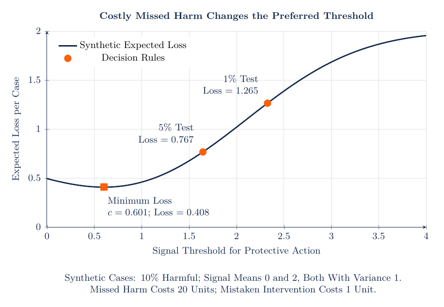

# Evidence Thresholds and the Costs of Error

A consumer-protection office must choose when a statistical signal should trigger a protective action. A strict threshold reduces unnecessary intervention and can leave more harmful cases untreated. The appropriate comparison depends on the consequences of both decisions.

## Synthetic Setup

Each observation is one hypothetical case. Ten percent of cases have the specified harm. Before the decision, the office observes a standardized signal $Z$. Harmless cases have $Z\sim N(0,1)$; harmful cases have $Z\sim N(2,1)$. These are two stipulated states, and the harmful signal shift is fixed at two standard deviations. The rule intervenes when $Z>c$, where $c$ is the threshold. No data from a firm or a research paper enter the calculation.

Correct decisions have zero loss. An unnecessary intervention creates loss $C_{FP}$ and a missed harmful case creates loss $C_{FN}$, in comparable illustrative units per case. The first scenario sets these losses to 1 and 20; the second reverses them. The signal distributions, case prevalence, and available actions remain fixed.

The normal distribution supplies exact error probabilities:

$$\alpha(c)=1-\Phi(c),\qquad \beta(c)=\Phi(c-2).$$

Here, $\Phi$ is the standard normal cumulative distribution function. The false-positive probability conditions on harmless cases; the false-negative probability conditions on harmful cases. The population expected loss is

$$R(c)=0.9\alpha(c)C_{FP}+0.1\beta(c)C_{FN}.$$

Differentiating this expression and equating its two weighted density terms gives the loss-minimizing threshold

$$c^*=1+\frac{1}{2}\log\left(\frac{0.9C_{FP}}{0.1C_{FN}}\right).$$

This solution uses the two normal states, positive costs, zero losses for correct decisions, and the specified prevalence. These conditions make the likelihood ratio increase with the signal, so a single threshold implements the optimum. Different states, residual harm after intervention, or costs of all actions require a revised loss model.

## Results

| Error Costs $(C_{FP},C_{FN})$ | Rule | False-Positive Probability | False-Negative Probability | Expected Loss per Case |
|---|---|---:|---:|---:|
| (1, 20) | One-percent test | 0.0100 | 0.6279 | 1.2648 |
| (1, 20) | Five-percent test | 0.0500 | 0.3612 | 0.7675 |
| (1, 20) | Minimum expected loss | 0.2740 | 0.0809 | 0.4083 |
| (20, 1) | One-percent test | 0.0100 | 0.6279 | 0.2428 |
| (20, 1) | Five-percent test | 0.0500 | 0.3612 | 0.9361 |
| (20, 1) | Minimum expected loss | 0.0002 | 0.9448 | 0.0974 |

When a missed harm costs twenty times an unnecessary intervention, the five-percent test has about 1.88 times the expected loss of the loss-minimizing rule. Reversing the cost ratio favors a much stricter threshold. These results establish that a significance convention alone does not determine a justified action. The assumed losses need their own substantive and moral defense.



The plotted population contains 10% harmful cases. The curve uses the first cost scenario and the two known normal distributions. Every point is an exact expected loss, rather than a sample estimate or confidence bound. The [underlying table](results/risk_curve.csv) supplies both error probabilities and both cost scenarios at each threshold. The [editable TikZ source](figures/error_costs.tex) uses Illinois blue and orange with distinct marker shapes.

## Posterior Probability and a P-Value

If $q$ denotes the posterior probability of harm under an explicit probability model, intervention has expected loss $(1-q)C_{FP}$ and inaction has expected loss $qC_{FN}$. The preferred action changes when $q>C_{FP}/(C_{FP}+C_{FN})$. With costs 1 and 20, that posterior threshold is $1/21$. A p-value is calculated conditional on the null and cannot be substituted for $q$. The program checks that the posterior odds implied by the synthetic normal model at $c^*$ equal the cost ratio.

## Interpretation and Practice

For a temporary, inexpensive safeguard, a high cost of missed harm may be defensible. A severe penalty requires accounting for much greater costs of mistaken attribution and the applicable legal standard. Neither a 27.4% false-positive rate nor the numerical cost ratio is a recommended enforcement rule. Both are consequences of the stated synthetic decision problem.

Change the prevalence, harmful signal shift, and the two costs separately. Explain whose losses each value represents and whether they are reversible. Then consider a person's serious objection that aggregate expected loss does not capture. The [philosophical guide](../../01_Resources/47_Evidence_Standards_and_Error_Costs/README.md) connects this comparison to inductive risk, contractualist reasoning, and institutional standards of evidence.

## Reproduction

Run from the repository root:

```bash
python3 03_Data_and_Code/Evidence_Standards/error_costs.py
```

Python 3.8 or later and its standard library are sufficient. No random draws, seed, network access, packages, or external datasets are required. Outputs are written beside the script under `results/`. `decision_rules.csv` has one row per scenario and rule; `risk_curve.csv` has one row per threshold; `summary.json` records assumptions and checks. Each error-rate denominator is its own underlying state population. Expected loss uses the full case population.

Executed on November 27, 2026. Probability symmetry, a boundary value, equal-cost symmetry, an independent dense-grid comparison, and posterior-odds agreement passed. The figure was compiled from the saved numerical tables and inspected for readability. The [verification record](VERIFICATION.md) lists artifact checks.

Python source: `03_Data_and_Code/Evidence_Standards/error_costs.py`

```python
"""Exact synthetic error probabilities and decision losses; standard library only."""

from csv import DictWriter
from math import isclose, log
from pathlib import Path
from statistics import NormalDist
import json


NORMAL = NormalDist()
PREVALENCE = 0.10
SIGNAL_SHIFT = 2.0
OUTPUT = Path(__file__).resolve().parent / "results"


def error_rates(cutoff, shift=SIGNAL_SHIFT):
    """Flag harm when Z > cutoff; Z is N(0,1) or N(shift,1)."""
    false_positive = NORMAL.cdf(-cutoff)
    false_negative = NORMAL.cdf(cutoff - shift)
    return false_positive, false_negative


def expected_loss(cutoff, false_positive_cost, false_negative_cost,
                  prevalence=PREVALENCE, shift=SIGNAL_SHIFT):
    alpha, beta = error_rates(cutoff, shift)
    return ((1 - prevalence) * alpha * false_positive_cost
            + prevalence * beta * false_negative_cost)


def optimal_cutoff(false_positive_cost, false_negative_cost,
                   prevalence=PREVALENCE, shift=SIGNAL_SHIFT):
    """Minimize loss for two normal states with equal variance and positive shift."""
    if not 0 < prevalence < 1 or shift <= 0:
        raise ValueError("Use a prevalence in (0,1) and a positive signal shift.")
    if min(false_positive_cost, false_negative_cost) <= 0:
        raise ValueError("Error costs must be positive.")
    odds = ((1 - prevalence) * false_positive_cost
            / (prevalence * false_negative_cost))
    return shift / 2 + log(odds) / shift


def write_csv(path, records):
    with path.open("w", newline="") as handle:
        writer = DictWriter(handle, fieldnames=list(records[0]))
        writer.writeheader()
        writer.writerows(records)


def verify_calculations():
    # Symmetry gives an independent benchmark at the midpoint of the signals.
    alpha, beta = error_rates(SIGNAL_SHIFT / 2)
    assert isclose(alpha, beta, abs_tol=1e-12)
    assert isclose(error_rates(0)[0], 0.5, abs_tol=1e-12)
    assert isclose(optimal_cutoff(1, 1, prevalence=0.5), 1.0)
    # Check the analytical optimum against a separately enumerated dense grid.
    grid = [i / 1000 for i in range(-1000, 6001)]
    for fp, fn in [(1, 20), (20, 1)]:
        optimum = optimal_cutoff(fp, fn)
        grid_optimum = min(grid, key=lambda c: expected_loss(c, fp, fn))
        assert abs(optimum - grid_optimum) <= 0.00051
        assert expected_loss(optimum, fp, fn) <= expected_loss(grid_optimum, fp, fn) + 1e-12
    # Posterior odds at the optimum equal the specified loss ratio.
    cutoff = optimal_cutoff(1, 20)
    posterior_odds = (PREVALENCE / (1 - PREVALENCE)
                      * NORMAL.pdf(cutoff - SIGNAL_SHIFT) / NORMAL.pdf(cutoff))
    assert isclose(posterior_odds, 1 / 20, rel_tol=1e-12)
    return "Passed: symmetry, probability boundary, equal-cost benchmark, grid optima, posterior odds."


def main():
    verification = verify_calculations()
    OUTPUT.mkdir(exist_ok=True)
    scenarios = [("Missed harm costs 20", 1.0, 20.0),
                 ("Mistaken intervention costs 20", 20.0, 1.0)]
    rows = []
    for scenario, fp, fn in scenarios:
        rules = [("One-percent test", NORMAL.inv_cdf(0.99)),
                 ("Five-percent test", NORMAL.inv_cdf(0.95)),
                 ("Minimum expected loss", optimal_cutoff(fp, fn))]
        for rule, cutoff in rules:
            alpha, beta = error_rates(cutoff)
            rows.append({
                "scenario": scenario, "rule": rule, "cutoff": cutoff,
                "prevalence": PREVALENCE, "signal_shift": SIGNAL_SHIFT,
                "false_positive_cost": fp, "false_negative_cost": fn,
                "false_positive_rate": alpha, "false_negative_rate": beta,
                "power": 1 - beta,
                "expected_loss": expected_loss(cutoff, fp, fn),
            })
    write_csv(OUTPUT / "decision_rules.csv", rows)
    write_csv(OUTPUT / "figure_points.csv", rows[:3])
    commands = {"PrevalencePercent": 100 * PREVALENCE, "SignalShift": SIGNAL_SHIFT}
    for prefix, row in zip(["One", "Five", "Optimal"], rows[:3]):
        commands[prefix + "Cutoff"] = row["cutoff"]
        commands[prefix + "Loss"] = row["expected_loss"]
    (OUTPUT / "figure_values.tex").write_text("\n".join(
        "\\newcommand{\\" + name + "}{" + f"{value:.12f}" + "}"
        for name, value in commands.items()) + "\n")
    curve = []
    for index in range(161):
        cutoff = index / 40
        alpha, beta = error_rates(cutoff)
        curve.append({
            "cutoff": cutoff, "false_positive_rate": alpha,
            "false_negative_rate": beta,
            "missed_harm_cost_20": expected_loss(cutoff, 1, 20),
            "mistaken_intervention_cost_20": expected_loss(cutoff, 20, 1),
        })
    write_csv(OUTPUT / "risk_curve.csv", curve)
    summary = {
        "data_status": "Synthetic known distributions; no estimated market effects.",
        "unit": "One hypothetical case before observing its signal.",
        "null": "No specified harm; Z ~ N(0,1).",
        "alternative": "Specified harm; Z ~ N(2,1).",
        "prevalence": PREVALENCE,
        "loss_units": "Illustrative comparable loss units per case.",
        "correct_decision_loss": 0,
        "verification": verification,
        "rules": rows,
    }
    (OUTPUT / "summary.json").write_text(json.dumps(summary, indent=2) + "\n")
    print(verification)
    for row in rows:
        print(f"{row['scenario']} | {row['rule']}: "
              f"alpha={row['false_positive_rate']:.4f}, "
              f"beta={row['false_negative_rate']:.4f}, "
              f"loss={row['expected_loss']:.4f}")


if __name__ == "__main__":
    main()
```
