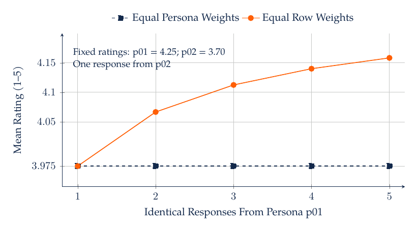

# Product-Screening Recommendation

By Nathan Yang

A product manager must decide which concepts warrant human research. All inputs below are invented. No model calls or customer study took place.

## Response Weights

The refill example has 3 response rows from 2 personas. Equal persona weights give 3.975; equal row weights give 4.066667 on a five-category rating scale.

Persona p01's first response has the following imposed category weights.

| Rating | Weight |
| --- | --- |
| 1 | 0.00 |
| 2 | 0.05 |
| 3 | 0.15 |
| 4 | 0.30 |
| 5 | 0.50 |

The expected rating is $\sum_{k=1}^{5}k p_k=4.25$.

## Concept Selection

A separate construction compares 6 invented concepts with an invented reference panel. The pooled pattern's shortlist is unresolved and its correlation is undefined. The reversed pattern selects F, E. Its recall of the reference top two (A, B) is 0%.

These patterns use reference outcomes in their construction. Their results justify checking ranking errors before funding a human study. They supply no evidence of actual purchase demand or out-of-sample performance.

An assumed research budget of \$500 and an assumed incentive of \$25 per participant allow 20 incentives before recruitment and operating costs. This arithmetic does not determine an adequate study size.

## Reproduction

[Numerical evidence](evidence.json) | [Full Python](../reproduce_recommendation.py) | [Data dictionary](../../Synthetic_Consumers/DATA_DICTIONARY.md)

[Response inputs](../../Synthetic_Consumers/data/anchor_responses.json) | [Concept inputs](../../Synthetic_Consumers/data/concept_panels.json)

From the course root: `python3 03_Data_and_Code/Reproducible_Recommendations/reproduce_recommendation.py`.
