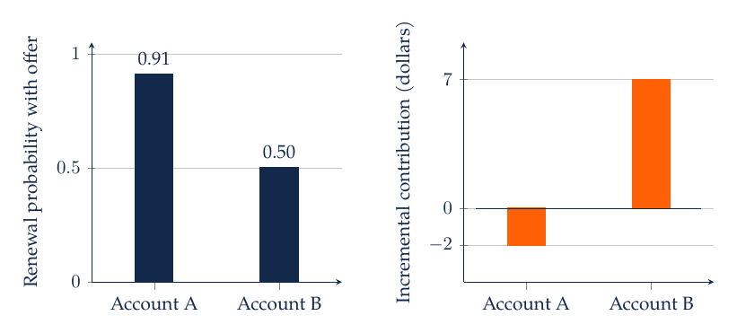
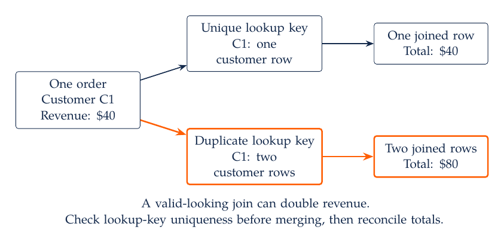
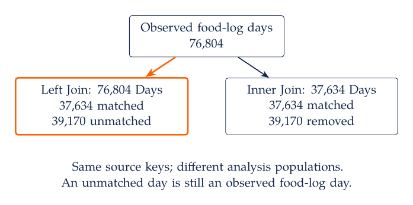

# M1. Marketing Decisions, Data, and AI-Assisted Python

A retailer must decide which customers should receive a coupon, how much inventory to place in each store, and which product descriptions should appear online. Each decision needs a different analytical object. A forecast of next week's purchases can inform inventory. A comparison of purchases with and without a coupon can inform targeting. A summary of product complaints can identify a service problem. An analysis becomes useful when its output corresponds to the decision the manager can actually change.

## 1.1 From a Marketing Question to an Analytical Object

Consider a subscription service deciding whether to offer a renewal discount. The service observes account tenure, past payments, recent use, and prior contacts. A descriptive analysis reports renewal rates by tenure. A predictive analysis estimates the probability that an account renews under the conditions represented in the training data. A causal analysis estimates how an offer changes renewal. A decision analysis combines that change with margins, contact costs, and operational constraints. These objects can use overlapping data while answering different questions.

The timing of the decision determines what information is available. If an account must be selected on Monday morning, a support call made on Wednesday cannot be a predictor for that selection. A variable can be strongly associated with an outcome and still be unusable at the decision time. Write down a forecast origin, an outcome window, and a feature window before constructing a table. An account-week table and an account-lifetime table support different forecasts because their rows and time horizons differ.

For a renewal offer, a useful decision quantity is incremental expected contribution:

$$
\Delta\pi_i=m_i\{p_i(1)-p_i(0)\}-c_i.
$$

Here $i$ identifies an account, $p_i(1)$ and $p_i(0)$ are its renewal probabilities with and without the offer, $m_i$ is contribution in dollars per retained account over the specified horizon, and $c_i$ is the expected incremental cost of making the offer. This compact expression assumes that the offer's costs can be summarized by $c_i$ and that $m_i$ already reflects relevant variable costs. When every renewing recipient receives a discount, discount expense depends on renewal under treatment and should be modeled explicitly.

The difference between the two renewal probabilities matters because many accounts would renew without assistance. Suppose contribution is $100 and contact cost is $3. Then an account whose renewal probability rises from 0.90 to 0.91 has incremental expected contribution of $-2. An account whose probability rises from 0.40 to 0.50 has contribution of $7. Ranking by treated renewal probability chooses the first account; ranking by incremental contribution chooses the second. Observing only treated customers would not reveal the untreated probabilities.



With contribution and contact cost held fixed, the first account's high baseline renewal probability reverses its ranking under incremental value. A response model and a targeting policy therefore need separate evaluation.

## 1.2 The Unit of Observation Determines the Calculation

A transaction system often stores one row per product line, while the marketing question concerns orders or customers. Suppose order O1 contains two product lines, O2 contains one, and O3 contains three. There are six rows, three orders, and perhaps only two customers. Counting rows as purchases would report six orders. Averaging customer attributes over product lines would give more weight to customers with larger baskets.

A key uniquely identifies the intended unit. At the line level, the key might be the combination of order ID and line number. At the order level, it is order ID. At the customer level, it is customer ID. A useful data contract states the key, allowed duplicates, measurement units, missing-value codes, and date conventions. It also states whether a negative quantity represents a return, whether a price includes tax, and whether canceled orders belong in the analysis.

For line $\ell$ in order $o$, gross line sales are quantity times unit price, $s_{o\ell}=q_{o\ell}p_{o\ell}$. Order sales are $S_o=\sum_\ell s_{o\ell}$, and customer-period sales are the sum across that customer's eligible orders during the period. These are identities once the population and variables have been defined. They do not require a behavioral assumption. The substantive choices enter through eligibility, returns, discounts, and the observation window.

Joining data can change the population or its weights. A many-to-one join from order lines to a customer table should add customer attributes without multiplying the original rows. If the customer table accidentally contains two records for a customer, every matching order line appears twice. A program can finish without an error while overstating sales. Verify the relationship between keys before joining, and compare row counts and totals afterward.



For a single $40 order, a customer lookup with two matching records produces two joined rows and an apparent $80 total. This error arises from the structure of the tables. Increasing the sophistication of the subsequent model cannot repair it.

## 1.3 Python Objects and Reproducible Calculations

Python stores individual values in objects such as integers, floating-point numbers, strings, and booleans. A list stores an ordered collection; a dictionary associates names with values. A function packages a calculation with explicit inputs and an output. These distinctions matter when an assistant supplies code: a column of numeric-looking strings does not behave like a numeric column, and an empty string does not automatically represent a missing value.

Suppose two orders contain three product lines. Multiplying quantity by unit price gives line sales; summing within each order gives order sales. Returning each calculation as a number allows its result to be checked and reused.

```python
lines = [
    {"order": "O1", "quantity": 2, "unit_price": 10.0},
    {"order": "O1", "quantity": 1, "unit_price": 5.0},
    {"order": "O2", "quantity": 3, "unit_price": 4.0},
]

def line_sales(line):
    return line["quantity"] * line["unit_price"]

order_sales = {}
for line in lines:
    key = line["order"]
    order_sales[key] = order_sales.get(key, 0.0) + line_sales(line)

assert order_sales == {"O1": 25.0, "O2": 12.0}
assert sum(order_sales.values()) == 37.0
```

The total is $37 across two orders, so average order value is $18.50. Dividing by the three product lines would instead give average line sales, $12.33. Neither denominator is inherently wrong; they describe different objects. The mistake would be assigning one calculation the other's interpretation.

A DataFrame provides a tabular interface for larger data. In pandas, selecting columns, filtering rows, creating variables, grouping observations, and joining tables are distinct operations. Use explicit intermediate names when those operations change the unit of observation. For example, `eligible_lines`, `orders`, and `customer_months` communicate more than repeatedly overwriting `df`. The [pandas tutorials](https://pandas.pydata.org/docs/getting_started/intro_tutorials/) provide syntax references; the analytical specification should determine which operations are needed.

Notebook execution order can hide dependencies. A cell may work because an earlier interactive command created a variable that is absent from the saved notebook. Before describing a notebook as reproducible, restart the kernel and run all cells in order. Store file paths relative to the project, record package versions, and distinguish source data from derived outputs. A random seed helps reproduce a simulation or split, but it does not guarantee identical results across every software version or computing platform.

## 1.4 Case Study: A Coupon Campaign Specification

A retailer has a monthly contact budget for 5,000 customers. The proposed campaign offers a discount on the next purchase. The manager initially asks for “a model to find our best customers.” That request leaves the action, outcome, and objective unresolved. The highest-spending customers may receive the offer without changing their behavior; customers likely to respond may buy products with low margins.

A usable specification would identify the decision date, eligible customer population, offer, evaluation horizon, and objective. One possibility is to maximize incremental contribution during the next 30 days, subject to the contact limit. Eligibility might require marketing consent and an active account. The analysis should define contribution after discounts, returns, fulfillment, and contact costs. It should identify which customer information existed before assignment and how untreated outcomes will be measured.

The initial dataset might include customer-level histories and a randomized pilot. Without such a pilot or another credible design, a response model can help describe or predict behavior, but the incremental contribution calculation remains unresolved. The next operational step may therefore be a randomized test, rather than immediate large-scale optimization.

A specification also needs acceptance criteria. The eligible-customer table must have one row per customer, no post-assignment features, and the intended date coverage. A campaign summary must reconcile assigned counts, contact costs, purchases, and contribution. These checks are small enough to state before asking an AI assistant to implement the analysis. They protect the meaning of the result while allowing flexibility in the code.

## 1.5 AI-Assisted Coding as a Sequence of Verifiable Steps

An effective coding request names the inputs, output, definitions, and checks. For the transaction example, ask for a function that accepts product-line records, validates required fields, aggregates sales by order, and returns both order totals and an exception report. Provide the three-line example and its expected $37 total. Ask the assistant to explain what happens with a return, a missing order ID, or a duplicated line.

Generate one analytical transformation at a time when the next step depends on a definition. Inspect the proposed code before executing it, especially commands that install software, delete files, upload data, or invoke an external API. Read error messages as evidence about the code's assumptions. A type error may reveal numeric values stored as strings; a merge error may reveal an incorrect key. Repairing the error without understanding its cause can preserve the underlying analytical mistake.

Verification should use both identities and meaningful counterexamples. Order totals must sum to the line total for the same eligible rows. A single known customer should produce a manually calculable summary. An empty input should have an explicit result. A missing customer lookup should not silently remove sales. These checks constrain what the implementation is allowed to do without forcing one particular coding style.

Keep a short record of consequential AI contributions: the task requested, important changes to the plan or code, and the checks performed. A saved conversation alone does not establish correctness. The record should make it possible to explain why a transformation was accepted.

## 1.6 Interpreting and Communicating a Result

A useful recommendation names the decision, states the relevant estimate with units and uncertainty, and explains how it changes the action. “The model has high accuracy” leaves the manager's decision unresolved. “At a $3 contact cost and the stated contribution assumptions, contact the customers with positive estimated incremental contribution, subject to capacity” connects the analysis to the objective. The recommendation still needs evidence about how the probabilities were estimated and whether the policy was evaluated on new customers or periods.

Results should distinguish observation from assumption. A transaction total is calculated from recorded eligible rows. A renewal probability is an estimate. A contribution margin may be supplied by finance. An untreated outcome for an offered customer is counterfactual. Listing these roles prevents a spreadsheet or notebook from giving every input the appearance of equal certainty.

If one customer places four orders and another places one, an order-weighted mean gives the first customer four times the weight. If both customers should count equally, calculate each customer's mean first. If an AI-generated program reports six purchases from six product lines, inspect whether purchase was defined as a line or an order. If an offer has a high response rate, ask for the response rate under no offer before interpreting the response as an effect.

## 1.7 Readings

The [Python marketing research companion repository](https://github.com/python-marketing-research/python-marketing-research-1ed) provides examples tied to marketing applications. Its notebooks are reference material and require inspection of dependencies and data paths before adaptation. The [pandas tutorials](https://pandas.pydata.org/docs/getting_started/intro_tutorials/) support tabular implementation.

## 1.8 mHealth: From Food Entries to a Decision Table

An mHealth product manager must decide which food categories to suggest when a customer returns to the app. Recent logs reveal repeated categories, variation across days, and gaps in observation. The immediate analytical task is to construct a reliable customer history. A recommendation based on duplicated daily totals or an accidental change in the customer population can look precise while describing the wrong behavior.

The released files contain actual 2016 records. User identifiers have been replaced, birthdays have been replaced with age on January 1, 2016, and weight fields contain documented random perturbations. The food file has 13,874,280 entries from 5,908 users. The separate daily file covers a smaller set of users and dates. Food categories, descriptions, and calorie fields retain their source values, apart from standardizing provider references to mHealth. The [data dictionary](../../03_Data_and_Code/mHealth/DATA_DICTIONARY.md) defines the available fields and unresolved coding conventions. In particular, `Weightchange`, `Goalplan`, and `Gender` have undocumented code meanings. None establishes a treatment, a behavioral goal, or a validated sex variable for an energy equation.

The working cohort retains every entry for users whose first four hexadecimal pseudonym digits have a value below 4,096. This fixed rule reduces memory requirements and preserves within-user histories. Its realized sample contains 917,153 entries, 370 users, and 76,804 observed user-days. Ages at the reference date range from 17 to 76. The cohort is a subset of app users who appear in the released file; it is not a representative population sample. The adult nutrition sensitivity analysis in M2 uses a separate age restriction.

A food-entry row records an item, while `Foodcalories` repeats the source daily total. On the first eligible user-day selected by the code below, five entries on July 4 have item calories summing to 1,132.7852. Each row repeats a daily total of 1,132.79. Summing that repeated field gives 5,663.95, exactly five times the reported daily total. The small difference between the item sum and one copy of the daily total is compatible with rounding in this case. Larger discrepancies elsewhere require investigation.

The daily key is `(Userid, date)`. A left join preserves all 76,804 cohort days, with 37,634 matched days and 39,170 unmatched days in the separate daily file. Replacing it with an inner join would remove more than half the cohort days. An unmatched row is therefore a sample-definition decision, even if the software reports no error.



The two branches retain the same matched records. Only the left-join branch preserves the unmatched days needed to describe the food-log cohort. Neither branch supplies unobserved calendar days.

### 1.8.1 Loading Data and Constructing Daily Measures

Use Python 3.13 with NumPy 2.1.3, pandas 2.2.3, PyArrow 19.0.0, SciPy 1.15.3, scikit-learn 1.6.1, and statsmodels 0.14.4 to reproduce the saved calculations. From the repository root, install the pinned packages into an environment, verify the release files, and run the analyses in dependency order:

```sh
python -m pip install -r 03_Data_and_Code/mHealth/recurring_examples/requirements.txt
python 03_Data_and_Code/mHealth/download_data.py
python 03_Data_and_Code/mHealth/recurring_examples/run_all.py
```

The downloader checks the published SHA-256 hashes. The first run reads the compressed food file in chunks and saves a local Parquet cache; subsequent runs reuse it. The cache is excluded from Git. Delete the `recurring_examples/cache` directory to force a fresh derivation. `common.py` supplies the same sample and measurement functions to every module. Paths are relative to the script location, so the saved programs can also be run from another working directory.

For each observed day, category breadth counts distinct recorded categories, assigning missing labels to `Unclassified`. Calorie-share variety uses the sum of included item calories as its denominator. A negative or missing item calorie value invalidates that day's share calculation; a nonpositive item sum also makes shares undefined. These conditions affect calorie-based variety, while the day's existence can still be used to measure logging. The first reported daily total is retained only after checking that its nonmissing values agree within the day.

Python source: [common.py](../../03_Data_and_Code/mHealth/recurring_examples/common.py). From its directory, run `python common.py`.

```python
"""Shared input and measurement functions for the eight mHealth examples."""

from pathlib import Path
import hashlib
import json

import numpy as np
import pandas as pd

ROOT = Path(__file__).resolve().parent
DATA = ROOT.parent / "data"
CACHE = ROOT / "cache"
OUTPUT = ROOT / "results"
SEED = 534
COHORT_THRESHOLD = 4096


def save_result(module, result):
    OUTPUT.mkdir(exist_ok=True)
    (OUTPUT / f"{module}.json").write_text(
        json.dumps(result, indent=2, allow_nan=False) + "\n"
    )


def load_food():
    """Keep all rows for users whose first four pseudonym hex digits are <4096."""
    CACHE.mkdir(exist_ok=True)
    cached = CACHE / "food.parquet"
    metadata = CACHE / "source.json"
    manifest = json.loads((ROOT.parent / "manifest.json").read_text())
    signature = {
        "sha256": manifest["files"]["food_entries.csv.gz"]["sha256"],
        "threshold": COHORT_THRESHOLD,
        "preparation_version": 2,
    }
    if (
        cached.exists()
        and metadata.exists()
        and json.loads(metadata.read_text()) == signature
    ):
        return pd.read_parquet(cached)
    columns = [
        "Userid",
        "Fancydate",
        "Name",
        "Category",
        "Calories",
        "Foodcalories",
        "Budgetcalories",
        "Age_at_2016_01_01",
    ]
    parts = []
    for chunk in pd.read_csv(
        DATA / "food_entries.csv.gz", usecols=columns, chunksize=250000
    ):
        code = chunk.Userid.str.slice(1, 5).map(lambda value: int(value, 16))
        parts.append(chunk.loc[code < COHORT_THRESHOLD].copy())
    food = pd.concat(parts, ignore_index=True)
    food["date"] = pd.to_datetime(food.Fancydate)
    food["category"] = food.Category.fillna("Unclassified")
    food["description"] = (
        food.Name.fillna("")
        .str.casefold()
        .str.replace(r"\s+", " ", regex=True)
        .str.strip()
    )
    food.to_parquet(cached, index=False)
    metadata.write_text(json.dumps(signature, indent=2) + "\n")
    return food


def make_daily(food):
    """One row per observed user-day; missing calendar days are not created."""
    keys = ["Userid", "date"]
    grouped = food.groupby(keys, observed=True)
    daily = grouped.agg(
        entries=("Calories", "size"),
        category_count=("category", "nunique"),
        item_calories=("Calories", "sum"),
        food_calories=("Foodcalories", "first"),
        budget_calories=("Budgetcalories", "first"),
        daily_total_versions=("Foodcalories", "nunique"),
        budget_versions=("Budgetcalories", "nunique"),
    )
    daily.loc[daily.daily_total_versions != 1, "food_calories"] = np.nan
    daily.loc[daily.budget_versions != 1, "budget_calories"] = np.nan
    invalid = food.Calories.isna() | food.Calories.lt(0)
    daily["invalid_item_calories"] = invalid.groupby([food.Userid, food.date]).sum()
    categories = food.groupby(keys + ["category"], observed=True).Calories.sum()
    category_totals = categories.groupby(level=keys).transform("sum")
    concentration = (
        (categories / category_totals.where(category_totals > 0))
        .pow(2)
        .groupby(level=keys)
        .sum(min_count=1)
    )
    daily["variety"] = (1 - concentration).where(
        (daily.item_calories > 0) & (daily.invalid_item_calories == 0)
    )
    daily = daily.reset_index().sort_values(keys).reset_index(drop=True)
    assert not daily.duplicated(keys).any()
    assert daily.variety.dropna().between(-1e-10, 1 + 1e-10).all()
    return daily


def make_baskets(food):
    """Distinct observed categories; the missing-category label is not a candidate."""
    selected = food.loc[
        food.category != "Unclassified", ["Userid", "date", "category"]
    ].drop_duplicates()
    return (
        selected.groupby(["Userid", "date"], observed=True)
        .category.agg(lambda values: tuple(sorted(values)))
        .reset_index(name="basket")
    )


def description_holdout(text):
    """A fixed description-level split independent of labels or outcomes."""
    return int(hashlib.sha256(text.encode()).hexdigest()[:8], 16) % 5 == 0


def load_inputs():
    food = load_food()
    return food, make_daily(food), make_baskets(food)


if __name__ == "__main__":
    food, daily, baskets = load_inputs()
    daily.to_parquet(CACHE / "daily.parquet", index=False)
    baskets.to_parquet(CACHE / "baskets.parquet", index=False)
    result = {
        "rows": len(food),
        "users": int(food.Userid.nunique()),
        "user_days": len(daily),
        "categories": int(food.category.nunique()),
        "missing_category_rows": int(food.Category.isna().sum()),
        "invalid_item_calorie_rows": int(
            (food.Calories.isna() | food.Calories.lt(0)).sum()
        ),
        "days_with_inconsistent_daily_total": int(
            daily.daily_total_versions.ne(1).sum()
        ),
        "days_with_inconsistent_budget": int(daily.budget_versions.ne(1).sum()),
        "nonpositive_recorded_daily_totals": int(daily.food_calories.le(0).sum()),
        "variety_eligible_days": int(daily.variety.notna().sum()),
        "item_total_matches_recorded_total_within_one": int(
            (daily.item_calories - daily.food_calories).abs().le(1).sum()
        ),
    }
    save_result("cohort", result)
    print(json.dumps(result, indent=2))
```

### 1.8.2 Join Validation and a Hand-Checkable Day

The join declares a one-to-one relationship and records unmatched keys. The small day-level example checks both candidate aggregations against the repeated total. Keeping these checks beside the join prevents a later model from silently inheriting a different denominator.

Python source: [m01.py](../../03_Data_and_Code/mHealth/recurring_examples/m01.py). From its directory, run `python m01.py`.

```python
"""Audit the cohort, repeated totals, and the separate daily file."""

import json
import pandas as pd
from common import DATA, load_inputs, save_result

food, daily, baskets = load_inputs()
other = pd.read_csv(DATA / "daily_records.csv.gz", usecols=["Userid", "Fancydate"])
other["date"] = pd.to_datetime(other.Fancydate)
assert not other.duplicated(["Userid", "date"]).any()
joined = daily.merge(
    other[["Userid", "date"]],
    how="left",
    on=["Userid", "date"],
    validate="one_to_one",
    indicator=True,
)
assert len(joined) == len(daily)
example = daily.loc[(daily.entries.between(3, 6)) & daily.food_calories.gt(0)].iloc[0]
rows = food.loc[food.Userid.eq(example.Userid) & food.date.eq(example.date)]
result = {
    "rows": len(food),
    "users": int(food.Userid.nunique()),
    "days": len(daily),
    "matched_days": int(joined._merge.eq("both").sum()),
    "unmatched_days": int(joined._merge.eq("left_only").sum()),
    "example_date": str(example.date.date()),
    "example_entries": len(rows),
    "example_item_sum": float(rows.Calories.sum()),
    "example_daily_total": float(example.food_calories),
    "example_wrong_sum": float(rows.Foodcalories.sum()),
}
save_result("M01", result)
print(json.dumps(result, indent=2))
```

### 1.8.3 Data Cleaning as a Sequence of Decisions

Structural checks stop calculations that violate their stated observation unit. A duplicate key in a daily lookup can multiply food records, so it must be resolved before joining. Review flags serve a different purpose: they identify observations whose meaning needs investigation. The cohort contains 52,838 rows equal on the selected fields of user, day, normalized description, category, and calories. Those fields omit event timestamps and meal identifiers. Repeated servings can therefore produce equal rows. Automatically dropping them would impose an unsupported definition of duplication.

The audit finds 206 food rows with missing categories, one negative item calorie value, and 23 days with a nonpositive sum of item calories. The calorie-share calculation consequently excludes 24 days. By contrast, 319 days have a nonpositive reported daily total. These counts differ because the item sum and reported total are separate measurements. Their discrepancy exceeds one calorie unit on 23,729 days. These flags can overlap and must not be added as if they represented disjoint exclusions.

A value outside a chosen review range is evidence for inspection, not proof of an error. The reported daily calorie median is 1,475.63, and the range is 0 to 9,190. A review flag below 100 or above 5,000 marks 651 days. Those thresholds are imposed sensitivity choices. They do not establish nutritional adequacy or identify incorrect reports. Preserve the released values, add flags, document the rule for each analysis, and report the resulting sample. M2 compares nutrition-informed alternatives; M3 repeats a regression after a stated restriction.

A useful AI coding request is: “Create separate structural checks and review flags. Stop on a duplicate daily key, preserve repeated food entries, count overlapping flags separately, and return the retained sample for each calculation.” Verify the proposed implementation with a two-entry day whose repeated total is 100 and whose calorie shares are 0.9 and 0.1. It must produce a daily total of 100 and variety of 0.18. A gap from January 1 to January 3 must remain a missing January 2 observation. The executable counterexamples are in `test_logic.py`.

Python source: [audit.py](../../03_Data_and_Code/mHealth/recurring_examples/audit.py). From its directory, run `python audit.py`.

```python
"""Separate structural failures, review flags, and analysis-specific exclusions."""

import json
import numpy as np
import pandas as pd
from common import DATA, load_inputs, save_result


def require_unique(frame, keys):
    if frame[keys].isna().any().any():
        raise ValueError("Missing join key")
    if frame.duplicated(keys).any():
        raise ValueError("Duplicate key at the declared observation unit")


def daily_flags(daily):
    flags = pd.DataFrame(index=daily.index)
    flags["invalid_item"] = daily.invalid_item_calories.gt(0)
    flags["nonpositive_item_sum"] = daily.item_calories.le(0)
    flags["nonpositive_daily_total"] = daily.food_calories.le(0)
    flags["missing_daily_total"] = daily.food_calories.isna()
    flags["total_discrepancy_over_one"] = (
        (daily.food_calories - daily.item_calories).abs().gt(1)
    )
    flags["daily_total_below_100_or_above_5000"] = daily.food_calories.lt(
        100
    ) | daily.food_calories.gt(5000)
    return flags


def run_audit():
    food, daily, baskets = load_inputs()
    assert food.Userid.notna().all() and food.date.notna().all()
    assert food.date.between("2016-01-01", "2016-12-31").all()
    require_unique(daily, ["Userid", "date"])
    # Repeated entries can be legitimate. Flag equality on these fields without deletion.
    fields = ["Userid", "date", "description", "category", "Calories"]
    duplicate_flags = food.duplicated(fields, keep=False)
    flags = daily_flags(daily)
    health = pd.read_csv(
        DATA / "daily_records.csv.gz",
        usecols=["Userid", "Fancydate", "Age_at_2016_01_01", "Currentweight"],
    )
    health = health.loc[health.Userid.isin(food.Userid.unique())]
    require_unique(health, ["Userid", "Fancydate"])
    age_versions = health.groupby("Userid").Age_at_2016_01_01.nunique(dropna=False)
    assert age_versions.eq(1).all()
    result = {
        "food_rows": len(food),
        "daily_rows": len(daily),
        "missing_category_rows": int(food.Category.isna().sum()),
        "rows_equal_on_selected_entry_fields": int(duplicate_flags.sum()),
        "missing_item_calorie_rows": int(food.Calories.isna().sum()),
        "negative_item_calorie_rows": int(food.Calories.lt(0).sum()),
        "flags_by_user_day": {key: int(value) for key, value in flags.sum().items()},
        "recorded_calorie_quantiles": {
            str(q): float(value)
            for q, value in daily.food_calories.quantile(
                [0, 0.01, 0.5, 0.99, 1]
            ).items()
        },
        "matched_daily_file_rows": len(health),
        "fixed_age_min": int(health.Age_at_2016_01_01.min()),
        "fixed_age_max": int(health.Age_at_2016_01_01.max()),
        "nonpositive_weight_rows": int(health.Currentweight.le(0).sum()),
    }
    save_result("audit", result)
    print(json.dumps(result, indent=2))


if __name__ == "__main__":
    run_audit()
```

## 1.9 Python Calculations for the Synthetic Cases

The inputs below are imposed teaching values. Running the program creates the labeled synthetic CSV files and prints the corresponding calculations. They are separate from the mHealth estimates. Keep the script beside `example_helpers.py` in `03_Data_and_Code/Lecture_Examples`.

Python source: [example_helpers.py](../../03_Data_and_Code/Lecture_Examples/example_helpers.py). From its directory, run `python example_helpers.py`.

```python
"""File output and arithmetic helpers for synthetic lecture examples."""

import csv
import itertools
import json
import math
from pathlib import Path

ROOT = Path(__file__).resolve().parent


def write_csv(name, fields, rows):
    with (ROOT / name).open("w", newline="", encoding="utf-8") as f:
        out = csv.writer(f)
        out.writerow(fields)
        out.writerows(rows)


def ols_slope(points):
    xbar = sum(x for x, y in points) / len(points)
    ybar = sum(y for x, y in points) / len(points)
    slope = sum((x - xbar) * (y - ybar) for x, y in points) / sum(
        (x - xbar) ** 2 for x, y in points
    )
    return {"intercept": ybar - slope * xbar, "slope": slope}


def shares(utilities):
    weights = {key: math.exp(val) for key, val in utilities.items()}
    return {key: weight / sum(weights.values()) for key, weight in weights.items()}
```

Python source: [m01_synthetic.py](../../03_Data_and_Code/Lecture_Examples/m01_synthetic.py). From its directory, run `python m01_synthetic.py`.

```python
"""Synthetic numerical examples for M1; run from any working directory."""

import itertools
import json
import math
from example_helpers import write_csv, ols_slope, shares

r = {}
lines = [("O1", "C1", 2, 10), ("O1", "C1", 1, 5), ("O2", "C2", 3, 4)]
write_csv(
    "M01_order_lines_synthetic.csv",
    ["order_id", "customer_id", "quantity", "unit_price_dollars"],
    lines,
)
orders = {}
for order, customer, qty, price in lines:
    orders[order] = orders.get(order, 0) + qty * price
r["M01"] = {
    "revenue": sum(orders.values()),
    "order_count": len(orders),
    "average_order_value": sum(orders.values()) / len(orders),
    "average_line_revenue": sum(orders.values()) / len(lines),
    "renewal_incremental_value_A": 100 * (0.91 - 0.90) - 3,
    "renewal_incremental_value_B": 100 * (0.50 - 0.40) - 3,
}
assert orders == {"O1": 25, "O2": 12}
print(json.dumps(r, indent=2))
```

## 1.10 mHealth: An Auditable Monthly Business Review

An mHealth manager needs to decide whether a decline in food entries warrants attention to customer engagement. Entry counts combine the number of eligible customers, the length of the reporting month, the frequency of logging, and the intensity of logging on observed days. A decline can arise from any of these components. The comparison becomes interpretable when the eligible population is fixed before the reporting periods and every component has an explicit denominator.

Define the population as users in the teaching cohort with at least one observed day before May 1, 2016. All members remain in the May and June denominators, including those with no logs in a month. A missing day contributes zero to the indicator for an observed log; its food consumption remains unobserved. For month $t$, the number of entries satisfies the accounting identity

$$
L_t=N D_t p_t a_t,
$$

where $N$ is the fixed number of eligible users, $D_t$ is calendar days in the month, $p_t$ is observed user-days divided by $ND_t$, and $a_t$ is entries per observed user-day. The identity separates calendar exposure from logging behavior. It uses counts of records, with no assumption that an entry represents a purchase or a complete meal.

| Quantity | May | June |
| --- | ---: | ---: |
| Eligible Users | 340 | 340 |
| Calendar User-Days | 10,540 | 10,200 |
| Observed User-Days | 7,082 | 6,331 |
| Observed Logging Fraction | 0.6719 | 0.6207 |
| Entries per Observed Day | 11.7995 | 11.6910 |
| Food Entries | 83,564 | 74,016 |

The table identifies a 5.12 percentage-point decline in the logging fraction, alongside a shorter month and a modest decline in entries per observed day. Changing the denominator to users who happened to log during June would remove inactive members from the comparison. The fixed-population result supports investigation of engagement, recording practices, and seasonality. It supplies no estimate of a campaign effect or change in nutrition.

An AI-assisted business review should retrieve numerical claims from a computed evidence file. The file below records the source checksum, membership rule, observation unit, month, numerator, and denominator. A useful coding request is: “Construct the fixed cohort before May, count distinct user-dates, retain members with zero logs, and verify the accounting identity separately for each month.” The independent calculation must finish before an assistant writes the managerial explanation.

The [claude-ecom reference](https://github.com/takechanman1228/claude-ecom) separates numerical computation from a narrative layer for ecommerce reviews. The mHealth calculation applies that separation to logging data. Its descriptive evidence file also supplies the structured-claim checks in M8.

Python source: [reporting.py](../../03_Data_and_Code/mHealth/recurring_examples/reporting.py). From its directory, run `python reporting.py`.

```python
"""Compute an auditable, fixed-cohort mHealth business review locally."""

import json
import pandas as pd
from common import ROOT, load_food, save_result


def monthly_review(food):
    # Fix membership before either reporting month; retain zero-log users.
    members = sorted(food.loc[food.date < "2016-05-01", "Userid"].unique())
    rows = []
    for month in ["2016-05", "2016-06"]:
        period = pd.Period(month, freq="M")
        part = food.loc[
            food.Userid.isin(members) & food.date.dt.to_period("M").eq(period)
        ]
        days = part[["Userid", "date"]].drop_duplicates()
        denominator = len(members) * period.days_in_month
        assert len(days) <= denominator
        rows.append(
            {
                "period": month,
                "eligible_users": len(members),
                "calendar_user_days": denominator,
                "observed_user_days": len(days),
                "users_with_logs": int(days.Userid.nunique()),
                "food_entries": len(part),
                "logging_fraction": len(days) / denominator,
                "entries_per_observed_day": len(part) / len(days),
            }
        )
    manifest = json.loads((ROOT.parent / "manifest.json").read_text())
    return {
        "source_sha256": manifest["files"]["food_entries.csv.gz"]["sha256"],
        "membership": "At least one observed day before 2016-05-01",
        "unit": "eligible user-calendar-day",
        "metric": "logging_fraction",
        "interpretation": "descriptive",
        "periods": rows,
    }


if __name__ == "__main__":
    result = monthly_review(load_food())
    save_result("reporting", result)
    print(json.dumps(result, indent=2))
```
