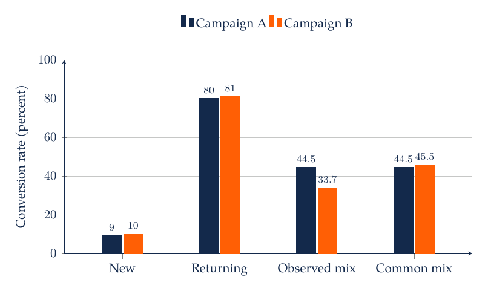
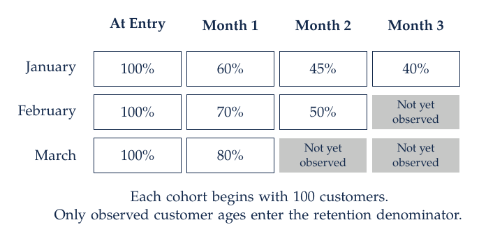

# M2. Customer Data, Measurement, and Visualization

A grocery retailer sees larger online baskets and asks whether moving customers to its app will raise sales. The raw comparison combines the shopping channel with who uses it, why they shop, and which trips are observed. A household may order online for a planned weekly restock and visit a store for a forgotten ingredient. Measurement and visualization determine whether the analysis reveals that distinction or conceals it.

## 2.1 Define the Population Before the Metric

A customer dataset is a record of an observation process. Loyalty accounts exclude unidentified shoppers. Online logs record sessions that may contain repeated visits by the same person. Orders exclude browsing without purchase. App events reflect tracking rules, consent, device settings, and instrumentation changes. Before calculating a metric, identify the target population and the mechanism by which its members enter the table.

Suppose monthly revenue per customer is intended to describe all eligible accounts. Dividing total revenue by purchasing accounts produces revenue per purchasing account. If inactivity changes, that measure can increase while revenue per eligible account falls. The denominator should therefore be written into the metric name or its definition. For customer acquisition cost, specify whether the denominator is new registered accounts, first-time purchasers, or customers with positive contribution over a defined horizon.

A conversion rate requires an eligible exposure count. If $b$ eligible sessions produce at least one purchase among $n$ eligible sessions, session conversion is $b/n$. Customer conversion instead uses customers in both numerator and denominator. A customer with ten sessions should not receive ten times the weight in a customer-level rate. When the same customer contributes repeated observations, statistical uncertainty must also account for that dependence.

Returns require a substantive rule. Gross sales, net sales after returns, and contribution after variable costs answer different questions. A comparison that deducts online returns but observes only gross offline sales mixes measurement rules. Currency, tax, fulfillment fees, and discounts should be aligned across channels before interpreting differences.

## 2.2 Build a Customer Table Without Losing Customers

Begin with a customer roster that defines eligibility. Aggregate eligible transactions to customer-period totals, then left-join those totals to the roster. A customer with no transactions can receive zero sales if the transaction system fully captures activity during the observation period. Zero should not replace a value that is missing because the customer was unobserved or the data feed failed.

A join should have a documented relationship: one-to-one, many-to-one, or one-to-many. Validate key uniqueness in the lookup table and inspect unmatched records. A match rate of 99% can still conceal a material problem if the unmatched 1% contains the highest-value customers or one entire channel. Report both counts and relevant value totals for unmatched observations.

Dates need similar attention. Convert timestamps to a consistent timezone before assigning day or week. Determine whether the date represents ordering, shipment, payment, or return. A promotion announced late in a period may affect orders immediately but recognized revenue later. Aligning metrics on an inappropriate date can create an apparent lag that comes from accounting rather than customer behavior.

Outliers should be investigated before removal. A $10,000 order could be a business customer, a data-entry error, or a legitimate event. A rule that trims all orders above a percentile changes the estimand to a restricted population. State that restriction and compare conclusions with and without the rule when it can affect the decision. Robust summaries such as medians and quantiles often reveal more than one mean with an undocumented exclusion.

## 2.3 Case Study: A Reversal Caused by Customer Mix

A marketing manager compares campaigns A and B using conversion. Both campaigns reach new and returning customers, but their audience composition differs. Assume the following customer counts and outcomes, with each customer belonging to one segment and appearing once.

| Campaign | New Customers | New Conversions | Returning Customers | Returning Conversions | Overall Conversion |
| --- | ---: | ---: | ---: | ---: | ---: |
| A | 100 | 9 | 100 | 80 | 89/200 = 44.5% |
| B | 200 | 20 | 100 | 81 | 101/300 = 33.7% |

Campaign B has higher conversion among new customers, 10% versus 9%, and among returning customers, 81% versus 80%. Campaign A nevertheless has the higher aggregate rate because half its audience consists of returning customers, compared with one-third for B. Returning customers convert much more frequently in both campaigns.

The aggregate rate is a weighted average of segment rates:

$$
\bar p_j=\sum_g w_{jg}p_{jg},\qquad \sum_g w_{jg}=1.
$$

Here $j$ indexes campaigns, $g$ indexes customer segments, $p_{jg}$ is the conversion fraction within a segment, and $w_{jg}$ is that segment's share of the campaign audience. The weights are part of the comparison. Holding them at 50% new and 50% returning gives standardized rates of 44.5% for A and 45.5% for B. This adjustment describes performance for the chosen common mix. It establishes a causal campaign effect only if the design supports that interpretation.

B's small advantages within both segments coexist with A's aggregate advantage. A manager deciding where to send the next campaign needs to specify the future audience mix and whether customers were assigned comparably. An aggregate bar chart alone cannot answer that question.

## 2.4 Cohorts, Retention, and Customer Age

A cohort groups customers by a common starting event, such as first purchase or subscription activation. Retention at customer age $k$ is the fraction of the original eligible cohort meeting a stated activity criterion at that age. A cohort table separates calendar time from customer age: an October signup observed one month later is not comparable with an April signup observed seven months later unless the question explicitly concerns those different ages.

For cohort $c$, define $N_c$ as the number of eligible customers at entry and $A_{c,k}$ as the number active at age $k$. The descriptive retention rate is $R_{c,k}=A_{c,k}/N_c$. A later cohort may not yet have reached age $k$; that cell is unobserved, not zero. Omitting inactive customers from the denominator would turn retention into a different conditional measure.

| Signup Cohort | Entry Customers | Active at Month 1 | Active at Month 2 | Active at Month 3 |
| --- | ---: | ---: | ---: | ---: |
| January | 100 | 60 | 45 | 40 |
| February | 100 | 70 | 50 | Not yet observed |
| March | 100 | 80 | Not yet observed | Not yet observed |

Month-one retention rises from 60% for the January cohort to 80% for the March cohort. March customers have not yet reached the later observation windows, so their long-run retention remains unobserved. Comparing March's month one with January's month three would combine cohort quality with customer age. The right comparison depends on whether the decision concerns onboarding, long-term value, or a calendar-time change affecting all existing customers.

Unobserved future periods require forecasts from an explicit model. Coding those periods as zero would treat unavailable outcomes as observed failures and bias retention downward.

## 2.5 Visual Encodings Should Match the Question

Use position on a common scale when precise comparison matters. A dot plot can compare segment conversion rates more clearly than area-sized bubbles. A line chart is appropriate when the ordering of time is meaningful. A histogram or empirical cumulative distribution reveals skewness that a mean hides. A scatterplot supports examination of a relationship, with transparency or aggregation when observations overlap.

The scale changes the interpretation. A logarithmic sales axis emphasizes proportional differences; a linear axis emphasizes dollar differences. A truncated bar-chart axis exaggerates differences because bar length encodes magnitude from its baseline. A carefully labeled narrow axis can be useful for a line or dot plot when the scientific question concerns small differences. The choice should preserve the intended comparison and disclose the scale.

Uncertainty should be shown for an estimated comparison when it affects a decision. For an independent Bernoulli sample, a common large-sample standard error for a proportion is $\sqrt{\hat p(1-\hat p)/n}$. Near zero or one, or with small samples, use an interval appropriate to binomial data. With repeated observations per customer, treating every session as independent generally understates uncertainty. Resample or cluster at the unit that captures the relevant dependence.

Color can encode categories or highlight the comparison that matters. Use line styles, markers, and labels alongside color, and keep small text dark enough for contrast. A figure should remain interpretable when printed in grayscale or described to a student who cannot see it. Explain the axes, units, sample, and principal comparison in its caption or accompanying text.

## 2.6 Case Study: Online Grocery Baskets and Repeated Purchases

Chintala, Liaukonytė, and Yang's [grocery-shopping study](https://doi.org/10.1287/mksc.2022.0292) compares online and offline baskets using household shopping records. It studies basket composition and repeated purchasing, with attention to differences in shopping-trip types. Larger baskets need not contain a wider range of categories, and a household's choice of channel can be related to the purpose of its trip.

Suppose one household buys the sets {milk, bread, apples, yogurt} and {milk, bread, apples, coffee} on successive trips. Each basket contains four distinct items. Their Jaccard similarity is

$$
J(A,B)=\frac{|A\cap B|}{|A\cup B|}=\frac{3}{5}=0.60.
$$

The numerator counts shared distinct items and the denominator counts all distinct items appearing in either trip. A different pair of four-item baskets with one shared item has similarity $1/7\approx0.143$. Basket size is identical in the two examples, while repeated purchasing differs substantially. Whether quantities or spending weights should enter the measure depends on the decision; set-based Jaccard treats one unit and ten units of an item alike.

A defensible descriptive study would define eligible grocery trips, compare channels within households when appropriate, and examine basket size, distinct categories, repeat-item overlap, and spending. It would inspect whether findings are driven by large restocking trips, small convenience trips, or particular retailers. Channel labels should not silently determine the definition of a “typical” trip when the objective is a comparable classification. Clustering can classify trips using their observed composition.

A retail recommendation might distinguish discovery from replenishment. High repetition can support convenient reordering while making it harder for unfamiliar products to receive attention. A proposed interface change should therefore specify both the desired outcome and the possible tradeoff. Its effect requires evaluation under an appropriate design, even when the descriptive pattern provides a strong reason to test it.

## 2.7 From Evidence to a Management Presentation

The Pyramid Principle organizes a recommendation around a decision-relevant answer, followed by a small number of supporting reasons and the evidence for each reason. This structure works when the answer's strength matches the analysis. A descriptive study might recommend a test or a closer diagnostic comparison, rather than immediate deployment.

For the campaign example, a clear opening is: “Compare the campaigns at a common customer mix before reallocating the budget.” The supporting reasons are that returning customers convert more often, the campaigns reached different mixes, and the within-segment ranking differs from the aggregate ranking. The supporting evidence should quantify each reason and connect it to the allocation decision.

An effective chart title can state the comparison, such as “Campaign A's aggregate advantage reflects its returning-customer share.” The caption should define the conversion denominator and identify the data as synthetic.

## 2.8 AI-Assisted Workflow and Practice

Ask an assistant to construct a customer-period table from a specified roster and transaction table, preserving customers with no observed purchases. Require a join audit, a missing-data report, and a reconciliation of total sales. Next ask it to calculate the campaign table above and standardized rates under a 50/50 audience mix. Verify those small numbers before applying the same functions to a larger file.

For a chart request, specify the question, observation unit, axis units, ordering, and uncertainty representation. Ask the assistant to describe what visual pattern would change the recommendation. Compare its description with the plotted data. If it labels an observational channel difference as an effect, revise the interpretation and identify the design that would be needed to support the stronger claim.

For practice, change campaign B's audience to 100 new and 100 returning customers while keeping its segment conversion rates fixed. Its aggregate rate becomes 45.5%, and the reversal disappears. Next calculate month-two retention for the January and February cohorts: 45% and 50%. March has no observed month-two rate. Finally, compare a four-item basket with itself: Jaccard similarity is one, regardless of whether the quantities have changed. Each exercise tests a definition that should remain explicit in an automated analysis.

## 2.9 Readings

[Wilke's visualization text](https://clauswilke.com/dataviz/) offers a visual reference for distributions, comparisons, and uncertainty. The [pandas grouping documentation](https://pandas.pydata.org/docs/user_guide/groupby.html) supports implementation.
