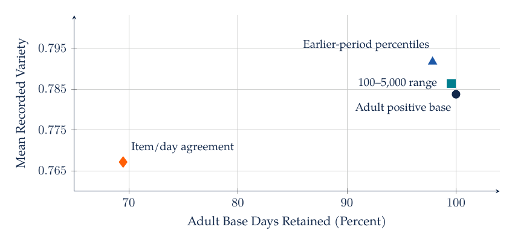
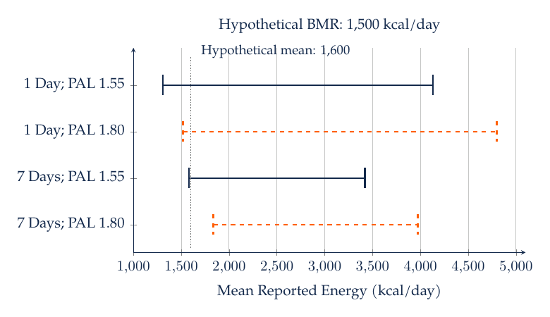
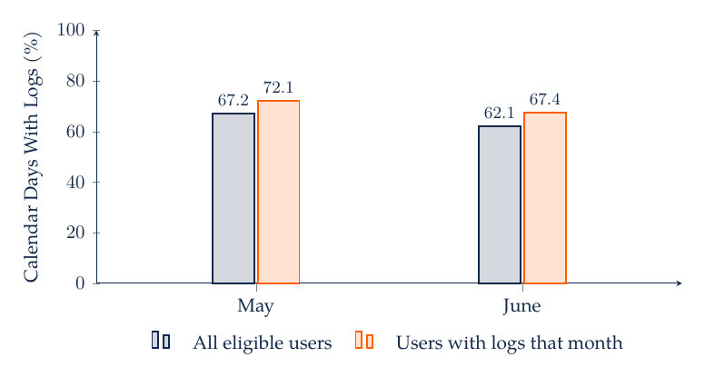
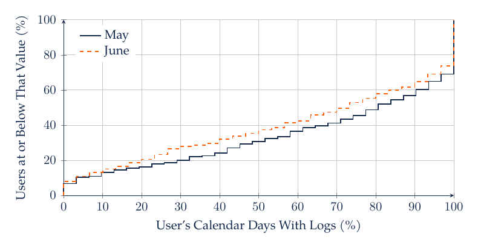

# M2. Customer Data, Measurement, and Visualization

A grocery retailer sees larger online baskets and asks whether moving customers to its app will raise sales. The raw comparison combines the shopping channel with who uses it, why they shop, and which trips are observed. A household may order online for a planned weekly restock and visit a store for a forgotten ingredient. Measurement and visualization determine whether the analysis reveals that distinction or conceals it.

## 2.1 Define the Population Before the Metric

A customer dataset is a record of an observation process. Loyalty accounts exclude unidentified shoppers. Online logs record sessions that may contain repeated visits by the same person. Orders exclude browsing without purchase. App events reflect tracking rules, consent, device settings, and instrumentation changes. Before calculating a metric, identify the target population and the mechanism by which its members enter the table.

Suppose monthly revenue per customer is intended to describe all eligible accounts. Dividing total revenue by purchasing accounts produces revenue per purchasing account. If inactivity changes, that measure can increase while revenue per eligible account falls. The denominator should therefore be written into the metric name or its definition. For customer acquisition cost, specify whether the denominator is new registered accounts, first-time purchasers, or customers with positive contribution over a defined horizon.

A conversion rate requires an eligible exposure count. If $b$ eligible sessions produce at least one purchase among $n$ eligible sessions, session conversion is $b/n$. Customer conversion instead uses customers in both numerator and denominator. A customer with ten sessions should not receive ten times the weight in a customer-level rate. When the same customer contributes repeated observations, statistical uncertainty must also account for that dependence.

Returns require a substantive rule. Gross sales, net sales after returns, and contribution after variable costs answer different questions. A comparison that deducts online returns but observes only gross offline sales mixes measurement rules. Currency, tax, fulfillment fees, and discounts should be aligned across channels before interpreting differences.

## 2.2 Build a Customer Table Without Losing Customers

Begin with a customer roster that defines eligibility. Aggregate eligible transactions to customer-period totals, then left-join those totals to the roster. A customer with no transactions can receive zero sales if the transaction system fully captures activity during the observation period. Zero should not replace a value that is missing because the customer was unobserved or the data feed failed.

A join should have a documented relationship: one-to-one, many-to-one, or one-to-many. Validate key uniqueness in the lookup table and inspect unmatched records. A match rate of 99% can still conceal a material problem if the unmatched 1% contains the highest-value customers or one entire channel. Report both counts and relevant value totals for unmatched observations.

Dates need similar attention. Convert timestamps to a consistent timezone before assigning day or week. Determine whether the date represents ordering, shipment, payment, or return. A promotion announced late in a period may affect orders immediately but recognized revenue later. Aligning metrics on an inappropriate date can create an apparent lag that comes from accounting rather than customer behavior.

Outliers should be investigated before removal. A $10,000 order could be a business customer, a data-entry error, or a legitimate event. A rule that trims all orders above a percentile changes the estimand to a restricted population. State that restriction and compare conclusions with and without the rule when it can affect the decision. Robust summaries such as medians and quantiles often reveal more than one mean with an undocumented exclusion.

## 2.3 Case Study: A Reversal Caused by Customer Mix

A marketing manager compares campaigns A and B using conversion. Both campaigns reach new and returning customers, but their audience composition differs. Assume the following customer counts and outcomes, with each customer belonging to one segment and appearing once.

| Campaign | New Customers | New Conversions | Returning Customers | Returning Conversions | Overall Conversion |
| --- | ---: | ---: | ---: | ---: | ---: |
| A | 100 | 9 | 100 | 80 | 89/200 = 44.5% |
| B | 200 | 20 | 100 | 81 | 101/300 = 33.7% |

Campaign B has higher conversion among new customers, 10% versus 9%, and among returning customers, 81% versus 80%. Campaign A nevertheless has the higher aggregate rate because half its audience consists of returning customers, compared with one-third for B. Returning customers convert much more frequently in both campaigns.

The aggregate rate is a weighted average of segment rates:

$$
\bar p_j=\sum_g w_{jg}p_{jg},\qquad \sum_g w_{jg}=1.
$$

Here $j$ indexes campaigns, $g$ indexes customer segments, $p_{jg}$ is the conversion fraction within a segment, and $w_{jg}$ is that segment's share of the campaign audience. The weights are part of the comparison. Holding them at 50% new and 50% returning gives standardized rates of 44.5% for A and 45.5% for B. This adjustment describes performance for the chosen common mix. It establishes a causal campaign effect only if the design supports that interpretation.


B's small advantages within both segments coexist with A's aggregate advantage. A manager deciding where to send the next campaign needs to specify the future audience mix and whether customers were assigned comparably. An aggregate bar chart alone cannot answer that question.

## 2.4 Cohorts, Retention, and Customer Age

A cohort groups customers by a common starting event, such as first purchase or subscription activation. Retention at customer age $k$ is the fraction of the original eligible cohort meeting a stated activity criterion at that age. A cohort table separates calendar time from customer age: an October signup observed one month later is not comparable with an April signup observed seven months later unless the question explicitly concerns those different ages.

For cohort $c$, define $N_c$ as the number of eligible customers at entry and $A_{c,k}$ as the number active at age $k$. The descriptive retention rate is $R_{c,k}=A_{c,k}/N_c$. A later cohort may not yet have reached age $k$; that cell is unobserved, not zero. Omitting inactive customers from the denominator would turn retention into a different conditional measure.

| Signup Cohort | Entry Customers | Active at Month 1 | Active at Month 2 | Active at Month 3 |
| --- | ---: | ---: | ---: | ---: |
| January | 100 | 60 | 45 | 40 |
| February | 100 | 70 | 50 | Not yet observed |
| March | 100 | 80 | Not yet observed | Not yet observed |

Month-one retention rises from 60% for the January cohort to 80% for the March cohort. March customers have not yet reached the later observation windows, so their long-run retention remains unobserved. Comparing March's month one with January's month three would combine cohort quality with customer age. The right comparison depends on whether the decision concerns onboarding, long-term value, or a calendar-time change affecting all existing customers.


Unobserved future periods require forecasts from an explicit model. Coding those periods as zero would treat unavailable outcomes as observed failures and bias retention downward.

## 2.5 Visual Encodings Should Match the Question

Use position on a common scale when precise comparison matters. A dot plot can compare segment conversion rates more clearly than area-sized bubbles. A line chart is appropriate when the ordering of time is meaningful. A histogram or empirical cumulative distribution reveals skewness that a mean hides. A scatterplot supports examination of a relationship, with transparency or aggregation when observations overlap.

The scale changes the interpretation. A logarithmic sales axis emphasizes proportional differences; a linear axis emphasizes dollar differences. A truncated bar-chart axis exaggerates differences because bar length encodes magnitude from its baseline. A carefully labeled narrow axis can be useful for a line or dot plot when the scientific question concerns small differences. The choice should preserve the intended comparison and disclose the scale.

Uncertainty should be shown for an estimated comparison when it affects a decision. For an independent Bernoulli sample, a common large-sample standard error for a proportion is $\sqrt{\hat p(1-\hat p)/n}$. Near zero or one, or with small samples, use an interval appropriate to binomial data. With repeated observations per customer, treating every session as independent generally understates uncertainty. Resample or cluster at the unit that captures the relevant dependence.

Color can encode categories or highlight the comparison that matters. Use line styles, markers, and labels alongside color, and keep small text dark enough for contrast. A figure should remain interpretable when printed in grayscale or described to a student who cannot see it. Explain the axes, units, sample, and principal comparison in its caption or accompanying text.

## 2.6 Case Study: Online Grocery Baskets and Repeated Purchases

Chintala, Liaukonytė, and Yang's [grocery-shopping study](https://doi.org/10.1287/mksc.2022.0292) compares online and offline baskets using household shopping records. It studies basket composition and repeated purchasing, with attention to differences in shopping-trip types. Larger baskets need not contain a wider range of categories, and a household's choice of channel can be related to the purpose of its trip.

Suppose one household buys the sets {milk, bread, apples, yogurt} and {milk, bread, apples, coffee} on successive trips. Each basket contains four distinct items. Their Jaccard similarity is

$$
J(A,B)=\frac{|A\cap B|}{|A\cup B|}=\frac{3}{5}=0.60.
$$

The numerator counts shared distinct items and the denominator counts all distinct items appearing in either trip. A different pair of four-item baskets with one shared item has similarity $1/7\approx0.143$. Basket size is identical in the two examples, while repeated purchasing differs substantially. Whether quantities or spending weights should enter the measure depends on the decision; set-based Jaccard treats one unit and ten units of an item alike.

A defensible descriptive study would define eligible grocery trips, compare channels within households when appropriate, and examine basket size, distinct categories, repeat-item overlap, and spending. It would inspect whether findings are driven by large restocking trips, small convenience trips, or particular retailers. Channel labels should not silently determine the definition of a “typical” trip when the objective is a comparable classification. Clustering can classify trips using their observed composition.

A retail recommendation might distinguish discovery from replenishment. High repetition can support convenient reordering while making it harder for unfamiliar products to receive attention. A proposed interface change should therefore specify both the desired outcome and the possible tradeoff. Its effect requires evaluation under an appropriate design, even when the descriptive pattern provides a strong reason to test it.

### 2.6.1 Variety Depends on Both Breadth and Concentration

Two customers can purchase the same number of categories while allocating spending very differently. One divides a basket equally between two categories; another assigns 90% to one and 10% to the other. A category count assigns both customers breadth two. To measure how evenly spending is distributed, define $V=1-\sum_c s_c^2$, where $s_c$ is category $c$'s share of the customer's spending within a stated basket or period. The shares must use a common denominator and sum to one. The two baskets have $V=0.50$ and $V=0.18$, respectively.

[Nielsen and coauthors (2022)](https://doi.org/10.1086/720453) use item counts and a reverse-coded concentration measure based on calorie shares to study food-consumption variety. The underlying unit matters: spending shares, calorie shares, and purchase counts can rank the same baskets differently. A wider category definition also changes measured variety without changing consumption. Report the category mapping, observation window, and share denominator before interpreting a trend or segment difference. M7, Section 7.12, connects these measurements to recommendation design.

## 2.7 From Evidence to a Management Presentation

The Pyramid Principle organizes a recommendation around a decision-relevant answer, followed by a small number of supporting reasons and the evidence for each reason. This structure works when the answer's strength matches the analysis. A descriptive study might recommend a test or a closer diagnostic comparison, rather than immediate deployment.

For the campaign example, a clear opening is: “Compare the campaigns at a common customer mix before reallocating the budget.” The supporting reasons are that returning customers convert more often, the campaigns reached different mixes, and the within-segment ranking differs from the aggregate ranking. The supporting evidence should quantify each reason and connect it to the allocation decision.

An effective chart title can state the comparison, such as “Campaign A's aggregate advantage reflects its returning-customer share.” The caption should define the conversion denominator and identify the data as synthetic.

## 2.8 AI-Assisted Workflow and Practice

Ask an assistant to construct a customer-period table from a specified roster and transaction table, preserving customers with no observed purchases. Require a join audit, a missing-data report, and a reconciliation of total sales. Next ask it to calculate the campaign table above and standardized rates under a 50/50 audience mix. Verify those small numbers before applying the same functions to a larger file.

For a chart request, specify the question, observation unit, axis units, ordering, and uncertainty representation. Ask the assistant to describe what visual pattern would change the recommendation. Compare its description with the plotted data. If it labels an observational channel difference as an effect, revise the interpretation and identify the design that would be needed to support the stronger claim.

For practice, change campaign B's audience to 100 new and 100 returning customers while keeping its segment conversion rates fixed. Its aggregate rate becomes 45.5%, and the reversal disappears. Next calculate month-two retention for the January and February cohorts: 45% and 50%. March has no observed month-two rate. Finally, compare a four-item basket with itself: Jaccard similarity is one, regardless of whether the quantities have changed. Each exercise tests a definition that should remain explicit in an automated analysis.

## 2.9 Readings

[Wilke's visualization text](https://clauswilke.com/dataviz/) offers a visual reference for distributions, comparisons, and uncertainty. The [pandas grouping documentation](https://pandas.pydata.org/docs/user_guide/groupby.html) supports implementation.

## 2.10 mHealth: Recorded Variety and Missing Days

The manager wants to know whether customers with broad recorded diets need different suggestions from customers who repeatedly log a few categories. Category count measures breadth. A calorie-share measure also distinguishes an even distribution from a day dominated by one category. For user $i$, day $t$, and recorded category $c$, define $k_{ict}$ as the sum of item calories in that category. On days with nonnegative observed item values and a positive item total, define

$$
s_{ict}=\frac{k_{ict}}{\sum_h k_{iht}},\qquad
V_{it}=1-\sum_c s_{ict}^2.
$$

The shares sum to one across recorded categories, including `Unclassified` where necessary. $V_{it}$ approaches zero when one category accounts for almost all recorded item calories. It rises when calorie shares become more evenly distributed across categories. Multiplying every item calorie value by the same positive constant leaves these shares unchanged. This scale invariance helps distinguish composition from recorded quantity, although omitted foods can still change composition.

Among the 76,780 eligible user-days, mean variety is 0.7834 when each day has equal weight and 0.7855 when each user first contributes a personal average. The small difference in these means does not make the weighting choices interchangeable. A day-weighted comparison gives frequent loggers more influence. A user-weighted comparison answers a question about the average observed user.

| Recorded Categories | Eligible Days | Mean Variety |
| --- | ---: | ---: |
| 1–5 | 11,861 | 0.5306 |
| 6–10 | 30,258 | 0.7895 |
| 11–20 | 32,492 | 0.8618 |
| 21 or More | 2,169 | 0.9046 |

Breadth and calorie-share variety rise together in these groups, partly because adding categories expands the possible distribution of shares. This is a descriptive relation among recorded days. It does not show that the app caused broader consumption or that greater category variety improved health. Source categories are not a validated diet-quality index.

The complete 2016 calendar contains 135,420 potential user-days for the selected users. Only 76,804 have food entries; 58,616 are unobserved. A zero-filled calorie panel would interpret every absent record as no consumption. For a logging outcome, zero can instead mean that no entry was observed on a specified calendar day. The variable's definition determines whether filling a missing cell with zero is appropriate. These users are identified from a full-year file, so the calendar is a descriptive grid rather than a verified account-enrollment roster.

The item sum is within one calorie unit of the reported daily total on 53,075 observed days. Using the reported total as the denominator of category shares would fail to make shares sum to one on many other days. The calculation below preserves both measures, constructs the observed-day summary, and builds the calendar separately.

Python source: [m02.py](../../03_Data_and_Code/mHealth/recurring_examples/m02.py). From its directory, run `python m02.py`.

```python
"""Measure recorded variety and separate observed days from calendar days."""

import json
import pandas as pd
from common import OUTPUT, load_inputs, save_result

food, daily, baskets = load_inputs()
eligible = daily.loc[daily.variety.notna()].copy()
eligible["breadth_group"] = pd.cut(
    eligible.category_count,
    [0, 5, 10, 20, 1000],
    labels=["1-5", "6-10", "11-20", "21+"],
)
table = eligible.groupby("breadth_group", observed=True).agg(
    days=("variety", "size"),
    mean_variety=("variety", "mean"),
    mean_recorded_calories=("food_calories", "mean"),
)
OUTPUT.mkdir(exist_ok=True)
table.to_csv(OUTPUT / "M02_breadth.csv")
assert int(table.days.sum()) == len(eligible)
calendar = pd.MultiIndex.from_product(
    [sorted(food.Userid.unique()), pd.date_range("2016-01-01", "2016-12-31")],
    names=["Userid", "date"],
)
panel = daily.set_index(["Userid", "date"]).reindex(calendar)
observed = panel.entries.notna()
result = {
    "eligible_days": len(eligible),
    "excluded_days": len(daily) - len(eligible),
    "calendar_user_days": len(panel),
    "observed_days": int(observed.sum()),
    "unobserved_days": int((~observed).sum()),
    "mean_variety_day_weighted": float(eligible.variety.mean()),
    "mean_variety_user_weighted": float(
        eligible.groupby("Userid").variety.mean().mean()
    ),
    "daily_total_equal_item_sum_within_one": int(
        (daily.food_calories - daily.item_calories).abs().le(1).sum()
    ),
    "daily_total_comparison_days": len(daily),
    "breadth": table.reset_index().to_dict(orient="records"),
}
save_result("M02", result)
print(json.dumps(result, indent=2))
```

## 2.11 mHealth: Nutrition Knowledge and Sample Restrictions

An mHealth analyst evaluating suggestions about diet must determine whether the records measure food selection, complete daily intake, or usual intake over a longer period. A day with one logged snack supplies evidence about that snack. It does not establish the person's total intake for the day. The National Cancer Institute's [food-record guidance](https://epi.grants.cancer.gov/dietary-assessment-primer/profiles/record/) identifies recording burden and reactivity as features of the measurement process. Its [usual-intake guidance](https://epi.grants.cancer.gov/dietary-assessment-primer/learn/usual.html) distinguishes day-to-day variation from a person's longer-run average. Repeated logs reduce some sampling variation while selective omissions can persist.

Nutrition studies often collect information that makes filtering more defensible. The [NHANES dietary codebook](https://wwwn.cdc.gov/Nchs/Data/Nhanes/Public/2021/DataFiles/DR1TOT_L.htm) documents recall reliability through `DR1DRSTZ`. mHealth has no corresponding completeness indicator. Several food entries or a positive calorie total cannot be substituted for that validation. NHANES also permits reliable records involving fasting or only water, so a zero total cannot universally be classified as erroneous. A ratio requiring a positive denominator nevertheless excludes zero totals by mathematical necessity.

For an adult descriptive analysis, the base sample requires age of at least 18 on January 1, positive finite reported daily calories, and a defined calorie-share variety measure. The fixed-age restriction removes users who were 17 at the reference date even if they turned 18 later in the year. It retains older adults; age 65 is not a general nutritional validity boundary. The combined restrictions retain 75,855 days from 367 users. They define the population and the calculations; they do not certify complete intake.

The National Cancer Institute's [outlier guidance](https://epi.grants.cancer.gov/dietary-assessment-primer/learn/outliers.html) supports examining extreme observations and comparing analyses under alternative exclusions. Short-term intake can genuinely vary substantially. A population percentile screen is therefore a sensitivity analysis. The 1st and 99th percentiles of positive adult daily totals in January through June are 209.01 and 3,534.11. Fixing those cutoffs using the earlier period prevents later observations from choosing their own reference range. A second screen uses an explicitly imposed 100–5,000 range; a third requires item totals and reported totals to agree within one calorie unit.

| Rule Applied to the Adult Base | Days Retained | Mean Reported Calories | Mean Variety |
| --- | ---: | ---: | ---: |
| Adult Positive Base | 75,855 | 1,541.82 | 0.7837 |
| Imposed 100–5,000 Range | 75,523 | 1,543.04 | 0.7863 |
| Earlier-Period 1st–99th Percentiles | 74,224 | 1,531.07 | 0.7916 |
| Item/Day Agreement Within One | 52,707 | 1,493.19 | 0.7671 |

Each row applies one screen independently to the same base. The agreement rule removes 23,148 days, far more than the percentile rule's 1,631. Its lower mean variety could reflect the kinds of records retained, including differences in logging intensity. Agreement is useful evidence about accounting consistency, but it does not prove nutritional completeness. A preference for cleaner-looking totals can therefore change the population being described.



The horizontal movement measures retention of adult base days; the vertical movement measures their mean recorded variety. The accounting-consistency restriction produces the largest movement in both dimensions. Treating it as a harmless technical correction would obscure a substantive change in the sample.

### 2.11.1 Energy Plausibility Requires Physiological Inputs

Energy-plausibility methods compare reported intake with expenditure or a model of requirements. [Banna, McCrory, Fialkowski, and Boushey (2017)](https://doi.org/10.3389/fnut.2017.00045) compare fixed cutoffs with individualized methods. [Black (2000)](https://doi.org/10.1038/sj.ijo.0801376), especially Table 8, updates the Goldberg approach. For an individual under the method's energy-balance and measurement conditions, bounds for mean reported energy intake divided by basal metabolic rate are

$$
L,U=\operatorname{PAL}\exp\left(\mp 2\sqrt{\frac{(0.23)^2}{d}+(0.085)^2+(0.15)^2}\right).
$$

Here $d$ is the number of assessment days and PAL is total energy expenditure divided by basal metabolic rate. The coefficients represent the variation assumptions for intake, predicted basal metabolic rate, and activity. The factor 2 gives the paper's approximate 95% limits for an individual; the sample-size term is one. These are conditional screening bounds, not an individual's recommended intake. Appropriate PAL and basal-metabolic-rate inputs are essential.

With an imposed basal metabolic rate of 1,500 kcal/day and PAL of 1.55, the bounds are approximately 1,308–4,131 kcal/day for one assessment day and 1,580–3,421 for seven days. Raising PAL to 1.80 raises the seven-day bounds to 1,835–3,973. A hypothetical seven-day mean of 1,600 would fall within the first interval and below the second. The same intake can receive a different flag because of the activity assumption. Additional days reduce the intake-variation component while the other variance components remain.



The code calculates these hypothetical bounds separately from the real-data screens. mHealth does not supply validated activity, basal metabolic rate, complete assessment days, or a documented mapping of `Gender` to the sex variable required by common prediction equations. No participant is assigned an individualized Goldberg label. Weight-loss goals and perturbed weights also complicate an energy-balance interpretation. Applying the equations to invented physiological inputs would turn an assumption into an apparent observation.

An AI coding request should therefore name the assessment instrument, population, units, necessary inputs, and output flags. Require the program to preserve raw values, distinguish overlapping exclusions, and return the analysis with and without the screen. Ask it to explain why one-day outliers, genuine fasting, and incomplete logging require different interpretations. The [nutrition resource guide](../../01_Resources/12_Nutrition_and_Dietary_Data_Quality/README.md) supplies the original methods and downloadable readings.

Python source: [nutrition.py](../../03_Data_and_Code/mHealth/recurring_examples/nutrition.py). From its directory, run `python nutrition.py`.

```python
"""Domain-informed sample definitions and explicitly hypothetical energy screens."""

import json
import math
import numpy as np
from common import load_inputs, save_result


def goldberg_bounds(days, pal, cv_intake=23, cv_bmr=8.5, cv_pal=15):
    """Individual EI:BMR bounds with Black (2000) coefficients, z=2, n=1."""
    if days < 1 or pal <= 0:
        raise ValueError("Positive assessment duration and PAL are required")
    variation = math.sqrt(cv_intake**2 / days + cv_bmr**2 + cv_pal**2) / 100
    return pal * math.exp(-2 * variation), pal * math.exp(2 * variation)


def run_analysis():
    food, daily, baskets = load_inputs()
    age_counts = food.groupby("Userid").Age_at_2016_01_01.nunique(dropna=False)
    assert age_counts.eq(1).all()
    ages = food.groupby("Userid").Age_at_2016_01_01.first()
    daily["age"] = daily.Userid.map(ages)
    # Nonnegative category calories and a positive denominator define valid shares.
    base = daily.loc[
        daily.variety.notna()
        & daily.food_calories.gt(0)
        & np.isfinite(daily.food_calories)
        & daily.age.ge(18)
    ].copy()
    training = base.loc[base.date.lt("2016-07-01")]
    lower, upper = training.food_calories.quantile([0.01, 0.99])
    masks = {
        "adult_positive_base": base.food_calories.gt(0),
        "fixed_100_to_5000_sensitivity": base.food_calories.between(100, 5000),
        "prior_period_1st_to_99th_percentile": base.food_calories.between(lower, upper),
        "daily_item_agreement_within_one": (base.food_calories - base.item_calories)
        .abs()
        .le(1),
    }
    summaries = []
    for name, mask in masks.items():
        selected = base.loc[mask]
        summaries.append(
            {
                "rule": name,
                "days": len(selected),
                "users": int(selected.Userid.nunique()),
                "removed_from_base": len(base) - len(selected),
                "mean_recorded_calories": float(selected.food_calories.mean()),
                "mean_variety": float(selected.variety.mean()),
            }
        )
    # Hypothetical complete records, stable energy balance, and predicted BMR.
    # These BMR/PAL inputs are imposed; no mHealth participant is classified.
    scenario = []
    for days in [1, 7]:
        for pal in [1.55, 1.80]:
            lo, hi = goldberg_bounds(days, pal)
            scenario.append(
                {
                    "days": days,
                    "assumed_pal": pal,
                    "bmr_kcal": 1500,
                    "lower_ratio": lo,
                    "upper_ratio": hi,
                    "lower_kcal": 1500 * lo,
                    "upper_kcal": 1500 * hi,
                    "illustrative_1600_kcal_flag": 1600 / 1500 < lo,
                }
            )
    result = {
        "source_observed_days": len(daily),
        "base_days": len(base),
        "base_removed_days": len(daily) - len(base),
        "age_min": float(ages.min()),
        "age_max": float(ages.max()),
        "training_days": len(training),
        "quantile_lower": float(lower),
        "quantile_upper": float(upper),
        "sensitivity": summaries,
        "hypothetical_goldberg": scenario,
    }
    save_result("nutrition", result)
    print(json.dumps(result, indent=2))


if __name__ == "__main__":
    run_analysis()
```

## 2.12 Python Calculations for the Synthetic Cases

The inputs below are imposed teaching values. Running the program creates the labeled synthetic CSV files and prints the corresponding calculations. They are separate from the mHealth estimates. Keep the script beside `example_helpers.py` in `03_Data_and_Code/Lecture_Examples`.

Python source: [m02_synthetic.py](../../03_Data_and_Code/Lecture_Examples/m02_synthetic.py). From its directory, run `python m02_synthetic.py`.

```python
"""Synthetic numerical examples for M2; run from any working directory."""

import itertools
import json
import math
from example_helpers import write_csv, ols_slope, shares

r = {}
campaigns = [
    ("A", "new", 100, 9),
    ("A", "returning", 100, 80),
    ("B", "new", 200, 20),
    ("B", "returning", 100, 81),
]
write_csv(
    "M02_campaigns_synthetic.csv",
    ["campaign", "customer_type", "assigned_customers", "conversions"],
    campaigns,
)
r["M02"] = {
    "observed_A": 89 / 200,
    "observed_B": 101 / 300,
    "common_mix_A": (0.09 + 0.80) / 2,
    "common_mix_B": (0.10 + 0.81) / 2,
    "basket_jaccard_high": 3 / 5,
    "basket_jaccard_low": 1 / 7,
}
assert r["M02"]["observed_A"] > r["M02"]["observed_B"]
assert r["M02"]["common_mix_B"] > r["M02"]["common_mix_A"]
variety_shares = {"equal": [0.5, 0.5], "concentrated": [0.9, 0.1]}
r["M02"]["variety"] = {
    name: 1 - sum(s * s for s in vals) for name, vals in variety_shares.items()
}
write_csv(
    "M02_variety_synthetic.csv",
    ["basket", "category", "spending_share"],
    [
        (name, f"C{i+1}", share)
        for name, vals in variety_shares.items()
        for i, share in enumerate(vals)
    ],
)
assert math.isclose(r["M02"]["variety"]["equal"], 0.5)
assert math.isclose(r["M02"]["variety"]["concentrated"], 0.18)
print(json.dumps(r, indent=2))
```

## 2.13 mHealth: Recency and Frequency at a Fixed Date

A manager considering a reminder campaign needs to distinguish a customer who logs frequently from one who logged recently. Both customers may have the same total number of records. Recency measures elapsed time since the last observed activity, while frequency measures repeated activity within a specified window. Their interpretation depends on the date at which the manager must make the decision.

For every user with a recorded day by June 30, define recency as the number of days from the most recent recorded day to June 30. Define frequency as distinct recorded days during June 1–30. A customer who last logged on June 30 has recency zero. A customer with no June logs has frequency zero and remains eligible because an earlier record establishes membership. July activity is an outcome and enters neither feature.

The 358 eligible users are grouped using prespecified recency boundaries of 7 and 30 days and a frequency boundary of 15 days. These cutoffs define a descriptive comparison; they have not been optimized for a campaign. The empty high-frequency, high-recency cell follows from the definitions: a customer whose last log was more than 30 days ago has zero June logging days.

| Recency on June 30 | June Logging Days | Users | Any July Log | Mean July Logging Days |
| --- | --- | ---: | ---: | ---: |
| 0–7 Days | 0–14 | 68 | 92.6% | 13.90 |
| 0–7 Days | 15–30 | 220 | 96.8% | 22.88 |
| 8–30 Days | 0–14 | 34 | 67.6% | 7.26 |
| 8–30 Days | 15–30 | 6 | 83.3% | 9.67 |
| 31+ Days | 0–14 | 30 | 50.0% | 5.70 |

Recent frequent loggers have a higher July logging rate in this cohort. The six-user cell warrants particular care because a single outcome changes its rate substantially. These rates describe future activity among known users; they do not identify which users would respond most to a reminder. Selecting recipients requires an incremental-effect comparison and a cost per contact.

[Joao Correia's RFM example](https://github.com/joaolcorreia/RFM-analysis) combines recency, frequency, and monetary value in transaction data. mHealth supports the first two dimensions. Calories, entry counts, and body weight have units different from spending and cannot supply monetary value. A commercial RFM table would need an actual monetary variable, a transaction definition, and a consistent observation window.

A coding assistant should receive the snapshot date and the eligible population explicitly. Ask it to verify that adding July rows leaves both June features unchanged, that repeated food entries on one day count only once toward frequency, and that zero-log members remain in the outcome denominator. Quantile bins require extra care when many customers share the same integer count; the fixed boundaries here avoid assigning tied counts to different groups.

Python source: [recency.py](../../03_Data_and_Code/mHealth/recurring_examples/recency.py). From its directory, run `python recency.py`.

```python
"""Describe later logging using features available at a fixed snapshot."""

import json
import pandas as pd
from common import OUTPUT, load_food, make_daily, save_result


def snapshot(daily, cutoff):
    cutoff = pd.Timestamp(cutoff)
    history = daily.loc[daily.date <= cutoff]
    last = history.groupby("Userid").date.max()
    recent = history.loc[history.date > cutoff - pd.Timedelta(days=30)]
    counts = recent.groupby("Userid").date.nunique().reindex(last.index, fill_value=0)
    return pd.DataFrame(
        {"recency_days": (cutoff - last).dt.days, "frequency_30d": counts}
    )


if __name__ == "__main__":
    daily = make_daily(load_food())
    customers = snapshot(daily, "2016-06-30")
    customers["recency_group"] = pd.cut(
        customers.recency_days,
        [-1, 7, 30, float("inf")],
        labels=["0-7 days", "8-30 days", "31+ days"],
    )
    customers["frequency_group"] = customers.frequency_30d.ge(15).map(
        {True: "15-30 days", False: "0-14 days"}
    )
    july = daily.loc[daily.date.between("2016-07-01", "2016-07-31")]
    customers["july_days"] = (
        july.groupby("Userid").date.nunique().reindex(customers.index, fill_value=0)
    )
    customers["july_any_log"] = customers.july_days.gt(0)
    assert customers.frequency_30d.between(0, 30).all()
    summary = (
        customers.groupby(["recency_group", "frequency_group"], observed=True)
        .agg(
            users=("july_days", "size"),
            july_users=("july_any_log", "sum"),
            july_logging_probability=("july_any_log", "mean"),
            mean_july_days=("july_days", "mean"),
        )
        .reset_index()
    )
    result = {
        "snapshot": "2016-06-30",
        "users": len(customers),
        "groups": summary.to_dict(orient="records"),
    }
    save_result("recency", result)
    summary.to_csv(OUTPUT / "recency.csv", index=False)
    print(json.dumps(result, indent=2))
```

## 2.14 mHealth: Chart Choice, Denominators, and Customer Differences

A manager sees nearly unchanged activity on days when customers record food and considers reducing attention to retention. That comparison conditions on having a recorded day. A customer who stops logging disappears from the conditional average. A useful business review therefore distinguishes the frequency of recorded days from the amount of activity on those days, with the eligible population fixed before either reporting month.

The comparison retains the 340 users with at least one observed day before May 1, 2016. Each user contributes all 31 May days and all 30 June days to the logging denominator. Repeated food entries on one day count once toward logging coverage. A calendar day without a food entry receives zero for the logging indicator. Its food consumption remains unobserved. Food-entry counts retain the recorded rows and describe recording intensity.

| Measure | May | June |
| --- | ---: | ---: |
| Eligible Users | 340 | 340 |
| Users With Logs | 317 | 313 |
| Eligible Calendar User-Days | 10,540 | 10,200 |
| Days With Logs | 7,082 | 6,331 |
| Days With Logs / Eligible Days | 67.19% | 62.07% |
| Days With Logs / Logger Calendar Days | 72.07% | 67.42% |
| Entries per Recorded Day | 11.80 | 11.69 |

The conditional logging rate divides by calendar days for users who logged at least once in that month. Its denominator changes with the outcome: May contains 317 such users and June contains 313. Both conditional rates exceed the corresponding fixed-population rates. Logging coverage in the fixed population falls by 5.12 percentage points, while entries per recorded day change little. Stable recording intensity among observed days can coexist with declining coverage of the eligible population. These patterns support examining disengagement and recording behavior; they do not identify a change in dietary intake or an effect of a reminder.



### 2.14.1 Match the Display to the Decision

The [Financial Times Visual Vocabulary](https://github.com/Financial-Times/chart-doctor/blob/main/visual-vocabulary/README.md) organizes displays by the relationship the reader needs to assess. The first choice is the comparison. A list of available plotting functions provides little guidance about whether the manager needs a ranking, a distribution, a trend, or an estimated contrast.

| Analytical Question | Useful Display | Essential Check |
| --- | --- | --- |
| Which segment is larger? | Sorted bars or dots | Common units and base |
| Where is the distribution concentrated? | Histogram or ECDF | Bins, ties, and weights |
| How does a metric change over time? | Line or paired dots | Calendar and membership |
| How do two variables move together? | Scatterplot or hexagons | Support and overlap |
| What share belongs to each category? | Aligned shares or bars | Common denominator |
| How uncertain is a contrast? | Point and interval | Estimand and sampling unit |

A bar encodes its magnitude through length from a baseline, so the logging-rate bars start at zero. Two percentage axes with different limits would change the visual comparison even when the data are identical. A dot-and-interval plot can use a narrower, explicitly labeled scale because the position represents the estimate and the interval represents its uncertainty. For dense scatterplots, transparency, hexagonal bins, or a documented sample can reveal concentrations that overlapping opaque points hide. Bin boundaries and color limits should stay fixed when comparing customer groups.

Use Illinois Blue and Illini Orange to distinguish the principal series, with labels and line styles carrying the same information. A heatmap of a nonnegative count needs an ordered light-to-dark scale. A signed deviation needs a meaningful center, usually zero, with comparable positive and negative distances. Unobserved cells need a separate label or pattern so that a reader can distinguish them from observed zeros. Small multiples should retain a common scale when the decision depends on cross-panel magnitudes.

### 2.14.2 An Average Decline Can Coexist With No Median Change

The user-level outcome is the fraction of a month's calendar days with a log. For a value $x$ between zero and one, its empirical cumulative distribution is

$$
\widehat F_m(x)=\frac{1}{N}\sum_{i=1}^{N}\mathbf{1}\{p_{im}\leq x\},
$$

where $p_{im}$ is user $i$'s logging fraction in month $m$ and $N$ is the fixed eligible-user count. The height at $x$ is the fraction of users whose logging frequency is at or below that value. Each user has equal weight. Ties produce jumps, including the jump at zero for users without a recorded day. The curve avoids a histogram's bin-width choice, while its denominator and observation unit still require an explicit definition.



The zero-logging share is 6.76% in May and 7.94% in June. At the other endpoint, 105 users log on every May day and 89 log on every June day. The median user's June-minus-May change is zero, while the mean change is negative. The middle half of individual changes spans approximately $-17.58$ to $+3.36$ percentage points. A mean decline therefore describes an aggregate change that is distributed unevenly across customers. It does not imply that every user reduced logging by five percentage points.

Histograms remain useful when the shape of a distribution matters. Compare several defensible bin widths and align bins across groups. A smooth density estimate requires extra care for bounded fractions with substantial mass at zero and one; smoothing can suggest observations outside the feasible range or conceal endpoint masses. The [seaborn distribution tutorial](https://seaborn.pydata.org/tutorial/distributions.html) discusses these choices. A distribution's spread and an estimate's uncertainty answer different questions, as the [error-bar tutorial](https://seaborn.pydata.org/tutorial/error_bars.html) makes explicit. M3, Section 3.6, calculates uncertainty for the average paired change.

### 2.14.3 Reproduce the Comparison

The program selects membership before May, counts distinct logged days, creates complete user-month pairs, and exports only aggregate tables. It also calculates the paired-user interval used in M3. Missing-month users remain in the logging calculation. The 5,000 bootstrap draws resample users with both monthly outcomes together. The deliberately incorrect independent-day interval is retained with its assumption stated in its name.

Python source: [visualization.py](../../03_Data_and_Code/mHealth/recurring_examples/visualization.py). From its directory, run `python visualization.py`.

```python
"""Prepare aggregate chart data and paired uncertainty for May and June."""

import json
import numpy as np
import pandas as pd
from common import OUTPUT, ROOT, SEED, load_food, save_result

MONTHS = ["2016-05", "2016-06"]


def prepare(food):
    # Membership is fixed before May; an absent log is zero logging only.
    members = sorted(food.loc[food.date < "2016-05-01", "Userid"].unique())
    if not members:
        raise ValueError("No users observed before May")
    rates = pd.DataFrame(index=members)
    rows = []
    for month in MONTHS:
        period = pd.Period(month, freq="M")
        part = food.loc[
            food.Userid.isin(members) & food.date.dt.to_period("M").eq(period)
        ]
        counts = (
            part[["Userid", "date"]].drop_duplicates().groupby("Userid").size()
            .reindex(members, fill_value=0)
        )
        rates[month] = counts / period.days_in_month
        observed = int(counts.sum())
        active = int(counts.gt(0).sum())
        assert counts.between(0, period.days_in_month).all()
        rows.append({
            "period": month, "eligible_users": len(members),
            "users_with_logs": active, "observed_user_days": observed,
            "calendar_user_days": len(members) * period.days_in_month,
            "logger_calendar_days": active * period.days_in_month,
            "food_entries": len(part),
            "logging_percent": 100 * rates[month].mean(),
            "conditional_logging_percent": (
                100 * observed / (active * period.days_in_month) if active else None
            ),
            "entries_per_observed_day": len(part) / observed if observed else None,
        })
    return rates, pd.DataFrame(rows)


def ecdf(values):
    """Exact right-continuous CDF; tied values contribute their full mass."""
    values = np.asarray(values, dtype=float)
    if len(values) == 0 or not np.isfinite(values).all():
        raise ValueError("A nonempty finite sample is required")
    x, count = np.unique(values, return_counts=True)
    return pd.DataFrame({
        "logging_percent": 100 * x, "users_at_value": count,
        "cumulative_percent": 100 * count.cumsum() / len(values),
        "eligible_users": len(values),
    })


def paired_summary(rates, draws=5000):
    # Each sampled index carries both months for the same user.
    difference = rates[MONTHS[1]].to_numpy() - rates[MONTHS[0]].to_numpy()
    if len(difference) < 2 or not np.isfinite(difference).all():
        raise ValueError("At least two complete user pairs are required")
    rng = np.random.default_rng(SEED)
    indices = rng.integers(0, len(difference), size=(draws, len(difference)))
    bootstrap = difference[indices].mean(axis=1)
    low, high = np.quantile(bootstrap, [0.025, 0.975])
    return {
        "users": len(difference), "bootstrap_draws": draws, "seed": SEED,
        "change_pp": float(100 * difference.mean()),
        "ci_low_pp": float(100 * low), "ci_high_pp": float(100 * high),
        "paired_se_pp": float(100 * difference.std(ddof=1) / np.sqrt(len(difference))),
        "individual_change_q25_pp": float(100 * np.quantile(difference, 0.25)),
        "individual_change_median_pp": float(100 * np.median(difference)),
        "individual_change_q75_pp": float(100 * np.quantile(difference, 0.75)),
    }


def main():
    rates, monthly = prepare(load_food())
    comparison = paired_summary(rates)
    # Deliberately wrong independence assumption, retained as a teaching contrast.
    p = monthly.logging_percent.to_numpy() / 100
    n = monthly.calendar_user_days.to_numpy()
    naive_se = float(100 * np.sqrt(np.sum(p * (1 - p) / n)))
    comparison.update({
        "naive_independent_days_se_pp": naive_se,
        "naive_ci_low_pp": comparison["change_pp"] - 1.96 * naive_se,
        "naive_ci_high_pp": comparison["change_pp"] + 1.96 * naive_se,
    })
    cdf = pd.concat([ecdf(rates[m]).assign(period=m) for m in MONTHS], ignore_index=True)
    assert np.allclose(monthly.logging_percent,
                       100 * monthly.observed_user_days / monthly.calendar_user_days)
    assert cdf.groupby("period").users_at_value.sum().eq(len(rates)).all()
    OUTPUT.mkdir(exist_ok=True)
    monthly.to_csv(OUTPUT / "visualization_monthly.csv", index=False)
    cdf.to_csv(OUTPUT / "visualization_ecdf.csv", index=False)
    manifest = json.loads((ROOT.parent / "manifest.json").read_text())
    result = {
        "source_sha256": manifest["files"]["food_entries.csv.gz"]["sha256"],
        "membership": "At least one observed day before 2016-05-01",
        "observation": "user-month; fraction of calendar days with a food entry",
        "interpretation": "descriptive within the selected cohort",
        "months": monthly.to_dict(orient="records"), "paired_change": comparison,
    }
    save_result("visualization", result)
    print(json.dumps(result, indent=2))


if __name__ == "__main__":
    main()
```

## 2.15 Interactive Charts Must Preserve the Comparison

An interactive display can help a manager inspect alternative denominators and distribution shapes. Each control also changes the information being presented. A month selector should update the numerator, denominator, labels, and distribution together. Retaining a stale count after filtering would make a correct plotted height describe the wrong population. Holding axes at 0–100% makes changes across selections comparable.

The [mHealth chart](../../03_Data_and_Code/mHealth/recurring_examples/results/visualization_interactive.html) compares the all-user and observed-logger denominators for a selected month. Its second panel displays the selected month's distribution across the full eligible cohort. The data table remains visible below the chart, with the observation counts and denominators for both months. Hover labels supplement the table. A reader can verify each rate without inferring a value from a bar's height.

[Altair's tutorial](https://github.com/altair-viz/altair-tutorial) provides a declarative approach in which the chart specifies data fields, visual encodings, and interactions. The older tutorial's selection syntax differs from the version used here. The program uses Altair 5.5.0, a bound parameter, and explicitly fixed scales. [The widget documentation](https://altair-viz.github.io/user_guide/interactions/bindings_widgets.html) and [HTML-export documentation](https://altair-viz.github.io/user_guide/saving_charts.html) describe these operations. The exported HTML contains aggregate data and runs without a Python server. Its JavaScript libraries load from a public CDN, so chart rendering requires internet access.

Static figures and interactive views should agree on every plotted value. Run `visualization.py` before `visualization_charts.py`. The chart program checks the monthly table against the saved numerical results and uses the same aggregate data for both forms of display.

Python source: [visualization_charts.py](../../03_Data_and_Code/mHealth/recurring_examples/visualization_charts.py). From its directory, run `python visualization_charts.py`.

```python
"""Build TikZ figures and a browser chart from verified aggregate tables."""

import json
import altair as alt
import pandas as pd
from common import OUTPUT, ROOT
from visualization import MONTHS

FIGURES = ROOT.parents[2] / "06_Lecture_Notes" / "figures"
BLUE, ORANGE = "#13294B", "#FF5F05"


def coordinates(x, y):
    return " ".join(f"({a:.8f},{b:.8f})" for a, b in zip(x, y))


def tikz_figures(monthly, cdf, result):
    FIGURES.mkdir(exist_ok=True)
    bars = r"""\begin{tikzpicture}
\begin{axis}[ybar,bar width=22pt,width=12.5cm,height=6.3cm,
 ymin=0,ymax=100,ylabel={Calendar Days With Logs (\%)},
 xtick={0,1},xticklabels={May,June},enlarge x limits=0.6,
 legend style={at={(0.5,-0.17)},anchor=north,legend columns=2,column sep=10pt},
 nodes near coords,point meta=y,
 every node near coord/.append style={font=\footnotesize,/pgf/number format/fixed,/pgf/number format/precision=1}]
\addplot[draw=IlliniBlue,fill=IlliniBlue!18] coordinates {ALL};
\addplot[draw=IlliniOrange,fill=IlliniOrange!18] coordinates {CONDITIONAL};
\legend{All eligible users,Users with logs that month}
\end{axis}
\end{tikzpicture}
"""
    bars = bars.replace("ALL", coordinates([0, 1], monthly.logging_percent))
    bars = bars.replace("CONDITIONAL", coordinates([0, 1], monthly.conditional_logging_percent))
    (FIGURES / "M02_logging_denominators.tex").write_text(bars)
    distribution = r"""\begin{tikzpicture}
\begin{axis}[width=12.5cm,height=6.5cm,xmin=0,xmax=100,ymin=0,ymax=100,
 xlabel={User's Calendar Days With Logs (\%)},ylabel={Users at or Below That Value (\%)},
 legend style={at={(0.03,0.97)},anchor=north west},grid=major]
"""
    for month, style in zip(MONTHS, ["IlliniBlue,solid", "IlliniOrange,dashed"]):
        part = cdf.loc[cdf.period.eq(month)]
        points = "(0,0) " + coordinates(part.logging_percent, part.cumulative_percent)
        distribution += rf"\addplot[{style},const plot] coordinates {{{points}}};" + "\n"
    distribution += "\\legend{May,June}\n\\end{axis}\n\\end{tikzpicture}\n"
    (FIGURES / "M02_logging_distribution.tex").write_text(distribution)
    comparison = result["paired_change"]
    intervals = r"""\begin{tikzpicture}
\begin{axis}[width=11cm,height=5.5cm,xmin=-10,xmax=1,ymin=-0.6,ymax=1.6,
 xlabel={June Minus May (Percentage Points)},ytick={0,1},
 yticklabels={{Independent days (incorrect)},{Paired user bootstrap}},
 grid=major]
\addplot[Storm,dashed] coordinates {(0,-0.5) (0,1.5)};
"""
    for y, low, high, color in [
        (1, comparison["ci_low_pp"], comparison["ci_high_pp"], "IlliniBlue"),
        (0, comparison["naive_ci_low_pp"], comparison["naive_ci_high_pp"], "Storm"),
    ]:
        points = coordinates([low, high], [y, y])
        intervals += rf"\addplot[{color},very thick,mark=|,mark size=5pt] coordinates {{{points}}};" + "\n"
        intervals += rf"\addplot[{color},only marks,mark=*] coordinates {{({comparison['change_pp']:.8f},{y})}};" + "\n"
    intervals += "\\end{axis}\n\\end{tikzpicture}\n"
    (FIGURES / "M03_logging_uncertainty.tex").write_text(intervals)


def interactive_chart(monthly, cdf):
    records = []
    for row in monthly.to_dict(orient="records"):
        for population, users, denominator, value in [
            ("All eligible users", row["eligible_users"], row["calendar_user_days"], row["logging_percent"]),
            ("Users with logs", row["users_with_logs"], row["logger_calendar_days"], row["conditional_logging_percent"]),
        ]:
            records.append({"period": row["period"], "population": population,
                            "users": users, "calendar_days": denominator,
                            "observed_days": row["observed_user_days"], "percent": value})
    table = pd.DataFrame(records)
    month = alt.param(name="month", value=MONTHS[0],
                      bind=alt.binding_select(options=MONTHS, name="Month: "))
    bars = alt.Chart(table).transform_filter(alt.datum.period == month).mark_bar().encode(
        x=alt.X("population:N", title=None, axis=alt.Axis(labelAngle=0)),
        y=alt.Y("percent:Q", title="Calendar Days With Logs (%)", scale=alt.Scale(domain=[0, 100])),
        color=alt.Color("population:N", scale=alt.Scale(range=[BLUE, ORANGE]), legend=None),
        tooltip=[alt.Tooltip("population:N"), alt.Tooltip("percent:Q", format=".2f"),
                 "users:Q", "observed_days:Q", "calendar_days:Q"],
    ).properties(width=320, height=300, title="The Denominator Changes the Rate")
    curve = alt.Chart(cdf).transform_filter(alt.datum.period == month).mark_line(
        interpolate="step-after", color=BLUE
    ).encode(
        x=alt.X("logging_percent:Q", title="User's Days With Logs (%)", scale=alt.Scale(domain=[0, 100])),
        y=alt.Y("cumulative_percent:Q", title="Users at or Below (%)", scale=alt.Scale(domain=[0, 100])),
        order="logging_percent:Q",
        tooltip=[alt.Tooltip("logging_percent:Q", format=".2f"),
                 alt.Tooltip("cumulative_percent:Q", format=".2f"), "users_at_value:Q", "eligible_users:Q"],
    ).properties(width=320, height=300, title="Distribution Across All Eligible Users")
    chart = alt.hconcat(bars, curve).add_params(month).configure_axis(
        labelColor=BLUE, titleColor=BLUE, labelFontSize=12, titleFontSize=12
    ).configure_title(color=BLUE, fontSize=15).configure_view(stroke=None)
    chart.save(OUTPUT / "visualization_interactive.vl.json")
    html = chart.to_html(embed_options={"renderer": "svg", "actions": False})
    table_text = table.rename(columns={
        "period": "Month", "population": "Population", "users": "Users",
        "calendar_days": "Calendar User-Days", "observed_days": "Days With Logs",
        "percent": "Days With Logs (%)",
    }).to_html(index=False, float_format=lambda x: f"{x:.2f}", border=0)
    n = int(monthly.eligible_users.iloc[0])
    introduction = (
        "<main><h1>mHealth: Logging Coverage</h1><p>Marketing Analytics · By Nathan Yang</p>"
        f"<p>{n} users observed before May 2016. The left chart compares two denominators. "
        "The right chart retains every eligible user, including users with no recorded days. "
        "Change the month to inspect both views. Both axes retain the same scales.</p>"
    )
    description = (
        "<h2>Chart Data</h2><p>Calendar user-days equal users multiplied by days in the month. "
        "No logged day means no observed food entry, without implying zero consumption. "
        "These descriptive comparisons do not estimate a treatment effect.</p>"
        + table_text
        + "<p>Internet access is required to display the charts. "
        "The data table remains available offline.</p></main>"
    )
    css = """<style>body{font:16px system-ui;color:#13294B;max-width:1000px;margin:32px auto;padding:0 24px}
    h1{border-bottom:3px solid #FF5F05;padding-bottom:12px}p{line-height:1.55;max-width:850px}
    table{border-collapse:collapse;font-size:14px}td,th{padding:10px;border-bottom:1px solid #C6C7C6;text-align:right}
    #vis{max-width:100%;overflow-x:auto}th{background:#EEF1F5}select{font-size:16px;padding:6px}.vega-bindings{margin:15px 0}</style>"""
    html = html.replace("</head>", css + "</head>").replace("<body>", "<body>" + introduction)
    html = html.replace("</body>", description + "</body>")
    (OUTPUT / "visualization_interactive.html").write_text(html)


if __name__ == "__main__":
    monthly = pd.read_csv(OUTPUT / "visualization_monthly.csv")
    cdf = pd.read_csv(OUTPUT / "visualization_ecdf.csv")
    result = json.loads((OUTPUT / "visualization.json").read_text())
    pd.testing.assert_frame_equal(monthly, pd.DataFrame(result["months"]), check_dtype=False)
    assert cdf.groupby("period").users_at_value.sum().eq(result["paired_change"]["users"]).all()
    tikz_figures(monthly, cdf, result)
    interactive_chart(monthly, cdf)
    print("Built three TikZ figures, the Vega-Lite specification, and interactive HTML.")
```
