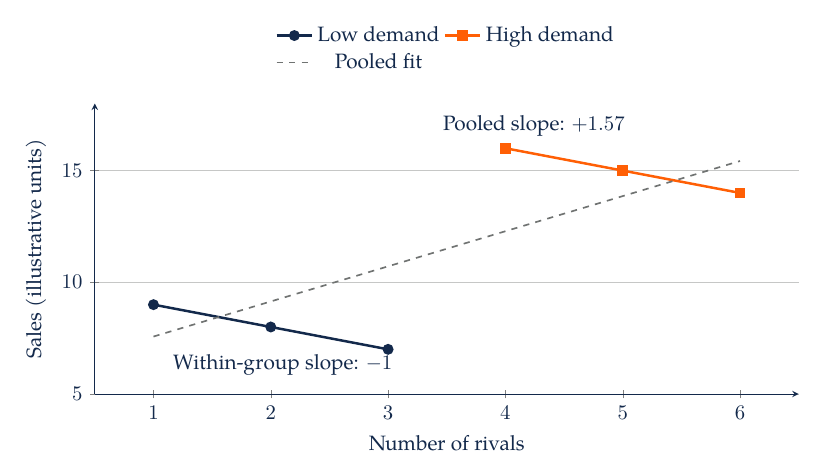
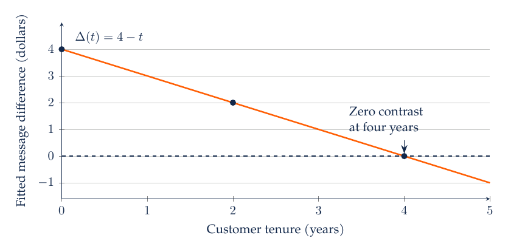
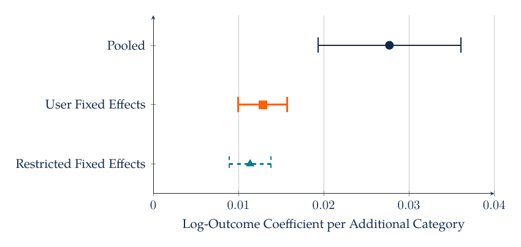

# M3. Regression, Interpretation, and Marketing Decisions

A retailer observes that stores with larger advertising budgets sell more. The manager wants to know whether another dollar of advertising would be profitable. The observed relationship combines the response to advertising with differences in store size, local demand, seasonality, and the firm's reasons for choosing the budget. Regression provides a way to summarize conditional relationships. Its value depends on which variation identifies the comparison and whether that comparison answers the manager's question.

## 3.1 A Conditional Mean and a Regression Line

Let $Y_i$ be weekly store sales measured in thousands of dollars and $X_i$ be weekly advertising expenditure in thousands of dollars. A simple linear model writes

$$
Y_i=\beta_0+\beta_1X_i+\varepsilon_i.
$$

The intercept $\beta_0$ is the fitted sales level at zero advertising; its practical interpretation is weak when zero lies far outside the observed range. The slope $\beta_1$ is the change in fitted sales, in thousands of dollars, associated with an additional thousand dollars of advertising. The residual captures the difference between observed sales and the fitted line. Linearity is an approximation to the relationship over the relevant range, not a claim that every customer's behavior is linear.

Ordinary least squares chooses coefficients to minimize the sum of squared residuals. In a simple regression with an intercept, its slope is

$$
\hat\beta_1=\frac{\sum_i(X_i-\bar X)(Y_i-\bar Y)}{\sum_i(X_i-\bar X)^2}.
$$

The numerator measures whether high-advertising observations tend to have high sales. The denominator measures how much advertising varies. When advertising hardly varies, the data provide little information about a slope, even if the sample contains many rows. A large sample of nearly identical budgets does not substitute for informative variation.

For three observations $(X,Y)=(1,3),(2,5),(3,7)$, the fitted line is $\hat Y=1+2X$. At $X=2.5$, it predicts sales of $6,000. If the sales contribution margin is 30%, an additional $1,000 of advertising is associated with $600 of contribution from $2,000 of extra sales. Treating that association as a return to intervention requires an identification argument. Even under a causal interpretation, the incremental contribution is less than the additional advertising expense in this numerical example.

## 3.2 Multiple Regression and the Comparison It Uses

A multiple regression can include observed store characteristics:

$$
Y_i=\beta_0+\beta_1X_i+\gamma Z_i+\varepsilon_i,
$$

where $Z_i$ might be floor area measured in thousands of square feet. The advertising coefficient summarizes variation in sales associated with advertising after removing the linear association with floor area. A useful way to understand this is to regress advertising on the other controls, regress sales on the same controls, and regress the resulting sales residuals on the advertising residuals. The Frisch-Waugh-Lovell result gives the same advertising coefficient as the full regression when the residualization includes the same intercept and controls.

“Controlling for” a variable therefore changes the comparison. It does not automatically remove all confounding. If managers observe local demand information that the analyst lacks, their advertising choices may remain related to unobserved sales determinants. Controls measured after the intervention can also remove part of the effect or introduce bias. Select variables using the decision timing and a substantive account of how the data were generated.

When an omitted variable affects both the predictor and the outcome, the simple slope can be misleading. In the linear population model above, suppose the regression disturbance is mean-independent of $X$ and $Z$. Omitting $Z$ yields a simple-regression slope equal to

$$
\beta_1+\gamma\frac{\operatorname{Cov}(X,Z)}{\operatorname{Var}(X)}.
$$

The extra term has a substantive interpretation. If larger stores sell more, so $\gamma>0$, and larger stores spend more on advertising, so the covariance is positive, the simple advertising slope exceeds the conditional slope. The equation is a model-based decomposition; its interpretation depends on the stated linear specification and exogeneity condition.

## 3.3 Case Study: Attractive Markets and Apparent Competitive Benefits

[Igami and Yang (2016)](https://doi.org/10.3982/QE478) study entry and competition among hamburger chains in Canada. Their setting motivates a general identification problem: attractive markets can support both more competitors and better outcomes for a focal firm. A positive relationship between rival presence and performance can therefore coexist with a negative competitive effect.

Within low-demand markets, suppose stores facing one, two, and three rivals have sales of 9, 8, and 7 units. Within high-demand markets, stores facing four, five, and six rivals have sales of 16, 15, and 14 units. Within each demand group, one additional rival is associated with one unit less sales. Across the six observations, the pooled slope is approximately $+1.57$: high-demand markets have more rivals and higher sales.



The within-group slope is $-1$, while baseline demand differs between groups. The positive pooled slope reflects that demand composition. In an actual retail application, market demand may be unobserved, entry may be forward-looking, and firms may respond strategically.

A manager considering entry should ask which outcomes would change if an additional competitor entered the same market. Comparing different markets does not automatically provide that counterfactual. Market fixed effects, measured demand controls, an instrument, or a credible event design may improve the comparison, but each uses different variation and requires its own conditions. A highly predictive regression can remain unsuitable for interpreting the coefficient as competition's causal effect.

## 3.4 Transformations and Economically Meaningful Units

A level-level specification gives an additive interpretation: one more unit of $X$ changes fitted $Y$ by $\beta_1$. A log-level specification, $\log Y=\beta_0+\beta_1X+\varepsilon$, describes proportional differences in a positive outcome. A one-unit change in $X$ changes the fitted log outcome by $\beta_1$; the corresponding multiplicative change in the log-scale prediction is $e^{\beta_1}$, or $100(e^{\beta_1}-1)$ percent. The approximation $100\beta_1$ percent is useful when the coefficient is small.

A log-log demand model, $\log Q=\alpha+\beta\log P+\varepsilon$, gives $\beta$ an elasticity interpretation over the range where the specification applies. If $\beta=-1.5$, a 1% higher price is associated with approximately 1.5% lower quantity. Sales revenue is $PQ$, so its local price elasticity is $1+\beta=-0.5$. Profit also depends on unit cost. A price that raises revenue can still lower profit, and observed prices can be endogenous because firms set them in response to demand.

Zero and negative outcomes need deliberate treatment. Taking a logarithm of zero is undefined. Adding one changes the scale and interpretation, especially when values are small or the unit of measurement changes. A two-part model can separate purchase incidence from positive expenditure. A suitable generalized linear model may model the conditional mean directly. The choice should reflect the outcome and intended estimand, with diagnostics for the selected specification.

Back-transforming a predicted log outcome also needs care. Exponentiating the predicted conditional mean of $\log Y$ generally does not produce the conditional mean of $Y$, because exponentiation is nonlinear. Retransformation methods or a model for the mean on the original scale may be needed when total sales is the target. Evaluate predictions in the units used for the managerial decision.

## 3.5 Interactions Describe How a Relationship Changes

Suppose an analyst expects a promotional message to work differently for customers with long tenure. A linear interaction specification is

$$
Y_i=\beta_0+\beta_1D_i+\beta_2T_i+\beta_3D_iT_i+\varepsilon_i,
$$

where $D_i$ is a message indicator and $T_i$ is tenure in years. The fitted message difference at tenure $t$ is $\beta_1+\beta_3t$. The coefficient $\beta_1$ is the difference at zero tenure, so centering tenure at a meaningful value can make that coefficient easier to interpret. The interaction coefficient tells how the fitted difference changes per year of tenure.

With $\beta_1=4$ dollars and $\beta_3=-1$ dollar per year, the fitted difference is $4 at tenure zero, $2 at two years, and zero at four years. An average coefficient can conceal that variation. Predictions beyond the observed tenure range should be treated as extrapolation. In a nonlinear probability model, an interaction coefficient on the model's index does not directly equal the interaction in probability; compute and plot the predicted probabilities or marginal contrasts.



For tenure between zero and five years, the assumed contrast $4-t$ crosses zero at four years. In an estimated application, uncertainty around the contrast and support at each tenure would determine whether such a crossing is informative.

## 3.6 Uncertainty, Dependence, and Practical Importance

A standard error describes sampling uncertainty under an estimator and its assumptions. A confidence interval provides a range generated by a procedure with a stated repeated-sampling coverage property. A p-value assesses compatibility with a particular null under its reference model. None of these quantities measures the managerial value of an effect by itself. A precisely estimated increase of one cent may be unimportant; a wide interval around a large potential benefit may justify another experiment.

For an approximately normal coefficient estimate, a rough 95% interval is the estimate plus or minus 1.96 standard errors, with appropriate adjustments when a finite-sample reference distribution is needed. If a sales slope is 2.0 with a standard error of 0.5, that interval is approximately [1.02, 2.98] in the slope's units. Report the units and the comparison alongside the interval.

Heteroskedasticity means that residual variance differs across observations. Heteroskedasticity-robust standard errors can address that feature for inference under suitable sampling conditions; they do not repair omitted-variable bias. Repeated store-week observations may share persistent store shocks. Clustered standard errors allow dependence within a specified cluster under their asymptotic conditions. The relevant number of independent clusters can be much smaller than the number of rows. With few clusters, conventional approximations may be unreliable and design-specific methods are needed.

## 3.7 Diagnostics and Panel Data

Inspect residuals against fitted values and important predictors for nonlinear patterns and changing variance. Investigate influential observations, errors in units, and unusual leverage. Multicollinearity can make individual coefficients unstable even when predictions are reasonably stable, because several predictors explain nearly the same variation. Removing a variable solely to obtain a smaller p-value changes the question and can introduce omitted-variable bias.

Store fixed effects absorb time-invariant differences between stores. Calendar fixed effects absorb common period-specific shocks. In a store-week panel, a model with both uses changes within stores relative to common time movements. It still requires a valid account of time-varying confounders. If a store raises advertising precisely when an unobserved local event increases demand, the advertising coefficient can remain biased.

A fitted model should be evaluated on the task for which it is used. For prediction, compare held-out errors with a useful baseline. For a descriptive coefficient, inspect support and sensitivity to substantively justified specifications. For a causal effect, assess the design and identifying conditions. A large $R^2$ indicates in-sample fit relative to an intercept-only benchmark; it does not establish a credible intervention comparison.

For repeated food logs, a customer fixed effect can absorb persistent differences in eating habits while relating changes in variety to changes in recorded consumption. It leaves time-varying motivation, activity, and reporting behavior as possible influences. The variety analysis in [Nielsen and coauthors (2022)](https://doi.org/10.1086/720453) provides a concrete application. Percentage-change outcomes also require attention to zero denominators: excluding days with zero prior vegetable or snack consumption changes the sample relative to an analysis of total calories. Interpret each coefficient for its own observed population and outcome definition.

## 3.8 AI-Assisted Implementation and Practice

Ask an assistant to fit the pooled and demand-group-adjusted regressions in the six-observation example. Require a table with variable definitions, units, coefficients, and the exact sample. Verify that the adjusted rival coefficient is $-1$ and the pooled coefficient is $11/7\approx1.57$. Ask it to explain why adding demand-group indicators changes the comparison. A numerical match without that explanation is an incomplete interpretation.

For a larger dataset, specify the formula and desired covariance estimator before requesting code. Ask the assistant to list dropped rows and explain how categorical variables were encoded. Have it calculate a predicted contrast at two values of a moderator and compare the result with the interaction formula. Treat diagnostic recommendations as hypotheses to inspect, rather than automatic permission to remove observations or alter the model.

For practice, consider an advertising coefficient measured per $1,000 of spending. Re-express the predictor in dollars and explain how the numerical coefficient changes while fitted sales remain the same. Next explain why a robust standard error cannot eliminate the bias in the market-demand example. Finally, distinguish a confidence interval for the conditional mean from a prediction interval for a new store's realized sales: the latter also reflects individual outcome variation.

## 3.9 Readings

[An Introduction to Statistical Learning](https://www.statlearning.com/) provides a foundation for regression, model assessment, and nonlinear extensions. The [statsmodels regression documentation](https://www.statsmodels.org/stable/regression.html) supports implementation.

## 3.10 mHealth: Breadth and Next-Day Recorded Calories

The manager observes that users with broader daily food logs often report more calories and considers using breadth to identify customers who may want different suggestions. The relevant first comparison concerns timing: does today's recorded breadth predict the next calendar day's reported total? Taking the next available row would turn a one-day comparison into an interval of variable length when customers skip days.

Let $K_{it}$ be today's recorded category count and $E_{i,t+1}$ the next calendar day's reported calories. Among positive consecutive-day pairs, estimate

$$
\log E_{i,t+1}=\alpha_i+\beta K_{it}+\gamma_{m(t)}+\delta_{w(t)}+u_{it}.
$$

The customer effect $\alpha_i$ absorbs time-invariant differences in typical logging and intake. Month and weekday effects describe calendar variation. The coefficient compares days with different recorded breadth for the same user, after these additive controls. It remains an association: changing appetite, omitted meals, or recording effort can affect both breadth and later totals. The [NCI discussion of weekday effects](https://epi.grants.cancer.gov/dietary-assessment-primer/learn/day.html) motivates attention to calendar composition.

The sample requires positive reported totals on both dates and at least two eligible pairs per user. It contains 69,648 pairs from 370 users. Standard errors are clustered by user to allow dependence among overlapping pairs. The pooled model uses the same month and weekday controls but omits customer effects. No prior-outcome control or calorie winsorization is included in either baseline specification.

| Specification | Pairs | Breadth Coefficient | Clustered 95% Interval |
| --- | ---: | ---: | ---: |
| Pooled | 69,648 | 0.02771 | [0.01934, 0.03609] |
| Customer Fixed Effects | 69,648 | 0.01284 | [0.00997, 0.01572] |
| Fixed Effects, 100–5,000 on Both Days | 69,216 | 0.01136 | [0.00893, 0.01380] |

In the fixed-effects model, one additional category corresponds to a 1.29% higher conditional geometric mean of next-day reported calories, calculated as $100(e^{\beta}-1)$. This percentage does not automatically describe the arithmetic mean. The pooled estimate is larger, consistent with persistent differences across users contributing to the pooled association. Its reduction after adding fixed effects does not identify a causal mechanism.

The third row applies the explicitly imposed review range from M1 to both dates. It removes 432 pairs and produces a 1.14% geometric-mean association. This is a sensitivity comparison on a changed sample, not a validated nutrition screen. The baseline outcome ranges from 0.64 to 9,190, so the restriction directly addresses observations influential on the log scale. The adult and percentile screens in M2 answer different sample questions and should be named separately when used.



The intervals quantify sampling uncertainty under the regression and clustering specification. They do not account for all reporting error or make breadth an assigned treatment. A recommendation to induce greater breadth needs evidence about how a particular intervention changes behavior and outcomes.

The date shift below moves future outcomes back exactly one day before the merge. The program then applies each sample rule explicitly and reports pair and user counts. An AI-generated `groupby(...).shift(-1)` without a date-gap check would answer a different question.

Python source: [m03.py](../../03_Data_and_Code/mHealth/recurring_examples/m03.py). From its directory, run `python m03.py`.

```python
"""Estimate descriptive next-calendar-day associations with clustered uncertainty."""

import json
import numpy as np
import pandas as pd
import statsmodels.formula.api as smf
from common import load_inputs, save_result

food, daily, baskets = load_inputs()
future = daily[["Userid", "date", "food_calories"]].copy()
future["date"] -= pd.Timedelta(days=1)
future = future.rename(columns={"food_calories": "next_calories"})
panel = daily.merge(future, on=["Userid", "date"], validate="one_to_one")
panel = panel.loc[panel.food_calories.gt(0) & panel.next_calories.gt(0)].copy()
counts = panel.groupby("Userid").size()
panel = panel.loc[panel.Userid.isin(counts[counts >= 2].index)].copy()
panel["log_next"] = np.log(panel.next_calories)
panel["month"] = panel.date.dt.month
panel["weekday"] = panel.date.dt.dayofweek
assert (panel.next_calories > 0).all()
restricted = panel.loc[
    panel.food_calories.between(100, 5000) & panel.next_calories.between(100, 5000)
].copy()
counts = restricted.groupby("Userid").size()
restricted = restricted.loc[restricted.Userid.isin(counts[counts >= 2].index)]
fits = {}
base = "log_next ~ category_count + C(month) + C(weekday)"
specifications = [
    ("pooled", base, panel),
    ("user_fixed_effects", base + " + C(Userid)", panel),
    ("restricted_fixed_effects", base + " + C(Userid)", restricted),
]
for name, formula, sample in specifications:
    fit = smf.ols(formula, data=sample).fit(
        cov_type="cluster", cov_kwds={"groups": sample.Userid}, use_t=True
    )
    coefficient = float(fit.params["category_count"])
    low, high = map(float, fit.conf_int().loc["category_count"])
    fits[name] = {
        "pairs": len(sample),
        "users": int(sample.Userid.nunique()),
        "coefficient": coefficient,
        "se": float(fit.bse["category_count"]),
        "ci_low": low,
        "ci_high": high,
        "geometric_mean_percent": 100 * float(np.expm1(coefficient)),
    }
result = {
    "pairs": len(panel),
    "users": int(panel.Userid.nunique()),
    "min_next_calories": float(panel.next_calories.min()),
    "max_next_calories": float(panel.next_calories.max()),
    "models": fits,
}
save_result("M03", result)
print(json.dumps(result, indent=2))
```

## 3.11 Python Calculations for the Synthetic Cases

The inputs below are imposed teaching values. Running the program creates the labeled synthetic CSV files and prints the corresponding calculations. They are separate from the mHealth estimates. Keep the script beside `example_helpers.py` in `03_Data_and_Code/Lecture_Examples`.

Python source: [m03_synthetic.py](../../03_Data_and_Code/Lecture_Examples/m03_synthetic.py). From its directory, run `python m03_synthetic.py`.

```python
"""Synthetic numerical examples for M3; run from any working directory."""

import itertools
import json
import math
from example_helpers import write_csv, ols_slope, shares

r = {}
low = [(1, 9), (2, 8), (3, 7)]
high = [(4, 16), (5, 15), (6, 14)]
write_csv(
    "M03_rivals_synthetic.csv",
    ["demand_group", "rival_count", "sales_illustrative_units"],
    [("low", x, y) for x, y in low] + [("high", x, y) for x, y in high],
)
r["M03"] = {
    "pooled": ols_slope(low + high),
    "low": ols_slope(low),
    "high": ols_slope(high),
    "simple_sales_fit": ols_slope([(1, 3), (2, 5), (3, 7)]),
    "coefficient_ci": [2 - 1.96 * 0.5, 2 + 1.96 * 0.5],
}
assert math.isclose(r["M03"]["pooled"]["slope"], 11 / 7)
assert r["M03"]["low"]["slope"] == r["M03"]["high"]["slope"] == -1
print(json.dumps(r, indent=2))
```
