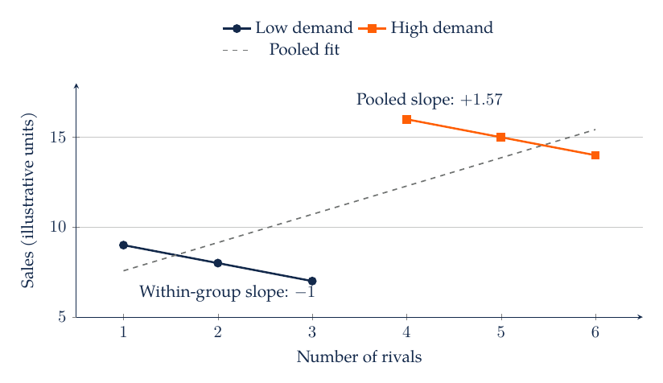
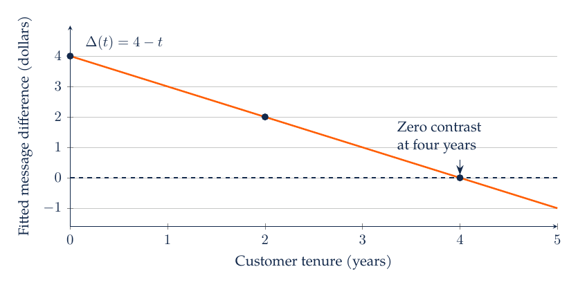
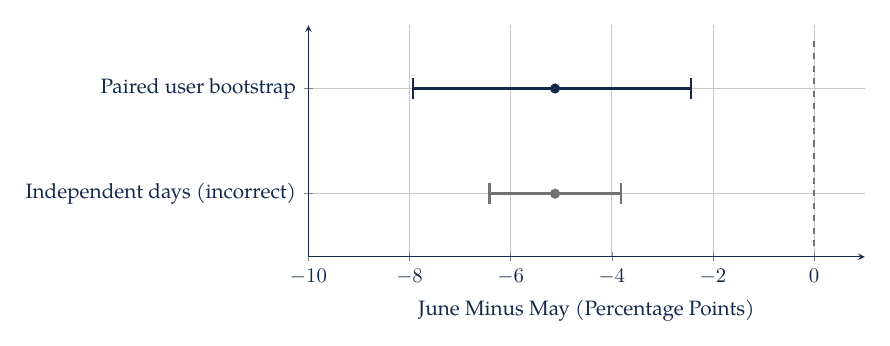
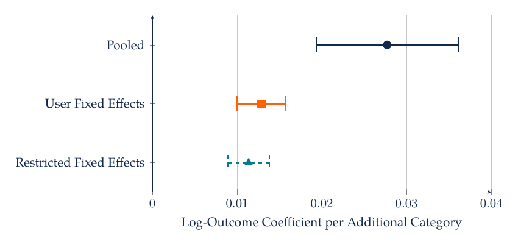
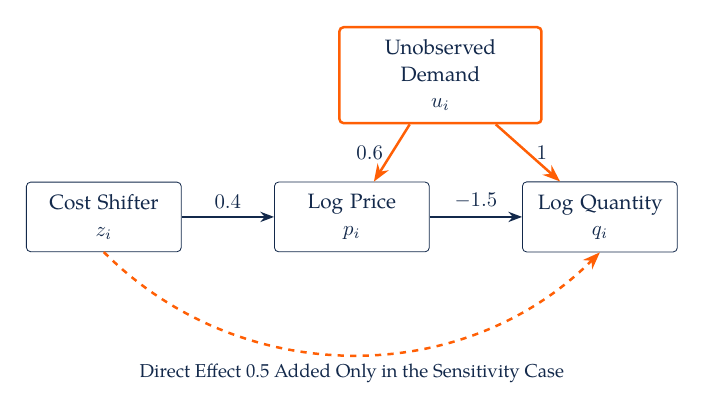
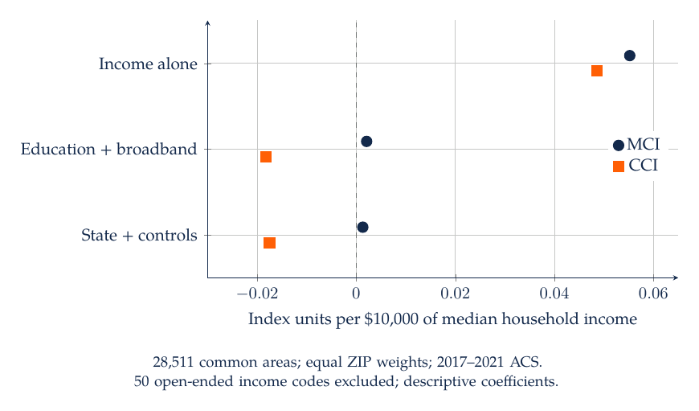
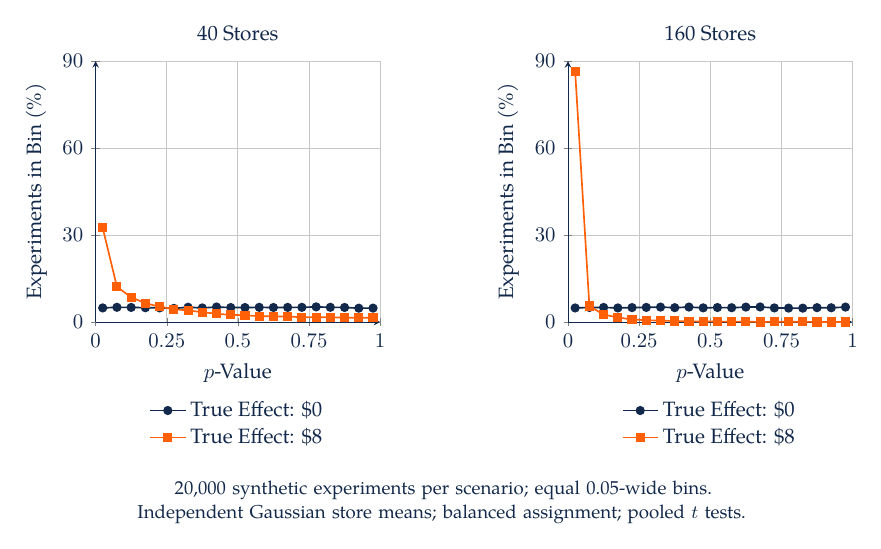

# M3. Regression, Interpretation, and Marketing Decisions

A retailer observes that stores with larger advertising budgets sell more. The manager wants to know whether another dollar of advertising would be profitable. The observed relationship combines the response to advertising with differences in store size, local demand, seasonality, and the firm's reasons for choosing the budget. Regression provides a way to summarize conditional relationships. Its value depends on which variation identifies the comparison and whether that comparison answers the manager's question.

## 3.1 A Conditional Mean and a Regression Line

Let $Y_i$ be weekly store sales measured in thousands of dollars and $X_i$ be weekly advertising expenditure in thousands of dollars. A simple linear model writes

$$
Y_i=\beta_0+\beta_1X_i+\varepsilon_i.
$$

The intercept $\beta_0$ is the fitted sales level at zero advertising; its practical interpretation is weak when zero lies far outside the observed range. The slope $\beta_1$ is the change in fitted sales, in thousands of dollars, associated with an additional thousand dollars of advertising. The residual captures the difference between observed sales and the fitted line. Linearity is an approximation to the relationship over the relevant range, not a claim that every customer's behavior is linear.

Ordinary least squares chooses coefficients to minimize the sum of squared residuals. In a simple regression with an intercept, its slope is

$$
\hat\beta_1=\frac{\sum_i(X_i-\bar X)(Y_i-\bar Y)}{\sum_i(X_i-\bar X)^2}.
$$

The numerator measures whether high-advertising observations tend to have high sales. The denominator measures how much advertising varies. When advertising hardly varies, the data provide little information about a slope, even if the sample contains many rows. A large sample of nearly identical budgets does not substitute for informative variation.

For three observations $(X,Y)=(1,3),(2,5),(3,7)$, the fitted line is $\hat Y=1+2X$. At $X=2.5$, it predicts sales of $6,000. If the sales contribution margin is 30%, an additional $1,000 of advertising is associated with $600 of contribution from $2,000 of extra sales. Treating that association as a return to intervention requires an identification argument. Even under a causal interpretation, the incremental contribution is less than the additional advertising expense in this numerical example.

## 3.2 Multiple Regression and the Comparison It Uses

A multiple regression can include observed store characteristics:

$$
Y_i=\beta_0+\beta_1X_i+\gamma Z_i+\varepsilon_i,
$$

where $Z_i$ might be floor area measured in thousands of square feet. The advertising coefficient summarizes variation in sales associated with advertising after removing the linear association with floor area. A useful way to understand this is to regress advertising on the other controls, regress sales on the same controls, and regress the resulting sales residuals on the advertising residuals. The Frisch-Waugh-Lovell result gives the same advertising coefficient as the full regression when the residualization includes the same intercept and controls.

“Controlling for” a variable therefore changes the comparison. It does not automatically remove all confounding. If managers observe local demand information that the analyst lacks, their advertising choices may remain related to unobserved sales determinants. Controls measured after the intervention can also remove part of the effect or introduce bias. Select variables using the decision timing and a substantive account of how the data were generated.

When an omitted variable affects both the predictor and the outcome, the simple slope can be misleading. In the linear population model above, suppose the regression disturbance is mean-independent of $X$ and $Z$. Omitting $Z$ yields a simple-regression slope equal to

$$
\beta_1+\gamma\frac{\operatorname{Cov}(X,Z)}{\operatorname{Var}(X)}.
$$

The extra term has a substantive interpretation. If larger stores sell more, so $\gamma>0$, and larger stores spend more on advertising, so the covariance is positive, the simple advertising slope exceeds the conditional slope. The equation is a model-based decomposition; its interpretation depends on the stated linear specification and exogeneity condition.

## 3.3 Case Study: Attractive Markets and Apparent Competitive Benefits

A study of entry and competition among hamburger chains in Canada [(Igami and Yang, 2016)](https://doi.org/10.3982/QE478) motivates a general identification problem: attractive markets can support both more competitors and better outcomes for a focal firm. A positive relationship between rival presence and performance can therefore coexist with a negative competitive effect.

Within low-demand markets, suppose stores facing one, two, and three rivals have sales of 9, 8, and 7 units. Within high-demand markets, stores facing four, five, and six rivals have sales of 16, 15, and 14 units. Within each demand group, one additional rival is associated with one unit less sales. Across the six observations, the pooled slope is approximately $+1.57$: high-demand markets have more rivals and higher sales.



The within-group slope is $-1$, while baseline demand differs between groups. The positive pooled slope reflects that demand composition. In an actual retail application, market demand may be unobserved, entry may be forward-looking, and firms may respond strategically.

A manager considering entry should ask which outcomes would change if an additional competitor entered the same market. Comparing different markets does not automatically provide that counterfactual. Market fixed effects, measured demand controls, an instrument, or a credible event design may improve the comparison, but each uses different variation and requires its own conditions. A highly predictive regression can remain unsuitable for interpreting the coefficient as competition's causal effect.

## 3.4 Transformations and Economically Meaningful Units

A level-level specification gives an additive interpretation: one more unit of $X$ changes fitted $Y$ by $\beta_1$. A log-level specification, $\log Y=\beta_0+\beta_1X+\varepsilon$, describes proportional differences in a positive outcome. A one-unit change in $X$ changes the fitted log outcome by $\beta_1$; the corresponding multiplicative change in the log-scale prediction is $e^{\beta_1}$, or $100(e^{\beta_1}-1)$ percent. The approximation $100\beta_1$ percent is useful when the coefficient is small.

A log-log demand model, $\log Q=\alpha+\beta\log P+\varepsilon$, gives $\beta$ an elasticity interpretation over the range where the specification applies. If $\beta=-1.5$, a 1% higher price is associated with approximately 1.5% lower quantity. Sales revenue is $PQ$, so its local price elasticity is $1+\beta=-0.5$. Profit also depends on unit cost. A price that raises revenue can still lower profit, and observed prices can be endogenous because firms set them in response to demand.

Zero and negative outcomes need deliberate treatment. Taking a logarithm of zero is undefined. Adding one changes the scale and interpretation, especially when values are small or the unit of measurement changes. A two-part model can separate purchase incidence from positive expenditure. A suitable generalized linear model may model the conditional mean directly. The choice should reflect the outcome and intended estimand, with diagnostics for the selected specification.

Back-transforming a predicted log outcome also needs care. Exponentiating the predicted conditional mean of $\log Y$ generally does not produce the conditional mean of $Y$, because exponentiation is nonlinear. Retransformation methods or a model for the mean on the original scale may be needed when total sales is the target. Evaluate predictions in the units used for the managerial decision.

## 3.5 Interactions Describe How a Relationship Changes

Suppose an analyst expects a promotional message to work differently for customers with long tenure. A linear interaction specification is

$$
Y_i=\beta_0+\beta_1D_i+\beta_2T_i+\beta_3D_iT_i+\varepsilon_i,
$$

where $D_i$ is a message indicator and $T_i$ is tenure in years. The fitted message difference at tenure $t$ is $\beta_1+\beta_3t$. The coefficient $\beta_1$ is the difference at zero tenure, so centering tenure at a meaningful value can make that coefficient easier to interpret. The interaction coefficient tells how the fitted difference changes per year of tenure.

With $\beta_1=4$ dollars and $\beta_3=-1$ dollar per year, the fitted difference is $4 at tenure zero, $2 at two years, and zero at four years. An average coefficient can conceal that variation. Predictions beyond the observed tenure range should be treated as extrapolation. In a nonlinear probability model, an interaction coefficient on the model's index does not directly equal the interaction in probability; compute and plot the predicted probabilities or marginal contrasts.



For tenure between zero and five years, the assumed contrast $4-t$ crosses zero at four years. In an estimated application, uncertainty around the contrast and support at each tenure would determine whether such a crossing is informative.

## 3.6 Uncertainty, Dependence, and Practical Importance

A standard error describes sampling uncertainty under an estimator and its assumptions. A confidence interval provides a range generated by a procedure with a stated repeated-sampling coverage property. A p-value assesses compatibility with a particular null under its reference model. None of these quantities measures the managerial value of an effect by itself. A precisely estimated increase of one cent may be unimportant; a wide interval around a large potential benefit may justify another experiment.

For an approximately normal coefficient estimate, a rough 95% interval is the estimate plus or minus 1.96 standard errors, with appropriate adjustments when a finite-sample reference distribution is needed. If a sales slope is 2.0 with a standard error of 0.5, that interval is approximately [1.02, 2.98] in the slope's units. Report the units and the comparison alongside the interval.

Heteroskedasticity means that residual variance differs across observations. Heteroskedasticity-robust standard errors can address that feature for inference under suitable sampling conditions; they do not repair omitted-variable bias. Repeated store-week observations may share persistent store shocks. Clustered standard errors allow dependence within a specified cluster under their asymptotic conditions. The relevant number of independent clusters can be much smaller than the number of rows. With few clusters, conventional approximations may be unreliable and design-specific methods are needed.

### 3.6.1 A Paired Change Requires Paired Uncertainty

A manager comparing May and June logging has two observations for each eligible mHealth user. The target is the average within-user change in the fraction of calendar days with a recorded entry. Let $p_{iM}$ and $p_{iJ}$ denote the May and June fractions and define $d_i=p_{iJ}-p_{iM}$. With users treated as independent sampling units, an estimated standard error for the average change is

$$
\widehat{\mathrm{SE}}(\bar d)=\frac{s_d}{\sqrt N},\qquad
s_d^2=\frac{1}{N-1}\sum_i(d_i-\bar d)^2.
$$

This calculation preserves the dependence between a user's two outcomes. The variance identity $\operatorname{Var}(p_{iJ}-p_{iM})=\operatorname{Var}(p_{iJ})+\operatorname{Var}(p_{iM})-2\operatorname{Cov}(p_{iJ},p_{iM})$ explains why separately resampling the two months changes the uncertainty calculation. Persistent user differences can cancel in a paired contrast. Dependence among days within a user also means that the number of calendar rows overstates the number of independent sampling units.

For the fixed population defined in M2, Section 2.14, the average change is $-5.12$ percentage points. Resampling complete users with both months together gives a 95% percentile-bootstrap interval of $[-7.93,-2.43]$ percentage points. The standard error calculated from the dispersion of user-level changes is 1.38 percentage points. An independent-Bernoulli-day calculation gives 0.66 percentage points and the narrower interval $[-6.42,-3.82]$. That calculation discards the observed dependence structure. A plotting library's default error bar can conceal this difference if the analyst supplies calendar rows without specifying the resampling unit.



The bootstrap treats observed user histories as draws from a common user distribution, with independence across users and both months fixed. It does not incorporate shocks shared across the entire platform or establish representativeness beyond this selected cohort. Both intervals concern a descriptive temporal difference. A causal claim about a product change would require an assignment design and uncertainty appropriate to that design. The full `visualization.py` program in M2, Section 2.14.3, calculates the monthly table, paired bootstrap, and independent-day comparison; `visualization_charts.py` generates the interval figure from those results.

## 3.7 Diagnostics and Panel Data

Residual patterns help determine whether the fitted relationship adequately describes the comparison. Plot residuals against fitted values and important predictors to examine nonlinearity and changing variance. Investigate influential observations, errors in units, and unusual leverage before interpreting a coefficient as a stable guide to the marketing decision. Multicollinearity can make individual coefficients unstable even when predictions are reasonably stable, because several predictors explain nearly the same variation. Removing a variable solely to obtain a smaller p-value changes the question and can introduce omitted-variable bias.

Store fixed effects absorb time-invariant differences between stores. Calendar fixed effects absorb common period-specific shocks. In a store-week panel, a model with both uses changes within stores relative to common time movements. It still requires a valid account of time-varying confounders. If a store raises advertising precisely when an unobserved local event increases demand, the advertising coefficient can remain biased.

A fitted model should be evaluated on the task for which it is used. For prediction, compare held-out errors with a useful baseline. For a descriptive coefficient, inspect support and sensitivity to substantively justified specifications. For a causal effect, assess the design and identifying conditions. A large $R^2$ indicates in-sample fit relative to an intercept-only benchmark; it does not establish a credible intervention comparison.

For repeated food logs, a customer fixed effect can absorb persistent differences in eating habits while relating changes in variety to changes in recorded consumption. It leaves time-varying motivation, activity, and reporting behavior as possible influences. The variety analysis in [(Nielsen et al., 2022)](https://doi.org/10.1086/720453) provides a concrete application. Percentage-change outcomes also require attention to zero denominators: excluding days with zero prior vegetable or snack consumption changes the sample relative to an analysis of total calories. Interpret each coefficient for its own observed population and outcome definition.

## 3.8 AI-Assisted Implementation and Practice

Ask an assistant to fit the pooled and demand-group-adjusted regressions in the six-observation example. Require a table with variable definitions, units, coefficients, and the exact sample. Verify that the adjusted rival coefficient is $-1$ and the pooled coefficient is $11/7\approx1.57$. Ask it to explain why adding demand-group indicators changes the comparison. A numerical match without that explanation is an incomplete interpretation.

For a larger dataset, specify the formula and desired covariance estimator before requesting code. Ask the assistant to list dropped rows and explain how categorical variables were encoded. Have it calculate a predicted contrast at two values of a moderator and compare the result with the interaction formula. Inspect the evidence behind each diagnostic recommendation. Removing observations or changing the model requires a reason tied to the measurement process or the question being estimated.

For practice, consider an advertising coefficient measured per $1,000 of spending. Re-express the predictor in dollars and explain how the numerical coefficient changes while fitted sales remain the same. Next explain why a robust standard error cannot eliminate the bias in the market-demand example. Finally, distinguish a confidence interval for the conditional mean from a prediction interval for a new store's realized sales: the latter also reflects individual outcome variation.

## 3.9 Readings

[An Introduction to Statistical Learning](https://www.statlearning.com/) provides a foundation for regression, model assessment, and nonlinear extensions. The [statsmodels regression documentation](https://www.statsmodels.org/stable/regression.html) supports implementation.

## 3.10 mHealth: Breadth and Next-Day Recorded Calories

The manager observes that users with broader daily food logs often report more calories and considers using breadth to identify customers who may want different suggestions. The relevant first comparison concerns timing: does today's recorded breadth predict the next calendar day's reported total? Taking the next available row would turn a one-day comparison into an interval of variable length when customers skip days.

Let $K_{it}$ be today's recorded category count and $E_{i,t+1}$ the next calendar day's reported calories. Among positive consecutive-day pairs, estimate

$$
\log E_{i,t+1}=\alpha_i+\beta K_{it}+\gamma_{m(t)}+\delta_{w(t)}+u_{it}.
$$

The customer effect $\alpha_i$ absorbs time-invariant differences in typical logging and intake. Month and weekday effects describe calendar variation. The coefficient compares days with different recorded breadth for the same user, after these additive controls. It remains an association: changing appetite, omitted meals, or recording effort can affect both breadth and later totals. The [NCI discussion of weekday effects](https://epi.grants.cancer.gov/dietary-assessment-primer/learn/day.html) motivates attention to calendar composition.

The sample requires positive reported totals on both dates and at least two eligible pairs per user. It contains 69,648 pairs from 370 users. Standard errors are clustered by user to allow dependence among overlapping pairs. The pooled model uses the same month and weekday controls but omits customer effects. No prior-outcome control or calorie winsorization is included in either baseline specification.

| Specification | Pairs | Breadth Coefficient | Clustered 95% Interval |
| --- | ---: | ---: | ---: |
| Pooled | 69,648 | 0.02771 | [0.01934, 0.03609] |
| Customer Fixed Effects | 69,648 | 0.01284 | [0.00997, 0.01572] |
| Fixed Effects, 100–5,000 on Both Days | 69,216 | 0.01136 | [0.00893, 0.01380] |

In the fixed-effects model, one additional category corresponds to a 1.29% higher conditional geometric mean of next-day reported calories, calculated as $100(e^{\beta}-1)$. This percentage does not automatically describe the arithmetic mean. The pooled estimate is larger, consistent with persistent differences across users contributing to the pooled association. Its reduction after adding fixed effects does not identify a causal mechanism.

The third row applies the explicitly imposed review range from M1 to both dates. It removes 432 pairs and produces a 1.14% geometric-mean association. This is a sensitivity comparison on a changed sample, not a validated nutrition screen. The baseline outcome ranges from 0.64 to 9,190, so the restriction directly addresses observations influential on the log scale. The adult and percentile screens in M2 answer different sample questions and should be named separately when used.



The intervals quantify sampling uncertainty under the regression and clustering specification. They do not account for all reporting error or make breadth an assigned treatment. A recommendation to induce greater breadth needs evidence about how a particular intervention changes behavior and outcomes.

The date shift below moves future outcomes back exactly one day before the merge. The program then applies each sample rule explicitly and reports pair and user counts. An AI-generated `groupby(...).shift(-1)` without a date-gap check would answer a different question.

Python source: [m03.py](../../03_Data_and_Code/mHealth/recurring_examples/m03.py). From its directory, run `python m03.py`.

```python
"""Estimate descriptive next-calendar-day associations with clustered uncertainty."""

import json
import numpy as np
import pandas as pd
import statsmodels.formula.api as smf
from common import load_inputs, save_result

food, daily, baskets = load_inputs()
future = daily[["Userid", "date", "food_calories"]].copy()
future["date"] -= pd.Timedelta(days=1)
future = future.rename(columns={"food_calories": "next_calories"})
panel = daily.merge(future, on=["Userid", "date"], validate="one_to_one")
panel = panel.loc[panel.food_calories.gt(0) & panel.next_calories.gt(0)].copy()
counts = panel.groupby("Userid").size()
panel = panel.loc[panel.Userid.isin(counts[counts >= 2].index)].copy()
panel["log_next"] = np.log(panel.next_calories)
panel["month"] = panel.date.dt.month
panel["weekday"] = panel.date.dt.dayofweek
assert (panel.next_calories > 0).all()
restricted = panel.loc[
    panel.food_calories.between(100, 5000) & panel.next_calories.between(100, 5000)
].copy()
counts = restricted.groupby("Userid").size()
restricted = restricted.loc[restricted.Userid.isin(counts[counts >= 2].index)]
fits = {}
base = "log_next ~ category_count + C(month) + C(weekday)"
specifications = [
    ("pooled", base, panel),
    ("user_fixed_effects", base + " + C(Userid)", panel),
    ("restricted_fixed_effects", base + " + C(Userid)", restricted),
]
for name, formula, sample in specifications:
    fit = smf.ols(formula, data=sample).fit(
        cov_type="cluster", cov_kwds={"groups": sample.Userid}, use_t=True
    )
    coefficient = float(fit.params["category_count"])
    low, high = map(float, fit.conf_int().loc["category_count"])
    fits[name] = {
        "pairs": len(sample),
        "users": int(sample.Userid.nunique()),
        "coefficient": coefficient,
        "se": float(fit.bse["category_count"]),
        "ci_low": low,
        "ci_high": high,
        "geometric_mean_percent": 100 * float(np.expm1(coefficient)),
    }
result = {
    "pairs": len(panel),
    "users": int(panel.Userid.nunique()),
    "min_next_calories": float(panel.next_calories.min()),
    "max_next_calories": float(panel.next_calories.max()),
    "models": fits,
}
save_result("M03", result)
print(json.dumps(result, indent=2))
```

## 3.11 Python Calculations for the Synthetic Cases

The inputs below are imposed teaching values. Running the program creates the labeled synthetic CSV files and prints the corresponding calculations. They are separate from the mHealth estimates. Keep the script beside `example_helpers.py` in `03_Data_and_Code/Lecture_Examples`.

Python source: [m03_synthetic.py](../../03_Data_and_Code/Lecture_Examples/m03_synthetic.py). From its directory, run `python m03_synthetic.py`.

```python
"""Synthetic numerical examples for M3; run from any working directory."""

import itertools
import json
import math
from example_helpers import write_csv, ols_slope, shares

r = {}
low = [(1, 9), (2, 8), (3, 7)]
high = [(4, 16), (5, 15), (6, 14)]
write_csv(
    "M03_rivals_synthetic.csv",
    ["demand_group", "rival_count", "sales_illustrative_units"],
    [("low", x, y) for x, y in low] + [("high", x, y) for x, y in high],
)
r["M03"] = {
    "pooled": ols_slope(low + high),
    "low": ols_slope(low),
    "high": ols_slope(high),
    "simple_sales_fit": ols_slope([(1, 3), (2, 5), (3, 7)]),
    "coefficient_ci": [2 - 1.96 * 0.5, 2 + 1.96 * 0.5],
}
assert math.isclose(r["M03"]["pooled"]["slope"], 11 / 7)
assert r["M03"]["low"]["slope"] == r["M03"]["high"]["slope"] == -1
print(json.dumps(r, indent=2))
```

## 3.12 Price Elasticity When Prices Respond to Demand

A retailer considers raising a price and wants the resulting percentage change in quantity. Historical prices can be high precisely when managers expect strong demand. A regression of quantity on price then combines the response to price with information used to choose it. Good predictive fit does not separate these two sources of variation.

Consider a synthetic population of independent markets. Let $p_i$ be log price in dollars per unit and $q_i$ log quantity sold. A standardized cost shifter $z_i$, an unobserved demand shock $u_i$, and independent shocks $v_i,e_i$ are mutually independent standard normal variables. The imposed price rule and demand equation are

$$
p_i=2+0.4z_i+0.6u_i+0.2v_i,
\qquad
q_i=5-1.5p_i+u_i+0.2e_i.
$$

The demand elasticity is $-1.5$: a small 1% increase in price changes quantity by approximately $-1.5\%$ with the demand shock held fixed. The coefficient $0.6$ makes price respond positively to unobserved demand. The cost shifter changes price and has no direct effect on quantity in this benchmark. These equations are imposed behavioral relationships, without an estimated supply model or a solved pricing equilibrium.

For the general linear equation $q_i=\alpha+\beta p_i+\varepsilon_i$, an instrumental-variable interpretation rests on the following conditions.

\begin{assumption}[Price Instrument]
\label{ass:price-instrument}
Markets are independent draws with finite second moments. The demand equation has a common coefficient $\beta$. The cost shifter satisfies $\operatorname{Cov}(z_i,\varepsilon_i)=0$ and $\operatorname{Cov}(z_i,p_i)\ne0$.
\end{assumption}

Under Assumption \ref{ass:price-instrument}, the ratio $\operatorname{Cov}(z_i,q_i)/\operatorname{Cov}(z_i,p_i)$ equals $\beta$. The numerator measures quantity variation associated with the cost shifter, and the denominator measures the induced price variation. Ordinary least squares instead has probability limit $\beta+\operatorname{Cov}(p_i,\varepsilon_i)/\operatorname{Var}(p_i)$, which is less negative in the benchmark because favorable demand shocks raise price.



The sample contains 2,000 simulated markets with seed 534. OLS and two-stage least squares use an intercept and the same log-price regressor. The reported intervals use heteroskedasticity-robust HC1 covariance estimates and a normal approximation.

| Estimator and Data Construction | Elasticity | 95% Interval |
| --- | ---: | --- |
| OLS, Benchmark | -0.447 | [-0.483, -0.410] |
| IV, Benchmark | -1.483 | [-1.589, -1.378] |
| IV, Direct Cost Effect Added | -0.239 | [-0.283, -0.195] |

The third row adds $0.5z_i$ directly to log quantity while preserving the price rule and the structural price elasticity. Its first-stage F statistic remains 815.85, identical to the benchmark. A strong first stage therefore coexists with a severely misleading elasticity estimate when exclusion fails. For example, a proposed cost instrument that also changes product quality could affect demand through an additional path.

The [PyBLP logit tutorial](https://pyblp.readthedocs.io/en/stable/_notebooks/tutorial/logit_nested.html) treats prices as endogenous in differentiated-product demand. Its market-share models require additional structure beyond this scalar simulation. The calculation below exposes the instrument logic directly. With $X$ containing the intercept and price and $Z$ the intercept and cost shifter, it forms $\widehat X=Z(Z'Z)^{-1}Z'X$ and computes $(\widehat X'X)^{-1}\widehat X'q$. Its covariance uses the structural residual $q-X\widehat\beta$, which differs from a second-stage residual formed with fitted price.

Python source: [price_iv.py](../../03_Data_and_Code/Lecture_Examples/price_iv.py). From its directory, run `python price_iv.py`.

```python
"""Synthetic price endogeneity and an exclusion-restriction sensitivity."""

from pathlib import Path
import json
import numpy as np


def fit_iv(y, x, z):
    # Instruments include the intercept. Avoid constructing an n-by-n matrix.
    xhat = z @ np.linalg.lstsq(z, x, rcond=None)[0]
    bread = np.linalg.inv(xhat.T @ x)
    beta = bread @ xhat.T @ y
    residual = y - x @ beta
    scores = xhat * residual[:, None]
    covariance = bread @ (scores.T @ scores) @ bread.T
    covariance *= len(y) / (len(y) - x.shape[1])  # HC1 correction
    se = np.sqrt(np.diag(covariance))
    return {
        "elasticity": float(beta[1]),
        "robust_se": float(se[1]),
        "ci95": [float(beta[1] - 1.96 * se[1]), float(beta[1] + 1.96 * se[1])],
    }


def calculate():
    rng = np.random.default_rng(534)
    n = 2000
    cost, demand, pricing_noise, sales_noise = rng.normal(size=(4, n))
    log_price = 2 + 0.4 * cost + 0.6 * demand + 0.2 * pricing_noise
    log_quantity = 5 - 1.5 * log_price + demand + 0.2 * sales_noise
    x = np.column_stack([np.ones(n), log_price])
    z = np.column_stack([np.ones(n), cost])
    first = z @ np.linalg.lstsq(z, log_price, rcond=None)[0]
    residual_ss = np.square(log_price - first).sum()
    total_ss = np.square(log_price - log_price.mean()).sum()
    first_stage_f = (total_ss - residual_ss) / (residual_ss / (n - 2))
    result = {
        "data": "synthetic independent markets",
        "markets": n,
        "seed": 534,
        "true_elasticity": -1.5,
        "ols": fit_iv(log_quantity, x, x),
        "valid_iv": fit_iv(log_quantity, x, z),
        "invalid_iv_direct_cost_effect_0_5": fit_iv(log_quantity + 0.5 * cost, x, z),
        "first_stage_f": float(first_stage_f),
    }
    return result


if __name__ == "__main__":
    result = calculate()
    output = Path(__file__).resolve().parent / "price_iv_results.json"
    output.write_text(json.dumps(result, indent=2, allow_nan=False) + "\n")
    print(json.dumps(result, indent=2))
```

## 3.13 Regression Evidence and Advertising Claims

\noindent A firm considering a claim about its product must match the statement customers will understand to the evidence supporting it. A regression of later engagement on earlier use describes a conditional relationship under the specified sample and controls. A claim that the product causes better outcomes requires evidence about the relevant intervention and comparison. The coefficient's statistical significance does not supply that comparison.

The FTC's advertising-substantiation policy addresses reasonable support for objective express and implied claims before they are disseminated. The necessary support depends on the claim and its context. A technically accurate description of a regression can still invite a broader inference if the surrounding advertisement promises a product benefit. See the [FTC policy statement](https://www.ftc.gov/legal-library/browse/ftc-policy-statement-regarding-advertising-substantiation).

Consider the mHealth association between recorded food-category breadth and next-day recorded calories. The variables describe logs in the observed sample. A customer-facing claim about weight loss changes both the outcome and the causal interpretation. The available regression does not identify that effect. A defensible empirical statement retains the observed outcome, sample restrictions, timing, coefficient magnitude, and uncertainty. A new claim requires a study designed for its outcome and population.

An evidence table can connect each proposed statement to its estimand, data, identification conditions, and supported wording. AI-generated copy should pass through the same comparison. Fluency does not expand the population or outcome represented by the underlying analysis.

## 3.14 A Linear Coefficient and a Nonlinear Decision

\noindent A zero linear discount coefficient can coexist with an inverted-U profit response. Sections 6.22–6.25 explain the distinction and provide the derivation and complete Python code.

## 3.15 Confounded Features and Predictions on a Different Task

\noindent If a task feature and a source tag always appear together, observations from that source identify their combined association with the response. Regularization can produce a unique fitted model even when those observations do not identify the two contributions separately. The resulting division depends on feature scaling and the penalty. A unique computational answer therefore need not reflect a uniquely informative comparison.

Adding examples of the same task without the tag supplies a contrast. In the synthetic ridge model of [Section 7.33](M07_Prediction_and_Machine_Learning.md), those examples reduce the task contribution and increase the tag contribution. Prediction on a different task then depends on whether the tag is present. The complete Python calculation states the feature representation and holds the sum-loss penalty fixed. Its implication concerns fitted associations and extrapolation under that representation; causal effects of a tag or a training-source change require a separate identification argument.

## 3.16 Customer Preferences and Synthetic Response Bias

\noindent A product manager wants to estimate the value of a premium feature and the response to price. Synthetic ratings can combine customer preference with a separate model bias. If both components vary with price, synthetic observations identify their sum. An increase in the preference coefficient can be offset by an equal decrease in the bias coefficient without changing the fitted synthetic ratings. Repeating the same source does not distinguish those explanations.

A useful comparison holds the source bias fixed. Suppose synthetic bias depends on price and an overall optimism shift, while the primary response depends on price and the premium feature. Comparing standard and premium profiles at the same price removes both bias terms. Comparing prices retains the price bias. Under this specification, the first contrast identifies the feature contribution, while primary observations are necessary to identify the price contribution separately.

The distinction depends on the allowed bias features. Admitting a premium-feature bias also confounds the feature contrast. The relationship between response and bias features is formalized in Theorem 2 [(Jasin et al., 2026)](https://papers.ssrn.com/sol3/papers.cfm?abstract_id=7734298). [Section 4.24](M04_Conjoint_Segmentation_and_CLV.md) gives the numerical example and complete Python; [Section 7.37](M07_Prediction_and_Machine_Learning.md) examines an omitted bias feature. Coefficient recovery under the stated response model supplies a statistical comparison. A causal interpretation still requires the relevant assignment and population conditions.

## 3.17 Area Income, Digital Usage, and the Comparison Defined by Controls

\noindent A retailer considering digital service expansion may observe greater computer usage in affluent areas. Income is also related to education, internet subscriptions, occupations, and the composition of devices that share diagnostics. The simple income slope combines these relationships. Comparing models on the same geographic sample reveals how the fitted income association changes when specified characteristics are held fixed.

Use the 28,511 released areas with a matched 2021 ACS income estimate inside the published open-ended boundaries, education share, and broadband share. Each area receives equal weight. The outcome is one of the two released indices from October 2022 through March 2023. The descriptive linear model is

$$
I_g=\alpha+\beta\frac{Y_g}{10{,}000}+\gamma E_g+\delta B_g+\lambda_{s(g)}+u_g.
$$

Here $I_g$ is the area index, $Y_g$ is median household income in 2021 dollars, $E_g$ is the bachelor's-or-higher share among adults aged 25 or older, and $B_g$ is the household broadband share. The state intercept $\lambda_{s(g)}$ enters only the third specification. The coefficient $\beta$ measures index units per $10,000 of area median income under the chosen projection. Omitting $E_g$, $B_g$, and the state intercepts gives the simple comparison.

| Common-Sample Specification | MCI Income Coefficient | CCI Income Coefficient |
| --- | ---: | ---: |
| Income Alone | 0.05521 | 0.04856 |
| Education and Broadband Controls | 0.00209 | -0.01821 |
| Controls and State Intercepts | 0.00132 | -0.01750 |



For CCI, the simple positive association becomes negative after adjustment. This comparison shows the sensitivity of the income projection to correlated characteristics. It does not identify an effect of raising household income. Education and broadband may themselves reflect economic processes related to income and usage; selecting them as controls requires an estimand before a causal interpretation is attempted.

State intercepts remove differences in average levels across states while retaining within-state variation in the covariates. They do not make households within an area interchangeable or remove unmeasured area differences. The fitted coefficients describe this released geographic sample. ACS sampling error, spatial dependence, selection into Windows telemetry, and privacy noise remain consequential for any population inference, so the comparison reports coefficients without inferential intervals.

The separate household-weighted calculation changes the importance of each area using its ACS household estimate. Those weights describe a different geographic projection and do not recover the unobserved number of Windows devices. Comparing weighted and unweighted coefficients is useful only after stating which population each projection represents.

### 3.17.1 Complete Python Comparison

\noindent Run the assessment in Section 2.26 first. From the repository root, run:

```bash
python3 03_Data_and_Code/Digital_Usage/compare_models.py
```

The script uses one common sample for every specification and both outcomes, solves least squares without a matrix inverse, checks matrix rank, and writes coefficients, residual prediction errors, and the household-weight sensitivity. Residual errors describe in-sample fit; an improved fit does not supply a causal interpretation or a deployment validation.

Python source: [compare_models.py](../../03_Data_and_Code/Digital_Usage/compare_models.py).

```python
"""Compare descriptive income slopes on one complete-case geographic sample."""
import json
from pathlib import Path
import numpy as np
import pandas as pd

ROOT = Path(__file__).resolve().parent


def fit(x, y, weights):
    # Weighted least squares by a square-root transformation; no inversion.
    scale = np.sqrt(weights / weights.mean())
    beta, _, rank, _ = np.linalg.lstsq(x * scale[:, None], y * scale, rcond=None)
    if rank != x.shape[1]:
        raise ValueError("The design matrix is rank deficient")
    return beta


def main():
    data = pd.read_csv(ROOT / "results/joined_areas.csv", dtype={"zip": "string"})
    fields = ["income_10k", "college_share", "broadband_share"]
    # Same rows for all models and both outcomes; equal geographic weights.
    sample = data.dropna(subset=fields).copy()
    assert len(sample) == int(data.regression_eligible.sum())
    ones = np.ones(len(sample))
    designs = {
        "Income": np.column_stack([ones, sample.income_10k]),
        "Income, Education, Broadband": np.column_stack([ones, sample[fields]]),
    }
    state = pd.get_dummies(sample.state, drop_first=True).to_numpy(dtype=float)
    designs["Controls and State Effects"] = np.column_stack([
        designs["Income, Education, Broadband"], state])
    result = []
    for outcome in ["mci", "cci"]:
        y = sample[outcome].to_numpy()
        for name, x in designs.items():
            beta = fit(x, y, ones)
            result.append({"index": outcome, "model": name,
                "areas": len(sample), "income_slope_per_10000_dollars": beta[1],
                "rmse_index_units": float(np.sqrt(np.mean((y - x @ beta) ** 2)))})
    pd.DataFrame(result).to_csv(ROOT / "results/regressions.csv", index=False)
    # Census household weights change the geographic estimand. They are not
    # Windows device counts or counts of individual people using applications.
    weighted = []
    for outcome in ["mci", "cci"]:
        y = sample[outcome].to_numpy()
        x = designs["Income, Education, Broadband"]
        beta = fit(x, y, sample.B28002_E001.to_numpy())
        weighted.append({"index": outcome, "areas": len(sample),
            "income_slope_per_10000_dollars": beta[1],
            "weight": "ACS household estimate"})
    pd.DataFrame(weighted).to_csv(ROOT / "results/household_weight_sensitivity.csv", index=False)
    (ROOT / "results/model_scope.json").write_text(json.dumps({
        "sample": len(sample), "unit": "released ZIP matched to 2021 ACS ZCTA",
        "income_units": "10000 inflation-adjusted 2021 dollars",
        "acs_period": "2017-2021", "usage_period": "October 2022-March 2023",
        "uncertainty": "No causal effect, population inference, or confidence interval estimated; ACS sampling error, privacy noise, and spatial dependence are not propagated."}, indent=2) + "\n")
    print(pd.DataFrame(result).to_string(index=False))


if __name__ == "__main__":
    main()
```


## 3.18 mHealth: An Estimated Change and Its Statistical Evidence

\noindent An mHealth manager comparing May with June needs to distinguish a change in recorded logging from uncertainty caused by differences across users. The sample retains the established pseudonym-based cohort and requires at least one observed day before May 1, 2016. Each eligible user remains in both monthly denominators, including users with no entries in a month. A day without an entry contributes zero to recorded logging; it supplies no measurement of food consumption on that day.

The comparison uses each user's fraction of calendar days with a recorded entry. May has 31 days and June has 30. Counting distinct user-day pairs prevents repeated food entries from increasing the number of logged days. The target is the mean within-user June-minus-May change in logging, with equal weight on each eligible user.

| Period | Eligible Users | Logged User-Days | Calendar User-Days |
| --- | ---: | ---: | ---: |
| May 2016 | 340 | 7,082 | 10,540 |
| June 2016 | 340 | 6,331 | 10,200 |

Logging declines from 67.19% to 62.07%, a change of $-5.12$ percentage points. With $d_i$ denoting a user's change in percentage points, the test of zero mean change uses $t=\bar d/(s_d/\sqrt{N})$ and an approximate Student reference distribution with $N-1$ degrees of freedom. This approximation treats users as independent draws from a common distribution of paired outcomes. The selected cohort and possible platform-wide shocks limit that sampling interpretation; no recorded assignment identifies an intervention effect.

| Uncertainty Calculation | Standard Error (pp) | 95% Interval (pp) | Two-Sided p-Value |
| --- | ---: | --- | ---: |
| Paired users | 1.379 | $[-7.835,-2.411]$ | 0.000237 |
| Independent days, incorrect comparison | 0.663 | $[-6.423,-3.823]$ | $1.13\times10^{-14}$ |

Both calculations reject a zero descriptive change at 5%. Their agreement on that binary decision conceals a substantial difference in reported precision. The independent-day calculation removes dependence between days within a user and between a user's monthly outcomes. The paired standard error agrees with the covariance identity in Section 3.6.1. Its Student interval differs slightly from that section's paired percentile-bootstrap interval because the two procedures construct uncertainty differently.

An assistant evaluating these records should preserve the initial roster, collapse food entries to distinct days, and carry each user's two months together. Verify one repeated-entry day and one user with no monthly entries before fitting a test. Then inspect the standard-error calculation and the interpretation of the result. Changing a heading to “customer-level analysis” supplies no evidence that the underlying code preserved customer dependence.

A coding checker that examines only the estimated change would accept both uncertainty calculations in the table above. The difference appears in the standard error, interval, and p-value. A stronger check preserves the user pairs and separately verifies the variance calculation, then compares an intentionally independent-day implementation with the required paired calculation. The fixed task defines which method answers the requested question. The workflow evidence in Section 1.19 supports treating complete numerical output as an object to assess; agreement with a reference coefficient supplies only part of that evidence.

### 3.18.1 Reproduce the Sample and Tests

\noindent Download the public files with `python3 03_Data_and_Code/mHealth/download_data.py` if needed. From the repository root, install `03_Data_and_Code/Statistical_Inference/requirements.txt` in a Python environment and run `python3 03_Data_and_Code/Statistical_Inference/mhealth_pairing.py`. The program verifies the released food-file hash, reads only identifiers and dates in chunks, reconstructs the fixed roster, and saves monthly counts and both uncertainty calculations. It uses the same input and cohort rule as Section 3.6.1 without depending on a precomputed cache.

Python source: [mhealth_pairing.py](../../03_Data_and_Code/Statistical_Inference/mhealth_pairing.py)

```python
"""Compare paired-user and independent-day uncertainty in observed logging."""
import hashlib
import json
from pathlib import Path

import numpy as np
import pandas as pd
from scipy import stats

ROOT = Path(__file__).resolve().parent
MHEALTH = ROOT.parent / "mHealth"
OUTPUT = ROOT / "results"
MONTHS = ("2016-05", "2016-06")


def load_days():
    """Verify the release and retain distinct days in the established cohort."""
    path = MHEALTH / "data/food_entries.csv.gz"
    manifest = json.loads((MHEALTH / "manifest.json").read_text())
    expected = manifest["files"][path.name]["sha256"]
    with path.open("rb") as handle:
        digest = hashlib.file_digest(handle, "sha256").hexdigest()
    if digest != expected:
        raise ValueError("Food-entry file differs from the released input")
    parts = []
    for chunk in pd.read_csv(path, usecols=["Userid", "Fancydate"],
                             chunksize=250000):
        code = chunk.Userid.str.slice(1, 5).map(lambda x: int(x, 16))
        part = chunk.loc[code < 4096].copy()
        part["date"] = pd.to_datetime(part.pop("Fancydate")).dt.normalize()
        parts.append(part.drop_duplicates())
    days = pd.concat(parts, ignore_index=True).drop_duplicates()
    return days, digest


def monthly_rates(days):
    """Fix membership before May; retain zero-log users in both months."""
    days = days[["Userid", "date"]].drop_duplicates()
    members = sorted(days.loc[days.date < "2016-05-01", "Userid"].unique())
    if len(members) < 2:
        raise ValueError("At least two users observed before May are required")
    rates = pd.DataFrame(index=members)
    rows = []
    for month in MONTHS:
        period = pd.Period(month, freq="M")
        mask = days.Userid.isin(members) & days.date.dt.to_period("M").eq(period)
        count = days.loc[mask].groupby("Userid").size().reindex(members, fill_value=0)
        if not count.between(0, period.days_in_month).all():
            raise ValueError("Logged days exceed the calendar denominator")
        rates[month] = count / period.days_in_month
        rows.append({"month": month, "users": len(members),
                     "logged_days": int(count.sum()),
                     "calendar_days": len(members) * period.days_in_month,
                     "users_without_logs": int(count.eq(0).sum()),
                     "logging_percent": float(100 * rates[month].mean())})
    return rates, rows


def compare_uncertainty(rates):
    """Two-sided tests of zero mean change; all effect units are percentage points."""
    x = rates[list(MONTHS)].to_numpy(dtype=float)
    if len(x) < 2 or not np.isfinite(x).all() or ((x < 0) | (x > 1)).any():
        raise ValueError("Complete user pairs with rates in [0, 1] are required")
    change = 100 * (x[:, 1] - x[:, 0])
    estimate = float(change.mean())
    se = float(change.std(ddof=1) / np.sqrt(len(x)))
    if se == 0:
        raise ValueError("A positive sample variance of changes is required")
    critical = stats.t.ppf(.975, len(x) - 1)
    paired_p = float(2 * stats.t.sf(abs(estimate / se), len(x) - 1))
    p = x.mean(axis=0)
    n_days = len(x) * np.array([31, 30])
    naive_se = float(100 * np.sqrt(np.sum(p * (1 - p) / n_days)))
    naive_p = float(2 * stats.norm.sf(abs(estimate / naive_se)))
    covariance = np.cov(100 * x.T, ddof=1)
    paired_variance = (covariance[0, 0] + covariance[1, 1]
                       - 2 * covariance[0, 1]) / len(x)
    if not np.isclose(paired_variance, se ** 2):
        raise AssertionError("Paired variance identity failed")
    return [
        {"method": "paired_users", "estimate_pp": estimate, "se_pp": se,
         "p_value": paired_p, "ci_low_pp": float(estimate - critical * se),
         "ci_high_pp": float(estimate + critical * se), "reference_df": len(x)-1,
         "independence_unit": "user", "interpretation": "descriptive change"},
        {"method": "independent_days_contrast", "estimate_pp": estimate,
         "se_pp": naive_se, "p_value": naive_p,
         "ci_low_pp": float(estimate - stats.norm.ppf(.975) * naive_se),
         "ci_high_pp": float(estimate + stats.norm.ppf(.975) * naive_se),
         "reference_df": None, "independence_unit": "user-day",
         "interpretation": "deliberately incorrect independence comparison"},
    ]


def main():
    days, digest = load_days()
    rates, monthly = monthly_rates(days)
    comparisons = compare_uncertainty(rates)
    OUTPUT.mkdir(exist_ok=True)
    pd.DataFrame(monthly).to_csv(OUTPUT / "mhealth_monthly.csv", index=False)
    pd.DataFrame(comparisons).to_csv(OUTPUT / "mhealth_uncertainty.csv", index=False)
    result = {"source_sha256": digest, "cohort_prefix_threshold": 4096,
              "membership": "observed before 2016-05-01", "users": len(rates),
              "outcome": "fraction of calendar days with a recorded food entry",
              "estimand": "mean within-user June minus May change",
              "causal_effect": False, "comparisons": comparisons}
    (OUTPUT / "mhealth.json").write_text(json.dumps(result, indent=2) + "\n")
    print(json.dumps(result, indent=2))


if __name__ == "__main__":
    main()
```

## 3.19 P-Values Across Repeated Marketing Experiments

\noindent A retailer deciding whether to expand a promotion needs an effect estimate, its uncertainty, and the contribution required to cover the promotion's cost. A p-value addresses a narrower comparison. For a specified statistic $T$, a two-sided p-value is the probability, under the null model, of obtaining a statistic at least as extreme as the observed value. It conditions on the null and the sampling procedure. It does not assign a probability to the null itself [(Lakens, 2022, Chapter 1)](https://lakens.github.io/statistical_inferences/01-pvalue.html).

Consider a synthetic experiment with 40 stores, 20 customers per store, and half the stores assigned to a promotion. Customer outcomes have variance 800 dollars squared and within-store correlation 0.3. The resulting store-mean variance is $800[0.3+0.7/20]=268$. Comparing independent store means preserves the assignment unit and gives a standard deviation of $\sqrt{4(268)/40}=5.177$ dollars for the difference in arm means. Increasing the number of stores to 160 reduces this standard deviation to $2.588$ dollars. Each scenario retains the same outcome variance and equal allocation.

\begin{assumption}[Repeated Store Experiments]\label{ass:pvalue-stores}
Store means are independent Gaussian observations with a common variance. Each experiment assigns equal numbers of stores to the two arms and evaluates one prespecified two-sided pooled $t$ test at level 0.05. Repeated experiments use independent outcomes from the same distribution.
\end{assumption}

Under Assumption \ref{ass:pvalue-stores}, the p-value is uniformly distributed when the true effect is zero. About 5% of experiments then reject at the 5% threshold. A positive effect shifts probability toward smaller p-values, with the size of the shift determined by the effect and precision. The shape of this distribution concerns repeated experiments under a specified model; the p-value from one experiment remains a single realized statistic.

The program generates 20,000 pairs of independent experiments in each scenario. With a true effect of $8 per customer, 40 stores yield a 32.5% rejection rate, compared with 86.6% using 160 stores. Among first experiments that reject, the independent second experiment rejects in 33.1% and 86.4% of cases, respectively. These conditional frequencies approach the power of the specified experiment because the second experiment is independent and the true effect is fixed. Subtracting the first p-value from one gives no such replication probability.



The electricity-price case supplies a consequential application. Table 2, column 4 reports a residential slope of 0.261 with a utility-clustered standard error of 0.158, in dollars per MWh per percentage point of added capacity relative to peak demand. Its approximate two-sided p-value is 0.099. This estimate meets the paper's 10% convention and falls short of 5%; other residential specifications meet 5%. Describing the entire paper as a null result would misstate its evidence. The relevant scrutiny concerns the strength of each interpretation and the effects its uncertainty still permits.

From the repository root:

```bash
python3 03_Data_and_Code/Statistical_Inference/pvalue_distributions.py
```
 The output separates analytical power, simulated rejection counts, confidence-interval coverage, and repeat-experiment frequencies. The first generated experiment is retained without selecting its p-value.


Python source: [pvalue_distributions.py](../../03_Data_and_Code/Statistical_Inference/pvalue_distributions.py)

```python
"""Repeated store experiments with known zero and nonzero dollar effects."""
import json
from pathlib import Path

import numpy as np
import pandas as pd
from scipy import stats

OUTPUT = Path(__file__).resolve().parent / "results"
SEED, REPETITIONS, ALPHA = 20261126, 20000, 0.05
STORES, EFFECTS = (40, 160), (0.0, 8.0)
CUSTOMERS, CUSTOMER_VARIANCE, RHO = 20, 800.0, 0.3
STORE_VARIANCE = CUSTOMER_VARIANCE * (RHO + (1 - RHO) / CUSTOMERS)


def pooled_test(control, treatment):
    """Rows are experiments; columns are independent equal-variance stores."""
    a, b = np.asarray(control), np.asarray(treatment)
    if a.ndim != 2 or b.shape != a.shape or a.shape[1] < 2:
        raise ValueError("Require equally sized two-dimensional groups")
    n = a.shape[1]
    effect = b.mean(axis=1) - a.mean(axis=1)
    se = np.sqrt((a.var(axis=1, ddof=1) + b.var(axis=1, ddof=1)) / n)
    df = 2 * n - 2
    p = 2 * stats.t.sf(np.abs(effect / se), df)
    return effect, se, p


def run(repetitions=REPETITIONS, seed=SEED):
    rng = np.random.default_rng(seed)
    summaries, bins, examples = [], [], []
    edges = np.linspace(0, 1, 21)
    for stores in STORES:
        n, df = stores // 2, stores - 2
        # Integrating the Gaussian customer shocks gives independent store means.
        groups = rng.normal(100, np.sqrt(STORE_VARIANCE),
                            size=(2, 2, repetitions, n))
        for truth in EFFECTS:
            estimates = []
            for repeat in range(2):
                estimates.append(pooled_test(groups[repeat, 0],
                                             groups[repeat, 1] + truth))
            effect, se, p = estimates[0]
            p_repeat = estimates[1][2]
            rejects = p < ALPHA
            critical = stats.t.ppf(1 - ALPHA / 2, df)
            true_se = np.sqrt(4 * STORE_VARIANCE / stores)
            ncp = truth / true_se
            power = stats.nct.cdf(-critical, df, ncp)
            power += stats.nct.sf(critical, df, ncp)
            summaries.append({"stores": stores, "true_effect_dollars": truth,
                "experiments": repetitions, "rejections": int(rejects.sum()),
                "rejection_rate": rejects.mean(), "analytical_power": power,
                "mc_standard_error": np.sqrt(power * (1 - power) / repetitions),
                "mean_estimate_dollars": effect.mean(),
                "estimate_sd_dollars": effect.std(ddof=1),
                "analytical_se_dollars": true_se,
                "estimate_q025": np.quantile(effect, .025),
                "estimate_q975": np.quantile(effect, .975),
                "ci95_coverage": (np.abs(effect - truth) <= critical * se).mean(),
                "repeat_rejections_after_rejection": int((rejects & (p_repeat < ALPHA)).sum()),
                "repeat_rate_after_rejection": (p_repeat[rejects] < ALPHA).mean()})
            counts, _ = np.histogram(p, bins=edges)
            for lo, hi, count in zip(edges[:-1], edges[1:], counts):
                bins.append({"stores": stores, "true_effect_dollars": truth,
                    "bin_left": lo, "bin_right": hi, "count": int(count),
                    "fraction": count / repetitions})
            # Retain the first draw, with no selection on significance.
            examples.append({"stores": stores, "true_effect_dollars": truth,
                "estimate_dollars": effect[0], "se_dollars": se[0],
                "p_value": p[0], "replication_p_value": p_repeat[0]})
    return pd.DataFrame(summaries), pd.DataFrame(bins), pd.DataFrame(examples)


def main():
    OUTPUT.mkdir(exist_ok=True)
    frames = run()
    for name, frame in zip(("pvalue_summary", "pvalue_bins", "pvalue_first"), frames):
        frame.to_csv(OUTPUT / (name + ".csv"), index=False, float_format="%.12g")
    setup = {"seed": SEED, "experiments_per_scenario": REPETITIONS,
        "independent_draws_per_pair": 2, "stores": STORES, "effects_dollars": EFFECTS,
        "customers_per_store": CUSTOMERS, "within_store_correlation": RHO,
        "customer_variance": CUSTOMER_VARIANCE, "store_mean_variance": STORE_VARIANCE,
        "alpha": ALPHA, "test": "two-sided equal-variance pooled Student t on store means",
        "scope": "Gaussian independent stores, balanced groups, one fixed-horizon test"}
    (OUTPUT / "pvalue_setup.json").write_text(json.dumps(setup, indent=2) + "\n")
    print(frames[0].to_string(index=False))


if __name__ == "__main__":
    main()
```

## 3.20 A Control Variable Needs a Causal Role

\noindent A firm assessing a promotion wants to know how offering it changes customer spending. Customers who redeem the promotion may differ in prior demand, attention, and ability to use the offer. Controlling for redemption can therefore change the question and introduce selection. The decision to include a variable requires a causal account of how the offer, the variable, and spending are related. Predictive strength alone does not supply that account [(Wysocki et al., 2022)](https://doi.org/10.1177/25152459221095823).

Let $D$ denote the intervention and $Y$ its outcome. A confounder affects both; a mediator carries an effect from $D$ to $Y$; a collider is a common consequence of two variables on a path. Conditioning can close a confounding path, remove a mediated pathway from a total-effect comparison, or open an otherwise closed collider path. The role is relative to the question and the assumed causal structure. The same variable name can play different roles under different interventions [(Cinelli et al., 2022, Models 1–17)](https://carloscinelli.com/files/Cinelli%20et%20al%20-%20A%20Crash%20Course%20in%20Good%20and%20Bad%20Controls.pdf).


A pre-treatment measurement can still be a collider. Conversely, a post-treatment variable is not harmful in every possible graph. The pertinent questions concern the paths opened and closed, the effect sought, and the remaining confounding. Ding and Miratrix show that conclusions based on a pure M-shaped graph can change under plausible departures from that structure. Competing graphs deserve substantive consideration [(Ding and Miratrix, 2014)](https://arxiv.org/abs/1408.0324).

An instrument-like predictor creates another risk. If an unmeasured factor confounds treatment and outcome, removing treatment variation that is unrelated to that factor can increase the relative influence of the confounding. A variable's ability to predict treatment is therefore insufficient justification for adjustment. [(Pearl, 2011)](https://ftp.cs.ucla.edu/pub/stat_ser/r386.pdf). A practical selection argument identifies causes of treatment, causes of the outcome, known instruments, and proxies for common causes, using substantive information about the setting [(VanderWeele, 2019)](https://doi.org/10.1007/s10654-019-00494-6).

### 3.20.1 Total Effects and Direct Effects

\noindent For customer $i$, the total effect compares $Y_i(1)$ with $Y_i(0)$, allowing the intervention's consequences to occur. A controlled direct effect compares $Y_i(1,m)$ with $Y_i(0,m)$ under an intervention fixing the mediator at $m$. Regressing on the realized mediator does not by itself identify that direct effect. Mediator–outcome confounding, treatment-induced confounding, interactions, and inadequate support can invalidate the interpretation [(Hernán and Robins, 2020, Chapter 23)](https://miguelhernan.org/whatifbook).

Infrastructure spending makes the distinction concrete. If a proposed project triggers utility investment and that investment raises household charges, controlling for the investment may remove precisely the pathway relevant to household protection. A narrowly defined direct effect can still be useful, provided its intervention and identifying conditions are defended. It does not answer the total-burden question merely because its coefficient is smaller.

### 3.20.2 Selection Can Condition Without a Regression Control

\noindent Restricting an experiment to purchasers, survey completers, or retained subscribers can condition on outcomes of assignment. Randomization then need not balance the selected groups. The same logic applies when an analysis includes only projects that reached completion. If completion depends on both economic viability and opposition, conditioning on completion can associate those determinants. The particular graph and their links to the outcome must be established [(Elwert and Winship, 2014)](https://doi.org/10.1146/annurev-soc-071913-043455); [(Montgomery et al., 2018)](https://doi.org/10.1111/ajps.12357).

## 3.21 Exact Examples of Helpful and Harmful Adjustment

\noindent Consider five synthetic linear structures. The units below are arbitrary analytical units. Each uses all 16 equally weighted combinations of four independent shocks, $Z,U,E,V\in\{-1,1\}$. Enumeration removes Monte Carlo variation and makes the regression coefficients hand-checkable. These are imposed causal models, not fitted explanations of observed customer behavior.

For the first two structures, set the randomized binary treatment to $D=(Z+1)/2$. In the mediator example, $M=2D+U$ and $Y=D+3M+V$. Changing $D$ by one increases $M$ by two and $Y$ by $1+3(2)=7$. Regression on $D$ alone recovers 7; adjustment for $M$ returns 1. The smaller coefficient represents the direct path under this particular unconfounded linear construction.

For the collider example, let $C=D+U$ and $Y=U+V$. Treatment has zero effect. Within a fixed value of $C$, a larger $D$ implies a smaller $U$, creating a negative conditional association with $Y$. Substituting $U=C-D$ gives $Y=C-D+V$, so the adjusted slope is −1 despite a total effect of zero.

The pre-treatment collider example uses the continuous treatment $D=U+E$, the candidate control $C=U+V$, and the outcome $Y=V+Z$. The final two comparisons use $D=3Z+U+E$ and $Y=D+2U+V$, changing only whether adjustment includes $Z$ or $U$.

| Synthetic Structure | Unadjusted Slope | Adjusted Slope |
| --- | ---: | ---: |
| Mediator $M$ | 7 | 1 |
| Collider $C$ | 0 | −1 |
| Pre-treatment collider $C$ | 0 | $-1/3$ |
| Instrument-like control $Z$ | $13/11$ | 2 |
| Measured confounder $U$ | $13/11$ | 1 |

In the last two rows, the causal effect per unit of the continuous treatment is 1. Without adjustment, the omitted-variable contribution is $2\operatorname{Cov}(D,U)/\operatorname{Var}(D)=2/11$. Removing $Z$ leaves $U+E$ as treatment variation, increasing that contribution to $2/2=1$. Observing and adjusting for $U$ removes the imposed confounding. The comparison establishes the value of a justified control and the danger of treating all additional controls as improvements.

Run `python3 03_Data_and_Code/Bad_Controls/control_paths.py` from the repository root with NumPy installed. The program exports every synthetic observation and compares each OLS slope with a separately derived analytical value. The finite population has no sampling uncertainty; p-values would add no evidence to this construction.

Python source: [control_paths.py](../../03_Data_and_Code/Bad_Controls/control_paths.py)

```python
"""Exact balanced synthetic examples of adjustment. Python 3.10+, NumPy."""
import csv
from itertools import product
from pathlib import Path
import numpy as np

OUT = Path(__file__).resolve().parent / "results"


def slope(y, d, *controls):
    design = np.column_stack([np.ones(len(d)), d, *controls])
    assert np.linalg.matrix_rank(design) == design.shape[1]
    return float(np.linalg.lstsq(design, y, rcond=None)[0][1])


def examples():
    # All 16 combinations have equal weight: independent, mean-zero shocks.
    z, u, e, v = np.array(list(product([-1.0, 1.0], repeat=4))).T
    d = (z + 1) / 2
    mediator = 2 * d + u
    collider = d + u
    cases = [
        ("mediator", d, d + 3 * mediator + v, mediator, 7, 1),
        ("post_treatment_collider", d, u + v, collider, 0, -1),
        ("pre_treatment_collider", u + e, v + z, u + v, 0, -1 / 3),
        ("instrument_like_control", 3 * z + u + e,
         3 * z + 3 * u + e + v, z, 13 / 11, 2),
        ("measured_confounder", 3 * z + u + e,
         3 * z + 3 * u + e + v, u, 13 / 11, 1),
    ]
    observations, results = [], []
    for case, treatment, outcome, control, raw, adjusted in cases:
        for index, (a, y, c) in enumerate(zip(treatment, outcome, control)):
            observations.append(dict(case=case, row=index, treatment=a,
                                     outcome=y, control=c, weight=1 / 16))
        before = slope(outcome, treatment)
        after = slope(outcome, treatment, control)
        # Independent analytical slopes, not regressions reused as targets.
        assert np.isclose(before, raw) and np.isclose(after, adjusted)
        results.append(dict(case=case, unadjusted=before, adjusted=after,
                            analytical_unadjusted=raw,
                            analytical_adjusted=adjusted))
    return observations, results


def save(name, rows):
    OUT.mkdir(exist_ok=True)
    with (OUT / name).open("w", newline="") as stream:
        writer = csv.DictWriter(stream, fieldnames=list(rows[0]))
        writer.writeheader()
        writer.writerows(rows)


if __name__ == "__main__":
    observations, results = examples()
    save("control_observations.csv", observations)
    save("control_estimates.csv", results)
    for row in results:
        print(row["case"], round(row["unadjusted"], 6),
              round(row["adjusted"], 6))
```
