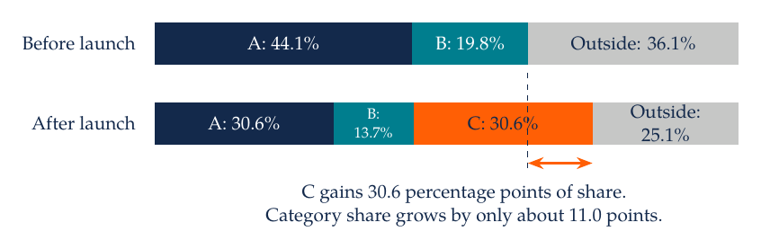
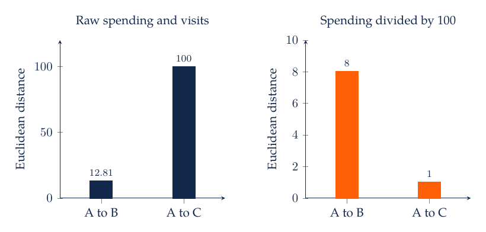
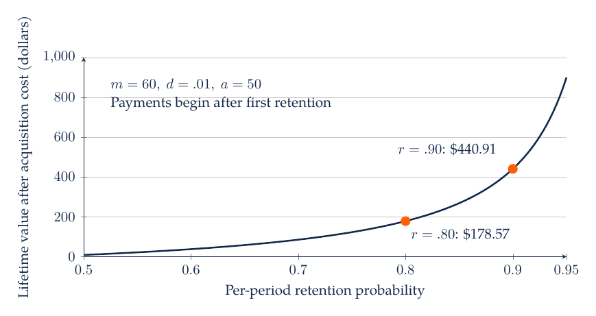
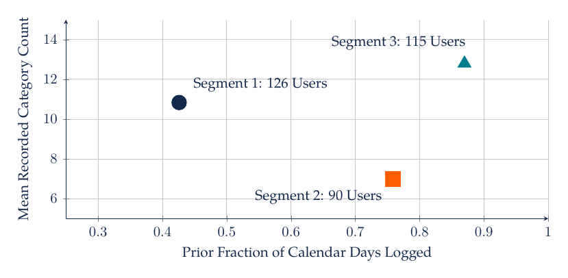
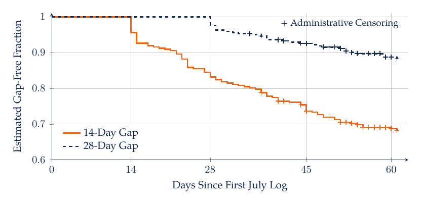
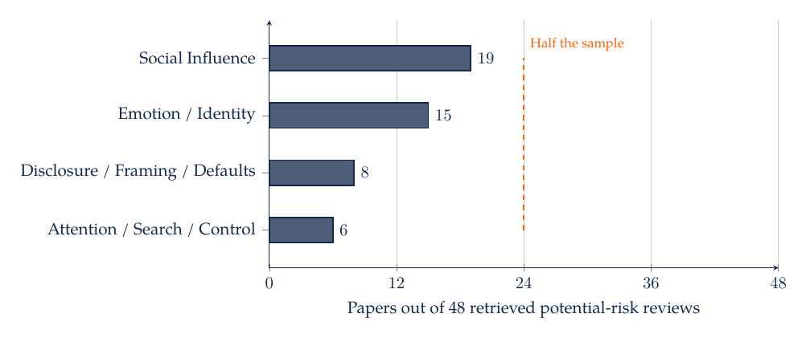
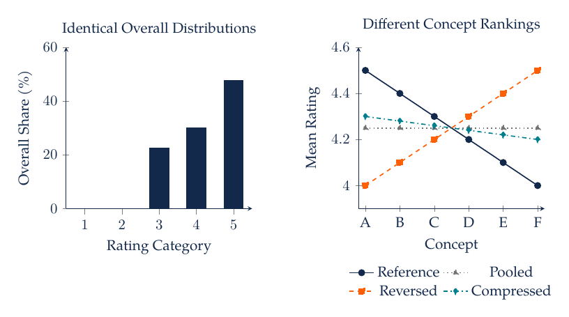

# M4. Product Preferences, Customer Segments, and Lifetime Value

A subscription retailer must choose a product bundle, decide whom to serve, and determine how much to spend acquiring or retaining customers. These decisions are connected. A feature that attracts one segment may be costly to deliver, and a segment with high initial spending may have low retention. Conjoint analysis estimates tradeoffs among product attributes, clustering summarizes patterns of similarity, and customer lifetime value translates future behavior into expected contribution.

## 4.1 Product Design Requires Tradeoffs

Asking consumers whether they like fast delivery often produces a favorable response, but it does not reveal how much they will pay for it or which other feature they will give up. Conjoint tasks present product profiles whose attributes vary. Respondents may rate profiles, rank them, or choose among alternatives. Choice-based tasks resemble an assortment decision, while ratings can provide more observations per respondent under a different response process.

Attributes should represent decisions the firm can implement and descriptions respondents can understand. Levels should span a plausible range without creating impossible combinations. If every premium-quality product also has the highest price, the design provides little independent information about the quality-price tradeoff. Randomization and a suitable experimental design help separate attribute effects, but realistic constraints may limit which combinations can be shown.

Include the decision's relevant alternatives. A forced choice between two products estimates preference conditional on choosing one of them. An outside option such as “buy neither” helps represent category participation. A simulation that omits the outside option can overstate category demand because every respondent must buy something. Survey design, task burden, and hypothetical behavior also affect how well stated choices transfer to market behavior.

## 4.2 Utility, Choice Probabilities, and Willingness to Pay

A simple model assigns respondent $i$ a systematic utility for alternative $j$:

$$
V_{ij}=\beta_q q_j+\beta_f f_j+\beta_p p_j,
$$

where $q_j$ indicates premium quality, $f_j$ indicates a delivery feature, and $p_j$ is price in dollars. Utility has an arbitrary scale. Coefficients describe tradeoffs on that scale, and price is expected to enter negatively in a conventional demand interpretation. Alternative-specific constants can capture average preference for named options relative to a reference alternative.

Under a multinomial-logit random-utility specification, the probability of choosing $j$ from the available set $\mathcal J_i$ is

$$
P_{ij}=\frac{\exp(V_{ij})}{\sum_{k\in\mathcal J_i}\exp(V_{ik})}.
$$

Multinomial logit imposes proportional substitution across alternatives. Whether this pattern fits the product category requires empirical assessment. Repeated choices by one respondent are dependent; estimation and validation should respect that respondent structure. Heterogeneous preferences may be represented with interactions, latent classes, or random coefficients when the data support the additional complexity.

For a binary feature whose coefficient is $\beta_f$, a local willingness-to-pay tradeoff under linear price utility is $-\beta_f/\beta_p$. If $\beta_f=1.2$ and $\beta_p=-0.1$ per dollar, the model equates the feature with $12 of price. This ratio is conditional on the specification and utility scale cancellation. A price coefficient close to zero makes the ratio unstable, and preferences outside the experimental price range are extrapolations.

Attribute importance is often calculated from the range of an attribute's estimated part-worths relative to the sum of ranges. The result depends on the levels included in the study. Expanding the price range can increase measured price importance even when underlying preferences are unchanged. Report the design range when discussing importance.

## 4.3 Case Study: A New Bundle Can Cannibalize Existing Sales

Consider two subscription bundles and an outside option. Bundle A has premium quality and costs $10; bundle B has standard quality and costs $6. Let $\beta_q=1.2$, $\beta_p=-0.1$, and normalize outside-option utility to zero. The systematic utilities are 0.2 for A and $-0.6$ for B. The logit probabilities are approximately 44.1% for A, 19.8% for B, and 36.1% for the outside option.

Now introduce bundle C with the same modeled attributes as A. The logit model assigns A and C approximately 30.6% each, B 13.7%, and the outside option 25.1%. C's share is 30.6 percentage points, but the total purchasing share rises only from 63.9% to 74.9%, an increase of about 11.0 points. The remaining share comes from the existing products. Forecasting a new product's sales without accounting for substitution would overstate incremental demand.



With utility coefficients and the potential-customer population fixed, adding C changes only the available choice set. Because C has the same modeled attributes as A, it is a close substitute. The logit model's independence-of-irrelevant-alternatives property makes C draw share proportionally from all existing alternatives. Whether that pattern is plausible is an empirical question. Richer substitution models may be needed when close substitutes compete especially strongly with one another.

A profit calculation must attach contribution margins and fixed costs to the simulated quantities. If A and C each contribute $4 per purchase and B contributes $3, expected contribution per potential customer rises from about $2.36 to $2.86 before product-development and operating costs. The contribution comparison is conditional on the specified utilities, margins, and fixed customer population. A pilot or holdout choice tasks can help evaluate the proposed product and model before a larger decision.

## 4.4 Estimate and Validate Preferences

A conjoint workflow begins with the managerial choice and feasible attributes, then constructs the task design and recruits a relevant respondent sample. Inspect completion time, straight-line responses, inconsistent attention, and whether participants understood the attributes. Exclusion rules should be set and reported transparently. Removing respondents because their preferences are inconvenient changes the target population.

Estimate a transparent baseline before adopting a more elaborate model. Check coefficient coding, reference levels, price units, and whether probabilities sum to one for every choice set. Evaluate prediction on held-out tasks or respondents according to the intended use. A model that fits familiar respondents' repeated choices may generalize differently to a new customer population.

A useful simulation changes one decision at a time and records what is fixed: attributes, price, competitor options, market size, and margins. Share of preference from a survey is not automatically market share. Distribution, awareness, availability, purchase frequency, and sampling can create differences. State the link between the conjoint output and the demand quantity used in the business calculation.

## 4.5 Segmentation Begins with a Definition of Similarity

A retailer may want segments for differentiated service, product positioning, or campaign design. Those objectives should guide the variables used to define similarity. Grouping customers by recent spending answers a different question from grouping them by category preferences or service needs. A segment should be interpretable, sufficiently stable, and connected to an action the firm can take.

Recency, frequency, and monetary value provide a useful descriptive starting point. Define recency as time since the last eligible purchase at a common observation date, frequency as the number of eligible purchases during a fixed window, and monetary value as sales or contribution during that window. Customers with different observation histories require adjustment or a deliberate eligibility rule. A new customer observed for one month should not be compared mechanically with one observed for a year.

K-means selects $K$ centers to minimize within-cluster squared Euclidean distance:

$$
\sum_{i=1}^n\left\|z_i-\mu_{c(i)}\right\|^2.
$$

Here $z_i$ is the vector of transformed customer features, $c(i)$ is customer $i$'s assigned cluster, and $\mu_{c(i)}$ is its cluster center. The feature transformations determine the distance. Standardization often helps prevent a large numerical scale from dominating, but it does not establish that all features should have equal managerial importance.

For three customers with spending-frequency pairs A=(100,1), B=(110,9), and C=(200,1), raw Euclidean distance makes B much closer to A than C is. If spending is expressed in hundreds of dollars while frequency remains in purchases, C becomes closer to A. The customer records have not changed; the implicit weights have. This is why units and scaling belong in the substantive definition of a segment.



Changing spending units reverses the nearest neighbor because it changes the relative weight placed on spending and visits. A segmentation report should explain that metric and examine whether the proposed actions remain sensible under reasonable transformations.

## 4.6 Choosing and Evaluating Segments

Use more than one criterion to choose $K$. Within-cluster dispersion falls mechanically as more clusters are added. A silhouette measure compares cohesion with separation under the chosen distance, but a high silhouette does not establish business value. Examine segment sizes, profiles, stability across resamples or time, and whether the segments imply different feasible actions.

Hierarchical clustering provides a nested set of groupings whose interpretation depends on the linkage and distance. Density-based methods can identify irregular groups and mark some observations as noise, with sensitivity to neighborhood parameters. Mixture models provide probabilistic membership under distributional assumptions. These alternatives address different patterns; no algorithm discovers a uniquely correct segmentation independent of representation and purpose.

For customer activation, avoid using future purchase outcomes to define a segment that supposedly exists before the campaign. For evaluating segmentation, examine behavior not used mechanically to construct it. A high-spending segment will have high spending by design if spending is a clustering input. A more useful question is whether the grouping helps predict future needs or improves the result of a tested service policy.

Clustering shopping trips on basket size, category composition, and spending can help separate trip types before comparing channels. Fit the representation without allowing the desired channel comparison to determine the grouping. Examine profiles and sensitivity, because a trip-classification algorithm can also create misleading comparisons if its features or thresholds differ across channels.

## 4.7 Customer Lifetime Value Depends on Timing and Margin

Customer lifetime value is the discounted expected contribution from a relationship, under a stated time horizon and behavioral model. For a newly acquired customer, a simple finite-horizon expression is

$$
\operatorname{CLV}=\sum_{t=1}^{T}\frac{\Pr(\text{active at }t)\,m_t}{(1+d)^t}-a.
$$

Here $t$ indexes periods after acquisition, $m_t$ is expected contribution conditional on being active in period $t$, $d$ is the discount rate per period, and $a$ is acquisition cost paid at time zero. Contribution should deduct relevant variable service and fulfillment costs. The expression assumes the conditional margin and activity probability have been defined consistently; more general models can use the expected product of activity and customer-specific margin.

Assume a stationary subscription process: a currently active customer survives each period with probability $r$, earns a constant contribution $m$ at the end of a period only if still active, and has an infinite horizon. With $r/(1+d)<1$, the geometric series gives

$$
\operatorname{CLV}=\frac{mr}{1+d-r}-a.
$$

This convention excludes an immediate current-period contribution. Including one would add that contribution and change the formula. Monthly retention requires monthly margins and a monthly discount rate. Combining monthly retention with an annual discount rate produces an inconsistent calculation.

With monthly contribution $m=60$, retention $r=0.80$, monthly discount rate $d=0.01$, and acquisition cost $a=50$, CLV is approximately $178.57. Increasing retention to 0.90 raises it to approximately $440.91. The gain is nonlinear because retention affects many future payments. These values are conditional on constant retention and margin; changes in retention or margin over time would change the valuation.



With monthly contribution, discounting, and acquisition cost fixed, a one-point retention increase has greater value at a higher baseline retention rate. Uncertainty about long-run retention can therefore dominate a CLV forecast.

## 4.8 Subscription and Noncontractual Relationships

In a subscription setting, cancellation is often observed. Survival analysis can model time to cancellation and account for right censoring when observation ends before cancellation. A hazard describes the probability of exit during a period conditional on survival to that period. Cohort effects, tenure dependence, and changes in service quality can make constant retention implausible.

In a noncontractual retail setting, the last purchase does not reveal whether a customer has permanently left. Models such as BG/NBD represent purchase frequency and latent dropout under specific stochastic assumptions. A separate spending model may estimate value per transaction. Those assumptions require checking, including the treatment of returns and any assumed relationship between purchase frequency and monetary value. A customer-level count alone does not identify permanent churn without a model.

Evaluate value forecasts on a holdout period with the same horizon used in the decision. Compare aggregate and customer-level calibration, rank ordering, and errors for new or infrequent customers. A model can rank customers well while overpredicting total value. For an acquisition budget, the aggregate monetary error may be more consequential than a small improvement in ranking.

## 4.9 Integrated Case: Which Segment Should Receive Retention Support?

Suppose segment H has high predicted CLV but little response to service outreach, while segment M has moderate predicted CLV and a larger response. Targeting only H can be inferior even if its value forecast is accurate. The relevant quantity is the change in expected future contribution caused by outreach, net of the outreach cost. CLV describes a baseline relationship; a retention intervention changes that relationship under a separate causal model.

A useful analysis would estimate or specify segment-specific preferences, margins, and retention, then test the proposed offer. Product design might attract a segment with expensive service needs; a seemingly attractive acquisition price might therefore have low contribution. Segment labels should help organize the decision without replacing these calculations. A final recommendation should show which assumption changes the preferred segment or product.

For practice, recompute the subscription value with $r=0.85$ and verify the result before acquisition cost is subtracted. Add an immediate $60 contribution and explain the change in timing. In the conjoint example, remove the outside option and observe that simulated purchase incidence becomes one by construction. In the clustering example, compare similarity using category shares instead of spending levels and explain which managerial question the new representation serves.

## 4.10 AI-Assisted Implementation and Readings

Ask a coding assistant to calculate choice probabilities from a supplied profile table, check that they sum to one, and separate a new product's share from incremental category demand. For clustering, require documented transformations, segment profiles, and a sensitivity comparison. For CLV, request an explicit payment timeline and verify the closed-form calculation against a long finite sum. These checks catch common mistakes that can survive apparently reasonable charts.

[Sawtooth's academic materials](https://sawtoothsoftware.com/academics/teaching-resources) provide conjoint examples. [Dolnicar, Grün, and Leisch's segmentation book](https://link.springer.com/book/10.1007/978-981-10-8818-6) develops the connection between segmentation design and use. [PyMC-Marketing's CLV documentation](https://www.pymc-marketing.io/en/latest/notebooks/clv/clv_quickstart.html) offers implementation examples whose model assumptions and software versions should be checked before adaptation.

## 4.11 mHealth: Behavioral Segments and Product Economics

A product manager may want different interfaces for occasional loggers, frequent loggers with narrow recorded diets, and frequent loggers with broad recorded diets. Segmenting on January through June behavior creates groups whose later logging can be described without using later observations to define the groups. A segment is useful when it corresponds to a decision the manager can implement, such as simplifying entry or offering a broader set of suggestions.

Eligibility requires at least 30 observed days before July 1 and nonmissing average variety. Each user contributes three features: observed days divided by the 182 calendar days in the first half of 2016, mean recorded category count, and mean calorie-share variety. Standardization gives each feature unit variance before three-cluster k-means. Three clusters are imposed for a manageable descriptive comparison. Cluster labels are ordered by their mean prior logging fraction.

| Segment | Users | Prior Logging Fraction | Mean Breadth | Later Logging Fraction |
| --- | ---: | ---: | ---: | ---: |
| 1 | 126 | 0.426 | 10.84 | 0.338 |
| 2 | 90 | 0.759 | 6.99 | 0.594 |
| 3 | 115 | 0.870 | 12.80 | 0.654 |

Later logging uses the 184 calendar days from July through December, with zero observed days for eligible users absent from that period. The differences describe persistence in recorded use. They are not treatment responses, contract renewal rates, or purchase probabilities. In particular, Segment 2 combines frequent logging with relatively narrow breadth. A single ranking by activity would conceal that distinction.

Repeating k-means with a second seed produces an adjusted Rand index of 1.0 for these inputs. The partition is stable to this initialization check. That result does not establish three natural customer types or prove stability to other features, calendar windows, or measurement screens. The calorie-based variety and breadth features are related, so including both places additional emphasis on recorded dietary diversity. Nutrition screening can also alter the segmentation inputs; compare its consequences before naming a segment around a health interpretation.



The food logs supply no observed subscription price, product-choice experiment, margin, acquisition cost, or payment-based retention. A hypothetical paid-plan calculation can nevertheless clarify the extra inputs needed. Set the outside-option utility to zero, paid-plan benefit to 0.8, price coefficient to -0.1 per dollar, and price to $5. The imposed logit model yields a paid-plan share of 0.5744. These inputs are assumptions, not conjoint estimates from the logs.

For a separate hypothetical subscription, suppose monthly contribution conditional on retention is $6, the monthly discount rate is 1%, acquisition cost is $10, and the first contribution occurs one month after acquisition. With constant monthly retention $r$, value is $6r/(1.01-r)-10$. Assumed retention of 0.80, 0.85, and 0.90 gives values of $12.86, $21.87, and $39.09. These scenarios are not assigned to the three behavioral segments. Doing so would equate logging persistence with paid retention without evidence.

The code fits the scaler and clusters using only the earlier period, then joins later logging for description. An AI assistant should explain each feature's units, how missing later records enter the denominator, and which economic inputs remain hypothetical before proposing a targeting rule.

Python source: [m04.py](../../03_Data_and_Code/mHealth/recurring_examples/m04.py). From its directory, run `python m04.py`.

```python
"""Segment January-June behavior and describe later logging."""

import json
import numpy as np
import pandas as pd
from sklearn.cluster import KMeans
from sklearn.preprocessing import StandardScaler
from sklearn.metrics import adjusted_rand_score
from common import OUTPUT, SEED, load_inputs, save_result

food, daily, baskets = load_inputs()
prior = daily.loc[daily.date.lt("2016-07-01")]
features = prior.groupby("Userid").agg(
    logged_days=("date", "size"),
    breadth=("category_count", "mean"),
    variety=("variety", "mean"),
)
features = features.loc[features.logged_days.ge(30)].dropna()
features["logging_fraction"] = features.logged_days / 182
columns = ["logging_fraction", "breadth", "variety"]
scaled = StandardScaler().fit_transform(features[columns])
model = KMeans(n_clusters=3, n_init=20, random_state=SEED).fit(scaled)
alternative = KMeans(n_clusters=3, n_init=20, random_state=SEED + 1).fit(scaled)
# Number clusters by their mean prior logging fraction for readable output.
order = (
    features.assign(raw=model.labels_)
    .groupby("raw")
    .logging_fraction.mean()
    .sort_values()
    .index
)
labels = {raw: rank + 1 for rank, raw in enumerate(order)}
features["segment"] = [labels[value] for value in model.labels_]
later = daily.loc[daily.date.ge("2016-07-01")].groupby("Userid").size()
features["later_logging_fraction"] = later.reindex(features.index, fill_value=0) / 184
table = features.groupby("segment").agg(
    users=("segment", "size"),
    prior_logging=("logging_fraction", "mean"),
    breadth=("breadth", "mean"),
    variety=("variety", "mean"),
    later_logging=("later_logging_fraction", "mean"),
)
OUTPUT.mkdir(exist_ok=True)
table.to_csv(OUTPUT / "M04_segments.csv")
# Imposed monthly financial assumptions, separate from the log estimates.
retention = np.array([0.80, 0.85, 0.90])
clv = 6 * retention / (1.01 - retention) - 10
utility = np.array([0.0, 0.8 - 0.1 * 5])  # Outside option, hypothetical paid plan.
choice = np.exp(utility - utility.max())
choice /= choice.sum()
result = {
    "users": len(features),
    "features": columns,
    "seed_agreement_ari": float(
        adjusted_rand_score(model.labels_, alternative.labels_)
    ),
    "segments": table.reset_index().to_dict(orient="records"),
    "hypothetical_retention": retention.tolist(),
    "hypothetical_clv": clv.tolist(),
    "hypothetical_paid_plan_share": float(choice[1]),
}
save_result("M04", result)
print(json.dumps(result, indent=2))
```

## 4.12 Python Calculations for the Synthetic Cases

The inputs below are imposed teaching values. Running the program creates the labeled synthetic CSV files and prints the corresponding calculations. They are separate from the mHealth estimates. Keep the script beside `example_helpers.py` in `03_Data_and_Code/Lecture_Examples`.

Python source: [m04_synthetic.py](../../03_Data_and_Code/Lecture_Examples/m04_synthetic.py). From its directory, run `python m04_synthetic.py`.

```python
"""Synthetic numerical examples for M4; run from any working directory."""

import itertools
import json
import math
from example_helpers import write_csv, ols_slope, shares

r = {}
before = shares({"A": 0.2, "B": -0.6, "outside": 0})
after = shares({"A": 0.2, "B": -0.6, "C": 0.2, "outside": 0})
r["M04"] = {
    "shares_before": before,
    "shares_after": after,
    "category_share_increase": before["outside"] - after["outside"],
    "contribution_before": 4 * before["A"] + 3 * before["B"],
    "contribution_after": 4 * (after["A"] + after["C"]) + 3 * after["B"],
    "wtp_dollars": 1.2 / 0.1,
    "distance_raw_AB": math.hypot(10, 8),
    "distance_raw_AC": 100,
    "distance_rescaled_AB": math.hypot(0.1, 8),
    "distance_rescaled_AC": 1,
    "clv_after_acquisition": {
        str(retention): 60 * retention / (1.01 - retention) - 50
        for retention in [0.8, 0.85, 0.9]
    },
}
write_csv(
    "M04_segmentation_synthetic.csv",
    ["customer", "spending_dollars", "visits"],
    [("A", 100, 1), ("B", 110, 9), ("C", 200, 1)],
)
assert math.isclose(sum(before.values()), 1) and math.isclose(sum(after.values()), 1)
print(json.dumps(r, indent=2))
```

## 4.13 mHealth: Time Until a Logging Gap

A retention manager may want to intervene before a long interruption in activity. The analytical object must specify when the interruption has actually occurred. A user who is absent for two days and returns on the third day has a different history from one who remains absent for several weeks. The end of the data window can arrive before either pattern is fully observed.

Define eligibility using at least 30 recorded days before July 1. Among eligible users who return during July, set time zero to that user's first July logging day. The event occurs on the 14th consecutive day without a subsequent log, and observation ends on August 31. The event date is the day the gap is confirmed. A later return does not erase a previously confirmed gap. Customers without a confirmed gap by August 31 are administratively censored at their elapsed follow-up time.

This definition concerns an interruption in observed logging. Permanent customer departure, failure to eat, and cancellation of a paid subscription are separate events. July return is also a selection condition: 331 users satisfy prior eligibility, and 297 have a July time origin. The curve describes these returners, including a mixture of early and late July start dates.

To allow different amounts of follow-up, define $n_t$ as users still under observation and gap-free immediately before elapsed day $t$, and $d_t$ as confirmed first gaps on that day. The Kaplan–Meier estimate is

$$
\widehat S(t)=\prod_{s\le t}\left(1-\frac{d_s}{n_s}\right).
$$

A censored user contributes to earlier risk sets and leaves subsequent ones. Censoring itself causes no downward step. When an event and administrative censoring share a day, the event is counted before censoring. A population interpretation of the pooled curve requires censoring to be independent of gap timing, possibly conditional on relevant start-date characteristics. Calendar trends can undermine that condition because later July starters have shorter follow-up.

| Confirmed Gap | Users | Events by August 31 | Censored | Gap-Free at Day 30 | Gap-Free at Day 60 |
| --- | ---: | ---: | ---: | ---: | ---: |
| 14 Days | 297 | 93 | 204 | 0.8182 | 0.6867 |
| 28 Days | 297 | 33 | 264 | 0.9630 | 0.8877 |



The 28-day definition produces fewer confirmed events because an interruption must persist longer. It also confirms an event later even when the same interruption satisfies both thresholds. At elapsed day 60, the risk sets contain 160 and 187 users for the 14- and 28-day definitions, respectively. The table therefore requires an event definition and a time origin to support a retention comparison. Converting either curve into customer lifetime value would additionally require a commercial relationship, margins, discounting, and a model linking logging interruptions to that relationship.

The [lifelines customer-churn example](https://github.com/CamDavidsonPilon/lifelines/blob/master/examples/Customer%20Churn.ipynb) uses explicit event and duration fields. The [Kaplan–Meier documentation](https://lifelines.readthedocs.io/en/latest/Survival%20analysis%20with%20lifelines.html) supplies the corresponding risk-set estimator. The code below computes each risk set explicitly so a small hand-constructed event/censoring table can verify the calculation.

Python source: [logging_gaps.py](../../03_Data_and_Code/mHealth/recurring_examples/logging_gaps.py). From its directory, run `python logging_gaps.py`.

```python
"""Kaplan-Meier estimates for a defined logging-gap event, with censoring."""

import json
import pandas as pd
from common import OUTPUT, load_food, make_daily, save_result


def first_gap(dates, start, end, gap_days):
    dates = set(dates)
    run = 0
    for day in pd.date_range(start + pd.Timedelta(days=1), end):
        run = 0 if day in dates else run + 1
        if run == gap_days:
            return (day - start).days, True
    return (end - start).days, False


def kaplan_meier(records):
    # At a tied time, events precede administrative censoring.
    survival = 1.0
    rows = []
    for time in sorted(records.duration.unique()):
        risk = int(records.duration.ge(time).sum())
        events = int((records.duration.eq(time) & records.event).sum())
        censored = int((records.duration.eq(time) & ~records.event).sum())
        survival *= 1 - events / risk
        rows.append(
            {
                "day": int(time),
                "at_risk": risk,
                "events": events,
                "censored": censored,
                "gap_free": survival,
            }
        )
    return pd.DataFrame(rows)


if __name__ == "__main__":
    daily = make_daily(load_food())
    prior = daily.loc[daily.date < "2016-07-01"].groupby("Userid").size()
    eligible = prior.index[prior >= 30]
    july = daily.loc[
        daily.Userid.isin(eligible) & daily.date.between("2016-07-01", "2016-07-31")
    ]
    starts = july.groupby("Userid").date.min()
    observed = daily.groupby("Userid").date.agg(set)
    end = pd.Timestamp("2016-08-31")
    result = {
        "eligible_before_july": len(eligible),
        "july_returners": len(starts),
        "administrative_end": str(end.date()),
        "thresholds": [],
    }
    for gap in [14, 28]:
        records = pd.DataFrame(
            [
                first_gap(observed[user], start, end, gap)
                for user, start in starts.items()
            ],
            columns=["duration", "event"],
        )
        curve = kaplan_meier(records)
        summary = {
            "gap_days": gap,
            "users": len(records),
            "events": int(records.event.sum()),
            "censored": int((~records.event).sum()),
        }
        for horizon in [30, 45, 60]:
            before = curve.loc[curve.day <= horizon]
            summary[f"gap_free_day_{horizon}"] = (
                float(before.gap_free.iloc[-1]) if len(before) else 1.0
            )
            summary[f"at_risk_day_{horizon}"] = int(records.duration.ge(horizon).sum())
        result["thresholds"].append(summary)
        OUTPUT.mkdir(exist_ok=True)
        curve.to_csv(OUTPUT / f"logging_gap_{gap}.csv", index=False)
    save_result("logging_gaps", result)
    print(json.dumps(result, indent=2))
```


## 4.14 Subscription Retention and Category Participation

A provider considering a retention offer needs to know whether departing subscribers continue buying from competitors. A customer who retains the category may respond to a different price, product, or bundle. A customer who stops paying for the category raises a different acquisition question. These outcomes require linked customer histories and a common starting cohort.

### 4.14.1 Adoption and Multihoming Denominators

The supplied synthetic panel contains a fixed roster of 60,000 consumers and 40 calendar months from January 2023 through April 2026. Subscription rows record held provider plans; the roster also includes consumers who never subscribe. Within this complete simulation, an absent consumer-provider-month row means no paid subscription. That interpretation relies on the generator's recording rule and would require separate validation in a transaction dataset.

Let $D_{ijt}$ indicate that consumer $i$ holds a paid subscription to provider $j$ in month $t$. To measure category adoption and multihoming among payers, calculate

$$
A_t=\frac{\sum_{i=1}^{N}\mathbf{1}\{\sum_jD_{ijt}>0\}}{N},
\qquad
H_t=\frac{\sum_{i=1}^{N}\mathbf{1}\{\sum_jD_{ijt}>1\}}
{\sum_{i=1}^{N}\mathbf{1}\{\sum_jD_{ijt}>0\}}.
$$

Here $N$ is the full consumer roster. Adoption uses all consumers, while multihoming uses the consumers with at least one subscription. In April 2026, the simulation has 1,741 payers holding 1,813 subscriptions, and 71 payers hold multiple providers. Adoption is therefore 2.902%, and multihoming among payers is 4.078%. The extra subscriptions and the number of multihomers differ because a consumer can hold more than two providers.

The generator adjusts a common utility term each month to approach a chosen aggregate adoption path. The final adoption rate is consequently a calibration outcome. It supplies no independent estimate of actual market penetration.

### 4.14.2 Following the Same Starting Customers

Define $C_j$ as the set of consumers paying provider $j$ in January 2025. At a later month, partition this fixed set into consumers paying $j$, consumers paying only other providers, and consumers paying no provider. Consumers who hold $j$ and a rival belong in the first group. These three groups exhaust the original cohort, so their shares sum to one.

The table follows each January 2025 provider cohort to January 2026. All values are synthetic. Provider cohorts overlap when a starting customer holds multiple subscriptions; their denominators should not be added as a unique-consumer count.

| January 2025 Provider | Starting Customers | Same Provider After 12 Months | Other Providers Only | No Paid Provider |
| --- | ---: | ---: | ---: | ---: |
| Anthropic | 317 | 32.8% | 26.5% | 40.7% |
| Google | 157 | 18.5% | 38.2% | 43.3% |
| Microsoft | 84 | 1.2% | 53.6% | 45.2% |
| OpenAI | 430 | 37.7% | 20.9% | 41.4% |
| Perplexity | 63 | 3.2% | 58.7% | 38.1% |

For the 430 starting OpenAI subscribers, 162 pay OpenAI after twelve months and another 90 pay other providers exclusively. Category participation within this same cohort is $252/430=58.6\%$. The 20.9-percentage-point difference isolates continued category participation among customers who no longer hold the original provider. Comparing a provider cohort with the pooled cohort of all initial AI payers would also change the mix of customers in the denominator.


### 4.14.3 Endpoint Retention, Continuous Retention, and Acquisition

Endpoint retention permits cancellation followed by reentry. Continuous retention requires the same provider to be held in every intervening month. Of the 430 starting OpenAI subscribers, 129 remain continuously subscribed through January 2026, a 30.0% continuous-retention rate. The 162 endpoint subscribers include 33 who returned after at least one observed gap. A cohort of existing subscribers also differs from a cohort of newly acquired customers because subscription tenure and prior survival affect its composition. Applying an acquisition-cohort CLV formula to this twelve-month endpoint rate would obscure both distinctions.

Likewise, the supplied `new` flag records a provider absent from the previous month's holdings. It can describe first paid entry, reentry to the category, a complete replacement of previous providers, or an additional provider while retaining at least one incumbent. In April 2026, the 401 new-provider events comprise 197 first paid entries, 157 category returns, 32 complete provider switches, and 15 provider additions. There are 400 distinct consumers behind these events because one consumer starts two providers. The event denominator is therefore explicit.

A release-month increase in new-provider events can reflect several of these mechanisms. A causal claim about a release also requires a credible comparison for what would have happened without it. Timing, publicity, contemporaneous prices, overlapping releases, and previous subscription states affect that comparison. The descriptive partition supports the acquisition decision without treating every new-provider event as switching.


Python source: [retention.py](../../03_Data_and_Code/GenAI_Demand/retention.py). From the script's folder, run `python3 retention.py`. Inputs are read from the supplied local bundle; output tables are written beside the course scripts.

```python
"""Measure synthetic subscription stocks, cohorts, and acquisition events."""
from pathlib import Path
import json

import numpy as np
import pandas as pd

HERE = Path(__file__).resolve().parent
SOURCE = HERE.parents[1] / "01_Resources/08_M8_Current_Topics_in_Marketing/genai_demand_lab/data"
OUTPUT = HERE / "results"


def acquisition_type(previous, current, ever_paid):
    """Classify a newly held provider using adjacent monthly subscription sets."""
    if not previous:
        return "category_return" if ever_paid else "first_paid_entry"
    if previous.isdisjoint(current):
        return "complete_provider_switch"
    return "provider_addition"


def cohort_outcomes(subs, provider, start, horizon, observed_months):
    """Endpoint and continuous retention for one fixed provider cohort."""
    required = {str(pd.Period(start, freq="M") + k) for k in range(horizon + 1)}
    if not required.issubset(set(observed_months)):
        raise ValueError("Cohort horizon extends beyond the observed calendar")
    cohort = set(subs.loc[subs.month.eq(start) & subs.provider.eq(provider), "consumer_id"])
    if not cohort:
        raise ValueError("Empty starting cohort")
    continuous = cohort.copy()
    rows = []
    for k in range(horizon + 1):
        month = str(pd.Period(start, freq="M") + k)
        active = subs.loc[subs.month.eq(month)]
        own = set(active.loc[active.provider.eq(provider), "consumer_id"])
        any_provider = set(active.consumer_id)
        continuous &= own
        row = {"provider": provider, "start_month": start, "month": month,
               "horizon_months": k, "cohort_size": len(cohort),
               "same_provider": len(cohort & own),
               "other_provider_only": len((cohort & any_provider) - own),
               "no_paid_provider": len(cohort - any_provider),
               "continuous_same_provider": len(continuous)}
        assert row["same_provider"] + row["other_provider_only"] + row["no_paid_provider"] == len(cohort)
        rows.append(row)
    return pd.DataFrame(rows)


def main():
    consumers = pd.read_csv(SOURCE / "synthetic_consumers.csv")
    subs = pd.read_csv(SOURCE / "synthetic_subscriptions.csv.gz")
    dgp = json.loads((SOURCE / "synthetic_dgp.json").read_text())
    months = sorted(dgp["g_trend"])
    n = len(consumers)
    assert n == dgp["n_consumers"] and consumers.consumer_id.is_unique
    assert not subs.duplicated(["consumer_id", "month", "provider"]).any()
    assert subs.consumer_id.isin(consumers.consumer_id).all()
    assert subs.month.isin(months).all() and subs.price.gt(0).all()
    assert subs["new"].isin([True, False]).all()
    assert subs.tier.isin(["basic", "premium"]).all()
    states = {m: {int(i): set(g.provider) for i, g in s.groupby("consumer_id")}
              for m, s in subs.groupby("month")}
    events, monthly, history = [], [], set()
    previous = {}
    for month in months:
        current = states.get(month, {})
        for consumer, providers in current.items():
            old = previous.get(consumer, set())
            for provider in sorted(providers - old):
                events.append({"month": month, "consumer_id": consumer, "provider": provider,
                               "event": acquisition_type(old, providers, consumer in history)})
        group = subs.loc[subs.month.eq(month)]
        monthly.append({"month": month, "population": n, "payers": len(current),
                        "subscriptions": len(group), "adoption": len(current) / n,
                        "multihomers": sum(len(s) > 1 for s in current.values()),
                        "basic_subscriptions": int(group.tier.eq("basic").sum())})
        history.update(current)
        previous = current
    events = pd.DataFrame(events)
    keys = ["month", "consumer_id", "provider"]
    recorded = set(subs.loc[subs["new"], keys].itertuples(index=False, name=None))
    calculated = set(events[keys].itertuples(index=False, name=None))
    assert recorded == calculated
    monthly = pd.DataFrame(monthly)
    monthly["multihoming_given_payment"] = monthly.multihomers / monthly.payers.replace(0, np.nan)
    monthly["basic_subscription_share"] = monthly.basic_subscriptions / monthly.subscriptions.replace(0, np.nan)
    cohort_start, horizon = "2025-01", 12
    assert str(pd.Period(cohort_start, freq="M") + horizon) <= months[-1]
    providers = sorted(subs.loc[subs.month.eq(cohort_start), "provider"].unique())
    cohorts = pd.concat([cohort_outcomes(subs, p, cohort_start, horizon, months)
                         for p in providers], ignore_index=True)
    last_events = events.loc[events.month.eq(months[-1])]
    counts = last_events.event.value_counts().sort_index()
    last = monthly.iloc[-1]
    result = {"data_type": "synthetic", "population": n, "subscription_rows": len(subs),
              "calendar_months": len(months), "last_month": months[-1],
              "last_payers": int(last.payers), "last_subscriptions": int(last.subscriptions),
              "last_adoption": float(last.adoption),
              "last_multihomers": int(last.multihomers),
              "last_multihoming_given_payment": float(last.multihoming_given_payment),
              "last_acquisition_events": int(len(last_events)),
              "last_acquisition_consumers": int(last_events.consumer_id.nunique()),
              "last_acquisition_types": {k: int(v) for k, v in counts.items()},
              "new_flag_verified": True}
    OUTPUT.mkdir(exist_ok=True)
    monthly.to_csv(OUTPUT / "adoption.csv", index=False, float_format="%.8f")
    cohorts.to_csv(OUTPUT / "cohorts.csv", index=False)
    counts.rename_axis("event").rename("events").to_csv(OUTPUT / "acquisition_types.csv")
    (OUTPUT / "retention.json").write_text(json.dumps(result, indent=2) + "\n")
    print(json.dumps(result, indent=2))


if __name__ == "__main__":
    main()
```

## 4.15 Retention, Customer Value, and Choice

\noindent A subscription manager can increase measured customer lifetime value by improving service or by making cancellation harder. Both mechanisms can raise the probability of another payment. They have different implications for customer welfare, future trust, and the sustainability of the relationship. A financial retention model should therefore distinguish the source of the additional renewal.

A useful comparison holds the final offer fixed and varies the preceding interaction. One group sees a direct cancellation option. Another can choose whether to view a retention offer before deciding. Record cancellation completion, time spent, subsequent charges, refunds, and informed willingness to continue. Continued payment and a completed choice are separate outcomes. The model in Section 8.14 provides a numerical example in which higher renewal raises firm profit while reducing customer value under explicitly opposed stakes.

The segmentation decision also has distributional consequences. A cluster defined by earlier spending and visits describes behavioral similarity. It does not establish an intrinsic customer type or a justification for restricting access to an essential service. Compare the proposed treatment with customers' needs and the consequences of errors. When a segment receives an offer, record who can obtain it, who is excluded, and whether the exclusion follows the firm's stated objective.

In a conjoint task, price components and cancellation conditions are product attributes when they affect the customer's actual choice. Omitting a mandatory payment from the described price changes the offer respondents evaluate. The FTC fee rule's current coverage includes live-event tickets and short-term lodging; applying it requires the covered transaction and required components. Its scope should be checked in the [FTC's rule guidance](https://www.ftc.gov/business-guidance/resources/rule-unfair-or-deceptive-fees-frequently-asked-questions).

## 4.16 AI Services, Buyer Burden, and the Outside Option

\noindent A firm pricing an analytics service needs to understand the customer's best alternative. A customer may buy a competing service, conduct the analysis internally, or leave the decision unchanged. AI assistance can improve each of those alternatives. A reduction in the seller's coding cost therefore need not increase the amount a customer will pay.

Let $v$ be a customer's monetary-equivalent value of the delivered analysis over a specified period, $b$ its setup and verification burden, and $u_0$ the net value of its best alternative. Under quasilinear utility, the customer weakly prefers purchase at price $p$ when $v-p-b\geq u_0$. Its price ceiling is $v-b-u_0$. All four objects refer to the same customer and horizon. The burden includes the customer's required effort after delivery; the outside option already includes the costs of pursuing that alternative.

Product design can raise this ceiling by making the output more useful or reducing integration and verification effort. Competitive improvements raise $u_0$ and reduce the ceiling, holding the offered product fixed. A conjoint exercise should represent realistic alternatives and implementation requirements. Preference estimates obtained before customers gain access to a substantially improved alternative may require new validation.

The conditional pricing calculation in M8, Section 8.17, compares this participation ceiling with the seller's cost recovery requirement. The interval can disappear even when the seller becomes more productive. Measuring actual take-up, substitution, and customer effort is necessary before treating the assumed sales volume as a forecast.

## 4.17 Clustering Mechanisms That Can Affect Consumer Agency

\noindent A subscription firm can use research to identify where a conversion or retention objective may conflict with customers' ability to understand and revise their choices. The relevant grouping should distinguish mechanisms that call for different evaluations. Social endorsement raises questions about credibility and pressure. Defaults raise questions about informed selection. Exit friction raises questions about whether a decision to cancel becomes effective. A high response rate provides little guidance about which of these mechanisms produced it.

The primary sample contains 48 retrieved papers coded as having a reported choice concern or potential dual use. Forty-seven are in the potential-dual-use category; one explicitly discusses constrained agency. The twelve binary features describe attention, framing, social cues, emotion and identity, disclosure, personalization, privacy, defaults and order, exit and search friction, habits and rewards, financial commitment, and delegated control. The labels are preliminary AI-assisted annotations, largely based on abstracts, with selected full-text checks. They have not undergone independent human adjudication. Potential misuse is an inference about a mechanism and does not establish author intent.

For papers $i$ and $j$, let $A_i$ and $A_j$ contain the mechanisms coded as present. Jaccard distance measures the proportion of their combined positive features that they do not share:

$$
d_J(i,j)=1-\frac{|A_i\cap A_j|}{|A_i\cup A_j|}.
$$

The numerator counts shared mechanisms and the denominator counts mechanisms present in either paper. Shared absences do not create similarity. This matters when most of the twelve codes are zero. Papers with no positive mechanism are excluded from this comparison, and unreviewed papers remain outside the analysis. Average linkage merges groups according to their average pairwise distance. K-means would impose a different Euclidean representation and objective.

The program evaluates two through eight clusters and selects the partition with the largest silhouette score. For a paper, the silhouette compares its mean distance to its own group with the smallest mean distance to another group, scaled by the larger distance. The selected four-cluster solution has a mean silhouette of 0.272. Cluster names describe the profiles after estimation; they are not inputs to the algorithm.

| Profile | Papers | Share of 48 |
| --- | --- | --- |
| Social Influence | 19 | 39.6% |
| Emotion and Identity | 15 | 31.3% |
| Disclosure, Framing, and Defaults | 8 | 16.7% |
| Attention, Search, and Control | 6 | 12.5% |



Social influence is the largest cluster in this selected sample. Every paper in that group receives the social-cue indicator, and six also receive the emotion/identity indicator. Emotion/identity is the most common individual feature across all groups, appearing in 21 of 48 papers. Thus the largest cluster and the most common feature answer different questions. Clusters partition the papers; feature memberships overlap. Neither statistic estimates the prevalence or severity of agency erosion in markets.

Stability checks change the strength of the conclusion. Re-estimation on 200 random 80% subsamples, holding four clusters fixed, produces a median adjusted Rand index of 0.794 against the full-sample partition. Switching to Hamming distance lowers agreement to 0.485. An imposed stress test that changes one feature per paper yields median agreement of 0.250. Those values compare partitions, with one indicating identical grouping and zero corresponding to chance-adjusted agreement. The stress test is a sensitivity calculation; its feature changes do not represent an estimated error rate.

Including 36 additional abstract-only risk reviews produces 84 papers and selects eight clusters, the top of the candidate range. Adding retrieved protective papers with positive mechanism codes produces 60 papers and selects six clusters. These changes warrant further review before treating the groups as a stable taxonomy. A manager can still use the profiles to choose customer-outcome measures: comprehension and credibility for social influence, informed preferences for emotional appeals, term recall for disclosure, and successful exit for cancellation flows.

Reproduction starts with `coded_papers.csv` and preserves all three sample definitions, the code checks, distance calculations, K selection, paper-level assignments, and sensitivity comparisons. All feature definitions and status rules appear in the [codebook](../../03_Data_and_Code/Consumer_Agency_Literature/CODEBOOK.md). Run it from the saved script with the dependencies in the example folder. Counts and profiles are checked against independent row-wise totals.

Python source: [cluster.py](../../03_Data_and_Code/Consumer_Agency_Literature/cluster.py).

```python
"""Cluster coded paper mechanisms; all prevalence estimates condition on the review sample."""
from pathlib import Path
import json
import platform
import numpy as np
import pandas as pd
import scipy
from scipy.spatial.distance import pdist, squareform
from scipy.cluster.hierarchy import linkage, cut_tree
import sklearn
from sklearn.metrics import silhouette_score, adjusted_rand_score

HERE = Path(__file__).resolve().parent
FEATURES = [
    "attention_salience", "framing_reference", "social_cues", "emotion_identity",
    "opacity_disclosure", "personalization", "privacy_control", "defaults_order",
    "exit_search_friction", "habits_rewards", "financial_commitment", "delegation_control",
]
RISK = ["potential_dual_use", "reported_choice_concern"]


def select_sample(data, sample):
    """Never convert uncoded papers into zero-feature observations."""
    risk = data.review_status.isin(RISK)
    if sample == "downloaded_risk":
        mask = risk & data.download_status.eq("downloaded")
    elif sample == "all_reviewed_risk":
        mask = risk
    elif sample == "downloaded_with_protective":
        mask = (risk | data.review_status.eq("protective")) & data.download_status.eq("downloaded")
        # Broad governance/inclusion papers without these mechanisms remain in
        # the review catalog; a zero vector has no positive mechanism to compare.
        mask &= data[FEATURES].sum(axis=1) > 0
    else:
        raise ValueError(sample)
    result = data.loc[mask].sort_values("id").reset_index(drop=True)
    if result[FEATURES].isna().any().any():
        raise ValueError("Missing codes require review, not zero imputation")
    if not result[FEATURES].isin([0, 1]).all().all():
        raise ValueError("Mechanism indicators must be binary")
    if (result[FEATURES].sum(axis=1) == 0).any():
        raise ValueError("An uncoded mechanism cannot enter the similarity analysis")
    return result


def partition(matrix, k, metric="jaccard"):
    """Average linkage accepts non-Euclidean distances such as Jaccard."""
    distances = pdist(matrix.astype(bool), metric=metric)
    tree = linkage(distances, method="average")
    labels = cut_tree(tree, n_clusters=[k]).ravel()
    return labels, squareform(distances)


def evaluate_sample(data, name, output):
    sample = select_sample(data, name)
    matrix = sample[FEATURES].to_numpy(dtype=int)
    n = len(sample)
    candidates = []
    for k in range(2, min(8, n - 1) + 1):
        labels, distance = partition(matrix, k)
        sizes = np.bincount(labels)
        candidates.append({"k": k, "silhouette": silhouette_score(distance, labels, metric="precomputed"),
                           "smallest_cluster": int(sizes.min()), "largest_cluster": int(sizes.max())})
    candidates = pd.DataFrame(candidates)
    # This is a declared selection rule, not a claim that nature has K types.
    best = candidates.sort_values(["silhouette", "k"], ascending=[False, True]).iloc[0]
    k = int(best.k)
    labels, _ = partition(matrix, k)
    # Stable presentation IDs: descending size, with original ID breaking ties.
    order = sorted(set(labels), key=lambda c: (-sum(labels == c), c))
    label_map = {c: rank + 1 for rank, c in enumerate(order)}
    sample["cluster"] = [label_map[c] for c in labels]
    counts = sample.groupby("cluster").size().rename("papers").to_frame()
    counts["share"] = counts.papers / n
    profiles = sample.groupby("cluster")[FEATURES].mean()
    counts["most_common_features"] = [
        "; ".join(profiles.loc[c].sort_values(ascending=False, kind="stable").head(3).index)
        for c in counts.index
    ]
    frequency = sample[FEATURES].sum().rename("papers").to_frame()
    frequency["denominator"] = n
    frequency["share"] = frequency.papers / n
    frequency = frequency.sort_values(["papers"], ascending=False, kind="stable")
    # Refit on 80% subsamples, comparing shared rows with the full partition.
    # Quantiles measure conditional algorithm stability, not population uncertainty.
    rng = np.random.default_rng(534)
    stability = []
    for iteration in range(200):
        indices = np.sort(rng.choice(n, size=max(k + 1, int(.8 * n)), replace=False))
        new_labels, _ = partition(matrix[indices], k)
        stability.append(adjusted_rand_score(labels[indices], new_labels))
    alternative, _ = partition(matrix, k, metric="hamming")
    # Perturb one coded bit per paper to expose sensitivity to annotation choices.
    # This imposed stress test is not an estimated annotation error distribution.
    perturbation = []
    for iteration in range(200):
        changed = matrix.copy()
        for row in range(n):
            allowed = np.arange(len(FEATURES))
            if changed[row].sum() == 1:
                allowed = allowed[changed[row] == 0]
            column = rng.choice(allowed)
            changed[row, column] = 1 - changed[row, column]
        new_labels, _ = partition(changed, k)
        perturbation.append(adjusted_rand_score(labels, new_labels))
    folder = output / name
    folder.mkdir(exist_ok=True, parents=True)
    sample.to_csv(folder / "assignments.csv", index=False)
    counts.to_csv(folder / "cluster_sizes.csv")
    profiles.to_csv(folder / "cluster_profiles.csv")
    frequency.to_csv(folder / "feature_prevalence.csv", index_label="feature")
    candidates.to_csv(folder / "k_comparison.csv", index=False)
    pd.DataFrame({"adjusted_rand_index": stability}).to_csv(folder / "subsample_stability.csv", index=False)
    assert counts.papers.sum() == n and np.isclose(counts.share.sum(), 1)
    # Independent row-loop count checks the vectorized feature aggregate.
    for feature in FEATURES:
        assert int(frequency.loc[feature, "papers"]) == sum(int(row[feature]) for _, row in sample.iterrows())
    return {"papers": n, "k": k, "silhouette": float(best.silhouette),
            "cluster_counts": {str(c): int(v) for c, v in counts.papers.items()},
            "largest_features": frequency.head(3).reset_index().to_dict("records"),
            "subsample_ari_quantiles": np.quantile(stability, [.1, .5, .9]).tolist(),
            "hamming_ari": float(adjusted_rand_score(labels, alternative)),
            "one_bit_perturbation_ari_quantiles": np.quantile(perturbation, [.1, .5, .9]).tolist(),
            "valid_perturbation_runs": len(perturbation)}


def main():
    data = pd.read_csv(HERE / "coded_papers.csv")
    assert data.id.is_unique and data.doi.is_unique
    output = HERE / "results"
    output.mkdir(exist_ok=True)
    summary = {name: evaluate_sample(data, name, output) for name in [
        "downloaded_risk", "all_reviewed_risk", "downloaded_with_protective"]}
    summary["environment"] = {"python": platform.python_version(), "numpy": np.__version__,
                              "pandas": pd.__version__, "scipy": scipy.__version__, "sklearn": sklearn.__version__}
    (output / "summary.json").write_text(json.dumps(summary, indent=2) + "\n")
    print(json.dumps(summary, indent=2))


if __name__ == "__main__":
    main()
```

## 4.18 Clustering Cost and the Meaning of a Segment

\noindent A marketing team organizing millions of product or review vectors may need to repeat clustering as its catalog changes. Lower computation time can make alternative representations and robustness checks feasible. The economic value depends on what the groups enable: inspecting representative complaints, organizing a product taxonomy, or allocating a fixed amount of human review. A customer-support decision also requires evidence about how the proposed action changes customer outcomes. Computational efficiency alone does not identify that response.

For a fixed representation, the optimization comparison can hold the observations, feature scale, and number of centers constant. Let $z_i\in\mathbb{R}^d$ be the transformed vector for observation $i$, and let $\mu_1,\ldots,\mu_K$ be the centers. The average squared distance to the nearest center is

$$
Q(\mu)=\frac{1}{n}\sum_{i=1}^{n}\min_{1\leq j\leq K}\|z_i-\mu_j\|^2.
$$

The denominator is the number of vectors. Each squared norm sums over the $d$ coordinates, so the units are squared transformed-feature units per vector. Lloyd k-means alternates assigning observations to centers and replacing each center with the mean of its assigned observations. MiniBatchKMeans updates centers from smaller batches. Both the stopping rule and the implementation affect the measured cost of reaching a particular value of $Q$.

[Bessa, Mazaré, Szilvasy, Touvron, Picard, Douze, and Jégou (2026)](https://arxiv.org/abs/2611.09501v1) develop e-means using exponentially weighted cluster sums and counts. To describe the update for cluster $j$ at training step $t$, let $s_{jt}$ be the sum of vectors assigned to that cluster in the current batch and $n_{jt}$ their count. Let $S_{j,t-1}$ and $N_{j,t-1}$ be the corresponding weighted quantities carried from earlier steps. With step weight $\alpha_t$, the update is

$$
\begin{aligned}
S_{jt}&=(1-\alpha_t)S_{j,t-1}+\alpha_t s_{jt},\\
N_{jt}&=(1-\alpha_t)N_{j,t-1}+\alpha_t n_{jt},\\
\mu_{jt}&=S_{jt}/N_{jt},\qquad N_{jt}>0.
\end{aligned}
$$

The count update gives observations their appropriate influence when batches contribute different numbers of assignments to a cluster. Suppose the earlier weighted count is 10 with sum 20, while the current batch contributes two observations with sum 14. At $\alpha_t=1/2$, the updated sum is 17 and the weighted count is 6, giving a center of $17/6\approx2.833$. Directly averaging the earlier mean 2 and the batch mean 7 would give 4.5. That calculation would give the two batch observations much greater influence per observation. The complete e-means implementation also specifies initialization, a cooling schedule, and treatment of unused clusters. In shuffled static training data, a recent batch refers to training order. It does not imply that more recent customer behavior receives greater economic importance.

The [o-means implementation](https://github.com/owlgebra-ai/faiss/tree/9ecbf0c2a2f4ca7a771b552badc145584b09e1a6/contrib/o_means) adds a two-level approximate assignment method for large numbers of centers, along with a different closing mean. Its benchmark evaluates final centers with exact float32 search and compares quality-adjusted timing on a particular GPU. Approximate assignment can save computation while missing the nearest center, and implementation kernels contribute to speed. The reported benefits concern large dense-vector problems; the code provides no CPU backend. The [source guide](../../01_Resources/23_Clustering_Optimization/README.md) records the versions and scope. These methods use squared Euclidean distance. Applying them to the Jaccard mechanism comparison in Section 4.17 or the affiliation network in Section 5.17 would change the objective and interpretation.

## 4.19 Final Centers and Customer Profiles

\noindent A cluster profile combines records assigned to the same group. When centers move during training, a stored assignment may refer to an earlier center configuration. Aggregating those stored labels can therefore describe a different partition from the one implied by the final centers. The [Faiss e-means documentation](https://github.com/facebookresearch/faiss/tree/ebab8f784c1d177129602269d5ad966c525fbdcb/contrib/e_means) distinguishes the labels returned during training from a new assignment using the fitted centers. The final assignment requires its own calculation and can add meaningful computation time.

Consider four synthetic scalar observations, $0,4,5,10$, and final centers at 2 and 7.5. Suppose the saved labels place the first three observations in A and the last in B. The midpoint between the centers is 4.75, so observation 5 belongs to B under the final nearest-center rule. Holding the points and centers fixed, the saved assignment gives mean squared distance $93/16=5.8125$. Reassigning the points gives $41/8=5.125$. One of four labels changes. A segment mean or count computed before this check could therefore be inconsistent with the reported centers.


The following calculation uses exact fractions for both the weighted-center example and the assignment comparison. Inputs are imposed scalar values; there are no observed customer outcomes. Its output preserves each point, center, assignment, and denominator.

Python source: [centroid_checks.py](../../03_Data_and_Code/Clustering_Optimization/centroid_checks.py). From its folder, run `python3 centroid_checks.py` using the standard library.

```python
"""Exact arithmetic for centroid weighting and stale assignments."""
from fractions import Fraction as F
from pathlib import Path
import json

HERE = Path(__file__).resolve().parent


def examples():
    # Earlier assignments: ten observations with mean 2.
    # Current batch: two observations with mean 7. Alpha is one-half.
    alpha = F(1, 2)
    total = (1 - alpha) * 20 + alpha * 14
    mass = (1 - alpha) * 10 + alpha * 2
    center = total / mass
    naive = (1 - alpha) * 2 + alpha * 7
    points = [F(0), F(4), F(5), F(10)]
    centers = [F(2), F(15, 2)]
    saved = [0, 0, 0, 1]
    final = [min(range(2), key=lambda j: (x - centers[j])**2)
             for x in points]
    saved_loss = sum((x - centers[j])**2
                     for x, j in zip(points, saved)) / len(points)
    final_loss = sum((x - centers[j])**2
                     for x, j in zip(points, final)) / len(points)
    return {
        "scope": "Constructed scalar examples; no observed customer outcomes",
        "ema_sum": str(total), "ema_mass": str(mass),
        "ema_centroid": str(center), "mean_of_centroids": str(naive),
        "points": [str(x) for x in points],
        "centers": [str(x) for x in centers],
        "saved_labels": saved, "final_labels": final,
        "boundary": str(sum(centers) / 2),
        "changed": sum(a != b for a, b in zip(saved, final)),
        "denominator": len(points),
        "saved_assignment_mse": str(saved_loss),
        "final_assignment_mse": str(final_loss),
    }


if __name__ == "__main__":
    result = examples()
    (HERE / "results").mkdir(exist_ok=True)
    (HERE / "results/centroid_checks.json").write_text(
        json.dumps(result, indent=2) + "\n")
    print(json.dumps(result, indent=2))
```


\noindent Clustering can also reduce the work of searching a vocabulary. The G-MTP architecture reviewed in M7 §7.31 groups 262,144 tokens into 2,048 clusters of 128 and projects onto tokens in 32 selected clusters. Its roughly 43-fold reduction concerns projection operations. In the reported mobile NPU comparison, the additional overall speedup is about 1.01 times because projection is only one part of generation. A computational saving must be evaluated at the boundary of the complete task. [Source and configuration](../../01_Resources/27_AI_Inference_Efficiency/README.md).

## 4.20 Comparing Implementations on Fixed Data

\noindent A team choosing a clustering implementation needs a common quality measure and a clearly defined timing boundary. The synthetic comparison fixes 50,000 training vectors, 10,000 independently drawn test vectors, 32 coordinates, and 64 centers. Eight Gaussian components have unequal probabilities, with means drawn once from a normal distribution with standard deviation 1.5 and coordinate noise with standard deviation 0.8. Training means and standard deviations transform both samples. The fitted center count deliberately exceeds the number of generating components: the objective is a compact squared-distance approximation, and a fitted cluster need not correspond to a distinct population type.

The data seed is 20261115. For each initialization seed, all three implementations receive the same 64 sampled training vectors as starting centers. The comparison uses seeds 11, 23, and 37 and budget settings 2, 5, and 10. A budget denotes a Lloyd iteration cap, a MiniBatch maximum-passes setting, or e-means epochs. These settings do not imply equal arithmetic work. MiniBatch uses batches of 256, while e-means chooses its batch size and step schedule automatically. The saved recipes identify those choices. A full-distance float64 calculation assigns every training and test observation to its nearest final center and computes the same loss for every method.

| Method | Budget | Fit (ms) | Evaluation (ms) | Test MSE | Changed Labels (%) |
| --- | ---: | ---: | ---: | ---: | ---: |
| Lloyd | 2 | 13.5 | 150.8 | 10.6496 | 0.000 |
| Lloyd | 5 | 24.0 | 141.1 | 10.5538 | 0.000 |
| Lloyd | 10 | 49.3 | 169.0 | 10.5264 | 0.000 |
| MiniBatch | 2 | 21.8 | 143.4 | 10.5693 | 0.000 |
| MiniBatch | 5 | 48.8 | 140.1 | 10.5530 | 0.000 |
| MiniBatch | 10 | 89.4 | 150.9 | 10.5448 | 0.000 |
| e-means | 2 | 32.0 | 152.0 | 10.5177 | 9.408 |
| e-means | 5 | 57.4 | 144.6 | 10.5030 | 2.384 |
| e-means | 10 | 114.4 | 159.4 | 10.4960 | 1.496 |


Each cell is the median across three initializations, conditional on the fixed data. Test MSE averages squared distance across all 10,000 test vectors; changed-label percentages use the 50,000 valid saved training labels in each run. Training is measured after warm-up with one numerical thread on an ARM64 CPU. The common evaluation includes final assignments and distances for both samples. Imports, data generation, scaling, saving outputs, and stability calculations are excluded. These short elapsed times are specific to the recorded environment and provide no confidence interval for performance on another machine.


At the displayed caps, e-means reaches smaller held-out loss and takes longer to fit than Lloyd. At cap 2, the median e-means saved-label disagreement is 9.408%. The common evaluation also takes longer than fitting in these runs. Both findings matter for implementation: quality, fitting time, and the cost of producing consistent final profiles enter the choice. This comparison evaluates complete library implementations with their recorded settings. It does not isolate the causal contribution of the exponential update or reproduce the sources' GPU speedups.

Pairwise adjusted Rand agreement compares the partitions from different initialization seeds on the same held-out observations. Relabeling cluster numbers leaves this statistic unchanged. Agreement measures sensitivity to initialization conditional on the feature representation, data, and $K$. Repeatedly selecting configurations using held-out loss would turn that sample into development data. A subsequent generalization claim would require a fresh evaluation sample.

The mHealth segments in Section 4.11 use three earlier-window behavioral features and three centers. Their later logging profiles address behavioral interpretation. They provide no evidence that GPU search would improve this small calculation or that a lower clustering loss would increase the effect of support. A proposed intervention needs an outcome and comparison tied to the action, while customer choice and respect for persons remain part of the justification in Marketing Dialectics. More efficient grouping increases the feasible range of analyses; the evidence for using a group in a marketing decision must still be supplied.

Python source: [compare_clustering.py](../../03_Data_and_Code/Clustering_Optimization/compare_clustering.py). Install the pinned requirements in an isolated environment as described in the [replication guide](../../03_Data_and_Code/Clustering_Optimization/README.md), then run `python compare_clustering.py --output local_runs`. The complete program generates the observations, fits each method, scores final centers, saves every label vector, and calculates aggregate results.

```python
"""Compare three CPU implementations on fixed synthetic vectors."""
from pathlib import Path
from time import perf_counter
from itertools import combinations
import argparse
import csv
import hashlib
import json
import platform

import numpy as np
import sklearn
import faiss
from faiss.contrib.e_means import NumpyEmeans
from sklearn.cluster import KMeans, MiniBatchKMeans
from sklearn.metrics import adjusted_rand_score
from threadpoolctl import threadpool_limits

HERE = Path(__file__).resolve().parent
METHODS = ("lloyd", "minibatch", "emeans")


def make_data(n=50000, d=32, seed=20261115):
    rng = np.random.default_rng(seed)
    means = rng.normal(0, 1.5, size=(8, d))
    weights = [.40, .20, .12, .10, .08, .05, .03, .02]
    def draw(count):
        group = rng.choice(8, size=count, p=weights)
        return means[group] + rng.normal(0, .8, size=(count, d))
    train, test = draw(n), draw(n // 5)
    mean, scale = train.mean(axis=0), train.std(axis=0)
    return (np.ascontiguousarray((train - mean) / scale, dtype="float32"),
            np.ascontiguousarray((test - mean) / scale, dtype="float32"))


def nearest(x, centers, chunk=512):
    """Score all final centers using direct float64 distances."""
    c = np.asarray(centers, dtype="float64")
    labels, distances = [], []
    for start in range(0, len(x), chunk):
        block = np.asarray(x[start:start + chunk], dtype="float64")
        squared = ((block[:, None, :] - c[None, :, :])**2).sum(axis=2)
        choice = squared.argmin(axis=1)
        labels.extend(choice.tolist())
        distances.extend(squared[np.arange(len(block)), choice].tolist())
    return np.asarray(labels), np.asarray(distances)


def fit(method, x, initial, budget, seed):
    k, d = initial.shape
    start = perf_counter()
    if method == "emeans":
        model = NumpyEmeans(d, k, nepochs=budget, seed=seed)
        centers, saved = model.train(x, initial.copy())
        details = dict(model.recipe)
    else:
        options = dict(n_clusters=k, init=initial.copy(), n_init=1,
                       max_iter=budget, tol=0.0, random_state=seed)
        if method == "lloyd":
            model = KMeans(algorithm="lloyd", **options)
        else:
            model = MiniBatchKMeans(batch_size=256, max_no_improvement=None,
                                   reassignment_ratio=0.01, **options)
        model.fit(x)
        centers, saved = model.cluster_centers_, model.labels_
        details = {"n_iter": int(model.n_iter_)}
        if method == "minibatch":
            details["n_steps"] = int(model.n_steps_)
            details["batch_size"] = 256
    elapsed = perf_counter() - start
    return np.asarray(centers).copy(), np.asarray(saved).copy(), elapsed, details


def write_csv(path, rows):
    with path.open("w", newline="") as stream:
        writer = csv.DictWriter(stream, fieldnames=list(rows[0]), lineterminator="\n")
        writer.writeheader()
        writer.writerows(rows)


def main():
    parser = argparse.ArgumentParser(description=__doc__)
    parser.add_argument("--rows", type=int, default=50000)
    parser.add_argument("--dimensions", type=int, default=32)
    parser.add_argument("--clusters", type=int, default=64)
    parser.add_argument("--seeds", type=int, nargs="+", default=[11, 23, 37])
    parser.add_argument("--budgets", type=int, nargs="+", default=[2, 5, 10])
    parser.add_argument("--output", type=Path, default=HERE / "results")
    args = parser.parse_args()
    if not (args.rows >= 10 and 1 < args.clusters <= args.rows
            and args.dimensions > 0 and min(args.budgets) > 0):
        parser.error("Require n >= 10, 1 < k <= n, d > 0 and positive budgets")
    if len(set(args.seeds)) != len(args.seeds) or len(set(args.budgets)) != len(args.budgets):
        parser.error("Seeds and budgets must be unique")
    args.output.mkdir(parents=True, exist_ok=True)
    train, test = make_data(args.rows, args.dimensions)
    runs, recipes, heldout = [], {}, {}
    faiss.omp_set_num_threads(1)
    with threadpool_limits(limits=1):
        # Exclude import and warm-up work from the reported training time.
        warm = train[:max(1000, args.clusters)]
        for method in METHODS:
            fit(method, warm, warm[:args.clusters].copy(), 1, 0)
        for seed in args.seeds:
            rng = np.random.default_rng(seed)
            initial = train[rng.choice(len(train), args.clusters, replace=False)]
            for budget in args.budgets:
                for method in rng.permutation(METHODS):
                    name = f"{method}_{seed}_{budget}"
                    centers, saved, seconds, recipe = fit(
                        method, train, initial, budget, seed)
                    start = perf_counter()
                    train_labels, train_d2 = nearest(train, centers)
                    test_labels, test_d2 = nearest(test, centers)
                    evaluation = perf_counter() - start
                    valid = (saved >= 0) & (saved < args.clusters)
                    disagreement = int(np.sum(saved[valid] != train_labels[valid]))
                    runs.append(dict(method=method, seed=seed, budget=budget,
                        train_rows=len(train), test_rows=len(test), dimensions=args.dimensions,
                        clusters=args.clusters, fit_seconds=seconds,
                        evaluation_seconds=evaluation, total_seconds=seconds + evaluation,
                        train_mse=float(train_d2.mean()), test_mse=float(test_d2.mean()),
                        saved_label_rows=int(valid.sum()),
                        saved_label_disagreements=disagreement,
                        saved_label_disagreement_rate=disagreement / valid.sum()))
                    np.savez_compressed(args.output / (name + ".npz"),
                        centroids=centers, saved_labels=saved,
                        train_labels=train_labels, test_labels=test_labels)
                    heldout[method, budget, seed] = test_labels
                    recipes[name] = recipe
                    print(name, round(seconds, 3), round(test_d2.mean(), 4), flush=True)
    summary, stability = [], []
    for method in METHODS:
        for budget in args.budgets:
            subset = [r for r in runs if r["method"] == method and r["budget"] == budget]
            row = dict(method=method, budget=budget, runs=len(subset))
            for field in ["fit_seconds", "evaluation_seconds", "total_seconds", "test_mse",
                          "train_mse", "saved_label_disagreement_rate"]:
                row[field + "_median"] = float(np.median([r[field] for r in subset]))
            summary.append(row)
            for first, second in combinations(args.seeds, 2):
                stability.append(dict(method=method, budget=budget, seed_a=first, seed_b=second,
                    test_rows=len(test), adjusted_rand=float(adjusted_rand_score(
                        heldout[method, budget, first], heldout[method, budget, second]))))
    write_csv(args.output / "runs.csv", runs)
    write_csv(args.output / "summary.csv", summary)
    if stability:
        write_csv(args.output / "stability.csv", stability)
    metadata = dict(data_seed=20261115, synthetic=True, train_rows=len(train), test_rows=len(test),
        dimensions=args.dimensions, clusters=args.clusters, seeds=args.seeds, budgets=args.budgets,
        threads=1, machine=platform.machine(), system=platform.system(),
        python=platform.python_version(), numpy=np.__version__, sklearn=sklearn.__version__,
        faiss=faiss.__version__, train_sha256=hashlib.sha256(train.tobytes()).hexdigest(),
        test_sha256=hashlib.sha256(test.tobytes()).hexdigest(), recipes=recipes,
        timing_scope="Construction and training after warm-up; common final-center evaluation reported separately. Data creation, scaling, imports, artifact saving and stability calculations excluded.",
        budget_scope="KMeans iteration cap, MiniBatchKMeans max_iter with convergence checks disabled, and e-means epochs. These do not imply equal arithmetic work.")
    (args.output / "metadata.json").write_text(json.dumps(metadata, indent=2,
        default=lambda x: x.item() if isinstance(x, np.generic) else str(x)) + "\n")


if __name__ == "__main__":
    main()
```

## 4.21 Group Profiles and Group Response Curves

\noindent A customer segment groups observed characteristics. A segment-specific treatment curve asks how the same group responds to assigned interventions. That comparison needs an assignment design and a defined target population. Groups used for causal targeting should rely on pretreatment information; conditioning on a treatment response changes the comparison.

Partial pooling can stabilize estimates for small groups. M6 Section 6.26 compares common, separate, and hierarchical curves using randomized synthetic discounts, with full Python and equal-store evaluation. Personalized discounts additionally require evidence on customer outcomes and justification for the group definition.

## 4.22 Spatial Relationships and Segment Definitions

\noindent A retailer grouping neighborhoods can use observed attributes, travel accessibility, or both. Each representation answers a different question. Areas with similar incomes may face different retail alternatives because of roads and crossings. Areas connected by transit can share access despite geographic separation. A graph embedding incorporates the supplied links and training objective into the resulting representation; spatial coherence alone does not establish similar preferences or a useful targeting policy.

The fixed-neighbor comparison in Section 5.21 holds the six locations and number of selected neighbors constant while changing the distance definition. Its altered links arise from the representation. The [Liverpool City2Graph case study](https://github.com/c2g-dev/city2graph-case-study) extends this issue to attribute clustering and graph-autoencoder embeddings. An optional comparison should retain the same observations, preprocessing, cluster count, and evaluation criteria wherever feasible. Customer outcomes or other independently chosen evidence are needed to interpret a cluster's marketing meaning.

Group means require the original membership counts when the decision concerns average customers or total demand. Equal weight for differently sized segments changes the population receiving weight. The synthetic network calculation in Section 5.24 retains zone counts, mean zone revenue, and total revenue separately, with complete Python. A segment representation should carry the corresponding counts and units through every later aggregation.

## 4.23 Synthetic Consumers and Product Concept Screening

\noindent A personal-care firm may have more product ideas than it can afford to test with a large human panel. A screening procedure must identify concepts worth further investigation while making mistaken exclusions visible. Generated consumer responses can organize possible benefits and objections. Their usefulness for selecting products depends on how well the resulting measurements distinguish concepts in the intended customer population.

[Maier and coauthors](https://arxiv.org/abs/2510.08338v3) compare generated purchase-intent responses with 9,300 human responses across 57 U.S. personal-care concept surveys. Their semantic similarity rating method maps generated text to distributions over five response categories. Reference statements and text embeddings determine that mapping. The authors report promising agreement with concept-level human results and state that they manually optimized the reference sets on the same surveys. Prospective screening therefore requires new concepts whose human outcomes remain outside measurement development.

Concept screening and conjoint analysis inform different decisions. Screening ranks complete descriptions under a specified measurement procedure. Identifying attribute tradeoffs additionally requires variation that separates the attributes and an appropriate response model. A positive response to a high-priced concept does not isolate a price effect when its other features also differ. Purchase-intent ratings also require a separate link to observed sales before entering a revenue forecast.

### 4.23.1 Distribution Fit and Concept Selection

\noindent Consider six fictional body-wash concepts, A through F, each with 100 invented survey ratings. Categories 1–5 represent increasing purchase intent. Use the stated counts as a common reference and construct three candidate response patterns to compare distributional fit with product ranking.

| Concept | Counts in Categories 1–5 | Reference Mean |
| --- | --- | ---: |
| A | 0, 0, 10, 30, 60 | 4.50 |
| B | 0, 0, 15, 30, 55 | 4.40 |
| C | 0, 0, 20, 30, 50 | 4.30 |
| D | 0, 0, 25, 30, 45 | 4.20 |
| E | 0, 0, 30, 30, 40 | 4.10 |
| F | 0, 0, 35, 30, 35 | 4.00 |

The pooled pattern assigns every concept the same distribution, $(0,0,0.225,0.30,0.475)$, with mean 4.25. The reversed pattern gives A the distribution of F, B the distribution of E, and so forth. The compressed pattern assigns 80% weight to the pooled distribution and 20% to each concept's reference distribution. All three reproduce the same overall category shares when concepts receive equal weight. Their implications for choosing products differ sharply.

\Needspace{7\baselineskip}

For concept $s$, compare reference and candidate cumulative distributions using

$$
K_s=1-\max_{r\in\{1,\ldots,5\}}\left|F_s^{\mathrm{ref}}(r)-F_s^{\mathrm{cand}}(r)\right|.
$$

The cumulative probability $F_s(r)$ is the share assigned to category $r$ or below. The maximum difference compares cumulative shares on the ordered categories. The average of $K_s$ gives each concept equal weight. Pearson correlation compares concept means, while Spearman correlation compares their ranks. Selecting two concepts creates a further decision criterion: the share of the reference top two that the candidate shortlist retains.

| Imposed Pattern | Mean KS Similarity | Mean Absolute Rating Error | Correlation | Reference Top Two Retained |
| --- | ---: | ---: | ---: | --- |
| Pooled | 0.925 | 0.150 | Undefined | Boundary Tie |
| Reversed | 0.850 | 0.300 | -1.000 | 0 of 2 |
| Compressed | 0.940 | 0.120 | 1.000 | 2 of 2 |

The correlation column reports Pearson correlation; Spearman gives the same results in this construction. The pooled means are constant, so both correlations are undefined and every concept ties at the screening threshold. The reversed pattern selects F and E, excluding both A and B. The compressed pattern preserves the correct shortlist while shrinking the difference between A and F from 0.50 to 0.10 rating points. Its perfect ordering consequently supplies no guarantee that the magnitude of a rating difference is accurate.



The left panel pools the same six equally weighted concepts. The right panel retains concept identity and uses a 3.9–4.6 vertical scale to show the differences in mean ratings. The managerial consequence follows from the intended action: broad distribution fit can coexist with a shortlist that rejects the strongest concepts. Alphabetical selection among tied concepts would introduce a decision rule unsupported by the ratings.

### 4.23.2 Human Validation and Missed Concepts

\noindent A prospective evaluation fixes the target population and recruitment process before comparing generated and human responses. Develop anchors on one set of concepts, choose a configuration on another, and reserve final concepts for evaluating the complete procedure. Model, prompt, embedding, anchor wording, and screening threshold all belong to that procedure. Splitting respondents within familiar concepts answers a narrower question than predicting responses to new products.

Human validation should include a random sample of concepts that the screening procedure rejects. Testing only the shortlist leaves promising exclusions unobserved. Known selection probabilities can support estimates of screening errors across the original concept pool, with uncertainty that respects concept and respondent sampling. A manager can then compare the cost of human validation with the consequences of advancing weak ideas or discarding strong ones. The synthetic calculations specify no monetary value for those errors.

### 4.23.3 Complete Python Evaluation

\noindent The program reads the frozen invented panels and verifies that all candidate patterns cover the same concepts. It calculates distribution similarity, mean-rating error, correlations, and shortlist overlap. A constant score leaves correlation undefined; a tie at the selection boundary leaves the shortlist unresolved. The reference data construct the three patterns for an analytical comparison, so these results are not a test of a trained model on unseen data.

Python source: [concept_screening.py](../../03_Data_and_Code/Synthetic_Consumers/concept_screening.py). From its directory, run `python3 concept_screening.py`. Inputs are in the accompanying `data` folder; outputs are written to `results`.

```python
"""Evaluate three imposed rating patterns on the same six synthetic concepts.

Reference counts are invented surveys, not human observations. Candidate PMFs are
fixed teaching inputs, not fitted predictions. No model calls or dependencies.
"""
import json
from math import isclose, isfinite, sqrt
from pathlib import Path
from statistics import mean

ROOT = Path(__file__).resolve().parent


def validate_pmf(pmf):
    if len(pmf) != 5 or any(not isfinite(x) or x < 0 for x in pmf):
        raise ValueError("A PMF needs five finite nonnegative values.")
    if not isclose(sum(pmf), 1, abs_tol=1e-12, rel_tol=0):
        raise ValueError("Category probabilities must sum to one.")
    return pmf


def mean_rating(pmf):
    return sum((k + 1) * x for k, x in enumerate(validate_pmf(pmf)))


def ks_similarity(left, right):
    validate_pmf(left)
    validate_pmf(right)
    x = y = distance = 0.0
    for a, b in zip(left, right):
        x, y = x + a, y + b
        distance = max(distance, abs(x - y))
    return 1 - distance


def correlation(left, right):
    if len(left) != len(right) or len(left) < 2:
        raise ValueError("Use paired concept scores with at least two concepts.")
    if any(not isfinite(x) for x in [*left, *right]):
        raise ValueError("Correlation requires finite scores.")
    x = [v - mean(left) for v in left]
    y = [v - mean(right) for v in right]
    xx, yy = sum(v * v for v in x), sum(v * v for v in y)
    return None if min(xx, yy) <= 1e-24 else sum(a * b for a, b in zip(x, y)) / sqrt(xx * yy)


def ranks(values):
    """Average ranks for exact ties; scores are ordered from smallest to largest."""
    order = sorted(range(len(values)), key=values.__getitem__)
    result = [None] * len(values)
    first = 0
    while first < len(order):
        last = first + 1
        while last < len(order) and values[order[last]] == values[order[first]]:
            last += 1
        for i in order[first:last]:
            result[i] = (first + 1 + last) / 2
        first = last
    return result


def shortlist(scores, count=2):
    if not 0 < count < len(scores) or any(not isfinite(x) for x in scores.values()):
        raise ValueError("Require finite scores and a shortlist smaller than the roster.")
    ordered = sorted(scores, key=lambda key: (-scores[key], key))
    if isclose(scores[ordered[count - 1]], scores[ordered[count]], abs_tol=1e-12, rel_tol=0):
        return None  # A boundary tie supplies no unique shortlist.
    return ordered[:count]


def evaluate(data):
    ids = [row["concept"] for row in data["reference"]]
    if len(set(ids)) != len(ids):
        raise ValueError("Reference concept identifiers must be unique.")
    observed = {}
    for row in data["reference"]:
        counts = row["counts"]
        if len(counts) != 5 or any(type(x) is not int or x < 0 for x in counts) or sum(counts) == 0:
            raise ValueError("Reference counts need five nonnegative integers and a positive total.")
        observed[row["concept"]] = [n / sum(counts) for n in counts]
    reference_means = {key: mean_rating(observed[key]) for key in ids}
    reference_top = shortlist(reference_means)
    if reference_top is None:
        raise ValueError("The reference needs a unique shortlist for this comparison.")
    summary, details = [], []
    for candidate, predictions in data["candidates"].items():
        if set(predictions) != set(ids):
            raise ValueError("Every candidate must cover exactly the same concept roster.")
        predicted_means = {key: mean_rating(predictions[key]) for key in ids}
        selected = shortlist(predicted_means)
        left, right = [reference_means[k] for k in ids], [predicted_means[k] for k in ids]
        similarities = [ks_similarity(observed[k], predictions[k]) for k in ids]
        summary.append(dict(candidate=candidate, concepts=len(ids),
            mean_ks_similarity=mean(similarities), mean_absolute_rating_error=mean(abs(x-y) for x,y in zip(left,right)),
            pearson=correlation(left, right), spearman=correlation(ranks(left), ranks(right)),
            reference_top_two=reference_top, selected=selected,
            selection_status="boundary_tie" if selected is None else "unique",
            top_two_recall=None if selected is None else len(set(selected) & set(reference_top))/2))
        for i, key in enumerate(ids):
            details.append(dict(candidate=candidate, concept=key, reference_mean=left[i],
                predicted_mean=right[i], ks_similarity=similarities[i],
                reference_distribution=observed[key], predicted_distribution=predictions[key]))
    return summary, details


def main():
    data = json.loads((ROOT / "data/concept_panels.json").read_text())
    summary, details = evaluate(data)
    out = ROOT / "results"
    out.mkdir(exist_ok=True)
    for name, value in [("screening_summary.json", summary), ("screening_details.json", details)]:
        (out / name).write_text(json.dumps(value, indent=2, allow_nan=False) + "\n")
    for row in summary:
        print(row["candidate"], row["mean_ks_similarity"], row["pearson"], row["selected"])


if __name__ == "__main__":
    main()
```

## 4.24 Human and Synthetic Evidence for Product Design

\noindent A body-wash manager must decide whether to include a premium feature and how to price the product. Human survey responses cost more than generated responses. The research budget should reflect which attribute comparisons each source can support at the required accuracy. A synthetic respondent can preserve the feature comparison while reversing the response to price.

### 4.24.1 Response Features and Bias Features

\noindent Four product profiles cross a standard or premium feature with a low or high price. Code the feature as $f=-1$ or $+1$ and price as $p=-1$ or $+1$. An observation is one response at one profile from one source in a fixed research setting. The response is a stylized continuous rating score measured in points. The price code identifies two levels; a price coefficient here is measured per coded unit and is not an elasticity.

To distinguish customer preferences from source bias, specify the primary and auxiliary responses as

$$
Y^P=\beta_0+\beta_F f+\beta_P p+e^P,\qquad
Y^A=\beta_0+\beta_F f+\beta_P p+\gamma_0+\gamma_Pp+e^A.
$$

The three $\beta$ coefficients describe the primary response. The auxiliary source adds an overall shift $\gamma_0$ and a price distortion $\gamma_P$. Estimation treats these coefficients as unknown. The exclusion of a separate feature bias supplies the informative feature comparison.

\begin{assumption}[Response and Bias Structure]
\label{ass:auxiliary-response-design}
The four profiles have the linear conditional means specified above. The response features $(1,f,p)$ and auxiliary bias features $(1,p)$ are known and fixed. The unknown response and bias coefficients are unrestricted. Errors are independent across observations and sources, Gaussian with mean zero, and have known positive source variances $\sigma_P^2$ and $\sigma_A^2$. Sampling costs $c_P$ and $c_A$ are positive and constant across profiles within each source.
\end{assumption}

Under Assumption \ref{ass:auxiliary-response-design}, differences between auxiliary ratings at the same price remove both bias terms. Their expected premium-minus-standard contrast is $2\beta_F$. A high-minus-low price contrast instead equals $2(\beta_P+\gamma_P)$, so auxiliary responses alone do not separate the two price coefficients. The response-feature space contains three directions; the bias-feature space overlaps the intercept and price directions.

### 4.24.2 Preserved Feature Comparisons and Reversed Price Responses

\noindent Set the primary coefficients to $(3,0.4,-0.5)$ and the auxiliary bias coefficients to $(0.8,0.6)$. These are invented inputs, with no observed human or generated-model responses. The resulting conditional means are:

| Price | Feature | Primary Mean | Auxiliary Mean |
|---|---|---:|---:|
| Low | Standard | 3.1 | 3.3 |
| Low | Premium | 3.9 | 4.1 |
| High | Standard | 2.1 | 3.5 |
| High | Premium | 2.9 | 4.3 |

At either price, the premium feature raises both sources' expected ratings by 0.8 points. Raising price reduces the primary rating by 1.0 point and increases the auxiliary rating by 0.2 points at either feature level. Thus, the model permits synthetic evidence to inform the feature comparison while reserving the price comparison for human research. A recommendation about willingness to pay would additionally require the monetary price difference and a justified mapping from these ratings to choice.


### 4.24.3 Research Cost at a Common Accuracy Target

\noindent Compare designs that estimate the same vector $(\beta_0,\beta_F,\beta_P)$ with expected total squared coefficient error at most $\epsilon^2$. The loss is measured in squared rating points under the fixed attribute coding. It is distinct from prediction error on an individual response or expected profit from a launch. [Jasin, Lin, and Zhang](https://papers.ssrn.com/sol3/papers.cfm?abstract_id=7734298), §5.3, derive the optimal continuous allocation for this design.

Balanced sampling places the same number of observations at each profile within each source. Define total primary precision $t=N_P/\sigma_P^2$ and auxiliary precision $s=N_A/\sigma_A^2$. Joint weighted least squares estimates both response and bias coefficients. Under Assumption \ref{ass:auxiliary-response-design}, its total coefficient MSE is

$$
\operatorname{MSE}(\widehat\beta)=\frac{2}{t}+\frac{1}{t+s}.
$$

The intercept and price variances each equal $1/t$, because the auxiliary bias confounds those coefficients. Both sources inform the feature coefficient, whose variance is $1/(t+s)$. Increasing auxiliary precision helps the final term while leaving the first two terms dependent on primary observations.

The relevant relative cost combines response cost and noise variance:

$$
\lambda=\frac{c_A\sigma_A^2}{c_P\sigma_P^2}.
$$

For the normalized target $\epsilon^2=1$, the optimal precisions are $t^*=3$ and $s^*=0$ when $\lambda\geq1/3$. For $0<\lambda<1/3$, they are

$$
t^*=2+\sqrt{\frac{2\lambda}{1-\lambda}},\qquad
s^*=\sqrt{\frac{2(1-\lambda)}{\lambda}}-1-\sqrt{\frac{2\lambda}{1-\lambda}}.
$$

For a target $\epsilon^2$, divide these normalized precisions by $\epsilon^2$, convert precision to response counts using each source variance, and round each profile's count upward. Relative to optimized primary-only sampling, the asymptotic saving is

$$
V(\lambda)=
\begin{cases}
1-\bigl[2-\lambda+2\sqrt{2\lambda(1-\lambda)}\bigr]/3,&0<\lambda<1/3,\\
0,&\lambda\geq1/3.
\end{cases}
$$

As auxiliary information becomes arbitrarily inexpensive, this saving approaches one third. In this balanced design and equally weighted coefficient loss, only the feature direction receives usable auxiliary information. The limiting fraction changes with the design and objective; counting unconfounded coefficients does not supply a general cost formula.


Set both error variances to 1, primary cost to 1, auxiliary cost to 0.01, and the MSE target to 0.01. The units of cost are normalized research-budget units. The continuous design implies a 24.29% asymptotic saving. Rounding profile counts gives:

| Allocation | Primary Responses | Auxiliary Responses | Cost | Total MSE |
|---|---:|---:|---:|---:|
| Primary Only | 300 | 0 | 300.00 | 0.010000 |
| Mixed Sources | 216 | 1,296 | 228.96 | 0.009921 |

The mixed design uses 54 primary and 324 auxiliary responses at each profile. Its 23.68% cost saving retains the same accuracy requirement. The rounded construction satisfies the target; it need not be the exact optimum over finite integer allocations. Model development, validation, and monitoring costs require separate entries in an operational research budget.

### 4.24.4 Python Allocation and Profile Comparisons

\noindent The [parameter file](../../03_Data_and_Code/Auxiliary_Data/data/parameters.json) supplies the invented coefficients, variances, source costs, and accuracy target. The program computes profile means, converts optimal precision into balanced integer counts, and saves the allocation and cost curve. A zero cost ratio appears only as the limiting point of the saved curve. No response records are simulated or sent to an external model. Run from the repository root:

```bash
python3 03_Data_and_Code/Auxiliary_Data/allocate_responses.py
```

Python source: [allocate_responses.py](../../03_Data_and_Code/Auxiliary_Data/allocate_responses.py)

```python
"""Four invented product profiles and a cost comparison at a common MSE target.

Adaptation of Jasin, Lin, and Zhang (2026), Section 5.3. All parameters are
imposed. Independent Gaussian errors and the specified bias features define
the model; this program calculates analytic moments without collecting data.
"""
import argparse
import csv
import json
from math import ceil, isfinite, sqrt
from pathlib import Path

ROOT = Path(__file__).resolve().parent


def load_parameters(path=ROOT / "data/parameters.json"):
    parameters = json.loads(Path(path).read_text())
    for key in ("primary_variance", "auxiliary_variance", "primary_cost",
                "auxiliary_cost", "mse_target"):
        if not isfinite(parameters[key]) or parameters[key] <= 0:
            raise ValueError(f"{key} must be finite and positive.")
    if len(parameters["primary_coefficients"]) != 3:
        raise ValueError("Primary coefficients must follow intercept, feature, price.")
    if len(parameters["auxiliary_bias_coefficients"]) != 2:
        raise ValueError("Bias coefficients must follow intercept, price.")
    return parameters


def optimal_precision(lam):
    if not isfinite(lam) or lam <= 0:
        raise ValueError("The information-cost ratio must be finite and positive.")
    if lam >= 1 / 3:
        return 3.0, 0.0
    primary = 2 + sqrt(2 * lam / (1 - lam))
    auxiliary = sqrt(2 * (1 - lam) / lam) - 1 - sqrt(2 * lam / (1 - lam))
    return primary, auxiliary


def calculate(parameters):
    b0, bf, bp = parameters["primary_coefficients"]
    g0, gp = parameters["auxiliary_bias_coefficients"]
    profiles = []
    for price in (-1, 1):
        for feature in (-1, 1):
            primary = b0 + bf * feature + bp * price
            profiles.append(dict(price=price, feature=feature,
                primary_mean=round(primary, 12),
                auxiliary_mean=round(primary + g0 + gp * price, 12)))
    vp, va = parameters["primary_variance"], parameters["auxiliary_variance"]
    cp, ca = parameters["primary_cost"], parameters["auxiliary_cost"]
    target = parameters["mse_target"]
    lam = ca * va / (cp * vp)
    t, s = optimal_precision(lam)
    primary_n = 4 * ceil(t * vp / (4 * target))
    auxiliary_n = 4 * ceil(s * va / (4 * target))
    reference_n = 4 * ceil(3 * vp / (4 * target))
    tp, ta = primary_n / vp, auxiliary_n / va
    cost = cp * primary_n + ca * auxiliary_n
    summary = dict(information_cost_ratio=lam, mse_target=target,
        primary_n=primary_n, auxiliary_n=auxiliary_n,
        primary_per_profile=primary_n // 4, auxiliary_per_profile=auxiliary_n // 4,
        primary_only_n=reference_n, primary_only_cost=cp * reference_n,
        primary_only_mse=3 * vp / reference_n, mixed_cost=cost,
        rounded_saving_fraction=1 - cost / (cp * reference_n),
        asymptotic_saving_fraction=1 - (t + lam * s) / 3,
        primary_precision=tp, auxiliary_precision=ta,
        intercept_variance=1 / tp, price_variance=1 / tp,
        feature_variance=1 / (tp + ta),
        correct_model_mse=2 / tp + 1 / (tp + ta))
    curve = [dict(information_cost_ratio=0.0, saving_fraction=1 / 3,
                  fully_confounded_saving=0.0, limiting_value=True)]
    ratios = [0.000001, 0.00001, 0.0001, 0.0002, 0.0005]
    ratios += [i / 1000 for i in range(1, 401)]
    for ratio in ratios:
        t, s = optimal_precision(ratio)
        curve.append(dict(information_cost_ratio=ratio,
            saving_fraction=1 - (t + ratio * s) / 3,
            fully_confounded_saving=0.0, limiting_value=False))
    return profiles, summary, curve


def write_csv(path, rows):
    with path.open("w", newline="") as stream:
        writer = csv.DictWriter(stream, fieldnames=list(rows[0]), lineterminator="\n")
        writer.writeheader()
        writer.writerows(rows)


def run(output):
    profiles, summary, curve = calculate(load_parameters())
    output.mkdir(parents=True, exist_ok=True)
    write_csv(output / "profile_means.csv", profiles)
    write_csv(output / "value_curve.csv", curve)
    (output / "allocation.json").write_text(json.dumps(summary, indent=2, allow_nan=False) + "\n")
    print(json.dumps(summary, indent=2))


if __name__ == "__main__":
    parser = argparse.ArgumentParser(description=__doc__)
    parser.add_argument("--output", type=Path, default=ROOT / "results")
    run(parser.parse_args().output)
```

## 4.25 Stable Segments and Substantive Meaning

\noindent A marketing manager uses customer-text features to define segments and allocate service resources. A feature that reconstructs common wording accurately may contribute little to identifying a complaint that requires attention. Evaluate the representation against the intended decision before interpreting its clusters. The synthetic comparison in §7.39 holds the case population fixed while contrasting aggregate reconstruction with recall of cases requiring review.

Cluster labels and feature coordinates can change across seeds even when an objective value changes little. Align cluster memberships or feature directions under a stated matching rule before comparing repeated fits. Report the population, preprocessing, number of groups, and matching criterion. Stable assignments support reproducibility under those choices; external behaviors or independently coded text provide evidence for a substantive segment interpretation. A segment name proposed by an LLM is a hypothesis requiring that evidence.

A high-value segment describes a firm's valuation under a specified horizon and cost model. It does not establish the customer's preferences or permission to receive a particular intervention. Keep segment definitions, predicted responses, customer outcomes, and authorization records separate when selecting an action.
