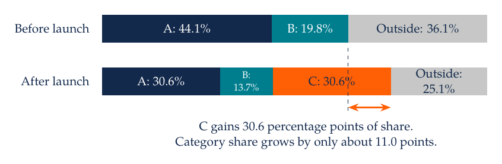
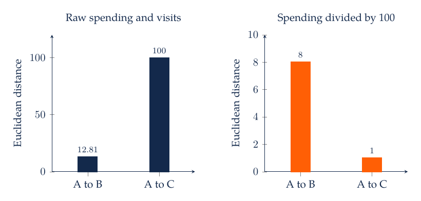
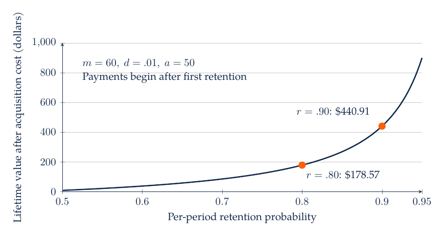
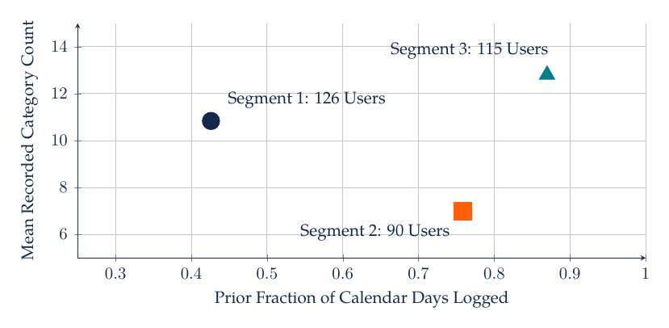
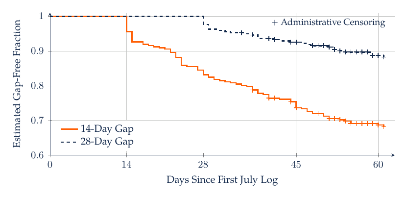

# M4. Product Preferences, Customer Segments, and Lifetime Value

A subscription retailer must choose a product bundle, decide whom to serve, and determine how much to spend acquiring or retaining customers. These decisions are connected. A feature that attracts one segment may be costly to deliver, and a segment with high initial spending may have low retention. Conjoint analysis estimates tradeoffs among product attributes, clustering summarizes patterns of similarity, and customer lifetime value translates future behavior into expected contribution.

## 4.1 Product Design Requires Tradeoffs

Asking consumers whether they like fast delivery often produces a favorable response, but it does not reveal how much they will pay for it or which other feature they will give up. Conjoint tasks present product profiles whose attributes vary. Respondents may rate profiles, rank them, or choose among alternatives. Choice-based tasks resemble an assortment decision, while ratings can provide more observations per respondent under a different response process.

Attributes should represent decisions the firm can implement and descriptions respondents can understand. Levels should span a plausible range without creating impossible combinations. If every premium-quality product also has the highest price, the design provides little independent information about the quality-price tradeoff. Randomization and a suitable experimental design help separate attribute effects, but realistic constraints may limit which combinations can be shown.

Include the decision's relevant alternatives. A forced choice between two products estimates preference conditional on choosing one of them. An outside option such as “buy neither” helps represent category participation. A simulation that omits the outside option can overstate category demand because every respondent must buy something. Survey design, task burden, and hypothetical behavior also affect how well stated choices transfer to market behavior.

## 4.2 Utility, Choice Probabilities, and Willingness to Pay

A simple model assigns respondent $i$ a systematic utility for alternative $j$:

$$
V_{ij}=\beta_q q_j+\beta_f f_j+\beta_p p_j,
$$

where $q_j$ indicates premium quality, $f_j$ indicates a delivery feature, and $p_j$ is price in dollars. Utility has an arbitrary scale. Coefficients describe tradeoffs on that scale, and price is expected to enter negatively in a conventional demand interpretation. Alternative-specific constants can capture average preference for named options relative to a reference alternative.

Under a multinomial-logit random-utility specification, the probability of choosing $j$ from the available set $\mathcal J_i$ is

$$
P_{ij}=\frac{\exp(V_{ij})}{\sum_{k\in\mathcal J_i}\exp(V_{ik})}.
$$

Multinomial logit imposes proportional substitution across alternatives. Whether this pattern fits the product category requires empirical assessment. Repeated choices by one respondent are dependent; estimation and validation should respect that respondent structure. Heterogeneous preferences may be represented with interactions, latent classes, or random coefficients when the data support the additional complexity.

For a binary feature whose coefficient is $\beta_f$, a local willingness-to-pay tradeoff under linear price utility is $-\beta_f/\beta_p$. If $\beta_f=1.2$ and $\beta_p=-0.1$ per dollar, the model equates the feature with $12 of price. This ratio is conditional on the specification and utility scale cancellation. A price coefficient close to zero makes the ratio unstable, and preferences outside the experimental price range are extrapolations.

Attribute importance is often calculated from the range of an attribute's estimated part-worths relative to the sum of ranges. The result depends on the levels included in the study. Expanding the price range can increase measured price importance even when underlying preferences are unchanged. Report the design range when discussing importance.

## 4.3 Case Study: A New Bundle Can Cannibalize Existing Sales

Consider two subscription bundles and an outside option. Bundle A has premium quality and costs $10; bundle B has standard quality and costs $6. Let $\beta_q=1.2$, $\beta_p=-0.1$, and normalize outside-option utility to zero. The systematic utilities are 0.2 for A and $-0.6$ for B. The logit probabilities are approximately 44.1% for A, 19.8% for B, and 36.1% for the outside option.

Now introduce bundle C with the same modeled attributes as A. The logit model assigns A and C approximately 30.6% each, B 13.7%, and the outside option 25.1%. C's share is 30.6 percentage points, but the total purchasing share rises only from 63.9% to 74.9%, an increase of about 11.0 points. The remaining share comes from the existing products. Forecasting a new product's sales without accounting for substitution would overstate incremental demand.



With utility coefficients and the potential-customer population fixed, adding C changes only the available choice set. Because C has the same modeled attributes as A, it is a close substitute. The logit model's independence-of-irrelevant-alternatives property makes C draw share proportionally from all existing alternatives. Whether that pattern is plausible is an empirical question. Richer substitution models may be needed when close substitutes compete especially strongly with one another.

A profit calculation must attach contribution margins and fixed costs to the simulated quantities. If A and C each contribute $4 per purchase and B contributes $3, expected contribution per potential customer rises from about $2.36 to $2.86 before product-development and operating costs. The contribution comparison is conditional on the specified utilities, margins, and fixed customer population. A pilot or holdout choice tasks can help evaluate the proposed product and model before a larger decision.

## 4.4 Estimate and Validate Preferences

A conjoint workflow begins with the managerial choice and feasible attributes, then constructs the task design and recruits a relevant respondent sample. Inspect completion time, straight-line responses, inconsistent attention, and whether participants understood the attributes. Exclusion rules should be set and reported transparently. Removing respondents because their preferences are inconvenient changes the target population.

Estimate a transparent baseline before adopting a more elaborate model. Check coefficient coding, reference levels, price units, and whether probabilities sum to one for every choice set. Evaluate prediction on held-out tasks or respondents according to the intended use. A model that fits familiar respondents' repeated choices may generalize differently to a new customer population.

A useful simulation changes one decision at a time and records what is fixed: attributes, price, competitor options, market size, and margins. Share of preference from a survey is not automatically market share. Distribution, awareness, availability, purchase frequency, and sampling can create differences. State the link between the conjoint output and the demand quantity used in the business calculation.

## 4.5 Segmentation Begins With a Definition of Similarity

A retailer may want segments for differentiated service, product positioning, or campaign design. Those objectives should guide the variables used to define similarity. Grouping customers by recent spending answers a different question from grouping them by category preferences or service needs. A segment should be interpretable, sufficiently stable, and connected to an action the firm can take.

Recency, frequency, and monetary value provide a useful descriptive starting point. Define recency as time since the last eligible purchase at a common observation date, frequency as the number of eligible purchases during a fixed window, and monetary value as sales or contribution during that window. Customers with different observation histories require adjustment or a deliberate eligibility rule. A new customer observed for one month should not be compared mechanically with one observed for a year.

K-means selects $K$ centers to minimize within-cluster squared Euclidean distance:

$$
\sum_{i=1}^n\left\|z_i-\mu_{c(i)}\right\|^2.
$$

Here $z_i$ is the vector of transformed customer features, $c(i)$ is customer $i$'s assigned cluster, and $\mu_{c(i)}$ is its cluster center. The feature transformations determine the distance. Standardization often helps prevent a large numerical scale from dominating, but it does not establish that all features should have equal managerial importance.

For three customers with spending-frequency pairs A=(100,1), B=(110,9), and C=(200,1), raw Euclidean distance makes B much closer to A than C is. If spending is expressed in hundreds of dollars while frequency remains in purchases, C becomes closer to A. The customer records have not changed; the implicit weights have. This is why units and scaling belong in the substantive definition of a segment.



Changing spending units reverses the nearest neighbor because it changes the relative weight placed on spending and visits. A segmentation report should explain that metric and examine whether the proposed actions remain sensible under reasonable transformations.

## 4.6 Choosing and Evaluating Segments

Use more than one criterion to choose $K$. Within-cluster dispersion falls mechanically as more clusters are added. A silhouette measure compares cohesion with separation under the chosen distance, but a high silhouette does not establish business value. Examine segment sizes, profiles, stability across resamples or time, and whether the segments imply different feasible actions.

Hierarchical clustering provides a nested set of groupings whose interpretation depends on the linkage and distance. Density-based methods can identify irregular groups and mark some observations as noise, with sensitivity to neighborhood parameters. Mixture models provide probabilistic membership under distributional assumptions. These alternatives address different patterns; no algorithm discovers a uniquely correct segmentation independent of representation and purpose.

For customer activation, avoid using future purchase outcomes to define a segment that supposedly exists before the campaign. For evaluating segmentation, examine behavior not used mechanically to construct it. A high-spending segment will have high spending by design if spending is a clustering input. A more useful question is whether the grouping helps predict future needs or improves the result of a tested service policy.

Clustering shopping trips on basket size, category composition, and spending can help separate trip types before comparing channels. Fit the representation without allowing the desired channel comparison to determine the grouping. Examine profiles and sensitivity, because a trip-classification algorithm can also create misleading comparisons if its features or thresholds differ across channels.

## 4.7 Customer Lifetime Value Depends on Timing and Margin

Customer lifetime value is the discounted expected contribution from a relationship, under a stated time horizon and behavioral model. For a newly acquired customer, a simple finite-horizon expression is

$$
\operatorname{CLV}=\sum_{t=1}^{T}\frac{\Pr(\text{active at }t)\,m_t}{(1+d)^t}-a.
$$

Here $t$ indexes periods after acquisition, $m_t$ is expected contribution conditional on being active in period $t$, $d$ is the discount rate per period, and $a$ is acquisition cost paid at time zero. Contribution should deduct relevant variable service and fulfillment costs. The expression assumes the conditional margin and activity probability have been defined consistently; more general models can use the expected product of activity and customer-specific margin.

Assume a stationary subscription process: a currently active customer survives each period with probability $r$, earns a constant contribution $m$ at the end of a period only if still active, and has an infinite horizon. With $r/(1+d)<1$, the geometric series gives

$$
\operatorname{CLV}=\frac{mr}{1+d-r}-a.
$$

This convention excludes an immediate current-period contribution. Including one would add that contribution and change the formula. Monthly retention requires monthly margins and a monthly discount rate. Combining monthly retention with an annual discount rate produces an inconsistent calculation.

With monthly contribution $m=60$, retention $r=0.80$, monthly discount rate $d=0.01$, and acquisition cost $a=50$, CLV is approximately $178.57. Increasing retention to 0.90 raises it to approximately $440.91. The gain is nonlinear because retention affects many future payments. These values are conditional on constant retention and margin; changes in retention or margin over time would change the valuation.



With monthly contribution, discounting, and acquisition cost fixed, a one-point retention increase has greater value at a higher baseline retention rate. Uncertainty about long-run retention can therefore dominate a CLV forecast.

## 4.8 Subscription and Noncontractual Relationships

In a subscription setting, cancellation is often observed. Survival analysis can model time to cancellation and account for right censoring when observation ends before cancellation. A hazard describes the probability of exit during a period conditional on survival to that period. Cohort effects, tenure dependence, and changes in service quality can make constant retention implausible.

In a noncontractual retail setting, the last purchase does not reveal whether a customer has permanently left. Models such as BG/NBD represent purchase frequency and latent dropout under specific stochastic assumptions. A separate spending model may estimate value per transaction. Those assumptions require checking, including the treatment of returns and any assumed relationship between purchase frequency and monetary value. A customer-level count alone does not identify permanent churn without a model.

Evaluate value forecasts on a holdout period with the same horizon used in the decision. Compare aggregate and customer-level calibration, rank ordering, and errors for new or infrequent customers. A model can rank customers well while overpredicting total value. For an acquisition budget, the aggregate monetary error may be more consequential than a small improvement in ranking.

## 4.9 Integrated Case: Which Segment Should Receive Retention Support?

Suppose segment H has high predicted CLV but little response to service outreach, while segment M has moderate predicted CLV and a larger response. Targeting only H can be inferior even if its value forecast is accurate. The relevant quantity is the change in expected future contribution caused by outreach, net of the outreach cost. CLV describes a baseline relationship; a retention intervention changes that relationship under a separate causal model.

A useful analysis would estimate or specify segment-specific preferences, margins, and retention, then test the proposed offer. Product design might attract a segment with expensive service needs; a seemingly attractive acquisition price might therefore have low contribution. Segment labels should help organize the decision without replacing these calculations. A final recommendation should show which assumption changes the preferred segment or product.

For practice, recompute the subscription value with $r=0.85$ and verify the result before acquisition cost is subtracted. Add an immediate $60 contribution and explain the change in timing. In the conjoint example, remove the outside option and observe that simulated purchase incidence becomes one by construction. In the clustering example, compare similarity using category shares instead of spending levels and explain which managerial question the new representation serves.

## 4.10 AI-Assisted Implementation and Readings

Ask a coding assistant to calculate choice probabilities from a supplied profile table, check that they sum to one, and separate a new product's share from incremental category demand. For clustering, require documented transformations, segment profiles, and a sensitivity comparison. For CLV, request an explicit payment timeline and verify the closed-form calculation against a long finite sum. These checks catch common mistakes that can survive apparently reasonable charts.

[Sawtooth's academic materials](https://sawtoothsoftware.com/academics/teaching-resources) provide conjoint examples. [Dolnicar, Grün, and Leisch's segmentation book](https://link.springer.com/book/10.1007/978-981-10-8818-6) develops the connection between segmentation design and use. [PyMC-Marketing's CLV documentation](https://www.pymc-marketing.io/en/latest/notebooks/clv/clv_quickstart.html) offers implementation examples whose model assumptions and software versions should be checked before adaptation.

## 4.11 mHealth: Behavioral Segments and Product Economics

A product manager may want different interfaces for occasional loggers, frequent loggers with narrow recorded diets, and frequent loggers with broad recorded diets. Segmenting on January through June behavior creates groups whose later logging can be described without using later observations to define the groups. A segment is useful when it corresponds to a decision the manager can implement, such as simplifying entry or offering a broader set of suggestions.

Eligibility requires at least 30 observed days before July 1 and nonmissing average variety. Each user contributes three features: observed days divided by the 182 calendar days in the first half of 2016, mean recorded category count, and mean calorie-share variety. Standardization gives each feature unit variance before three-cluster k-means. Three clusters are imposed for a manageable descriptive comparison. Cluster labels are ordered by their mean prior logging fraction.

| Segment | Users | Prior Logging Fraction | Mean Breadth | Later Logging Fraction |
| --- | ---: | ---: | ---: | ---: |
| 1 | 126 | 0.426 | 10.84 | 0.338 |
| 2 | 90 | 0.759 | 6.99 | 0.594 |
| 3 | 115 | 0.870 | 12.80 | 0.654 |

Later logging uses the 184 calendar days from July through December, with zero observed days for eligible users absent from that period. The differences describe persistence in recorded use. They are not treatment responses, contract renewal rates, or purchase probabilities. In particular, Segment 2 combines frequent logging with relatively narrow breadth. A single ranking by activity would conceal that distinction.

Repeating k-means with a second seed produces an adjusted Rand index of 1.0 for these inputs. The partition is stable to this initialization check. That result does not establish three natural customer types or prove stability to other features, calendar windows, or measurement screens. The calorie-based variety and breadth features are related, so including both places additional emphasis on recorded dietary diversity. Nutrition screening can also alter the segmentation inputs; compare its consequences before naming a segment around a health interpretation.



The food logs supply no observed subscription price, product-choice experiment, margin, acquisition cost, or payment-based retention. A hypothetical paid-plan calculation can nevertheless clarify the extra inputs needed. Set the outside-option utility to zero, paid-plan benefit to 0.8, price coefficient to -0.1 per dollar, and price to $5. The imposed logit model yields a paid-plan share of 0.5744. These inputs are assumptions, not conjoint estimates from the logs.

For a separate hypothetical subscription, suppose monthly contribution conditional on retention is $6, the monthly discount rate is 1%, acquisition cost is $10, and the first contribution occurs one month after acquisition. With constant monthly retention $r$, value is $6r/(1.01-r)-10$. Assumed retention of 0.80, 0.85, and 0.90 gives values of $12.86, $21.87, and $39.09. These scenarios are not assigned to the three behavioral segments. Doing so would equate logging persistence with paid retention without evidence.

The code fits the scaler and clusters using only the earlier period, then joins later logging for description. An AI assistant should explain each feature's units, how missing later records enter the denominator, and which economic inputs remain hypothetical before proposing a targeting rule.

Python source: [m04.py](../../03_Data_and_Code/mHealth/recurring_examples/m04.py). From its directory, run `python m04.py`.

```python
"""Segment January-June behavior and describe later logging."""

import json
import numpy as np
import pandas as pd
from sklearn.cluster import KMeans
from sklearn.preprocessing import StandardScaler
from sklearn.metrics import adjusted_rand_score
from common import OUTPUT, SEED, load_inputs, save_result

food, daily, baskets = load_inputs()
prior = daily.loc[daily.date.lt("2016-07-01")]
features = prior.groupby("Userid").agg(
    logged_days=("date", "size"),
    breadth=("category_count", "mean"),
    variety=("variety", "mean"),
)
features = features.loc[features.logged_days.ge(30)].dropna()
features["logging_fraction"] = features.logged_days / 182
columns = ["logging_fraction", "breadth", "variety"]
scaled = StandardScaler().fit_transform(features[columns])
model = KMeans(n_clusters=3, n_init=20, random_state=SEED).fit(scaled)
alternative = KMeans(n_clusters=3, n_init=20, random_state=SEED + 1).fit(scaled)
# Number clusters by their mean prior logging fraction for readable output.
order = (
    features.assign(raw=model.labels_)
    .groupby("raw")
    .logging_fraction.mean()
    .sort_values()
    .index
)
labels = {raw: rank + 1 for rank, raw in enumerate(order)}
features["segment"] = [labels[value] for value in model.labels_]
later = daily.loc[daily.date.ge("2016-07-01")].groupby("Userid").size()
features["later_logging_fraction"] = later.reindex(features.index, fill_value=0) / 184
table = features.groupby("segment").agg(
    users=("segment", "size"),
    prior_logging=("logging_fraction", "mean"),
    breadth=("breadth", "mean"),
    variety=("variety", "mean"),
    later_logging=("later_logging_fraction", "mean"),
)
OUTPUT.mkdir(exist_ok=True)
table.to_csv(OUTPUT / "M04_segments.csv")
# Imposed monthly financial assumptions, separate from the log estimates.
retention = np.array([0.80, 0.85, 0.90])
clv = 6 * retention / (1.01 - retention) - 10
utility = np.array([0.0, 0.8 - 0.1 * 5])  # Outside option, hypothetical paid plan.
choice = np.exp(utility - utility.max())
choice /= choice.sum()
result = {
    "users": len(features),
    "features": columns,
    "seed_agreement_ari": float(
        adjusted_rand_score(model.labels_, alternative.labels_)
    ),
    "segments": table.reset_index().to_dict(orient="records"),
    "hypothetical_retention": retention.tolist(),
    "hypothetical_clv": clv.tolist(),
    "hypothetical_paid_plan_share": float(choice[1]),
}
save_result("M04", result)
print(json.dumps(result, indent=2))
```

## 4.12 Python Calculations for the Synthetic Cases

The inputs below are imposed teaching values. Running the program creates the labeled synthetic CSV files and prints the corresponding calculations. They are separate from the mHealth estimates. Keep the script beside `example_helpers.py` in `03_Data_and_Code/Lecture_Examples`.

Python source: [m04_synthetic.py](../../03_Data_and_Code/Lecture_Examples/m04_synthetic.py). From its directory, run `python m04_synthetic.py`.

```python
"""Synthetic numerical examples for M4; run from any working directory."""

import itertools
import json
import math
from example_helpers import write_csv, ols_slope, shares

r = {}
before = shares({"A": 0.2, "B": -0.6, "outside": 0})
after = shares({"A": 0.2, "B": -0.6, "C": 0.2, "outside": 0})
r["M04"] = {
    "shares_before": before,
    "shares_after": after,
    "category_share_increase": before["outside"] - after["outside"],
    "contribution_before": 4 * before["A"] + 3 * before["B"],
    "contribution_after": 4 * (after["A"] + after["C"]) + 3 * after["B"],
    "wtp_dollars": 1.2 / 0.1,
    "distance_raw_AB": math.hypot(10, 8),
    "distance_raw_AC": 100,
    "distance_rescaled_AB": math.hypot(0.1, 8),
    "distance_rescaled_AC": 1,
    "clv_after_acquisition": {
        str(retention): 60 * retention / (1.01 - retention) - 50
        for retention in [0.8, 0.85, 0.9]
    },
}
write_csv(
    "M04_segmentation_synthetic.csv",
    ["customer", "spending_dollars", "visits"],
    [("A", 100, 1), ("B", 110, 9), ("C", 200, 1)],
)
assert math.isclose(sum(before.values()), 1) and math.isclose(sum(after.values()), 1)
print(json.dumps(r, indent=2))
```

## 4.13 mHealth: Time Until a Logging Gap

A retention manager may want to intervene before a long interruption in activity. The analytical object must specify when the interruption has actually occurred. A user who is absent for two days and returns on the third day has a different history from one who remains absent for several weeks. The end of the data window can arrive before either pattern is fully observed.

Define eligibility using at least 30 recorded days before July 1. Among eligible users who return during July, set time zero to that user's first July logging day. The event occurs on the 14th consecutive day without a subsequent log, and observation ends on August 31. The event date is the day the gap is confirmed. A later return does not erase a previously confirmed gap. Customers without a confirmed gap by August 31 are administratively censored at their elapsed follow-up time.

This definition concerns an interruption in observed logging. Permanent customer departure, failure to eat, and cancellation of a paid subscription are separate events. July return is also a selection condition: 331 users satisfy prior eligibility, and 297 have a July time origin. The curve describes these returners, including a mixture of early and late July start dates.

To allow different amounts of follow-up, define $n_t$ as users still under observation and gap-free immediately before elapsed day $t$, and $d_t$ as confirmed first gaps on that day. The Kaplan–Meier estimate is

$$
\widehat S(t)=\prod_{s\le t}\left(1-\frac{d_s}{n_s}\right).
$$

A censored user contributes to earlier risk sets and leaves subsequent ones. Censoring itself causes no downward step. When an event and administrative censoring share a day, the event is counted before censoring. A population interpretation of the pooled curve requires censoring to be independent of gap timing, possibly conditional on relevant start-date characteristics. Calendar trends can undermine that condition because later July starters have shorter follow-up.

| Confirmed Gap | Users | Events by August 31 | Censored | Gap-Free at Day 30 | Gap-Free at Day 60 |
| --- | ---: | ---: | ---: | ---: | ---: |
| 14 Days | 297 | 93 | 204 | 0.8182 | 0.6867 |
| 28 Days | 297 | 33 | 264 | 0.9630 | 0.8877 |



The 28-day definition produces fewer confirmed events because an interruption must persist longer. It also confirms an event later even when the same interruption satisfies both thresholds. At elapsed day 60, the risk sets contain 160 and 187 users for the 14- and 28-day definitions, respectively. The table therefore requires an event definition and a time origin to support a retention comparison. Converting either curve into customer lifetime value would additionally require a commercial relationship, margins, discounting, and a model linking logging interruptions to that relationship.

The [lifelines customer-churn example](https://github.com/CamDavidsonPilon/lifelines/blob/master/examples/Customer%20Churn.ipynb) uses explicit event and duration fields. The [Kaplan–Meier documentation](https://lifelines.readthedocs.io/en/latest/Survival%20analysis%20with%20lifelines.html) supplies the corresponding risk-set estimator. The code below computes each risk set explicitly so a small hand-constructed event/censoring table can verify the calculation.

Python source: [logging_gaps.py](../../03_Data_and_Code/mHealth/recurring_examples/logging_gaps.py). From its directory, run `python logging_gaps.py`.

```python
"""Kaplan-Meier estimates for a defined logging-gap event, with censoring."""

import json
import pandas as pd
from common import OUTPUT, load_food, make_daily, save_result


def first_gap(dates, start, end, gap_days):
    dates = set(dates)
    run = 0
    for day in pd.date_range(start + pd.Timedelta(days=1), end):
        run = 0 if day in dates else run + 1
        if run == gap_days:
            return (day - start).days, True
    return (end - start).days, False


def kaplan_meier(records):
    # At a tied time, events precede administrative censoring.
    survival = 1.0
    rows = []
    for time in sorted(records.duration.unique()):
        risk = int(records.duration.ge(time).sum())
        events = int((records.duration.eq(time) & records.event).sum())
        censored = int((records.duration.eq(time) & ~records.event).sum())
        survival *= 1 - events / risk
        rows.append(
            {
                "day": int(time),
                "at_risk": risk,
                "events": events,
                "censored": censored,
                "gap_free": survival,
            }
        )
    return pd.DataFrame(rows)


if __name__ == "__main__":
    daily = make_daily(load_food())
    prior = daily.loc[daily.date < "2016-07-01"].groupby("Userid").size()
    eligible = prior.index[prior >= 30]
    july = daily.loc[
        daily.Userid.isin(eligible) & daily.date.between("2016-07-01", "2016-07-31")
    ]
    starts = july.groupby("Userid").date.min()
    observed = daily.groupby("Userid").date.agg(set)
    end = pd.Timestamp("2016-08-31")
    result = {
        "eligible_before_july": len(eligible),
        "july_returners": len(starts),
        "administrative_end": str(end.date()),
        "thresholds": [],
    }
    for gap in [14, 28]:
        records = pd.DataFrame(
            [
                first_gap(observed[user], start, end, gap)
                for user, start in starts.items()
            ],
            columns=["duration", "event"],
        )
        curve = kaplan_meier(records)
        summary = {
            "gap_days": gap,
            "users": len(records),
            "events": int(records.event.sum()),
            "censored": int((~records.event).sum()),
        }
        for horizon in [30, 45, 60]:
            before = curve.loc[curve.day <= horizon]
            summary[f"gap_free_day_{horizon}"] = (
                float(before.gap_free.iloc[-1]) if len(before) else 1.0
            )
            summary[f"at_risk_day_{horizon}"] = int(records.duration.ge(horizon).sum())
        result["thresholds"].append(summary)
        OUTPUT.mkdir(exist_ok=True)
        curve.to_csv(OUTPUT / f"logging_gap_{gap}.csv", index=False)
    save_result("logging_gaps", result)
    print(json.dumps(result, indent=2))
```
