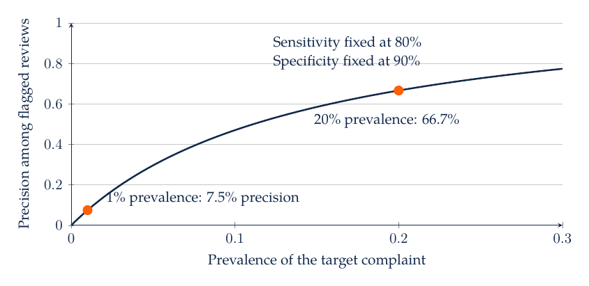
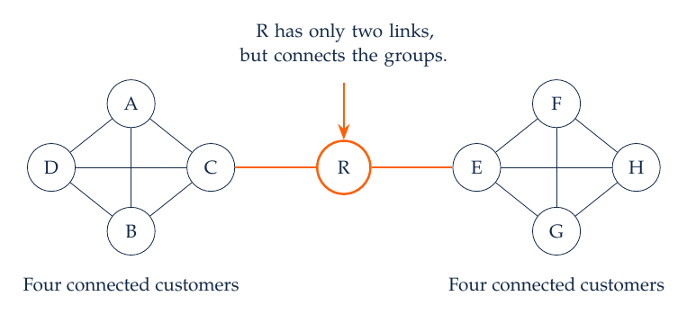

# M5. Text, Social Media, and Customer Networks

A retailer receives thousands of reviews and support messages each week. The service manager needs to distinguish delivery delays, product defects, and billing problems, then decide which issues deserve attention. A count of negative words is an incomplete representation: “the refund was fast, but the replacement failed” contains different evaluations of two aspects of the experience. The analytical task is to turn language into a defensible measurement of a concept relevant to action.

Text analysis also raises a sampling problem. Customers who post reviews can differ from those who remain silent, and the platform can affect what gets posted or displayed. Social-network analysis adds another layer: observed connections and similar behavior can reflect influence, common circumstances, or selection into relationships.

## 5.1 Define the Construct and the Document

A construct is the concept the analysis intends to measure, such as delivery dissatisfaction, perceived authenticity, or purchase intent. A label is the operational category assigned to an observation. A document might be a complete review, one sentence, a support ticket, or a conversation. Those units should follow the construct. A review-level sentiment label can obscure a positive service experience and a negative product experience in the same review.

Write an annotation codebook before producing labels at scale. It should define each category, inclusion and exclusion rules, treatment of ambiguity, and examples near category boundaries. If a message can contain several problems, a multi-label task may be appropriate. If the decision requires routing each ticket to one team, define a primary issue or a routing priority separately from the presence of every issue.

Metadata can be informative and potentially misleading. Ratings may help validate a sentiment measure but can also leak the intended label into a prediction exercise. Product category, language, channel, and date can reveal domain differences. Remove or protect personal information before sending text to an external service, and use approved data access. A scraped review is not automatically free of personal or contractual restrictions.

## 5.2 Representing Language With Counts and Weights

A bag-of-words representation counts tokens while largely ignoring their order. An $n$-gram representation retains local sequences, so “not good” can differ from “good.” Tokenization, case normalization, punctuation, and stop-word rules change the resulting features. Removing negation words can destroy information needed for sentiment. Removing product names may help focus on attributes or may erase the very object whose complaints the manager needs to identify.

Term frequency-inverse document frequency gives greater weight to terms that are frequent in a document but less common across the corpus. One simple convention is

$$
\operatorname{tfidf}_{wd}=\operatorname{tf}_{wd}\log\left(\frac{N}{\operatorname{df}_w}\right),
$$

where $\operatorname{tf}_{wd}$ is the frequency of word $w$ in document $d$, $N$ is the number of documents, and $\operatorname{df}_w$ is the number of documents containing the word. Implementations vary in smoothing, normalization, and term-frequency definitions. Record the convention rather than assuming a library's output matches this exact expression.

If “delivery” appears in two of three documents, its inverse-document-frequency term under this convention is $\log(3/2)\approx0.405$. A word appearing in every document receives zero weight. That weighting can help discriminate documents, but a common term may still be substantively important. Statistical distinctiveness and managerial importance are different criteria.

Fit a learned vocabulary and IDF weights on training text when evaluating prediction. Learning them from the test corpus exposes information about the evaluation distribution. The leakage may appear minor compared with using labels, yet it still changes the task. A pipeline makes the training-only transformation explicit and reproducible.

## 5.3 Embeddings and Semantic Similarity

An embedding maps a document or token into a vector learned from language data. Similar vectors can capture related meanings even when documents use different words. Cosine similarity compares the angle between vectors:

$$
\operatorname{cos}(u,v)=\frac{u^\top v}{\|u\|\,\|v\|}.
$$

The normalization removes vector length from the comparison. This is useful when direction represents meaning in the selected model, but it does not guarantee that the similarity corresponds to the marketing construct. Two messages about refunds can be semantically close while expressing opposite evaluations. Retrieval quality should be checked with examples that matter for the downstream task.

A simple TF-IDF classifier can be a strong baseline for a well-defined domain. Embeddings may help with paraphrases, sparse labels, and semantic retrieval, but they introduce dependence on a pretrained model and its training domain. Compare alternatives on the same held-out data and operational criteria. Record model versions because an updated representation can change nearest neighbors and labels even when the input text is unchanged.

For interpretation, inspect representative successes and failures. A model may associate a brand name with complaints because one product had a recall during training. It can then misclassify neutral mentions after the issue is resolved. Temporal validation and product-level holdouts help reveal whether performance depends on such shortcuts.

## 5.4 Sentiment, Aspect Labels, and Topic Models

A sentiment lexicon assigns scores to words and combines them using rules. It offers a transparent baseline, but sarcasm, domain-specific meanings, and context can cause errors. A supervised classifier learns a mapping from labeled examples to outcomes. Its labels and training sample define what it learns; a generic “positive/negative” dataset may not represent customer-service severity.

Aspect-based analysis separates the object being evaluated from the evaluation itself. For the sentence “delivery was late, but the support agent solved the problem,” a useful record might contain delivery-negative and service-positive labels. A single overall score discards that distinction. If the action is a logistics intervention, the aspect-specific measure is closer to the decision.

Topic models describe recurring patterns of word co-occurrence or document similarity. A topic is an estimated pattern, not automatically a stable consumer need. In probabilistic models, documents can combine topics; in clustering approaches, assignments may be discrete or probabilistic. Analysts supply topic names after inspecting high-weight words and representative documents. Validate those names with actual text and examine stability across preprocessing and model choices.

A manager should avoid interpreting an increase in a topic's share without checking its denominator. More delivery complaints can mean more delivery problems, more deliveries overall, a changed review prompt, or fewer reviews about other topics. Combining text measures with transaction or service-volume data helps distinguish these explanations.

## 5.5 Case Study: A Complaint Detector Under Changing Prevalence

Suppose a classifier identifies a rare but costly product defect. In a synthetic evaluation population of 1,000 tickets, 200 truly mention the defect. The classifier detects 160 of them and incorrectly flags 80 of the 800 other tickets. Sensitivity, or recall, is 80%; specificity is 90%; precision is 160/240, or 66.7%.

| Population | True Defect Tickets | True Positives | False Positives | Precision |
| --- | ---: | ---: | ---: | ---: |
| Evaluation sample | 200 | 160 | 80 | 66.7% |
| Deployment sample | 10 | 8 | 99 | 7.5% |

The second row holds sensitivity at 80% and specificity at 90%, but reduces true prevalence to 1%. Among 990 nondefect tickets, 99 are flagged. Only eight of the 107 flagged tickets are true positives. A manager using the original precision to plan review staffing would be badly misled.

Bayes' rule makes the dependence explicit. If prevalence is $\rho$, sensitivity is $s$, and specificity is $q$, then

$$
\Pr(\text{defect}\mid\text{flag})=\frac{s\rho}{s\rho+(1-q)(1-\rho)}.
$$

The denominator counts both correct and incorrect flags. For a rare issue, even a modest false-positive rate can dominate that total. This is why validation should represent the deployment population or explicitly adjust for a changed sampling design.

Sensitivity and specificity remain at 0.80 and 0.90 in both populations. The decline in precision comes entirely from the lower prevalence. Operational evaluation should also consider the cost of missed defects, the burden of false alarms, and whether uncertain cases can be routed to human review.

## 5.6 Human and LLM Annotation

LLMs can help draft a codebook, suggest candidate labels, or classify text using explicit instructions. For a defensible measurement exercise, preserve the original text, the codebook version, model identifier, prompt, output schema, and date. Require a bounded output format with an allowed “uncertain” category where appropriate. Validate the output against the schema and inspect cases that violate the instructions.

A prompt should identify the construct, unit, categories, boundary rules, and examples. For delivery dissatisfaction, it should distinguish a complaint about an actual delay from a question about the promised delivery date. Ask for a short supporting span from the supplied text when that improves auditability. A fluent explanation is not evidence that the label is correct; compare it with independent human judgments on a relevant sample.

Human agreement is informative because the construct may itself be ambiguous. Double-code a sample, examine disagreements, and refine definitions before scaling. Report category-specific errors, prevalence, and performance across languages or product groups. An average accuracy can conceal systematic failure on the minority category that motivates the analysis.

Treat text being classified as data. A review may contain language resembling an instruction to the model. It should not change the annotation task, request external actions, or supply new system rules. Separate the fixed task instructions from the document content, constrain outputs, and inspect unexpected behavior. Use synthetic or approved text for classroom exercises involving external services.

## 5.7 Networks: Connections, Reach, and Brokerage

A network represents entities as nodes and relationships as edges. Nodes might be customers, creators, brands, or products. An edge might indicate following, communication, co-purchase, or a similarity criterion. Directed and weighted networks preserve different information from undirected binary networks. The edge definition should follow the substantive relationship the analyst intends to study.

Degree counts a node's direct connections. Betweenness summarizes how often a node lies on shortest paths between other nodes. A person with few direct contacts can have high betweenness if those contacts connect otherwise separate groups. Eigenvector-based measures give more weight to connections with well-connected nodes. These metrics describe network structure under their definitions; they do not by themselves establish persuasion, credibility, or the effect of paying a creator.

Broker R has two direct connections, while each within-group connector has four. Removing R disconnects the two groups. A customer with fewer direct contacts can therefore be essential for reaching a different audience. A marketing campaign may value either role, depending on message transmission, audience overlap, and the intended outcome.

Observed similarity among connected customers can arise from influence, homophily, or common exposure. Friends may adopt a product because they affect one another, because they already share tastes, or because they see the same promotion. Regressing adoption on friends' adoption does not distinguish those mechanisms without additional design. Randomized encouragement, timing restrictions, or credible natural variation can help, with attention to spillovers and the unit of assignment.

## 5.8 Social-Media Case: Engagement and Commercial Value

A brand compares two creators. One receives many comments, but those comments largely come from an audience that already follows the brand. The other reaches a smaller group with less overlap. A high engagement count does not establish more incremental sales. The comparison requires a target population, exposure definition, outcome horizon, and a way to measure what would have happened without the collaboration.

Text can help describe comment content, and network overlap can describe audience duplication. Those measurements support campaign design, but they should be combined with an evaluation strategy. A test might randomize eligible regions or audience groups when feasible, or compare outcomes using a credible observational design. If communication crosses groups, spillovers can complicate the interpretation of an untreated group.

For classroom practice, construct two small audience sets and calculate their overlap. Then compare comments per exposed user with total comments. Explain why neither is a direct estimate of incremental profit.

## 5.9 AI-Assisted Workflow, Practice, and Readings

Start a text exercise with a small manually inspected sample and a codebook. Build a transparent baseline, reserve an evaluation sample, and compare a more complex method on the same outcomes. Ask an assistant to produce a confusion matrix and representative errors, then independently recompute precision and recall from the counts. Keep model selection and prompt refinement away from the final test sample.

For practice, calculate accuracy in the first complaint-detector sample: 88%. Explain why a classifier that always predicts “no defect” would achieve 99% accuracy in the rare-prevalence deployment sample while detecting no defects. Next identify how removing “not” changes the meaning of “not reliable.” Finally, explain why two highly connected adopters may share preferences even if neither caused the other's adoption.

The [scikit-learn text-feature documentation](https://scikit-learn.org/stable/modules/feature_extraction.html#text-feature-extraction) supports count and TF-IDF representations. [VADER's author repository](https://github.com/cjhutto/vaderSentiment) provides a rule-based sentiment baseline. [Hagen and colleagues (2020)](https://doi.org/10.1007/s11002-020-09535-7) discuss ways machine learning can support behavioral marketing research.
