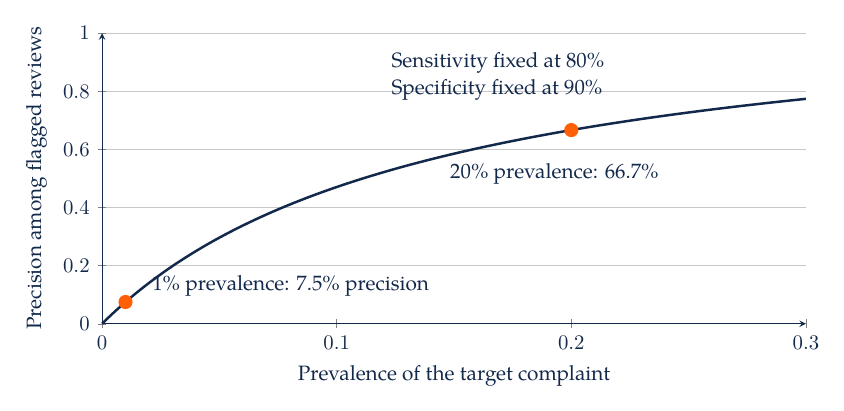
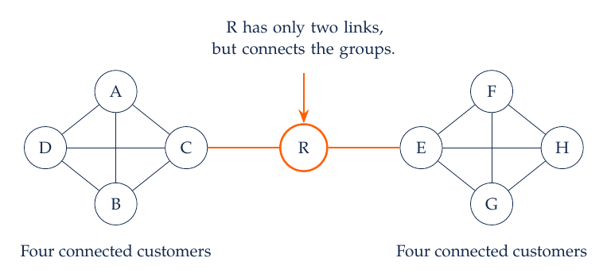
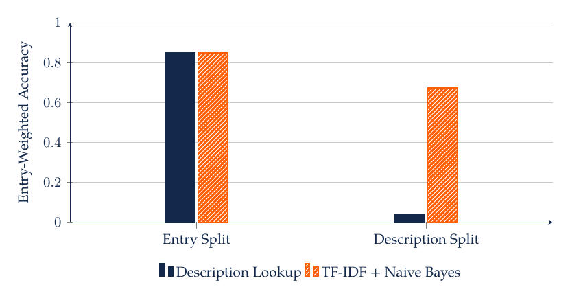
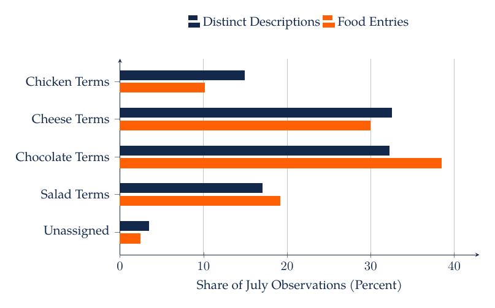
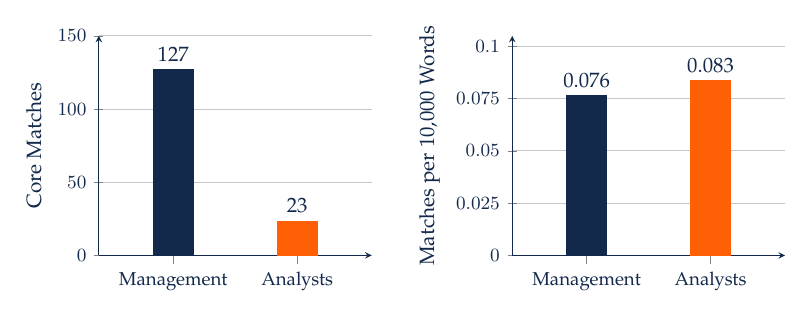
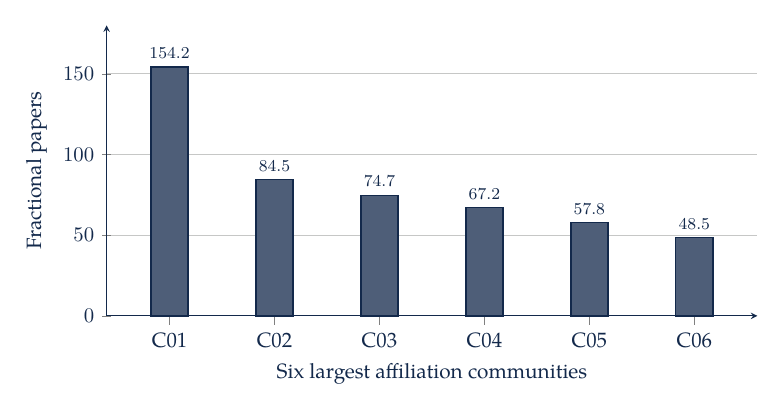

# M5. Text, Social Media, and Customer Networks

A retailer receives thousands of reviews and support messages each week. The service manager needs to distinguish delivery delays, product defects, and billing problems, then decide which issues deserve attention. A count of negative words is an incomplete representation: “the refund was fast, but the replacement failed” contains different evaluations of two aspects of the experience. The analytical task is to turn language into a defensible measurement of a concept relevant to action.

Text analysis also raises a sampling problem. Customers who post reviews can differ from those who remain silent, and the platform can affect what gets posted or displayed. Social-network analysis adds another layer: observed connections and similar behavior can reflect influence, common circumstances, or selection into relationships.

## 5.1 Define the Construct and the Document

A construct is the concept the analysis intends to measure, such as delivery dissatisfaction, perceived authenticity, or purchase intent. A label is the operational category assigned to an observation. A document might be a complete review, one sentence, a support ticket, or a conversation. Those units should follow the construct. A review-level sentiment label can obscure a positive service experience and a negative product experience in the same review.

Write an annotation codebook before producing labels at scale. It should define each category, inclusion and exclusion rules, treatment of ambiguity, and examples near category boundaries. If a message can contain several problems, a multi-label task may be appropriate. If the decision requires routing each ticket to one team, define a primary issue or a routing priority separately from the presence of every issue.

Metadata can be informative and potentially misleading. Ratings may help validate a sentiment measure but can also leak the intended label into a prediction exercise. Product category, language, channel, and date can reveal domain differences. Remove or protect personal information before sending text to an external service, and use approved data access. A scraped review is not automatically free of personal or contractual restrictions.

## 5.2 Representing Language With Counts and Weights

A bag-of-words representation counts tokens while largely ignoring their order. An $n$-gram representation retains local sequences, so “not good” can differ from “good.” Tokenization, case normalization, punctuation, and stop-word rules change the resulting features. Removing negation words can destroy information needed for sentiment. Removing product names may help focus on attributes or may erase the very object whose complaints the manager needs to identify.

Term frequency-inverse document frequency gives greater weight to terms that are frequent in a document but less common across the corpus. One simple convention is

$$
\operatorname{tfidf}_{wd}=\operatorname{tf}_{wd}\log\left(\frac{N}{\operatorname{df}_w}\right),
$$

where $\operatorname{tf}_{wd}$ is the frequency of word $w$ in document $d$, $N$ is the number of documents, and $\operatorname{df}_w$ is the number of documents containing the word. Implementations vary in smoothing, normalization, and term-frequency definitions. Record the convention rather than assuming a library's output matches this exact expression.

If “delivery” appears in two of three documents, its inverse-document-frequency term under this convention is $\log(3/2)\approx0.405$. A word appearing in every document receives zero weight. That weighting can help discriminate documents, but a common term may still be substantively important. Statistical distinctiveness and managerial importance are different criteria.

Fit a learned vocabulary and IDF weights on training text when evaluating prediction. Learning them from the test corpus exposes information about the evaluation distribution. The leakage may appear minor compared with using labels, yet it still changes the task. A pipeline makes the training-only transformation explicit and reproducible.

## 5.3 Embeddings and Semantic Similarity

An embedding maps a document or token into a vector learned from language data. Similar vectors can capture related meanings even when documents use different words. Cosine similarity compares the angle between vectors:

$$
\operatorname{cos}(u,v)=\frac{u^\top v}{\|u\|\,\|v\|}.
$$

The normalization removes vector length from the comparison. This is useful when direction represents meaning in the selected model, but it does not guarantee that the similarity corresponds to the marketing construct. Two messages about refunds can be semantically close while expressing opposite evaluations. Retrieval quality should be checked with examples that matter for the downstream task.

A simple TF-IDF classifier can be a strong baseline for a well-defined domain. Embeddings may help with paraphrases, sparse labels, and semantic retrieval, but they introduce dependence on a pretrained model and its training domain. Compare alternatives on the same held-out data and operational criteria. Record model versions because an updated representation can change nearest neighbors and labels even when the input text is unchanged.

For interpretation, inspect representative successes and failures. A model may associate a brand name with complaints because one product had a recall during training. It can then misclassify neutral mentions after the issue is resolved. Temporal validation and product-level holdouts help reveal whether performance depends on such shortcuts.

## 5.4 Sentiment, Aspect Labels, and Topic Models

A sentiment lexicon assigns scores to words and combines them using rules. It offers a transparent baseline, but sarcasm, domain-specific meanings, and context can cause errors. A supervised classifier learns a mapping from labeled examples to outcomes. Its labels and training sample define what it learns; a generic “positive/negative” dataset may not represent customer-service severity.

Aspect-based analysis separates the object being evaluated from the evaluation itself. For the sentence “delivery was late, but the support agent solved the problem,” a useful record might contain delivery-negative and service-positive labels. A single overall score discards that distinction. If the action is a logistics intervention, the aspect-specific measure is closer to the decision.

Topic models describe recurring patterns of word co-occurrence or document similarity. A topic is an estimated pattern, not automatically a stable consumer need. In probabilistic models, documents can combine topics; in clustering approaches, assignments may be discrete or probabilistic. Analysts supply topic names after inspecting high-weight words and representative documents. Validate those names with actual text and examine stability across preprocessing and model choices.

A manager should avoid interpreting an increase in a topic's share without checking its denominator. More delivery complaints can mean more delivery problems, more deliveries overall, a changed review prompt, or fewer reviews about other topics. Combining text measures with transaction or service-volume data helps distinguish these explanations.

## 5.5 Case Study: A Complaint Detector Under Changing Prevalence

Suppose a classifier identifies a rare but costly product defect. In a synthetic evaluation population of 1,000 tickets, 200 truly mention the defect. The classifier detects 160 of them and incorrectly flags 80 of the 800 other tickets. Sensitivity, or recall, is 80%; specificity is 90%; precision is 160/240, or 66.7%.

| Population | True Defect Tickets | True Positives | False Positives | Precision |
| --- | ---: | ---: | ---: | ---: |
| Evaluation sample | 200 | 160 | 80 | 66.7% |
| Deployment sample | 10 | 8 | 99 | 7.5% |

The second row holds sensitivity at 80% and specificity at 90%, but reduces true prevalence to 1%. Among 990 nondefect tickets, 99 are flagged. Only eight of the 107 flagged tickets are true positives. A manager using the original precision to plan review staffing would be badly misled.

Bayes' rule makes the dependence explicit. If prevalence is $\rho$, sensitivity is $s$, and specificity is $q$, then

$$
\Pr(\text{defect}\mid\text{flag})=\frac{s\rho}{s\rho+(1-q)(1-\rho)}.
$$

The denominator counts both correct and incorrect flags. For a rare issue, even a modest false-positive rate can dominate that total. This is why validation should represent the deployment population or explicitly adjust for a changed sampling design.



Sensitivity and specificity remain at 0.80 and 0.90 in both populations. The decline in precision comes entirely from the lower prevalence. Operational evaluation should also consider the cost of missed defects, the burden of false alarms, and whether uncertain cases can be routed to human review.

## 5.6 Human and LLM Annotation

LLMs can help draft a codebook, suggest candidate labels, or classify text using explicit instructions. For a defensible measurement exercise, preserve the original text, the codebook version, model identifier, prompt, output schema, and date. Require a bounded output format with an allowed “uncertain” category where appropriate. Validate the output against the schema and inspect cases that violate the instructions.

A prompt should identify the construct, unit, categories, boundary rules, and examples. For delivery dissatisfaction, it should distinguish a complaint about an actual delay from a question about the promised delivery date. Ask for a short supporting span from the supplied text when that improves traceability. A fluent explanation is not evidence that the label is correct; compare it with independent human judgments on a relevant sample.

Human agreement is informative because the construct may itself be ambiguous. Double-code a sample, examine disagreements, and refine definitions before scaling. Report category-specific errors, prevalence, and performance across languages or product groups. An average accuracy can conceal systematic failure on the minority category that motivates the analysis.

Treat text being classified as data. A review may contain language resembling an instruction to the model. It should not change the annotation task, request external actions, or supply new system rules. Separate the fixed task instructions from the document content, constrain outputs, and inspect unexpected behavior. Use synthetic or approved text for classroom exercises involving external services.

## 5.7 Networks: Connections, Reach, and Brokerage

A network represents entities as nodes and relationships as edges. Nodes might be customers, creators, brands, or products. An edge might indicate following, communication, co-purchase, or a similarity criterion. Directed and weighted networks preserve different information from undirected binary networks. The edge definition should follow the substantive relationship the analyst intends to study.

Degree counts a node's direct connections. Betweenness summarizes how often a node lies on shortest paths between other nodes. A person with few direct contacts can have high betweenness if those contacts connect otherwise separate groups. Eigenvector-based measures give more weight to connections with well-connected nodes. These metrics describe network structure under their definitions; they do not by themselves establish persuasion, credibility, or the effect of paying a creator.



Broker R has two direct connections, while each within-group connector has four. Removing R disconnects the two groups. A customer with fewer direct contacts can therefore be essential for reaching a different audience. A marketing campaign may value either role, depending on message transmission, audience overlap, and the intended outcome.

Observed similarity among connected customers can arise from influence, homophily, or common exposure. Friends may adopt a product because they affect one another, because they already share tastes, or because they see the same promotion. Regressing adoption on friends' adoption does not distinguish those mechanisms without additional design. Randomized encouragement, timing restrictions, or credible natural variation can help, with attention to spillovers and the unit of assignment.

## 5.8 Social-Media Case: Engagement and Commercial Value

A brand compares two creators. One receives many comments, but those comments largely come from an audience that already follows the brand. The other reaches a smaller group with less overlap. A high engagement count does not establish more incremental sales. The comparison requires a target population, exposure definition, outcome horizon, and a way to measure what would have happened without the collaboration.

Text can help describe comment content, and network overlap can describe audience duplication. Those measurements support campaign design, but they should be combined with an evaluation strategy. A test might randomize eligible regions or audience groups when feasible, or compare outcomes using a credible observational design. If communication crosses groups, spillovers can complicate the interpretation of an untreated group.

For classroom practice, construct two small audience sets and calculate their overlap. Then compare comments per exposed user with total comments. Explain why neither is a direct estimate of incremental profit.

## 5.9 AI-Assisted Workflow, Practice, and Readings

Start a text exercise with a small manually inspected sample and a codebook. Build a transparent baseline, reserve an evaluation sample, and compare a more complex method on the same outcomes. Ask an assistant to produce a confusion matrix and representative errors, then independently recompute precision and recall from the counts. Keep model selection and prompt refinement away from the final test sample.

For practice, calculate accuracy in the first complaint-detector sample: 88%. Explain why a classifier that always predicts “no defect” would achieve 99% accuracy in the rare-prevalence deployment sample while detecting no defects. Next identify how removing “not” changes the meaning of “not reliable.” Finally, explain why two highly connected adopters may share preferences even if neither caused the other's adoption.

The [scikit-learn text-feature documentation](https://scikit-learn.org/stable/modules/feature_extraction.html#text-feature-extraction) supports count and TF-IDF representations. [VADER's author repository](https://github.com/cjhutto/vaderSentiment) provides a rule-based sentiment baseline. [Hagen and colleagues (2020)](https://doi.org/10.1007/s11002-020-09535-7) discuss ways machine learning can support behavioral marketing research.

## 5.10 mHealth: Classifying New Food Descriptions

The manager wants to reduce the effort required to categorize a food entry. A lookup table may work well for familiar descriptions, while a text classifier may help with a new description. These are distinct deployment conditions. Repeated descriptions in both training and test records can make a random entry split look successful even when the system will struggle with unseen language.

Normalize descriptions by lowercasing, collapsing whitespace, and trimming the ends. Retain nonempty descriptions and nonmissing source categories, then sample 200,000 eligible entries with seed 534. The sample contains 37,570 distinct normalized descriptions; 1,725 appear with more than one source category. Those inconsistencies create label ambiguity. The source category is the prediction target, not a validated nutritional interpretation of the food.

The first split assigns approximately 20% of entries to testing. The second uses a fixed SHA-256 rule to hold out entire normalized descriptions. Its test entries therefore share no exact normalized description with training. Both evaluations weight food entries equally, so frequent descriptions receive more weight. A second evaluation weighting unique descriptions equally would answer a different product question.

A training-only lookup chooses the most frequent category for each description, breaking count ties alphabetically and falling back to the most frequent training category. The text alternative fits a TF-IDF vocabulary of unigrams and bigrams on distinct training descriptions, caps the vocabulary at 20,000 features, and requires a term to occur in at least two training descriptions. Multinomial naive Bayes uses smoothing of 0.1 and training description-category counts as weights.

| Evaluation | Test Entries | Familiar Descriptions | Lookup Accuracy | Text Accuracy | Text Macro F1 |
| --- | ---: | ---: | ---: | ---: | ---: |
| Entry Split | 40,273 | 88.65% | 84.90% | 84.94% | 0.5531 |
| Description Split | 36,987 | 0% | 3.82% | 67.42% | 0.3465 |

Macro F1 averages across the 312 labels present in the combined sampled data, assigning zero to undefined class scores. Rare labels therefore matter more than in accuracy. The gap between the two evaluations reflects both familiarity and the changed test composition; it is not a causal estimate of leakage's effect. For a service processing new descriptions, the description-level evaluation is the closer test of that requirement.



The lookup nearly matches the text classifier on the entry split because most test descriptions already appear in training. Its collapse on unseen descriptions reveals how much of that performance depends on memory. A product could use the lookup for verified familiar terms and route uncertain new terms for review. Nutrition-based food composition matching would additionally require portion units, preparation details, and validated food codes. A category prediction alone supplies none of those quantities.

An AI assistant can help inspect ambiguous examples and propose a labeling rubric. Use only permitted local processing, preserve the original category, and evaluate proposed relabeling against independently reviewed examples. The code below makes no external model request and learns every lookup and text transformation from training rows only.

Python source: [m05.py](../../03_Data_and_Code/mHealth/recurring_examples/m05.py). From its directory, run `python m05.py`.

```python
"""Contrast familiar-description and unseen-description classification."""

import json
import numpy as np
from sklearn.feature_extraction.text import TfidfVectorizer
from sklearn.naive_bayes import MultinomialNB
from sklearn.metrics import accuracy_score, f1_score
from common import SEED, description_holdout, load_food, save_result

food = load_food()
usable = food.loc[food.description.ne("") & food.category.ne("Unclassified")]
sample = usable.sample(n=min(200000, len(usable)), random_state=SEED).reset_index(
    drop=True
)
rng = np.random.default_rng(SEED)
masks = {
    "entry_split": rng.random(len(sample)) < 0.2,
    "description_split": sample.description.map(description_holdout).to_numpy(),
}
results = {}
for name, mask in masks.items():
    train, test = sample.loc[~mask], sample.loc[mask]
    counts = train.groupby(["description", "category"]).size().reset_index(name="count")
    # Break tied category counts alphabetically; learn the lookup only on training rows.
    lookup = counts.sort_values(["count", "category"], ascending=[False, True])
    lookup = lookup.drop_duplicates("description").set_index("description").category
    majority = train.category.value_counts().sort_index().idxmax()
    baseline = test.description.map(lookup).fillna(majority)
    vectorizer = TfidfVectorizer(ngram_range=(1, 2), max_features=20000, min_df=2)
    vectorizer.fit(train.description.drop_duplicates())
    classifier = MultinomialNB(alpha=0.1)
    classifier.fit(
        vectorizer.transform(counts.description),
        counts.category,
        sample_weight=counts["count"],
    )
    prediction = classifier.predict(vectorizer.transform(test.description))
    labels = sorted(set(train.category) | set(test.category))
    results[name] = {
        "train_rows": len(train),
        "test_rows": len(test),
        "familiar_description_fraction": float(
            test.description.isin(lookup.index).mean()
        ),
        "lookup_accuracy": float(accuracy_score(test.category, baseline)),
        "nb_accuracy": float(accuracy_score(test.category, prediction)),
        "nb_macro_f1": float(
            f1_score(
                test.category,
                prediction,
                labels=labels,
                average="macro",
                zero_division=0,
            )
        ),
        "test_label_unseen_in_train_fraction": float(
            (~test.category.isin(train.category.unique())).mean()
        ),
        "metric_classes": len(labels),
    }
ambiguity = sample.groupby("description").category.nunique()
result = {
    "sample_rows": len(sample),
    "descriptions": len(ambiguity),
    "descriptions_with_multiple_labels": int(ambiguity.gt(1).sum()),
    "splits": results,
}
save_result("M05", result)
print(json.dumps(result, indent=2))
```

## 5.11 Python Calculations for the Synthetic Cases

The inputs below are imposed teaching values. Running the program creates the labeled synthetic CSV files and prints the corresponding calculations. They are separate from the mHealth estimates. Keep the script beside `example_helpers.py` in `03_Data_and_Code/Lecture_Examples`.

Python source: [m05_synthetic.py](../../03_Data_and_Code/Lecture_Examples/m05_synthetic.py). From its directory, run `python m05_synthetic.py`.

```python
"""Synthetic numerical examples for M5; run from any working directory."""

import itertools
import json
import math
from example_helpers import write_csv, ols_slope, shares

r = {}
r["M05"] = {}
for positive in [200, 10]:
    tp = 0.8 * positive
    fn = positive - tp
    fp = 0.1 * (1000 - positive)
    tn = 1000 - positive - fp
    r["M05"][str(positive / 1000)] = {
        "tp": tp,
        "fp": fp,
        "fn": fn,
        "tn": tn,
        "precision": tp / (tp + fp),
        "accuracy": (tp + tn) / 1000,
    }
write_csv(
    "M05_annotation_synthetic.csv",
    [
        "prevalence",
        "true_positive",
        "false_positive",
        "false_negative",
        "true_negative",
    ],
    [(p, v["tp"], v["fp"], v["fn"], v["tn"]) for p, v in r["M05"].items()],
)
print(json.dumps(r, indent=2))
```

## 5.12 mHealth: Text Topics and Their Denominators

A product manager wants to organize a large food-description vocabulary into interpretable groups. Repeated entries make a frequently logged description prominent, while a catalog of distinct descriptions emphasizes the range of language available. These populations answer different questions. A topic model fitted to distinct descriptions can summarize vocabulary, but its topic shares need a separate choice of observation unit.

Use all 50,860 distinct nonempty normalized descriptions recorded before July 1. Fit TF-IDF on these descriptions, retaining at most 3,000 unigram and bigram features, removing English stop words, and requiring a feature in at least three documents. The maximum document-frequency threshold is 0.95. Fix the number of nonnegative matrix factorization components at four as an illustrative specification. No July description is used to learn the vocabulary, inverse-document frequencies, or component vectors.

Let $V$ contain nonnegative TF-IDF features, with one row per training description. NMF approximates $V$ by $WH$, where the rows of $H$ contain term patterns and each row of $W$ gives the associated nonnegative loadings. The chosen specification minimizes squared reconstruction error subject to nonnegative factors. Multiplying a row of $H$ by a constant and dividing its column of $W$ by the same constant preserves the approximation. Before comparing loadings, the code therefore scales them to correspond to component term vectors with unit Euclidean norm.

July contains 17,042 distinct nonempty descriptions and 79,957 entries, including 5,208 descriptions absent from training. Apply the frozen vectorizer and factorization to July descriptions. Assign each description to its largest scaled loading when positive. A zero-vector description remains unassigned. The resulting groups have the following leading terms and shares.

| Leading Terms | Share of Distinct July Descriptions | Share of July Entries |
| --- | ---: | ---: |
| Chicken, Breast, Soup | 14.83% | 10.12% |
| Cheese, Cheddar, Pizza | 32.52% | 29.92% |
| Chocolate, Bar, Dark | 32.22% | 38.45% |
| Salad, Dressing, Greek | 17.01% | 19.15% |
| Unassigned | 3.42% | 2.36% |



The chocolate-related component receives a larger share when repeated entries determine the weights. This result concerns the language and repetition of recorded entries. The component includes other terms and does not define a validated food group, calorie share, or measure of nutritional quality. Assigning a dominant component also discards information about mixtures. The 583 unassigned descriptions expose a vocabulary-coverage problem that would be hidden by forcing every text into a topic.

[Blueprints for Text Analytics, Chapter 8](https://github.com/blueprints-for-text-analytics-python/blueprints-text/blob/master/ch08/Topic_Modeling_Clustering.ipynb) provides an NMF topic-model example. [BERTopic's representation documentation](https://maartengr.github.io/BERTopic/getting_started/representation/representation.html) offers separate methods for describing topics. An LLM-generated topic name should remain attached to the component's terms and inspected examples. A fluent name supplies no independent evidence that a component measures preference, healthfulness, or a commercial segment.

A useful AI-assisted extension changes one choice at a time: the number of topics, frequency weighting during fitting, or the vocabulary threshold. Compare representative descriptions and unmatched texts as well as reconstruction error. Improving the numerical objective alone does not establish that a proposed topic label answers the manager's question.

Python source: [topics.py](../../03_Data_and_Code/mHealth/recurring_examples/topics.py). From its directory, run `python topics.py`.

```python
"""Local topic decomposition of food descriptions with a future-text check."""

import json
import numpy as np
from sklearn.decomposition import NMF
from sklearn.feature_extraction.text import TfidfVectorizer
from common import SEED, load_food, save_result


if __name__ == "__main__":
    food = load_food()
    prior = food.loc[(food.date < "2016-07-01") & food.description.ne("")]
    training_text = sorted(prior.description.unique())
    july = food.loc[
        food.date.between("2016-07-01", "2016-07-31") & food.description.ne("")
    ]
    counts = july.groupby("description").size().sort_index()
    vectorizer = TfidfVectorizer(
        min_df=3,
        max_df=0.95,
        max_features=3000,
        ngram_range=(1, 2),
        stop_words="english",
    )
    train_matrix = vectorizer.fit_transform(training_text)
    model = NMF(
        n_components=4, init="nndsvda", random_state=SEED, max_iter=500, tol=1e-4
    )
    model.fit(train_matrix)
    future_matrix = vectorizer.transform(counts.index)
    # Put topic term vectors on a common L2 scale before comparing loadings.
    weights = model.transform(future_matrix) * np.linalg.norm(model.components_, axis=1)
    assigned = weights.sum(axis=1) > 1e-12
    labels = np.where(assigned, weights.argmax(axis=1), -1)
    terms = vectorizer.get_feature_names_out()
    rows = []
    for topic in range(4):
        selected = labels == topic
        top = np.argsort(-model.components_[topic], kind="stable")[:6]
        rows.append(
            {
                "topic": topic + 1,
                "terms": terms[top].tolist(),
                "distinct_description_share": float(selected.mean()),
                "food_entry_share": float(
                    counts.to_numpy()[selected].sum() / counts.sum()
                ),
            }
        )
    result = {
        "training_distinct_descriptions": len(training_text),
        "training_entries": len(prior),
        "vocabulary_terms": len(terms),
        "july_distinct_descriptions": len(counts),
        "july_entries": int(counts.sum()),
        "july_new_descriptions": int((~counts.index.isin(training_text)).sum()),
        "july_zero_vocabulary_descriptions": int(
            (future_matrix.getnnz(axis=1) == 0).sum()
        ),
        "july_unassigned_descriptions": int((~assigned).sum()),
        "july_unassigned_entries": int(counts.to_numpy()[~assigned].sum()),
        "iterations": int(model.n_iter_),
        "topics": rows,
    }
    assert model.n_iter_ < model.max_iter
    assert np.isclose(
        sum(row["food_entry_share"] for row in rows)
        + result["july_unassigned_entries"] / counts.sum(),
        1,
    )
    save_result("topics", result)
    print(json.dumps(result, indent=2))
```

## 5.13 Review Provenance and Generated Language

\noindent A retailer using reviews to describe a product needs to preserve the distinction between an actual customer's experience and generated wording. An LLM can summarize a collection of genuine reviews, but its output can introduce an experience that no reviewer reported. A sentiment classifier can also assign a confident label to a false or irrelevant text. Model accuracy and the authenticity of the underlying evidence address different questions.

Preserve the review identifier, source, date, any recorded incentive, and the text actually analyzed. A summary should retain the relevant review denominator and material disagreement. A generated quotation attributed to a customer requires that customer's actual words and appropriate permission. A synthetic example used to test a parser should remain labeled synthetic and separate from reviews offered to potential buyers.

The FTC's Consumer Reviews and Testimonials Rule addresses specified conduct involving false reviews and testimonials. Its provisions distinguish creation, purchase, dissemination, and mere hosting, with different knowledge conditions. AI generation alone does not determine whether a testimonial misrepresents experience. The relevant questions concern the speaker, actual experience, claim, and business conduct. See the [FTC's questions and answers](https://www.ftc.gov/business-guidance/resources/consumer-reviews-testimonials-rule-questions-answers).

A useful assessment samples the original texts behind a generated theme, checks whether each factual claim is supported, and records unsupported statements separately from ordinary classification errors. The rare-complaint example in Section 5.5 supplies another check: a high false-positive share can make a generated summary overstate the prevalence of a problem even when individual labels have respectable sensitivity and specificity.

## 5.14 Earnings Calls: Pricing Language, Speaking Exposure, and Meaning

\noindent A communications team can use public earnings calls to identify pricing statements that require contextual reading. The decision is which statements to examine and what additional evidence to request. The supplied core dictionary includes dynamic, personalized, algorithmic, and AI pricing as well as electronic shelf labels. These terms retrieve heterogeneous business objects. A display technology, a planned test, and an implemented price rule have different implications for customers.

### 5.14.1 A Call-Level Comparison

\noindent Among calls with observed text, the supplied retail group has 36 core-positive calls out of 1,241, or 2.90%; restaurants have 9 of 445, or 2.02%; and the comparison group has 67 of 639, or 10.49%. Calls receive equal weight. Firms with more captured calls consequently receive more weight in a pooled group rate. The categories differ in their business models, communication practices, and sample coverage. A higher rate identifies more frequent use of the specified language within the observed corpus.

Calendar-quarter summaries use the date on which the call occurred. Fiscal-quarter labels can refer to different calendar periods across firms. The first and last quarters have incomplete calendar windows, and the number of firms varies across quarters. Reporting the call and firm counts beside each share makes those differences visible. Complete calendar support does not establish complete capture of every firm's calls.

### 5.14.2 Who Speaks More About Pricing?

\noindent Management supplies 127 of the 150 core occurrences and analysts supply 23. Management also speaks far more words. To measure language intensity for role $r$ on the same set of observed calls, calculate

$$
I_r=10{,}000\frac{\sum_{c\in\mathcal C}M_{cr}}{\sum_{c\in\mathcal C}W_{cr}},
$$

where $M_{cr}$ is the core-occurrence count and $W_{cr}$ is the number of words attributed to role $r$ in call $c$. The multiplier expresses occurrences per 10,000 words. The ratio pools word exposure, so long speaking segments receive greater weight than short ones.

Management's 16,685,338 words imply 0.076 occurrences per 10,000 words. Analysts' 2,761,999 words imply 0.083. The raw-count ranking reverses after exposure adjustment. This arithmetic does not establish that analysts are more concerned about pricing: management includes prepared remarks and answers, analysts principally ask questions, and role assignments are heuristic. The rates describe the supplied labels and text exposure without a population significance claim.



The Q&A detector fails to identify a boundary for 86 supplied calls, including the empty transcript. Restricting both counts and words to the 2,240 observed calls with detected Q&A yields 115 management occurrences in 15,985,597 words, or 0.072 per 10,000. The analyst rate remains 0.083. This sensitivity addresses the flagged boundaries while retaining the substantive difference between prepared remarks and questions. A stronger role comparison would require verified turn labels and comparable speaking contexts.

Python source: [disclosure.py](../../03_Data_and_Code/Earnings_Calls/disclosure.py). From `03_Data_and_Code/Earnings_Calls`, run `python disclosure.py`. Python, pandas, and NumPy are required; the committed metadata supply all inputs.

```python
"""Compare pricing-language coverage with explicit call and word denominators."""
import pandas as pd
from assessment import HERE, load_checked


def role_rates(calls, mentions, require_qa=False):
    sample = calls.loc[calls.text_observed & (calls.qa_detected | (not require_qa))]
    core = mentions.loc[mentions.tier.eq('core') & mentions.call_id.isin(sample.call_id)]
    rows = []
    for role in ['management', 'analyst']:
        n = int(core.role.eq(role).sum())
        words = int(sample['words_' + role].sum())
        rows.append({'sample': 'detected_qa' if require_qa else 'all_observed',
                     'role': role, 'calls': len(sample), 'core_matches': n,
                     'words': words, 'per_10000_words': 10000 * n / words if words else float('nan')})
    return pd.DataFrame(rows)


def main():
    calls, mentions, _, _ = load_checked()
    valid = calls.loc[calls.text_observed].copy()
    groups = valid.groupby('group').agg(
        calls=('call_id', 'size'), positive_calls=('has_core', 'sum'),
        core_matches=('n_core', 'sum'))
    groups['share_percent'] = 100 * groups.positive_calls / groups.calls
    groups.to_csv(HERE / 'results/group_rates.csv')
    roles = pd.concat([role_rates(calls, mentions), role_rates(calls, mentions, True)])
    roles.to_csv(HERE / 'results/role_rates.csv', index=False)
    valid['calendar_quarter'] = valid.call_date.dt.to_period('Q')
    quarter = valid.groupby('calendar_quarter').agg(
        calls=('call_id', 'size'), positive_calls=('has_core', 'sum'),
        firms=('ticker', 'nunique'))
    quarter['share_percent'] = 100 * quarter.positive_calls / quarter.calls
    # Calendar coverage does not imply complete capture of all firms' calls.
    start, end = pd.Timestamp('2021-11-02'), pd.Timestamp('2026-11-02')
    quarter['full_calendar_window'] = [
        q.start_time >= start and q.end_time.normalize() <= end for q in quarter.index]
    quarter.to_csv(HERE / 'results/quarter_rates.csv')
    print(groups.round(4).to_string())
    print(roles.round(6).to_string(index=False))


if __name__ == '__main__':
    (HERE / 'results').mkdir(exist_ok=True)
    main()
```

### 5.14.3 A Match Is a Retrieval Decision

\noindent Consider seven purposeful cases from the supplied excerpts. Amazon's October 2024 statement concerns displaying current prices and deals. Eventbrite's August 2023 statement concerns advertising cost per click. Wendy's February 2024 statement concerns future tests. Kroger's September 2025 statement concerns shelf-label infrastructure, while its September 2022 statement describes personalized promotional investment. Delta's July 2025 statement describes AI-enhanced pricing; a January 2025 question about cabin pricing is recorded as management prepared remarks and warrants speaker review. Each case has an original match ID and source URL in [the interpretation table](../../03_Data_and_Code/Earnings_Calls/data/interpretation_cases.csv).

A coding scheme should identify the priced object, current use versus future intention, assertion versus question or denial, and the scope of supporting evidence. The seven examples expose distinctions; their purposeful selection supplies no estimate of corpus precision. The original notes' reported precision check lacks the underlying adjudicated labels needed for independent verification. Recall additionally requires examining relevant passages that were never retrieved. Re-running a regex on truncated stored excerpts cannot measure whole-call recall.

The synthetic contrast set below holds a pricing phrase nearly fixed while changing its meaning. Denial, intention, and a question all retrieve the same core term. A sentence describing fares that change hourly with demand supplies a plausible paraphrase that the dictionary misses. These are specified counterexamples to an interpretation rule, with no empirical model-performance claim.

Python source: [construct_checks.py](../../03_Data_and_Code/Earnings_Calls/construct_checks.py). From `03_Data_and_Code/Earnings_Calls`, run `python construct_checks.py`. Python, pandas, and NumPy are required; the committed metadata supply all inputs.

```python
"""Use synthetic contrast cases to separate dictionary retrieval from adoption."""
import re
import pandas as pd
from assessment import HERE


def match_terms(text, dictionary):
    return [row.term_id for row in dictionary.itertuples()
            if re.search(row.regex, text, 0 if row.case_sensitive else re.IGNORECASE)]


def main():
    dictionary = pd.read_csv(HERE / 'data/dictionary.csv')
    # All sentences below are synthetic, with intentionally specified meanings.
    examples = [
        ('We use dynamic pricing in all stores.', True, 'current_use', True),
        ('We do not use dynamic pricing.', True, 'denial', False),
        ('We may test dynamic pricing next year.', True, 'future_intention', False),
        ('Do you plan to use dynamic pricing?', True, 'question', False),
        ('The app displays real-time pricing information.', True, 'price_display', False),
        ('We installed electronic shelf labels.', True, 'infrastructure', False),
        ('Our fares adjust every hour with demand.', False, 'current_use', True),
        ('We observed a surge in demand.', False, 'demand_only', False),
    ]
    rows = []
    for text, expected_hit, meaning, current_use in examples:
        terms = match_terms(text, dictionary)
        core = dictionary.loc[dictionary.term_id.isin(terms), 'tier'].eq('core').any()
        assert bool(core) == expected_hit, (text, terms)
        rows.append({'synthetic_text': text, 'core_hit': bool(core),
                     'terms': '|'.join(terms), 'specified_meaning': meaning,
                     'specified_current_use': current_use})
    output = pd.DataFrame(rows)
    output.to_csv(HERE / 'results/synthetic_construct_checks.csv', index=False)
    print(output[['core_hit', 'specified_meaning', 'specified_current_use']].to_string(index=False))
    cases = pd.read_csv(HERE / 'data/interpretation_cases.csv')
    mentions = pd.read_csv(HERE / 'data/mentions.csv')
    assert cases.mention_id.is_unique and set(cases.mention_id) <= set(mentions.mention_id)
    # A purposeful interpretation set supplies examples, not population precision.
    cases[['mention_id', 'case_label', 'evidence_scope']].to_csv(
        HERE / 'results/interpretation_summary.csv', index=False)


if __name__ == '__main__':
    (HERE / 'results').mkdir(exist_ok=True)
    main()
```

### 5.14.4 AI-Assisted Interpretation and Review Effort

\noindent Ask an assistant to propose a schema before requesting labels. Require the match ID, priced object, timing, type of speaker claim, evidence scope, and an explicit unknown value when context is insufficient. Compare its output with the recorded cases and require source-grounded explanations for disagreements. An apparent question in a management record should trigger inspection of the original turn rather than an automatic change based on punctuation.

For empirical evaluation, draw passages with known selection probabilities from both retrieved and nonretrieved text, obtain independent human labels, adjudicate disagreements, and reserve firms or later calls for evaluation. Freeze prompts and dictionary choices before using the held-out sample. If sampling oversamples hits, use the sampling probabilities when estimating population performance. Repeated corporate wording makes random sentence splits especially vulnerable to leakage.

The supplied firm score combines chosen weights on percentile ranks among firms with positive matches. Such a score can order a reading queue, but it lacks labeled outcomes and probability calibration. Keep coverage, recency, and unresolved interpretation separate so that a reviewer can see why a firm was selected. A no-match firm remains in the coverage table, and absent text remains unknown. Pricing behavior, consumer outcomes, and legal exposure require observations beyond disclosure counts.

## 5.15 Repeated Prompt Revision and Independent Text Evaluation

\noindent An analyst building an earnings-call classifier wants to know whether a revised prompt recognizes the intended pricing construct on new material. Correcting a prompt after inspecting a mislabeled passage uses that passage for development. A later correct label on the same passage establishes that the revision handled a known example. Generalization requires a comparison on additional documents whose labels did not guide the revision.

The document split should match the intended use. A tool for previously unseen firms needs evaluation on firms excluded from development. A tool for later calls from familiar firms needs a chronological separation and inputs available at the forecast date. Passages from one call share management, vocabulary, and context, so they should remain together when splitting documents. Repeated calls from a firm can also create dependence. Uncertainty should reflect that structure.

Freeze the construct definition, prompt, model configuration, retrieval procedure, and scoring rule before the final comparison. An independent reference label should be based on the underlying passage and its context. Agreement among generated explanations provides little protection when they share the same missing context or coding mistake. Preserve a dictionary baseline and allow it the same eligible evidence. Evaluate errors consequential for the intended review queue, including false positives and missed statements.

Once final labels guide another revision, the exposed documents belong to development. A new confirmation requires additional evidence or a prespecified procedure that accounts for the adaptive reuse. M7, Section 7.20, calculates how choosing among many equally uninformative candidates can produce apparently strong development accuracy while performance on fresh cases remains at chance. That mechanism applies even when every candidate runs without a software error.

## 5.16 A Text Classifier Needs an Agency Definition

\noindent A research review can mistake persuasive language for evidence that consumers lost control. The construct must be defined before an LLM assigns labels. Here, agency concerns the ability to understand material terms, form a choice, act on it, and revise or end the relationship. Adoption, continued use, and a favorable brand evaluation are insufficient by themselves to establish impairment. A consumer can value a recommendation or deliberately delegate a decision.

The [paper cards](../../01_Resources/13_Consumer_Agency_and_Recent_Research/CATALOG.md) separate managerial implications from an agency assessment and identify the evidence read. A useful extraction record contains the decision, setting, study design, outcome, proposed mechanism, source passage, and evidence level. It should distinguish an experimentally observed response, a qualitative account of restricted control, a conditional theoretical prediction, and a possible misuse inferred by the reviewer. Those categories answer different questions.

In [Immersive Service: Characteristics, Challenges, and Pathways to Consumer Agency](https://doi.org/10.1177/00222429251319312), qualitative evidence from residential care connects agency to service boundaries, roles, protocols, and voice. The managerial implications include assessing residents' desired control, their constraints, and feasible opportunities to shape daily activities. This provides direct substantive guidance about agency in a particular service setting. Generalization to digital subscriptions requires a separate argument about which mechanisms carry over.

By contrast, [Nudging App Adoption](https://doi.org/10.1177/00222429221141066) examines how choice presentation changes feature adoption. Its retrieved discussion states that enabling a feature still required an active choice and that the interventions left the actual default unchanged. Presentation can nevertheless influence habitual responses and decision time. A reviewer may infer a concern about poorly understood privacy choices, while the paper's beneficial public-health setting remains part of the evidence. Conflating that inference with demonstrated deception would corrupt the label.

For an AI-assisted review, provide the source text and require a passage supporting each nonzero feature. Permit an insufficient-evidence response. Have independent readers code a prespecified set that includes protective cases and uncertain cases, compare disagreements, and adjudicate the definitions before extending the labels. Preserve initial and revised codes. A high agreement rate establishes consistency under the coding protocol; construct validity still depends on whether the labels capture meaningful consumer control. The clustering program in Section 4.17 reproduces the numerical grouping from the saved labels, while the evidentiary judgment remains a separate task.

## 5.17 University Affiliations Define a Different Research Network

\noindent A literature review can ask which universities appear together on papers and whether their shared research covers different mechanisms. The observation units and similarity measure differ from the mechanism clustering in Section 4.17. Universities are the network nodes, while shared publication affiliations create links. A link can arise through separate coauthors or one author's multiple affiliations. It does not establish institutional endorsement of a research implication or identify a university's causal influence on an author.

The eligible journal census contains 824 records. Work-specific OpenAlex metadata, with one affiliation correction verified against a retrieved published article, identifies 424 higher-education institutions across 745 papers. Seventy-nine papers lack an identified education affiliation. The metadata category includes universities, colleges, and independent business schools. Names are resolved through institution IDs and ROR links; distinct campuses and schools remain separate when their identifiers differ. The source attaches affiliations to works rather than substituting each author's current employer. Automated matching and differences across publication versions can still create errors.

For paper $p$, let $U_p$ be its set of distinct universities and let $k_p$ be the number of institutions in that set. A paper with at least two universities contributes total edge weight one, divided across all of its university pairs:

$$
w_{ij}=\sum_{p:k_p\geq2}\frac{\mathbf{1}\{i,j\in U_p,\ i\ne j\}}{\binom{k_p}{2}}.
$$

A two-university paper contributes one to its single link. A three-university paper contributes one-third to each of three links. This normalization prevents papers with many affiliations from mechanically receiving more total network weight. Repeated authors from the same institution do not multiply its presence. Single-university papers contribute no cross-university edge but remain in publication totals.

Louvain clustering searches for communities with more internal link weight than a degree-based benchmark. Its modularity objective can be written as

$$
Q=\frac{1}{2m}\sum_{i,j}\left(w_{ij}-\gamma\frac{s_i s_j}{2m}\right)\mathbf{1}\{c_i=c_j\},
$$

where $s_i=\sum_jw_{ij}$ is university $i$'s weighted degree, $m$ is total undirected edge weight, $c_i$ is its community, and $\gamma$ controls resolution. The benchmark allows universities with more links to have more expected within-group weight. Higher resolution generally favors smaller groups. The algorithm is a heuristic; different seeds can reach different partitions with similar objective values.

At resolution one and seed 534, the network's 1,766 links produce 19 communities among 415 connected institutions. Nine additional institutions have no cross-institution edge and remain unconnected. The connected institutions occupy six components. Modularity is 0.471. Publication totals split each paper equally across its universities, with each paper contributing one in total across communities. Distinct-paper counts can overlap across groups, so they cannot be added as a unique total.



The largest community includes Columbia, the University of Texas at Dallas, the Chinese University of Hong Kong, and Yale among its largest fractional contributors. Other communities include different combinations across countries. A community name based on geography or assumed research intent would add information the algorithm never used. Stable IDs connect each group to its complete membership and paper allocations.

Across twenty seeds, the median adjusted Rand index relative to the primary fit is 0.522. Replacing fractional edges with a full count for every pair lowers agreement to 0.193. These results show that institutional membership is sensitive to the representation and optimization. The community count describes one fitted network, with the alternatives retained for comparison.

Agency-mechanism profiles are then overlaid on the communities using only reviewed papers and the same fractional allocation. Their denominator is the community's fractional mass of reviewed papers with a reported choice concern or inferred possible dual use. For example, C01 contains 22 distinct such papers, contributing 13.53 fractional papers; C03 has eight distinct papers and receives a small-sample flag. Missing reviews remain missing. These profiles describe a selected publication set and do not estimate a university's propensity to erode agency.

The runnable program reads the public paper-institution pairs, coverage table, and reviewed codes. It preserves unconnected institutions, checks total edge weight and paper allocations, exports every membership and link, and compares seeds, resolution, and weighting. The [affiliation guide](../../03_Data_and_Code/Consumer_Agency_Literature/AFFILIATIONS.md) records source definitions and the verified correction. Method references: [OpenAlex authorships](https://help.openalex.org/data/authorships/), [NetworkX Louvain documentation](https://networkx.org/documentation/stable/reference/algorithms/generated/networkx.algorithms.community.louvain.louvain_communities.html), and [Blondel et al. (2008)](https://doi.org/10.1088/1742-5468/2008/10/P10008).

Python source: [affiliation_clusters.py](../../03_Data_and_Code/Consumer_Agency_Literature/affiliation_clusters.py).

```python
"""Cluster universities by shared-paper affiliations and overlay reviewed mechanisms."""
from pathlib import Path
from itertools import combinations
from collections import Counter
import json
import numpy as np
import pandas as pd
import networkx as nx
from sklearn.metrics import adjusted_rand_score
from cluster import FEATURES, RISK

HERE = Path(__file__).resolve().parent


def make_graph(pairs, fractional=True):
    graph = nx.Graph()
    graph.add_nodes_from(sorted(pairs.institution_id.unique()))
    multipaper = 0
    for _, group in pairs.groupby('paper_id', sort=True):
        nodes = sorted(set(group.institution_id))
        k = len(nodes)
        if k < 2:
            continue
        multipaper += 1
        weight = 2 / (k * (k - 1)) if fractional else 1.0
        for left, right in combinations(nodes, 2):
            if not graph.has_edge(left, right):
                graph.add_edge(left, right, weight=0.0, shared_papers=0)
            graph[left][right]['weight'] += weight
            graph[left][right]['shared_papers'] += 1
    if fractional:
        assert np.isclose(graph.size(weight='weight'), multipaper)
    assert nx.number_of_selfloops(graph) == 0
    return graph


def communities(graph, seed=534, resolution=1):
    connected = graph.subgraph([n for n in graph if graph.degree(n) > 0]).copy()
    groups = nx.community.louvain_communities(connected, weight='weight', seed=seed, resolution=resolution)
    return connected, groups


def labels(groups, nodes):
    lookup = {node: i for i, group in enumerate(groups) for node in group}
    return [lookup[node] for node in nodes]


def main():
    pairs = pd.read_csv(HERE / 'paper_affiliations.csv').sort_values(['paper_id', 'institution_id'])
    coverage = pd.read_csv(HERE / 'affiliation_coverage.csv')
    reviews = pd.read_csv(HERE / 'coded_papers.csv')
    assert not pairs.duplicated(['paper_id', 'institution_id']).any()
    assert coverage.paper_id.is_unique and reviews.id.is_unique
    pairs['paper_weight'] = 1 / pairs.groupby('paper_id').institution_id.transform('size')
    np.testing.assert_allclose(pairs.groupby('paper_id').paper_weight.sum(), 1)
    graph = make_graph(pairs)
    connected, groups = communities(graph)
    # Community IDs are display labels ordered by fractional publication mass.
    mass = pairs.groupby('institution_id').paper_weight.sum()
    groups = sorted(groups, key=lambda g: (-float(mass.loc[list(g)].sum()), min(g)))
    membership = {node: f'C{i+1:02d}' for i, group in enumerate(groups) for node in group}
    pairs['community'] = pairs.institution_id.map(membership).fillna('Unconnected')
    universities = pairs.groupby(['institution_id', 'institution_name', 'community']).agg(
        papers=('paper_id', 'nunique'), fractional_papers=('paper_weight', 'sum')).reset_index()
    universities['weighted_degree'] = universities.institution_id.map(dict(graph.degree(weight='weight')))
    # Split each paper across its universities; its total contribution remains one.
    allocation = pairs.groupby(['paper_id', 'community']).paper_weight.sum().reset_index()
    allocation = allocation.merge(coverage, on='paper_id', validate='many_to_one')
    allocation = allocation.merge(reviews[['id'] + FEATURES], left_on='paper_id', right_on='id',
                                  how='left', validate='many_to_one').drop(columns='id')
    output = HERE / 'results/affiliations'
    output.mkdir(parents=True, exist_ok=True)
    university_rows, mechanism_rows = [], []
    for community, group in allocation.groupby('community', sort=True):
        members = universities.loc[universities.community == community].sort_values(
            ['fractional_papers', 'institution_name'], ascending=[False, True])
        reviewed = group.loc[group.review_status.ne('not_reviewed')]
        risk = group.loc[group.review_status.isin(RISK)]
        assert not risk[FEATURES].isna().any().any()
        university_rows.append({'community': community, 'universities': len(members),
            'distinct_papers': group.paper_id.nunique(), 'fractional_papers': group.paper_weight.sum(),
            'reviewed_papers': reviewed.paper_id.nunique(), 'reviewed_fractional_papers': reviewed.paper_weight.sum(),
            'risk_reviewed_papers': risk.paper_id.nunique(), 'risk_reviewed_fractional_papers': risk.paper_weight.sum(),
            'largest_affiliations_by_fractional_papers': '; '.join(members.institution_name.head(4))})
        for feature in FEATURES:
            numerator = (risk[feature] * risk.paper_weight).sum()
            denominator = risk.paper_weight.sum()
            mechanism_rows.append({'community': community, 'feature': feature,
                'weighted_positive': numerator, 'weighted_reviewed_risk_denominator': denominator,
                'share': numerator / denominator if denominator else None,
                'distinct_reviewed_risk_papers': risk.paper_id.nunique(),
                'small_review_sample': risk.paper_id.nunique() < 10})
    nodes = sorted(connected)
    reference = labels(groups, nodes)
    sensitivity = []
    for resolution in [.5, 1., 1.5]:
        for seed in range(20):
            _, candidate = communities(graph, seed=seed, resolution=resolution)
            sensitivity.append({'resolution': resolution, 'seed': seed, 'communities': len(candidate),
                'modularity': nx.community.modularity(connected, candidate, weight='weight', resolution=resolution),
                'ari_against_primary': adjusted_rand_score(reference, labels(candidate, nodes))})
    full_graph = make_graph(pairs, fractional=False)
    _, full_groups = communities(full_graph)
    edges = [{'left': a, 'right': b, **d} for a, b, d in graph.edges(data=True)]
    university_table = pd.DataFrame(university_rows)
    assert np.isclose(university_table.fractional_papers.sum(), pairs.paper_id.nunique())
    universities.to_csv(output / 'university_membership.csv', index=False)
    university_table.to_csv(output / 'community_summary.csv', index=False)
    allocation.to_csv(output / 'paper_community_weights.csv', index=False)
    pd.DataFrame(mechanism_rows).to_csv(output / 'mechanism_profiles.csv', index=False)
    pd.DataFrame(edges).to_csv(output / 'university_edges.csv', index=False)
    sensitivity = pd.DataFrame(sensitivity)
    sensitivity.to_csv(output / 'sensitivity.csv', index=False)
    journal = allocation.groupby(['community', 'journal']).paper_weight.sum().reset_index()
    journal.to_csv(output / 'journal_profiles.csv', index=False)
    same_resolution = sensitivity.loc[sensitivity.resolution.eq(1), 'ari_against_primary']
    summary = {'eligible_papers': len(coverage), 'papers_with_university': pairs.paper_id.nunique(),
        'papers_without_university': int(coverage.university_count.eq(0).sum()),
        'multi_university_papers': int(coverage.university_count.gt(1).sum()),
        'universities': graph.number_of_nodes(), 'edges': graph.number_of_edges(),
        'unconnected_universities': len(list(nx.isolates(graph))), 'communities': len(groups),
        'connected_components': nx.number_connected_components(connected),
        'modularity': nx.community.modularity(connected, groups, weight='weight'),
        'seed_ari_quantiles': same_resolution.quantile([.1,.5,.9]).tolist(),
        'full_counting_ari': adjusted_rand_score(reference, labels(full_groups, nodes)),
        'shared_author_list_flagged_papers': int(coverage.shared_author_affiliation_list.sum()),
        'networkx_version': nx.__version__, 'resolution': 1, 'seed': 534}
    (output / 'summary.json').write_text(json.dumps(summary, indent=2) + '\n')
    print(json.dumps(summary, indent=2))
    print(university_table.head(6).to_string(index=False))


if __name__ == '__main__':
    main()
```

## 5.18 A Changing Judge Can Change the Apparent Improvement

\noindent A marketing team compares summaries of the same earnings calls produced by two AI configurations. It uses an LLM judge to score factual support, coverage, and clarity. If the team also changes the judge, a higher reported score can reflect the generator, the judge, or their interaction. A fixed rubric names the intended criteria, but different judges can still apply it differently.

Consider four stipulated mean scores on the same 0-100 rubric. The old judge assigns 60 to the old generator's saved outputs and 62 to the new generator's outputs. The new judge assigns 75 and 77 to those same respective output sets. Comparing the old system's score of 60 with the new system's score of 77 gives seventeen points. Holding either judge fixed gives two points. The remaining fifteen points arise from the changed judgment of the old outputs.


[Zheng et al. (2023)](https://arxiv.org/abs/2306.05685) study position, verbosity, and self-enhancement biases in model judges. [Panickssery, Bowman, and Feng (2024)](https://arxiv.org/abs/2404.13076) examine self-recognition and preference for a model's own summaries. These findings motivate scoring saved outputs with both judge versions, varying presentation order, and comparing with independently assessed evidence. Freezing a judge preserves a comparison rule; it does not establish that the rule is correct.

For a review summary, independently assess whether each conclusion is supported by the underlying reviews, whether dissenting experiences are represented, and whether uncertainty is retained. For an earnings-call summary, check speaker role, timing, and the distinction between a claim and an implemented action. Preserve inconsistent or unscorable judgments in the denominator. A parser failure and an incorrect substantive judgment are different failures.

[Sharma et al. (2024)](https://arxiv.org/abs/2310.13548v4) also motivate a controlled feedback exercise. Hold the same marketing proposal and evidence fixed while varying whether a sponsor is described as liking it, disliking it, or expressing no view. Compare factual criticism and recommendations under the same rubric. A change in approval can reflect responsiveness to the sponsor's position without adding evidence about the proposal's commercial value. This is a proposed comparison; no course model responses have been collected.

### 5.18.1 Reproduce the Judge Comparison

\noindent The four imposed mean scores define the comparison, with differences measured in score points. They contain no observed model performance. In a real evaluation, repeated outputs from the same call should remain grouped when estimating uncertainty.


Python source: [evaluate_judges.py](../../03_Data_and_Code/LLM_Revalidation/evaluate_judges.py).

```python
"""A constructed generator-by-judge comparison on a fixed 0-100 rubric."""
from pathlib import Path
import json

HERE = Path(__file__).resolve().parent

def compare(scores):
    old, new = scores["old_judge"], scores["new_judge"]
    return dict(scores=scores,
        diagonal_change=new["new_generator"]-old["old_generator"],
        generator_change_old_judge=old["new_generator"]-old["old_generator"],
        generator_change_new_judge=new["new_generator"]-new["old_generator"],
        judge_change_old_generator=new["old_generator"]-old["old_generator"])

def main():
    # Scores are imposed. Both judges assess the same saved outputs for each generator.
    scores = {"old_judge": {"old_generator": 60, "new_generator": 62},
              "new_judge": {"old_generator": 75, "new_generator": 77}}
    result = compare(scores)
    assert result["diagonal_change"] == (
        result["generator_change_new_judge"]+result["judge_change_old_generator"])
    output = HERE / "results"
    output.mkdir(exist_ok=True)
    (output / "judge_comparison.json").write_text(json.dumps(result, indent=2) + "\n")
    print(json.dumps(result, indent=2))
if __name__ == "__main__":
    main()
```
