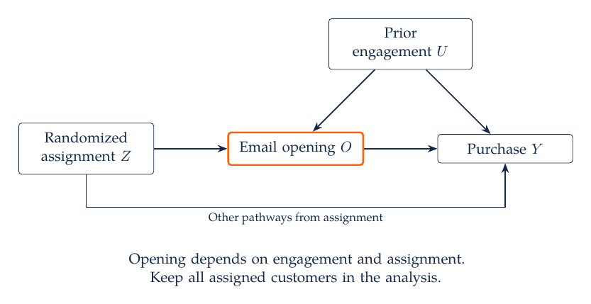
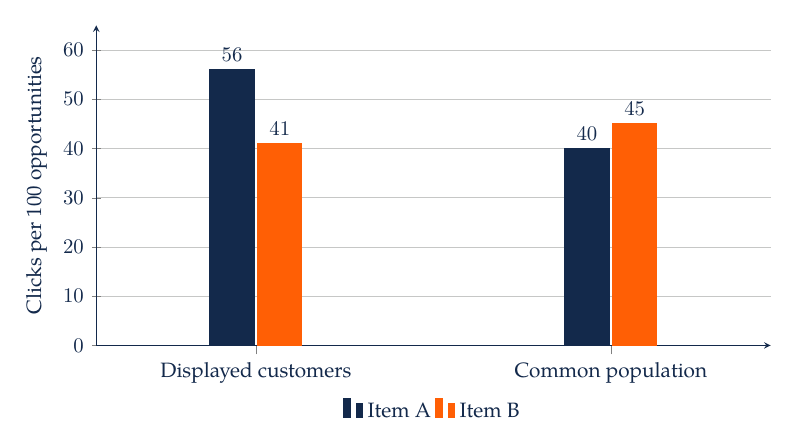
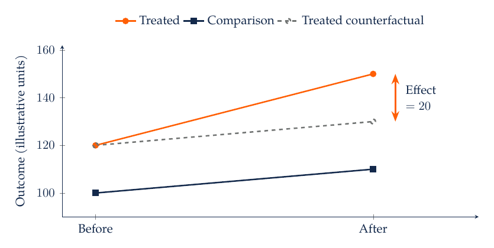
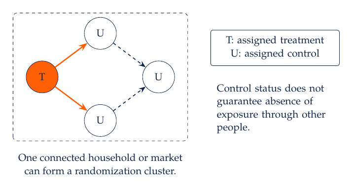
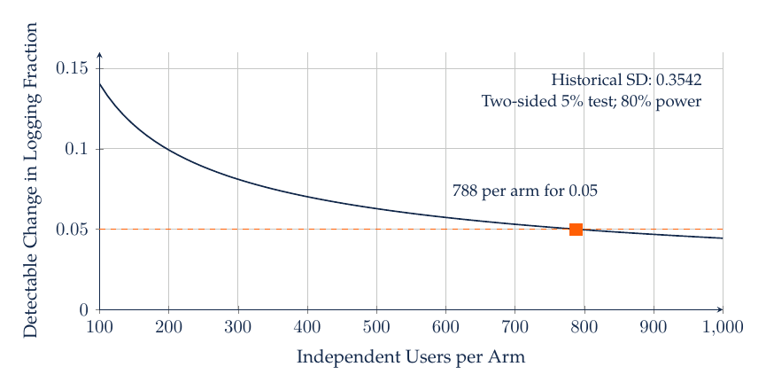
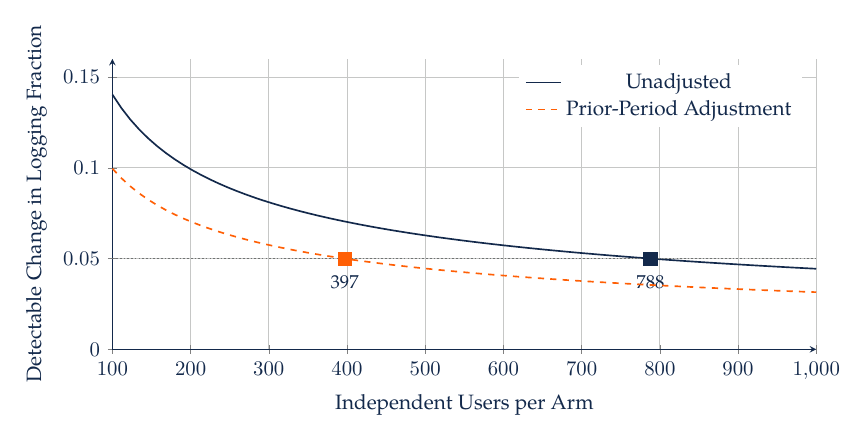
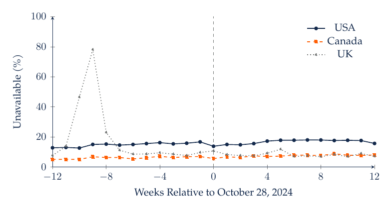

# M6. Causal Effects and Marketing Experiments

A retailer wants to know whether an email campaign increases contribution. Customers who open marketing emails often purchase more, but they may already be more engaged. Comparing openers with nonopeners can therefore reward a campaign for behavior it did not cause. The decision requires a comparison between outcomes under alternative actions for the same target population.

## 6.1 Define the Treatment, Outcome, and Estimand

Let $Y_i(1)$ be customer $i$'s 30-day contribution if assigned an email and $Y_i(0)$ the contribution if not assigned. The individual effect is $Y_i(1)-Y_i(0)$. Only one of these outcomes is observed for a given customer under a single assignment. A causal design supplies a defensible way to learn an average comparison despite that missing counterfactual.

For a target population, the average treatment effect is

$$
\operatorname{ATE}=E[Y_i(1)-Y_i(0)].
$$

The expectation refers to the stated population and outcome window. An average treatment effect on the treated uses the population that actually received treatment. An intention-to-treat effect uses assignment as the treatment, even if some assigned customers never open the email. These are different estimands. The managerial decision to send an email often corresponds closely to the assignment effect, because opening is outside the firm's direct control.

A well-defined treatment includes the offer, timing, channel, and implementation. “Digital marketing” is too broad to identify a single comparison. The outcome should include economically relevant costs and have enough follow-up to capture returns or delayed purchases. If customers can affect one another, an individual's outcome may depend on other customers' assignments. The unit and design then need to account for interference rather than silently assuming it away.

## 6.2 Why the Treated-Untreated Difference Can Be Biased

The observed difference between treated and untreated customers can be decomposed as

$$
E[Y\mid D=1]-E[Y\mid D=0]
=E[Y(1)-Y(0)\mid D=1]
+\{E[Y(0)\mid D=1]-E[Y(0)\mid D=0]\}.
$$

Here $D$ indicates treatment. The first term is the average treatment effect among treated customers. The bracketed term compares their untreated outcomes with untreated customers' outcomes. If the firm targets people who would purchase anyway, that selection term can be positive. If it targets customers in serious decline, the term can be negative. The direction follows the assignment process, not a universal rule about observational data.

An unobserved engagement variable may affect both email opening and purchasing. Adjusting for pre-treatment engagement measures can be useful if they capture the relevant confounding, but controlling for a variable does not guarantee this condition. A post-treatment variable such as clicking the email can mediate part of its effect. Conditioning on customers who click changes the population and can introduce selection.



The firm randomizes email assignment, while customers choose whether to open. Assignment can affect opening, and engagement can affect both opening and purchases. Restricting attention to openers creates a selected group. An assignment-based analysis preserves the randomized comparison when its implementation and outcome measurement are valid.

## 6.3 Designing an Experiment Around the Decision

An experiment needs an eligible population, assignment unit, treatment implementation, primary outcome, horizon, and analysis plan. Randomize at a unit that corresponds to exposure and likely spillovers. A customer-level email experiment may be appropriate when accounts act independently. A store-level display intervention requires store assignment or a design that accounts for shared exposure. Household, geographic, or network spillovers can require broader clusters.

Balance treatment groups through randomization, with blocking or stratification when important pre-treatment characteristics are known. For example, randomize within customer-tenure groups to improve balance and precision. Record assignment before contact and retain every assigned unit in the primary analysis when estimating the intention-to-treat effect. Excluding nonopeners, customers who later unsubscribe, or stores with disappointing execution can undermine the randomized comparison.

Specify a primary outcome and guardrails before viewing results. Incremental contribution might be primary, with unsubscribe rates, complaints, and returns as guardrails. Multiple outcomes can be informative, but selecting the most favorable result after examining many tests exaggerates evidence. Decide how multiple testing, sequential monitoring, and stopping will be handled. Ordinary fixed-horizon p-values do not generally retain their advertised interpretation under unrestricted repeated peeking and outcome selection.

## 6.4 Case Study: Estimate an Email Assignment Effect

In a synthetic experiment, 1,000 customers are assigned an email and 1,000 are assigned no email. Within 30 days, 130 assigned customers and 100 controls make at least one eligible purchase. The estimated assignment effect on purchase incidence is

$$
\hat\tau=\frac{130}{1000}-\frac{100}{1000}=0.03,
$$

or three percentage points. Relative to the control rate of 10%, this is a 30% relative increase. The two descriptions use different denominators; reporting only “30% lift” can obscure the absolute change.

Under independent customer assignments and the usual large-sample approximation, an unpooled standard error is

$$
\widehat{\operatorname{SE}}(\hat\tau)
=\sqrt{\frac{0.13(0.87)}{1000}+\frac{0.10(0.90)}{1000}}
\approx0.0143.
$$

An approximate 95% interval is [0.0021, 0.0579], or about 0.21 to 5.79 percentage points. This interval describes sampling uncertainty under the stated design and approximation. It does not account for an unmeasured outcome-definition error or interference between assigned customers.

Suppose an additional purchase contributes $40 and email delivery costs $0.50 per assigned customer. If the offer has no additional discount cost and purchase incidence is the relevant incremental quantity, estimated incremental contribution is $40(0.03)-$0.50=$0.70 per assigned customer. Applying the same transformation to the effect interval gives approximately $-0.42 to $1.82. A positive point estimate therefore coexists with economically consequential uncertainty. A decision can combine that uncertainty with rollout costs, the value of another test, and guardrail outcomes.

The margin assumption matters. If treatment also changes basket size, returns, or discount expense, purchase incidence alone is insufficient. An experiment measuring contribution directly may better match the objective.

## 6.5 Power, Precision, and the Minimum Useful Effect

Power planning begins with the smallest effect that could change the decision, not with a convenient number of rows. For two equally sized independent groups and a binary outcome with baseline rate near $p$, a rough per-group sample-size approximation is

$$
n\approx\frac{2p(1-p)(z_{1-\alpha/2}+z_{1-\beta})^2}{\delta^2},
$$

where $\delta$ is the absolute effect in probability units, $\alpha$ is the two-sided significance level, and $1-\beta$ is target power. This approximation uses a common baseline variance and normal critical values. More precise planning can use the expected rates under the alternative and the actual assignment design.

With $p=0.10$, $\delta=0.02$, $\alpha=0.05$, and 80% power, using 1.96 and 0.84 gives about 3,528 customers per group. Halving the target effect approximately quadruples the required sample under this formula. A two-percentage-point effect is 0.02, not 2; a unit error can produce a meaningless sample-size recommendation.

Clustering reduces the amount of independent information. A common approximation with equal cluster size $m$ and intracluster correlation $\rho$ multiplies individual-level variance by $1+(m-1)\rho$. For $m=20$ and $\rho=0.05$, that factor is 1.95. The number of clusters, unequal cluster sizes, assignment design, and small-sample inference still require explicit consideration. Thousands of customers across four stores do not provide thousands of independent store-level treatment assignments.

## 6.6 Implementation Checks That Protect the Comparison

Verify that the assignment counts match the intended allocation and investigate material sample-ratio discrepancies. Check whether tracking differs between treatment and control, whether treatment changes the probability an outcome is observed, and whether exclusions were applied consistently. Pre-treatment balance is a diagnostic, not proof that every causal assumption holds. In a correctly randomized experiment, chance imbalances can occur.

Noncompliance changes the estimand. If only 40% of assigned customers open the email, the intention-to-treat effect remains the effect of assignment under the observed implementation. Dividing it by an opening-rate difference identifies a complier effect only under additional instrumental-variable conditions, including an appropriate exclusion restriction and monotonicity. The firm may care about the assignment effect even when a different scientific question concerns actual exposure.

Use pre-treatment outcomes to improve precision when justified. A regression adjustment can compare outcomes while accounting for baseline spending or stratification variables. Avoid selecting an adjustment because it makes the treatment coefficient significant. Report the planned analysis and explain any departures. Analyze heterogeneity cautiously, especially when many subgroups are examined after seeing the main result.

## 6.7 Observational Adjustment and Its Limits

When randomization is unavailable, a common approach assumes that treatment is conditionally independent of potential outcomes given observed pre-treatment covariates, with overlap in treatment probabilities. Regression adjustment, matching, and inverse-probability weighting implement different ways to construct a comparison under that condition. The central question is whether the observed covariates make the treated and untreated outcomes comparable.

A propensity score is the treatment probability given those covariates. Extreme estimated scores indicate limited overlap and can create unstable weights. Trimming or restricting the sample changes the population for which the effect is estimated. Report that population explicitly. A flexible prediction algorithm for treatment assignment does not establish that all confounders were measured.

A doubly robust estimator combines an outcome model and a treatment model and can be consistent when one nuisance model is correctly specified, under the underlying identification conditions and regularity assumptions. This robustness does not cover unmeasured confounding. For advanced implementations, sample splitting and cross-fitting help control overfitting of nuisance functions; the design remains the foundation of the causal interpretation.

### 6.7.1 Evaluating a Recommendation Policy From Logged Exposure

A retailer has records from an existing recommendation policy and wants to evaluate a different one. The existing policy shows products selectively: frequent buyers may usually see A, while occasional buyers usually see B. Comparing their observed click rates mixes product response with the customer populations receiving each recommendation. [Schnabel and coauthors (2016)](https://proceedings.mlr.press/v48/schnabel16.html) formulate recommendation learning and evaluation as problems of selected observation and use propensity weighting to address that selection under explicit conditions.

Consider a single recommendation opportunity per customer. Let $X_i$ be information available before display, $A_i$ the displayed item, and $Y_i$ a click within the specified response window. The logging policy assigns item $a$ with probability $p_0(a\mid X_i)$. A target policy assigns it with probability $\pi(a\mid X_i)$. The target is the expected clicks per opportunity if eligible customers receive recommendations from $\pi$. An inverse-propensity estimator is

$$
\widehat V(\pi)=\frac{1}{n}\sum_{i=1}^{n}
\frac{\pi(A_i\mid X_i)}{p_0(A_i\mid X_i)}Y_i.
$$

The ratio changes how much each logged outcome represents the target policy. For a policy that always recommends A, outcomes following B receive zero weight. An A outcome observed under a 10% display probability receives weight ten. The denominator $n$ counts all eligible logged opportunities, including those assigned zero weight. Dividing only by the number of matching displays estimates a different quantity.

Interpretation requires a well-defined action and outcome, conditional exchangeability of display given $X_i$, and positive logging probability wherever the target policy assigns positive probability. A known randomized logging policy can supply the assignment condition. Estimating probabilities from observational logs requires the additional substantive claim that the recorded context captures the relevant selection. The target population and response process must also match the logged environment. For a slate of products, position and other displayed items can affect the response; a single-item propensity generally does not describe assignment of the complete slate.

The weighting identity explains the adjustment. Conditional on $X=x$, averaging over logged actions gives $\sum_a p_0(a\mid x)\{\pi(a\mid x)/p_0(a\mid x)\}E[Y(a)\mid X=x]$. The logging probability cancels, leaving the response weighted by the target policy. Cancellation requires positive support. If an item was never eligible for a customer group, multiplying the observed records by larger weights cannot reveal that group's response to it.

### 6.7.2 Case Study: Exposure Adjustment Reverses the Preferred Item

Suppose 1,000 synthetic customers comprise 500 frequent buyers and 500 occasional buyers. The logging policy randomly assigns A within each group with probabilities 0.90 and 0.10, respectively. B receives the remaining probability. The constructed counts are:

| Customer Group | Item | Display Probability | Displays | Clicks |
| --- | --- | ---: | ---: | ---: |
| Frequent | A | 0.90 | 450 | 270 |
| Frequent | B | 0.10 | 50 | 25 |
| Occasional | A | 0.10 | 50 | 10 |
| Occasional | B | 0.90 | 450 | 180 |

A receives 280 clicks from 500 displays, or 56%. B receives 205 from 500, or 41%. Yet A's within-group rates are 60% and 20%, while B's are 50% and 40%. Applied to the same equally weighted customer population, A gives 40% and B gives 45%. A's displayed customers disproportionately come from the group with high response to either item.

The inverse-propensity calculations recover the common-population comparison:

$$
\widehat V(A)=\frac{270/0.90+10/0.10}{1000}=0.40,
\qquad
\widehat V(B)=\frac{25/0.10+180/0.90}{1000}=0.45.
$$



The raw bars describe response among each item's displayed customers. The adjusted bars describe the same 50:50 customer mix for both policies. The five-percentage-point advantage for B is imposed by the synthetic cell counts and randomized logging design. It is not an estimate from the cited study.

Large weights reduce precision. For A, the 50 occasional buyers each represent ten eligible customers, so a small number of outcomes carries substantial influence. The diagnostic $(\sum_i w_i)^2/\sum_i w_i^2$ equals 180 for either policy in this example, despite 1,000 logged opportunities. This effective sample size describes weight concentration; it does not replace a variance calculation that respects assignment and dependence. Weight clipping trades variance for bias, and self-normalization changes the finite-sample estimator. Report these choices and retain an untouched evaluation sample when choosing between policies.

## 6.8 Difference-in-Differences and a Counterfactual Trend

A retailer introduces an app in treated markets while comparable markets remain untreated. A before-after difference in treated markets mixes the app's effect with common demand changes. Difference-in-differences subtracts the comparison group's change:

$$
\hat\tau_{\mathrm{DiD}}=(\bar Y_{T,post}-\bar Y_{T,pre})-(\bar Y_{C,post}-\bar Y_{C,pre}).
$$

In a synthetic example, treated-market sales rise from 120 to 150 and comparison-market sales rise from 100 to 110. The DiD estimate is 20 sales units. Under the identifying parallel-trends condition, the treated markets' untreated counterfactual would have risen to 130. Different starting levels are compatible with this design; the condition concerns untreated changes.



The dashed line is a counterfactual implied by parallel untreated trends, not an observed sales series. The vertical gap between observed treated sales and that line is the estimated effect. A treatment-specific local shock at the same time would challenge the interpretation even if the pre-treatment levels looked similar.

Inspect multiple pre-treatment periods, institutional timing, possible anticipation, spillovers, and changes in sample composition. Similar pre-trends can support the design's plausibility, but a nonsignificant pre-trend test does not establish parallel counterfactual trends. With staggered adoption and heterogeneous effects, conventional two-way fixed-effects coefficients can combine comparisons in problematic ways. Use estimators aligned with cohort and time-specific effects, with a clear comparison group, when extending beyond the simple two-period design.

## 6.9 Other Designs: Discontinuities and Instruments

A regression discontinuity design can use a treatment rule at a threshold, such as eligibility based on a pre-existing score. Customers just above and below the cutoff may be comparable if other determinants of the outcome vary smoothly there and the score is not precisely manipulated. The resulting effect is local to the cutoff and the relevant compliance behavior. Bandwidth, functional form, density patterns, and discontinuities in other predetermined variables deserve inspection.

An instrumental variable changes treatment while affecting the outcome only through the treatment channel, under the design's conditions. Relevance is an empirical first-stage requirement; exclusion is a substantive condition. A strong first stage cannot establish exclusion. In a binary-treatment setting with independence, exclusion, and monotonicity, the familiar local average treatment effect concerns compliers whose treatment changes with the instrument. It need not equal the population ATE.

Marketing instruments require particularly careful reasoning because pricing, distribution, and exposure decisions often respond to demand. A variable correlated with treatment is not sufficient. Explain who makes the relevant decision, when the instrument is determined, and which other channels could connect it to outcomes. If those channels remain credible, the causal interpretation needs revision.

## 6.10 Spillovers and Experiment Units

An advertising campaign can shift purchases between stores or products rather than increase total demand. A customer-level outcome may show a gain while chain-wide contribution changes little. Define the outcome at the level relevant to the managerial objective and examine displacement where it is plausible. The same issue arises when customers share offers or when a platform changes recommendations for multiple users.



An assigned store can gain sales while diverting purchases from another store. If the comparison store loses customers, subtracting its decline can overstate the increase in total chain sales. Cluster randomization, geographic separation, or designs that vary treatment saturation may help identify the relevant effects, subject to their own practical constraints.

### 6.10.1 Case Study: Recommendations Supply Information and Exposure

A recommendation can increase consumption by bringing a product to attention or by changing beliefs about its quality. [Aridor, Gonçalves, Kluver, Kong, and Konstan's MovieLens experiment](https://www.econstor.eu/handle/10419/271773), in its November 2022 working-paper version, separates recommendation and exposure-only conditions and elicits users' beliefs. The results support an informational role: recommendations influence beliefs and consumption beyond simply exposing a movie. MovieLens provides recommendations without selling or hosting the movies, which helps define the incentives in this setting.

A retailer studying the same mechanism could distinguish ordinary display from an explicit personalized endorsement while keeping the eligible product set and available information controlled. The primary outcome would be purchases or contribution per assigned customer over a fixed horizon. Belief measures would address how the endorsement operates. The experiment must account for the possibility that asking about a product itself increases attention to it. Comparisons based only on customers who subsequently click would condition on a response that the endorsement can change.

The displayed information can also affect the labels collected afterward. [Cosley and coauthors (2003)](https://experts.umn.edu/en/publications/is-seeing-believing-how-recommender-interfaces-affect-users-opini/) experimentally vary predicted ratings shown to MovieLens users and find that subsequent ratings tend to move toward the displayed prediction. A rating collected after a recommendation therefore reflects the evaluation context as well as the user's experience. A model trained to reproduce those ratings can partly reproduce its own previous influence. Collecting some evaluations before showing predicted ratings provides a comparison for that mechanism.

An experiment on an adaptive recommender also needs a rule for retraining. If both treatment and control data update a shared model, one customer's assignment may change another customer's recommendations. Freezing the model, maintaining separate models, or assigning sufficiently separated populations evaluates different policies. State which policy and learning process the experiment implements. A short experiment with a frozen model identifies a different intervention from deploying a model that learns from its own recommendations over several months.

## 6.11 AI-Assisted Workflow and Practice

Ask an assistant to state the estimand, assignment unit, outcome horizon, and comparison group before writing estimation code. For the email example, require the conversion effect in percentage points, the unpooled standard error, and the contribution calculation. Check the arithmetic independently. Ask it to explain why restricting the sample to email openers changes the analysis.

For observational data, draw or describe the assignment process before selecting controls. Request an overlap diagnostic and a report of which observations receive large weights. For DiD, ask the assistant to show observed and counterfactual series separately and identify the assumptions that connect them. A convincing plot should not substitute for those conditions.

If comparison-market sales rise by 25 rather than 10, the DiD estimate becomes five. If email cost doubles to $1, the point estimate of incremental contribution falls to $0.20. If treatment raises returns, explain why a conversion effect can overstate the contribution effect. If two stores share most customers, identify why store assignment may create interference.

For the exposure example, ask an assistant to compute both the raw click rates and inverse-propensity policy values from the four aggregate rows, using the display counts when calculating denominators and weight concentration. Verify the weighted results independently by averaging the two group-specific response rates. Then set A's display probability among occasional buyers to zero in a proposed logging design and explain why the always-A policy becomes unidentified from those logs. The implementation should flag the unsupported action rather than silently drop that group.

## 6.12 Readings

[Facure's causal-inference handbook](https://matheusfacure.github.io/python-causality-handbook/landing-page.html) supplies accessible implementations of several designs. [Kohavi and colleagues' practical guide](https://exp-platform.com/Documents/GuideControlledExperiments.pdf) discusses controlled online experiments. [Callaway and Sant'Anna (2021)](https://doi.org/10.1016/j.jeconom.2020.12.001) develop difference-in-differences with multiple periods.

## 6.13 mHealth: Planning a Randomized Suggestion Test

The manager has a candidate suggestion policy and wants to know whether offering it changes customer behavior. The historical logs contain no documented randomized assignment or recommendation exposure. They can supply a distribution for planning precision and reveal how a proposed outcome is measured. An effect estimate requires the assignment and outcome records from a suitable new design.

Consider a user-randomized trial comparing the current interface with an offer of the new suggestions. Define the primary logging outcome as the fraction of the next 30 calendar days with at least one recorded food entry. Analyze all assigned eligible users under their original assignment, including users who never return. A suggestion may increase logging without changing consumption. A nutrition outcome therefore needs its own validated measurement and a plan for missingness. Post-assignment completeness screens could remove users differently across arms and alter the intention-to-treat comparison.

For historical planning, require at least 30 recorded days during January through May. Among the 327 eligible users, June's logging fraction averages 0.6408 with a standard deviation of 0.3542. Twenty-three users have no June entries and receive a zero logging fraction. That zero is meaningful for observed logging. It says nothing about zero consumption, nutritional adequacy, or contract cancellation.

With independent users, equal arm sizes, a two-sided 5% test, 80% power, and the historical standard deviation treated as the prospective outcome standard deviation, the normal approximation is

$$
n_{\text{per arm}}\approx
\frac{2\sigma^2(z_{0.975}+z_{0.80})^2}{\Delta^2}.
$$

An imposed minimum detectable effect of 0.05 in the logging fraction, equivalent to 1.5 days out of 30, gives 788 users per arm after rounding upward. This is a planning scenario using historical variance. Future eligibility, outcome distributions, unequal assignment, clustering, and the intended analysis can change the required size. The 327-user historical subset does not supply that many independent trial participants.



A randomization simulation assigns the same observed June outcomes to nearly equal arms 2,000 times while imposing a sharp zero effect. The standard deviation of the resulting mean difference is 0.0395, and the central 95% interval is approximately [-0.0798, 0.0740]. These differences arise from assignment variation alone. Repeatedly treating each user-day as an independent trial participant would conceal dependence within users and overstate the effective sample size.

The protocol should specify randomization before any policy exposure, record assignment and actual exposure separately, and keep the outcome window fixed. For nutrition assessments, collect reliable intake or appropriate validation measures independently of how often the app is used. Domain-based restrictions should be specified in advance, with their effect on the target population and missing-outcome analysis made explicit.

The program uses a local random generator with seed 534. It reports the assumed effect separately from the simulated differences and never labels an artificial assignment as an observed intervention.

Python source: [m06.py](../../03_Data_and_Code/mHealth/recurring_examples/m06.py). From its directory, run `python m06.py`.

```python
"""Use historical logging variation to plan, not estimate, a randomized trial."""

import json
import numpy as np
from scipy.stats import norm
from common import SEED, load_inputs, save_result

food, daily, baskets = load_inputs()
prior = daily.loc[daily.date.between("2016-01-01", "2016-05-31")]
counts = prior.groupby("Userid").size()
eligible = counts[counts >= 30].index.sort_values()
june = daily.loc[daily.date.between("2016-06-01", "2016-06-30")]
# A zero means no recorded day in June, not zero consumption or poor health.
outcome = june.groupby("Userid").size().reindex(eligible, fill_value=0) / 30
sigma = float(outcome.std(ddof=1))
effect = 0.05  # Imposed minimum detectable increase in the fraction of logged days.
critical = norm.ppf(0.975) + norm.ppf(0.80)
per_arm = int(np.ceil(2 * sigma**2 * critical**2 / effect**2))
# Illustrative balanced assignment under a sharp zero-effect simulation.
rng = np.random.default_rng(SEED)
values = outcome.to_numpy()
differences = []
for repetition in range(2000):
    order = rng.permutation(len(values))
    treated, control = np.array_split(order, 2)
    differences.append(values[treated].mean() - values[control].mean())
result = {
    "eligible_users": len(eligible),
    "june_mean_logging_fraction": float(outcome.mean()),
    "june_sd": sigma,
    "zero_logged_days": int(outcome.eq(0).sum()),
    "assumed_effect": effect,
    "normal_approximation_users_per_arm": per_arm,
    "null_simulation_mean_difference": float(np.mean(differences)),
    "null_simulation_sd": float(np.std(differences, ddof=1)),
    "null_simulation_95_percent_interval": np.quantile(
        differences, [0.025, 0.975]
    ).tolist(),
}
save_result("M06", result)
print(json.dumps(result, indent=2))
```

## 6.14 Python Calculations for the Synthetic Cases

The inputs below are imposed teaching values. Running the program creates the labeled synthetic CSV files and prints the corresponding calculations. They are separate from the mHealth estimates. Keep the script beside `example_helpers.py` in `03_Data_and_Code/Lecture_Examples`.

Python source: [m06_synthetic.py](../../03_Data_and_Code/Lecture_Examples/m06_synthetic.py). From its directory, run `python m06_synthetic.py`.

```python
"""Synthetic numerical examples for M6; run from any working directory."""

import itertools
import json
import math
from example_helpers import write_csv, ols_slope, shares

r = {}
se = math.sqrt(0.13 * 0.87 / 1000 + 0.1 * 0.9 / 1000)
ci = [0.03 - 1.96 * se, 0.03 + 1.96 * se]
r["M06"] = {
    "assignment_effect": 0.03,
    "standard_error": se,
    "effect_ci": ci,
    "contribution_per_assigned_customer": 40 * 0.03 - 0.5,
    "contribution_ci": [40 * x - 0.5 for x in ci],
    "sample_per_arm": 2 * 0.1 * 0.9 * (1.96 + 0.84) ** 2 / 0.02**2,
    "design_effect": 1 + (20 - 1) * 0.05,
    "difference_in_differences": (150 - 120) - (110 - 100),
}
write_csv(
    "M06_experiment_synthetic.csv",
    ["assignment", "assigned_customers", "purchasers"],
    [("email", 1000, 130), ("control", 1000, 100)],
)
write_csv(
    "M06_did_synthetic.csv",
    ["group", "before", "after"],
    [("treated", 120, 150), ("comparison", 100, 110)],
)

exposures = [
    ("frequent", "A", 0.9, 450, 270),
    ("frequent", "B", 0.1, 50, 25),
    ("occasional", "A", 0.1, 50, 10),
    ("occasional", "B", 0.9, 450, 180),
]
write_csv(
    "M06_exposure_synthetic.csv",
    ["customer_group", "item", "logging_probability", "displays", "clicks"],
    exposures,
)


def constant_policy_value(rows, item):
    groups = {row[0] for row in rows}
    selected = [row for row in rows if row[1] == item]
    if {row[0] for row in selected if row[2] > 0} != groups:
        raise ValueError(
            "Target action lacks positive logging support in a customer group"
        )
    n = sum(row[3] for row in rows)
    weighted_clicks = sum(clicks / prob for _, _, prob, count, clicks in selected)
    sum_weights = sum(count / prob for _, _, prob, count, clicks in selected)
    sum_squared_weights = sum(count / prob**2 for _, _, prob, count, clicks in selected)
    raw = sum(row[4] for row in selected) / sum(row[3] for row in selected)
    return {
        "raw_rate": raw,
        "ips_value": weighted_clicks / n,
        "effective_sample_size": sum_weights**2 / sum_squared_weights,
    }


r["M06"]["recommendation_policies"] = {
    item: constant_policy_value(exposures, item) for item in ["A", "B"]
}
for item, target in [("A", 0.4), ("B", 0.45)]:
    result = r["M06"]["recommendation_policies"][item]
    # Independent standardization uses the known 50:50 population mix.
    standardized = sum(
        0.5 * clicks / count for group, j, prob, count, clicks in exposures if j == item
    )
    assert math.isclose(result["ips_value"], target) and math.isclose(
        result["ips_value"], standardized
    )
    assert math.isclose(result["effective_sample_size"], 180)
unsupported = [
    (g, j, 0 if (g, j) == ("occasional", "A") else p, n, y)
    for g, j, p, n, y in exposures
]
try:
    constant_policy_value(unsupported, "A")
except ValueError:
    pass
else:
    raise AssertionError("An unsupported target policy must be rejected")
print(json.dumps(r, indent=2))
```

## 6.15 mHealth: Prior Activity and Experiment Precision

A manager wants an experiment to detect a useful change in logging with fewer participants. Users differ persistently in how often they record food. Random assignment balances those differences in expectation, while a particular assignment can still place more frequent loggers in one arm. A pre-treatment activity measure can explain part of the outcome variation and improve precision.

For a planned June experiment, retain users with at least 30 recorded days before June 1. Define $X_i$ as the fraction of May days with a log and $Y_i$ as the fraction of June days with a log. All 327 eligible users remain in both monthly denominators, including users with zero observed logging days. Fit a coefficient using March logging fractions to predict April fractions, and freeze it before June. The CUPED-adjusted outcome is

$$
Y_i^{\mathrm{adj}}=Y_i-\theta(X_i-\overline X),
\qquad
\widehat\tau_{\mathrm{adj}}=overline Y_1^{\mathrm{adj}}-overline Y_0^{\mathrm{adj}}.
$$

The subscripts 1 and 0 denote randomized assignment arms. With a fixed coefficient and a pre-treatment covariate unaffected by assignment, the adjustment removes a mean-zero difference between arms in expectation. It preserves the pooled outcome mean. Randomization supplies the treatment-effect comparison; covariate adjustment changes its precision. The arithmetic is the control-variate approach underlying [CUPED](https://exp-platform.com/cuped/), introduced by Deng, Xu, Kohavi, and Walker (2013).

For a fixed coefficient, the adjusted variance equals

$$
\operatorname{Var}(Y^{\mathrm{adj}})=\operatorname{Var}(Y)+\theta^2\operatorname{Var}(X)-2\theta\operatorname{Cov}(X,Y).
$$

At the population-optimal coefficient $\theta^*=\operatorname{Cov}(X,Y)/\operatorname{Var}(X)$, this becomes $\operatorname{Var}(Y)(1-\rho^2)$. The historical coefficient used here is learned from different months, so its gain must be measured in the later comparison. A poorly transferred coefficient can increase variance. A covariate affected by treatment can also change the estimand and bias the treatment-effect calculation.

| Historical Planning Quantity | Unadjusted | CUPED |
| --- | ---: | ---: |
| Variance of June Outcome | 0.12546 | 0.06315 |
| Exact Sharp-Null Randomization SD | 0.03918 | 0.02779 |
| SD Across 2,000 Random Assignments | 0.04032 | 0.02840 |
| Approximate Users per Arm for 0.05 | 788 | 397 |

The March–April coefficient is 0.55386. The table compares the same June users and outcomes, with an adjusted-to-unadjusted variance ratio of 0.50334. The prospective sample-size calculation assumes independent users, equal arm sizes, a two-sided 5% test, 80% power, and a 0.05 absolute increase in logging fraction. It uses historical variance as a planning input and a normal approximation. Actual effects, variance shifts, interference, and attrition can change the needed sample.



No experimental assignment is observed in mHealth. The randomization exercise imposes a sharp zero-effect null, holding every recorded June outcome fixed while repeatedly assigning 163 users to treatment and 164 to control. Its dispersion illustrates the design's sampling variability. The analytical finite-population variance is $S^2(1/n_1+1/n_0)$ for each fixed outcome, and provides an independent comparison with the simulation.

[FeedX](https://github.com/google-marketing-solutions/feedx) combines experimental design with prior-period adjustment for shopping-feed tests. Its application also raises a choice of randomization unit. A test of generated product descriptions may randomize products, whereas an mHealth reminder experiment could randomize users. Shared exposure and spillovers must be addressed at the unit actually assigned. Repeated fixed-horizon significance tests during monitoring require a sequentially valid procedure or a prespecified analysis time; software output does not resolve that design choice.

Python source: [cuped.py](../../03_Data_and_Code/mHealth/recurring_examples/cuped.py). From its directory, run `python cuped.py`.

```python
"""Historical precision planning with a coefficient frozen before June."""

import json
import math
import numpy as np
import pandas as pd
from scipy.stats import norm
from common import SEED, load_food, make_daily, save_result


def adjust(outcome, baseline, theta):
    return outcome - theta * (baseline - baseline.mean())


if __name__ == "__main__":
    daily = make_daily(load_food())
    prior = daily.loc[daily.date < "2016-06-01"].groupby("Userid").size()
    users = prior.index[prior >= 30]
    monthly = {}
    for month in ["2016-03", "2016-04", "2016-05", "2016-06"]:
        period = pd.Period(month, freq="M")
        part = daily.loc[daily.date.dt.to_period("M").eq(period)]
        monthly[month] = (
            part.groupby("Userid").size().reindex(users, fill_value=0).to_numpy()
            / period.days_in_month
        )
    march, april = monthly["2016-03"], monthly["2016-04"]
    theta = np.cov(march, april, ddof=1)[0, 1] / np.var(march, ddof=1)
    baseline, outcome = monthly["2016-05"], monthly["2016-06"]
    adjusted = adjust(outcome, baseline, theta)
    assert np.isclose(adjusted.mean(), outcome.mean())
    n, n_treated = len(users), len(users) // 2
    rng = np.random.default_rng(SEED)
    differences = []
    for _ in range(2000):
        treated = np.zeros(n, dtype=bool)
        treated[rng.choice(n, n_treated, replace=False)] = True
        # Imposed sharp null: these recorded outcomes do not change with assignment.
        differences.append(
            [
                values[treated].mean() - values[~treated].mean()
                for values in [outcome, adjusted]
            ]
        )
    differences = np.asarray(differences)
    power_multiplier = 2 * (norm.ppf(0.975) + norm.ppf(0.8)) ** 2 / 0.05**2
    result = {
        "users": n,
        "coefficient_from_march_april": float(theta),
        "may_june_correlation": float(np.corrcoef(baseline, outcome)[0, 1]),
        "june_mean": float(outcome.mean()),
        "sharp_null_draws": len(differences),
        "methods": [],
    }
    for column, (name, values) in enumerate(
        [("unadjusted", outcome), ("cuped", adjusted)]
    ):
        variance = np.var(values, ddof=1)
        result["methods"].append(
            {
                "method": name,
                "outcome_variance": float(variance),
                "simulated_effect_mean": float(differences[:, column].mean()),
                "simulated_effect_sd": float(differences[:, column].std(ddof=1)),
                "exact_randomization_sd": float(
                    np.sqrt(variance * (1 / n_treated + 1 / (n - n_treated)))
                ),
                "approximate_users_per_arm_for_0_05": math.ceil(
                    power_multiplier * variance
                ),
            }
        )
    result["variance_ratio"] = float(np.var(adjusted, ddof=1) / np.var(outcome, ddof=1))
    save_result("cuped", result)
    print(json.dumps(result, indent=2))
```

## 6.16 McDonald's: Repair Policy and the Choice of a Comparison Group

\noindent A franchise operator evaluating access to repair services wants to know whether a policy reduces interruptions and improves the return to maintenance. The [2024 final rule](https://www.govinfo.gov/content/pkg/FR-2024-10-28/pdf/2024-24563.pdf) introduced a limited circumvention exemption for diagnosis, maintenance, and repair of retail-level commercial food-preparation equipment. Its effective date is October 28, 2024, as stated on page 85437; the relevant provision appears on pages 85448--85449. Announcement timing, the legal effective date, and actual adoption of new repair practices are distinct dates. A change in an ordering indicator can arise through several channels described in Section 2.16.

The weekly country data permit a concrete calculation of the comparison that a difference-in-differences design would use. Retain the 12 common weekly snapshots before October 28 and the 12 after the implementation week. Exclude that week from the pre/post means. Require at least 2,000 US records and 500 records in each comparison country. These imposed thresholds retain all 24 pre/post weeks for the USA, Canada, and the UK in this window. Compute each weekly percentage from its numerator and denominator, then weight weeks equally.

For comparison country $c$, the descriptive contrast is

$$
\widehat D_c=(\overline p_{US,post}-\overline p_{US,pre})
 -(\overline p_{c,post}-\overline p_{c,pre}).
$$

Here $p$ is the percentage of observed records reporting unavailability. The contrast has percentage-point units. A causal interpretation would require the US outcome to follow the comparison country's change in the absence of the policy, together with comparable measurement, a suitable exposure definition, and no consequential spillovers or simultaneous country-specific changes. The national policy supplies one treated country. Repeated stores and weeks do not create additional independent policy assignments.

| Country | Pre-Period Mean (%) | Post-Period Mean (%) | Change (Percentage Points) |
| --- | ---: | ---: | ---: |
| USA | 14.80 | 16.87 | +2.07 |
| Canada | 6.09 | 7.52 | +1.42 |
| UK | 19.36 | 8.06 | -11.29 |

The US-minus-Canada contrast is +0.65 percentage points. The US-minus-UK contrast is +13.37 points. The UK pre-period contains a large temporary rise in recorded unavailability; its subsequent decline dominates the second contrast. The time paths therefore matter for selecting a comparison, even when a regression can readily produce a coefficient. Canadian record counts are constant at 1,428 in this window. That regularity calls for checking the source's refresh process alongside the apparent stability of the percentage. A constant count alone does not establish a stale feed.



These data support an audit of a proposed policy evaluation. The positive contrasts do not establish that the exemption worsened availability. Stronger evidence would connect a stable set of outlets to policy exposure, actual repair adoption, verified mechanical interruptions, and comparable collection times. Pre-treatment event coefficients can diagnose particular discrepancies, while a nonsignificant pre-trend test supplies no proof of the counterfactual assumption. Customer demand, service hours, and repair implementation would further distinguish an operational policy effect from a change in the ordering measure.

Python source: [policy.py](../../03_Data_and_Code/McBroken/policy.py). From its directory, run `python policy.py`.

```python
"""Calculate descriptive country contrasts around the October 2024 exemption."""
import json
from pathlib import Path

import pandas as pd

ROOT = Path(__file__).resolve().parent


def main():
    data = pd.read_csv(ROOT / "data/policy_window.csv")
    assert not data.duplicated(["country", "event_week"]).any()
    data["percent"] = 100 * data.n_broken / data.n_checked
    # These are sensitivity screens, not a claim of representative coverage.
    data = data[data.n_checked.ge(data.country.map({"USA": 2000, "UK": 500, "CA": 500}))]
    wide = data.pivot(index="event_week", columns="country", values="percent")
    common = wide[["USA", "UK", "CA"]].dropna()
    pre = common.loc[common.index < 0].mean()
    post = common.loc[common.index > 0].mean()  # omit the implementation week
    if len(common.loc[common.index < 0]) != 12 or len(common.loc[common.index > 0]) != 12:
        raise ValueError("Expected 12 common pre weeks and 12 common post weeks")
    change = post - pre
    table = pd.DataFrame({"pre_percent": pre, "post_percent": post,
                          "change_pp": change})
    contrasts = {c: float(change.USA - change[c]) for c in ["CA", "UK"]}
    results = ROOT / "results"
    results.mkdir(exist_ok=True)
    table.to_csv(results / "policy_means.csv", index_label="country")
    (results / "policy.json").write_text(json.dumps({
        "effective_date": "2024-10-28", "pre_weeks": 12, "post_weeks": 12,
        "omitted_week": 0, "weighting": "Equal weight per common weekly snapshot",
        "us_change_minus_comparator_change_pp": contrasts,
        "interpretation": "Descriptive contrasts; parallel counterfactual trends and stable measurement are not established."}, indent=2) + "\n")
    figure = r"""\begin{tikzpicture}
\begin{axis}[width=12.5cm,height=6.7cm,xmin=-12,xmax=12,ymin=0,ymax=100,
 xlabel={Weeks Relative to October 28, 2024},ylabel={Unavailable (\%)},
 xtick={-12,-8,-4,0,4,8,12},legend style={at={(0.98,0.98)},anchor=north east}]
"""
    for country, style in [("USA", "IlliniBlue,mark=*"),
                           ("CA", "IlliniOrange,dashed,mark=square*"),
                           ("UK", "Storm,dotted,mark=triangle*")]:
        points = " ".join(f"({i},{v:.6f})" for i, v in common[country].items())
        figure += f"\\addplot[{style},mark size=1.4pt] coordinates {{{points}}};\n"
    figure += r"\legend{USA,Canada,UK}" + "\n"
    figure += r"\draw[Storm,dashed] (axis cs:0,0)--(axis cs:0,100);" + "\n"
    figure += "\\end{axis}\n\\end{tikzpicture}\n"
    (ROOT.parents[1] / "06_Lecture_Notes/figures/M06_mcbroken_policy.tex").write_text(figure)
    print(table.to_string())
    print(json.dumps(contrasts, indent=2))


if __name__ == "__main__":
    main()
```
