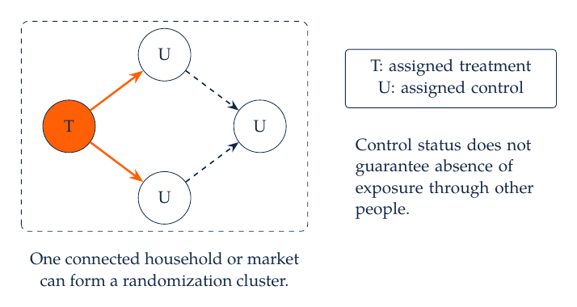
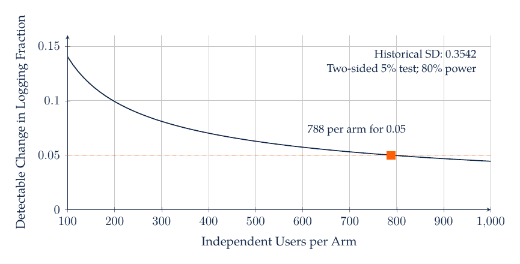
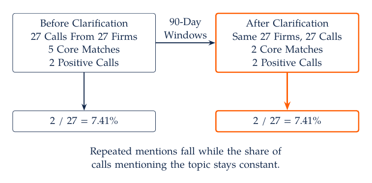
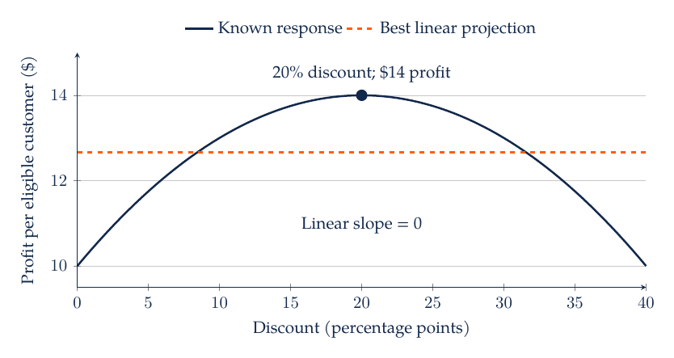
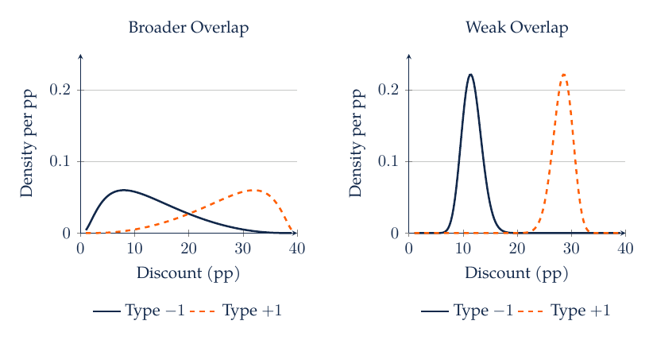
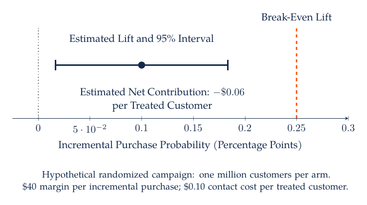
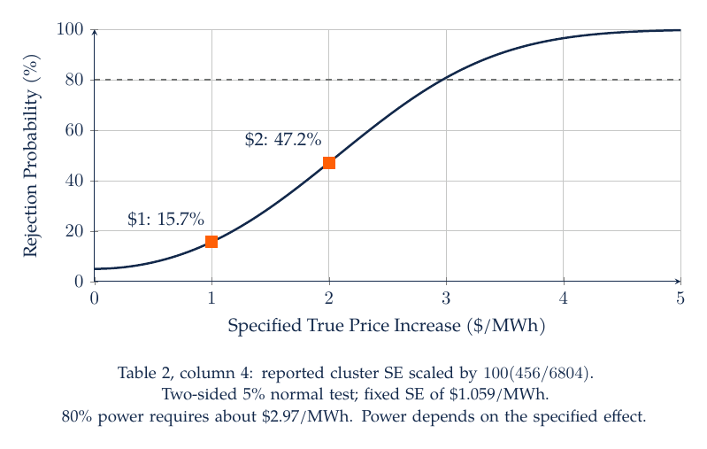
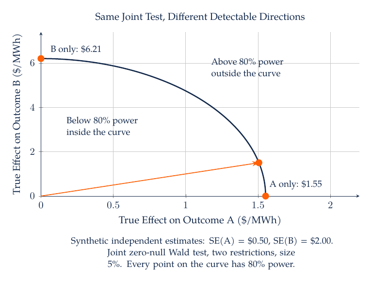
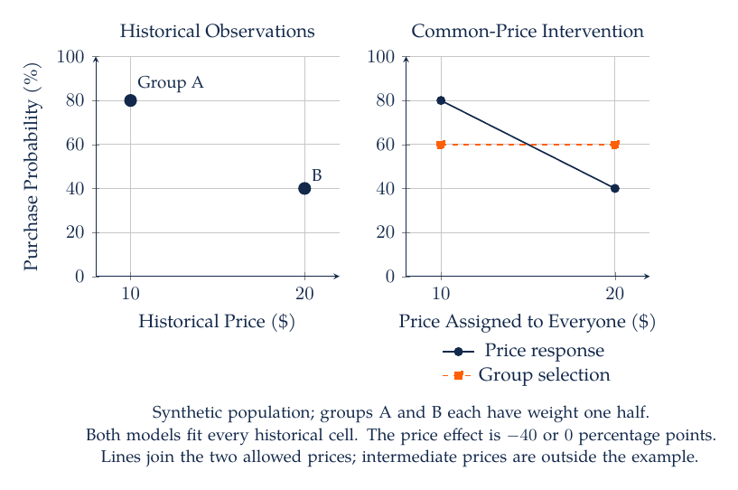
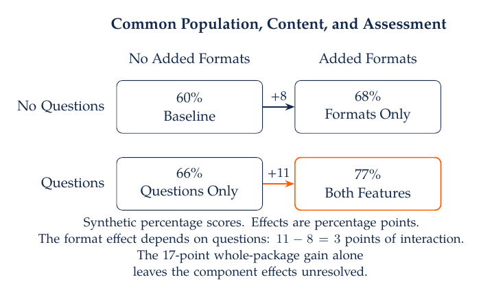

# M6. Causal Effects and Marketing Experiments

A retailer wants to know whether an email campaign increases contribution. Customers who open marketing emails often purchase more, but they may already be more engaged. Comparing openers with nonopeners can therefore reward a campaign for behavior it did not cause. The decision requires a comparison between outcomes under alternative actions for the same target population.

## 6.1 Define the Treatment, Outcome, and Estimand

Let $Y_i(1)$ be customer $i$'s 30-day contribution if assigned an email and $Y_i(0)$ the contribution if not assigned. The individual effect is $Y_i(1)-Y_i(0)$. Only one of these outcomes is observed for a given customer under a single assignment. A causal design supplies a defensible way to learn an average comparison despite that missing counterfactual.

For a target population, the average treatment effect is

$$
\operatorname{ATE}=E[Y_i(1)-Y_i(0)].
$$

The expectation refers to the stated population and outcome window. An average treatment effect on the treated uses the population that actually received treatment. An intention-to-treat effect uses assignment as the treatment, even if some assigned customers never open the email. These are different estimands. The managerial decision to send an email often corresponds closely to the assignment effect, because opening is outside the firm's direct control.

A well-defined treatment includes the offer, timing, channel, and implementation. “Digital marketing” is too broad to identify a single comparison. The outcome should include economically relevant costs and have enough follow-up to capture returns or delayed purchases. If customers can affect one another, an individual's outcome may depend on other customers' assignments. The assignment unit and outcome definition must then account for these spillovers.

## 6.2 Why the Treated-Untreated Difference Can Be Biased

The observed difference between treated and untreated customers can be decomposed as

$$
E[Y\mid D=1]-E[Y\mid D=0]
=E[Y(1)-Y(0)\mid D=1]
+\{E[Y(0)\mid D=1]-E[Y(0)\mid D=0]\}.
$$

Here $D$ indicates treatment, the first term is the average treatment effect among treated customers, and the bracketed term compares the two groups' untreated outcomes. That selection term can be positive when the firm targets customers who would purchase anyway, or negative when it targets customers in serious decline. The assignment process therefore determines how the observed comparison differs from the treatment effect.

An unobserved engagement variable may affect both email opening and purchasing. Adjusting for pre-treatment engagement measures can be useful if they capture the relevant confounding, but controlling for a variable does not guarantee this condition. A post-treatment variable such as clicking the email can mediate part of its effect. Conditioning on customers who click changes the population and can introduce selection.


The firm randomizes email assignment, while customers choose whether to open. Assignment can affect opening, and engagement can affect both opening and purchases. Restricting attention to openers creates a selected group. An assignment-based analysis preserves the randomized comparison when its implementation and outcome measurement are valid.

## 6.3 Designing an Experiment Around the Decision

An experiment needs an eligible population, assignment unit, treatment implementation, primary outcome, horizon, and analysis plan. Randomize at a unit that corresponds to exposure and likely spillovers. A customer-level email experiment may be appropriate when accounts act independently. A store-level display intervention requires store assignment or a design that accounts for shared exposure. Household, geographic, or network spillovers can require broader clusters.

Balance treatment groups through randomization, with blocking or stratification when important pre-treatment characteristics are known. For example, randomize within customer-tenure groups to improve balance and precision. Record assignment before contact and retain every assigned unit in the primary analysis when estimating the intention-to-treat effect. Excluding nonopeners, customers who later unsubscribe, or stores with disappointing execution can undermine the randomized comparison.

Specify a primary outcome and guardrails before viewing results. Incremental contribution might be primary, with unsubscribe rates, complaints, and returns as guardrails. Multiple outcomes can be informative, but selecting the most favorable result after examining many tests exaggerates evidence. Decide how multiple testing, sequential monitoring, and stopping will be handled. Ordinary fixed-horizon p-values do not generally retain their advertised interpretation under unrestricted repeated peeking and outcome selection.

## 6.4 Case Study: Estimate an Email Assignment Effect

In a synthetic experiment, 1,000 customers are assigned an email and 1,000 are assigned no email. Within 30 days, 130 assigned customers and 100 controls make at least one eligible purchase. The estimated assignment effect on purchase incidence is

$$
\hat\tau=\frac{130}{1000}-\frac{100}{1000}=0.03,
$$

or three percentage points. Relative to the control rate of 10%, this is a 30% relative increase. The two descriptions use different denominators; reporting only “30% lift” can obscure the absolute change.

Under independent customer assignments and the usual large-sample approximation, an unpooled standard error is

$$
\widehat{\operatorname{SE}}(\hat\tau)
=\sqrt{\frac{0.13(0.87)}{1000}+\frac{0.10(0.90)}{1000}}
\approx0.0143.
$$

An approximate 95% interval is [0.0021, 0.0579], or about 0.21 to 5.79 percentage points. This interval describes sampling uncertainty under the stated design and approximation. It does not account for an unmeasured outcome-definition error or interference between assigned customers.

Suppose an additional purchase contributes $40 and email delivery costs $0.50 per assigned customer. If the offer has no additional discount cost and purchase incidence is the relevant incremental quantity, estimated incremental contribution is $40(0.03)-$0.50=$0.70 per assigned customer. Applying the same transformation to the effect interval gives approximately $-0.42 to $1.82. A positive point estimate therefore coexists with economically consequential uncertainty. A decision can combine that uncertainty with rollout costs, the value of another test, and customer outcomes such as returns and complaints.

The margin assumption matters. If treatment also changes basket size, returns, or discount expense, purchase incidence alone is insufficient. An experiment measuring contribution directly may better match the objective.

## 6.5 Power, Precision, and the Minimum Useful Effect

Power planning begins with the smallest effect that could change the decision, not with a convenient number of rows. For two equally sized independent groups and a binary outcome with baseline rate near $p$, a rough per-group sample-size approximation is

$$
n\approx\frac{2p(1-p)(z_{1-\alpha/2}+z_{1-\beta})^2}{\delta^2},
$$

where $\delta$ is the absolute effect in probability units, $\alpha$ is the two-sided significance level, and $1-\beta$ is target power. This approximation uses a common baseline variance and normal critical values. More precise planning can use the expected rates under the alternative and the actual assignment design.

With $p=0.10$, $\delta=0.02$, $\alpha=0.05$, and 80% power, using 1.96 and 0.84 gives about 3,528 customers per group. Halving the target effect approximately quadruples the required sample under this formula. A two-percentage-point effect is 0.02, not 2; a unit error can produce a meaningless sample-size recommendation.

Clustering reduces the amount of independent information. A common approximation with equal cluster size $m$ and intracluster correlation $\rho$ multiplies individual-level variance by $1+(m-1)\rho$. For $m=20$ and $\rho=0.05$, that factor is 1.95. The number of clusters, unequal cluster sizes, assignment design, and small-sample inference still require explicit consideration. Thousands of customers across four stores do not provide thousands of independent store-level treatment assignments.

## 6.6 Implementation Checks That Protect the Comparison

Verify that the assignment counts match the intended allocation and investigate material sample-ratio discrepancies. Check whether tracking differs between treatment and control, whether treatment changes the probability an outcome is observed, and whether exclusions were applied consistently. Pre-treatment balance is a diagnostic, not proof that every causal assumption holds. In a correctly randomized experiment, chance imbalances can occur.

Noncompliance changes the estimand. If only 40% of assigned customers open the email, the intention-to-treat effect remains the effect of assignment under the observed implementation. Dividing it by an opening-rate difference identifies a complier effect only under additional instrumental-variable conditions, including an appropriate exclusion restriction and monotonicity. The firm may care about the assignment effect even when a different scientific question concerns actual exposure.

Use pre-treatment outcomes to improve precision when justified. A regression adjustment can compare outcomes while accounting for baseline spending or stratification variables. Avoid selecting an adjustment because it makes the treatment coefficient significant. Report the planned analysis and explain any departures. Analyze heterogeneity cautiously, especially when many subgroups are examined after seeing the main result.

## 6.7 Observational Adjustment and Its Limits

When randomization is unavailable, a common approach assumes that treatment is conditionally independent of potential outcomes given observed pre-treatment covariates, with overlap in treatment probabilities. Regression adjustment, matching, and inverse-probability weighting implement different ways to construct a comparison under that condition. The central question is whether the observed covariates make the treated and untreated outcomes comparable.

A propensity score is the treatment probability given those covariates. Extreme estimated scores indicate limited overlap and can create unstable weights. Trimming or restricting the sample changes the population for which the effect is estimated. Report that population explicitly. A flexible prediction algorithm for treatment assignment does not establish that all confounders were measured.

A doubly robust estimator combines an outcome model and a treatment model and can be consistent when one nuisance model is correctly specified, under the underlying identification conditions and regularity assumptions. This robustness does not cover unmeasured confounding. For advanced implementations, sample splitting and cross-fitting help control overfitting of nuisance functions; the design remains the foundation of the causal interpretation.

### 6.7.1 Evaluating a Recommendation Policy from Logged Exposure

A retailer has records from an existing recommendation policy and wants to evaluate a different one. The existing policy shows products selectively: frequent buyers may usually see A, while occasional buyers usually see B. Comparing their observed click rates mixes product response with the customer populations receiving each recommendation. Recommendation learning and evaluation can be formulated as problems of selected observation, with propensity weighting addressing that selection under explicit conditions [(Schnabel et al., 2016)](https://proceedings.mlr.press/v48/schnabel16.html).

Consider a single recommendation opportunity per customer. Let $X_i$ be information available before display, $A_i$ the displayed item, and $Y_i$ a click within the specified response window. The logging policy assigns item $a$ with probability $p_0(a\mid X_i)$. A target policy assigns it with probability $\pi(a\mid X_i)$. The target is the expected clicks per opportunity if eligible customers receive recommendations from $\pi$. An inverse-propensity estimator is

$$
\widehat V(\pi)=\frac{1}{n}\sum_{i=1}^{n}
\frac{\pi(A_i\mid X_i)}{p_0(A_i\mid X_i)}Y_i.
$$

The ratio changes how much each logged outcome represents the target policy. For a policy that always recommends A, outcomes following B receive zero weight. An A outcome observed under a 10% display probability receives weight ten. The denominator $n$ counts all eligible logged opportunities, including those assigned zero weight. Dividing only by the number of matching displays estimates a different quantity.

Interpretation requires a well-defined action and outcome, conditional exchangeability of display given $X_i$, and positive logging probability wherever the target policy assigns positive probability. A known randomized logging policy can supply the assignment condition. Estimating probabilities from observational logs requires the additional substantive claim that the recorded context captures the relevant selection. The target population and response process must also match the logged environment. For a slate of products, position and other displayed items can affect the response; a single-item propensity generally does not describe assignment of the complete slate.

The weighting identity explains the adjustment. Conditional on $X=x$, averaging over logged actions gives $\sum_a p_0(a\mid x)\{\pi(a\mid x)/p_0(a\mid x)\}E[Y(a)\mid X=x]$. The logging probability cancels, leaving the response weighted by the target policy. Cancellation requires positive support. If an item was never eligible for a customer group, multiplying the observed records by larger weights cannot reveal that group's response to it.

### 6.7.2 Case Study: Exposure Adjustment Reverses the Preferred Item

Suppose 1,000 synthetic customers comprise 500 frequent buyers and 500 occasional buyers. The logging policy randomly assigns A within each group with probabilities 0.90 and 0.10, respectively. B receives the remaining probability. The constructed counts are:

| Customer Group | Item | Display Probability | Displays | Clicks |
| --- | --- | ---: | ---: | ---: |
| Frequent | A | 0.90 | 450 | 270 |
| Frequent | B | 0.10 | 50 | 25 |
| Occasional | A | 0.10 | 50 | 10 |
| Occasional | B | 0.90 | 450 | 180 |

A receives 280 clicks from 500 displays, or 56%. B receives 205 from 500, or 41%. Yet A's within-group rates are 60% and 20%, while B's are 50% and 40%. Applied to the same equally weighted customer population, A gives 40% and B gives 45%. A's displayed customers disproportionately come from the group with high response to either item.

The inverse-propensity calculations recover the common-population comparison:

$$
\widehat V(A)=\frac{270/0.90+10/0.10}{1000}=0.40,
\qquad
\widehat V(B)=\frac{25/0.10+180/0.90}{1000}=0.45.
$$


The raw bars describe response among each item's displayed customers. The adjusted bars describe the same 50:50 customer mix for both policies. The five-percentage-point advantage for B is imposed by the synthetic cell counts and randomized logging design. It is not an estimate from the cited study.

Large weights reduce precision. For A, the 50 occasional buyers each represent ten eligible customers, so a small number of outcomes carries substantial influence. The diagnostic $(\sum_i w_i)^2/\sum_i w_i^2$ equals 180 for either policy in this example, despite 1,000 logged opportunities. This effective sample size describes weight concentration; it does not replace a variance calculation that respects assignment and dependence. Weight clipping trades variance for bias, and self-normalization changes the finite-sample estimator. Report these choices and retain an untouched evaluation sample when choosing between policies.

## 6.8 Difference-in-Differences and a Counterfactual Trend

A retailer introduces an app in treated markets while comparable markets remain untreated. A before-after difference in treated markets mixes the app's effect with common demand changes. Difference-in-differences subtracts the comparison group's change:

$$
\hat\tau_{\mathrm{DiD}}=(\bar Y_{T,post}-\bar Y_{T,pre})-(\bar Y_{C,post}-\bar Y_{C,pre}).
$$

In a synthetic example, treated-market sales rise from 120 to 150 and comparison-market sales rise from 100 to 110. The DiD estimate is 20 sales units. Under the identifying parallel-trends condition, the treated markets' untreated counterfactual would have risen to 130. Different starting levels are compatible with this design; the condition concerns untreated changes.


The dashed line is a counterfactual implied by parallel untreated trends, not an observed sales series. The vertical gap between observed treated sales and that line is the estimated effect. A treatment-specific local shock at the same time would challenge the interpretation even if the pre-treatment levels looked similar.

Inspect multiple pre-treatment periods, institutional timing, possible anticipation, spillovers, and changes in sample composition. Similar pre-trends can support the design's plausibility, but a nonsignificant pre-trend test does not establish parallel counterfactual trends. With staggered adoption and heterogeneous effects, conventional two-way fixed-effects coefficients can combine comparisons in problematic ways. Use estimators aligned with cohort and time-specific effects, with a clear comparison group, when extending beyond the simple two-period design.

## 6.9 Other Designs: Discontinuities and Instruments

A regression discontinuity design can use a treatment rule at a threshold, such as eligibility based on a pre-existing score. Customers just above and below the cutoff may be comparable if other determinants of the outcome vary smoothly there and the score is not precisely manipulated. The resulting effect is local to the cutoff and the relevant compliance behavior. Bandwidth, functional form, density patterns, and discontinuities in other predetermined variables deserve inspection.

An instrumental variable changes treatment while affecting the outcome only through the treatment channel, under the design's conditions. Relevance is an empirical first-stage requirement; exclusion is a substantive condition. A strong first stage cannot establish exclusion. In a binary-treatment setting with independence, exclusion, and monotonicity, the familiar local average treatment effect concerns compliers whose treatment changes with the instrument. It need not equal the population ATE.

Marketing instruments require particularly careful reasoning because pricing, distribution, and exposure decisions often respond to demand. A variable correlated with treatment is not sufficient. Explain who makes the relevant decision, when the instrument is determined, and which other channels could connect it to outcomes. If those channels remain credible, the causal interpretation needs revision.

## 6.10 Spillovers and Experiment Units

An advertising campaign can shift purchases between stores or products rather than increase total demand. A customer-level outcome may show a gain while chain-wide contribution changes little. Define the outcome at the level relevant to the managerial objective and examine displacement where it is plausible. The same issue arises when customers share offers or when a platform changes recommendations for multiple users.



An assigned store can gain sales while diverting purchases from another store. If the comparison store loses customers, subtracting its decline can overstate the increase in total chain sales. Cluster randomization, geographic separation, or designs that vary treatment saturation may help identify the relevant effects, subject to their own practical constraints.

### 6.10.1 Case Study: Recommendations Supply Information and Exposure

A recommendation can increase consumption by bringing a product to attention or by changing beliefs about its quality. The MovieLens experiment [(Aridor et al., 2022)](https://www.econstor.eu/handle/10419/271773), in its November 2022 working-paper version, separates recommendation and exposure-only conditions and elicits users' beliefs. The results support an informational role: recommendations influence beliefs and consumption beyond simply exposing a movie. MovieLens provides recommendations without selling or hosting the movies, which helps define the incentives in this setting.

A retailer studying the same mechanism could distinguish ordinary display from an explicit personalized endorsement while keeping the eligible product set and available information controlled. The primary outcome would be purchases or contribution per assigned customer over a fixed horizon. Belief measures would address how the endorsement operates. The experiment must account for the possibility that asking about a product itself increases attention to it. Comparisons based only on customers who subsequently click would condition on a response that the endorsement can change.

The displayed information can also affect the labels collected afterward. An experiment varying predicted ratings shown to MovieLens users finds that subsequent ratings tend to move toward the displayed prediction [(Cosley et al., 2003)](https://experts.umn.edu/en/publications/is-seeing-believing-how-recommender-interfaces-affect-users-opini/). A rating collected after a recommendation therefore reflects the evaluation context as well as the user's experience. A model trained to reproduce those ratings can partly reproduce its own previous influence. Collecting some evaluations before showing predicted ratings provides a comparison for that mechanism.

An experiment on an adaptive recommender also needs a rule for retraining. If both treatment and control data update a shared model, one customer's assignment may change another customer's recommendations. Freezing the model, maintaining separate models, or assigning sufficiently separated populations evaluates different policies. State which policy and learning process the experiment implements. A short experiment with a frozen model identifies a different intervention from deploying a model that learns from its own recommendations over several months.

## 6.11 AI-Assisted Workflow and Practice

Ask an assistant to state the estimand, assignment unit, outcome horizon, and comparison group before writing estimation code. For the email example, require the conversion effect in percentage points, the unpooled standard error, and the contribution calculation. Check the arithmetic independently. Ask it to explain why restricting the sample to email openers changes the analysis.

For observational data, draw or describe the assignment process before selecting controls. Request an overlap diagnostic and a report of which observations receive large weights. For DiD, ask the assistant to show observed and counterfactual series separately and identify the assumptions that connect them. A convincing plot should not substitute for those conditions.

If comparison-market sales rise by 25 instead of 10, the DiD estimate becomes five. If email cost doubles to $1, the point estimate of incremental contribution falls to $0.20. If treatment raises returns, explain why a conversion effect can overstate the contribution effect. If two stores share most customers, identify why store assignment may create interference.

For the exposure example, ask an assistant to compute both the raw click rates and inverse-propensity policy values from the four aggregate rows, using the display counts when calculating denominators and weight concentration. Verify the weighted results independently by averaging the two group-specific response rates. Then set A's display probability among occasional buyers to zero in a proposed logging design and explain why the always-A policy becomes unidentified from those logs. The implementation should flag the unsupported action and retain the group in the population accounting.

## 6.12 Readings

The causal-inference handbook [(Facure, n.d.)](https://matheusfacure.github.io/python-causality-handbook/landing-page.html) supplies accessible implementations of several designs. The guide to controlled experiments [(Kohavi et al., 2007)](https://exp-platform.com/Documents/GuideControlledExperiments.pdf) discusses controlled online experiments. Difference-in-differences methods extend to multiple periods [(Callaway and Sant'Anna, 2021)](https://doi.org/10.1016/j.jeconom.2020.12.001).

## 6.13 mHealth: Planning a Randomized Suggestion Test

The manager has a candidate suggestion policy and wants to know whether offering it changes customer behavior. The historical logs contain no documented randomized assignment or recommendation exposure. They can supply a distribution for planning precision and reveal how a proposed outcome is measured. An effect estimate requires the assignment and outcome records from a suitable new design.

Consider a user-randomized trial comparing the current interface with an offer of the new suggestions. Define the primary logging outcome as the fraction of the next 30 calendar days with at least one recorded food entry. Analyze all assigned eligible users under their original assignment, including users who never return. A suggestion may increase logging without changing consumption. A nutrition outcome therefore needs its own validated measurement and a plan for missingness. Post-assignment completeness screens could remove users differently across arms and alter the intention-to-treat comparison.

For historical planning, require at least 30 recorded days during January through May. Among the 327 eligible users, June's logging fraction averages 0.6408 with a standard deviation of 0.3542. Twenty-three users have no June entries and receive a zero logging fraction. That zero is meaningful for observed logging. It says nothing about zero consumption, nutritional adequacy, or contract cancellation.

With independent users, equal arm sizes, a two-sided 5% test, 80% power, and the historical standard deviation treated as the prospective outcome standard deviation, the normal approximation is

$$
n_{\text{per arm}}\approx
\frac{2\sigma^2(z_{0.975}+z_{0.80})^2}{\Delta^2}.
$$

An imposed minimum detectable effect of 0.05 in the logging fraction, equivalent to 1.5 days out of 30, gives 788 users per arm after rounding upward. This is a planning scenario using historical variance. Future eligibility, outcome distributions, unequal assignment, clustering, and the intended analysis can change the required size. The 327-user historical subset does not supply that many independent trial participants.



A randomization simulation assigns the same observed June outcomes to nearly equal arms 2,000 times while imposing a sharp zero effect. The standard deviation of the resulting mean difference is 0.0395, and the central 95% interval is approximately [-0.0798, 0.0740]. These differences arise from assignment variation alone. Repeatedly treating each user-day as an independent trial participant would conceal dependence within users and overstate the effective sample size.

The protocol should specify randomization before any policy exposure, record assignment and actual exposure separately, and keep the outcome window fixed. For nutrition assessments, collect reliable intake or appropriate validation measures independently of how often the app is used. Domain-based restrictions should be specified in advance, with their effect on the target population and missing-outcome analysis made explicit.

Random assignment is generated locally with seed 534. Report the assumed effect alongside the simulated differences so that sampling variation can be distinguished from the effect specified in the simulation.

Python source: [m06.py](../../03_Data_and_Code/mHealth/recurring_examples/m06.py). From its directory, run `python m06.py`.

```python
"""Use historical logging variation to plan, not estimate, a randomized trial."""

import json
import numpy as np
from scipy.stats import norm
from common import SEED, load_inputs, save_result

food, daily, baskets = load_inputs()
prior = daily.loc[daily.date.between("2016-01-01", "2016-05-31")]
counts = prior.groupby("Userid").size()
eligible = counts[counts >= 30].index.sort_values()
june = daily.loc[daily.date.between("2016-06-01", "2016-06-30")]
# A zero means no recorded day in June, not zero consumption or poor health.
outcome = june.groupby("Userid").size().reindex(eligible, fill_value=0) / 30
sigma = float(outcome.std(ddof=1))
effect = 0.05  # Imposed minimum detectable increase in the fraction of logged days.
critical = norm.ppf(0.975) + norm.ppf(0.80)
per_arm = int(np.ceil(2 * sigma**2 * critical**2 / effect**2))
# Illustrative balanced assignment under a sharp zero-effect simulation.
rng = np.random.default_rng(SEED)
values = outcome.to_numpy()
differences = []
for repetition in range(2000):
    order = rng.permutation(len(values))
    treated, control = np.array_split(order, 2)
    differences.append(values[treated].mean() - values[control].mean())
result = {
    "eligible_users": len(eligible),
    "june_mean_logging_fraction": float(outcome.mean()),
    "june_sd": sigma,
    "zero_logged_days": int(outcome.eq(0).sum()),
    "assumed_effect": effect,
    "normal_approximation_users_per_arm": per_arm,
    "null_simulation_mean_difference": float(np.mean(differences)),
    "null_simulation_sd": float(np.std(differences, ddof=1)),
    "null_simulation_95_percent_interval": np.quantile(
        differences, [0.025, 0.975]
    ).tolist(),
}
save_result("M06", result)
print(json.dumps(result, indent=2))
```

## 6.14 Python Calculations for the Synthetic Cases

Run the program below to write the synthetic examples to CSV and reproduce their calculations. Keep the script beside `example_helpers.py` in `03_Data_and_Code/Lecture_Examples`; the separate mHealth programs reproduce the observed-data results.

Python source: [m06_synthetic.py](../../03_Data_and_Code/Lecture_Examples/m06_synthetic.py). From its directory, run `python m06_synthetic.py`.

```python
"""Synthetic numerical examples for M6; run from any working directory."""

import itertools
import json
import math
from example_helpers import write_csv, ols_slope, shares

r = {}
se = math.sqrt(0.13 * 0.87 / 1000 + 0.1 * 0.9 / 1000)
ci = [0.03 - 1.96 * se, 0.03 + 1.96 * se]
r["M06"] = {
    "assignment_effect": 0.03,
    "standard_error": se,
    "effect_ci": ci,
    "contribution_per_assigned_customer": 40 * 0.03 - 0.5,
    "contribution_ci": [40 * x - 0.5 for x in ci],
    "sample_per_arm": 2 * 0.1 * 0.9 * (1.96 + 0.84) ** 2 / 0.02**2,
    "design_effect": 1 + (20 - 1) * 0.05,
    "difference_in_differences": (150 - 120) - (110 - 100),
}
write_csv(
    "M06_experiment_synthetic.csv",
    ["assignment", "assigned_customers", "purchasers"],
    [("email", 1000, 130), ("control", 1000, 100)],
)
write_csv(
    "M06_did_synthetic.csv",
    ["group", "before", "after"],
    [("treated", 120, 150), ("comparison", 100, 110)],
)

exposures = [
    ("frequent", "A", 0.9, 450, 270),
    ("frequent", "B", 0.1, 50, 25),
    ("occasional", "A", 0.1, 50, 10),
    ("occasional", "B", 0.9, 450, 180),
]
write_csv(
    "M06_exposure_synthetic.csv",
    ["customer_group", "item", "logging_probability", "displays", "clicks"],
    exposures,
)


def constant_policy_value(rows, item):
    groups = {row[0] for row in rows}
    selected = [row for row in rows if row[1] == item]
    if {row[0] for row in selected if row[2] > 0} != groups:
        raise ValueError(
            "Target action lacks positive logging support in a customer group"
        )
    n = sum(row[3] for row in rows)
    weighted_clicks = sum(clicks / prob for _, _, prob, count, clicks in selected)
    sum_weights = sum(count / prob for _, _, prob, count, clicks in selected)
    sum_squared_weights = sum(count / prob**2 for _, _, prob, count, clicks in selected)
    raw = sum(row[4] for row in selected) / sum(row[3] for row in selected)
    return {
        "raw_rate": raw,
        "ips_value": weighted_clicks / n,
        "effective_sample_size": sum_weights**2 / sum_squared_weights,
    }


r["M06"]["recommendation_policies"] = {
    item: constant_policy_value(exposures, item) for item in ["A", "B"]
}
for item, target in [("A", 0.4), ("B", 0.45)]:
    result = r["M06"]["recommendation_policies"][item]
    # Independent standardization uses the known 50:50 population mix.
    standardized = sum(
        0.5 * clicks / count for group, j, prob, count, clicks in exposures if j == item
    )
    assert math.isclose(result["ips_value"], target) and math.isclose(
        result["ips_value"], standardized
    )
    assert math.isclose(result["effective_sample_size"], 180)
unsupported = [
    (g, j, 0 if (g, j) == ("occasional", "A") else p, n, y)
    for g, j, p, n, y in exposures
]
try:
    constant_policy_value(unsupported, "A")
except ValueError:
    pass
else:
    raise AssertionError("An unsupported target policy must be rejected")
print(json.dumps(r, indent=2))
```

## 6.15 mHealth: Prior Activity and Experiment Precision

A manager wants an experiment to detect a useful change in logging with fewer participants. Users differ persistently in how often they record food. Random assignment balances those differences in expectation, while a particular assignment can still place more frequent loggers in one arm. A pre-treatment activity measure can explain part of the outcome variation and improve precision.

For a planned June experiment, retain users with at least 30 recorded days before June 1. Define $X_i$ as the fraction of May days with a log and $Y_i$ as the fraction of June days with a log. All 327 eligible users remain in both monthly denominators, including users with zero observed logging days. Fit a coefficient using March logging fractions to predict April fractions, and freeze it before June. The CUPED-adjusted outcome is

$$
Y_i^{\mathrm{adj}}=Y_i-\theta(X_i-\overline X),
\qquad
\widehat\tau_{\mathrm{adj}}=overline Y_1^{\mathrm{adj}}-overline Y_0^{\mathrm{adj}}.
$$

The subscripts 1 and 0 denote randomized assignment arms. With a fixed coefficient and a pre-treatment covariate unaffected by assignment, the adjustment removes a mean-zero difference between arms in expectation. It preserves the pooled outcome mean. Randomization supplies the treatment-effect comparison; covariate adjustment changes its precision. The arithmetic is the control-variate approach underlying [CUPED](https://exp-platform.com/cuped/) (Deng et al., 2013).

For a fixed coefficient, the adjusted variance equals

$$
\operatorname{Var}(Y^{\mathrm{adj}})=\operatorname{Var}(Y)+\theta^2\operatorname{Var}(X)-2\theta\operatorname{Cov}(X,Y).
$$

At the population-optimal coefficient $\theta^*=\operatorname{Cov}(X,Y)/\operatorname{Var}(X)$, this becomes $\operatorname{Var}(Y)(1-\rho^2)$. The historical coefficient used here is learned from different months, so its gain must be measured in the later comparison. A poorly transferred coefficient can increase variance. A covariate affected by treatment can also change the estimand and bias the treatment-effect calculation.

| Historical Planning Quantity | Unadjusted | CUPED |
| --- | ---: | ---: |
| Variance of June Outcome | 0.12546 | 0.06315 |
| Exact Sharp-Null Randomization SD | 0.03918 | 0.02779 |
| SD Across 2,000 Random Assignments | 0.04032 | 0.02840 |
| Approximate Users per Arm for 0.05 | 788 | 397 |

The March–April coefficient is 0.55386. The table compares the same June users and outcomes, with an adjusted-to-unadjusted variance ratio of 0.50334. The prospective sample-size calculation assumes independent users, equal arm sizes, a two-sided 5% test, 80% power, and a 0.05 absolute increase in logging fraction. It uses historical variance as a planning input and a normal approximation. Actual effects, variance shifts, interference, and attrition can change the needed sample.


No experimental assignment is observed in mHealth. The randomization exercise imposes a sharp zero-effect null, holding every recorded June outcome fixed while repeatedly assigning 163 users to treatment and 164 to control. Its dispersion illustrates the design's sampling variability. The analytical finite-population variance is $S^2(1/n_1+1/n_0)$ for each fixed outcome, and provides an independent comparison with the simulation.

[FeedX](https://github.com/google-marketing-solutions/feedx) combines experimental design with prior-period adjustment for shopping-feed tests. Its application also raises a choice of randomization unit. A test of generated product descriptions may randomize products, whereas an mHealth reminder experiment could randomize users. Shared exposure and spillovers must be addressed at the unit actually assigned. Repeated fixed-horizon significance tests during monitoring require a sequentially valid procedure or a prespecified analysis time; software output does not resolve that design choice.

Python source: [cuped.py](../../03_Data_and_Code/mHealth/recurring_examples/cuped.py). From its directory, run `python cuped.py`.

```python
"""Historical precision planning with a coefficient frozen before June."""

import json
import math
import numpy as np
import pandas as pd
from scipy.stats import norm
from common import SEED, load_food, make_daily, save_result


def adjust(outcome, baseline, theta):
    return outcome - theta * (baseline - baseline.mean())


if __name__ == "__main__":
    daily = make_daily(load_food())
    prior = daily.loc[daily.date < "2016-06-01"].groupby("Userid").size()
    users = prior.index[prior >= 30]
    monthly = {}
    for month in ["2016-03", "2016-04", "2016-05", "2016-06"]:
        period = pd.Period(month, freq="M")
        part = daily.loc[daily.date.dt.to_period("M").eq(period)]
        monthly[month] = (
            part.groupby("Userid").size().reindex(users, fill_value=0).to_numpy()
            / period.days_in_month
        )
    march, april = monthly["2016-03"], monthly["2016-04"]
    theta = np.cov(march, april, ddof=1)[0, 1] / np.var(march, ddof=1)
    baseline, outcome = monthly["2016-05"], monthly["2016-06"]
    adjusted = adjust(outcome, baseline, theta)
    assert np.isclose(adjusted.mean(), outcome.mean())
    n, n_treated = len(users), len(users) // 2
    rng = np.random.default_rng(SEED)
    differences = []
    for _ in range(2000):
        treated = np.zeros(n, dtype=bool)
        treated[rng.choice(n, n_treated, replace=False)] = True
        # Imposed sharp null: these recorded outcomes do not change with assignment.
        differences.append(
            [
                values[treated].mean() - values[~treated].mean()
                for values in [outcome, adjusted]
            ]
        )
    differences = np.asarray(differences)
    power_multiplier = 2 * (norm.ppf(0.975) + norm.ppf(0.8)) ** 2 / 0.05**2
    result = {
        "users": n,
        "coefficient_from_march_april": float(theta),
        "may_june_correlation": float(np.corrcoef(baseline, outcome)[0, 1]),
        "june_mean": float(outcome.mean()),
        "sharp_null_draws": len(differences),
        "methods": [],
    }
    for column, (name, values) in enumerate(
        [("unadjusted", outcome), ("cuped", adjusted)]
    ):
        variance = np.var(values, ddof=1)
        result["methods"].append(
            {
                "method": name,
                "outcome_variance": float(variance),
                "simulated_effect_mean": float(differences[:, column].mean()),
                "simulated_effect_sd": float(differences[:, column].std(ddof=1)),
                "exact_randomization_sd": float(
                    np.sqrt(variance * (1 / n_treated + 1 / (n - n_treated)))
                ),
                "approximate_users_per_arm_for_0_05": math.ceil(
                    power_multiplier * variance
                ),
            }
        )
    result["variance_ratio"] = float(np.var(adjusted, ddof=1) / np.var(outcome, ddof=1))
    save_result("cuped", result)
    print(json.dumps(result, indent=2))
```

## 6.16 McDonald's: Repair Policy and the Choice of a Comparison Group

\noindent A franchise operator evaluating access to repair services wants to know whether a policy reduces interruptions and improves the return to maintenance. The [2024 final rule](https://www.govinfo.gov/content/pkg/FR-2024-10-28/pdf/2024-24563.pdf) introduced a limited circumvention exemption for diagnosis, maintenance, and repair of retail-level commercial food-preparation equipment. Its effective date is October 28, 2024, as stated on page 85437; the relevant provision appears on pages 85448--85449. Announcement timing, the legal effective date, and actual adoption of new repair practices are distinct dates. A change in an ordering indicator can arise through several channels described in Section 2.16.

The weekly country data permit a concrete calculation of the comparison that a difference-in-differences design would use. Retain the 12 common weekly snapshots before October 28 and the 12 after the implementation week. Exclude that week from the pre/post means. Require at least 2,000 US records and 500 records in each comparison country. These imposed thresholds retain all 24 pre/post weeks for the USA, Canada, and the UK in this window. Compute each weekly percentage from its numerator and denominator, then weight weeks equally.

For comparison country $c$, the descriptive contrast is

$$
\widehat D_c=(\overline p_{US,post}-\overline p_{US,pre})
 -(\overline p_{c,post}-\overline p_{c,pre}).
$$

Here $p$ is the percentage of observed records reporting unavailability. The contrast has percentage-point units. A causal interpretation would require the US outcome to follow the comparison country's change in the absence of the policy, together with comparable measurement, a suitable exposure definition, and no consequential spillovers or simultaneous country-specific changes. The national policy supplies one treated country. Repeated stores and weeks do not create additional independent policy assignments.

| Country | Pre-Period Mean (%) | Post-Period Mean (%) | Change (Percentage Points) |
| --- | ---: | ---: | ---: |
| USA | 14.80 | 16.87 | +2.07 |
| Canada | 6.09 | 7.52 | +1.42 |
| UK | 19.36 | 8.06 | -11.29 |

The US-minus-Canada contrast is +0.65 percentage points. The US-minus-UK contrast is +13.37 points. The UK pre-period contains a large temporary rise in recorded unavailability; its subsequent decline dominates the second contrast. The time paths therefore matter for selecting a comparison, even when a regression can readily produce a coefficient. Canadian record counts are constant at 1,428 in this window. That regularity calls for checking the source's refresh process alongside the apparent stability of the percentage. A constant count alone does not establish a stale feed.


These data support an evaluation of a proposed policy comparison. The positive contrasts do not establish that the exemption worsened availability. Stronger evidence would connect a stable set of outlets to policy exposure, actual repair adoption, verified mechanical interruptions, and comparable collection times. Pre-treatment event coefficients can diagnose particular discrepancies, while a nonsignificant pre-trend test supplies no proof of the counterfactual assumption. Customer demand, service hours, and repair implementation would further distinguish an operational policy effect from a change in the ordering measure.

Python source: [policy.py](../../03_Data_and_Code/McBroken/policy.py). From its directory, run `python policy.py`.

```python
"""Calculate descriptive country contrasts around the October 2024 exemption."""
import json
from pathlib import Path

import pandas as pd

ROOT = Path(__file__).resolve().parent


def main():
    data = pd.read_csv(ROOT / "data/policy_window.csv")
    assert not data.duplicated(["country", "event_week"]).any()
    data["percent"] = 100 * data.n_broken / data.n_checked
    # These are sensitivity screens, not a claim of representative coverage.
    data = data[data.n_checked.ge(data.country.map({"USA": 2000, "UK": 500, "CA": 500}))]
    wide = data.pivot(index="event_week", columns="country", values="percent")
    common = wide[["USA", "UK", "CA"]].dropna()
    pre = common.loc[common.index < 0].mean()
    post = common.loc[common.index > 0].mean()  # omit the implementation week
    if len(common.loc[common.index < 0]) != 12 or len(common.loc[common.index > 0]) != 12:
        raise ValueError("Expected 12 common pre weeks and 12 common post weeks")
    change = post - pre
    table = pd.DataFrame({"pre_percent": pre, "post_percent": post,
                          "change_pp": change})
    contrasts = {c: float(change.USA - change[c]) for c in ["CA", "UK"]}
    results = ROOT / "results"
    results.mkdir(exist_ok=True)
    table.to_csv(results / "policy_means.csv", index_label="country")
    (results / "policy.json").write_text(json.dumps({
        "effective_date": "2024-10-28", "pre_weeks": 12, "post_weeks": 12,
        "omitted_week": 0, "weighting": "Equal weight per common weekly snapshot",
        "us_change_minus_comparator_change_pp": contrasts,
        "interpretation": "Descriptive contrasts; parallel counterfactual trends and stable measurement are not established."}, indent=2) + "\n")
    figure = r"""\begin{tikzpicture}
\begin{axis}[width=12.5cm,height=6.7cm,xmin=-12,xmax=12,ymin=0,ymax=100,
 xlabel={Weeks Relative to October 28, 2024},ylabel={Unavailable (\%)},
 xtick={-12,-8,-4,0,4,8,12},legend style={at={(0.98,0.98)},anchor=north east}]
"""
    for country, style in [("USA", "IlliniBlue,mark=*"),
                           ("CA", "IlliniOrange,dashed,mark=square*"),
                           ("UK", "Storm,dotted,mark=triangle*")]:
        points = " ".join(f"({i},{v:.6f})" for i, v in common[country].items())
        figure += f"\\addplot[{style},mark size=1.4pt] coordinates {{{points}}};\n"
    figure += r"\legend{USA,Canada,UK}" + "\n"
    figure += r"\draw[Storm,dashed] (axis cs:0,0)--(axis cs:0,100);" + "\n"
    figure += "\\end{axis}\n\\end{tikzpicture}\n"
    (ROOT.parents[1] / "06_Lecture_Notes/figures/M06_mcbroken_policy.tex").write_text(figure)
    print(table.to_string())
    print(json.dumps(contrasts, indent=2))


if __name__ == "__main__":
    main()
```

## 6.17 Experimental Objectives and Customer Outcomes

\noindent A marketing experiment identifies a response to the assigned intervention for the represented population. The choice of outcome determines what success means. An experiment that ranks interfaces by completed renewals can reliably select a profitable interface while remaining silent about whether customers wanted the additional subscription. Randomization addresses the comparison between assigned procedures; customer value requires an appropriate outcome and its own measurement.

For a cancellation experiment, define eligibility before assignment and retain every assigned customer in the primary denominator. Include a direct-choice benchmark and record the final payment status over a fixed horizon. Also measure completion time, refunds, unwanted charges, and customers' informed willingness to continue. Conditioning only on customers who reach the last page can remove the people most affected by a difficult interface. Report that intermediate reach rate separately.

The procedure includes the customer's opportunity to refuse optional retention content. If a customer must first undergo the intervention to discover how to decline it, the refusal path changes the treatment itself. A comparison of optional and compulsory interaction can therefore require different treatment definitions even when the last screen is identical. Describe the complete assigned sequence before interpreting the estimated effect.

Under the model in Section 8.14, firm and customer interests are opposed for the same renewal. Accurate experimentation then helps the firm select the procedure with the largest customer loss within the available set. This conditional result follows from the stakes and objective. When a better product increases both willingness to pay and firm profit, the same experiment can instead select a mutually beneficial change. The empirical task is to measure the consequences that distinguish those settings.

## 6.18 Earnings Calls: A Public Clarification and the Event Window

\noindent A communications manager wants to understand whether pricing language changed around a public clarification. [Wendy's February 27, 2024 statement](https://www.wendys.com/blog/wendys-digital-news-update) described intended uses of digital menu boards and rejected the interpretation that the company planned higher prices at its busiest times. That dated company statement supplies an observable event. It does not establish realized prices or customer responses.

Define a before window from 90 through one calendar day before the statement and an after window from one through 90 days after it. Exclude calls on the event day because within-day ordering is unavailable. Use calls with observed text and report both all available firms and firms appearing in both windows. The comparison is the change in the fraction of calls containing core language. A separate firm-equal calculation first averages calls within firm and period, then averages those firm rates, so extra captured calls do not increase a firm's weight.

In the common-firm comparison group, each window contains one call from each of 27 firms. Core occurrences fall from five to two, while the number of positive calls remains two in each window. Incidence therefore remains 2/27, or 7.41%. In the full available comparison sample, the apparent call rate falls from 2/27 to 2/34 as coverage expands. These are distinct sources of an apparent change: repeated language within calls and the number of observed calls.



The event is shared public information, and the supplied comparison group identifies an industry classification. Its firms have not been verified as unexposed to the event. Earnings-call timing, business conditions, and disclosure choices also vary. Even a measured change in disclosure would leave adoption and customer effects as separate outcomes. A causal design would need a specified exposure, a defensible counterfactual disclosure path, stable measurement, and uncertainty that accounts for repeated firms. Matching firm coverage addresses composition alone.

The program repeats the descriptive calculation with 60-, 90-, and 120-day windows and reports counts, call-weighted rates, and firm-equal rates. Compare these prespecified windows before writing an explanation for a selected result. Reconcile the numerator and denominator separately, then identify the evidence needed for any causal claim.

Python source: [event_windows.py](../../03_Data_and_Code/Earnings_Calls/event_windows.py). From `03_Data_and_Code/Earnings_Calls`, run `python event_windows.py`. Python, pandas, and NumPy are required; the committed metadata supply all inputs.

```python
"""Describe call-level language around a public clarification; no causal effect."""
import pandas as pd
from assessment import HERE, load_checked


def compare_windows(calls, event='2024-02-27', days=90):
    date = pd.Timestamp(event)
    d = calls.loc[calls.text_observed].copy()
    delta = (d.call_date - date).dt.days
    # Exclude the event day because within-day ordering is unavailable.
    d = d.loc[delta.between(-days, -1) | delta.between(1, days)].copy()
    d['period'] = d.call_date.gt(date).map({False: 'before', True: 'after'})
    common = d.groupby('ticker').period.nunique()
    common = common[common.eq(2)].index
    rows = []
    for sample, panel in [('available_calls', d), ('firms_in_both_windows', d[d.ticker.isin(common)])]:
        for (group, period), part in panel.groupby(['group', 'period']):
            rows.append({'window_days': days, 'sample': sample, 'group': group,
                         'period': period, 'firms': part.ticker.nunique(),
                         'calls': len(part), 'positive_calls': int(part.has_core.sum()),
                         'core_matches': int(part.n_core.sum()),
                         'share_percent': 100 * part.has_core.mean(),
                         'firm_equal_share_percent': 100 * part.groupby('ticker').has_core.mean().mean()})
    return pd.DataFrame(rows)


def main():
    calls, _, _, _ = load_checked()
    results = pd.concat([compare_windows(calls, days=n) for n in [60, 90, 120]])
    results.to_csv(HERE / 'results/event_windows.csv', index=False)
    print(results[results.window_days.eq(90)].round(4).to_string(index=False))


if __name__ == '__main__':
    (HERE / 'results').mkdir(exist_ok=True)
    main()
```

## 6.19 Model Improvements and Reusable Analytical Workflows

\noindent A marketing team must decide whether to buy access to a newer model, invest in a tested code library, or use both. A comparison between its old setup and a new setup that changes both components cannot isolate their separate contributions. A factorial comparison crosses model version with library access and evaluates every condition using a common task population and acceptance rule.

Consider a synthetic table with 100 assigned tasks in each of four conditions. Each task requires a correct customer-level analysis within the same deadline and resource limits. The rubric checks aggregation, available information, and the managerial interpretation. An unfinished task counts as a failure. The counts below are constructed teaching inputs; they are neither measured model performance nor results of a conducted experiment.

| Model | Library | Assigned Tasks | Passing Tasks | Pass Rate |
| --- | --- | ---: | ---: | ---: |
| Earlier | Absent | 100 | 60 | 60% |
| Earlier | Present | 100 | 70 | 70% |
| Newer | Absent | 100 | 65 | 65% |
| Newer | Present | 100 | 85 | 85% |

Let $q_{m\ell}$ denote the fraction of all assigned tasks passing, where $m=1$ selects the newer model and $\ell=1$ supplies the library. The model comparison depends on library access: $q_{10}-q_{00}=0.05$ without it and $q_{11}-q_{01}=0.15$ with it. The library comparison is ten percentage points with the earlier model and twenty with the newer model. Their interaction is

$$
\delta=(q_{11}-q_{10})-(q_{01}-q_{00})=0.10.
$$

The positive interaction means that the imposed library gain is larger with the newer model. The joint change from 60% to 85% is twenty-five percentage points. It can be decomposed as a five-point model change followed by a twenty-point library change, or a ten-point library change followed by a fifteen-point model change. Neither path supplies a unique allocation of the interaction to one component.


In an empirical study, randomize teams or independent analytical projects to the four conditions, with blocking on task difficulty where useful. If several outputs come from one team, their number does not establish the number of independent assignments. Shared helpers and learning can spill across conditions. A team that first sees the library may carry its knowledge into a later nominally unassisted task. Separate teams or a justified design for carryover is needed before interpreting a crossover comparison.

Use fresh tasks, permit a competent baseline to solve the same problem, and record actual resource consumption alongside the common ceiling. The library's setup and maintenance cost enters the investment comparison even if library construction occurs before randomization. A success on familiar datasets measures execution within that scope. Transfer to a different schema or task family requires additional tasks. A revised prompting or search procedure is a further treatment dimension; changing it simultaneously with both factors would again prevent attribution.

### 6.19.1 Reproduce the Four-Condition Comparison

\noindent Run `python3 03_Data_and_Code/AI_Workflows/factorial.py` from the repository root. Python 3.10 or later suffices; no packages or model account are required. The program writes one CSV row per condition and a JSON of percentage-point contrasts. Exact rational arithmetic checks the two paths to the joint change. The code operates on the imposed counts and supplies no sampling uncertainty or empirical efficacy claim.

Python source: [factorial.py](../../03_Data_and_Code/AI_Workflows/factorial.py)

```python
"""Construct a synthetic model-by-library comparison; no model APIs are called."""
import csv
import json
from fractions import Fraction
from pathlib import Path

OUT = Path(__file__).resolve().parent / "results"


def contrasts(rates):
    """Keys are (model, library), each coded 0 or 1; values are pass fractions."""
    if set(rates) != {(0, 0), (0, 1), (1, 0), (1, 1)}:
        raise ValueError("All four conditions are required")
    return {
        "model_without_library": rates[1, 0] - rates[0, 0],
        "model_with_library": rates[1, 1] - rates[0, 1],
        "library_with_earlier_model": rates[0, 1] - rates[0, 0],
        "library_with_newer_model": rates[1, 1] - rates[1, 0],
        "interaction": rates[1, 1] - rates[1, 0] - rates[0, 1] + rates[0, 0],
        "joint_change": rates[1, 1] - rates[0, 0],
    }


def main():
    # Imposed counts: 100 assigned tasks in every cell. An unfinished task fails.
    # All cells use the same task population, rubric, deadline, and resource limits.
    passes = {(0, 0): 60, (0, 1): 70, (1, 0): 65, (1, 1): 85}
    rates = {key: Fraction(count, 100) for key, count in passes.items()}
    effects = contrasts(rates)
    # Two independent paths from the initial cell to the final cell must agree.
    assert effects["joint_change"] == Fraction(25, 100)
    assert effects["joint_change"] == (
        effects["model_without_library"] + effects["library_with_newer_model"]
    )
    assert effects["joint_change"] == (
        effects["library_with_earlier_model"] + effects["model_with_library"]
    )
    assert effects["interaction"] == Fraction(10, 100)
    OUT.mkdir(exist_ok=True)
    with (OUT / "factorial_cells.csv").open("w", newline="") as f:
        writer = csv.writer(f)
        writer.writerow(["model", "library", "assigned", "passed", "pass_fraction"])
        for (model, library), passed in passes.items():
            writer.writerow([model, library, 100, passed, float(rates[model, library])])
    result = {
        "scope": "Constructed counts; no observed AI performance or causal estimate.",
        "units": "percentage points in the fraction of all assigned tasks passing",
        "contrasts_pp": {key: float(100 * value) for key, value in effects.items()},
    }
    (OUT / "factorial_results.json").write_text(json.dumps(result, indent=2) + "\n")
    print(json.dumps(result, indent=2))


if __name__ == "__main__":
    main()
```

## 6.20 Conversion, Returns, and Customer Intent

\noindent An online retailer choosing between promotional messages needs to measure the consequences after checkout. A message that produces more orders can also produce more reversals if customers commit before resolving uncertainty. Define the treatment as the assigned message, the population as eligible visitors, and the initial outcome as purchases within a prespecified window. Subsequent returns, complaints, and retained purchases provide additional outcomes over a longer horizon.

[The Effects of Pressure and Self-Assurance Nudges on Product Purchases and Returns in Online Retailing](https://doi.org/10.1177/00222437231180494) reports a randomized field experiment. The available abstract describes stronger purchase responses to pressure nudges alongside more returns, while self-assurance produces a different balance. The evidence motivates evaluating net sales and customer outcomes together. The full text was not retrieved for this collection, so the abstract supports the directional comparison; exact effect sizes and implementation conditions require the complete study.

For a cancellation intervention, the population can instead be customers who start an exit request. Record the request before assigning any lawful alternative interface so that treatment does not determine inclusion in the denominator. Measure successful cancellation, time, later charges, and whether any accepted retention offer matches stated intent. A comparison that conditions on post-treatment completion can exclude the consumers most affected by friction. Consumer understanding should be measured separately from continued payment.

A policy evaluation adds another source of variation. A rule that takes effect in one jurisdiction can motivate a difference-in-differences design, but coverage, preexisting trends, and firm-wide interface changes must be assessed. If a platform changes its interface everywhere, untreated jurisdictions may also receive the new design. The comparison must therefore follow actual exposure, including firms outside the adopting jurisdiction that receive the same interface change. The existing policy-comparison code in Section 6.16 supplies the corresponding timing and comparison-group checks; the [cancellation source record](../../01_Resources/13_Consumer_Agency_and_Recent_Research/Policy/README.md) supplies the legal distinctions.

## 6.21 Experimental Evidence and AI-Assisted Decisions

A firm can reuse randomized comparisons to train a model that proposes new interventions. The *Causal Alignment* approach (Angelopoulos et al., 2026) applies this idea to email subject lines, with human review and evaluation in new campaigns. The training signal inherits the outcome used to rank alternatives. A causal effect on clicks therefore remains an effect on clicks, even when a more effective generator makes that effect easier to reproduce. Customer understanding, refusal, and benefit require corresponding measures and reasons for the proposed action. [Research guide](../../01_Resources/16_AI_Experimentation_and_Pricing/README.md).

The selection of an action also depends on its anticipated deployment setting. The *Robust A/B Decisions* approach (Farrell et al., 2026) evaluates policies under uncertainty about future outcome distributions. Its conservative treatment of the selected payoff does not add customer outcomes that were absent from the objective. Marketing Dialectics, Sections 9.14–9.18, connects these decisions to personalized pricing, current policy discussions, and a reproducible comparison of profit and customer surplus.

## 6.22 Discount Depth and the Causal Response Curve

\noindent A retailer choosing a discount needs to know how another percentage point changes profit. A larger discount can increase purchases while reducing the margin on every unit sold. The relevant response can therefore rise and then fall. A coefficient near zero can conceal economically important differences between moderate discounts and either extreme.

Let $A$ denote the discount in percentage points, so $A=20$ means a 20 percent discount. Let $Y(a)$ be profit in dollars per eligible customer over the promotion week if that customer receives discount $a$. Eligibility is determined before the offer. The population curve $\theta(a)=E[Y(a)]$ compares the same population at different discounts; subtracting $\theta(a_0)$ gives the effect relative to a specified reference discount. All curves and observations in Sections 6.22–6.26 are synthetic.

Consider the imposed response

$$
\theta(a)=10+0.4a-0.01a^2,\qquad 0\leq a\leq40.
$$

Profit reaches $14 at a 20 percent discount and equals $10 at both endpoints. If discounts are randomized uniformly over this range, symmetry makes the population linear-regression slope zero. The fitted constant is $38/3, or approximately $12.67. The nonlinear response still varies by $4 per customer. This projection calculation concerns the uniform-randomization benchmark; the observational sample below follows a different assignment distribution.



The horizontal axis varies the discount from 0 to 40 percentage points while holding the target population and promotion horizon fixed. The blue curve reaches $14 at 20. The orange dashed line is the best linear projection under a uniform discount distribution. A zero linear slope coexists with a substantial nonlinear response.

DoubleML's partially linear regression specification places a constant coefficient on treatment while allowing flexible covariate adjustment. That specification answers a different question from estimating an unrestricted curve. Under misspecification, the projection's weighting matters; its coefficient need not equal a simple average derivative. Nonparametric double-machine-learning methods also exist. [DoubleML models](https://docs.doubleml.org/stable/guide/models.html); [(Colangelo and Lee, 2023)](https://arxiv.org/abs/2004.03036).

## 6.23 Adjustment for Selected Discount Intensity

\noindent Suppose customers with stronger expected demand tend to receive larger discounts. Comparing their observed profits with those of low-discount customers mixes the discount response with differences in demand. Let $X$ contain observed characteristics recorded before the offer. The conditional outcome mean is $\mu(x,a)=E[Y\mid X=x,A=a]$, and $\pi(a\mid x)$ is the conditional density of the discount. A density has units of inverse percentage points; it is distinct from the probability of observing one exact value of a continuous treatment.

A causal interpretation requires a well-defined intervention, consistency, and conditional mean independence of potential outcomes and assigned discounts given $X$. Each dose under consideration also needs sufficient conditional support for the target population. These conditions exclude unmeasured common causes of discount assignment and profit. Randomization within the relevant population can provide this independence by design.

To average over a common population, define $m(a)=E_X[\mu(X,a)]$ and $f_A(a)=E_X[\pi(a\mid X)]$. The doubly robust adjusted outcome is

$$
\xi_i=\widehat m(A_i)+\frac{\widehat f_A(A_i)}{\widehat\pi(A_i\mid X_i)}
\left[Y_i-\widehat\mu(X_i,A_i)\right].
$$

The first term averages predicted profit over the target population. The second corrects its residual using the relative frequency of the customer's assigned dose. Under identification and regularity conditions, the population conditional mean $E[\xi\mid A=a]$ equals $\theta(a)$ when either nuisance function is correct. If the outcome model is correct, the residual has conditional mean zero. If the density model is correct, the density ratio changes the covariate distribution among customers receiving dose $a$ back to the target distribution, canceling the outcome-model error [(Kennedy et al., 2017)](https://arxiv.org/abs/1507.00747).

Five-fold cross-fitting estimates each customer's nuisance predictions using the other four folds. A local linear regression then smooths the adjusted outcomes across discounts. Cross-fitting limits reuse of the same outcome for fitting and evaluation. Valid confidence intervals require additional conditions on estimation errors and smoothing bias. The name double machine learning alone does not establish double robustness; that property depends on the score and the nuisance functions it uses.

### 6.23.1 A Known Population and Four Model Specifications

\noindent The simulated population contains equal shares of two observed types, $X=-1$ and $X=1$. Each sample fixes 1,200 customers of each type. Discount assignment and realized profit satisfy

$$
Z=\log\!\left(\frac{A}{40-A}\right)=0.9X+\eta,
\qquad Y=10+0.4A-0.01A^2+2X+\varepsilon,
$$

where $\eta$ is normal with standard deviation 0.9 and $\varepsilon$ is independent normal noise with standard deviation 1. The $2X$ term affects both observed profits and the selection problem. Equal target shares make its population average zero. Outcomes are measured once per customer, all rows are retained, and no missing values are imposed. The logistic transformation keeps discounts strictly between 0 and 40.

The correctly specified outcome regression includes a quadratic in discount and the observed type. Its misspecified counterpart omits type. The correctly specified density regression fits the transformed discount on type and estimates its normal residual scale, including the transformation's Jacobian when calculating the density of $A$. Its misspecified counterpart omits type. Target standardization uses the known equal type shares. These transparent parametric nuisance models isolate the statistical argument; they do not compare commercial software packages.

Across 200 independently generated samples of 2,400 customers, the average root mean squared error over the 29 equally weighted doses from 6 through 34 is:

| Outcome Model | Density Model | RMSE (USD) | Coverage (%) |
| --- | --- | ---: | ---: |
| Correct | Correct | 0.099 | 90.7 |
| Correct | Omits Type | 0.058 | 85.7 |
| Omits Type | Correct | 0.312 | 96.7 |
| Omits Type | Omits Type | 1.335 | 6.4 |

Correctness refers to the data-generating specification. The reported errors include sampling variation and the bias from a fixed two-percentage-point smoothing bandwidth. The doubly robust population identity does not require finite-sample errors to be identical when either model is correct. In this design, density correction introduces enough variation that the correctly specified outcome model with unit weights has the lowest average RMSE. Neither this ranking nor the coverage rates establish performance in a different population.

The reference sample's cross-fitted partially linear coefficient is $0.0028 per percentage point. Its small magnitude reflects the inadequacy of a constant slope for this symmetric response. It does not imply that changing discount depth has a negligible effect.

## 6.24 Overlap, Weight Concentration, and Missing Confounders

\noindent A common discount grid requires evidence about both customer types at each proposed dose. Observing many low discounts among one type and many high discounts among the other can leave the counterfactual comparisons poorly represented. Reducing the standard deviation of $\eta$ from 0.9 to 0.22 concentrates customers near type-specific discounts while keeping the same causal profit curve.



Each panel plots the discount density for type minus one as a solid blue curve and type plus one as a dashed orange curve. The horizontal axis is discount in percentage points. Both panels use the same vertical scale in density per percentage point. Lower assignment noise concentrates each type around a different discount. Mathematical positivity remains, but the observed sample offers little information about the opposite type at many doses.

The weight-based effective sample size is $(\sum_i w_i)^2/\sum_i w_i^2$. It measures concentration among observed weights. In the reference sample with broader overlap, the largest estimated weight is 169.9 and the effective sample size is 125.5 out of 2,400. With weaker overlap, almost all observed weights are close to one-half and the effective sample size is approximately 2,400. The rare cross-type observations that would receive enormous weights are largely absent. A high effective sample size therefore does not establish adequate support. Conditional densities, dose-by-type counts, and the proposed decision range remain necessary checks.

When the outcome model omits type and the density specification is correct, capping weights at five raises the broader-overlap reference error from $0.532 to $0.634. Capping reduces weight concentration but changes the residual correction. It can remove the cancellation of outcome-model error that supplies double robustness. In the weaker-overlap sample, the error is $1.825 with or without the cap. These are comparisons within one fixed sample. They motivate sensitivity analysis without selecting a threshold after seeing which estimate is preferred.

An unobserved common cause creates a separate problem. Add an independent type $U\in\{-1,1\}$ with equal shares to both assignment and profit: $Z=0.9X+0.8U+\eta$ and $Y=\theta(A)+2X+2U+\varepsilon$. Even exact knowledge of $E[Y\mid A,X]$ identifies an adjusted association when $U$ remains omitted. Bayes' rule gives $E[U\mid Z,X]=\tanh\{0.8(Z-0.9X)/0.9^2\}$. Standardizing this observed regression over $X$ differs from the causal curve by as much as $1.666 on the 6–34 grid. Better nuisance prediction cannot remove this identification failure. Measuring $U$ or obtaining a credible alternative design changes the available comparison.

## 6.25 Interval Coverage and Reproducible Estimation

\noindent A confidence interval at one prespecified dose addresses a narrower event than covering the entire response curve. The program reports conditional HC0 standard errors for the local linear regression, holding the fitted adjusted outcomes fixed. These approximate standard errors omit first-stage uncertainty and smoothing bias. Their nominal 95 percent label is evaluated against the known curve across repeated samples.

With both nuisance models correctly specified, mean pointwise coverage is 90.7 percent, while all 29 points lie inside their respective pointwise intervals in 42.5 percent of samples. The latter event has no nominal 95 percent guarantee because these are pointwise intervals. The former comparison directly shows undercoverage of the pointwise procedure in this design. Each dose has 200 simulated coverage indicators; its Monte Carlo standard error is $\sqrt{\widehat p(1-\widehat p)/200}$. Correlated doses within a sample do not supply independent repetitions. The saved coverage table retains each dose's rate and simulation uncertainty.

The fixed bandwidth creates a finite-resolution teaching comparison. Consistency for an unrestricted curve requires an appropriate bandwidth sequence and regularity conditions. In applied work, inference must address the sampling unit, nuisance estimation, smoothing, and any search over doses. Refitting the whole pipeline in a bootstrap can assess some sources of uncertainty under suitable conditions; it does not resolve missing confounders or unsupported extrapolation. Selecting the maximum of an estimated curve also selects estimation noise, motivating independent policy evaluation.

Run the calculation from its example directory:

```sh
cd 03_Data_and_Code/Dose_Response
python dose_response.py --output local_runs --repetitions 200
```

The output includes synthetic customer records, all four fitted curves, coverage by dose, weight diagnostics, and the exact hidden-confounder comparison. Seeds, units, sample sizes, dependencies, and commands are recorded in the [example guide](../../03_Data_and_Code/Dose_Response/README.md).

Python source: [dose_response.py](../../03_Data_and_Code/Dose_Response/dose_response.py).

```python
"""Synthetic discount curves, cross-fitting, overlap, and interval evaluation.

Run: python dose_response.py --output results --repetitions 200
All doses are percentage points; profit is dollars per eligible customer.
The target population places equal weight on X=-1 and X=1.
"""
from pathlib import Path
import argparse
import json
import platform
import numpy as np

GRID = np.linspace(6, 34, 29)
SETTINGS = [(True, True), (True, False), (False, True), (False, False)]


def truth(a):
    return 10 + 0.4 * np.asarray(a) - 0.01 * np.asarray(a) ** 2


def generate(n=2400, seed=20261118, sigma=0.9):
    """Equal numbers of each observed type; no exclusions or missing rows."""
    if n % 2:
        raise ValueError("n must be even")
    rng = np.random.default_rng(seed)
    x = rng.permutation(np.repeat([-1.0, 1.0], n // 2))
    z = 0.9 * x + rng.normal(0, sigma, n)
    a = 40 / (1 + np.exp(-z))
    y = truth(a) + 2 * x + rng.normal(0, 1, n)
    return x, a, y


def outcome_features(x, a, correct=True):
    t = (np.asarray(a) - 20) / 10
    columns = [np.ones_like(t), t, t * t]
    if correct:
        columns.append(np.broadcast_to(x, t.shape))
    return np.column_stack(columns)


def treatment_features(x, correct=True):
    return np.column_stack([np.ones_like(x), x]) if correct else np.ones((len(x), 1))


def density(a, mean, sigma):
    """Logistic-normal density on (0,40), including its Jacobian."""
    a = np.asarray(a)
    z = np.log(a / (40 - a))
    return (np.exp(-0.5 * ((z - mean) / sigma) ** 2)
            / (np.sqrt(2 * np.pi) * sigma) * 40 / (a * (40 - a)))


def pseudo_outcome(x, a, y, outcome_correct=True, gps_correct=True, cap=None, seed=71):
    """Five folds; train each nuisance only on the other four folds.

    Standardization uses the stated equal-type target population. The wrong
    outcome model omits X; the wrong dose model omits X on the logit scale.
    cap is a fixed maximum weight, not an estimated quantile.
    """
    fold = np.random.default_rng(seed).permutation(np.arange(len(y)) % 5)
    xi, raw_weight = np.empty_like(y), np.empty_like(y)
    for k in range(5):
        tr, te = fold != k, fold == k
        b = np.linalg.lstsq(outcome_features(x[tr], a[tr], outcome_correct), y[tr], rcond=None)[0]
        mu = outcome_features(x[te], a[te], outcome_correct) @ b
        marginal_mu = sum(outcome_features(g, a[te], outcome_correct) @ b for g in [-1, 1]) / 2
        z = np.log(a[tr] / (40 - a[tr]))
        design = treatment_features(x[tr], gps_correct)
        c = np.linalg.lstsq(design, z, rcond=None)[0]
        sigma = np.sqrt(np.mean((z - design @ c) ** 2))
        observed_mean = treatment_features(x[te], gps_correct) @ c
        conditional = density(a[te], observed_mean, sigma)
        marginal = sum(density(a[te], treatment_features(np.full(te.sum(), g), gps_correct) @ c,
                               sigma) for g in [-1, 1]) / 2
        raw_weight[te] = marginal / conditional
        weight = raw_weight[te] if cap is None else np.minimum(raw_weight[te], cap)
        xi[te] = marginal_mu + weight * (y[te] - mu)
    return xi, raw_weight


def smooth(a, y, grid=GRID, bandwidth=2.0):
    """Local linear Gaussian smoother and conditional HC0 standard error.

    This standard error holds fitted pseudo-outcomes fixed. It omits nuisance
    estimation and smoothing bias; its coverage is evaluated, never presumed.
    """
    delta = np.asarray(a)[:, None] - np.asarray(grid)[None, :]
    w = np.exp(-0.5 * (delta / bandwidth) ** 2)
    s0, s1, s2 = w.sum(0), (w * delta).sum(0), (w * delta**2).sum(0)
    determinant = s0 * s2 - s1**2
    if np.any(determinant <= 1e-14):
        raise ValueError("Insufficient local variation at an evaluation dose")
    linear_weights = w * (s2 - delta * s1) / determinant
    slope_weights = w * (delta * s0 - s1) / determinant
    estimate = linear_weights.T @ y
    slope = slope_weights.T @ y
    residual = y[:, None] - estimate - delta * slope
    se = np.sqrt(((linear_weights * residual) ** 2).sum(0))
    return estimate, se


def plr_slope(x, a, y):
    """Cross-fitted Robinson partialling-out slope, with binary-X nuisances."""
    fold = np.random.default_rng(71).permutation(np.arange(len(y)) % 5)
    ra, ry = np.empty_like(a), np.empty_like(y)
    design = treatment_features(x)
    for k in range(5):
        tr, te = fold != k, fold == k
        ra[te] = a[te] - design[te] @ np.linalg.lstsq(design[tr], a[tr], rcond=None)[0]
        ry[te] = y[te] - design[te] @ np.linalg.lstsq(design[tr], y[tr], rcond=None)[0]
    return float(ra @ ry / (ra @ ra))


def hidden_confounding(grid=GRID):
    """Exact observable-data regression with an omitted independent U in {-1,1}.

    Z=.9X+.8U+Normal(0,.9), Y=truth(A)+2X+2U+noise. Bayes' rule gives
    E[U|Z,X]=tanh(.8*(Z-.9X)/.9**2). Both observable nuisance functions could
    be known exactly and adjustment for X would still miss the causal curve.
    """
    z = np.log(grid / (40 - grid))
    observed = truth(grid) + sum(2 * np.tanh(0.8 * (z - 0.9 * g) / 0.9**2)
                                for g in [-1, 1]) / 2
    return observed


def save_table(path, columns, rows):
    np.savetxt(path, np.asarray(rows), delimiter=",", header=",".join(columns), comments="", fmt="%.10g")


def run(output, repetitions=200):
    output.mkdir(parents=True, exist_ok=True)
    x, a, y = generate()
    save_table(output / "customers.csv", ["type", "discount_pp", "profit_usd"], np.c_[x, a, y])
    reference, curve_columns, curves = [], ["discount_pp", "truth_usd"], [GRID, truth(GRID)]
    for oc, gc in SETTINGS:
        name = f"outcome_{int(oc)}_density_{int(gc)}"
        xi, w = pseudo_outcome(x, a, y, oc, gc)
        est, se = smooth(a, xi)
        reference.append({"model": name, "rmse_usd": float(np.sqrt(np.mean((est-truth(GRID))**2))),
                          "weight_max": float(w.max()), "ess_rows": float(w.sum()**2/(w@w))})
        curve_columns.extend([name, name + "_conditional_se"])
        curves.extend([est, se])
    save_table(output / "curves.csv", curve_columns, np.column_stack(curves))
    evaluation, point_rows = [], []
    for oc, gc in SETTINGS:
        cover, whole, rmse, bias = [], [], [], []
        for r in range(repetitions):
            xr, ar, yr = generate(seed=10000+r)
            xi, _ = pseudo_outcome(xr, ar, yr, oc, gc)
            est, se = smooth(ar, xi)
            error = est - truth(GRID)
            hit = np.abs(error) <= 1.96 * se
            cover.append(hit); whole.append(hit.all())
            rmse.append(np.sqrt(np.mean(error**2))); bias.append(error)
        point_cover = np.mean(cover, axis=0)
        evaluation.append({"outcome_correct": oc, "density_correct": gc,
                           "mean_rmse_usd": float(np.mean(rmse)),
                           "mean_pointwise_coverage": float(point_cover.mean()),
                           "whole_grid_coverage_of_pointwise_intervals": float(np.mean(whole))})
        for dose, coverage, mean_bias in zip(GRID, point_cover, np.mean(bias, axis=0)):
            point_rows.append([int(oc), int(gc), dose, coverage,
                               np.sqrt(coverage*(1-coverage)/repetitions), mean_bias])
    save_table(output / "coverage.csv", ["outcome_correct", "density_correct", "discount_pp",
               "pointwise_coverage", "monte_carlo_se", "mean_bias_usd"], point_rows)
    overlap = []
    for sigma in [0.9, 0.22]:
        xx, aa, yy = generate(sigma=sigma)
        for cap in [None, 5.0]:
            xi, w = pseudo_outcome(xx, aa, yy, False, True, cap=cap)
            estimate, _ = smooth(aa, xi)
            used = w if cap is None else np.minimum(w, cap)
            overlap.append({"sigma": sigma, "cap": cap, "max_raw_weight": float(w.max()),
                            "ess_rows": float(used.sum()**2/(used@used)),
                            "rmse_usd": float(np.sqrt(np.mean((estimate-truth(GRID))**2)))})
    dose = np.linspace(1, 39, 153)
    save_table(output / "overlap.csv", ["discount_pp", "broad_minus", "broad_plus", "narrow_minus", "narrow_plus"],
               np.c_[dose, density(dose, -.9, .9), density(dose, .9, .9),
                     density(dose, -.9, .22), density(dose, .9, .22)])
    save_table(output / "hidden_confounding.csv", ["discount_pp", "causal_profit_usd", "adjusted_association_usd"],
               np.c_[GRID, truth(GRID), hidden_confounding()])
    report = {"seed": 20261118, "n": len(y), "repetitions": repetitions,
              "python": platform.python_version(), "numpy": np.__version__,
              "grid_pp": [6, 34, 1], "bandwidth_pp": 2.0,
              "reference": reference, "plr_slope_usd_per_pp": plr_slope(x, a, y),
              "simulation": evaluation, "overlap": overlap,
              "hidden_confounding_max_bias_usd": float(np.max(np.abs(hidden_confounding()-truth(GRID)))),
              "scope": "Synthetic fixed-design evaluations. Intervals are conditional HC0 pointwise approximations; no simultaneous-band guarantee."}
    (output / "summary.json").write_text(json.dumps(report, indent=2) + "\n")
    print(json.dumps(report, indent=2))


if __name__ == "__main__":
    parser = argparse.ArgumentParser(description=__doc__)
    parser.add_argument("--output", type=Path, default=Path(__file__).resolve().parent / "results")
    parser.add_argument("--repetitions", type=int, default=200)
    args = parser.parse_args()
    if args.repetitions < 2:
        parser.error("Use at least two independent repetitions")
    run(args.output, args.repetitions)
```


## 6.26 Store Decisions and Partial Pooling

\noindent A retailer may need a different discount for each store, while some stores supply only a small number of customers. Separate estimates then have high sampling variation. A common curve can conceal persistent differences across stores. Partial pooling estimates a common response together with regional and store deviations, shrinking the deviations according to a penalty selected using validation outcomes.

The synthetic comparison has 20 stores nested in four regions. Each region contains stores with 12, 25, 60, 150, and 300 customers, giving 2,188 observations. Discounts are independently randomized between 5 and 35 within every store. Profit equals a quadratic response with imposed region and store coefficient deviations plus independent noise with a $3 standard deviation. Randomization removes the need for confounder adjustment in this comparison, allowing differences in pooling to determine the estimation tradeoff.

Write $B(a)=(1,t,t^2-0.75)'$, where $t=(a-20)/10$. The fitted curve for store $s$ in region $r$ is

$$
\widehat\theta_s(a)=B(a)'(\widehat\beta+\widehat b_r+\widehat c_s).
$$

The coefficients minimize the sum of squared customer residuals plus $\lambda_r\sum_r\|b_r\|^2+\lambda_s\sum_s\|c_s\|^2$. Global coefficients are unpenalized. Five-fold validation within every store selects each penalty from 1, 10, and 100, averaging validation squared error equally across stores. Both selected penalties equal 100. The final fit uses every observation. The known response curves enter only the evaluation, with equal weight on each store and each of 29 doses from 6 through 34.

All entries below are curve RMSE in dollars per customer. Parentheses give the number of stores.

| Store Sample | Complete | Separate | Partial |
| --- | ---: | ---: | ---: |
| All (20) | 0.968 | 0.936 | 0.512 |
| 12 or 25 Customers (8) | 0.954 | 1.376 | 0.666 |
| 150 or 300 Customers (8) | 1.084 | 0.376 | 0.349 |

Partial pooling has the lowest aggregate error in this one simulated dataset. Individual stores can favor a different estimator. Store 4, with 300 customers, has separate-fit RMSE of $0.249 and partial-pooling RMSE of $0.550. Pooling trades variation against bias toward shared coefficients, so a large aggregate improvement does not establish improvement at every store.


Store 0 has 12 customers and Store 4 has 300. Solid blue curves show their known synthetic responses, gray dashed curves show separate quadratic fits, and orange dash-dotted curves show partial pooling. Both panels share discount and profit scales. Shrinkage improves the small store's curve while moving the large store's estimate farther from its known response.

An observational extension would require adjustment for assignment within the relevant target groups. A group-specific curve averages covariates within that group and uses the corresponding marginal treatment density. Smoothing a population-standardized adjusted outcome within stores generally changes the intended estimand. The reviewed `drcurves` implementation performs group-specific standardization before hierarchical smoothing. Group curves still require credible within-group support; pooling cannot supply an unobserved counterfactual without additional modeling assumptions. [Pinned implementation](https://github.com/raz1470/continuous-dr-learner/blob/72115789652127cc2a89eb960d829d2cc513d9cb/src/drcurves/nuisance.py).

Python source: [store_pooling.py](../../03_Data_and_Code/Dose_Response/store_pooling.py).

```python
"""Randomized synthetic discounts: separate, complete, and partial pooling.

Twenty stores nested in four regions; equal-store evaluation on a common grid.
Only observed validation outcomes select penalties. Known curves score the fits.
"""
from pathlib import Path
import argparse
import json
import numpy as np


def basis(a):
    t = (np.asarray(a) - 20) / 10
    return np.column_stack([np.ones_like(t), t, t*t - 0.75])


def design(a, store):
    b = basis(a)
    region = store // 5
    return np.column_stack([b] + [b*(region == r)[:, None] for r in range(4)]
                           + [b*(store == s)[:, None] for s in range(20)])


def fit(a, store, y, region_penalty, store_penalty):
    d = design(a, store)
    penalty = np.r_[np.zeros(3), np.full(12, region_penalty), np.full(60, store_penalty)]
    return np.linalg.solve(d.T @ d + np.diag(penalty), d.T @ y)


def generate(seed=20261119):
    rng = np.random.default_rng(seed)
    sizes = np.tile([12, 25, 60, 150, 300], 4)
    region = np.array([[-.6, -.5, .1], [-.2, .4, -.1], [.2, -.2, -.1], [.6, .3, .1]])
    coefficient = (np.array([13.25, 0, -1]) + np.repeat(region, 5, axis=0)
                   + rng.normal(size=(20, 3)) * [.6, .5, .3])
    store = np.repeat(np.arange(20), sizes)
    a = rng.uniform(5, 35, len(store))  # Randomized independently within every store.
    y = np.sum(basis(a) * coefficient[store], axis=1) + rng.normal(0, 3, len(a))
    fold = np.concatenate([rng.permutation(np.arange(n) % 5) for n in sizes])
    return a, store, y, coefficient, fold


def run(output):
    output.mkdir(parents=True, exist_ok=True)
    a, store, y, coefficient, fold = generate()
    candidates = []
    for rp in [1., 10., 100.]:
        for sp in [1., 10., 100.]:
            prediction = np.empty_like(y)
            for k in range(5):
                tr, te = fold != k, fold == k
                beta = fit(a[tr], store[tr], y[tr], rp, sp)
                prediction[te] = design(a[te], store[te]) @ beta
            loss = np.mean([np.mean((y[store == s]-prediction[store == s])**2) for s in range(20)])
            candidates.append((loss, rp, sp))
    loss, rp, sp = min(candidates)
    partial = fit(a, store, y, rp, sp)
    complete = np.linalg.lstsq(basis(a), y, rcond=None)[0]
    grid, rows, errors = np.arange(6., 35.), [], []
    for s in range(20):
        selected = store == s
        separate = np.linalg.lstsq(basis(a[selected]), y[selected], rcond=None)[0]
        target = basis(grid) @ coefficient[s]
        predictions = [basis(grid) @ complete, basis(grid) @ separate,
                       design(grid, np.full(len(grid), s)) @ partial]
        errors.append([selected.sum()] + [np.mean((p-target)**2) for p in predictions])
        rows.extend(np.c_[np.full(len(grid), s), grid, target, *predictions].tolist())
    errors = np.array(errors)
    np.savetxt(output / "stores.csv", np.c_[store, store//5, a, y, fold], delimiter=",", comments="",
               header="store,region,discount_pp,profit_usd,validation_fold", fmt="%.10g")
    np.savetxt(output / "store_curves.csv", rows, delimiter=",", comments="",
               header="store,discount_pp,truth,complete,separate,partial", fmt="%.10g")
    np.savetxt(output / "pooling_cv.csv", candidates, delimiter=",", comments="",
               header="equal_store_validation_mse,region_penalty,store_penalty", fmt="%.10g")
    results = {}
    for name, selected in [("all_stores", np.ones(20, bool)), ("small_stores_n_le_25", errors[:, 0] <= 25),
                           ("large_stores_n_ge_150", errors[:, 0] >= 150)]:
        results[name] = dict(zip(["complete", "separate", "partial"],
                                np.sqrt(errors[selected, 1:].mean(0)).tolist()))
    report = {"seed": 20261119, "observations": len(y), "stores": 20, "regions": 4,
              "region_penalty": rp, "store_penalty": sp, "validation_mse": loss,
              "rmse_usd": results, "scope": "One synthetic randomized dataset; no confidence intervals or general dominance claim."}
    (output / "pooling_summary.json").write_text(json.dumps(report, indent=2) + "\n")
    print(json.dumps(report, indent=2))


if __name__ == "__main__":
    parser = argparse.ArgumentParser(description=__doc__)
    parser.add_argument("--output", type=Path, default=Path(__file__).resolve().parent / "results")
    run(parser.parse_args().output)
```


## 6.27 Continuous Treatment and Parallel Trends

\noindent A store panel can sometimes support a comparison of profit changes across discount intensities. If an unobserved store characteristic enters profit additively with the same coefficient in both periods, differencing removes that component. Time-varying demand shocks, changing loadings on the characteristic, and dose choices responding to expected profit changes require further justification.

Ordinary parallel trends can identify treatment-on-the-treated level effects relative to no treatment for particular dose groups. Comparing those effects across dose groups also compares populations that may have different gains from treatment. Interpreting the slope across doses as a causal response generally requires stronger restrictions. Pretreatment patterns can reveal some failures, but a flat placebo curve does not prove the required post-treatment comparison. The appropriate design depends on the assignment process and the target effect [(Callaway et al., 2025)](https://arxiv.org/abs/2107.02637v8).

For a marketing panel, specify the offer date, anticipation period, customer or store assignment unit, and any other interventions changing alongside the discount. Keep repeated units in the same nuisance-fitting fold and use inference suited to the assignment and dependence structure. If the existing mHealth logs do not record randomized notification intensity, a causal notification-response curve requires an additional design. Logging frequency by itself describes observed behavior and cannot substitute for an assigned intervention.

## 6.28 Fixed Experimental Designs and Auxiliary Responses

\noindent A firm planning product research can choose both the profiles shown and the source supplying each response. When response features, bias features, variances, and sampling costs are known, the information supplied by another response is determined by its source and profile. The realized rating need not change that information calculation. This makes a design fixed before data collection a useful benchmark.

Under a linear Gaussian model, such a fixed allocation attains the minimum leading sampling cost as the coefficient-MSE target approaches zero [(Jasin et al., 2026, Theorem 1)](https://papers.ssrn.com/sol3/papers.cfm?abstract_id=7734298). The objective requires accuracy uniformly over the unknown response and bias coefficients. The result permits lower-order differences at finite accuracy. Their pilot extension estimates unknown noise variances; it retains known response and bias features.

The distinction from an adaptive marketing experiment follows from the information structure and objective. A nonlinear choice model can make information depend on unknown parameters. An online promotion experiment can value revenue earned during learning as well as a final estimate. An unknown bias dictionary requires evidence about which source comparisons remain valid. These changes require their own allocation analysis. [Section 4.24](M04_Conjoint_Segmentation_and_CLV.md) provides the fixed-design calculation, and [Section 7.37](M07_Prediction_and_Machine_Learning.md) shows what happens when its bias restriction fails. Synthetic ratings alone do not establish an intervention's causal effect on human purchasing.

## 6.29 Factorial Comparisons of Coding Workflows

\noindent A firm deciding whether to improve task documentation or introduce automated feedback needs evidence about their separate contributions. Changing both at once can establish the effect of the combined procedure under a credible comparison, while leaving each component's contribution unresolved. The mHealth design in §1.17 crosses information and feedback at a fixed model version. Each repeated run receives a clean state, and the order of the four configurations is randomized within a repetition to reduce systematic timing differences.

Let $q_{cf}$ denote the probability of a valid complete output on the fixed evaluation task when explicit context has value $c\in\{0,1\}$ and development feedback has value $f\in\{0,1\}$. Validity is defined by the independently maintained output checks. The contribution of context depends on whether feedback is supplied. The interaction records the difference between those contributions:

$$
\Delta_{CF}=(q_{11}-q_{01})-(q_{10}-q_{00}).
$$

A positive interaction means that context has a larger effect on valid-output probability when feedback is available, under this model, task, and resource policy. A negative interaction means that its measured contribution is smaller. Neither sign by itself identifies why the components interact. The execution records can suggest a mechanism, such as a checker exposing a misunderstood date boundary; a targeted intervention is needed to separate that mechanism from competing explanations.

Count timeouts and missing files as unsuccessful assigned attempts. Preserve paired repetitions and record costs even when no valid output is produced. Fresh conversations limit carryover from prior feedback, while random order alone does not remove provider updates or human-review learning. Hold the model version fixed, blind reviewers to the configuration where feasible, and record disruptions. Five repetitions per cell on one August workload assess repeat-run variation conditional on that workload. A claim about marketing analysis generally requires independent tasks drawn from the intended deployment setting.

An execution record is diagnostic evidence. It can show that a file was unavailable, a tool failed, or an incorrect output passed a narrow checker. Those observations do not identify the causal effect of replacing the model or changing the tool. The component intervention and its comparison define that question. The public [protocol](../../03_Data_and_Code/Agent_Workflows/EXPERIMENT_PROTOCOL.md) supplies the recording requirements without presuming a measured gain.


## 6.30 Store Assignment and False Discoveries

\noindent A retailer considering a promotion needs evidence that incremental customer contribution covers its cost. Suppose the promotion is assigned to stores, while the data contain one outcome for each customer. Local demand can move many customers' outcomes together. Treating every customer as an independent experimental unit can then produce a precise-looking estimate even when the number of independently assigned stores is modest.

To isolate this problem, consider a synthetic experiment with 40 stores and 20 customers per store. Exactly half the stores receive the promotion. The outcome is net contribution per customer in dollars, which can include losses. The promotion has zero effect for every customer. Keeping that truth fixed allows repeated experiments to measure how often each test incorrectly reports an effect.

The variance calculation uses the following restrictions.

\begin{assumption}\label{ass:balanced-store-assignment}
There are $G$ independent stores, with an even $G\geq4$, and $m\geq2$ customers in every store. Exactly $G/2$ stores are assigned to treatment uniformly at random, independently of potential outcomes. Every customer's outcome is observed, and assignment has no spillovers across stores.
\end{assumption}

\begin{assumption}\label{ass:store-null-outcomes}
For store $g$ and customer $j$, potential outcomes satisfy $Y_{gj}(1)=Y_{gj}(0)=\mu+u_g+e_{gj}$. Store shocks are independent normal draws with variance $\sigma^2\rho$; customer shocks are independent normal draws with variance $\sigma^2(1-\rho)$. The two shock families are independent, with $0\leq\rho<1$ and $\sigma^2>0$.
\end{assumption}

Here $\mu$ is mean customer contribution, $u_g$ is a shared store shock, and $e_{gj}$ is an individual customer shock. The within-store correlation is $\rho$, and each customer's marginal outcome variance is $\sigma^2$. Set $\mu=100$, $\sigma^2=800$, $G=40$, and $m=20$. These are illustrative parameters, with Gaussian support on the real line.


The difference between treated and control store means estimates the same contrast as the difference between all treated and control customer outcomes under the equal-size restriction. Its sampling variance under Assumptions \ref{ass:balanced-store-assignment} and \ref{ass:store-null-outcomes} is

$$
\operatorname{Var}(\widehat\tau)=\frac{4\sigma^2}{G}
\left(\rho+\frac{1-\rho}{m}\right).
$$

The store shock survives averaging over customers, while the individual component falls with $m$. An independence calculation using $Gm$ customers would instead use $4\sigma^2/(Gm)$. The ratio of the true variance to that benchmark is $1+(m-1)\rho$. At $\rho=0.3$, the ratio is 6.7. Additional customer observations reveal the store mean more precisely while leaving the number of independently assigned stores unchanged.

The program compares two-sided Welch tests using customer rows or store means. Each procedure computes the same point estimate, then estimates variance and reference degrees of freedom using its respective observation unit. Aggregation to store means is appropriate for the equal-size setup here. Unequal store sizes require an explicit choice between a customer-weighted and a store-weighted target and an estimator suited to that design.

### 6.30.1 A Fixed Experiment and Repeated Null Comparisons

\noindent In the first generated experiment at $\rho=0.3$, both methods estimate an increase of \$4.334 per customer. The customer-row test reports $p=0.0287$; the store-mean test reports $p=0.3446$. The first dataset is retained by its position in the seeded run, without searching for a significant result. The true intervention effect remains zero.

The broader comparison generates 4,000 independent experiments at each correlation. Each experiment redraws stores and customers, randomly assigns half the stores, and tests one prespecified outcome at $\alpha=0.05$. The same underlying Gaussian draws and assignments are reused across correlations to make those comparisons paired. The rejection fractions describe repeated sampling and assignment under this simulation; they are not exact conditional randomization-test probabilities for one fixed dataset.

| Within-Store Correlation | Customer-Row Rejection Rate | Store-Mean Rejection Rate |
| ---: | ---: | ---: |
| 0.0 | 5.20% | 4.975% |
| 0.1 | 24.20% | 4.950% |
| 0.3 | 44.90% | 4.700% |
| 0.5 | 55.00% | 4.775% |


The customer-row test allows unequal variances across treatment arms, yet it omits the covariance among customers sharing a store. Allowing heteroskedasticity therefore does not solve this dependence problem. The store-mean test remains close to its nominal level across these Gaussian settings. Its Monte Carlo intervals describe uncertainty in an estimated rejection fraction; the intervals do not describe the dispersion of customer outcomes or uncertainty about one promotion effect.

A firm's assistant should identify assignment and dependence before inspecting which procedure produces significance. Evaluate a proposed test on newly generated data with a known null, then examine power under a specified nonzero effect. Reporting only the most favorable outcome or stopping after a favorable interim result changes the testing procedure. The single-outcome calculation here leaves those choices fixed; the experimental plan in Section 6.3 must address them when they occur.

### 6.30.2 Reproduce the Experiments

\noindent Run `python3 03_Data_and_Code/Statistical_Inference/store_randomization.py` from the repository root. The program saves the simulation parameters, rejection counts, Monte Carlo intervals, the first result at each correlation, and the first customer-level dataset at $\rho=0.3$. The analytical variance provides a separate comparison with the empirical dispersion of estimated effects.

Python source: [store_randomization.py](../../03_Data_and_Code/Statistical_Inference/store_randomization.py)

```python
"""Evaluate false-positive rates with a store-randomized zero-effect promotion."""
import json
from pathlib import Path

import numpy as np
import pandas as pd
from scipy import stats

ROOT = Path(__file__).resolve().parent
OUTPUT = ROOT / "results"
SEED = 20261125
REPETITIONS = 4000
STORES = 40
CUSTOMERS = 20
VARIANCE = 800.0
CORRELATIONS = (0.0, 0.1, 0.3, 0.5)
ALPHA = .05


def welch(a, b):
    """Treat rows as experiments and columns as independent observations."""
    a, b = np.atleast_2d(a), np.atleast_2d(b)
    if min(a.shape[1], b.shape[1]) < 2:
        raise ValueError("Each arm needs at least two independent observations")
    v0, v1 = a.var(axis=1, ddof=1) / a.shape[1], b.var(axis=1, ddof=1) / b.shape[1]
    se = np.sqrt(v0 + v1)
    if np.any(se == 0):
        raise ValueError("A positive contrast variance is required")
    df = (v0 + v1) ** 2 / (v0 ** 2 / (a.shape[1]-1) + v1 ** 2 / (b.shape[1]-1))
    effect = b.mean(axis=1) - a.mean(axis=1)
    p = 2 * stats.t.sf(np.abs(effect / se), df)
    return effect, se, df, p


def compare_methods(outcomes, treated):
    """Equal store sizes make both point estimates identical."""
    r, g, m = outcomes.shape
    if treated.shape != (r, g) or g % 2 or not np.all(treated.sum(axis=1) == g//2):
        raise ValueError("Exactly half the stores must receive the promotion")
    customer0 = outcomes[~treated].reshape(r, g//2*m)
    customer1 = outcomes[treated].reshape(r, g//2*m)
    store_means = outcomes.mean(axis=2)
    store0 = store_means[~treated].reshape(r, g//2)
    store1 = store_means[treated].reshape(r, g//2)
    return {"customer_rows": welch(customer0, customer1),
            "store_means": welch(store0, store1)}


def wilson(successes, total):
    """Monte Carlo uncertainty for a rejection fraction, not an effect interval."""
    z = stats.norm.ppf(.975)
    p = successes / total
    center = (p + z*z/(2*total)) / (1 + z*z/total)
    half = z * np.sqrt(p*(1-p)/total + z*z/(4*total*total)) / (1 + z*z/total)
    return float(center-half), float(center+half)


def simulate(repetitions=REPETITIONS, stores=STORES, customers=CUSTOMERS, seed=SEED):
    if repetitions < 2 or stores < 4 or stores % 2 or customers < 2:
        raise ValueError("Use two repetitions, an even store count >=4, and >=2 customers")
    rng = np.random.default_rng(seed)
    # Shared Gaussian draws and assignments make the rho comparisons paired.
    store_shock = rng.normal(size=(repetitions, stores, 1))
    customer_shock = rng.normal(size=(repetitions, stores, customers))
    order = np.argsort(rng.random((repetitions, stores)), axis=1)
    treated = np.zeros((repetitions, stores), dtype=bool)
    treated[np.arange(repetitions)[:, None], order[:, :stores//2]] = True
    summaries, examples, first_data = [], [], None
    for rho in CORRELATIONS:
        # Potential outcomes are identical under promotion and control.
        y = (100 + np.sqrt(VARIANCE*rho)*store_shock
             + np.sqrt(VARIANCE*(1-rho))*customer_shock)
        results = compare_methods(y, treated)
        if not np.allclose(results["customer_rows"][0], results["store_means"][0]):
            raise AssertionError("Equal-size point estimates differ")
        for method, (effect, se, df, p) in results.items():
            rejected = int((p < ALPHA).sum())
            low, high = wilson(rejected, repetitions)
            summaries.append({"rho": rho, "method": method, "repetitions": repetitions,
                "rejections": rejected, "rejection_rate": rejected/repetitions,
                "mc_ci_low": low, "mc_ci_high": high, "mean_effect_dollars": effect.mean(),
                "empirical_effect_sd": effect.std(ddof=1), "mean_reported_se": se.mean(),
                "theoretical_effect_sd": np.sqrt(4*VARIANCE/stores*(rho+(1-rho)/customers)),
                "design_effect": 1+(customers-1)*rho})
            critical = stats.t.ppf(.975, df[0])
            examples.append({"rho": rho, "method": method, "repetition": 0,
                "effect_dollars": effect[0], "se_dollars": se[0], "df": df[0],
                "p_value": p[0], "ci_low": effect[0]-critical*se[0],
                "ci_high": effect[0]+critical*se[0]})
        if rho == .3:
            first_data = pd.DataFrame({"store": np.repeat(np.arange(stores), customers),
                "customer": np.tile(np.arange(customers), stores),
                "assigned_promotion": np.repeat(treated[0].astype(int), customers),
                "contribution_dollars": y[0].ravel()})
    return pd.DataFrame(summaries), pd.DataFrame(examples), first_data


def main():
    summary, examples, data = simulate()
    OUTPUT.mkdir(exist_ok=True)
    summary.to_csv(OUTPUT / "null_calibration.csv", index=False)
    examples.to_csv(OUTPUT / "first_experiment.csv", index=False)
    data.to_csv(OUTPUT / "synthetic_store_customers.csv", index=False)
    setup = {"seed": SEED, "repetitions_per_rho": REPETITIONS, "stores": STORES,
             "customers_per_store": CUSTOMERS, "treated_stores": STORES//2,
             "outcome_variance": VARIANCE, "mean_contribution_dollars": 100,
             "true_effect_dollars": 0, "within_store_correlations": CORRELATIONS,
             "alpha": ALPHA, "hypotheses_per_experiment": 1,
             "outcome": "synthetic net contribution per customer in dollars",
             "model_api_calls": 0}
    (OUTPUT / "simulation.json").write_text(json.dumps(setup, indent=2) + "\n")
    print(summary[["rho", "method", "rejections", "rejection_rate", "mean_reported_se"]]
          .to_string(index=False))


if __name__ == "__main__":
    main()
```

## 6.31 Prompt Effects, Workflow Changes, and the Outcome Scale

\noindent A manager choosing an analysis workflow wants to know whether a worked example becomes less useful when the assistant can execute code. The comparison depends on the definition of improvement. An increase from 80% to 90% success removes half the failures; an increase from 98% to 99% removes the same fraction. Their percentage-point effects differ even though their proportional reductions in failure agree.

In the published coding benchmark, each prompt-by-workflow cell pools 7,200 runs over six models, 40 tasks, and three languages. The example supplies related code on separate data. The common task statement already specifies the target, method, and output in both prompt conditions.

| Workflow | No Example | One Example | Gain (pp) | Baseline Failures Removed |
| --- | ---: | ---: | ---: | ---: |
| Chatbot | 81.49% | 85.90% | 4.42 | 23.86% |
| Self-Repair | 92.40% | 94.18% | 1.78 | 23.40% |
| Agent | 96.97% | 97.76% | 0.79 | 26.15% |

Let $q_{ea}$ denote the observed success fraction with example status $e\in\{0,1\}$ and workflow $a$. The example's percentage-point gain is $100(q_{1a}-q_{0a})$. To express the same improvement relative to the available failures, calculate

$$
r_a=\frac{q_{1a}-q_{0a}}{1-q_{0a}}.
$$

The denominator is the no-example failure fraction. The ratio is undefined if that fraction is zero. The agent's smaller percentage-point gain coexists with a slightly larger proportional reduction in failures. The difference between its example gain and the chatbot's gain is $-3.625$ percentage points. That additive interaction describes a particular outcome scale and does not establish a general technological substitution between prompting and execution.

The [complete program in Section 1.19.1](../../03_Data_and_Code/Agent_Workflows/benchmark_evidence.py) calculates each contrast from the published integer counts. Repeated runs share tasks and datasets. Confidence intervals for generalization across tasks should preserve that dependence, as the authors' task-cluster intervals do. Recomputing a binomial interval over 43,200 independent observations would answer a different sampling question.

For an original course comparison, hold the core specification and independent-check instruction fixed while changing the opportunities to execute and revise. Record actual calls, feedback, stopping decisions, and resource use. These complete workflow conditions still differ in several operational features. A separate factorial comparison, such as Section 6.29, is needed to isolate the effect of a particular information or feedback component. Use synthetic practice inputs for live model calls, then evaluate the frozen program locally on the mHealth task without exposing the final answers.

## 6.32 Statistical Detection and a Profitable Campaign

\noindent A promotion can change purchases detectably while losing money. Suppose a randomized campaign assigns one million independent customers to each arm. Purchases occur for 100,000 control customers and 101,000 treated customers. The estimated lift is 0.1 percentage points, with a two-sided pooled proportion-test p-value of 0.0187. Its approximate 95% interval is 0.0167 to 0.1833 percentage points. These hypothetical counts supply evidence of a positive purchase effect under independent assignment, complete observation, and one prespecified comparison.

Suppose each incremental purchase contributes $40 and each treated customer costs $0.10 to contact. For an incremental purchase probability $\delta$, net contribution per treated customer is $40\delta-0.10$ dollars. The break-even lift is therefore $0.10/40=0.0025$, or 0.25 percentage points. At the estimated lift, net contribution is minus $0.06 per treated customer. Transforming the lift interval gives a net-contribution interval of approximately minus $0.0933 to minus $0.0267. These calculations hold the contribution margin and contact cost fixed and omit further purchases, returns, and spillovers. Statistical detection does not establish that the campaign clears its economic threshold.



A second denominator matters when a firm runs many experiments. Suppose 1,000 prespecified tests include 800 true nulls and 200 nonzero effects, each with size 0.05 and power 0.80. The expected counts are 40 false rejections and 160 true rejections. False rejections therefore comprise 20% of expected rejections. This ratio of expected counts differs from the 5% rejection probability conditional on a true null. It is not automatically the expected realized false-discovery proportion or the probability that one particular reported claim is false. Those interpretations require additional assumptions about how effects, tests, and reported claims are sampled. Selecting analyses after observing results further changes the error calculation.

The complete program reproduces the campaign arithmetic and varies the proportion of true nulls and power in the portfolio. From the repository root:

```bash
python3 03_Data_and_Code/Statistical_Inference/campaign_decisions.py
```


Python source: [campaign_decisions.py](../../03_Data_and_Code/Statistical_Inference/campaign_decisions.py)

```python
"""Hypothetical campaign summaries and expected counts in a test portfolio."""
from pathlib import Path

import numpy as np
import pandas as pd
from scipy import stats

OUTPUT = Path(__file__).resolve().parent / "results"


def campaign(n=1000000, control=100000, treatment=101000,
             margin=40.0, contact_cost=0.10):
    if n <= 0 or not (0 <= control <= n and 0 <= treatment <= n) or margin <= 0:
        raise ValueError("Require valid counts and a positive contribution margin")
    a, b = control / n, treatment / n
    lift = b - a
    pooled = (control + treatment) / (2 * n)
    null_se = np.sqrt(2 * pooled * (1 - pooled) / n)
    se = np.sqrt((a * (1 - a) + b * (1 - b)) / n)
    low, high = lift + np.array([-1, 1]) * stats.norm.ppf(.975) * se
    return {"customers_per_arm": n, "control_conversions": control,
        "treatment_conversions": treatment, "lift": lift,
        "null_se": null_se, "se": se, "z": lift / null_se,
        "p_value": 2 * stats.norm.sf(abs(lift / null_se)),
        "ci95_low": low, "ci95_high": high, "margin_dollars": margin,
        "contact_cost_dollars": contact_cost, "break_even_lift": contact_cost / margin,
        "net_dollars_per_treated_customer": margin * lift - contact_cost,
        "net_ci95_low": margin * low - contact_cost,
        "net_ci95_high": margin * high - contact_cost}


def portfolio(tests=1000, null_fraction=.8, alpha=.05, power=.8):
    if tests <= 0 or not all(0 <= x <= 1 for x in (null_fraction, alpha, power)):
        raise ValueError("Require positive count and probabilities in [0, 1]")
    nulls, effects = tests * null_fraction, tests * (1 - null_fraction)
    false, true = nulls * alpha, effects * power
    rows = [{"truth": "zero_effect", "tests": nulls,
             "expected_reject": false, "expected_nonreject": nulls - false},
            {"truth": "nonzero_effect", "tests": effects,
             "expected_reject": true, "expected_nonreject": effects - true}]
    ratio = false / (false + true) if false + true > 0 else float("nan")
    return pd.DataFrame(rows), ratio


def main():
    OUTPUT.mkdir(exist_ok=True)
    result = pd.DataFrame([campaign()])
    result.to_csv(OUTPUT / "campaign_decision.csv", index=False, float_format="%.12g")
    rows, ratio = portfolio()
    rows.to_csv(OUTPUT / "test_portfolio.csv", index=False, float_format="%.12g")
    sensitivity = []
    for null_fraction in [.2, .5, .8, .95]:
        for power in [.2, .8]:
            _, fraction = portfolio(null_fraction=null_fraction, power=power)
            sensitivity.append({"null_fraction": null_fraction, "alpha": .05,
                "power": power, "ratio_expected_false_to_all_rejections": fraction})
    pd.DataFrame(sensitivity).to_csv(OUTPUT / "portfolio_sensitivity.csv",
                                   index=False, float_format="%.12g")
    print(result.to_string(index=False))
    print(rows.to_string(index=False))
    print("Ratio of expected false to all rejections:", ratio)


if __name__ == "__main__":
    main()
```

## 6.33 Testing Electricity-Price Interpretations Against the Reported Tables

\noindent A regulator deciding how much financial protection to require from a data-center developer needs evidence about plausible residential costs. A study's inability to reject zero does not discharge that burden. The October 2026 electricity working paper (Rana et al., 2026) reports estimates for additions of at least 10 MW during 2020–2025 in bundled utility service territories. The preferred residential regression uses 627 utility-quarter observations from 41 treated utilities. Its outcome is average residential revenue per MWh, and its treatment is cumulative added capacity as a percentage of the utility's pre-treatment peak demand. [Paper, Table 2 and §§4–5](https://papers.ssrn.com/sol3/papers.cfm?abstract_id=7580459).

### 6.33.1 Effects That the Design Could Miss

\noindent The paper interprets its preferred slope using 456 MW of average added capacity and 6,804 MW of average peak demand. Their ratio, multiplied by 100, is 6.70194 percentage points. Applying that reference exposure to the reported slope 0.261 and standard error 0.158 gives an estimated increase of $1.749/MWh and a standard error of $1.059/MWh. The ratio of two reported means is a reference exposure; it generally differs from the mean of utility-specific ratios and from a household-weighted exposure.

Use inverse power (Andrews, 1989) to assess sensitivity at economically specified departures from the null. Section 6.34 derives the corresponding detection thresholds and their dependence on direction and nuisance parameters. For a fixed normal approximation with standard error $s$, the rejection probability against a specified positive effect $d$ is

$$
\pi(d;s)=\Phi(-z_{0.975}-d/s)+1-\Phi(z_{0.975}-d/s).
$$

Here $d$ and $s$ share units of dollars per MWh, $\Phi$ is the standard normal cumulative distribution, and $z_{0.975}$ is its 97.5th percentile. The calculation holds the published precision fixed and varies a decision-relevant effect. It is a sensitivity calculation from rounded table entries. Replicating the utility panel and evaluating finite-sample power for the full synthetic-control estimator require the underlying observations and procedure. The reported standard errors already account for utility clustering.

At $d=1$, power is 15.7%; at $d=2$, it is 47.2%. An experiment with this assumed precision would fail to reject in about 84% and 53% of repetitions even if those positive effects were true. About $2.97/MWh is required for 80% power. This minimum detectable effect describes the sensitivity of the test. It is not a bound on the effect that actually occurred. The illustrative $1 and $2 thresholds should be justified against household burdens before guiding a real policy decision.



The approximate two-sided 95% interval is $[-0.33,3.82]$/MWh. The one-sided 95% upper bound is $1.749+1.645(1.059)=3.49$/MWh. Thus the reported estimate does not rule out a $1 or $2 increase at that confidence level. Low sensitivity explains why nonsignificance can coexist with economically consequential effects. It does not establish the true effect, prove that positive harm occurred, or identify low power as the sole cause of the observed result.

### 6.33.2 Developer Comparisons and Mechanism Claims

\noindent Table 4's preferred developer regression estimates a slope of 0.158 for the four named technology firms, with standard error 0.160. Its approximate 95% interval is $[-0.156,0.472]$, and its one-sided 95% upper bound is 0.421, all in dollars per MWh per percentage point of added capacity. The coefficient is imprecise and permits positive effects. Applying the pooled reference exposure to it would create a hypothetical common-exposure comparison; the paper does not report that exposure as the cloud group's average.

The other-owner slope is 1.042 with standard error 0.477, but separate significance stars do not test whether the two slopes differ. Table 4 supplies the relevant joint Wald test, with $p=0.101$, exceeding both 0.05 and 0.10 despite the text describing the difference as marginally significant. A difference can remain substantively plausible without satisfying those thresholds. Its uncertainty depends on the covariance between the slopes, which would be omitted by a calculation using only their marginal standard errors. The direct test is therefore the appropriate reported evidence for the comparison.

Table 7 supplies a second weak null. Its preferred estimate of additional quarterly electricity sales is 291 MWh per added MW, with standard error 493. The approximate two-sided 95% interval extends from minus 675 to 1,257 MWh. Suppose a new MW operates for a full 2,190-hour quarter at 50% utilization and displaces no other sales. It then adds 1,095 MWh. Under the reported precision, power against that scenario is 60.3%; at 25% utilization, power is 19.9%. The insignificant sales estimate therefore does not exclude substantial additional consumption. Inferring that infrastructure costs dominate contemporaneous demand requires a comparison that identifies those channels, including timing, actual utilization, procurement costs, and changes in other loads.

### 6.33.3 Internal Consistency and Causal Interpretation

\noindent Several further claims can be assessed directly against the paper's definitions and tables.

- **A residual is assigned to named causes.** Page 3 attributes the remaining 96% of residential price growth to inflation, fuel expenses, and grid modernization and resilience. Table A.4 implies an observed rise of $43.26/MWh, and the reference estimate accounts for about 4.04% of it. Subtracting that share leaves a residual. The regression does not separately estimate the named causes or establish that they exhaust the residual. A correct subtraction cannot turn an unestimated decomposition into a causal finding.
- **The outcome changes meaning in the mechanism discussion.** Section 4.2 defines the cost outcome as utility cost per MWh and describes it as corresponding to the model's cost numerator. The model's numerator is a total revenue requirement. A ratio can rise because costs rise or sales fall, and joint changes can offset each other. Recovering the numerator requires total costs and the relevant denominator, with a consistent accounting period and sample.
- **An ownership rule is interpreted as a business model.** The four-firm indicator and its complement do not establish whether each facility supplies cloud services, leases space, or operates for its owner. Section 2.28 identifies the mismatch. Any causal recommendation about contracting practices needs the contracts and evidence that distinguishes them from location selection.
- **Historical coefficients are used to guide a changing system.** The model permits headroom thresholds and changes in cost allocation, while the preferred regression imposes an approximately linear cumulative-stock effect. The theory therefore supplies a reason to examine nonlinear responses before extending the historical estimate to much larger future loads. Regulatory lags also separate an activation date from eventual cost recovery.

The design has additional requirements that a replication should test. Equation 21 uses post-anchor gaps, utility fixed effects, and quarter-of-year fixed effects. A utility with one addition and no later change has a constant post-anchor stock, which its fixed effect absorbs. Consequently, the coefficient's identifying variation and weighting deserve direct examination before it is described as the average effect of all additions. Quarter-of-year controls capture seasonality; they do not themselves absorb every calendar-quarter shock. The synthetic comparison must account for differential shocks. Donors without new facilities can still share wholesale-price or transmission spillovers, and overlapping donor weights can create dependence across treated gaps. Re-estimating the counterfactual and slope together, examining donor-market exposure, and reporting leave-one-utility-out results would assess these concerns. Their magnitude and direction remain empirical questions.

The paper acknowledges unobserved shocks, potential donor spillovers, linearity, limited heterogeneity power, and uncertainty about developer mechanisms. Those acknowledgments materially constrain interpretation. A critique should preserve them and identify where a broader claim fails to respect them. An imprecise positive estimate, a non-rejecting subgroup test, and a causal mechanism left unresolved supply no statistical warrant for categorical reassurance.

From the repository root:

```bash
python3 03_Data_and_Code/Statistical_Inference/data_center_claims.py
```
 The input coefficients, table locations, units, samples, reference scaling, and all calculations appear below. The program also computes the equal-average household example in §2.28. Raw utility observations and synthetic-control weights are not reconstructed.


Python source: [data_center_claims.py](../../03_Data_and_Code/Statistical_Inference/data_center_claims.py)

```python
"""Reconstruct reported-table implications; no utility-panel replication."""
from pathlib import Path

import numpy as np
import pandas as pd
from scipy.optimize import brentq
from scipy.stats import norm

ROOT = Path(__file__).resolve().parent
RESULTS = ROOT / "results"
REFERENCE_PP = 100 * 456 / 6804  # Ratio of reported means, pp of peak MW.
ALPHA = 0.05


def power(effect, se, alpha=ALPHA):
    """Two-sided normal-test power at an externally specified true effect."""
    if se <= 0 or not 0 < alpha < 1:
        raise ValueError("Positive SE and alpha strictly between zero and one required")
    z = norm.ppf(1 - alpha / 2)
    shift = np.asarray(effect) / se
    return norm.cdf(-z - shift) + norm.sf(z - shift)


def summarize(estimate, se):
    z = norm.ppf(0.975)
    return dict(estimate=estimate, se=se,
                p_zero=2 * norm.sf(abs(estimate / se)),
                ci95_low=estimate - z * se, ci95_high=estimate + z * se,
                upper95=estimate + norm.ppf(0.95) * se,
                mde80=brentq(lambda d: power(d, se) - 0.8, 0, 10 * se))


def main():
    RESULTS.mkdir(exist_ok=True)
    # Rana, Kaps, Netessine, October 2026 version: Tables 2, 4, and 7.
    # Published SEs already cluster by utility; retain them without inflation.
    inputs = [
        ("residential_reference", "Table 2 col 4; pp. 23-24", .261, .158,
         REFERENCE_PP, "USD/MWh at reference exposure", 41, 627),
        ("cloud_slope", "Table 4 col 4; p. 26", .158, .160,
         1, "USD/MWh per exposure pp", 41, 627),
        ("other_owner_slope", "Table 4 col 4; p. 26", 1.042, .477,
         1, "USD/MWh per exposure pp", 41, 627),
        ("sales_slope", "Table 7 col 2; p. 31", 291, 493,
         1, "quarterly MWh per added MW", 42, 648),
    ]
    estimates = []
    for key, source, b, se, scale, units, clusters, n in inputs:
        estimates.append(dict(case=key, source=source, reported_coefficient=b,
                              reported_se=se, scale=scale, units=units,
                              treated_utilities=clusters, observations=n,
                              **summarize(b * scale, se * scale)))
    pd.DataFrame(estimates).to_csv(RESULTS / "data_center_estimates.csv", index=False)

    se = .158 * REFERENCE_PP
    targets = [1.0, 2.0, 3.0]
    pd.DataFrame([dict(target_usd_per_mwh=d, power=power(d, se),
                       nonrejection_probability=1-power(d, se),
                       upper95_below_target=(.261*REFERENCE_PP + norm.ppf(.95)*se < d))
                  for d in targets]).to_csv(RESULTS / "data_center_power.csv", index=False)
    grid = np.linspace(0, 5, 101)
    pd.DataFrame(dict(target_usd_per_mwh=grid, power=power(grid, se))).to_csv(
        RESULTS / "data_center_power_curve.csv", index=False)

    # A hypothetical full 2,190-hour quarter with no displacement of other sales.
    pd.DataFrame([dict(utilization=u, hours=2190, target_mwh_per_mw=2190*u,
                       power=power(2190*u, 493)) for u in [.25, .50]]).to_csv(
        RESULTS / "data_center_sales_targets.csv", index=False)

    # Tables 2 and A.4: descriptive denominator, not a causal decomposition.
    increase = 166.85 - 123.59
    share = .261 * REFERENCE_PP / increase
    pd.DataFrame([dict(reference_exposure_pp=REFERENCE_PP,
                       observed_price_increase=increase,
                       estimated_share=share, residual_share=1-share,
                       developer_equality_p_reported=.101)]).to_csv(
        RESULTS / "data_center_reporting_checks.csv", index=False)

    # Synthetic counterexample: equal use, fixed population, one monthly period.
    # Two cost allocations produce the same average; consent is unobserved.
    n, mwh = 1000, 1.0
    rows = []
    for label, affected, extra_bill in [("uniform", n, 2), ("concentrated", 100, 20)]:
        total = affected * extra_bill
        rows.append(dict(scenario=label, households=n, affected_households=affected,
                         mwh_per_household=mwh, extra_bill_if_affected=extra_bill,
                         aggregate_extra_revenue=total,
                         average_increase_usd_per_mwh=total/(n*mwh)))
    pd.DataFrame(rows).to_csv(RESULTS / "data_center_incidence_illustration.csv", index=False)


if __name__ == "__main__":
    main()
```

## 6.34 Inverse Power and the Scope of Nonrejection

\noindent A regulator considering a residential cost guarantee needs to know which price increases a study could reliably detect. The inverse-power approach starts with a desired probability of rejection and calculates the departures from the null that attain it. This retains the economic units lost when a result is summarized by a t-statistic alone. Two studies can have the same t-statistic and very different abilities to detect a consequential price increase. [(Andrews, 1989)](https://doi.org/10.2307/1913623); [Cowles version, §§1–3](https://cowles.yale.edu/sites/default/files/2022-08/d0800.pdf).

### 6.34.1 Invert the Test's Detection Probability

\noindent Let $\delta$ be a vector of $q$ departures from the hypothesized restrictions, with zero representing the null. Let $\widehat\delta$ estimate that vector and let $V$ denote the covariance matrix of the estimator. For a single electricity-price restriction, $q=1$, $\delta$ is measured in dollars per MWh, and $V=s^2$.

\begin{assumption}[Fixed Gaussian Approximation for Power]\label{ass:andrews-power}
For the hypothetical repeated samples, $\widehat\delta$ is normally distributed with mean $\delta$ and a fixed positive-definite covariance matrix $V$. The test rejects when $W=\widehat\delta'V^{-1}\widehat\delta$ exceeds the $1-\alpha$ quantile of a chi-squared distribution with $q$ degrees of freedom. The restriction, significance level, and direction of departure are specified independently of the realized estimate.
\end{assumption}

Under Assumption \ref{ass:andrews-power}, the distribution under an alternative is noncentral chi-squared, with noncentrality $\lambda=\delta'V^{-1}\delta$. To calculate the departure needed for a target rejection probability $p$, solve

$$
\Pr\!\left\{\chi_q^2(\lambda_p)>\chi^2_{q,1-\alpha}\right\}=p.
$$

The resulting $\lambda_p$ measures distance from the null relative to sampling precision. Along a direction $\eta$ of Euclidean length one, write $\delta=r\eta$. The inverse-power radius is

$$
r_p(\eta,V)=\sqrt{\frac{\lambda_p}{\eta'V^{-1}\eta}}.
$$

This radius expresses the departure in the chosen coordinates. A direction and its distance require an explicit unit convention when outcomes have different scales. The scalar case reduces to $r_p=s\sqrt{\lambda_p}$. Power rises with the positive radius under this approximation, so the inner and outer inverse-power boundaries coincide (Andrews, 1989). A general test can have a more complicated power function.

For the residential reference comparison in §6.33, the fixed standard error is $1.05891/MWh. A two-sided 5% zero-null test gives the following detection thresholds.

| Target Power | Departure from Zero ($/MWh) | Nonrejection Probability at That Departure |
|---|---:|---:|
| 50% | 2.075 | 50% |
| 80% | 2.967 | 20% |
| 90% | 3.432 | 10% |
| 95% | 3.817 | 5% |

An increase of roughly $2.08/MWh would still escape detection in half of repeated samples under this assumed precision. The usual 80% minimum detectable effect is one point on this inverse-power function. The four-owner slope separately requires a departure of 0.448 dollars/MWh per exposure percentage point for 80% power; the sales slope requires 1,381 quarterly MWh per added MW. Their different units and estimands must remain explicit.

The realized residential estimate instead supplies a one-sided 95% upper confidence bound of $3.49/MWh. That bound depends on the estimate as well as its precision. The inverse-power radius depends on the test, covariance, and target power. Substituting the realized coefficient for an externally specified alternative collapses the exercise into a transformation of the same test statistic. It supplies no independent demonstration that the true effect is small. Neither a detection threshold nor a nonrejection event assigns a posterior probability to the null.

### 6.34.2 Direction and Nuisance Parameters Matter

\noindent A joint test can be sensitive to one departure and insensitive to another. Suppose two independent estimates measure price effects on outcomes A and B in dollars per MWh, with standard errors 0.50 and 2.00. A joint 5% Wald test of both zero restrictions needs an A-only departure of $1.55 for 80% power, compared with a B-only departure of $6.21. The covariance matrix and the test remain fixed. The direction of the true effect changes.



Inverse-power calculations require explicit nuisance parameters and sensitivity to the values at which they are held fixed (Andrews, 1989). Here, multiplying the residential standard error by 0.75, 1, and 1.5 gives 80% detection thresholds of $2.225, $2.967, and $4.450/MWh. These are assumed precision scenarios. They are not estimated corrections to the already clustered standard error. A study-specific analysis would simulate alternatives through the utility panel, synthetic-control fitting, slope estimation, and inference procedure, preserving relevant dependence and checking null rejection rates before interpreting alternative rejection rates.

The table-based calculation therefore implements inverse-power logic (Andrews, 1989) within a fixed Wald approximation. It does not establish a uniform power guarantee over unknown donor dependence, treatment timing, covariance, or model misspecification. Those features require evidence from the actual design. The reported developer contrast also needs its joint covariance; the two marginal standard errors cannot supply its directional power. Choosing a different test after inspecting which one gives a favorable result changes the procedure being evaluated.

Run the complete calculation from the repository root:

```bash
python3 03_Data_and_Code/Statistical_Inference/andrews_inverse_power.py
```


Python source: [andrews_inverse_power.py](../../03_Data_and_Code/Statistical_Inference/andrews_inverse_power.py)

```python
"""Inverse power in a fixed Wald approximation (Andrews, 1989).

Published inputs are rounded coefficients/clustered SEs, not a panel replication.
The two-outcome covariance and precision multipliers are synthetic illustrations.
"""
from pathlib import Path

import numpy as np
import pandas as pd
from scipy.optimize import brentq
from scipy.stats import chi2, ncx2

from data_center_claims import REFERENCE_PP

OUTPUT = Path(__file__).resolve().parent / "results"
ALPHA = .05


def required_noncentrality(target_power, restrictions=1, alpha=ALPHA):
    """Invert the noncentral chi-square power function at a fixed test size."""
    if restrictions < 1 or int(restrictions) != restrictions:
        raise ValueError("A positive integer number of restrictions is required")
    if not 0 < alpha < target_power < 1:
        raise ValueError("Require 0 < alpha < target power < 1")
    cutoff = chi2.ppf(1-alpha, restrictions)
    objective = lambda lam: ncx2.sf(cutoff, restrictions, lam)-target_power
    upper = 1.0
    while objective(upper) < 0:
        upper *= 2
    return brentq(objective, 0, upper)


def inverse_radius(covariance, direction, target_power, alpha=ALPHA):
    """Deviation d=r*direction needed for power; direction has Euclidean norm 1."""
    v, eta = np.asarray(covariance, float), np.asarray(direction, float)
    q = eta.size
    if v.shape != (q, q) or not np.all(np.isfinite(v)):
        raise ValueError("Finite square covariance matching the direction required")
    if not np.allclose(v, v.T) or not np.isclose(eta @ eta, 1):
        raise ValueError("Symmetric covariance and unit direction required")
    np.linalg.cholesky(v)  # Positive definiteness; no pseudoinverse substitution.
    information = eta @ np.linalg.solve(v, eta)
    return np.sqrt(required_noncentrality(target_power, q, alpha)/information)


def main():
    OUTPUT.mkdir(exist_ok=True)
    sources = [("residential_reference", .158*REFERENCE_PP, "USD/MWh"),
               ("four_owner_slope", .160, "USD/MWh per exposure pp"),
               ("sales_slope", 493.0, "quarterly MWh per added MW")]
    rows = []
    for name, se, unit in sources:
        for probability in [.5, .8, .9, .95]:
            radius = inverse_radius([[se**2]], [1], probability)
            rows.append(dict(case=name, se=se, units=unit, alpha=ALPHA,
                             target_power=probability, deviation=radius,
                             standardized_deviation=radius/se))
    pd.DataFrame(rows).to_csv(OUTPUT/"andrews_inverse_power.csv", index=False)

    # Assumed precision changes, not estimated corrections to the published SE.
    rows = []
    for multiplier in [.75, 1, 1.5]:
        se = .158*REFERENCE_PP*multiplier
        rows.append(dict(se_multiplier=multiplier, se=se,
                         mde80=inverse_radius([[se**2]], [1], .8)))
    pd.DataFrame(rows).to_csv(OUTPUT/"andrews_precision_scenarios.csv", index=False)

    # Synthetic independent outcomes A and B, each measured in USD/MWh.
    # V is the covariance of their estimators, not individual observations.
    v = np.diag([.5**2, 2.0**2])
    directions = {"A_only": [1., 0.], "B_only": [0., 1.],
                  "equal_increases": [1/np.sqrt(2), 1/np.sqrt(2)]}
    rows = []
    for name, direction in directions.items():
        radius = inverse_radius(v, direction, .8)
        delta = radius*np.asarray(direction)
        rows.append(dict(direction=name, restrictions=2, alpha=ALPHA,
                         target_power=.8, radius=radius,
                         effect_A=delta[0], effect_B=delta[1]))
    pd.DataFrame(rows).to_csv(OUTPUT/"andrews_directional_power.csv", index=False)


if __name__ == "__main__":
    main()
```

## 6.35 Institutional Exposure and the Meaning of an Untreated Utility

\noindent A regulator deciding whether households need protection from data-center costs must identify when financial obligations arise and who remains responsible if a project fails. A utility may receive a service request, commit resources, build equipment, and recover approved costs before a center begins operating. Cancellation removes the expected electricity demand without necessarily removing those obligations. A comparison defined by operating capacity can therefore omit an economically consequential part of the investment process.

### 6.35.1 Follow the Project Before Defining Treatment

\noindent The electricity study defines new capacity by the quarter in which it begins operating (Rana et al., 2026). Its treatment anchor is the first positive addition since 2020; cumulative operating additions supply the subsequent exposure measure. The donor rule requires complete outcomes and no positive addition of the selected treatment during the treated utility's post-anchor horizon. This rule excludes the specified operating additions. It does not separately screen service requests, committed upgrades, cancelled projects, or obligations already entering rates. [Paper, pp. 16–18, Equations 15–20](https://papers.ssrn.com/sol3/papers.cfm?abstract_id=7580459).

The relevant distinction is between absence of an operating center and absence of project-related exposure. A cancelled project can satisfy the first condition while failing the second. If preparatory spending changes prices before the recorded anchor, some exposure also enters the 16-quarter fitting period. Close pre-entry fit can then match histories that already contain project costs. A delayed rate adjustment creates the opposite timing problem: costs may enter bills after the study's outcome window.

Bloomberg's January 6, 2026 report on ComEd discusses financial commitments intended to protect customers when proposed projects fail to materialize. That reporting supplies an institutional reason to examine the project pipeline. It does not identify contaminated donors in this paper's 2020–2025 sample. [Bloomberg report](https://www.energyconnects.com/news/utilities/2026/january/chicago-s-biggest-electricity-company-inks-deals-to-keep-data-centers-from-boosting-energy-bills/).

### 6.35.2 An Untreated Control Can Bear Project Costs

\noindent Consider a synthetic two-period comparison of three utilities. All begin at $100/MWh. After investment, one completed project raises its utility's price to $110; a cancelled project leaves approved costs that raise another utility's price to $108; an unexposed utility remains at $100. The last two utilities have zero operating additions. Give the cancelled-project utility weight 0.75 and the unexposed utility weight 0.25 in the comparison.

| Utility | Operating Addition (MW) | Initial Price (USD/MWh) | Later Price (USD/MWh) | Donor Weight |
| --- | ---: | ---: | ---: | ---: |
| Completed Project | 100 | 100 | 110 | 0 |
| Cancelled After Investment | 0 | 100 | 108 | 0.75 |
| No Project | 0 | 100 | 100 | 0.25 |

The weighted donor price rises by $6/MWh. The resulting change difference is $4/MWh, although the completed-project utility's increase relative to its stipulated no-project path is $10/MWh. The comparison subtracts a cost borne by nominally untreated customers.

To identify the omitted component, write the two-period change difference as

$$
G_i=\Delta Y_i-\sum_j w_{ij}\Delta Y_j
    =\tau_i-\sum_j w_{ij}\gamma_j.
$$

Here $Y$ is dollars per MWh, the nonnegative fixed donor weights sum to one, $\tau_i$ is the completed-project increase, and $\gamma_j$ is each donor's project-related increase. The second equality holds in the constructed example because the no-project price changes are equal. With $\tau_i=10$ and weighted $\gamma_j=6$, the gap is four. If both changes were ten, the gap would be zero despite positive costs in both groups.


This attenuation follows from the imposed positive donor costs and common no-project changes. Actual bias can have either sign when timing, cost recovery, donor selection, load, or other shocks differ. The calculation is a two-period illustration. The paper subsequently regresses outcome gaps on cumulative exposure with utility fixed effects; a single constant post-entry exposure would be absorbed by those effects. Reproducing its slope requires the actual panel and within-utility exposure variation.

### 6.35.3 Contracts Determine Who Bears a Failed Project's Costs

\noindent Preparatory spending creates a potential obligation. Its incidence depends on the applicable recovery decision, enforceable developer payments, reuse of the assets, and allocation across customer classes. For a transparent annual calculation, let $K$ be the annual revenue requirement attributable to the assets, $D$ the collectible annual developer contribution, and $U$ the annual offset from alternative uses. Define $a$ as the fraction of the remaining requirement allowed into rates, $s$ as the residential allocation share, and $Q_R$ as annual residential sales in MWh. An illustrative average-price increment is

$$
\Delta p_R=\frac{a s\max\{K-D-U,0\}}{Q_R}.
$$

Every monetary term in the numerator is dollars per year. $K$ already annualizes the relevant costs; inserting an upfront construction bill would mix units. The expression is a stated allocation rule for the example. Actual tariffs can use demand charges, fixed charges, riders, and different allocations.

With an annual requirement of $1 million, residential share 0.8, sales of 100,000 MWh, and full allowed recovery, zero developer contributions imply $8/MWh. A $500,000 annual contribution reduces that amount to $4. Full contributions or disallowed recovery reduce it to zero. The outcomes show why a credible account needs the contract and regulatory decision alongside the project status.

Ohio Power's Schedule DCT took effect July 23, 2025. Its service process includes reimbursement obligations for specified pre-energization cancellation or delay. This is a protection for covered projects in that service territory; it does not establish the terms faced by every utility or earlier project. [Ohio Power, Data Center Tariff](https://www.aepohio.com/company/about/rates/data-center-tariff/).

In a February 17, 2026 concurrence concerning a ComEd agreement, FERC Commissioner Judy Chang distinguished acceptance of the contract from proof that other customers were fully protected. Her reasoning concerns transmission cost allocation and the duration of commitments. It is a commissioner's concurrence, separate from a general finding of household harm. [FERC concurrence](https://ferc.gov/news-events/news/commissioner-changs-concurrence-transmission-security-agreement-between).

### 6.35.4 Reconstruct the Exposure Before Reestimating the Effect

\noindent A useful project panel records a stable project identifier, requested capacity, location, utility, application date, financial commitment, investment authorization, expenditure, energization, cancellation, and applicable cost-recovery dates. Duplicate requests for alternative sites must be linked before treating requested capacity as distinct demand. Record developer guarantees and amounts actually collected. A signed promise and a collectible payment can differ.

For the paper's comparison, first identify which donors carried pending or cancelled projects during the fitting and outcome windows. Quantify their weights and the timing of any associated price changes. Then distinguish effects following a request, investment commitment, energization, and recovery decision. Screening potential controls using information available at the comparison date avoids quietly selecting the sample by later success. Removing all eventual failures can itself condition on a future outcome. A design with multiple project states must also address selection into those states.

An operational-capacity estimand may remain useful for the incremental effect of completed entry under the observed institutional environment. A claim about the total household consequences of the data-center investment cycle requires a broader exposure definition, including failed proposals. Shared transmission or wholesale-market costs can also reach utilities with no local request, so the relevant geographic boundary may exceed the service territory. Each proposed screen should be justified by the mechanism and tested against the available records.

The inverse-power calculation in §6.34 addresses sampling sensitivity under its stated covariance. It cannot repair an outcome that fails to measure the claimed burden or a comparison group that shares the exposure. Greater precision around that comparison would make the narrow contrast more certain while leaving the broader interpretation unresolved.

Run `python3 03_Data_and_Code/Statistical_Inference/institutional_exposure.py` from the repository root. The program constructs the bill examples in §2.28.1, the three-utility comparison, and the annual recovery scenarios. All inputs are synthetic. The four CSV outputs retain units, weights, project states, and the assumptions needed to reproduce each calculation.


Python source: [institutional_exposure.py](../../03_Data_and_Code/Statistical_Inference/institutional_exposure.py)

```python
"""Synthetic electricity examples: bills, cancelled projects, and cost allocation.

All values are imposed. This is a two-period comparison, not a replication of
the paper's synthetic-control/within-utility capacity regression. No downloads.
"""
from pathlib import Path

import numpy as np
import pandas as pd

OUTPUT = Path(__file__).resolve().parent / "results"


def billing_examples():
    """One month per row; the same 1,000 customer accounts in every scenario."""
    rows = []
    for name, revenue, sales in [
        ("baseline", 100000., 1000.),
        ("more_use_same_average_price", 110000., 1100.),
        ("higher_price_less_use", 100000., 800.),
    ]:
        customers = 1000
        price = revenue/sales
        mean_use = sales/customers
        rows.append(dict(scenario=name, revenue_usd=revenue,
                         sales_mwh=sales, customer_months=customers,
                         average_price_usd_mwh=price,
                         use_mwh_per_customer_month=mean_use,
                         bill_usd_per_customer_month=revenue/customers))
    result = pd.DataFrame(rows)
    assert np.allclose(result.average_price_usd_mwh *
                       result.use_mwh_per_customer_month,
                       result.bill_usd_per_customer_month)
    return result


def donor_examples():
    """Assume equal baseline prices and no other changes in three utilities."""
    return pd.DataFrame([
        dict(utility="completed", project_status="operating",
             operating_addition_mw=100., prior_price=100., post_price=110.,
             project_related_increase=10., donor_weight=0.),
        dict(utility="cancelled", project_status="cancelled_after_investment",
             operating_addition_mw=0., prior_price=100., post_price=108.,
             project_related_increase=8., donor_weight=.75),
        dict(utility="unexposed", project_status="no_project",
             operating_addition_mw=0., prior_price=100., post_price=100.,
             project_related_increase=0., donor_weight=.25),
    ])


def donor_comparisons(utilities):
    """Compare changes, holding donor weights fixed at their imposed values."""
    treated = utilities.loc[utilities.utility == "completed"].iloc[0]
    donors = utilities.loc[utilities.donor_weight > 0]
    weights = donors.donor_weight.to_numpy()
    assert np.isclose(weights.sum(), 1)
    assert donors.operating_addition_mw.eq(0).all()
    treated_change = treated.post_price-treated.prior_price
    rows = []
    for scenario, donor_change in [
        ("unexposed_comparison", 0.),
        ("weighted_operationally_untreated", float(weights @
         (donors.post_price-donors.prior_price).to_numpy())),
    ]:
        rows.append(dict(comparison=scenario,
                         treated_change_usd_mwh=treated_change,
                         donor_change_usd_mwh=donor_change,
                         change_difference_usd_mwh=treated_change-donor_change))
    return pd.DataFrame(rows)


def residual_recovery(annual_requirement, developer_payment, reusable_offset,
                      allowed_fraction, residential_share, sales_mwh):
    """Illustrative annual recovery of unmatched costs, in USD/MWh.

    Requirement, payments, and the reuse offset all use annual USD. Fractions
    represent imposed cost-recovery and class-allocation rules. They are not
    estimated legal entitlements. Upfront capital expenditure is not used.
    """
    values = [annual_requirement, developer_payment, reusable_offset,
              allowed_fraction, residential_share, sales_mwh]
    if not np.isfinite(values).all() or min(values[:3]) < 0:
        raise ValueError("Finite inputs and nonnegative annual amounts required")
    if not 0 <= allowed_fraction <= 1 or not 0 <= residential_share <= 1:
        raise ValueError("Recovery and allocation fractions must be in [0, 1]")
    if sales_mwh <= 0:
        raise ValueError("Positive annual residential sales required")
    residual = max(annual_requirement-developer_payment-reusable_offset, 0.)
    return allowed_fraction*residential_share*residual/sales_mwh


def recovery_examples():
    rows = []
    for name, payment, allowed in [
        ("no_developer_payment", 0., 1.),
        ("partial_developer_payment", 500000., 1.),
        ("full_developer_payment", 1000000., 1.),
        ("recovery_disallowed", 0., 0.),
    ]:
        value = residual_recovery(1000000., payment, 0., allowed, .8, 100000.)
        rows.append(dict(scenario=name, annual_requirement_usd=1000000.,
                         developer_annual_payment_usd=payment,
                         reusable_annual_offset_usd=0., allowed_fraction=allowed,
                         residential_share=.8, annual_residential_mwh=100000.,
                         residential_increase_usd_mwh=value))
    return pd.DataFrame(rows)


def main():
    OUTPUT.mkdir(exist_ok=True)
    utilities = donor_examples()
    tables = {"institutional_bills": billing_examples(),
              "institutional_donors": utilities,
              "institutional_comparisons": donor_comparisons(utilities),
              "institutional_recovery": recovery_examples()}
    for name, table in tables.items():
        table.to_csv(OUTPUT/f"{name}.csv", index=False)


if __name__ == "__main__":
    main()
```


## 6.36 Qualitative Mechanisms and a Causal Comparison

\noindent A utility's statement that it expects to recover investment through customer charges supplies evidence about an institutional mechanism. Identifying the incremental effect of a data center requires a comparison with the charges that would have prevailed without that project. The difference depends on cost allocation, displaced investment, new-load revenue, usage, regulatory decisions, and timing. The source matrix in §5.27 distinguishes these objects before interpreting a bill change.

An executive can anticipate both higher rates and benefits from additional sales. Higher rates compare future charges with current charges, while a benefit may compare the future charge with a still-higher counterfactual. These claims can hold together. Testing their joint implication requires the same customer class, period, charge component, and no-project benchmark. A raw increase in a household bill does not determine the data center's causal contribution, and a nonsignificant coefficient does not remove the need to assess recovery already planned for future periods.

Use a source-linked chronology to connect the proposed load, construction commitment, recovery request, approval, and billing period. The order may begin before energization and may continue after a project is delayed. The selected calls identify questions for that chronology; they do not establish the treatment histories or donor contamination of the original study. The executed collection and bill arithmetic in §5.27 can be reproduced without the study's unavailable utility panel. An empirical extension would connect project records to regulatory dockets and outcomes, preserving source conflicts and unknown dates.

## 6.37 Targeted Experiments and the People Who Bear the Risk

\noindent A firm can learn which pricing policy raises revenue while exposing some customers to a greater probability of an unfavorable offer. Consider the synthetic population in M9 §9.17: 60% belong to L, with valuations uniform on $6–$10, and 40% belong to H, with valuations uniform on $10–$30. Each person has one purchase opportunity, the outside option yields zero, and marginal cost is zero. The control charges everyone $19/3. The treatment charges L $6 and H $15. Group labels indicate valuation distributions; they contain no information about wealth, urgency, or moral standing.

Suppose the probability of treatment is 1/4 for L and 3/4 for H, with random assignment within each group. These probabilities are constructed for the example. The published validation experiment (Dubé and Misra, 2021) assigned prospects across a status quo price, an optimized uniform price, and personalization. Oversampling a randomized treatment arm does not by itself bias a treatment comparison. The composition problem here comes from assignment probabilities that differ across groups with different outcomes.

The population policy effect on expected revenue is the weighted contrast

$$
\tau=\sum_{g\in\{L,H\}}w_g\{\mu_1(g)-\mu_0(g)\},
$$

where $w_g$ is the eligible population share and $\mu_z(g)$ is revenue per eligible member of group $g$ under policy $z$. Conditional randomization and positive treatment probabilities support this comparison. Revenue includes zeros for nonbuyers. Comparing the two pooled arms without adjustment produces $3.5985, while weighting the within-group contrasts by the population shares produces $2.0833. Inverse-probability weighting reproduces the latter value because each observed treatment contribution is divided by its known assignment probability.

Correct inference leaves a separate decision about exposure. Under the targeted allocation, an H member faces an expected surplus loss of $6.0313 relative to always receiving the control offer. Equal assignment reduces that expected loss to $4.0208. The expected share of the entire population losing a purchase opportunity rises from 5% under balanced assignment to 7.5% under targeted assignment. Experiment revenue rises from $7.0583 to $7.5208 per eligible person. A firm that selects the latter allocation because it earns more must also explain why the additional burden on H is warranted.

A Scanlonian assessment compares principles governing experimentation, including a person's prospect before assignment and the burden if the unfavorable outcome occurs. A small probability does not erase a severe outcome. Conversely, every imposition of risk does not amount to an unreasonable principle. The disagreement between ex ante and ex post contractualism requires an argument about risk, alternatives, and the purpose of the experiment; Suikkanen (2019, §§1–5) develops one proposed synthesis. A model's expected revenue criterion supplies none of these normative premises. Relevant alternatives include lower exposure, compensation, a price ceiling, and an informative design using less burdensome offers.

An unbiased estimate and a precise contrast supply reasons to rely on the experimental result. The objective and allocation of exposure also require justification to the people affected. Holding all expected outcomes fixed leaves that question intact. M9 §§9.34.3–9.34.5 distinguishes instrumental rationality from reasonableness and connects the argument to pricing communication and data-center reassurance.

The calculation uses exact expected cells. It contains no sampling variation or empirical standard errors. Run from the repository root:

```bash
python3 03_Data_and_Code/AI_Experimentation_and_Pricing/evaluate_targeted_experiment.py
```
 Its output records both the correctly weighted revenue contrast and the distribution of experimental burdens.


Python source: [evaluate_targeted_experiment.py](../../03_Data_and_Code/AI_Experimentation_and_Pricing/evaluate_targeted_experiment.py)

```python
"""Synthetic expected cells for a stratified pricing experiment; no sampling.

Assignment probabilities are invented, not the published experiment's design.
Run: python3 03_Data_and_Code/AI_Experimentation_and_Pricing/evaluate_targeted_experiment.py
"""
import json
from fractions import Fraction as F
from pathlib import Path
from evaluate_pricing import GROUPS, best_uniform, demand, surplus

ROOT = Path(__file__).resolve().parent


def calculate(propensities):
    if set(propensities) != set(GROUPS) or any(
            not 0 < e < 1 for e in propensities.values()):
        raise ValueError("Each group requires a known assignment probability in (0,1).")
    base = best_uniform(list(GROUPS.values()))
    rows = []
    treated = control = treated_mass = control_mass = ipw = F(0)
    for g, (w, lo, hi) in GROUPS.items():
        e = propensities[g]
        p1 = best_uniform([GROUPS[g]])
        y0, y1 = base * demand(base, lo, hi), p1 * demand(p1, lo, hi)
        cs0, cs1 = surplus(base, lo, hi), surplus(p1, lo, hi)
        treated += w * e * y1
        control += w * (1-e) * y0
        treated_mass += w * e
        control_mass += w * (1-e)
        ipw += w * e * y1 / e - w * (1-e) * y0 / (1-e)
        rows.append({"group": g, "population_share": w, "assignment_probability": e,
                     "expected_revenue_control": y0, "expected_revenue_treatment": y1,
                     "expected_surplus_loss_per_group_member": e * max(F(0), cs0-cs1),
                     "population_expected_lost_purchase_share":
                         w * e * max(F(0), demand(base, lo, hi)-demand(p1, lo, hi))})
    return {"rows": rows, "naive_difference": treated/treated_mass-control/control_mass,
            "ipw_policy_effect": ipw, "experiment_revenue_per_eligible": treated+control,
            "expected_lost_purchase_share": sum(r["population_expected_lost_purchase_share"]
                                                for r in rows)}


if __name__ == "__main__":
    results = {"data_type": "Exact synthetic expected cells, no empirical standard errors",
               "targeted": calculate({"L": F(1, 4), "H": F(3, 4)}),
               "balanced": calculate({"L": F(1, 2), "H": F(1, 2)})}
    out = ROOT / "scanlon_results"
    out.mkdir(exist_ok=True)
    (out / "experiment.json").write_text(json.dumps(results, indent=2,
        default=lambda x: {"exact": str(x), "decimal": float(x)}) + "\n")
```

Source: [(Suikkanen, 2020)](https://doi.org/10.1007/s10892-019-09282-6). The pricing inputs are the original synthetic example in M9 §9.17. The [source assessment](../../01_Resources/16_AI_Experimentation_and_Pricing/SCANLON_ASSESSMENT.md) distinguishes this design from the published field experiments.

## 6.38 Equal Historical Fit and Different Price Effects

\noindent A retailer wants to predict purchases if it charges every customer $20 instead of $10. Historical records contain both prices, but each customer group has received only one of them. Two response models can reproduce every historical observation and disagree about the common-price intervention. The difference concerns identification even when the population probabilities are known exactly.

### 6.38.1 Construct Two Compatible Models

\noindent In a synthetic population, groups A and B each contain half the customers. Every customer receives one offer and can buy one unit. Historically, group A receives a $10 offer and purchases with probability 0.8; group B receives a $20 offer and purchases with probability 0.4. The complete historical joint law is:

| Group | Price ($) | Purchase | Population Probability |
| --- | --- | --- | --- |
| A | 10 | 0 | 0.10 |
| A | 10 | 1 | 0.40 |
| B | 20 | 0 | 0.30 |
| B | 20 | 1 | 0.20 |

The first model assigns purchase probabilities of 0.8 at $10 and 0.4 at $20 to both groups. The second assigns probability 0.8 to group A and 0.4 to group B at either price. Both models reproduce the four joint probabilities, including the observed group labels. They differ only in the group–price combinations absent from historical support.

For the specified intervention, preserve the population and its equal group weights, the product, disclosed information, availability, and each model's purchase rule. Assign one common price to everyone. The first model predicts purchase probabilities of 0.8 and 0.4 under the two common prices, an effect of −40 percentage points. The second predicts 0.6 at either price, an effect of zero. These are exact population implications of two imposed models. Increasing the historical sample would leave the missing group–price combinations unresolved.



The left panel gives the historically observed purchase probability in each group. Both models pass through those points. The right panel averages each model's response over the same population after assigning the common price. Blue circles and orange squares distinguish the two models; the vertical scale is identical across panels. Lines join the two allowed prices without specifying intermediate-price responses.

### 6.38.2 Evidence That Distinguishes the Models

\noindent A representation establishes that at least one model can produce the observed law. Identification of a target requires agreement on that target across the admissible models that produce the law. The two constructions establish that the stated evidence and restrictions leave the common-price effect unidentified. They supply no estimate of which response rule holds in an actual market.

Randomizing both prices within both groups would create the missing comparisons. For example, the models predict purchase probabilities of 0.4 and 0.8 for group A at $20. Appropriate random assignment, implementation, and inference could distinguish those predictions. Restricting demand through an economic assumption is another route to a conclusion, whose force would then depend on the evidence and reasons supporting that restriction. A structural account separates intervention definition from identification through observed distributions [(Pearl, 2009, §§3.2.1–3.2.3)](https://ftp.cs.ucla.edu/pub/stat_ser/r350.pdf).

An intervention described only as “personalization” leaves material features open. Specify the price rule, data inputs, disclosure, comparison offer, timing, customer alternatives, and any opportunity to decline. If the procedure also changes information or product availability, the resulting effect answers a different causal question. A welfare or ought conclusion then adds the valuation and normative premises examined in §§4.29 and 9.40.

### 6.38.3 Reproduce the Historical and Intervention Laws

\noindent The program enumerates every historical cell, verifies that the two complete joint laws coincide, and calculates population purchase probabilities at each common price. It writes the conditional response rules and marks historically observed cells. All inputs are exact fractions, with no random sampling or estimated coefficients.

Python source: [price_models.py](../../03_Data_and_Code/Analytical_Arguments/price_models.py)

```python
"""Exact synthetic purchase laws with equal fit and different policy effects.

Each customer receives one offer and can buy one unit. Two equally common
groups historically receive different prices. All probabilities are imposed
population quantities; there is no sampled dataset or estimated coefficient.
"""
import csv
from fractions import Fraction as F
from pathlib import Path

HERE = Path(__file__).resolve().parent
GROUPS = {"A": F(1, 2), "B": F(1, 2)}
HISTORICAL_PRICE = {"A": 10, "B": 20}
MODELS = ("price_response", "group_selection")


def purchase_probability(model, group, price):
    """Probability per offer at a USD price in the specified two-price menu."""
    if group not in GROUPS or price not in (10, 20):
        raise ValueError("The example covers groups A/B and prices 10/20 only.")
    if model == "price_response":
        return F(6, 5) - F(price, 25)
    if model == "group_selection":
        return {"A": F(4, 5), "B": F(2, 5)}[group]
    raise ValueError(model)


def observed_joint(model):
    """Joint probabilities of group, price, and purchase in historical offers."""
    rows = []
    for group, weight in GROUPS.items():
        price = HISTORICAL_PRICE[group]
        prob = purchase_probability(model, group, price)
        for purchase in (0, 1):
            mass = weight * (prob if purchase else 1 - prob)
            rows.append({"group": group, "price_usd": price,
                         "purchase": purchase, "population_mass": mass})
    return rows


def policy_purchase(model, price):
    """Assign the same price to all customers; preserve group weights and rules."""
    return sum(weight * purchase_probability(model, group, price)
               for group, weight in GROUPS.items())


def write_csv(name, rows):
    output = HERE / "results"
    output.mkdir(exist_ok=True)
    with (output / name).open("w", newline="") as stream:
        writer = csv.DictWriter(stream, fieldnames=list(rows[0]),
                                lineterminator="\n")
        writer.writeheader()
        writer.writerows({k: float(v) if isinstance(v, F) else v
                          for k, v in row.items()} for row in rows)


def main():
    observed = observed_joint(MODELS[0])
    assert observed == observed_joint(MODELS[1])
    assert sum(row["population_mass"] for row in observed) == 1
    write_csv("observed_purchase_law.csv", observed)
    counterfactuals = []
    effects = []
    for model in MODELS:
        for group in GROUPS:
            for price in (10, 20):
                counterfactuals.append({"model": model, "group": group,
                    "price_usd": price,
                    "purchase_probability": purchase_probability(model, group, price),
                    "historically_observed": price == HISTORICAL_PRICE[group]})
        low, high = (policy_purchase(model, price) for price in (10, 20))
        effects.append({"model": model, "purchase_at_10": low,
                        "purchase_at_20": high, "effect_pp": 100 * (high - low)})
    write_csv("conditional_purchase_rules.csv", counterfactuals)
    write_csv("policy_effects.csv", effects)
    print("Identical historical joint laws; policy effects are -40 and 0 pp.")


if __name__ == "__main__":
    main()
```

## 6.39 A Learning Package and Its Component Effects

\noindent An instructor choosing between a digital reader and an interactive learning tool needs to define the decision. Offering an entire package and adding one feature to an existing course are different interventions. Random assignment to the package can inform the first comparison while leaving the contribution of each component unresolved.

Heldreth and colleagues report an experiment with 60 adolescents studying one chapter, with 58 completing a 3–7-day follow-up. The treatment combines several learning features. The reported directional tests and blinded scoring support an assessment of that specified comparison. Generalization to advanced marketing analysis and attribution to individual features require further evidence [(Heldreth et al., 2026, §§4–5)](https://doi.org/10.3389/frai.2026.1783117).

### 6.39.1 Separate Questions and Representations

\noindent Suppose an instructor considers two features: questions with feedback, denoted $Q$, and alternative representations, denoted $F$. Each feature is either absent or present. Define $\mu_{qf}$ as the population mean percentage score on a common assessment under assignment $(q,f)$. A prospective factorial experiment randomly assigns students to four conditions with common content and study-time allowances. Equal allocation defines an equal-weight average of each feature's effect across the other feature's settings.

For an original synthetic illustration, set $\mu_{00}=60$, $\mu_{10}=66$, $\mu_{01}=68$, and $\mu_{11}=77$. The whole-package gain is 17 percentage points. Adding formats produces 8 points without questions and 11 points with questions. The interaction is the difference between those effects:

$$
\mu_{11}-\mu_{10}-\mu_{01}+\mu_{00}=77-66-68+60=3.
$$

The equal-weight question effect is $(6+9)/2=7.5$ points; the format effect is $(8+11)/2=9.5$ points. These are imposed population comparisons, with no sampling uncertainty or estimated learning benefit. The two diagonal means alone would also be compatible with $\mu_{10}=77$ and $\mu_{01}=60$, which assign the gain entirely to questions. Observing the whole-package difference therefore leaves component effects unidentified.



The horizontal comparisons hold question availability fixed. Their difference identifies the interaction in the synthetic construction. The diagonal comparison changes both features and gives no unique allocation of the total gain.

### 6.39.2 Define Learning and the Study-Time Intervention

\noindent Specify the primary outcome before comparing tools. Immediate comprehension, delayed retention, transfer to an unfamiliar case, independent debugging, and a defended objection describe distinct achievements. A favorable experience rating supplies evidence about the reported experience. Its relation to learning requires a separate comparison.

Study time can respond to the assigned tool. A total-effect comparison retains that pathway under the specified time allowance. Conditioning afterward on observed study time can change the estimand and introduce selection. An effect under a fixed duration requires a design or additional identifying assumptions that address that question directly. Within a treatment group, students' choices among available formats are also post-assignment behavior; their association with scores does not identify a format's causal effect.

A course evaluation should select a common outcome, specify the assignment unit, account for missing follow-up, and report uncertainty alongside a meaningful improvement threshold. Delayed assessments should use comparable tasks or a justified equating procedure when interpreting score changes as forgetting. Predefine directional hypotheses when using one-sided tests. An experiment that supports a package-level learning benefit still leaves the normative value of its objective open to assessment.

### 6.39.3 Reproduce the Numerical Comparisons

\noindent The following standard-library program uses the published rounded percentages solely for arithmetic, then generates the four synthetic cells and their effects. Exact fractions preserve the calculations before decimal export. The second construction contains no participant observations and supplies no empirical test statistic.

Python source: [learning_comparisons.py](../../03_Data_and_Code/Learning_Design/learning_comparisons.py)

```python
"""Published rounded percentages and an original synthetic factorial example.

Run from any directory. Standard library only; no student records or model calls.
"""
import csv
import json
from fractions import Fraction
from pathlib import Path

HERE = Path(__file__).resolve().parent


def percentage_comparison(treatment, comparison):
    """Inputs are percentages on a 0-100 scale; return points and relative %.

    Zero comparison values leave the relative percentage undefined.
    """
    a, b = Fraction(str(treatment)), Fraction(str(comparison))
    if not (0 <= a <= 100 and 0 <= b <= 100):
        raise ValueError("Scores must be percentages in [0, 100]")
    return a - b, (100 * (a - b) / b if b else None)


def factorial_effects(means):
    """Q: questions with feedback; F: alternative representations.

    Each key is (Q, F). Means are hypothetical percentage scores for the same
    population and common assessment. Equal allocation defines main effects.
    """
    if set(means) != {(0, 0), (1, 0), (0, 1), (1, 1)}:
        raise ValueError("All four factorial cells are required")
    m = {k: Fraction(str(v)) for k, v in means.items()}
    if any(not 0 <= x <= 100 for x in m.values()):
        raise ValueError("Scores must be percentages in [0, 100]")
    return {
        "questions_without_formats_pp": m[1, 0] - m[0, 0],
        "questions_with_formats_pp": m[1, 1] - m[0, 1],
        "formats_without_questions_pp": m[0, 1] - m[0, 0],
        "formats_with_questions_pp": m[1, 1] - m[1, 0],
        "questions_equal_weight_effect_pp":
            (m[1, 0] - m[0, 0] + m[1, 1] - m[0, 1]) / 2,
        "formats_equal_weight_effect_pp":
            (m[0, 1] - m[0, 0] + m[1, 1] - m[1, 0]) / 2,
        "interaction_pp": m[1, 1] - m[1, 0] - m[0, 1] + m[0, 0],
        "whole_package_pp": m[1, 1] - m[0, 0],
    }


def main():
    out = HERE / "results"
    out.mkdir(exist_ok=True)
    points, relative = percentage_comparison(78, 67)
    # Rounded figures reported in Google's September 16, 2025 announcement.
    with (out / "reported_percentage_comparison.csv").open("w", newline="") as f:
        writer = csv.writer(f)
        writer.writerow(["treatment_percent", "comparison_percent",
                         "difference_percentage_points", "relative_change_percent"])
        writer.writerow([78, 67, float(points), float(relative)])
    means = {(0, 0): 60, (1, 0): 66, (0, 1): 68, (1, 1): 77}
    with (out / "synthetic_factorial_cells.csv").open("w", newline="") as f:
        writer = csv.writer(f)
        writer.writerow(["questions", "formats", "mean_score_percent"])
        writer.writerows((q, v, means[q, v]) for q, v in sorted(means))
    effects = {k: float(v) for k, v in factorial_effects(means).items()}
    (out / "synthetic_factorial_effects.json").write_text(
        json.dumps(effects, indent=2) + "\n")
    print(f"Reported rounded scores: {float(points):g} points; {float(relative):.4f}% relative")
    print("Synthetic factorial:", effects)


if __name__ == "__main__":
    main()
```

## 6.40 Treatment-Affected Covariates in a Panel

\noindent A marketer evaluating an intervention may need to account for changing customer circumstances. Those circumstances can influence untreated outcome trends while also responding to the intervention. Including their realized post-treatment values can distort the target comparison, while excluding them can leave different untreated trends. The solution requires a defensible account of their untreated evolution [(Caetano et al., 2026, Sections 2–4)](https://arxiv.org/abs/2608.03881v2).

Let periods 0 and 1 denote a baseline and follow-up, with treatment $D=1$ beginning after the baseline. Let $X_1(0)$ be the follow-up covariate under no treatment and $X_1(1)$ its treated counterpart. For treated units only $X_1(1)$ is observed. Conditional parallel trends stated in terms of $X_1(0)$ cannot generally be implemented by substituting $X_1(1)$. Baseline covariates suffice only under further conditions. Otherwise, identifying the untreated covariate distribution requires additional observed information, overlap, and restrictions. These requirements precede the choice of regression or machine-learning estimator.

### 6.40.1 A Counterfactual Covariate Calculation

\noindent Consider an original synthetic population of customers with a binary baseline characteristic $W$. Half have $W=1$. Treatment probabilities are $1/4$ when $W=0$ and $3/4$ when $W=1$. Independent shocks $U,E$ each equal −1 or 1 with equal probability. The baseline outcome is 100, and the baseline covariate is constant at zero. Define

$$
X_1(0)=W+U,\qquad X_1=X_1(0)+2D,\qquad
\Delta Y=-2D+3X_1+E=4D+3X_1(0)+E.
$$

The treatment raises the covariate by two units. The direct term is −2, while the mediated term is $3(2)=6$, giving a total effect of 4 for every customer. Untreated trends depend on $X_1(0)$. The treatment group has mean $W=3/4$ and the comparison group has mean $W=1/4$, so discarding the covariate information produces $4+3(3/4-1/4)=5.5$. Adjusting for observed $X_1$ returns −2. Neither coefficient recovers the total effect.

The observed baseline variable $W$ supports a valid comparison in this construction. It balances the distribution of untreated $X_1(0)$ because $U$ is independent of assignment given $W$. An equivalent linear imputation first learns the untreated trend as $3X_1$ among controls, then learns the mean untreated covariate as $W$. Subtracting the predicted untreated trend $3W$ from treated outcome changes recovers 4. Replacing a random covariate by its conditional mean works here because the outcome-trend function is linear. Nonlinear cases require the relevant conditional distribution or an appropriate nested expectation.


This construction makes the information requirement visible. If $W$ were unobserved, the code's conditional imputation would lose its justification. A constant baseline value $X_0$ would not replace it. More flexible prediction of $X_1$ would not restore the missing identifying information. Orthogonal scores and cross-fitting address nuisance-estimation error under a valid design; their precision does not validate an inappropriate adjustment set [(Chernozhukov et al., 2018)](https://arxiv.org/abs/1608.00060v7).

Treatment-confounder feedback poses a further longitudinal problem when a covariate is affected by an earlier intervention and determines a later intervention. G-methods address treatment histories under sequential identification conditions. Those conditions differ from the conditional parallel-trends premise used above. [(Hernán and Robins, 2020, Chapters 19–21)](https://miguelhernan.org/whatifbook). Fixed effects and a long list of changing covariates do not automatically establish either premise.

### 6.40.2 Reproducible Population Calculation

\noindent Run `python3 03_Data_and_Code/Bad_Controls/panel_covariates.py` with NumPy installed. The program enumerates 16 population cells, using their known probabilities rather than drawing a sample. All covariate and trend models used for imputation are fit among untreated units. The outputs retain observed and counterfactual covariates, which are available because the population is synthetic.

Python source: [panel_covariates.py](../../03_Data_and_Code/Bad_Controls/panel_covariates.py)

```python
"""A finite synthetic DiD population with a treatment-affected covariate."""
import csv
from itertools import product
from pathlib import Path
import numpy as np

OUT = Path(__file__).resolve().parent / "results"


def fit(y, columns, weights):
    x = np.column_stack([np.ones(len(y)), *columns])
    root = np.sqrt(weights)
    assert np.linalg.matrix_rank(x * root[:, None]) == x.shape[1]
    return np.linalg.lstsq(x * root[:, None], y * root, rcond=None)[0]


def calculate():
    rows = []
    # W precedes treatment. X0 is constant and provides no extra information.
    for w, d, u, e in product([0, 1], [0, 1], [-1, 1], [-1, 1]):
        propensity = .25 + .5 * w
        weight = .5 * (propensity if d else 1 - propensity) * .25
        x_untreated = w + u
        rows.append(dict(w=w, d=d, u=u, e=e, weight=weight, x0=0,
                         x1_untreated=x_untreated,
                         x1_observed=x_untreated + 2 * d,
                         y0=100, y1=100 + 4 * d + 3 * x_untreated + e))
    values = {k: np.array([r[k] for r in rows]) for k in rows[0]}
    d, w, mass = values["d"], values["w"], values["weight"]
    dy = values["y1"] - values["y0"]
    x = values["x1_observed"]
    treated, untreated = d == 1, d == 0
    assert np.isclose(mass.sum(), 1) and np.isclose(mass[treated].sum(), .5)
    assert np.isclose(np.average(w[treated], weights=mass[treated]), .75)
    assert np.isclose(np.average(w[untreated], weights=mass[untreated]), .25)
    # Learn the untreated outcome trend only among untreated units.
    outcome_fit = fit(dy[untreated], [x[untreated]], mass[untreated])
    # Learn untreated X1 conditional on W, again only among untreated units.
    covariate_fit = fit(x[untreated], [w[untreated]], mass[untreated])
    expected_x0 = covariate_fit[0] + covariate_fit[1] * w[treated]
    expected_trend = outcome_fit[0] + outcome_fit[1] * expected_x0
    imputation = np.average(dy[treated] - expected_trend,
                            weights=mass[treated])
    estimates = {
        "omit_covariates_or_use_constant_baseline": fit(dy, [d], mass)[1],
        "adjust_for_observed_post_treatment_x": fit(dy, [d, x], mass)[1],
        "adjust_for_observed_pre_treatment_w": fit(dy, [d, w], mass)[1],
        "untreated_covariate_imputation": imputation,
    }
    analytical = [5.5, -2, 4, 4]
    result = []
    for (name, estimate), expected in zip(estimates.items(), analytical):
        assert np.isclose(estimate, expected)
        result.append(dict(method=name, estimate=float(estimate),
                           true_att=4, analytical=expected))
    return rows, result


if __name__ == "__main__":
    OUT.mkdir(exist_ok=True)
    for name, rows in zip(["panel_population.csv", "panel_estimates.csv"],
                          calculate()):
        with (OUT / name).open("w", newline="") as stream:
            writer = csv.DictWriter(stream, fieldnames=list(rows[0]))
            writer.writeheader()
            writer.writerows(rows)
    for row in calculate()[1]:
        print(row["method"], round(row["estimate"], 6))
```


## 6.41 Phantom Projects and the Meaning of a Control

\noindent A regulator assessing household protection must follow the project before deciding which utility is untreated. A proposed facility can trigger studies, contractual commitments, or construction before operation. Some proposals are later withdrawn, canceled, or delayed. Whether households bear a cost depends on spending, authorized recovery, developer payments, and alternative uses of the assets. Zero operating capacity therefore fails to establish zero economic exposure.

### 6.41.1 Evidence Within 2020–2025

\noindent The concern is directly relevant to the latter part of the electricity paper's window. A July 2023 official announcement attributes the cancellation of the Cascade Locks project to inadequate community support. LBNL's January 2025 brief identifies underused large-load infrastructure as a financial risk. Ohio Power's data-center tariff took effect in July 2025, adding contractual protections concerning project commitments. These records establish that cancellation and uncertain demand were contemporary design issues. They do not establish residential cost recovery for the canceled Oregon project or any particular donor utility. [Port announcement](https://www.portofcascadelocks.gov/july-20-2023-cascade-locks-port-and-roundhouse-inc-jointly-announce-decision-to-discontinue-datacenter-project); [LBNL brief](https://emp.lbl.gov/publications/electricity-rate-designs-large-loads); [tariff record](https://www.aepohio.com/company/about/rates/data-center-tariff/).

Data Center Watch documents substantial opposition-related disruption in 2025. Its public-source tracking supports heightened scrutiny of the later sample years. It supplies neither a consistent national cancellation-rate denominator nor a measure of stranded utility costs. Proposed investment, delayed projects, canceled projects, and household losses must remain distinct. A claim of an elevated cancellation rate throughout 2020–2025 requires a comparable earlier-period project census. [Initial report](https://www.datacenterwatch.org/report); [Q2 2025 update](https://www.datacenterwatch.org/q22025).

### 6.41.2 Separate Covariates, Baselines, and Donor Units

\noindent A bad covariate control can remove a causal pathway or open a collider path. An exposed donor unit creates a different problem: its observed outcome may fail to represent the no-exposure counterfactual. Matching on a baseline after commitments creates a timing problem. Conditioning on completed facilities creates a selection problem. These mechanisms require separate evidence and need not have the same bias direction.

The electricity paper defines entry through operating capacity and screens donors for no positive additions of that measure during the post-anchor horizon. Its primary gap regression uses cumulative capacity, utility fixed effects, and quarter-of-year fixed effects. The paper acknowledges possible market spillovers. The specified screen does not independently establish the absence of preparatory or failed-project costs. It is therefore a concrete identification question whether heavily weighted donors had such exposure. There is no verified finding here that infrastructure spending was included as a post-treatment regression control [(Rana et al., 2026, pp. 17–20, Equations 15–21)](https://papers.ssrn.com/sol3/papers.cfm?abstract_id=7580459).

Synthetic controls require relevant comparison units and a baseline preceding the intervention's effects. A small fitting error cannot establish those institutional conditions. Anticipation can begin with a credible commitment, while shared transmission or procurement systems can expose geographically separate utilities [(Abadie, 2021)](https://economics.mit.edu/sites/default/files/publications/jel.20191450.pdf); [(Malani and Reif, 2015)](https://julianreif.com/research/reif.jpube.2015.anticipation.pdf); [(Butts, 2023)](https://arxiv.org/abs/2105.03737).

### 6.41.3 One Project History, Three Comparisons

\noindent Consider four synthetic utilities, each with one project status at the end of 2025. All begin at $100/MWh. The completed and canceled projects each generate a $6/MWh price increment after commitments in 2024. Operation adds another $4/MWh for the completed project. The pending project generates its $6/MWh increment late in 2025 and has not opened by the cutoff. The unexposed utility remains at 100. Recovery and zero offsets are imposed for the example.

| Utility Status at Cutoff | Before Requests | After Early Commitments | End of Window |
| --- | ---: | ---: | ---: |
| Completed | 100 | 106 | 110 |
| Canceled | 100 | 106 | 106 |
| Unexposed | 100 | 100 | 100 |
| Pending | 100 | 100 | 106 |

An early-baseline comparison with the unexposed donor recovers the imposed completed-project effect of 10. Giving equal weights to the canceled and unexposed donors produces $10-(0.5)(6)=7$. Starting from the postcommitment baseline yields a treated change of 4 and a donor change of zero. That last comparison measures only the additional change after the existing commitments. The canceled donor's price remains constant over that shorter interval, so it adds no further change to that particular difference-in-differences calculation.


For an early-baseline comparison, let $c$ be the canceled donor's price increment and $w$ its weight. Holding the treated effect at 10 and all other changes at zero gives the gap $10-wc$. Positive donor exposure reduces this gap; a sufficiently large increment reverses its sign. Other cost patterns can produce other directions. These are sensitivity calculations, not estimates of contamination in the paper.

## 6.42 Thoughtful Design Before Convenient Data

\noindent Recent operating-facility records can be accurate and still be inadequate for a question about the full development process. A convenient sample of completed facilities omits failed proposals and projects pending at the observation cutoff. A recent baseline can begin after costs are committed. An analysis may then answer a selected, late-stage question while its interpretation concerns the total consequences for households. The flaw lies in the unsupported comparison or generalization, rather than the age of the data itself.

Thoughtful design specifies the intervention, population, outcome, and relevant horizon before choosing the available records. For an operating-entry effect, the design must justify the counterfactual path conditional on the existing project environment. For a project-pipeline effect, the proposal cohort must retain cancellations, postponements, and uncompleted projects. Earlier commitments require earlier records; longer-run recovery requires adequate follow-up. A stated reason for choosing 2020–2025 does not establish any of these identifying conditions.

### 6.42.1 A Convenience Sample Can Reverse the Policy Message

\noindent Retain the three synthetic proposed-project utilities: completed, canceled, and pending. Give them equal population weight. Under the first construction, their effects at the cutoff are 10, 6, and 6, so the proposal-population mean is $22/3$, approximately $7.33/MWh$. Observing only the completed facility gives 10. Now impose a second construction in which operation creates savings that make the completed project's net effect −2, while canceled and pending projects still impose 6 each. The proposal-population mean is then $10/3$, approximately $3.33/MWh$, while the operating-project mean is −2.

The two conditional means concern different populations even when both are calculated correctly. Applying the operating-project mean to the full proposal population yields false reassurance in the second construction and exaggerates the proposal mean in the first. Selection thus creates a problem of interpretation whose direction depends on which projects complete. A causal account needs the determinants of completion and their links to exposure and outcomes.

The same discipline applies to the historical record. Increased public scrutiny can alter which proposals reach operation and when. Its consequences for selection depend on whether opposition, viability, utility investment, and household burdens are related. Treat pending projects as right-censored histories, record the follow-up horizon, and compare cohorts with adequate common follow-up. Household charges may outlast the cutoff even when a cancellation occurs within it.

### 6.42.2 Reconstruct the Design in Python

\noindent Run `python3 03_Data_and_Code/Bad_Controls/project_pipeline.py` from the repository root. The program uses the standard library, saves the synthetic histories, and calculates the window, donor, and population comparisons. Dates are illustrative labels inside the study period; they are not observed dates from the paper's utilities.

Python source: [project_pipeline.py](../../03_Data_and_Code/Bad_Controls/project_pipeline.py)

```python
"""Synthetic project histories, comparison windows, and donor sensitivity.

Prices are dollars/MWh. Each project belongs to a distinct utility. No source
observations or estimates from the electricity paper enter these calculations.
"""
import csv
from pathlib import Path

OUT = Path(__file__).resolve().parent / "results"


def construct():
    paths = {
        "completed": ([100, 106, 110], ["no_request", "committed", "operating"]),
        "cancelled": ([100, 106, 106], ["no_request", "committed", "cancelled"]),
        "unexposed": ([100, 100, 100], ["no_request"] * 3),
        "pending": ([100, 100, 106], ["no_request", "requested", "committed"]),
    }
    dates = ["2023Q1", "2024Q1", "2025Q4"]
    panel = [dict(utility=unit, quarter=date, period=t, state=states[t],
                  operating=int(states[t] == "operating"), price_usd_mwh=prices[t])
             for unit, (prices, states) in paths.items()
             for t, date in enumerate(dates)]
    price = {(r["utility"], r["period"]): r["price_usd_mwh"] for r in panel}
    def change(unit, baseline):
        return price[unit, 2] - price[unit, baseline]
    comparisons = []
    for label, baseline, cancelled_weight in [
        ("before_commitment_unexposed_donor", 0, 0),
        ("before_commitment_mixed_donors", 0, .5),
        ("before_opening_mixed_donors", 1, .5),
    ]:
        donor_change = (cancelled_weight * change("cancelled", baseline)
                        + (1 - cancelled_weight) * change("unexposed", baseline))
        comparisons.append(dict(comparison=label, baseline=dates[baseline],
                                treated_change=change("completed", baseline),
                                weighted_donor_change=donor_change,
                                change_difference=change("completed", baseline)
                                - donor_change))
    assert [r["change_difference"] for r in comparisons] == [10, 7, 4]
    sensitivity = [dict(cancelled_donor_increment=cost,
                        cancelled_donor_weight=weight,
                        gap=10 - weight * cost)
                   for cost in [0, 6, 12, 24] for weight in [0, .5, 1]]
    populations = []
    # Fixed status composition; change the net effect for the completed project.
    # These are means of imposed potential effects, not observational estimates.
    for scenario, completed in [("all_positive", 10), ("operating_savings", -2)]:
        populations.append(dict(scenario=scenario, proposal_units=3,
                                operating_units=1, completed_effect=completed,
                                cancelled_effect=6, pending_effect=6,
                                proposal_mean=(completed + 6 + 6) / 3,
                                operating_mean=completed))
    assert populations[0]["proposal_mean"] == 22 / 3
    assert populations[1]["proposal_mean"] == 10 / 3
    return {"project_panel.csv": panel, "window_comparisons.csv": comparisons,
            "donor_sensitivity.csv": sensitivity,
            "selected_populations.csv": populations}


if __name__ == "__main__":
    OUT.mkdir(exist_ok=True)
    for name, rows in construct().items():
        with (OUT / name).open("w", newline="") as stream:
            writer = csv.DictWriter(stream, fieldnames=list(rows[0]))
            writer.writeheader()
            writer.writerows(rows)
        print(name, len(rows), "rows")
```


### 6.42.3 Evidence That Could Resolve the Critique

\noindent Reconstruct the request, commitment, expenditure, cancellation, energization, recovery, and payment dates for the proposed-project cohort. Link projects to the paper's donor utilities and weights. Assess whether assets were reused, developer guarantees were collectible, or regulators disallowed recovery. A canceled project with zero sunk spending or complete offsets supplies a negative case against household pass-through.

Report donor-weight exposure shares, alternative plausible exposure dates, and the fit and support remaining after restrictions. A sensitivity analysis should preserve unresolved histories explicitly. If a different screen destroys overlap, the original causal question may remain unidentified with the available data. Selecting a convenient comparison to regain precision would not resolve that problem. The [source assessment](../../01_Resources/44_Bad_Controls_and_Project_Exposure/CASE_ASSESSMENT.md) distinguishes verified design features, historical evidence, and the records still required for a reanalysis.

## 6.43 Household Bills, Access, and Causal Cost Incidence

\noindent A claim about household electricity costs requires distinguishing recorded charges from the costs attributable to a particular development. U.S. household billing data already exist. The [EIA Residential Energy Consumption Survey](https://www.eia.gov/consumption/residential/faqs.php) collects supplier billing data following its household survey, and [public 2020 RECS microdata](https://www.eia.gov/consumption/residential/data/2020/index.php?view=microdata) include consumption and expenditure measures. Consequently, the proposition that household costs will never be collected or released is contradicted by existing evidence. The unresolved problem concerns the detail, linkage, timing, population, and access required for the causal question.

The target must specify whose costs and which intervention. Let $B_{ht}(d)$ denote the electricity charge in USD to household $h$ in month $t$ under project history $d$. A history includes proposed development, preparatory investment, operation or cancellation, cost recovery, and contractual offsets. Comparing $B_{ht}(d)$ with $B_{ht}(d_0)$ defines an effect relative to a specified alternative history $d_0$. Only one history is realized. Even complete billing records do not reveal both potential outcomes; identification still requires a credible comparison or structural restrictions.

Charges, payments, arrears, assistance, usage, and affordability also answer different questions. A lower bill can accompany rationed heating or cooling. A legally collectible charge can be disputed on moral grounds. Utility revenue divided by sales has units of USD per MWh and can change differently from monthly household charges (§2.29). A precise estimate for that ratio cannot settle every question about who bears development costs.

### 6.43.1 The Missing Link May Lie Between Existing Systems

\noindent A suitable design would connect project requests and cancellations to utility investments, recovery decisions, developer contributions, service territories, household bills, and a defensible comparison population. A file can exist inside one institution while lacking the identifiers or permissions needed for that linkage. Routine billing does not require recording every proposed project's contribution to a customer's counterfactual bill. Creating that evidence requires analytical work, institutional cooperation, and a design covering failed and delayed proposals as well as operating facilities.

There is direct evidence of selective access to some relevant records. In its [January 2026 response to senators](https://www.warren.senate.gov/wp-content/uploads/media/doc/big_tech_responses.pdf), Google describes bespoke electricity contract terms as generally confidential, subject to regulatory review and legal disclosure requirements. The senators' [October 2026 report](https://www.warren.senate.gov/wp-content/uploads/2026/10/471703-ai-data-center-boom-cost-Digital-8.5x11.pdf) discusses nondisclosure practices and differences among companies. These documents support examining contract access. They do not establish that household bills went unrecorded or that the data-center paper's particular comparison units bore unrecovered costs during 2020–2025.

Public concern can also stimulate inquiry. Virginia's [December 2024 investigation](https://jlarc.virginia.gov/pdfs/reports/Rpt598.pdf) analyzes data-center infrastructure and electricity costs. The [September 30, 2026 introduced text of S. 5640](https://www.govinfo.gov/content/pkg/BILLS-119s5640is/xhtml/BILLS-119s5640is.html) proposes federal reporting on electricity use, grid buildout, and household bills and costs. This is proposed legislation, with no effective reporting duty inferred here. Political sensitivity therefore supplies a reason to examine access mechanisms, rather than a basis for predicting permanent unavailability.

### 6.43.2 What the Evidence Justifies

\noindent An inaccessible project-linked panel leaves the household effect unresolved. The two worlds in §2.31 establish why accurate selected records alone can fail to identify even the sign of the population effect. They are a logical counterexample, with no estimate of how often actual utility releases follow that selection rule. Evidence of a particular selection mechanism would require release criteria, coverage counts, retention rules, denied requests, redaction grounds, and comparisons with records available under controlled access.

The criticism of broad reassurance remains substantial. A study using an aggregate price outcome must establish the additional premises needed to interpret it as household cost incidence. Missing project histories and restricted access make those premises harder to assess; they do not make the burden disappear. A defensible response narrows the public claim, improves the design, or acknowledges the remaining uncertainty. Disclosure and causal identification are complementary requirements.

## 6.44 Type I and Type II Errors Under Unequal Costs

An agency deciding whether to investigate possible consumer harm faces two mistakes: an unnecessary intervention and a harmful practice left unaddressed. A one-sided test can control false alarms without selecting an appropriate action. The choice also depends on how often harm occurs, who bears each error, and what the intervention does. Decision theory makes these judgments explicit ([Manski, 2021](https://doi.org/10.3982/ECTA17985)).

### 6.44.1 A Synthetic Decision With Known Signals

Consider a population of hypothetical cases before their signals are observed. Ten percent involve the specified harm. A standardized signal $Z$ has distribution $N(0,1)$ in harmless cases and $N(d,1)$ in harmful cases, with $d=2$. A rule takes protective action when $Z>c$. Correct actions have zero loss; a false positive costs $C_{FP}$ and a false negative costs $C_{FN}$ in illustrative comparable loss units per case. These inputs define a two-state illustration. They are unrelated to an estimated prevalence or effect in an actual pricing or electricity market.

The null is the absence of the specified harm. The false-positive probability is $\alpha(c)=1-\Phi(c)$, where $\Phi$ is the standard normal cumulative distribution function. At the specified alternative, the false-negative probability is $\beta(c)=\Phi(c-d)$, and power is $1-\beta(c)$. Averaging losses over the population, with harmful share $\pi=0.10$, gives

$$R(c)=(1-\pi)\alpha(c)C_{FP}+\pi\beta(c)C_{FN}.$$

The first term weights unnecessary interventions among harmless cases. The second weights missed harm among harmful cases. Both are losses per case in the full population, so a comparison must preserve the denominator and the same loss units. A composite harmful alternative would require a distribution over effects or separate evaluation across them.

To find the least costly threshold, equate the marginal reduction in false-positive losses with the marginal increase in false-negative losses. The normal-density ratio is $\phi(c-d)/\phi(c)=\exp(dc-d^2/2)$. For positive costs, $0<\pi<1$, and $d>0$, the minimizing threshold is

$$c^*=\frac{d}{2}+\frac{1}{d}\log\left(\frac{(1-\pi)C_{FP}}{\pi C_{FN}}\right).$$

Raising the cost of missed harm lowers this threshold; raising the cost of mistaken intervention increases it. These comparative effects hold the signal distributions and harmful share fixed. The expression is an optimal rule for the specified illustration. It does not establish a legal burden of proof or a universally acceptable error rate.

### 6.44.2 The Same Evidence, Different Consequences

First set $C_{FP}=1$ and $C_{FN}=20$. The results below use the exact normal probabilities, with rounding only for presentation.

| Rule | Signal Cutoff | False Positive | Missed Harm | Loss per Case |
| --- | --- | --- | --- | --- |
| One-percent test | 2.326 | 1.0% | 62.8% | 1.265 |
| Five-percent test | 1.645 | 5.0% | 36.1% | 0.767 |
| Minimum expected loss | 0.601 | 27.4% | 8.1% | 0.408 |

The one-percent rule produces fewer false alarms and much more missed harm. Under these illustrative costs, its expected loss exceeds that of the five-percent rule. The loss-minimizing rule accepts a substantial false-positive rate because each missed harm costs twenty times as much. The comparison makes that tradeoff visible; judging it requires examining what the proposed protective action actually imposes on each person.


**Figure interpretation.** The horizontal axis changes the action threshold while holding evidence quality fixed. The blue curve averages loss over all hypothetical cases. The square identifies the loss minimum; circles identify conventional testing thresholds. Moving right reduces false positives while increasing missed harm. The shape depends on the stated prevalence, signal distributions, and costs.

Now reverse the costs to $C_{FP}=20$ and $C_{FN}=1$. The five-percent rule has expected loss 0.936, the one-percent rule 0.243, and the minimum-loss rule 0.097 at $c^*=3.596$. Severe mistaken interventions can justify a more demanding threshold. A critique of excessive caution is strongest when it states why the particular missed harm is serious and why the proposed action has smaller or reversible costs.

### 6.44.3 Posterior Beliefs, Power, and Moral Reasons

Under the same binary losses, a person who assigns posterior probability $q$ to harm acts when $(1-q)C_{FP}<qC_{FN}$, or $q>C_{FP}/(C_{FP}+C_{FN})$. For costs one and twenty, this probability threshold is $1/21$. A p-value is not $q$: it concerns a tail probability under a specified null rather than a posterior probability of harm. Substituting a p-value for $q$ gives the formula a different and invalid interpretation.

Power likewise belongs to a specified alternative and design. The inverse-power analysis in §6.34 evaluates plausible effects and detectable magnitudes; it avoids treating power computed at the noisy observed estimate as independent evidence. A failure to reject can reflect low power, a small effect, misspecification, or other conditions. An action requires weighing those possibilities alongside the consequences of waiting.

Expected loss supplies one account of the consequences. A contractualist assessment also considers whether a particular person's serious burden can be justified through a principle that affected people could not reasonably reject (Scanlon, 1998, chapter 5). Many small benefits to others do not automatically answer that person's objection. Common loss units are an explicit modeling choice; the arithmetic cannot establish that every morally relevant consideration is commensurable.

### 6.44.4 Complete Python and Reproduction

The program computes exact probabilities, both cost scenarios, a threshold grid for the figure, and numerical labels. It checks a symmetry benchmark, probability boundaries, an equal-cost case, a separately enumerated optimum, and posterior odds at the analytical threshold. Run `python3 03_Data_and_Code/Evidence_Standards/error_costs.py` from the repository root. It writes results beside the script in `results/`; no external dataset, simulation draw, or package is required.

Python source: [error_costs.py](../../03_Data_and_Code/Evidence_Standards/error_costs.py)

```python
"""Exact synthetic error probabilities and decision losses; standard library only."""

from csv import DictWriter
from math import isclose, log
from pathlib import Path
from statistics import NormalDist
import json


NORMAL = NormalDist()
PREVALENCE = 0.10
SIGNAL_SHIFT = 2.0
OUTPUT = Path(__file__).resolve().parent / "results"


def error_rates(cutoff, shift=SIGNAL_SHIFT):
    """Flag harm when Z > cutoff; Z is N(0,1) or N(shift,1)."""
    false_positive = NORMAL.cdf(-cutoff)
    false_negative = NORMAL.cdf(cutoff - shift)
    return false_positive, false_negative


def expected_loss(cutoff, false_positive_cost, false_negative_cost,
                  prevalence=PREVALENCE, shift=SIGNAL_SHIFT):
    alpha, beta = error_rates(cutoff, shift)
    return ((1 - prevalence) * alpha * false_positive_cost
            + prevalence * beta * false_negative_cost)


def optimal_cutoff(false_positive_cost, false_negative_cost,
                   prevalence=PREVALENCE, shift=SIGNAL_SHIFT):
    """Minimize loss for two normal states with equal variance and positive shift."""
    if not 0 < prevalence < 1 or shift <= 0:
        raise ValueError("Use a prevalence in (0,1) and a positive signal shift.")
    if min(false_positive_cost, false_negative_cost) <= 0:
        raise ValueError("Error costs must be positive.")
    odds = ((1 - prevalence) * false_positive_cost
            / (prevalence * false_negative_cost))
    return shift / 2 + log(odds) / shift


def write_csv(path, records):
    with path.open("w", newline="") as handle:
        writer = DictWriter(handle, fieldnames=list(records[0]))
        writer.writeheader()
        writer.writerows(records)


def verify_calculations():
    # Symmetry gives an independent benchmark at the midpoint of the signals.
    alpha, beta = error_rates(SIGNAL_SHIFT / 2)
    assert isclose(alpha, beta, abs_tol=1e-12)
    assert isclose(error_rates(0)[0], 0.5, abs_tol=1e-12)
    assert isclose(optimal_cutoff(1, 1, prevalence=0.5), 1.0)
    # Check the analytical optimum against a separately enumerated dense grid.
    grid = [i / 1000 for i in range(-1000, 6001)]
    for fp, fn in [(1, 20), (20, 1)]:
        optimum = optimal_cutoff(fp, fn)
        grid_optimum = min(grid, key=lambda c: expected_loss(c, fp, fn))
        assert abs(optimum - grid_optimum) <= 0.00051
        assert expected_loss(optimum, fp, fn) <= expected_loss(grid_optimum, fp, fn) + 1e-12
    # Posterior odds at the optimum equal the specified loss ratio.
    cutoff = optimal_cutoff(1, 20)
    posterior_odds = (PREVALENCE / (1 - PREVALENCE)
                      * NORMAL.pdf(cutoff - SIGNAL_SHIFT) / NORMAL.pdf(cutoff))
    assert isclose(posterior_odds, 1 / 20, rel_tol=1e-12)
    return "Passed: symmetry, probability boundary, equal-cost benchmark, grid optima, posterior odds."


def main():
    verification = verify_calculations()
    OUTPUT.mkdir(exist_ok=True)
    scenarios = [("Missed harm costs 20", 1.0, 20.0),
                 ("Mistaken intervention costs 20", 20.0, 1.0)]
    rows = []
    for scenario, fp, fn in scenarios:
        rules = [("One-percent test", NORMAL.inv_cdf(0.99)),
                 ("Five-percent test", NORMAL.inv_cdf(0.95)),
                 ("Minimum expected loss", optimal_cutoff(fp, fn))]
        for rule, cutoff in rules:
            alpha, beta = error_rates(cutoff)
            rows.append({
                "scenario": scenario, "rule": rule, "cutoff": cutoff,
                "prevalence": PREVALENCE, "signal_shift": SIGNAL_SHIFT,
                "false_positive_cost": fp, "false_negative_cost": fn,
                "false_positive_rate": alpha, "false_negative_rate": beta,
                "power": 1 - beta,
                "expected_loss": expected_loss(cutoff, fp, fn),
            })
    write_csv(OUTPUT / "decision_rules.csv", rows)
    write_csv(OUTPUT / "figure_points.csv", rows[:3])
    commands = {"PrevalencePercent": 100 * PREVALENCE, "SignalShift": SIGNAL_SHIFT}
    for prefix, row in zip(["One", "Five", "Optimal"], rows[:3]):
        commands[prefix + "Cutoff"] = row["cutoff"]
        commands[prefix + "Loss"] = row["expected_loss"]
    (OUTPUT / "figure_values.tex").write_text("\n".join(
        "\\newcommand{\\" + name + "}{" + f"{value:.12f}" + "}"
        for name, value in commands.items()) + "\n")
    curve = []
    for index in range(161):
        cutoff = index / 40
        alpha, beta = error_rates(cutoff)
        curve.append({
            "cutoff": cutoff, "false_positive_rate": alpha,
            "false_negative_rate": beta,
            "missed_harm_cost_20": expected_loss(cutoff, 1, 20),
            "mistaken_intervention_cost_20": expected_loss(cutoff, 20, 1),
        })
    write_csv(OUTPUT / "risk_curve.csv", curve)
    summary = {
        "data_status": "Synthetic known distributions; no estimated market effects.",
        "unit": "One hypothetical case before observing its signal.",
        "null": "No specified harm; Z ~ N(0,1).",
        "alternative": "Specified harm; Z ~ N(2,1).",
        "prevalence": PREVALENCE,
        "loss_units": "Illustrative comparable loss units per case.",
        "correct_decision_loss": 0,
        "verification": verification,
        "rules": rows,
    }
    (OUTPUT / "summary.json").write_text(json.dumps(summary, indent=2) + "\n")
    print(verification)
    for row in rows:
        print(f"{row['scenario']} | {row['rule']}: "
              f"alpha={row['false_positive_rate']:.4f}, "
              f"beta={row['false_negative_rate']:.4f}, "
              f"loss={row['expected_loss']:.4f}")


if __name__ == "__main__":
    main()
```

## 6.45 Evidence for Action Before Precise Identification

An investigation, a temporary protection, and a punitive remedy impose different burdens. Credible documents or descriptive patterns can support obtaining records even when the causal magnitude remains unresolved. A reversible safeguard can be justified where a serious exposure is credible and delay imposes substantial costs. A sanction requires its separate factual and legal predicates. The appropriate evidentiary standard therefore attaches to a specific action and institutional authority.

For electricity infrastructure, relevant next steps include linking project commitments, cancellations, investments, tariff proceedings, and household bills. Phantom projects could create exposure before operation or after cancellation; determining contamination of a particular control group requires those records. An imprecise average-price estimate leaves this inquiry unresolved. It also supplies no evidence by itself that a project harmed households.

For targeted pricing, records about available alternatives, switching frictions, targeting criteria, and costs can bear on a complaint before a complete demand model is estimated. The governing legal question remains specific to the alleged conduct. United States merger guidance considers documents, testimony, economic evidence, and structural presumptions in assessing prospective threats to competition ([DOJ and FTC, 2023, §4.1](https://www.justice.gov/atr/merger-guidelines/tools/sources-of-evidence)). This agency guidance is nonbinding and does not replace the elements of other claims. M9 §§9.56–9.59 compares such institutional standards with the reasons affected people can demand.
