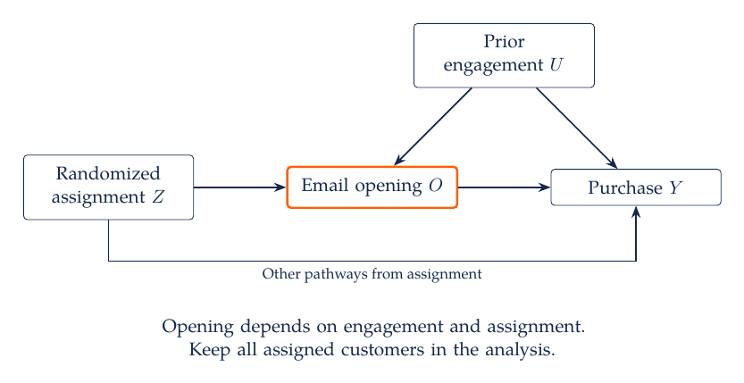
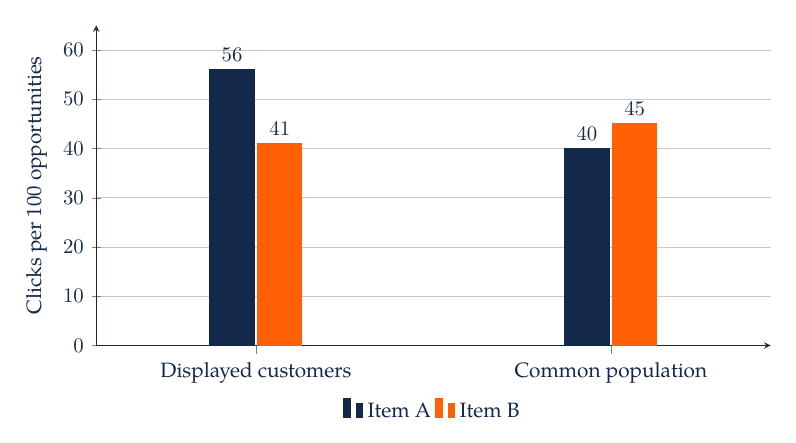
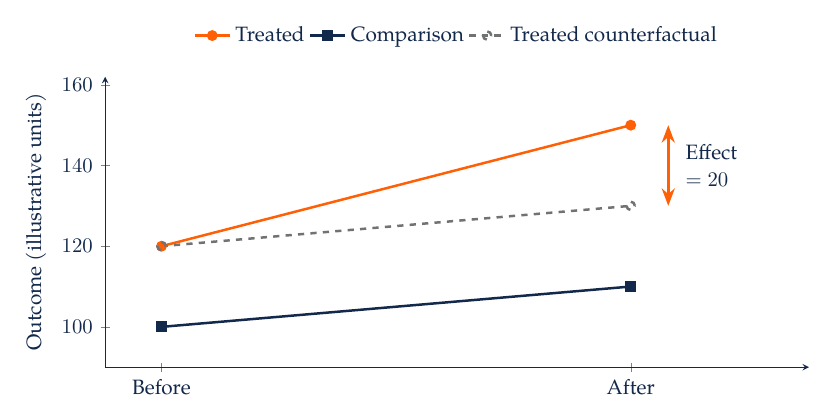
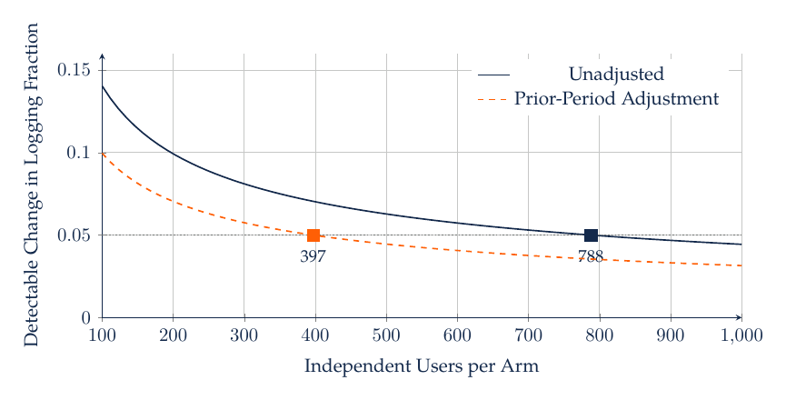
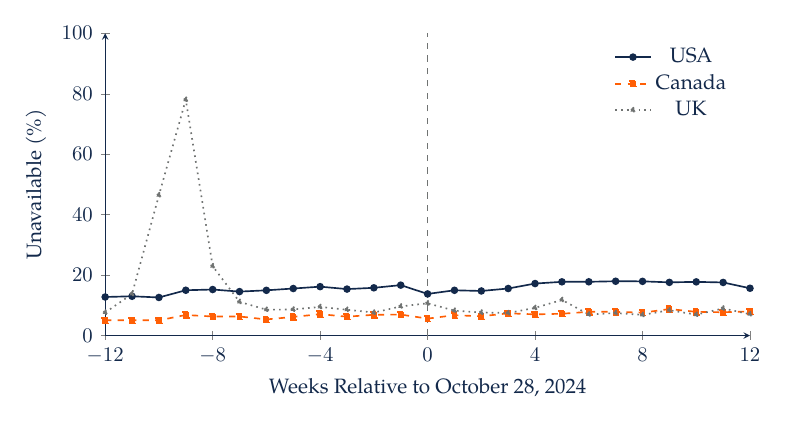
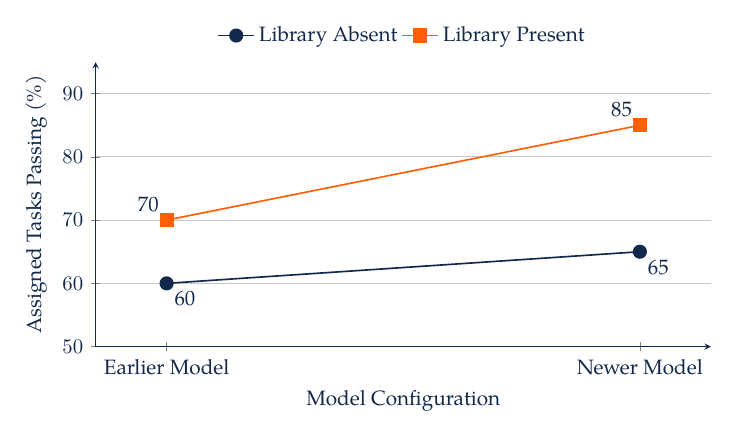
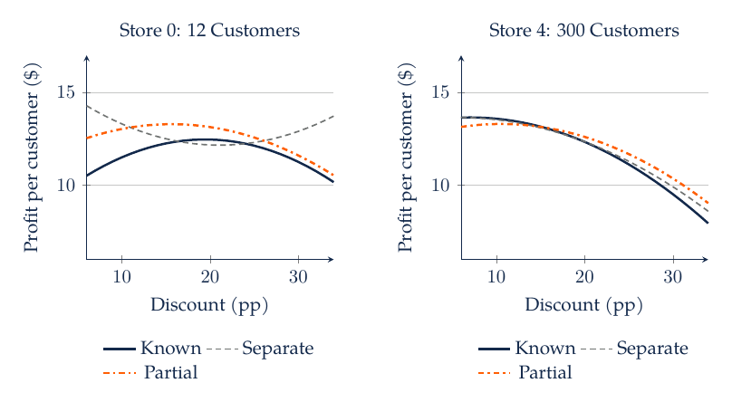
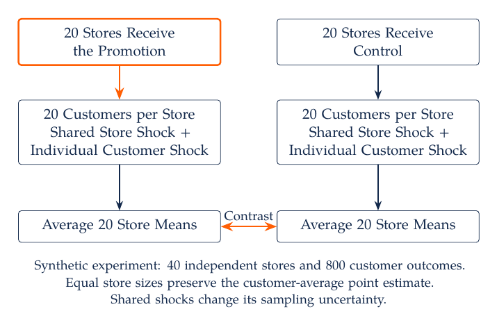

# M6. Causal Effects and Marketing Experiments

A retailer wants to know whether an email campaign increases contribution. Customers who open marketing emails often purchase more, but they may already be more engaged. Comparing openers with nonopeners can therefore reward a campaign for behavior it did not cause. The decision requires a comparison between outcomes under alternative actions for the same target population.

## 6.1 Define the Treatment, Outcome, and Estimand

Let $Y_i(1)$ be customer $i$'s 30-day contribution if assigned an email and $Y_i(0)$ the contribution if not assigned. The individual effect is $Y_i(1)-Y_i(0)$. Only one of these outcomes is observed for a given customer under a single assignment. A causal design supplies a defensible way to learn an average comparison despite that missing counterfactual.

For a target population, the average treatment effect is

$$
\operatorname{ATE}=E[Y_i(1)-Y_i(0)].
$$

The expectation refers to the stated population and outcome window. An average treatment effect on the treated uses the population that actually received treatment. An intention-to-treat effect uses assignment as the treatment, even if some assigned customers never open the email. These are different estimands. The managerial decision to send an email often corresponds closely to the assignment effect, because opening is outside the firm's direct control.

A well-defined treatment includes the offer, timing, channel, and implementation. “Digital marketing” is too broad to identify a single comparison. The outcome should include economically relevant costs and have enough follow-up to capture returns or delayed purchases. If customers can affect one another, an individual's outcome may depend on other customers' assignments. The assignment unit and outcome definition must then account for these spillovers.

## 6.2 Why the Treated-Untreated Difference Can Be Biased

The observed difference between treated and untreated customers can be decomposed as

$$
E[Y\mid D=1]-E[Y\mid D=0]
=E[Y(1)-Y(0)\mid D=1]
+\{E[Y(0)\mid D=1]-E[Y(0)\mid D=0]\}.
$$

Here $D$ indicates treatment. The first term is the average treatment effect among treated customers. The bracketed term compares their untreated outcomes with untreated customers' outcomes. If the firm targets people who would purchase anyway, that selection term can be positive. If it targets customers in serious decline, the term can be negative. The direction follows the assignment process, not a universal rule about observational data.

An unobserved engagement variable may affect both email opening and purchasing. Adjusting for pre-treatment engagement measures can be useful if they capture the relevant confounding, but controlling for a variable does not guarantee this condition. A post-treatment variable such as clicking the email can mediate part of its effect. Conditioning on customers who click changes the population and can introduce selection.



The firm randomizes email assignment, while customers choose whether to open. Assignment can affect opening, and engagement can affect both opening and purchases. Restricting attention to openers creates a selected group. An assignment-based analysis preserves the randomized comparison when its implementation and outcome measurement are valid.

## 6.3 Designing an Experiment Around the Decision

An experiment needs an eligible population, assignment unit, treatment implementation, primary outcome, horizon, and analysis plan. Randomize at a unit that corresponds to exposure and likely spillovers. A customer-level email experiment may be appropriate when accounts act independently. A store-level display intervention requires store assignment or a design that accounts for shared exposure. Household, geographic, or network spillovers can require broader clusters.

Balance treatment groups through randomization, with blocking or stratification when important pre-treatment characteristics are known. For example, randomize within customer-tenure groups to improve balance and precision. Record assignment before contact and retain every assigned unit in the primary analysis when estimating the intention-to-treat effect. Excluding nonopeners, customers who later unsubscribe, or stores with disappointing execution can undermine the randomized comparison.

Specify a primary outcome and guardrails before viewing results. Incremental contribution might be primary, with unsubscribe rates, complaints, and returns as guardrails. Multiple outcomes can be informative, but selecting the most favorable result after examining many tests exaggerates evidence. Decide how multiple testing, sequential monitoring, and stopping will be handled. Ordinary fixed-horizon p-values do not generally retain their advertised interpretation under unrestricted repeated peeking and outcome selection.

## 6.4 Case Study: Estimate an Email Assignment Effect

In a synthetic experiment, 1,000 customers are assigned an email and 1,000 are assigned no email. Within 30 days, 130 assigned customers and 100 controls make at least one eligible purchase. The estimated assignment effect on purchase incidence is

$$
\hat\tau=\frac{130}{1000}-\frac{100}{1000}=0.03,
$$

or three percentage points. Relative to the control rate of 10%, this is a 30% relative increase. The two descriptions use different denominators; reporting only “30% lift” can obscure the absolute change.

Under independent customer assignments and the usual large-sample approximation, an unpooled standard error is

$$
\widehat{\operatorname{SE}}(\hat\tau)
=\sqrt{\frac{0.13(0.87)}{1000}+\frac{0.10(0.90)}{1000}}
\approx0.0143.
$$

An approximate 95% interval is [0.0021, 0.0579], or about 0.21 to 5.79 percentage points. This interval describes sampling uncertainty under the stated design and approximation. It does not account for an unmeasured outcome-definition error or interference between assigned customers.

Suppose an additional purchase contributes $40 and email delivery costs $0.50 per assigned customer. If the offer has no additional discount cost and purchase incidence is the relevant incremental quantity, estimated incremental contribution is $40(0.03)-$0.50=$0.70 per assigned customer. Applying the same transformation to the effect interval gives approximately $-0.42 to $1.82. A positive point estimate therefore coexists with economically consequential uncertainty. A decision can combine that uncertainty with rollout costs, the value of another test, and customer outcomes such as returns and complaints.

The margin assumption matters. If treatment also changes basket size, returns, or discount expense, purchase incidence alone is insufficient. An experiment measuring contribution directly may better match the objective.

## 6.5 Power, Precision, and the Minimum Useful Effect

Power planning begins with the smallest effect that could change the decision, not with a convenient number of rows. For two equally sized independent groups and a binary outcome with baseline rate near $p$, a rough per-group sample-size approximation is

$$
n\approx\frac{2p(1-p)(z_{1-\alpha/2}+z_{1-\beta})^2}{\delta^2},
$$

where $\delta$ is the absolute effect in probability units, $\alpha$ is the two-sided significance level, and $1-\beta$ is target power. This approximation uses a common baseline variance and normal critical values. More precise planning can use the expected rates under the alternative and the actual assignment design.

With $p=0.10$, $\delta=0.02$, $\alpha=0.05$, and 80% power, using 1.96 and 0.84 gives about 3,528 customers per group. Halving the target effect approximately quadruples the required sample under this formula. A two-percentage-point effect is 0.02, not 2; a unit error can produce a meaningless sample-size recommendation.

Clustering reduces the amount of independent information. A common approximation with equal cluster size $m$ and intracluster correlation $\rho$ multiplies individual-level variance by $1+(m-1)\rho$. For $m=20$ and $\rho=0.05$, that factor is 1.95. The number of clusters, unequal cluster sizes, assignment design, and small-sample inference still require explicit consideration. Thousands of customers across four stores do not provide thousands of independent store-level treatment assignments.

## 6.6 Implementation Checks That Protect the Comparison

Verify that the assignment counts match the intended allocation and investigate material sample-ratio discrepancies. Check whether tracking differs between treatment and control, whether treatment changes the probability an outcome is observed, and whether exclusions were applied consistently. Pre-treatment balance is a diagnostic, not proof that every causal assumption holds. In a correctly randomized experiment, chance imbalances can occur.

Noncompliance changes the estimand. If only 40% of assigned customers open the email, the intention-to-treat effect remains the effect of assignment under the observed implementation. Dividing it by an opening-rate difference identifies a complier effect only under additional instrumental-variable conditions, including an appropriate exclusion restriction and monotonicity. The firm may care about the assignment effect even when a different scientific question concerns actual exposure.

Use pre-treatment outcomes to improve precision when justified. A regression adjustment can compare outcomes while accounting for baseline spending or stratification variables. Avoid selecting an adjustment because it makes the treatment coefficient significant. Report the planned analysis and explain any departures. Analyze heterogeneity cautiously, especially when many subgroups are examined after seeing the main result.

## 6.7 Observational Adjustment and Its Limits

When randomization is unavailable, a common approach assumes that treatment is conditionally independent of potential outcomes given observed pre-treatment covariates, with overlap in treatment probabilities. Regression adjustment, matching, and inverse-probability weighting implement different ways to construct a comparison under that condition. The central question is whether the observed covariates make the treated and untreated outcomes comparable.

A propensity score is the treatment probability given those covariates. Extreme estimated scores indicate limited overlap and can create unstable weights. Trimming or restricting the sample changes the population for which the effect is estimated. Report that population explicitly. A flexible prediction algorithm for treatment assignment does not establish that all confounders were measured.

A doubly robust estimator combines an outcome model and a treatment model and can be consistent when one nuisance model is correctly specified, under the underlying identification conditions and regularity assumptions. This robustness does not cover unmeasured confounding. For advanced implementations, sample splitting and cross-fitting help control overfitting of nuisance functions; the design remains the foundation of the causal interpretation.

### 6.7.1 Evaluating a Recommendation Policy from Logged Exposure

A retailer has records from an existing recommendation policy and wants to evaluate a different one. The existing policy shows products selectively: frequent buyers may usually see A, while occasional buyers usually see B. Comparing their observed click rates mixes product response with the customer populations receiving each recommendation. [Schnabel and coauthors (2016)](https://proceedings.mlr.press/v48/schnabel16.html) formulate recommendation learning and evaluation as problems of selected observation and use propensity weighting to address that selection under explicit conditions.

Consider a single recommendation opportunity per customer. Let $X_i$ be information available before display, $A_i$ the displayed item, and $Y_i$ a click within the specified response window. The logging policy assigns item $a$ with probability $p_0(a\mid X_i)$. A target policy assigns it with probability $\pi(a\mid X_i)$. The target is the expected clicks per opportunity if eligible customers receive recommendations from $\pi$. An inverse-propensity estimator is

$$
\widehat V(\pi)=\frac{1}{n}\sum_{i=1}^{n}
\frac{\pi(A_i\mid X_i)}{p_0(A_i\mid X_i)}Y_i.
$$

The ratio changes how much each logged outcome represents the target policy. For a policy that always recommends A, outcomes following B receive zero weight. An A outcome observed under a 10% display probability receives weight ten. The denominator $n$ counts all eligible logged opportunities, including those assigned zero weight. Dividing only by the number of matching displays estimates a different quantity.

Interpretation requires a well-defined action and outcome, conditional exchangeability of display given $X_i$, and positive logging probability wherever the target policy assigns positive probability. A known randomized logging policy can supply the assignment condition. Estimating probabilities from observational logs requires the additional substantive claim that the recorded context captures the relevant selection. The target population and response process must also match the logged environment. For a slate of products, position and other displayed items can affect the response; a single-item propensity generally does not describe assignment of the complete slate.

The weighting identity explains the adjustment. Conditional on $X=x$, averaging over logged actions gives $\sum_a p_0(a\mid x)\{\pi(a\mid x)/p_0(a\mid x)\}E[Y(a)\mid X=x]$. The logging probability cancels, leaving the response weighted by the target policy. Cancellation requires positive support. If an item was never eligible for a customer group, multiplying the observed records by larger weights cannot reveal that group's response to it.

### 6.7.2 Case Study: Exposure Adjustment Reverses the Preferred Item

Suppose 1,000 synthetic customers comprise 500 frequent buyers and 500 occasional buyers. The logging policy randomly assigns A within each group with probabilities 0.90 and 0.10, respectively. B receives the remaining probability. The constructed counts are:

| Customer Group | Item | Display Probability | Displays | Clicks |
| --- | --- | ---: | ---: | ---: |
| Frequent | A | 0.90 | 450 | 270 |
| Frequent | B | 0.10 | 50 | 25 |
| Occasional | A | 0.10 | 50 | 10 |
| Occasional | B | 0.90 | 450 | 180 |

A receives 280 clicks from 500 displays, or 56%. B receives 205 from 500, or 41%. Yet A's within-group rates are 60% and 20%, while B's are 50% and 40%. Applied to the same equally weighted customer population, A gives 40% and B gives 45%. A's displayed customers disproportionately come from the group with high response to either item.

The inverse-propensity calculations recover the common-population comparison:

$$
\widehat V(A)=\frac{270/0.90+10/0.10}{1000}=0.40,
\qquad
\widehat V(B)=\frac{25/0.10+180/0.90}{1000}=0.45.
$$



The raw bars describe response among each item's displayed customers. The adjusted bars describe the same 50:50 customer mix for both policies. The five-percentage-point advantage for B is imposed by the synthetic cell counts and randomized logging design. It is not an estimate from the cited study.

Large weights reduce precision. For A, the 50 occasional buyers each represent ten eligible customers, so a small number of outcomes carries substantial influence. The diagnostic $(\sum_i w_i)^2/\sum_i w_i^2$ equals 180 for either policy in this example, despite 1,000 logged opportunities. This effective sample size describes weight concentration; it does not replace a variance calculation that respects assignment and dependence. Weight clipping trades variance for bias, and self-normalization changes the finite-sample estimator. Report these choices and retain an untouched evaluation sample when choosing between policies.

## 6.8 Difference-in-Differences and a Counterfactual Trend

A retailer introduces an app in treated markets while comparable markets remain untreated. A before-after difference in treated markets mixes the app's effect with common demand changes. Difference-in-differences subtracts the comparison group's change:

$$
\hat\tau_{\mathrm{DiD}}=(\bar Y_{T,post}-\bar Y_{T,pre})-(\bar Y_{C,post}-\bar Y_{C,pre}).
$$

In a synthetic example, treated-market sales rise from 120 to 150 and comparison-market sales rise from 100 to 110. The DiD estimate is 20 sales units. Under the identifying parallel-trends condition, the treated markets' untreated counterfactual would have risen to 130. Different starting levels are compatible with this design; the condition concerns untreated changes.



The dashed line is a counterfactual implied by parallel untreated trends, not an observed sales series. The vertical gap between observed treated sales and that line is the estimated effect. A treatment-specific local shock at the same time would challenge the interpretation even if the pre-treatment levels looked similar.

Inspect multiple pre-treatment periods, institutional timing, possible anticipation, spillovers, and changes in sample composition. Similar pre-trends can support the design's plausibility, but a nonsignificant pre-trend test does not establish parallel counterfactual trends. With staggered adoption and heterogeneous effects, conventional two-way fixed-effects coefficients can combine comparisons in problematic ways. Use estimators aligned with cohort and time-specific effects, with a clear comparison group, when extending beyond the simple two-period design.

## 6.9 Other Designs: Discontinuities and Instruments

A regression discontinuity design can use a treatment rule at a threshold, such as eligibility based on a pre-existing score. Customers just above and below the cutoff may be comparable if other determinants of the outcome vary smoothly there and the score is not precisely manipulated. The resulting effect is local to the cutoff and the relevant compliance behavior. Bandwidth, functional form, density patterns, and discontinuities in other predetermined variables deserve inspection.

An instrumental variable changes treatment while affecting the outcome only through the treatment channel, under the design's conditions. Relevance is an empirical first-stage requirement; exclusion is a substantive condition. A strong first stage cannot establish exclusion. In a binary-treatment setting with independence, exclusion, and monotonicity, the familiar local average treatment effect concerns compliers whose treatment changes with the instrument. It need not equal the population ATE.

Marketing instruments require particularly careful reasoning because pricing, distribution, and exposure decisions often respond to demand. A variable correlated with treatment is not sufficient. Explain who makes the relevant decision, when the instrument is determined, and which other channels could connect it to outcomes. If those channels remain credible, the causal interpretation needs revision.

## 6.10 Spillovers and Experiment Units

An advertising campaign can shift purchases between stores or products rather than increase total demand. A customer-level outcome may show a gain while chain-wide contribution changes little. Define the outcome at the level relevant to the managerial objective and examine displacement where it is plausible. The same issue arises when customers share offers or when a platform changes recommendations for multiple users.


An assigned store can gain sales while diverting purchases from another store. If the comparison store loses customers, subtracting its decline can overstate the increase in total chain sales. Cluster randomization, geographic separation, or designs that vary treatment saturation may help identify the relevant effects, subject to their own practical constraints.

### 6.10.1 Case Study: Recommendations Supply Information and Exposure

A recommendation can increase consumption by bringing a product to attention or by changing beliefs about its quality. [Aridor, Gonçalves, Kluver, Kong, and Konstan's MovieLens experiment](https://www.econstor.eu/handle/10419/271773), in its November 2022 working-paper version, separates recommendation and exposure-only conditions and elicits users' beliefs. The results support an informational role: recommendations influence beliefs and consumption beyond simply exposing a movie. MovieLens provides recommendations without selling or hosting the movies, which helps define the incentives in this setting.

A retailer studying the same mechanism could distinguish ordinary display from an explicit personalized endorsement while keeping the eligible product set and available information controlled. The primary outcome would be purchases or contribution per assigned customer over a fixed horizon. Belief measures would address how the endorsement operates. The experiment must account for the possibility that asking about a product itself increases attention to it. Comparisons based only on customers who subsequently click would condition on a response that the endorsement can change.

The displayed information can also affect the labels collected afterward. [Cosley and coauthors (2003)](https://experts.umn.edu/en/publications/is-seeing-believing-how-recommender-interfaces-affect-users-opini/) experimentally vary predicted ratings shown to MovieLens users and find that subsequent ratings tend to move toward the displayed prediction. A rating collected after a recommendation therefore reflects the evaluation context as well as the user's experience. A model trained to reproduce those ratings can partly reproduce its own previous influence. Collecting some evaluations before showing predicted ratings provides a comparison for that mechanism.

An experiment on an adaptive recommender also needs a rule for retraining. If both treatment and control data update a shared model, one customer's assignment may change another customer's recommendations. Freezing the model, maintaining separate models, or assigning sufficiently separated populations evaluates different policies. State which policy and learning process the experiment implements. A short experiment with a frozen model identifies a different intervention from deploying a model that learns from its own recommendations over several months.

## 6.11 AI-Assisted Workflow and Practice

Ask an assistant to state the estimand, assignment unit, outcome horizon, and comparison group before writing estimation code. For the email example, require the conversion effect in percentage points, the unpooled standard error, and the contribution calculation. Check the arithmetic independently. Ask it to explain why restricting the sample to email openers changes the analysis.

For observational data, draw or describe the assignment process before selecting controls. Request an overlap diagnostic and a report of which observations receive large weights. For DiD, ask the assistant to show observed and counterfactual series separately and identify the assumptions that connect them. A convincing plot should not substitute for those conditions.

If comparison-market sales rise by 25 instead of 10, the DiD estimate becomes five. If email cost doubles to $1, the point estimate of incremental contribution falls to $0.20. If treatment raises returns, explain why a conversion effect can overstate the contribution effect. If two stores share most customers, identify why store assignment may create interference.

For the exposure example, ask an assistant to compute both the raw click rates and inverse-propensity policy values from the four aggregate rows, using the display counts when calculating denominators and weight concentration. Verify the weighted results independently by averaging the two group-specific response rates. Then set A's display probability among occasional buyers to zero in a proposed logging design and explain why the always-A policy becomes unidentified from those logs. The implementation should flag the unsupported action and retain the group in the population accounting.

## 6.12 Readings

[Facure's causal-inference handbook](https://matheusfacure.github.io/python-causality-handbook/landing-page.html) supplies accessible implementations of several designs. [Kohavi and colleagues' practical guide](https://exp-platform.com/Documents/GuideControlledExperiments.pdf) discusses controlled online experiments. [Callaway and Sant'Anna (2021)](https://doi.org/10.1016/j.jeconom.2020.12.001) develop difference-in-differences with multiple periods.

## 6.13 mHealth: Planning a Randomized Suggestion Test

The manager has a candidate suggestion policy and wants to know whether offering it changes customer behavior. The historical logs contain no documented randomized assignment or recommendation exposure. They can supply a distribution for planning precision and reveal how a proposed outcome is measured. An effect estimate requires the assignment and outcome records from a suitable new design.

Consider a user-randomized trial comparing the current interface with an offer of the new suggestions. Define the primary logging outcome as the fraction of the next 30 calendar days with at least one recorded food entry. Analyze all assigned eligible users under their original assignment, including users who never return. A suggestion may increase logging without changing consumption. A nutrition outcome therefore needs its own validated measurement and a plan for missingness. Post-assignment completeness screens could remove users differently across arms and alter the intention-to-treat comparison.

For historical planning, require at least 30 recorded days during January through May. Among the 327 eligible users, June's logging fraction averages 0.6408 with a standard deviation of 0.3542. Twenty-three users have no June entries and receive a zero logging fraction. That zero is meaningful for observed logging. It says nothing about zero consumption, nutritional adequacy, or contract cancellation.

With independent users, equal arm sizes, a two-sided 5% test, 80% power, and the historical standard deviation treated as the prospective outcome standard deviation, the normal approximation is

$$
n_{\text{per arm}}\approx
\frac{2\sigma^2(z_{0.975}+z_{0.80})^2}{\Delta^2}.
$$

An imposed minimum detectable effect of 0.05 in the logging fraction, equivalent to 1.5 days out of 30, gives 788 users per arm after rounding upward. This is a planning scenario using historical variance. Future eligibility, outcome distributions, unequal assignment, clustering, and the intended analysis can change the required size. The 327-user historical subset does not supply that many independent trial participants.


A randomization simulation assigns the same observed June outcomes to nearly equal arms 2,000 times while imposing a sharp zero effect. The standard deviation of the resulting mean difference is 0.0395, and the central 95% interval is approximately [-0.0798, 0.0740]. These differences arise from assignment variation alone. Repeatedly treating each user-day as an independent trial participant would conceal dependence within users and overstate the effective sample size.

The protocol should specify randomization before any policy exposure, record assignment and actual exposure separately, and keep the outcome window fixed. For nutrition assessments, collect reliable intake or appropriate validation measures independently of how often the app is used. Domain-based restrictions should be specified in advance, with their effect on the target population and missing-outcome analysis made explicit.

Random assignment is generated locally with seed 534. Report the assumed effect alongside the simulated differences so that sampling variation can be distinguished from the effect specified in the simulation.

Python source: [m06.py](../../03_Data_and_Code/mHealth/recurring_examples/m06.py). From its directory, run `python m06.py`.

```python
"""Use historical logging variation to plan, not estimate, a randomized trial."""

import json
import numpy as np
from scipy.stats import norm
from common import SEED, load_inputs, save_result

food, daily, baskets = load_inputs()
prior = daily.loc[daily.date.between("2016-01-01", "2016-05-31")]
counts = prior.groupby("Userid").size()
eligible = counts[counts >= 30].index.sort_values()
june = daily.loc[daily.date.between("2016-06-01", "2016-06-30")]
# A zero means no recorded day in June, not zero consumption or poor health.
outcome = june.groupby("Userid").size().reindex(eligible, fill_value=0) / 30
sigma = float(outcome.std(ddof=1))
effect = 0.05  # Imposed minimum detectable increase in the fraction of logged days.
critical = norm.ppf(0.975) + norm.ppf(0.80)
per_arm = int(np.ceil(2 * sigma**2 * critical**2 / effect**2))
# Illustrative balanced assignment under a sharp zero-effect simulation.
rng = np.random.default_rng(SEED)
values = outcome.to_numpy()
differences = []
for repetition in range(2000):
    order = rng.permutation(len(values))
    treated, control = np.array_split(order, 2)
    differences.append(values[treated].mean() - values[control].mean())
result = {
    "eligible_users": len(eligible),
    "june_mean_logging_fraction": float(outcome.mean()),
    "june_sd": sigma,
    "zero_logged_days": int(outcome.eq(0).sum()),
    "assumed_effect": effect,
    "normal_approximation_users_per_arm": per_arm,
    "null_simulation_mean_difference": float(np.mean(differences)),
    "null_simulation_sd": float(np.std(differences, ddof=1)),
    "null_simulation_95_percent_interval": np.quantile(
        differences, [0.025, 0.975]
    ).tolist(),
}
save_result("M06", result)
print(json.dumps(result, indent=2))
```

## 6.14 Python Calculations for the Synthetic Cases

The inputs below are imposed teaching values. Running the program creates the labeled synthetic CSV files and prints the corresponding calculations. They are separate from the mHealth estimates. Keep the script beside `example_helpers.py` in `03_Data_and_Code/Lecture_Examples`.

Python source: [m06_synthetic.py](../../03_Data_and_Code/Lecture_Examples/m06_synthetic.py). From its directory, run `python m06_synthetic.py`.

```python
"""Synthetic numerical examples for M6; run from any working directory."""

import itertools
import json
import math
from example_helpers import write_csv, ols_slope, shares

r = {}
se = math.sqrt(0.13 * 0.87 / 1000 + 0.1 * 0.9 / 1000)
ci = [0.03 - 1.96 * se, 0.03 + 1.96 * se]
r["M06"] = {
    "assignment_effect": 0.03,
    "standard_error": se,
    "effect_ci": ci,
    "contribution_per_assigned_customer": 40 * 0.03 - 0.5,
    "contribution_ci": [40 * x - 0.5 for x in ci],
    "sample_per_arm": 2 * 0.1 * 0.9 * (1.96 + 0.84) ** 2 / 0.02**2,
    "design_effect": 1 + (20 - 1) * 0.05,
    "difference_in_differences": (150 - 120) - (110 - 100),
}
write_csv(
    "M06_experiment_synthetic.csv",
    ["assignment", "assigned_customers", "purchasers"],
    [("email", 1000, 130), ("control", 1000, 100)],
)
write_csv(
    "M06_did_synthetic.csv",
    ["group", "before", "after"],
    [("treated", 120, 150), ("comparison", 100, 110)],
)

exposures = [
    ("frequent", "A", 0.9, 450, 270),
    ("frequent", "B", 0.1, 50, 25),
    ("occasional", "A", 0.1, 50, 10),
    ("occasional", "B", 0.9, 450, 180),
]
write_csv(
    "M06_exposure_synthetic.csv",
    ["customer_group", "item", "logging_probability", "displays", "clicks"],
    exposures,
)


def constant_policy_value(rows, item):
    groups = {row[0] for row in rows}
    selected = [row for row in rows if row[1] == item]
    if {row[0] for row in selected if row[2] > 0} != groups:
        raise ValueError(
            "Target action lacks positive logging support in a customer group"
        )
    n = sum(row[3] for row in rows)
    weighted_clicks = sum(clicks / prob for _, _, prob, count, clicks in selected)
    sum_weights = sum(count / prob for _, _, prob, count, clicks in selected)
    sum_squared_weights = sum(count / prob**2 for _, _, prob, count, clicks in selected)
    raw = sum(row[4] for row in selected) / sum(row[3] for row in selected)
    return {
        "raw_rate": raw,
        "ips_value": weighted_clicks / n,
        "effective_sample_size": sum_weights**2 / sum_squared_weights,
    }


r["M06"]["recommendation_policies"] = {
    item: constant_policy_value(exposures, item) for item in ["A", "B"]
}
for item, target in [("A", 0.4), ("B", 0.45)]:
    result = r["M06"]["recommendation_policies"][item]
    # Independent standardization uses the known 50:50 population mix.
    standardized = sum(
        0.5 * clicks / count for group, j, prob, count, clicks in exposures if j == item
    )
    assert math.isclose(result["ips_value"], target) and math.isclose(
        result["ips_value"], standardized
    )
    assert math.isclose(result["effective_sample_size"], 180)
unsupported = [
    (g, j, 0 if (g, j) == ("occasional", "A") else p, n, y)
    for g, j, p, n, y in exposures
]
try:
    constant_policy_value(unsupported, "A")
except ValueError:
    pass
else:
    raise AssertionError("An unsupported target policy must be rejected")
print(json.dumps(r, indent=2))
```

## 6.15 mHealth: Prior Activity and Experiment Precision

A manager wants an experiment to detect a useful change in logging with fewer participants. Users differ persistently in how often they record food. Random assignment balances those differences in expectation, while a particular assignment can still place more frequent loggers in one arm. A pre-treatment activity measure can explain part of the outcome variation and improve precision.

For a planned June experiment, retain users with at least 30 recorded days before June 1. Define $X_i$ as the fraction of May days with a log and $Y_i$ as the fraction of June days with a log. All 327 eligible users remain in both monthly denominators, including users with zero observed logging days. Fit a coefficient using March logging fractions to predict April fractions, and freeze it before June. The CUPED-adjusted outcome is

$$
Y_i^{\mathrm{adj}}=Y_i-\theta(X_i-\overline X),
\qquad
\widehat\tau_{\mathrm{adj}}=overline Y_1^{\mathrm{adj}}-overline Y_0^{\mathrm{adj}}.
$$

The subscripts 1 and 0 denote randomized assignment arms. With a fixed coefficient and a pre-treatment covariate unaffected by assignment, the adjustment removes a mean-zero difference between arms in expectation. It preserves the pooled outcome mean. Randomization supplies the treatment-effect comparison; covariate adjustment changes its precision. The arithmetic is the control-variate approach underlying [CUPED](https://exp-platform.com/cuped/), introduced by Deng, Xu, Kohavi, and Walker (2013).

For a fixed coefficient, the adjusted variance equals

$$
\operatorname{Var}(Y^{\mathrm{adj}})=\operatorname{Var}(Y)+\theta^2\operatorname{Var}(X)-2\theta\operatorname{Cov}(X,Y).
$$

At the population-optimal coefficient $\theta^*=\operatorname{Cov}(X,Y)/\operatorname{Var}(X)$, this becomes $\operatorname{Var}(Y)(1-\rho^2)$. The historical coefficient used here is learned from different months, so its gain must be measured in the later comparison. A poorly transferred coefficient can increase variance. A covariate affected by treatment can also change the estimand and bias the treatment-effect calculation.

| Historical Planning Quantity | Unadjusted | CUPED |
| --- | ---: | ---: |
| Variance of June Outcome | 0.12546 | 0.06315 |
| Exact Sharp-Null Randomization SD | 0.03918 | 0.02779 |
| SD Across 2,000 Random Assignments | 0.04032 | 0.02840 |
| Approximate Users per Arm for 0.05 | 788 | 397 |

The March–April coefficient is 0.55386. The table compares the same June users and outcomes, with an adjusted-to-unadjusted variance ratio of 0.50334. The prospective sample-size calculation assumes independent users, equal arm sizes, a two-sided 5% test, 80% power, and a 0.05 absolute increase in logging fraction. It uses historical variance as a planning input and a normal approximation. Actual effects, variance shifts, interference, and attrition can change the needed sample.



No experimental assignment is observed in mHealth. The randomization exercise imposes a sharp zero-effect null, holding every recorded June outcome fixed while repeatedly assigning 163 users to treatment and 164 to control. Its dispersion illustrates the design's sampling variability. The analytical finite-population variance is $S^2(1/n_1+1/n_0)$ for each fixed outcome, and provides an independent comparison with the simulation.

[FeedX](https://github.com/google-marketing-solutions/feedx) combines experimental design with prior-period adjustment for shopping-feed tests. Its application also raises a choice of randomization unit. A test of generated product descriptions may randomize products, whereas an mHealth reminder experiment could randomize users. Shared exposure and spillovers must be addressed at the unit actually assigned. Repeated fixed-horizon significance tests during monitoring require a sequentially valid procedure or a prespecified analysis time; software output does not resolve that design choice.

Python source: [cuped.py](../../03_Data_and_Code/mHealth/recurring_examples/cuped.py). From its directory, run `python cuped.py`.

```python
"""Historical precision planning with a coefficient frozen before June."""

import json
import math
import numpy as np
import pandas as pd
from scipy.stats import norm
from common import SEED, load_food, make_daily, save_result


def adjust(outcome, baseline, theta):
    return outcome - theta * (baseline - baseline.mean())


if __name__ == "__main__":
    daily = make_daily(load_food())
    prior = daily.loc[daily.date < "2016-06-01"].groupby("Userid").size()
    users = prior.index[prior >= 30]
    monthly = {}
    for month in ["2016-03", "2016-04", "2016-05", "2016-06"]:
        period = pd.Period(month, freq="M")
        part = daily.loc[daily.date.dt.to_period("M").eq(period)]
        monthly[month] = (
            part.groupby("Userid").size().reindex(users, fill_value=0).to_numpy()
            / period.days_in_month
        )
    march, april = monthly["2016-03"], monthly["2016-04"]
    theta = np.cov(march, april, ddof=1)[0, 1] / np.var(march, ddof=1)
    baseline, outcome = monthly["2016-05"], monthly["2016-06"]
    adjusted = adjust(outcome, baseline, theta)
    assert np.isclose(adjusted.mean(), outcome.mean())
    n, n_treated = len(users), len(users) // 2
    rng = np.random.default_rng(SEED)
    differences = []
    for _ in range(2000):
        treated = np.zeros(n, dtype=bool)
        treated[rng.choice(n, n_treated, replace=False)] = True
        # Imposed sharp null: these recorded outcomes do not change with assignment.
        differences.append(
            [
                values[treated].mean() - values[~treated].mean()
                for values in [outcome, adjusted]
            ]
        )
    differences = np.asarray(differences)
    power_multiplier = 2 * (norm.ppf(0.975) + norm.ppf(0.8)) ** 2 / 0.05**2
    result = {
        "users": n,
        "coefficient_from_march_april": float(theta),
        "may_june_correlation": float(np.corrcoef(baseline, outcome)[0, 1]),
        "june_mean": float(outcome.mean()),
        "sharp_null_draws": len(differences),
        "methods": [],
    }
    for column, (name, values) in enumerate(
        [("unadjusted", outcome), ("cuped", adjusted)]
    ):
        variance = np.var(values, ddof=1)
        result["methods"].append(
            {
                "method": name,
                "outcome_variance": float(variance),
                "simulated_effect_mean": float(differences[:, column].mean()),
                "simulated_effect_sd": float(differences[:, column].std(ddof=1)),
                "exact_randomization_sd": float(
                    np.sqrt(variance * (1 / n_treated + 1 / (n - n_treated)))
                ),
                "approximate_users_per_arm_for_0_05": math.ceil(
                    power_multiplier * variance
                ),
            }
        )
    result["variance_ratio"] = float(np.var(adjusted, ddof=1) / np.var(outcome, ddof=1))
    save_result("cuped", result)
    print(json.dumps(result, indent=2))
```

## 6.16 McDonald's: Repair Policy and the Choice of a Comparison Group

\noindent A franchise operator evaluating access to repair services wants to know whether a policy reduces interruptions and improves the return to maintenance. The [2024 final rule](https://www.govinfo.gov/content/pkg/FR-2024-10-28/pdf/2024-24563.pdf) introduced a limited circumvention exemption for diagnosis, maintenance, and repair of retail-level commercial food-preparation equipment. Its effective date is October 28, 2024, as stated on page 85437; the relevant provision appears on pages 85448--85449. Announcement timing, the legal effective date, and actual adoption of new repair practices are distinct dates. A change in an ordering indicator can arise through several channels described in Section 2.16.

The weekly country data permit a concrete calculation of the comparison that a difference-in-differences design would use. Retain the 12 common weekly snapshots before October 28 and the 12 after the implementation week. Exclude that week from the pre/post means. Require at least 2,000 US records and 500 records in each comparison country. These imposed thresholds retain all 24 pre/post weeks for the USA, Canada, and the UK in this window. Compute each weekly percentage from its numerator and denominator, then weight weeks equally.

For comparison country $c$, the descriptive contrast is

$$
\widehat D_c=(\overline p_{US,post}-\overline p_{US,pre})
 -(\overline p_{c,post}-\overline p_{c,pre}).
$$

Here $p$ is the percentage of observed records reporting unavailability. The contrast has percentage-point units. A causal interpretation would require the US outcome to follow the comparison country's change in the absence of the policy, together with comparable measurement, a suitable exposure definition, and no consequential spillovers or simultaneous country-specific changes. The national policy supplies one treated country. Repeated stores and weeks do not create additional independent policy assignments.

| Country | Pre-Period Mean (%) | Post-Period Mean (%) | Change (Percentage Points) |
| --- | ---: | ---: | ---: |
| USA | 14.80 | 16.87 | +2.07 |
| Canada | 6.09 | 7.52 | +1.42 |
| UK | 19.36 | 8.06 | -11.29 |

The US-minus-Canada contrast is +0.65 percentage points. The US-minus-UK contrast is +13.37 points. The UK pre-period contains a large temporary rise in recorded unavailability; its subsequent decline dominates the second contrast. The time paths therefore matter for selecting a comparison, even when a regression can readily produce a coefficient. Canadian record counts are constant at 1,428 in this window. That regularity calls for checking the source's refresh process alongside the apparent stability of the percentage. A constant count alone does not establish a stale feed.



These data support an evaluation of a proposed policy comparison. The positive contrasts do not establish that the exemption worsened availability. Stronger evidence would connect a stable set of outlets to policy exposure, actual repair adoption, verified mechanical interruptions, and comparable collection times. Pre-treatment event coefficients can diagnose particular discrepancies, while a nonsignificant pre-trend test supplies no proof of the counterfactual assumption. Customer demand, service hours, and repair implementation would further distinguish an operational policy effect from a change in the ordering measure.

Python source: [policy.py](../../03_Data_and_Code/McBroken/policy.py). From its directory, run `python policy.py`.

```python
"""Calculate descriptive country contrasts around the October 2024 exemption."""
import json
from pathlib import Path

import pandas as pd

ROOT = Path(__file__).resolve().parent


def main():
    data = pd.read_csv(ROOT / "data/policy_window.csv")
    assert not data.duplicated(["country", "event_week"]).any()
    data["percent"] = 100 * data.n_broken / data.n_checked
    # These are sensitivity screens, not a claim of representative coverage.
    data = data[data.n_checked.ge(data.country.map({"USA": 2000, "UK": 500, "CA": 500}))]
    wide = data.pivot(index="event_week", columns="country", values="percent")
    common = wide[["USA", "UK", "CA"]].dropna()
    pre = common.loc[common.index < 0].mean()
    post = common.loc[common.index > 0].mean()  # omit the implementation week
    if len(common.loc[common.index < 0]) != 12 or len(common.loc[common.index > 0]) != 12:
        raise ValueError("Expected 12 common pre weeks and 12 common post weeks")
    change = post - pre
    table = pd.DataFrame({"pre_percent": pre, "post_percent": post,
                          "change_pp": change})
    contrasts = {c: float(change.USA - change[c]) for c in ["CA", "UK"]}
    results = ROOT / "results"
    results.mkdir(exist_ok=True)
    table.to_csv(results / "policy_means.csv", index_label="country")
    (results / "policy.json").write_text(json.dumps({
        "effective_date": "2024-10-28", "pre_weeks": 12, "post_weeks": 12,
        "omitted_week": 0, "weighting": "Equal weight per common weekly snapshot",
        "us_change_minus_comparator_change_pp": contrasts,
        "interpretation": "Descriptive contrasts; parallel counterfactual trends and stable measurement are not established."}, indent=2) + "\n")
    figure = r"""\begin{tikzpicture}
\begin{axis}[width=12.5cm,height=6.7cm,xmin=-12,xmax=12,ymin=0,ymax=100,
 xlabel={Weeks Relative to October 28, 2024},ylabel={Unavailable (\%)},
 xtick={-12,-8,-4,0,4,8,12},legend style={at={(0.98,0.98)},anchor=north east}]
"""
    for country, style in [("USA", "IlliniBlue,mark=*"),
                           ("CA", "IlliniOrange,dashed,mark=square*"),
                           ("UK", "Storm,dotted,mark=triangle*")]:
        points = " ".join(f"({i},{v:.6f})" for i, v in common[country].items())
        figure += f"\\addplot[{style},mark size=1.4pt] coordinates {{{points}}};\n"
    figure += r"\legend{USA,Canada,UK}" + "\n"
    figure += r"\draw[Storm,dashed] (axis cs:0,0)--(axis cs:0,100);" + "\n"
    figure += "\\end{axis}\n\\end{tikzpicture}\n"
    (ROOT.parents[1] / "06_Lecture_Notes/figures/M06_mcbroken_policy.tex").write_text(figure)
    print(table.to_string())
    print(json.dumps(contrasts, indent=2))


if __name__ == "__main__":
    main()
```

## 6.17 Experimental Objectives and Customer Outcomes

\noindent A marketing experiment identifies a response to the assigned intervention for the represented population. The choice of outcome determines what success means. An experiment that ranks interfaces by completed renewals can reliably select a profitable interface while remaining silent about whether customers wanted the additional subscription. Randomization addresses the comparison between assigned procedures; customer value requires an appropriate outcome and its own measurement.

For a cancellation experiment, define eligibility before assignment and retain every assigned customer in the primary denominator. Include a direct-choice benchmark and record the final payment status over a fixed horizon. Also measure completion time, refunds, unwanted charges, and customers' informed willingness to continue. Conditioning only on customers who reach the last page can remove the people most affected by a difficult interface. Report that intermediate reach rate separately.

The procedure includes the customer's opportunity to refuse optional retention content. If a customer must first undergo the intervention to discover how to decline it, the refusal path changes the treatment itself. A comparison of optional and compulsory interaction can therefore require different treatment definitions even when the last screen is identical. Describe the complete assigned sequence before interpreting the estimated effect.

Under the model in Section 8.14, firm and customer interests are opposed for the same renewal. Accurate experimentation then helps the firm select the procedure with the largest customer loss within the available set. This conditional result follows from the stakes and objective. When a better product increases both willingness to pay and firm profit, the same experiment can instead select a mutually beneficial change. The empirical task is to measure the consequences that distinguish those settings.

## 6.18 Earnings Calls: A Public Clarification and the Event Window

\noindent A communications manager wants to understand whether pricing language changed around a public clarification. [Wendy's February 27, 2024 statement](https://www.wendys.com/blog/wendys-digital-news-update) described intended uses of digital menu boards and rejected the interpretation that the company planned higher prices at its busiest times. That dated company statement supplies an observable event. It does not establish realized prices or customer responses.

Define a before window from 90 through one calendar day before the statement and an after window from one through 90 days after it. Exclude calls on the event day because within-day ordering is unavailable. Use calls with observed text and report both all available firms and firms appearing in both windows. The comparison is the change in the fraction of calls containing core language. A separate firm-equal calculation first averages calls within firm and period, then averages those firm rates, so extra captured calls do not increase a firm's weight.

In the common-firm comparison group, each window contains one call from each of 27 firms. Core occurrences fall from five to two, while the number of positive calls remains two in each window. Incidence therefore remains 2/27, or 7.41%. In the full available comparison sample, the apparent call rate falls from 2/27 to 2/34 as coverage expands. These are distinct sources of an apparent change: repeated language within calls and the number of observed calls.


The event is shared public information, and the supplied comparison group identifies an industry classification. Its firms have not been verified as unexposed to the event. Earnings-call timing, business conditions, and disclosure choices also vary. Even a measured change in disclosure would leave adoption and customer effects as separate outcomes. A causal design would need a specified exposure, a defensible counterfactual disclosure path, stable measurement, and uncertainty that accounts for repeated firms. Matching firm coverage addresses composition alone.

The program repeats the descriptive calculation with 60-, 90-, and 120-day windows and reports counts, call-weighted rates, and firm-equal rates. Compare these prespecified windows before writing an explanation for a selected result. Reconcile the numerator and denominator separately, then identify the evidence needed for any causal claim.

Python source: [event_windows.py](../../03_Data_and_Code/Earnings_Calls/event_windows.py). From `03_Data_and_Code/Earnings_Calls`, run `python event_windows.py`. Python, pandas, and NumPy are required; the committed metadata supply all inputs.

```python
"""Describe call-level language around a public clarification; no causal effect."""
import pandas as pd
from assessment import HERE, load_checked


def compare_windows(calls, event='2024-02-27', days=90):
    date = pd.Timestamp(event)
    d = calls.loc[calls.text_observed].copy()
    delta = (d.call_date - date).dt.days
    # Exclude the event day because within-day ordering is unavailable.
    d = d.loc[delta.between(-days, -1) | delta.between(1, days)].copy()
    d['period'] = d.call_date.gt(date).map({False: 'before', True: 'after'})
    common = d.groupby('ticker').period.nunique()
    common = common[common.eq(2)].index
    rows = []
    for sample, panel in [('available_calls', d), ('firms_in_both_windows', d[d.ticker.isin(common)])]:
        for (group, period), part in panel.groupby(['group', 'period']):
            rows.append({'window_days': days, 'sample': sample, 'group': group,
                         'period': period, 'firms': part.ticker.nunique(),
                         'calls': len(part), 'positive_calls': int(part.has_core.sum()),
                         'core_matches': int(part.n_core.sum()),
                         'share_percent': 100 * part.has_core.mean(),
                         'firm_equal_share_percent': 100 * part.groupby('ticker').has_core.mean().mean()})
    return pd.DataFrame(rows)


def main():
    calls, _, _, _ = load_checked()
    results = pd.concat([compare_windows(calls, days=n) for n in [60, 90, 120]])
    results.to_csv(HERE / 'results/event_windows.csv', index=False)
    print(results[results.window_days.eq(90)].round(4).to_string(index=False))


if __name__ == '__main__':
    (HERE / 'results').mkdir(exist_ok=True)
    main()
```

## 6.19 Model Improvements and Reusable Analytical Workflows

\noindent A marketing team must decide whether to buy access to a newer model, invest in a tested code library, or use both. A comparison between its old setup and a new setup that changes both components cannot isolate their separate contributions. A factorial comparison crosses model version with library access and evaluates every condition using a common task population and acceptance rule.

Consider a synthetic table with 100 assigned tasks in each of four conditions. Each task requires a correct customer-level analysis within the same deadline and resource limits. The rubric checks aggregation, available information, and the managerial interpretation. An unfinished task counts as a failure. The counts below are constructed teaching inputs; they are neither measured model performance nor results of a conducted experiment.

| Model | Library | Assigned Tasks | Passing Tasks | Pass Rate |
| --- | --- | ---: | ---: | ---: |
| Earlier | Absent | 100 | 60 | 60% |
| Earlier | Present | 100 | 70 | 70% |
| Newer | Absent | 100 | 65 | 65% |
| Newer | Present | 100 | 85 | 85% |

Let $q_{m\ell}$ denote the fraction of all assigned tasks passing, where $m=1$ selects the newer model and $\ell=1$ supplies the library. The model comparison depends on library access: $q_{10}-q_{00}=0.05$ without it and $q_{11}-q_{01}=0.15$ with it. The library comparison is ten percentage points with the earlier model and twenty with the newer model. Their interaction is

$$
\delta=(q_{11}-q_{10})-(q_{01}-q_{00})=0.10.
$$

The positive interaction means that the imposed library gain is larger with the newer model. The joint change from 60% to 85% is twenty-five percentage points. It can be decomposed as a five-point model change followed by a twenty-point library change, or a ten-point library change followed by a fifteen-point model change. Neither path supplies a unique allocation of the interaction to one component.



In an empirical study, randomize teams or independent analytical projects to the four conditions, with blocking on task difficulty where useful. If several outputs come from one team, their number does not establish the number of independent assignments. Shared helpers and learning can spill across conditions. A team that first sees the library may carry its knowledge into a later nominally unassisted task. Separate teams or a justified design for carryover is needed before interpreting a crossover comparison.

Use fresh tasks, permit a competent baseline to solve the same problem, and record actual resource consumption alongside the common ceiling. The library's setup and maintenance cost enters the investment comparison even if library construction occurs before randomization. A success on familiar datasets measures execution within that scope. Transfer to a different schema or task family requires additional tasks. A revised prompting or search procedure is a further treatment dimension; changing it simultaneously with both factors would again prevent attribution.

### 6.19.1 Reproduce the Four-Condition Comparison

\noindent Run `python3 03_Data_and_Code/AI_Workflows/factorial.py` from the repository root. Python 3.10 or later suffices; no packages or model account are required. The program writes one CSV row per condition and a JSON of percentage-point contrasts. Exact rational arithmetic checks the two paths to the joint change. The code operates on the imposed counts and supplies no sampling uncertainty or empirical efficacy claim.

Python source: [factorial.py](../../03_Data_and_Code/AI_Workflows/factorial.py)

```python
"""Construct a synthetic model-by-library comparison; no model APIs are called."""
import csv
import json
from fractions import Fraction
from pathlib import Path

OUT = Path(__file__).resolve().parent / "results"


def contrasts(rates):
    """Keys are (model, library), each coded 0 or 1; values are pass fractions."""
    if set(rates) != {(0, 0), (0, 1), (1, 0), (1, 1)}:
        raise ValueError("All four conditions are required")
    return {
        "model_without_library": rates[1, 0] - rates[0, 0],
        "model_with_library": rates[1, 1] - rates[0, 1],
        "library_with_earlier_model": rates[0, 1] - rates[0, 0],
        "library_with_newer_model": rates[1, 1] - rates[1, 0],
        "interaction": rates[1, 1] - rates[1, 0] - rates[0, 1] + rates[0, 0],
        "joint_change": rates[1, 1] - rates[0, 0],
    }


def main():
    # Imposed counts: 100 assigned tasks in every cell. An unfinished task fails.
    # All cells use the same task population, rubric, deadline, and resource limits.
    passes = {(0, 0): 60, (0, 1): 70, (1, 0): 65, (1, 1): 85}
    rates = {key: Fraction(count, 100) for key, count in passes.items()}
    effects = contrasts(rates)
    # Two independent paths from the initial cell to the final cell must agree.
    assert effects["joint_change"] == Fraction(25, 100)
    assert effects["joint_change"] == (
        effects["model_without_library"] + effects["library_with_newer_model"]
    )
    assert effects["joint_change"] == (
        effects["library_with_earlier_model"] + effects["model_with_library"]
    )
    assert effects["interaction"] == Fraction(10, 100)
    OUT.mkdir(exist_ok=True)
    with (OUT / "factorial_cells.csv").open("w", newline="") as f:
        writer = csv.writer(f)
        writer.writerow(["model", "library", "assigned", "passed", "pass_fraction"])
        for (model, library), passed in passes.items():
            writer.writerow([model, library, 100, passed, float(rates[model, library])])
    result = {
        "scope": "Constructed counts; no observed AI performance or causal estimate.",
        "units": "percentage points in the fraction of all assigned tasks passing",
        "contrasts_pp": {key: float(100 * value) for key, value in effects.items()},
    }
    (OUT / "factorial_results.json").write_text(json.dumps(result, indent=2) + "\n")
    print(json.dumps(result, indent=2))


if __name__ == "__main__":
    main()
```

## 6.20 Conversion, Returns, and Customer Intent

\noindent An online retailer choosing between promotional messages needs to measure the consequences after checkout. A message that produces more orders can also produce more reversals if customers commit before resolving uncertainty. Define the treatment as the assigned message, the population as eligible visitors, and the initial outcome as purchases within a prespecified window. Subsequent returns, complaints, and retained purchases provide additional outcomes over a longer horizon.

[The Effects of Pressure and Self-Assurance Nudges on Product Purchases and Returns in Online Retailing](https://doi.org/10.1177/00222437231180494) reports a randomized field experiment. The available abstract describes stronger purchase responses to pressure nudges alongside more returns, while self-assurance produces a different balance. The evidence motivates evaluating net sales and customer outcomes together. The full text was not retrieved for this collection, so the abstract supports the directional comparison; exact effect sizes and implementation conditions require the complete study.

For a cancellation intervention, the population can instead be customers who start an exit request. Record the request before assigning any lawful alternative interface so that treatment does not determine inclusion in the denominator. Measure successful cancellation, time, later charges, and whether any accepted retention offer matches stated intent. A comparison that conditions on post-treatment completion can exclude the consumers most affected by friction. Consumer understanding should be measured separately from continued payment.

A policy evaluation adds another source of variation. A rule that takes effect in one jurisdiction can motivate a difference-in-differences design, but coverage, preexisting trends, and firm-wide interface changes must be assessed. If a platform changes its interface everywhere, untreated jurisdictions may also receive the new design. The comparison must therefore follow actual exposure, including firms outside the adopting jurisdiction that receive the same interface change. The existing policy-comparison code in Section 6.16 supplies the corresponding timing and comparison-group checks; the [cancellation source record](../../01_Resources/13_Consumer_Agency_and_Recent_Research/Policy/README.md) supplies the legal distinctions.

## 6.21 Experimental Evidence and AI-Assisted Decisions

A firm can reuse randomized comparisons to train a model that proposes new interventions. Angelopoulos, Lee, and Misra's *Causal Alignment* applies this idea to email subject lines, with human review and evaluation in new campaigns. The training signal inherits the outcome used to rank alternatives. A causal effect on clicks therefore remains an effect on clicks, even when a more effective generator makes that effect easier to reproduce. Customer understanding, refusal, and benefit require corresponding measures and reasons for the proposed action. [Research guide](../../01_Resources/16_AI_Experimentation_and_Pricing/README.md).

The selection of an action also depends on its anticipated deployment setting. Farrell, Korganbekova, and Misra's *Robust A/B Decisions* evaluates policies under uncertainty about future outcome distributions. Its conservative treatment of the selected payoff does not add customer outcomes that were absent from the objective. Marketing Dialectics, Sections 9.14–9.18, connects these decisions to personalized pricing, current policy discussions, and a reproducible comparison of profit and customer surplus.

## 6.22 Discount Depth and the Causal Response Curve

\noindent A retailer choosing a discount needs to know how another percentage point changes profit. A larger discount can increase purchases while reducing the margin on every unit sold. The relevant response can therefore rise and then fall. A coefficient near zero can conceal economically important differences between moderate discounts and either extreme.

Let $A$ denote the discount in percentage points, so $A=20$ means a 20 percent discount. Let $Y(a)$ be profit in dollars per eligible customer over the promotion week if that customer receives discount $a$. Eligibility is determined before the offer. The population curve $\theta(a)=E[Y(a)]$ compares the same population at different discounts; subtracting $\theta(a_0)$ gives the effect relative to a specified reference discount. All curves and observations in Sections 6.22–6.26 are synthetic.

Consider the imposed response

$$
\theta(a)=10+0.4a-0.01a^2,\qquad 0\leq a\leq40.
$$

Profit reaches $14 at a 20 percent discount and equals $10 at both endpoints. If discounts are randomized uniformly over this range, symmetry makes the population linear-regression slope zero. The fitted constant is $38/3, or approximately $12.67. The nonlinear response still varies by $4 per customer. This projection calculation concerns the uniform-randomization benchmark; the observational sample below follows a different assignment distribution.


**Figure description.** The horizontal axis varies the discount from 0 to 40 percentage points while holding the target population and promotion horizon fixed. The blue curve reaches $14 at 20. The orange dashed line is the best linear projection under a uniform discount distribution. A zero linear slope coexists with a substantial nonlinear response.

DoubleML's partially linear regression specification places a constant coefficient on treatment while allowing flexible covariate adjustment. That specification answers a different question from estimating an unrestricted curve. Under misspecification, the projection's weighting matters; its coefficient need not equal a simple average derivative. Nonparametric double-machine-learning methods also exist. [DoubleML models](https://docs.doubleml.org/stable/guide/models.html); [Colangelo and Lee](https://arxiv.org/abs/2004.03036).

## 6.23 Adjustment for Selected Discount Intensity

\noindent Suppose customers with stronger expected demand tend to receive larger discounts. Comparing their observed profits with those of low-discount customers mixes the discount response with differences in demand. Let $X$ contain observed characteristics recorded before the offer. The conditional outcome mean is $\mu(x,a)=E[Y\mid X=x,A=a]$, and $\pi(a\mid x)$ is the conditional density of the discount. A density has units of inverse percentage points; it is distinct from the probability of observing one exact value of a continuous treatment.

A causal interpretation requires a well-defined intervention, consistency, and conditional mean independence of potential outcomes and assigned discounts given $X$. Each dose under consideration also needs sufficient conditional support for the target population. These conditions exclude unmeasured common causes of discount assignment and profit. Randomization within the relevant population can provide this independence by design.

To average over a common population, define $m(a)=E_X[\mu(X,a)]$ and $f_A(a)=E_X[\pi(a\mid X)]$. The doubly robust adjusted outcome is

$$
\xi_i=\widehat m(A_i)+\frac{\widehat f_A(A_i)}{\widehat\pi(A_i\mid X_i)}
\left[Y_i-\widehat\mu(X_i,A_i)\right].
$$

The first term averages predicted profit over the target population. The second corrects its residual using the relative frequency of the customer's assigned dose. Under identification and regularity conditions, the population conditional mean $E[\xi\mid A=a]$ equals $\theta(a)$ when either nuisance function is correct. If the outcome model is correct, the residual has conditional mean zero. If the density model is correct, the density ratio changes the covariate distribution among customers receiving dose $a$ back to the target distribution, canceling the outcome-model error. [Kennedy, Ma, McHugh, and Small](https://arxiv.org/abs/1507.00747).

Five-fold cross-fitting estimates each customer's nuisance predictions using the other four folds. A local linear regression then smooths the adjusted outcomes across discounts. Cross-fitting limits reuse of the same outcome for fitting and evaluation. Valid confidence intervals require additional conditions on estimation errors and smoothing bias. The name double machine learning alone does not establish double robustness; that property depends on the score and the nuisance functions it uses.

### 6.23.1 A Known Population and Four Model Specifications

\noindent The simulated population contains equal shares of two observed types, $X=-1$ and $X=1$. Each sample fixes 1,200 customers of each type. Discount assignment and realized profit satisfy

$$
Z=\log\!\left(\frac{A}{40-A}\right)=0.9X+\eta,
\qquad Y=10+0.4A-0.01A^2+2X+\varepsilon,
$$

where $\eta$ is normal with standard deviation 0.9 and $\varepsilon$ is independent normal noise with standard deviation 1. The $2X$ term affects both observed profits and the selection problem. Equal target shares make its population average zero. Outcomes are measured once per customer, all rows are retained, and no missing values are imposed. The logistic transformation keeps discounts strictly between 0 and 40.

The correctly specified outcome regression includes a quadratic in discount and the observed type. Its misspecified counterpart omits type. The correctly specified density regression fits the transformed discount on type and estimates its normal residual scale, including the transformation's Jacobian when calculating the density of $A$. Its misspecified counterpart omits type. Target standardization uses the known equal type shares. These transparent parametric nuisance models isolate the statistical argument; they do not compare commercial software packages.

Across 200 independently generated samples of 2,400 customers, the average root mean squared error over the 29 equally weighted doses from 6 through 34 is:

| Outcome Model | Density Model | RMSE (USD) | Coverage (%) |
| --- | --- | ---: | ---: |
| Correct | Correct | 0.099 | 90.7 |
| Correct | Omits Type | 0.058 | 85.7 |
| Omits Type | Correct | 0.312 | 96.7 |
| Omits Type | Omits Type | 1.335 | 6.4 |

Correctness refers to the data-generating specification. The reported errors include sampling variation and the bias from a fixed two-percentage-point smoothing bandwidth. The doubly robust population identity does not require finite-sample errors to be identical when either model is correct. In this design, density correction introduces enough variation that the correctly specified outcome model with unit weights has the lowest average RMSE. Neither this ranking nor the coverage rates establish performance in a different population.

The reference sample's cross-fitted partially linear coefficient is $0.0028 per percentage point. Its small magnitude reflects the inadequacy of a constant slope for this symmetric response. It does not imply that changing discount depth has a negligible effect.

## 6.24 Overlap, Weight Concentration, and Missing Confounders

\noindent A common discount grid requires evidence about both customer types at each proposed dose. Observing many low discounts among one type and many high discounts among the other can leave the counterfactual comparisons poorly represented. Reducing the standard deviation of $\eta$ from 0.9 to 0.22 concentrates customers near type-specific discounts while keeping the same causal profit curve.


**Figure description.** Each panel plots the discount density for type minus one as a solid blue curve and type plus one as a dashed orange curve. The horizontal axis is discount in percentage points. Both panels use the same vertical scale in density per percentage point. Lower assignment noise concentrates each type around a different discount. Mathematical positivity remains, but the observed sample offers little information about the opposite type at many doses.

The weight-based effective sample size is $(\sum_i w_i)^2/\sum_i w_i^2$. It measures concentration among observed weights. In the reference sample with broader overlap, the largest estimated weight is 169.9 and the effective sample size is 125.5 out of 2,400. With weaker overlap, almost all observed weights are close to one-half and the effective sample size is approximately 2,400. The rare cross-type observations that would receive enormous weights are largely absent. A high effective sample size therefore does not establish adequate support. Conditional densities, dose-by-type counts, and the proposed decision range remain necessary checks.

When the outcome model omits type and the density specification is correct, capping weights at five raises the broader-overlap reference error from $0.532 to $0.634. Capping reduces weight concentration but changes the residual correction. It can remove the cancellation of outcome-model error that supplies double robustness. In the weaker-overlap sample, the error is $1.825 with or without the cap. These are comparisons within one fixed sample. They motivate sensitivity analysis without selecting a threshold after seeing which estimate is preferred.

An unobserved common cause creates a separate problem. Add an independent type $U\in\{-1,1\}$ with equal shares to both assignment and profit: $Z=0.9X+0.8U+\eta$ and $Y=\theta(A)+2X+2U+\varepsilon$. Even exact knowledge of $E[Y\mid A,X]$ identifies an adjusted association when $U$ remains omitted. Bayes' rule gives $E[U\mid Z,X]=\tanh\{0.8(Z-0.9X)/0.9^2\}$. Standardizing this observed regression over $X$ differs from the causal curve by as much as $1.666 on the 6–34 grid. Better nuisance prediction cannot remove this identification failure. Measuring $U$ or obtaining a credible alternative design changes the available comparison.

## 6.25 Interval Coverage and Reproducible Estimation

\noindent A confidence interval at one prespecified dose addresses a narrower event than covering the entire response curve. The program reports conditional HC0 standard errors for the local linear regression, holding the fitted adjusted outcomes fixed. These approximate standard errors omit first-stage uncertainty and smoothing bias. Their nominal 95 percent label is evaluated against the known curve across repeated samples.

With both nuisance models correctly specified, mean pointwise coverage is 90.7 percent, while all 29 points lie inside their respective pointwise intervals in 42.5 percent of samples. The latter event has no nominal 95 percent guarantee because these are pointwise intervals. The former comparison directly shows undercoverage of the pointwise procedure in this design. Each dose has 200 simulated coverage indicators; its Monte Carlo standard error is $\sqrt{\widehat p(1-\widehat p)/200}$. Correlated doses within a sample do not supply independent repetitions. The saved coverage table retains each dose's rate and simulation uncertainty.

The fixed bandwidth creates a finite-resolution teaching comparison. Consistency for an unrestricted curve requires an appropriate bandwidth sequence and regularity conditions. In applied work, inference must address the sampling unit, nuisance estimation, smoothing, and any search over doses. Refitting the whole pipeline in a bootstrap can assess some sources of uncertainty under suitable conditions; it does not resolve missing confounders or unsupported extrapolation. Selecting the maximum of an estimated curve also selects estimation noise, motivating independent policy evaluation.

Run the calculation from its example directory:

```sh
cd 03_Data_and_Code/Dose_Response
python dose_response.py --output local_runs --repetitions 200
```

The output includes synthetic customer records, all four fitted curves, coverage by dose, weight diagnostics, and the exact hidden-confounder comparison. Seeds, units, sample sizes, dependencies, and commands are recorded in the [example guide](../../03_Data_and_Code/Dose_Response/README.md).

Python source: [dose_response.py](../../03_Data_and_Code/Dose_Response/dose_response.py).

```python
"""Synthetic discount curves, cross-fitting, overlap, and interval evaluation.

Run: python dose_response.py --output results --repetitions 200
All doses are percentage points; profit is dollars per eligible customer.
The target population places equal weight on X=-1 and X=1.
"""
from pathlib import Path
import argparse
import json
import platform
import numpy as np

GRID = np.linspace(6, 34, 29)
SETTINGS = [(True, True), (True, False), (False, True), (False, False)]


def truth(a):
    return 10 + 0.4 * np.asarray(a) - 0.01 * np.asarray(a) ** 2


def generate(n=2400, seed=20261118, sigma=0.9):
    """Equal numbers of each observed type; no exclusions or missing rows."""
    if n % 2:
        raise ValueError("n must be even")
    rng = np.random.default_rng(seed)
    x = rng.permutation(np.repeat([-1.0, 1.0], n // 2))
    z = 0.9 * x + rng.normal(0, sigma, n)
    a = 40 / (1 + np.exp(-z))
    y = truth(a) + 2 * x + rng.normal(0, 1, n)
    return x, a, y


def outcome_features(x, a, correct=True):
    t = (np.asarray(a) - 20) / 10
    columns = [np.ones_like(t), t, t * t]
    if correct:
        columns.append(np.broadcast_to(x, t.shape))
    return np.column_stack(columns)


def treatment_features(x, correct=True):
    return np.column_stack([np.ones_like(x), x]) if correct else np.ones((len(x), 1))


def density(a, mean, sigma):
    """Logistic-normal density on (0,40), including its Jacobian."""
    a = np.asarray(a)
    z = np.log(a / (40 - a))
    return (np.exp(-0.5 * ((z - mean) / sigma) ** 2)
            / (np.sqrt(2 * np.pi) * sigma) * 40 / (a * (40 - a)))


def pseudo_outcome(x, a, y, outcome_correct=True, gps_correct=True, cap=None, seed=71):
    """Five folds; train each nuisance only on the other four folds.

    Standardization uses the stated equal-type target population. The wrong
    outcome model omits X; the wrong dose model omits X on the logit scale.
    cap is a fixed maximum weight, not an estimated quantile.
    """
    fold = np.random.default_rng(seed).permutation(np.arange(len(y)) % 5)
    xi, raw_weight = np.empty_like(y), np.empty_like(y)
    for k in range(5):
        tr, te = fold != k, fold == k
        b = np.linalg.lstsq(outcome_features(x[tr], a[tr], outcome_correct), y[tr], rcond=None)[0]
        mu = outcome_features(x[te], a[te], outcome_correct) @ b
        marginal_mu = sum(outcome_features(g, a[te], outcome_correct) @ b for g in [-1, 1]) / 2
        z = np.log(a[tr] / (40 - a[tr]))
        design = treatment_features(x[tr], gps_correct)
        c = np.linalg.lstsq(design, z, rcond=None)[0]
        sigma = np.sqrt(np.mean((z - design @ c) ** 2))
        observed_mean = treatment_features(x[te], gps_correct) @ c
        conditional = density(a[te], observed_mean, sigma)
        marginal = sum(density(a[te], treatment_features(np.full(te.sum(), g), gps_correct) @ c,
                               sigma) for g in [-1, 1]) / 2
        raw_weight[te] = marginal / conditional
        weight = raw_weight[te] if cap is None else np.minimum(raw_weight[te], cap)
        xi[te] = marginal_mu + weight * (y[te] - mu)
    return xi, raw_weight


def smooth(a, y, grid=GRID, bandwidth=2.0):
    """Local linear Gaussian smoother and conditional HC0 standard error.

    This standard error holds fitted pseudo-outcomes fixed. It omits nuisance
    estimation and smoothing bias; its coverage is evaluated, never presumed.
    """
    delta = np.asarray(a)[:, None] - np.asarray(grid)[None, :]
    w = np.exp(-0.5 * (delta / bandwidth) ** 2)
    s0, s1, s2 = w.sum(0), (w * delta).sum(0), (w * delta**2).sum(0)
    determinant = s0 * s2 - s1**2
    if np.any(determinant <= 1e-14):
        raise ValueError("Insufficient local variation at an evaluation dose")
    linear_weights = w * (s2 - delta * s1) / determinant
    slope_weights = w * (delta * s0 - s1) / determinant
    estimate = linear_weights.T @ y
    slope = slope_weights.T @ y
    residual = y[:, None] - estimate - delta * slope
    se = np.sqrt(((linear_weights * residual) ** 2).sum(0))
    return estimate, se


def plr_slope(x, a, y):
    """Cross-fitted Robinson partialling-out slope, with binary-X nuisances."""
    fold = np.random.default_rng(71).permutation(np.arange(len(y)) % 5)
    ra, ry = np.empty_like(a), np.empty_like(y)
    design = treatment_features(x)
    for k in range(5):
        tr, te = fold != k, fold == k
        ra[te] = a[te] - design[te] @ np.linalg.lstsq(design[tr], a[tr], rcond=None)[0]
        ry[te] = y[te] - design[te] @ np.linalg.lstsq(design[tr], y[tr], rcond=None)[0]
    return float(ra @ ry / (ra @ ra))


def hidden_confounding(grid=GRID):
    """Exact observable-data regression with an omitted independent U in {-1,1}.

    Z=.9X+.8U+Normal(0,.9), Y=truth(A)+2X+2U+noise. Bayes' rule gives
    E[U|Z,X]=tanh(.8*(Z-.9X)/.9**2). Both observable nuisance functions could
    be known exactly and adjustment for X would still miss the causal curve.
    """
    z = np.log(grid / (40 - grid))
    observed = truth(grid) + sum(2 * np.tanh(0.8 * (z - 0.9 * g) / 0.9**2)
                                for g in [-1, 1]) / 2
    return observed


def save_table(path, columns, rows):
    np.savetxt(path, np.asarray(rows), delimiter=",", header=",".join(columns), comments="", fmt="%.10g")


def run(output, repetitions=200):
    output.mkdir(parents=True, exist_ok=True)
    x, a, y = generate()
    save_table(output / "customers.csv", ["type", "discount_pp", "profit_usd"], np.c_[x, a, y])
    reference, curve_columns, curves = [], ["discount_pp", "truth_usd"], [GRID, truth(GRID)]
    for oc, gc in SETTINGS:
        name = f"outcome_{int(oc)}_density_{int(gc)}"
        xi, w = pseudo_outcome(x, a, y, oc, gc)
        est, se = smooth(a, xi)
        reference.append({"model": name, "rmse_usd": float(np.sqrt(np.mean((est-truth(GRID))**2))),
                          "weight_max": float(w.max()), "ess_rows": float(w.sum()**2/(w@w))})
        curve_columns.extend([name, name + "_conditional_se"])
        curves.extend([est, se])
    save_table(output / "curves.csv", curve_columns, np.column_stack(curves))
    evaluation, point_rows = [], []
    for oc, gc in SETTINGS:
        cover, whole, rmse, bias = [], [], [], []
        for r in range(repetitions):
            xr, ar, yr = generate(seed=10000+r)
            xi, _ = pseudo_outcome(xr, ar, yr, oc, gc)
            est, se = smooth(ar, xi)
            error = est - truth(GRID)
            hit = np.abs(error) <= 1.96 * se
            cover.append(hit); whole.append(hit.all())
            rmse.append(np.sqrt(np.mean(error**2))); bias.append(error)
        point_cover = np.mean(cover, axis=0)
        evaluation.append({"outcome_correct": oc, "density_correct": gc,
                           "mean_rmse_usd": float(np.mean(rmse)),
                           "mean_pointwise_coverage": float(point_cover.mean()),
                           "whole_grid_coverage_of_pointwise_intervals": float(np.mean(whole))})
        for dose, coverage, mean_bias in zip(GRID, point_cover, np.mean(bias, axis=0)):
            point_rows.append([int(oc), int(gc), dose, coverage,
                               np.sqrt(coverage*(1-coverage)/repetitions), mean_bias])
    save_table(output / "coverage.csv", ["outcome_correct", "density_correct", "discount_pp",
               "pointwise_coverage", "monte_carlo_se", "mean_bias_usd"], point_rows)
    overlap = []
    for sigma in [0.9, 0.22]:
        xx, aa, yy = generate(sigma=sigma)
        for cap in [None, 5.0]:
            xi, w = pseudo_outcome(xx, aa, yy, False, True, cap=cap)
            estimate, _ = smooth(aa, xi)
            used = w if cap is None else np.minimum(w, cap)
            overlap.append({"sigma": sigma, "cap": cap, "max_raw_weight": float(w.max()),
                            "ess_rows": float(used.sum()**2/(used@used)),
                            "rmse_usd": float(np.sqrt(np.mean((estimate-truth(GRID))**2)))})
    dose = np.linspace(1, 39, 153)
    save_table(output / "overlap.csv", ["discount_pp", "broad_minus", "broad_plus", "narrow_minus", "narrow_plus"],
               np.c_[dose, density(dose, -.9, .9), density(dose, .9, .9),
                     density(dose, -.9, .22), density(dose, .9, .22)])
    save_table(output / "hidden_confounding.csv", ["discount_pp", "causal_profit_usd", "adjusted_association_usd"],
               np.c_[GRID, truth(GRID), hidden_confounding()])
    report = {"seed": 20261118, "n": len(y), "repetitions": repetitions,
              "python": platform.python_version(), "numpy": np.__version__,
              "grid_pp": [6, 34, 1], "bandwidth_pp": 2.0,
              "reference": reference, "plr_slope_usd_per_pp": plr_slope(x, a, y),
              "simulation": evaluation, "overlap": overlap,
              "hidden_confounding_max_bias_usd": float(np.max(np.abs(hidden_confounding()-truth(GRID)))),
              "scope": "Synthetic fixed-design evaluations. Intervals are conditional HC0 pointwise approximations; no simultaneous-band guarantee."}
    (output / "summary.json").write_text(json.dumps(report, indent=2) + "\n")
    print(json.dumps(report, indent=2))


if __name__ == "__main__":
    parser = argparse.ArgumentParser(description=__doc__)
    parser.add_argument("--output", type=Path, default=Path(__file__).resolve().parent / "results")
    parser.add_argument("--repetitions", type=int, default=200)
    args = parser.parse_args()
    if args.repetitions < 2:
        parser.error("Use at least two independent repetitions")
    run(args.output, args.repetitions)
```


## 6.26 Store Decisions and Partial Pooling

\noindent A retailer may need a different discount for each store, while some stores supply only a small number of customers. Separate estimates then have high sampling variation. A common curve can conceal persistent differences across stores. Partial pooling estimates a common response together with regional and store deviations, shrinking the deviations according to a penalty selected using validation outcomes.

The synthetic comparison has 20 stores nested in four regions. Each region contains stores with 12, 25, 60, 150, and 300 customers, giving 2,188 observations. Discounts are independently randomized between 5 and 35 within every store. Profit equals a quadratic response with imposed region and store coefficient deviations plus independent noise with a $3 standard deviation. Randomization removes the need for confounder adjustment in this comparison, allowing differences in pooling to determine the estimation tradeoff.

Write $B(a)=(1,t,t^2-0.75)'$, where $t=(a-20)/10$. The fitted curve for store $s$ in region $r$ is

$$
\widehat\theta_s(a)=B(a)'(\widehat\beta+\widehat b_r+\widehat c_s).
$$

The coefficients minimize the sum of squared customer residuals plus $\lambda_r\sum_r\|b_r\|^2+\lambda_s\sum_s\|c_s\|^2$. Global coefficients are unpenalized. Five-fold validation within every store selects each penalty from 1, 10, and 100, averaging validation squared error equally across stores. Both selected penalties equal 100. The final fit uses every observation. The known response curves enter only the evaluation, with equal weight on each store and each of 29 doses from 6 through 34.

All entries below are curve RMSE in dollars per customer. Parentheses give the number of stores.

| Store Sample | Complete | Separate | Partial |
| --- | ---: | ---: | ---: |
| All (20) | 0.968 | 0.936 | 0.512 |
| 12 or 25 Customers (8) | 0.954 | 1.376 | 0.666 |
| 150 or 300 Customers (8) | 1.084 | 0.376 | 0.349 |

Partial pooling has the lowest aggregate error in this one simulated dataset. Individual stores can favor a different estimator. Store 4, with 300 customers, has separate-fit RMSE of $0.249 and partial-pooling RMSE of $0.550. Pooling trades variation against bias toward shared coefficients, so a large aggregate improvement does not establish improvement at every store.



**Figure description.** Store 0 has 12 customers and Store 4 has 300. Solid blue curves show their known synthetic responses, gray dashed curves show separate quadratic fits, and orange dash-dotted curves show partial pooling. Both panels share discount and profit scales. Shrinkage improves the small store's curve while moving the large store's estimate farther from its known response.

An observational extension would require adjustment for assignment within the relevant target groups. A group-specific curve averages covariates within that group and uses the corresponding marginal treatment density. Smoothing a population-standardized adjusted outcome within stores generally changes the intended estimand. The reviewed `drcurves` implementation performs group-specific standardization before hierarchical smoothing. Group curves still require credible within-group support; pooling cannot supply an unobserved counterfactual without additional modeling assumptions. [Pinned implementation](https://github.com/raz1470/continuous-dr-learner/blob/72115789652127cc2a89eb960d829d2cc513d9cb/src/drcurves/nuisance.py).

Python source: [store_pooling.py](../../03_Data_and_Code/Dose_Response/store_pooling.py).

```python
"""Randomized synthetic discounts: separate, complete, and partial pooling.

Twenty stores nested in four regions; equal-store evaluation on a common grid.
Only observed validation outcomes select penalties. Known curves score the fits.
"""
from pathlib import Path
import argparse
import json
import numpy as np


def basis(a):
    t = (np.asarray(a) - 20) / 10
    return np.column_stack([np.ones_like(t), t, t*t - 0.75])


def design(a, store):
    b = basis(a)
    region = store // 5
    return np.column_stack([b] + [b*(region == r)[:, None] for r in range(4)]
                           + [b*(store == s)[:, None] for s in range(20)])


def fit(a, store, y, region_penalty, store_penalty):
    d = design(a, store)
    penalty = np.r_[np.zeros(3), np.full(12, region_penalty), np.full(60, store_penalty)]
    return np.linalg.solve(d.T @ d + np.diag(penalty), d.T @ y)


def generate(seed=20261119):
    rng = np.random.default_rng(seed)
    sizes = np.tile([12, 25, 60, 150, 300], 4)
    region = np.array([[-.6, -.5, .1], [-.2, .4, -.1], [.2, -.2, -.1], [.6, .3, .1]])
    coefficient = (np.array([13.25, 0, -1]) + np.repeat(region, 5, axis=0)
                   + rng.normal(size=(20, 3)) * [.6, .5, .3])
    store = np.repeat(np.arange(20), sizes)
    a = rng.uniform(5, 35, len(store))  # Randomized independently within every store.
    y = np.sum(basis(a) * coefficient[store], axis=1) + rng.normal(0, 3, len(a))
    fold = np.concatenate([rng.permutation(np.arange(n) % 5) for n in sizes])
    return a, store, y, coefficient, fold


def run(output):
    output.mkdir(parents=True, exist_ok=True)
    a, store, y, coefficient, fold = generate()
    candidates = []
    for rp in [1., 10., 100.]:
        for sp in [1., 10., 100.]:
            prediction = np.empty_like(y)
            for k in range(5):
                tr, te = fold != k, fold == k
                beta = fit(a[tr], store[tr], y[tr], rp, sp)
                prediction[te] = design(a[te], store[te]) @ beta
            loss = np.mean([np.mean((y[store == s]-prediction[store == s])**2) for s in range(20)])
            candidates.append((loss, rp, sp))
    loss, rp, sp = min(candidates)
    partial = fit(a, store, y, rp, sp)
    complete = np.linalg.lstsq(basis(a), y, rcond=None)[0]
    grid, rows, errors = np.arange(6., 35.), [], []
    for s in range(20):
        selected = store == s
        separate = np.linalg.lstsq(basis(a[selected]), y[selected], rcond=None)[0]
        target = basis(grid) @ coefficient[s]
        predictions = [basis(grid) @ complete, basis(grid) @ separate,
                       design(grid, np.full(len(grid), s)) @ partial]
        errors.append([selected.sum()] + [np.mean((p-target)**2) for p in predictions])
        rows.extend(np.c_[np.full(len(grid), s), grid, target, *predictions].tolist())
    errors = np.array(errors)
    np.savetxt(output / "stores.csv", np.c_[store, store//5, a, y, fold], delimiter=",", comments="",
               header="store,region,discount_pp,profit_usd,validation_fold", fmt="%.10g")
    np.savetxt(output / "store_curves.csv", rows, delimiter=",", comments="",
               header="store,discount_pp,truth,complete,separate,partial", fmt="%.10g")
    np.savetxt(output / "pooling_cv.csv", candidates, delimiter=",", comments="",
               header="equal_store_validation_mse,region_penalty,store_penalty", fmt="%.10g")
    results = {}
    for name, selected in [("all_stores", np.ones(20, bool)), ("small_stores_n_le_25", errors[:, 0] <= 25),
                           ("large_stores_n_ge_150", errors[:, 0] >= 150)]:
        results[name] = dict(zip(["complete", "separate", "partial"],
                                np.sqrt(errors[selected, 1:].mean(0)).tolist()))
    report = {"seed": 20261119, "observations": len(y), "stores": 20, "regions": 4,
              "region_penalty": rp, "store_penalty": sp, "validation_mse": loss,
              "rmse_usd": results, "scope": "One synthetic randomized dataset; no confidence intervals or general dominance claim."}
    (output / "pooling_summary.json").write_text(json.dumps(report, indent=2) + "\n")
    print(json.dumps(report, indent=2))


if __name__ == "__main__":
    parser = argparse.ArgumentParser(description=__doc__)
    parser.add_argument("--output", type=Path, default=Path(__file__).resolve().parent / "results")
    run(parser.parse_args().output)
```


## 6.27 Continuous Treatment and Parallel Trends

\noindent A store panel can sometimes support a comparison of profit changes across discount intensities. If an unobserved store characteristic enters profit additively with the same coefficient in both periods, differencing removes that component. Time-varying demand shocks, changing loadings on the characteristic, and dose choices responding to expected profit changes require further justification.

Ordinary parallel trends can identify treatment-on-the-treated level effects relative to no treatment for particular dose groups. Comparing those effects across dose groups also compares populations that may have different gains from treatment. Interpreting the slope across doses as a causal response generally requires stronger restrictions. Pretreatment patterns can reveal some failures, but a flat placebo curve does not prove the required post-treatment comparison. The appropriate design depends on the assignment process and the target effect. [Callaway, Goodman-Bacon, and Sant'Anna, December 2025 version](https://arxiv.org/abs/2107.02637v8).

For a marketing panel, specify the offer date, anticipation period, customer or store assignment unit, and any other interventions changing alongside the discount. Keep repeated units in the same nuisance-fitting fold and use inference suited to the assignment and dependence structure. If the existing mHealth logs do not record randomized notification intensity, a causal notification-response curve requires an additional design. Logging frequency by itself describes observed behavior and cannot substitute for an assigned intervention.

## 6.28 Fixed Experimental Designs and Auxiliary Responses

\noindent A firm planning product research can choose both the profiles shown and the source supplying each response. When response features, bias features, variances, and sampling costs are known, the information supplied by another response is determined by its source and profile. The realized rating need not change that information calculation. This makes a design fixed before data collection a useful benchmark.

[Jasin, Lin, and Zhang](https://papers.ssrn.com/sol3/papers.cfm?abstract_id=7734298), Theorem 1, show that such a fixed allocation attains the minimum leading sampling cost as the coefficient-MSE target approaches zero in their linear Gaussian model. The objective requires accuracy uniformly over the unknown response and bias coefficients. The result permits lower-order differences at finite accuracy. Their pilot extension estimates unknown noise variances; it retains known response and bias features.

The distinction from an adaptive marketing experiment follows from the information structure and objective. A nonlinear choice model can make information depend on unknown parameters. An online promotion experiment can value revenue earned during learning as well as a final estimate. An unknown bias dictionary requires evidence about which source comparisons remain valid. These changes require their own allocation analysis. [Section 4.24](M04_Conjoint_Segmentation_and_CLV.md) provides the fixed-design calculation, and [Section 7.37](M07_Prediction_and_Machine_Learning.md) shows what happens when its bias restriction fails. Synthetic ratings alone do not establish an intervention's causal effect on human purchasing.

## 6.29 Factorial Comparisons of Coding Workflows

\noindent A firm deciding whether to improve task documentation or introduce automated feedback needs evidence about their separate contributions. Changing both at once can establish the effect of the combined procedure under a credible comparison, while leaving each component's contribution unresolved. The mHealth design in §1.17 crosses information and feedback at a fixed model version. Each repeated run receives a clean state, and the order of the four configurations is randomized within a repetition to reduce systematic timing differences.

Let $q_{cf}$ denote the probability of a valid complete output on the fixed evaluation task when explicit context has value $c\in\{0,1\}$ and development feedback has value $f\in\{0,1\}$. Validity is defined by the independently maintained output checks. The contribution of context depends on whether feedback is supplied. The interaction records the difference between those contributions:

$$
\Delta_{CF}=(q_{11}-q_{01})-(q_{10}-q_{00}).
$$

A positive interaction means that context has a larger effect on valid-output probability when feedback is available, under this model, task, and resource policy. A negative interaction means that its measured contribution is smaller. Neither sign by itself identifies why the components interact. The execution records can suggest a mechanism, such as a checker exposing a misunderstood date boundary; a targeted intervention is needed to separate that mechanism from competing explanations.

Count timeouts and missing files as unsuccessful assigned attempts. Preserve paired repetitions and record costs even when no valid output is produced. Fresh conversations limit carryover from prior feedback, while random order alone does not remove provider updates or human-review learning. Hold the model version fixed, blind reviewers to the configuration where feasible, and record disruptions. Five repetitions per cell on one August workload assess repeat-run variation conditional on that workload. A claim about marketing analysis generally requires independent tasks drawn from the intended deployment setting.

An execution record is diagnostic evidence. It can show that a file was unavailable, a tool failed, or an incorrect output passed a narrow checker. Those observations do not identify the causal effect of replacing the model or changing the tool. The component intervention and its comparison define that question. The public [protocol](../../03_Data_and_Code/Agent_Workflows/EXPERIMENT_PROTOCOL.md) supplies the recording requirements without presuming a measured gain.


## 6.30 Store Assignment and False Discoveries

\noindent A retailer considering a promotion needs evidence that incremental customer contribution covers its cost. Suppose the promotion is assigned to stores, while the data contain one outcome for each customer. Local demand can move many customers' outcomes together. Treating every customer as an independent experimental unit can then produce a precise-looking estimate even when the number of independently assigned stores is modest.

To isolate this problem, consider a synthetic experiment with 40 stores and 20 customers per store. Exactly half the stores receive the promotion. The outcome is net contribution per customer in dollars, which can include losses. The promotion has zero effect for every customer. Keeping that truth fixed allows repeated experiments to measure how often each test incorrectly reports an effect.

The variance calculation uses the following restrictions.

\begin{assumption}\label{ass:balanced-store-assignment}
There are $G$ independent stores, with an even $G\geq4$, and $m\geq2$ customers in every store. Exactly $G/2$ stores are assigned to treatment uniformly at random, independently of potential outcomes. Every customer's outcome is observed, and assignment has no spillovers across stores.
\end{assumption}

\begin{assumption}\label{ass:store-null-outcomes}
For store $g$ and customer $j$, potential outcomes satisfy $Y_{gj}(1)=Y_{gj}(0)=\mu+u_g+e_{gj}$. Store shocks are independent normal draws with variance $\sigma^2\rho$; customer shocks are independent normal draws with variance $\sigma^2(1-\rho)$. The two shock families are independent, with $0\leq\rho<1$ and $\sigma^2>0$.
\end{assumption}

Here $\mu$ is mean customer contribution, $u_g$ is a shared store shock, and $e_{gj}$ is an individual customer shock. The within-store correlation is $\rho$, and each customer's marginal outcome variance is $\sigma^2$. Set $\mu=100$, $\sigma^2=800$, $G=40$, and $m=20$. These are illustrative parameters, with Gaussian support on the real line.



The difference between treated and control store means estimates the same contrast as the difference between all treated and control customer outcomes under the equal-size restriction. Its sampling variance under Assumptions \ref{ass:balanced-store-assignment} and \ref{ass:store-null-outcomes} is

$$
\operatorname{Var}(\widehat\tau)=\frac{4\sigma^2}{G}
\left(\rho+\frac{1-\rho}{m}\right).
$$

The store shock survives averaging over customers, while the individual component falls with $m$. An independence calculation using $Gm$ customers would instead use $4\sigma^2/(Gm)$. The ratio of the true variance to that benchmark is $1+(m-1)\rho$. At $\rho=0.3$, the ratio is 6.7. Additional customer observations reveal the store mean more precisely while leaving the number of independently assigned stores unchanged.

The program compares two-sided Welch tests using customer rows or store means. Each procedure computes the same point estimate, then estimates variance and reference degrees of freedom using its respective observation unit. Aggregation to store means is appropriate for the equal-size setup here. Unequal store sizes require an explicit choice between a customer-weighted and a store-weighted target and an estimator suited to that design.

### 6.30.1 A Fixed Experiment and Repeated Null Comparisons

\noindent In the first generated experiment at $\rho=0.3$, both methods estimate an increase of \$4.334 per customer. The customer-row test reports $p=0.0287$; the store-mean test reports $p=0.3446$. The first dataset is retained by its position in the seeded run, without searching for a significant result. The true intervention effect remains zero.

The broader comparison generates 4,000 independent experiments at each correlation. Each experiment redraws stores and customers, randomly assigns half the stores, and tests one prespecified outcome at $\alpha=0.05$. The same underlying Gaussian draws and assignments are reused across correlations to make those comparisons paired. The rejection fractions describe repeated sampling and assignment under this simulation; they are not exact conditional randomization-test probabilities for one fixed dataset.

| Within-Store Correlation | Customer-Row Rejection Rate | Store-Mean Rejection Rate |
| ---: | ---: | ---: |
| 0.0 | 5.20% | 4.975% |
| 0.1 | 24.20% | 4.950% |
| 0.3 | 44.90% | 4.700% |
| 0.5 | 55.00% | 4.775% |


The customer-row test allows unequal variances across treatment arms, yet it omits the covariance among customers sharing a store. Allowing heteroskedasticity therefore does not solve this dependence problem. The store-mean test remains close to its nominal level across these Gaussian settings. Its Monte Carlo intervals describe uncertainty in an estimated rejection fraction; the intervals do not describe the dispersion of customer outcomes or uncertainty about one promotion effect.

A firm's assistant should identify assignment and dependence before inspecting which procedure produces significance. Evaluate a proposed test on newly generated data with a known null, then examine power under a specified nonzero effect. Reporting only the most favorable outcome or stopping after a favorable interim result changes the testing procedure. The single-outcome calculation here leaves those choices fixed; the experimental plan in Section 6.3 must address them when they occur.

### 6.30.2 Reproduce the Experiments

\noindent Run `python3 03_Data_and_Code/Statistical_Inference/store_randomization.py` from the repository root. The program saves the simulation parameters, rejection counts, Monte Carlo intervals, the first result at each correlation, and the first customer-level dataset at $\rho=0.3$. The analytical variance provides a separate comparison with the empirical dispersion of estimated effects.

Python source: [store_randomization.py](../../03_Data_and_Code/Statistical_Inference/store_randomization.py)

```python
"""Evaluate false-positive rates with a store-randomized zero-effect promotion."""
import json
from pathlib import Path

import numpy as np
import pandas as pd
from scipy import stats

ROOT = Path(__file__).resolve().parent
OUTPUT = ROOT / "results"
SEED = 20261125
REPETITIONS = 4000
STORES = 40
CUSTOMERS = 20
VARIANCE = 800.0
CORRELATIONS = (0.0, 0.1, 0.3, 0.5)
ALPHA = .05


def welch(a, b):
    """Treat rows as experiments and columns as independent observations."""
    a, b = np.atleast_2d(a), np.atleast_2d(b)
    if min(a.shape[1], b.shape[1]) < 2:
        raise ValueError("Each arm needs at least two independent observations")
    v0, v1 = a.var(axis=1, ddof=1) / a.shape[1], b.var(axis=1, ddof=1) / b.shape[1]
    se = np.sqrt(v0 + v1)
    if np.any(se == 0):
        raise ValueError("A positive contrast variance is required")
    df = (v0 + v1) ** 2 / (v0 ** 2 / (a.shape[1]-1) + v1 ** 2 / (b.shape[1]-1))
    effect = b.mean(axis=1) - a.mean(axis=1)
    p = 2 * stats.t.sf(np.abs(effect / se), df)
    return effect, se, df, p


def compare_methods(outcomes, treated):
    """Equal store sizes make both point estimates identical."""
    r, g, m = outcomes.shape
    if treated.shape != (r, g) or g % 2 or not np.all(treated.sum(axis=1) == g//2):
        raise ValueError("Exactly half the stores must receive the promotion")
    customer0 = outcomes[~treated].reshape(r, g//2*m)
    customer1 = outcomes[treated].reshape(r, g//2*m)
    store_means = outcomes.mean(axis=2)
    store0 = store_means[~treated].reshape(r, g//2)
    store1 = store_means[treated].reshape(r, g//2)
    return {"customer_rows": welch(customer0, customer1),
            "store_means": welch(store0, store1)}


def wilson(successes, total):
    """Monte Carlo uncertainty for a rejection fraction, not an effect interval."""
    z = stats.norm.ppf(.975)
    p = successes / total
    center = (p + z*z/(2*total)) / (1 + z*z/total)
    half = z * np.sqrt(p*(1-p)/total + z*z/(4*total*total)) / (1 + z*z/total)
    return float(center-half), float(center+half)


def simulate(repetitions=REPETITIONS, stores=STORES, customers=CUSTOMERS, seed=SEED):
    if repetitions < 2 or stores < 4 or stores % 2 or customers < 2:
        raise ValueError("Use two repetitions, an even store count >=4, and >=2 customers")
    rng = np.random.default_rng(seed)
    # Shared Gaussian draws and assignments make the rho comparisons paired.
    store_shock = rng.normal(size=(repetitions, stores, 1))
    customer_shock = rng.normal(size=(repetitions, stores, customers))
    order = np.argsort(rng.random((repetitions, stores)), axis=1)
    treated = np.zeros((repetitions, stores), dtype=bool)
    treated[np.arange(repetitions)[:, None], order[:, :stores//2]] = True
    summaries, examples, first_data = [], [], None
    for rho in CORRELATIONS:
        # Potential outcomes are identical under promotion and control.
        y = (100 + np.sqrt(VARIANCE*rho)*store_shock
             + np.sqrt(VARIANCE*(1-rho))*customer_shock)
        results = compare_methods(y, treated)
        if not np.allclose(results["customer_rows"][0], results["store_means"][0]):
            raise AssertionError("Equal-size point estimates differ")
        for method, (effect, se, df, p) in results.items():
            rejected = int((p < ALPHA).sum())
            low, high = wilson(rejected, repetitions)
            summaries.append({"rho": rho, "method": method, "repetitions": repetitions,
                "rejections": rejected, "rejection_rate": rejected/repetitions,
                "mc_ci_low": low, "mc_ci_high": high, "mean_effect_dollars": effect.mean(),
                "empirical_effect_sd": effect.std(ddof=1), "mean_reported_se": se.mean(),
                "theoretical_effect_sd": np.sqrt(4*VARIANCE/stores*(rho+(1-rho)/customers)),
                "design_effect": 1+(customers-1)*rho})
            critical = stats.t.ppf(.975, df[0])
            examples.append({"rho": rho, "method": method, "repetition": 0,
                "effect_dollars": effect[0], "se_dollars": se[0], "df": df[0],
                "p_value": p[0], "ci_low": effect[0]-critical*se[0],
                "ci_high": effect[0]+critical*se[0]})
        if rho == .3:
            first_data = pd.DataFrame({"store": np.repeat(np.arange(stores), customers),
                "customer": np.tile(np.arange(customers), stores),
                "assigned_promotion": np.repeat(treated[0].astype(int), customers),
                "contribution_dollars": y[0].ravel()})
    return pd.DataFrame(summaries), pd.DataFrame(examples), first_data


def main():
    summary, examples, data = simulate()
    OUTPUT.mkdir(exist_ok=True)
    summary.to_csv(OUTPUT / "null_calibration.csv", index=False)
    examples.to_csv(OUTPUT / "first_experiment.csv", index=False)
    data.to_csv(OUTPUT / "synthetic_store_customers.csv", index=False)
    setup = {"seed": SEED, "repetitions_per_rho": REPETITIONS, "stores": STORES,
             "customers_per_store": CUSTOMERS, "treated_stores": STORES//2,
             "outcome_variance": VARIANCE, "mean_contribution_dollars": 100,
             "true_effect_dollars": 0, "within_store_correlations": CORRELATIONS,
             "alpha": ALPHA, "hypotheses_per_experiment": 1,
             "outcome": "synthetic net contribution per customer in dollars",
             "model_api_calls": 0}
    (OUTPUT / "simulation.json").write_text(json.dumps(setup, indent=2) + "\n")
    print(summary[["rho", "method", "rejections", "rejection_rate", "mean_reported_se"]]
          .to_string(index=False))


if __name__ == "__main__":
    main()
```
