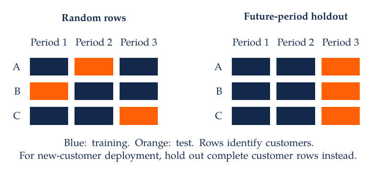
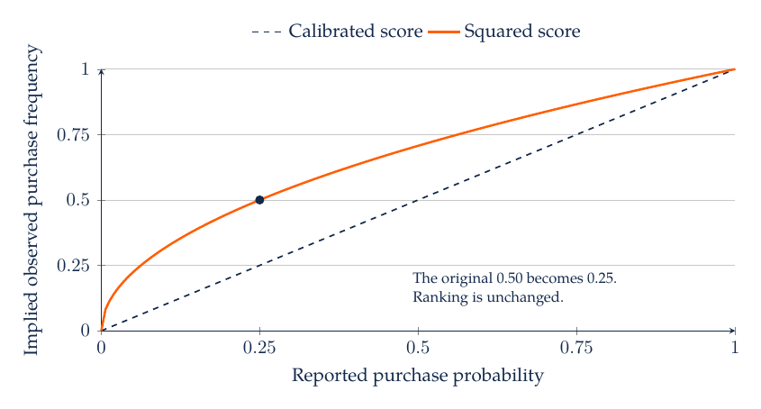
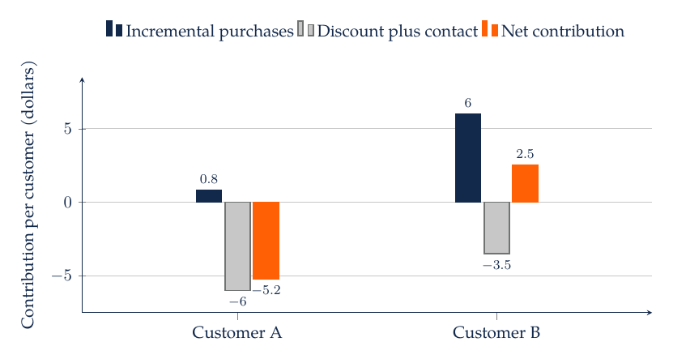
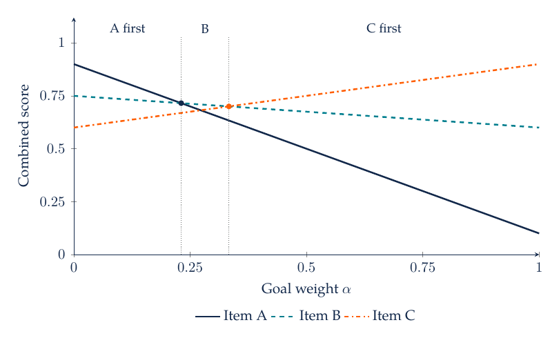
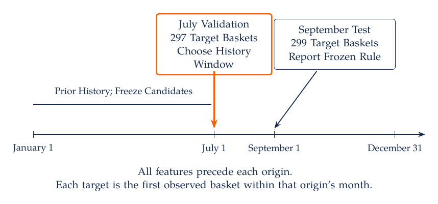
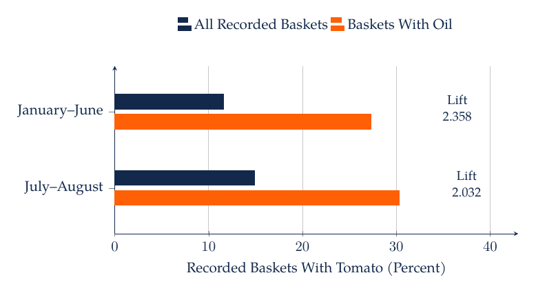

# M7. Prediction, Machine Learning, and Marketing Actions

A retailer wants to anticipate next month's customer purchases and allocate limited service capacity. A model that predicts historical purchases accurately may still fail when deployed: its features may contain future information, its test set may reuse the same customers as training, or its objective may reward errors that are costly for the business. Prediction should therefore be designed around an explicit deployment situation.

## 7.1 Specify the Forecast Origin and Target

A prediction task needs a target variable, a forecast origin, a horizon, and an eligible population. For customer churn, define what counts as churn and when that status becomes observable. In a subscription business, cancellation may be explicit. In noncontractual retail, “no purchase for 90 days” is an operational label, not proof that a relationship has ended permanently.

Construct predictors using information available at the forecast origin. If predicting purchases during November, features might use transactions through October 31. November support contacts, returns, or campaign interactions are unavailable at that origin. A database may contain them when the analyst extracts the file, making leakage easy to overlook. Store feature timestamps or document their measurement windows.

The deployment population determines the validation design. Predicting future behavior for existing customers differs from predicting behavior for newly acquired customers. A random row split can place the same customer in training and test data, giving a favorable assessment for a task that actually requires generalization to new customers. A time split addresses future periods, while a customer-group split addresses new customers. Some tasks require both.



A random row split can reuse a customer's history in training and test data. Holding out complete customers evaluates generalization to new customers; holding out later periods evaluates future performance. The intended use determines which comparison is relevant.

## 7.2 Baselines, Loss Functions, and Regularization

A baseline should be operationally meaningful. For sales forecasting, compare with the previous period, the same period last year, or a simple customer-history average when those quantities are available. For classification, compare with a constant probability and a transparent logistic regression. A complex model's incremental value is easier to assess when these comparisons are reported on the same test observations.

A supervised learner minimizes a loss that quantifies prediction error. Squared error penalizes large deviations strongly; absolute error gives a different compromise under skewness. For a binary outcome, log loss is

$$
L=-\frac{1}{n}\sum_{i=1}^n\{y_i\log\hat p_i+(1-y_i)\log(1-\hat p_i)\}.
$$

Here $y_i$ is the observed binary outcome and $\hat p_i$ is its predicted probability. Confident mistakes receive large penalties. The loss evaluates probability forecasts; it does not by itself encode the cost of a marketing action. Select a loss appropriate to the prediction task, then evaluate how the forecasts support the downstream decision.

Regularization constrains a flexible model to reduce overfitting. Ridge regression adds a squared-coefficient penalty, while lasso adds an absolute-coefficient penalty and can set some coefficients to zero. Standardize features appropriately when the penalty depends on coefficient scale, and fit that transformation using training data. The regularization strength is a tuning choice selected with validation data, not with the final test sample.

Bias and variance describe an important tradeoff. A rigid model may systematically miss a pattern; a very flexible model may fit noise specific to the training sample. More data can help, but only if it represents the deployment problem and adds relevant information. A million duplicated or highly dependent rows can provide less useful information than their count suggests.

## 7.3 Logistic Regression, Trees, and Ensembles

Logistic regression maps a linear index to a probability:

$$
\hat p_i=\frac{1}{1+\exp[-(\beta_0+x_i^\top\beta)]}.
$$

The coefficients describe changes in log odds under the model. A coefficient's effect on probability depends on the starting probability and other predictors. Predicted probabilities are often easier to communicate than odds ratios, especially when the business decision uses expected counts or contribution. Nonlinear features and interactions can extend the model while preserving a relatively transparent structure.

A decision tree partitions the feature space into regions using sequential splits. It can represent interactions without specifying them manually: a spending threshold might matter only among recent customers. Deep trees can fit small idiosyncratic groups, making pruning, minimum leaf sizes, and validation important. A split point near an observed value should not automatically be interpreted as a behavioral threshold.

Random forests average trees fitted with randomness in observations and candidate features, reducing instability relative to a single tree in many settings. Gradient boosting builds an ensemble sequentially to improve a chosen loss, with tuning choices such as tree depth, learning rate, and number of iterations. These methods can be effective on tabular data, but performance remains empirical. More complexity also increases the burden of checking leakage, calibration, computation, and reproducibility.

Neural networks learn layered representations and can be especially useful for text, images, or large complex datasets. Their flexibility does not eliminate the need for baselines or careful evaluation. In a modest customer table, a well-tuned simpler model may be competitive and easier to maintain. Choose the method based on task performance and practical constraints rather than the apparent modernity of the algorithm.

## 7.4 Validation, Cross-Validation, and Leakage

Use training data to fit parameters, validation data or cross-validation to select models and tuning choices, and a final test sample to estimate performance after those choices are fixed. Reusing the test sample repeatedly turns it into a validation sample, even if the file is still named “test.” Report the procedure so the claimed holdout remains meaningful.

All learned preprocessing belongs inside the training process. This includes imputation, scaling, feature selection, vocabulary construction, dimensionality reduction, and target-based encodings. In cross-validation, fit each transformation on the training fold and apply it to that fold's validation observations. A pipeline makes the sequence explicit. The [scikit-learn pitfalls guide](https://scikit-learn.org/stable/common_pitfalls.html) documents implementation patterns for this separation.

Time-series and grouped data need adapted splits. Rolling-origin evaluation trains on earlier periods and predicts later ones, potentially repeating this across several origins. Grouped validation holds out complete customers, households, stores, or other relevant units. If a target window overlaps a training outcome window, a temporal gap may be necessary. Document the dates and units assigned to each split.

A useful audit asks when each feature became observable. In a marketing-call dataset, call duration can be useful after a call but unavailable when deciding whom to call. A model using that feature answers a different prediction problem. The feature's legitimacy follows the decision time, not whether a package accepts it or whether it improves accuracy.

## 7.5 Case Study: Accuracy Can Conceal a Useless Model

Suppose 5% of 1,000 customers make a purchase in the target window. A model predicting no purchase for everyone achieves 95% accuracy while identifying no purchasers. A different model flags 100 customers, including 30 purchasers and 70 nonpurchasers. It has 30 true positives, 20 false negatives, 70 false positives, and 880 true negatives.

The second model's precision is 30%, recall is 60%, and accuracy is 91%. Its lower accuracy coexists with a potentially useful ranking for a limited-capacity task. Whether it improves profit depends on the action, costs, and whether the purchase probabilities under that action are the relevant quantities. Accuracy alone cannot make that decision.

ROC curves compare true-positive and false-positive rates across thresholds. Precision-recall curves focus on the tradeoff between finding positives and the composition of the flagged group, which can be informative when positives are rare. Both depend on the evaluation setting; precision is especially sensitive to prevalence. Lift at a specified contact fraction compares the selected group's outcome rate with the population rate, but observed lift is not automatically an incremental treatment effect.

Report metrics with their operational units. For a service team that can review only 100 cases per week, precision among the top 100 and the number of important cases missed may be more relevant than a global ranking metric. Use a holdout that reflects the weekly population and inspect uncertainty in the metric when counts are small.

## 7.6 Ranking and Calibration Answer Different Questions

A ranking model orders cases from more likely to less likely. A calibrated probability model assigns probabilities that correspond to observed frequencies in relevant groups. If customers assigned probability 0.20 purchase about 20% of the time in a suitable evaluation population, that group is calibrated. Calibration can vary across segments and over time even when overall performance looks satisfactory.

A strictly increasing transformation of scores preserves their ranking. Squaring probabilities between zero and one therefore leaves a ranking-based AUC unchanged, apart from practical handling of ties or finite precision, while generally changing calibration. A predicted probability of 0.50 becomes 0.25. If the original 0.50 group purchases half the time, the transformed probabilities understate its frequency.



For calibrated forecasts, predicted probabilities equal observed frequencies. After squaring an initially calibrated score $p$, the reported probability is $q=p^2$, while the observed frequency remains $p=\sqrt{q}$. Expected counts and profit calculations depend on the probability scale, so unchanged ranking performance does not guarantee unchanged decision quality.

Inspect calibration plots and proper scoring rules, such as log loss or the Brier score, on held-out data. Calibration methods themselves require fitting and should use data separate from the final evaluation. If the deployment population changes, recalibration may be necessary. A single global correction may be insufficient when the relationship changes differently across groups.

## 7.7 Thresholds Should Reflect the Decision

Consider a classification action in which a false positive costs $C_{FP}$ and a false negative costs $C_{FN}$, with zero cost for correct classifications. For a calibrated probability $p$, predicting positive has expected cost $C_{FP}(1-p)$ and predicting negative has expected cost $C_{FN}p$. The cost-minimizing rule predicts positive when

$$
p>\frac{C_{FP}}{C_{FP}+C_{FN}}.
$$

If an unnecessary review costs one unit and missing a true issue costs nine units, the threshold is 0.10 under this simplified loss. A threshold of 0.50 would encode a different cost balance. Capacity constraints, review effectiveness, and heterogeneous costs require a more detailed rule. The formula is useful because it makes the decision assumptions explicit.

A marketing intervention usually needs a causal comparison beyond this classification loss. For a coupon, let $p_i(1)$ and $p_i(0)$ be purchase probabilities with and without the coupon, $m$ the contribution before the discount, $d$ the discount paid on a treated purchase, and $c$ the contact cost. A simple incremental expected contribution is

$$
\Delta\pi_i=m\{p_i(1)-p_i(0)\}-d\,p_i(1)-c.
$$

The discount is paid on all treated purchases in this setup, including purchases that would have happened anyway. The equation assumes one relevant purchase opportunity and a fixed discount and contribution. It can be extended to spending, multiple purchases, returns, and heterogeneous margins.

## 7.8 Case Study: Targeting the Most Responsive Customers Can Lose Money

Take $m=40$, $d=5$, and $c=2$. Customer A has purchase probabilities 0.80 with the coupon and 0.78 without it. Customer B has probabilities 0.30 and 0.15. A has the higher treated response probability, but incremental contribution is $-5.20 for A and $2.50 for B.

| Customer | Purchase With Coupon | Purchase Without Coupon | Incremental Contribution |
| --- | ---: | ---: | ---: |
| A | 0.80 | 0.78 | -$5.20 |
| B | 0.30 | 0.15 | $2.50 |



Incremental purchasing contributes $0.80 for A and $6.00 for B, while discount and contact costs are $6.00 and $3.50, respectively. These values follow from the assumed purchase probabilities. Estimating their difference from customer data requires treatment variation and an identification strategy. Uplift or heterogeneous-treatment-effect models address that causal target under their conditions; they are not ordinary response models with a different name.

Evaluate a targeting policy on data that support its value comparison. A randomized holdout or a carefully designed policy evaluation can estimate incremental contribution for the selected group. Estimating a model and reporting its value on the same observations used to choose the policy can overstate performance. Budget constraints also matter: a customer with positive expected value may still be excluded when another customer offers greater value per unit of scarce capacity.

## 7.9 Interpretation, Fairness, and Deployment

Feature importance describes a relationship between a fitted model and its inputs under a chosen method. Permutation importance measures the change in predictive performance after disrupting a feature, with complications when predictors are correlated. Partial-dependence plots average predictions over a reference distribution and can involve unrealistic combinations of correlated features. Local explanation methods describe the fitted prediction under their conventions. These tools do not automatically identify causal effects of changing a feature.

Evaluate performance across groups relevant to the application and examine how errors translate into service or opportunity. A model can be accurate on average while performing poorly for new customers, small stores, or a language group with sparse training data. Protected or sensitive attributes and proxies require appropriate institutional and legal review for the intended use. The consequences of errors depend on the decision and the affected customers.

Deployment requires monitoring the input distribution, missingness, outcome frequency, calibration, and decision value. A change in model accuracy can reflect changing customer behavior, instrumentation, or policy. Record versions and retain a reproducible baseline. If an intervention changes the behavior that generates future training data, the model's environment becomes endogenous to its use, because its recommendations change subsequent exposure and behavior.

## 7.10 Recommendation Models and the Candidate Set

A recommendation decision chooses a small set of products for a particular customer at a particular time. Candidate generation first identifies eligible items, scoring predicts their relevance, and ranking selects their order. A final adjustment may impose stock availability, repetition limits, category variety, or a customer-stated goal. An accurate score cannot recover a useful product that candidate generation has already excluded. Evaluation should therefore record both the eligible set and the final list.

Content-based models use item attributes and the customer's history. A grocery system might represent foods by ingredients, category, price, or an embedding of their descriptions. Collaborative models instead use patterns across customer-item interactions. Matrix factorization represents a customer and an item with short vectors and scores their compatibility through an inner product:

$$
\hat r_{uj}=\mu+b_u+b_j+p_u^\top q_j.
$$

Here $u$ indexes a customer, $j$ an item, $\mu$ is an overall level, $b_u$ and $b_j$ are customer and item offsets, and the vectors $p_u$ and $q_j$ summarize interaction patterns in a common latent space. The score's units depend on the fitted target. With squared-error training on star ratings, it approximates rating units. A ranking score fitted to implicit interactions has no automatic probability interpretation. Popularity offsets capture broad appeal, while the inner product permits customers with different histories to prefer different products.

Ratings are explicit feedback. Clicks, views, and purchases are implicit feedback whose meaning depends on exposure and opportunity. A missing interaction is not a verified rejection. Treating every missing customer-item pair as a negative can encode the previous recommender's display policy. Negative sampling changes the training distribution, so the sampling rule and any probability correction belong in the analysis. Logging impressions and eligible alternatives makes these distinctions more tractable.

New customers and new products create a cold-start problem. Content features, initial preference questions, and popularity baselines can provide information before interaction histories become informative. A hybrid model combines these sources. Sequential models additionally condition on the order of past events, allowing a recent purchase to change what is useful next. The validation sample must preserve that order and exclude later purchases, ratings, and catalog information from the forecast origin.

## 7.11 Ranking Metrics Depend on Position and Available Labels

Precision at $K$ is the fraction of the first $K$ recommendations labeled relevant. Recall at $K$ is the fraction of all labeled relevant items retrieved in that list. Hit rate records whether at least one relevant item appears. These metrics use different denominators and can disagree. A hit rate of one can coexist with low precision when a long list contains one relevant item.

Normalized discounted cumulative gain gives greater weight to relevant items near the top. For nonnegative relevance labels $r_1,\ldots,r_K$, one convention is

$$
\mathrm{DCG}@K=\sum_{k=1}^{K}\frac{2^{r_k}-1}{\log_2(k+1)},
\qquad
\mathrm{NDCG}@K=\frac{\mathrm{DCG}@K}{\mathrm{IDCG}@K}.
$$

The position discount reflects the greater value assigned to placing useful items earlier. The ideal DCG uses the best ordering of the labeled eligible items at the same cutoff. Report the gain convention and the treatment of customers with no relevant labels, for whom this ratio has a zero denominator. Averaging only over customers with positive labels changes the evaluation population.

Consider a synthetic three-item candidate set in which A is irrelevant and B and C are relevant. The lists A, B, C and B, C, A both have precision $2/3$ and recall one. The first list has DCG $1/\log_2(3)+1/\log_2(4)\approx1.131$. The second has DCG $1+1/\log_2(3)\approx1.631$, which is also the ideal value. Their NDCG values are approximately 0.693 and 1.000. The same number of relevant items can produce different ranking quality because their positions differ.

Historical labels describe items observed under earlier exposure and consumption decisions. High NDCG on those labels can coexist with poor discovery of items rarely displayed. Evaluate a common candidate set, retain customer and time boundaries, compare with a popularity baseline, and report performance for customers and products with little history. The policy-value calculation in M6, Section 6.7, addresses selected exposure under different assumptions from an ordinary held-out ranking calculation. Neither calculation alone establishes customer satisfaction or the value of changing the deployed system.

## 7.12 Case Study: Food Recommendations, Variety, and Customer Goals

A food app can predict what a customer usually eats while learning little about what would help that customer pursue a stated goal. The distinction changes the training sample, the model inputs, and the relevant evaluation outcome. [Ling, Nie, Nielsen, Knäuper, Yang, and Dubé (2022)](https://doi.org/10.1145/3485447.3514193) develop a recommendation system using daily food histories and information about calories and body-mass-index groups. Their 2016 app sample restricts users to ages 18–65 with substantial logging histories and removes sparse daily records. Table 2 reports 7,457 users in the resulting model sample.

The model represents both the foods within a day and the sequence of days. Separate models learn from general histories, particular body-mass-index groups, and periods associated with the relevant weight outcome. Their predictions can be combined. The last basket supplies the test observation, the preceding basket supplies validation, and earlier baskets supply training. This design evaluates whether the model predicts foods eaten during periods associated with the intended outcome. It does not randomize customers to receive the recommendations, so the reported ranking improvements do not identify a causal effect on weight.

Selecting successful periods can help define a target pattern while also selecting motivation, physical activity, reporting behavior, or other determinants of the outcome. A customer who follows a similar food pattern may differ on those other dimensions. For deployment, the goal and all required inputs must be available when recommendations are made. A later realized weight outcome can define a retrospective evaluation stratum; it cannot serve as a known input for a new customer unless supplied as an explicit scenario rather than an observed future fact.

[Nielsen, Yang, Dubé, Knäuper, Ling, and Nie (2022)](https://doi.org/10.1086/720453) examine variety in food logs and develop FOODVAR. Their empirical analysis relates daily variety to subsequent changes in calories and the composition of food consumption. Variety measures include item counts and a reverse-coded concentration index based on calorie shares. Two days with the same item count can therefore differ in variety if one is dominated by a single food. The reported relationships are conditional associations, and the denominators and sample restrictions differ across the total-calorie, vegetable, and snack analyses.

FOODVAR incorporates a variety-change indicator into sequential food recommendation. Its evaluation uses 30 days of history, seven subsequent validation days, and a final test day, with the indicator representing the intended variety direction. Table 5 compares hit-rate and NDCG measures against the baseline across weight-outcome groups. The results establish predictive differences within that evaluation design. A prospective test would elicit the variety goal before displaying recommendations and measure subsequent behavior. The synthetic category-bonus example in M8, Section 8.2, is a simpler list-selection exercise with a different algorithm.

### 7.12.1 A Goal Weight Can Change the Preferred Item Abruptly

Suppose three products have preference scores and goal-compatibility scores on a common illustrative scale. A scores $(0.90,0.10)$, B scores $(0.75,0.60)$, and C scores $(0.60,0.90)$. The scores are imposed inputs, not estimated purchase probabilities or health effects. A weighted ranking rule is

$$
s_j(\alpha)=(1-\alpha)p_j+\alpha g_j,\qquad 0\leq\alpha\leq1,
$$

where $p_j$ measures preference compatibility, $g_j$ measures compatibility with the stated goal, and $\alpha$ determines their relative importance. At $\alpha=0$, A ranks first. At $\alpha=0.25$, the scores are 0.700, 0.7125, and 0.675, so B ranks first. At $\alpha=0.50$, C ranks first with 0.750. Solving the pairwise score equalities gives the optimal switches at $\alpha=3/13$ and $\alpha=1/3$.



Every score changes continuously, yet the chosen item changes discretely. A small adjustment near a crossing can therefore replace the displayed recommendation. B is the preferred compromise only over a narrow weight interval. A useful audit varies the weight and inspects which customers experience large changes in their lists. The chosen scales and weights define the tradeoff; combining scores does not itself establish that a goal will be achieved.

## 7.13 LLM Explanations Need Factual and Behavioral Evaluation

A shopping assistant may generate a persuasive reason for recommending a product after the product has already been selected. That text can be useful, but its fluency does not establish that it describes the ranking model's actual reason. Three questions remain distinct: whether the explanation contains correct product facts, whether it corresponds to the system's decision process, and whether it helps the customer make a satisfactory choice.

[Wang, Li, and Chen's RecPIE study](https://arxiv.org/abs/2502.16759v3), in its May 2026 version, jointly trains recommendation prediction and natural-language explanation. Prediction performance informs explanation generation, and explanation representations feed into subsequent predictions. The empirical setting includes Google Maps point-of-interest recommendations and a separate human assessment of explanations. Reported improvements in ranking and explanation preference concern those evaluations. They do not by themselves estimate the effect of deploying the system on purchases, retention, or customer welfare.

[Qin, Huang, Deng, Lei, and Chua (2024)](https://aclanthology.org/2024.findings-emnlp.247/) study credibility in conversational recommendation. Their PC-CRS approach uses credibility-aware persuasive strategies and subsequent revision of explanations. The comparison motivates separate evaluation of persuasive success and support for factual claims. An assistant can increase acceptance by asserting an appealing attribute that the product does not possess. Acceptance alone would reward that error.

Consider a synthetic catalog with prices, delivery times, and verified product attributes. A customer asks for delivery within two days at a price below $30. First enforce those eligibility constraints using the catalog. Then rank eligible products and generate explanations that refer to specific supported attributes. “Arrives tomorrow” is unsupported when the recorded delivery window is three to five days, even if the rest of the explanation is relevant. “You value quiet operation” is unsupported when the customer has expressed no such preference and no permitted history supplies it.

An audit should inspect factual support, constraint violations, ranking performance, and customer outcomes separately. Remove or alter a cited attribute and examine whether the explanation and ranking change as claimed; this provides a behavioral diagnostic of correspondence, with scope limited to the perturbations tested. Hold out customers, products, or time periods according to deployment. Keep the catalog version and the evidence used for each explanation so the claim can be checked after product information changes.

## 7.14 AI-Assisted Workflow, Practice, and Readings

Ask an assistant to create an evaluation plan before choosing a model. Specify forecast origin, horizon, unit, grouping, baseline, loss, and final holdout. Require a feature-availability table and a pipeline that fits transformations only on training data. Have it produce both a metric table and an explanation of the operational decision each metric supports.

For practice, verify the 91% accuracy and 60% recall in the rare-purchase example. Square a small set of predicted probabilities and confirm that their order is unchanged while expected purchase counts change. Recalculate the coupon case with a $1 discount and explain which customer becomes more attractive. Finally, identify why a model trained on all customers' latest outcomes cannot honestly claim to predict those same outcomes out of sample.

For a recommender exercise, have an assistant build a popularity baseline, a simple content score, and the stated goal-weight rule on synthetic items. Require a chronological split, a documented candidate set, and a report of excluded or unavailable products. Verify the two NDCG calculations by hand, then enumerate the goal-weight switches independently. Ask why an unseen item was labeled irrelevant and require the code to distinguish an observed rejection from absent exposure. A working implementation of the simple score is not a replication of FOODVAR, HHFR, or RecPIE.

For an explanation exercise, give the assistant a small catalog and a customer's explicit constraints. Request a recommendation with an attribute-level source for each factual claim. Include one unavailable attribute and one product that violates a constraint. Check whether the system acknowledges missing information and excludes the ineligible product. Score factual support separately from how persuasive the explanation sounds.

[An Introduction to Statistical Learning](https://www.statlearning.com/) develops the central learning methods. The [scikit-learn evaluation guide](https://scikit-learn.org/stable/modules/model_evaluation.html) provides metric definitions and implementation references. [Hagen and colleagues (2020)](https://doi.org/10.1007/s11002-020-09535-7) connect machine-learning tools to behavioral marketing questions.

## 7.15 mHealth: Predicting a Returning User's Next Basket

The manager needs a recommendation baseline that uses only information available when suggestions are chosen. Global category popularity is easy to implement. A personal frequency rule can exploit repeated food choices without estimating a complex model. The comparison should preserve complete baskets and evaluate both rules on the same users, candidate set, and future outcomes.

A basket is the set of distinct source categories recorded by a user on a day; missing category labels are excluded. Freeze the candidate set at the 312 categories observed before July 1. For each forecast origin, require at least 30 prior observed basket days and select the first observed basket during the following month as the target. Validation starts July 1 and testing starts September 1. Every score uses dates strictly before its forecast origin. The test concerns returning users who subsequently log a basket, conditional on that observation; it does not evaluate people who never return.

Personal frequency is the fraction of a user's observed days in a specified history window containing a category. It does not divide by all calendar days. A tiny popularity term resolves most frequency ties; exact remaining ties use alphabetical order. If a user has no observed day in a short window, personal frequencies are zero and the popularity term supplies the order. Global popularity uses the corresponding fraction across all prior observed user-days. Scores produce a list of ten distinct categories.

Choose among 30-day, 90-day, and all-prior-history windows using July mean NDCG at ten. Their validation scores are 0.5666, 0.5661, and 0.5501, respectively, among 297 evaluated users. The 30-day rule wins by a very small margin over 90 days. The code preserves the specified tie order and carries the chosen window to September. A further claim that 30 days is generally superior would need repeated or independent validation.

| September Rule | Evaluated Users | Recall at 10 | NDCG at 10 |
| --- | ---: | ---: | ---: |
| Global Popularity | 299 | 0.2799 | 0.3270 |
| Personal 30-Day Frequency | 299 | 0.4759 | 0.5862 |



There are 362 eligible users at the September origin, but only 299 have a target basket in that month. Reporting both counts exposes the conditioning introduced by the target definition. All observed target categories in this evaluation are covered by the frozen candidate set. The implementation nevertheless retains all target categories in the recall denominator and ideal DCG, so an unsupported category would count against performance.

The personal rule recovers more recorded categories than the popularity baseline. This supports personalization for predicting the observed basket under the historical environment. It does not show that displaying those suggestions changes choices, improves nutrition, or generates incremental app value. Logging may omit foods, and the basket can occur several days after the fixed origin. A same-day or event-time recommender would need a corresponding evaluation design.

### 7.15.1 Histories, Candidate Sets, and Ranking Metrics

`ranking.py` defines the common evaluation so that M8 changes the ranking objective while holding the target baskets fixed. Recall divides the number of recovered categories by the target basket size. NDCG discounts relevant categories by position and divides by the best possible ranking for that target. Each evaluated user contributes one metric value, and the final result averages users equally.

Python source: [ranking.py](../../03_Data_and_Code/mHealth/recurring_examples/ranking.py). From its directory, run `python ranking.py`.

```python
"""Whole-basket chronological evaluation with a frozen category universe."""

import numpy as np
import pandas as pd


def candidate_categories(baskets):
    prior = baskets.loc[baskets.date.lt("2016-07-01")]
    return sorted({category for basket in prior.basket for category in basket})


def evaluation_cases(baskets, cutoff, candidates):
    cutoff = pd.Timestamp(cutoff)
    prior = baskets.loc[baskets.date.lt(cutoff)]
    counts = prior.groupby("Userid").size()
    eligible = counts[counts >= 30].index
    end = cutoff + pd.offsets.MonthBegin(1)
    target = baskets.loc[baskets.date.ge(cutoff) & baskets.date.lt(end)]
    target = target.loc[target.Userid.isin(eligible)].sort_values(["Userid", "date"])
    target = target.drop_duplicates("Userid")
    histories = dict(tuple(prior.groupby("Userid")))
    assert prior.date.max() < cutoff
    global_counts = (
        prior.basket.explode().value_counts().reindex(candidates, fill_value=0)
    )
    popularity = global_counts.to_numpy(dtype=float) / len(prior)
    cases = [(histories[row.Userid], set(row.basket)) for row in target.itertuples()]
    return cases, popularity, len(eligible)


def personal_frequency(history, cutoff, candidates, window):
    if window is not None:
        start = pd.Timestamp(cutoff) - pd.Timedelta(days=window)
        history = history.loc[history.date.ge(start)]
    counts = history.basket.explode().value_counts().reindex(candidates, fill_value=0)
    return counts.to_numpy(dtype=float) / max(1, len(history))


def rank_categories(scores, candidates, k=10):
    # Stable sorting resolves exact score ties using alphabetically sorted candidates.
    positions = np.argsort(-scores, kind="stable")[:k]
    return [candidates[index] for index in positions]


def ranking_metrics(ranking, target):
    relevance = np.array([category in target for category in ranking], dtype=float)
    discounts = 1 / np.log2(np.arange(2, len(ranking) + 2))
    ideal = discounts[: min(len(target), len(ranking))].sum()
    return float(relevance.sum() / len(target)), float(
        (relevance * discounts).sum() / ideal
    )


def evaluate(
    baskets, cutoff, candidates, window=None, popularity_only=False, novelty_weight=0
):
    cases, popularity, eligible = evaluation_cases(baskets, cutoff, candidates)
    rows = []
    for history, target in cases:
        frequency = personal_frequency(history, cutoff, candidates, window)
        recent = personal_frequency(history, cutoff, candidates, 30)
        unseen = recent == 0
        scores = popularity if popularity_only else frequency + 1e-6 * popularity
        ranking = rank_categories(scores + novelty_weight * unseen, candidates)
        recall, ndcg = ranking_metrics(ranking, target)
        recent_set = {candidates[j] for j in np.flatnonzero(recent)}
        novelty = sum(category not in recent_set for category in ranking) / len(ranking)
        coverage = len(target & set(candidates)) / len(target)
        rows.append([recall, ndcg, novelty, coverage])
    means = np.mean(rows, axis=0)
    return {
        "eligible_users": eligible,
        "evaluated_users": len(cases),
        "recall_at_10": float(means[0]),
        "ndcg_at_10": float(means[1]),
        "novelty_at_10": float(means[2]),
        "target_candidate_coverage": float(means[3]),
    }
```

### 7.15.2 Validation Before Testing

The execution order matters. Fit the history-window choice using July, freeze it, and report September performance without changing the rule after seeing the test. The small metric counterexample confirms that placing both relevant categories first yields NDCG of one, while placing an irrelevant category first lowers it. A separate test supplies a category that occurs only in the future and verifies that it never enters personal history.

Python source: [m07.py](../../03_Data_and_Code/mHealth/recurring_examples/m07.py). From its directory, run `python m07.py`.

```python
"""Choose history length in July and evaluate the frozen rule in September."""

import json
from common import load_inputs, save_result
from ranking import candidate_categories, evaluate, ranking_metrics

food, daily, baskets = load_inputs()
candidates = candidate_categories(baskets)
windows = {"30_days": 30, "90_days": 90, "all_prior_days": None}
validation = {
    name: evaluate(baskets, "2016-07-01", candidates, window)
    for name, window in windows.items()
}
# Ties retain the first listed specification; September plays no role in selection.
chosen = max(validation, key=lambda name: validation[name]["ndcg_at_10"])
test = {
    "popularity": evaluate(baskets, "2016-09-01", candidates, popularity_only=True),
    "personal_frequency": evaluate(baskets, "2016-09-01", candidates, windows[chosen]),
}
assert ranking_metrics(["B", "C", "A"], {"B", "C"}) == (1.0, 1.0)
assert ranking_metrics(["A", "B", "C"], {"B", "C"})[1] < 1
result = {
    "candidate_categories": len(candidates),
    "validation": validation,
    "chosen_window": chosen,
    "test": test,
}
save_result("M07", result)
print(json.dumps(result, indent=2))
```

## 7.16 Python Calculations for the Synthetic Cases

The inputs below are imposed teaching values. Running the program creates the labeled synthetic CSV files and prints the corresponding calculations. They are separate from the mHealth estimates. Keep the script beside `example_helpers.py` in `03_Data_and_Code/Lecture_Examples`.

Python source: [m07_synthetic.py](../../03_Data_and_Code/Lecture_Examples/m07_synthetic.py). From its directory, run `python m07_synthetic.py`.

```python
"""Synthetic numerical examples for M7; run from any working directory."""

import itertools
import json
import math
from example_helpers import write_csv, ols_slope, shares

r = {}
r["M07"] = {
    "precision": 30 / 100,
    "recall": 30 / 50,
    "accuracy": (30 + 880) / 1000,
    "all_negative_accuracy": 950 / 1000,
    "cost_threshold": 1 / (1 + 9),
    "coupon_A": 40 * (0.8 - 0.78) - 5 * 0.8 - 2,
    "coupon_B": 40 * (0.3 - 0.15) - 5 * 0.3 - 2,
}
write_csv(
    "M07_coupon_synthetic.csv",
    [
        "customer",
        "purchase_with_coupon",
        "purchase_without_coupon",
        "margin_dollars",
        "discount_dollars",
        "contact_cost_dollars",
    ],
    [("A", 0.8, 0.78, 40, 5, 2), ("B", 0.3, 0.15, 40, 5, 2)],
)

rankings = {
    "ABC": [("A", 0), ("B", 1), ("C", 1)],
    "BCA": [("B", 1), ("C", 1), ("A", 0)],
}


def dcg(labels):
    return sum(
        (2**label - 1) / math.log2(rank + 1)
        for rank, label in enumerate(labels, start=1)
    )


ideal = dcg([1, 1, 0])
r["M07"]["rankings"] = {
    name: {
        "precision_at_3": sum(v for _, v in vals) / 3,
        "recall_at_3": sum(v for _, v in vals) / 2,
        "dcg_at_3": dcg([v for _, v in vals]),
        "ndcg_at_3": dcg([v for _, v in vals]) / ideal,
    }
    for name, vals in rankings.items()
}
write_csv(
    "M07_rankings_synthetic.csv",
    ["ranking", "position", "item", "binary_relevance"],
    [
        (name, pos, item, rel)
        for name, vals in rankings.items()
        for pos, (item, rel) in enumerate(vals, start=1)
    ],
)
assert math.isclose(r["M07"]["rankings"]["BCA"]["ndcg_at_3"], 1)
assert 0.693 < r["M07"]["rankings"]["ABC"]["ndcg_at_3"] < 0.694

goal_items = {"A": (0.9, 0.1), "B": (0.75, 0.6), "C": (0.6, 0.9)}
goal_score = (
    lambda item, alpha: (1 - alpha) * goal_items[item][0] + alpha * goal_items[item][1]
)
r["M07"]["goal_blend"] = {
    "scores": {
        str(alpha): {item: goal_score(item, alpha) for item in goal_items}
        for alpha in [0, 0.25, 0.5, 1]
    },
    "optimal_switches": [3 / 13, 1 / 3],
}
write_csv(
    "M07_goals_synthetic.csv",
    ["item", "preference_score", "goal_score"],
    [(item, *scores) for item, scores in goal_items.items()],
)
assert math.isclose(goal_score("A", 3 / 13), goal_score("B", 3 / 13))
assert math.isclose(goal_score("B", 1 / 3), goal_score("C", 1 / 3))
for i in range(1001):
    alpha = i / 1000
    expected = "A" if alpha < 3 / 13 else ("B" if alpha < 1 / 3 else "C")
    assert max(goal_items, key=lambda j: goal_score(j, alpha)) == expected
print(json.dumps(r, indent=2))
```

## 7.17 mHealth: Basket Associations and Future Validation

A recommendation manager wants to identify categories that commonly appear together in a recorded day. An association rule can generate candidates for a basket-completion feature. Its commercial value still depends on when a suggestion is shown, whether the customer has already recorded the item, and whether the suggestion changes behavior. A high co-occurrence rate alone does not establish incremental demand.

Treat each observed user-day with at least one classified category as a basket. Deduplicate categories within the day, so repeated servings contribute one presence indicator. For categories $A$ and $B$, define

$$
\operatorname{support}(A,B)=P(A\cap B),\qquad
\operatorname{confidence}(A\to B)=P(B\mid A),\qquad
\operatorname{lift}(A\to B)=\frac{P(B\mid A)}{P(B)}.
$$

Probabilities are empirical fractions of recorded baskets. Confidence is directional, whereas lift is symmetric for a two-category pair. A popular category can have high confidence without an unusually strong association. Lift compares the conditional rate with the marginal rate and therefore supplies the necessary benchmark. The label “confidence” here is a conditional frequency, separate from a statistical confidence interval.

Use January–June data to select the 20 most frequent categories. Among their pairs, require at least 100 joint baskets and 30 distinct supporting users. Rank eligible pairs by training lift and fix the largest before examining July–August. These prespecified restrictions avoid selecting a pair supported by only a few repeated entries, but they do not make users' repeated baskets independent. The training sample has 40,727 baskets from 358 users. The selected pair is oil and tomato, supported jointly by 192 users.

| Metric | January–June | July–August |
| --- | ---: | ---: |
| Recorded Baskets | 40,727 | 12,956 |
| Baskets With Oil | 7,283 | 2,174 |
| Baskets With Tomato | 4,708 | 1,930 |
| Baskets With Both | 1,985 | 658 |
| Tomato Given Oil | 27.26% | 30.27% |
| Marginal Tomato Rate | 11.56% | 14.90% |
| Lift | 2.358 | 2.032 |

The later evaluation includes observed baskets from the previously known users; 334 of them contribute baskets in July–August. Users with no later basket supply no basket-level outcome. In the table, conditional tomato frequency rises while lift falls because tomato also becomes more common overall. Judging only the conditional frequency would miss that change in the comparison benchmark.



A 500-draw bootstrap resamples the 358 training users, carrying each user's complete later basket history into the draw, including zero later baskets. The percentile interval for later lift is [1.762, 2.411]. It describes sampling variation for the already selected pair, with dependence within each user preserved. It does not address common calendar shocks, uncertainty over the category-selection procedure, or the effect of displaying a recommendation. The recorded category names also do not establish nutritional complementarity.

The [mlxtend association-rule guide](https://rasbt.github.io/mlxtend/user_guide/frequent_patterns/association_rules/) defines support, confidence, and lift and provides scalable itemset-mining tools. The code below enumerates pairs from a bounded candidate set so every numerator is inspectable. Its results can be compared with that library after the same basket and candidate definitions are imposed.

The [implicit recommendation examples](https://github.com/benfred/implicit/tree/main/examples) and [Surprise examples](https://github.com/NicolasHug/Surprise/tree/master/examples) address different feedback structures. Food logging supplies observed occurrences; missing entries do not provide explicit dislike ratings. For next-basket prediction, retain the chronological evaluation and known candidate set from Section 7.15. For within-basket completion, the source would additionally need an information rule specifying which recorded categories are visible when a suggestion is made.

Python source: [association_rules.py](../../03_Data_and_Code/mHealth/recurring_examples/association_rules.py). From its directory, run `python association_rules.py`.

```python
"""Select a category pair in January-June; evaluate it in July-August."""

from itertools import combinations
import json
import numpy as np
import pandas as pd
from common import SEED, load_food, make_baskets, save_result


def metrics(n, a, b, both):
    if min(n, a, b) <= 0:
        raise ValueError("Positive basket and marginal counts are required")
    return {
        "baskets": int(n),
        "a_baskets": int(a),
        "b_baskets": int(b),
        "joint_baskets": int(both),
        "support": both / n,
        "confidence_a_to_b": both / a,
        "baseline_b": b / n,
        "lift": both * n / (a * b),
    }


def presence(baskets, categories):
    return np.array(
        [[c in basket for c in categories] for basket in baskets.basket], dtype=np.int64
    )


if __name__ == "__main__":
    baskets = make_baskets(load_food())
    train = baskets.loc[baskets.date < "2016-07-01"]
    frequency = train.explode("basket").groupby("basket").size()
    categories = sorted(
        frequency.sort_values(ascending=False, kind="stable").head(20).index
    )
    matrix = presence(train, categories)
    joint, marginal = matrix.T @ matrix, matrix.sum(axis=0)
    rules = []
    for a, b in combinations(range(len(categories)), 2):
        mask = (matrix[:, a] * matrix[:, b]).astype(bool)
        supporting_users = train.loc[mask, "Userid"].nunique()
        if joint[a, b] >= 100 and supporting_users >= 30:
            rule = metrics(len(train), marginal[a], marginal[b], joint[a, b])
            rules.append(
                {
                    "a": categories[a],
                    "b": categories[b],
                    "supporting_users": int(supporting_users),
                    **rule,
                }
            )
    rules.sort(key=lambda r: (-r["lift"], r["a"], r["b"]))
    selected = rules[0]
    users = sorted(train.Userid.unique())
    future = baskets.loc[
        baskets.Userid.isin(users) & baskets.date.between("2016-07-01", "2016-08-31")
    ].copy()
    binary = presence(future, [selected["a"], selected["b"]])
    future["a"], future["b"] = binary[:, 0], binary[:, 1]
    future["both"], future["n"] = binary.prod(axis=1), 1
    counts = (
        future.groupby("Userid")[["n", "a", "b", "both"]]
        .sum()
        .reindex(users, fill_value=0)
        .to_numpy()
    )
    evaluation = metrics(*counts.sum(axis=0))
    rng = np.random.default_rng(SEED)
    lifts = []
    for _ in range(500):
        total = counts[rng.integers(0, len(users), len(users))].sum(axis=0)
        if min(total[:3]) > 0:
            lifts.append(metrics(*total)["lift"])
    evaluation["user_bootstrap_ci95"] = np.quantile(lifts, [0.025, 0.975]).tolist()
    evaluation["bootstrap_valid_draws"] = len(lifts)
    result = {
        "candidate_categories": len(categories),
        "eligible_pairs": len(rules),
        "training_users": len(users),
        "evaluation_users": int(future.Userid.nunique()),
        "selected_training_pair": selected,
        "july_august": evaluation,
    }
    save_result("association_rules", result)
    print(json.dumps(result, indent=2))
```
