# M7. Prediction, Machine Learning, and Marketing Actions

A retailer wants to anticipate next month's customer purchases and allocate limited service capacity. A model that predicts historical purchases accurately may still fail when deployed: its features may contain future information, its test set may reuse the same customers as training, or its objective may reward errors that are costly for the business. Prediction should therefore be designed around an explicit deployment situation.

## 7.1 Specify the Forecast Origin and Target

A prediction task needs a target variable, a forecast origin, a horizon, and an eligible population. For customer churn, define what counts as churn and when that status becomes observable. In a subscription business, cancellation may be explicit. In noncontractual retail, “no purchase for 90 days” is an operational label, not proof that a relationship has ended permanently.

Construct predictors using information available at the forecast origin. If predicting purchases during November, features might use transactions through October 31. November support contacts, returns, or campaign interactions are unavailable at that origin. A database may contain them when the analyst extracts the file, making leakage easy to overlook. Store feature timestamps or document their measurement windows.

The deployment population determines the validation design. Predicting future behavior for existing customers differs from predicting behavior for newly acquired customers. A random row split can place the same customer in training and test data, giving a favorable assessment for a task that actually requires generalization to new customers. A time split addresses future periods, while a customer-group split addresses new customers. Some tasks require both.

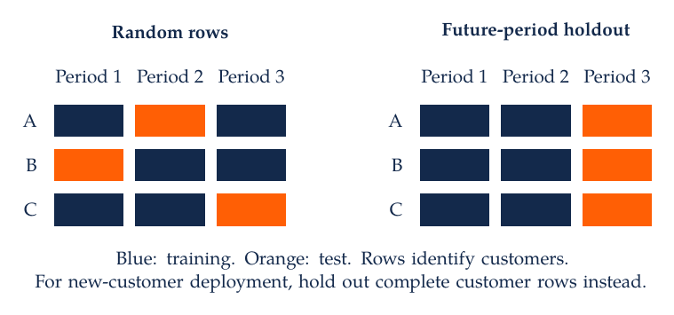

A random row split can reuse a customer's history in training and test data. Holding out complete customers evaluates generalization to new customers; holding out later periods evaluates future performance. The intended use determines which comparison is relevant.

## 7.2 Baselines, Loss Functions, and Regularization

A baseline should be operationally meaningful. For sales forecasting, compare with the previous period, the same period last year, or a simple customer-history average when those quantities are available. For classification, compare with a constant probability and a transparent logistic regression. A complex model's incremental value is easier to assess when these comparisons are reported on the same test observations.

A supervised learner minimizes a loss that quantifies prediction error. Squared error penalizes large deviations strongly; absolute error gives a different compromise under skewness. For a binary outcome, log loss is

$$
L=-\frac{1}{n}\sum_{i=1}^n\{y_i\log\hat p_i+(1-y_i)\log(1-\hat p_i)\}.
$$

Here $y_i$ is the observed binary outcome and $\hat p_i$ is its predicted probability. Confident mistakes receive large penalties. The loss evaluates probability forecasts; it does not by itself encode the cost of a marketing action. Select a loss appropriate to the prediction task, then evaluate how the forecasts support the downstream decision.

Regularization constrains a flexible model to reduce overfitting. Ridge regression adds a squared-coefficient penalty, while lasso adds an absolute-coefficient penalty and can set some coefficients to zero. Standardize features appropriately when the penalty depends on coefficient scale, and fit that transformation using training data. The regularization strength is a tuning choice selected with validation data, not with the final test sample.

Bias and variance describe an important tradeoff. A rigid model may systematically miss a pattern; a very flexible model may fit noise specific to the training sample. More data can help, but only if it represents the deployment problem and adds relevant information. A million duplicated or highly dependent rows can provide less useful information than their count suggests.

## 7.3 Logistic Regression, Trees, and Ensembles

Logistic regression maps a linear index to a probability:

$$
\hat p_i=\frac{1}{1+\exp[-(\beta_0+x_i^\top\beta)]}.
$$

The coefficients describe changes in log odds under the model. A coefficient's effect on probability depends on the starting probability and other predictors. Predicted probabilities are often easier to communicate than odds ratios, especially when the business decision uses expected counts or contribution. Nonlinear features and interactions can extend the model while preserving a relatively transparent structure.

A decision tree partitions the feature space into regions using sequential splits. It can represent interactions without specifying them manually: a spending threshold might matter only among recent customers. Deep trees can fit small idiosyncratic groups, making pruning, minimum leaf sizes, and validation important. A split point near an observed value should not automatically be interpreted as a behavioral threshold.

Random forests average trees fitted with randomness in observations and candidate features, reducing instability relative to a single tree in many settings. Gradient boosting builds an ensemble sequentially to improve a chosen loss, with tuning choices such as tree depth, learning rate, and number of iterations. These methods can be effective on tabular data, but performance remains empirical. More complexity also increases the burden of checking leakage, calibration, computation, and reproducibility.

Neural networks learn layered representations and can be especially useful for text, images, or large complex datasets. Their flexibility does not eliminate the need for baselines or careful evaluation. In a modest customer table, a well-tuned simpler model may be competitive and easier to maintain. Compare methods using task performance, maintenance costs, and the operational constraints of deployment.

## 7.4 Validation, Cross-Validation, and Leakage

Use training data to fit parameters, validation data or cross-validation to select models and tuning choices, and a final test sample to estimate performance after those choices are fixed. Reusing the test sample repeatedly turns it into a validation sample, even if the file is still named “test.” Report the procedure so the claimed holdout remains meaningful.

All learned preprocessing belongs inside the training process. This includes imputation, scaling, feature selection, vocabulary construction, dimensionality reduction, and target-based encodings. In cross-validation, fit each transformation on the training fold and apply it to that fold's validation observations. A pipeline makes the sequence explicit. The [scikit-learn pitfalls guide](https://scikit-learn.org/stable/common_pitfalls.html) documents implementation patterns for this separation.

Time-series and grouped data need adapted splits. Rolling-origin evaluation trains on earlier periods and predicts later ones, potentially repeating this across several origins. Grouped validation holds out complete customers, households, stores, or other relevant units. If a target window overlaps a training outcome window, a temporal gap may be necessary. Document the dates and units assigned to each split.

A useful assessment asks when each feature became observable. In a marketing-call dataset, call duration can be useful after a call but unavailable when deciding whom to call. A model using that feature answers a different prediction problem. The feature's legitimacy follows the decision time, not whether a package accepts it or whether it improves accuracy.

## 7.5 Case Study: Accuracy Can Conceal a Useless Model

Suppose 5% of 1,000 customers make a purchase in the target window. A model predicting no purchase for everyone achieves 95% accuracy while identifying no purchasers. A different model flags 100 customers, including 30 purchasers and 70 nonpurchasers. It has 30 true positives, 20 false negatives, 70 false positives, and 880 true negatives.

The second model's precision is 30%, recall is 60%, and accuracy is 91%. Its lower accuracy coexists with a potentially useful ranking for a limited-capacity task. Whether it improves profit depends on the action, costs, and whether the purchase probabilities under that action are the relevant quantities. Accuracy alone cannot make that decision.

ROC curves compare true-positive and false-positive rates across thresholds. Precision-recall curves focus on the tradeoff between finding positives and the composition of the flagged group, which can be informative when positives are rare. Both depend on the evaluation setting; precision is especially sensitive to prevalence. Lift at a specified contact fraction compares the selected group's outcome rate with the population rate, but observed lift is not automatically an incremental treatment effect.

Report metrics with their operational units. For a service team that can review only 100 cases per week, precision among the top 100 and the number of important cases missed may be more relevant than a global ranking metric. Use a holdout that reflects the weekly population and inspect uncertainty in the metric when counts are small.

## 7.6 Ranking and Calibration Answer Different Questions

A ranking model orders cases from more likely to less likely. A calibrated probability model assigns probabilities that correspond to observed frequencies in relevant groups. If customers assigned probability 0.20 purchase about 20% of the time in a suitable evaluation population, that group is calibrated. Calibration can vary across segments and over time even when overall performance looks satisfactory.

A strictly increasing transformation of scores preserves their ranking. Squaring probabilities between zero and one therefore leaves a ranking-based AUC unchanged, apart from practical handling of ties or finite precision, while generally changing calibration. A predicted probability of 0.50 becomes 0.25. If the original 0.50 group purchases half the time, the transformed probabilities understate its frequency.

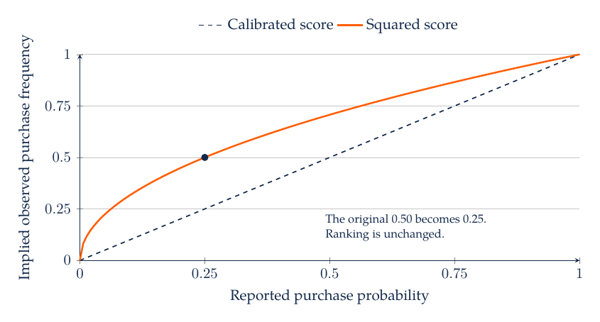

For calibrated forecasts, predicted probabilities equal observed frequencies. After squaring an initially calibrated score $p$, the reported probability is $q=p^2$, while the observed frequency remains $p=\sqrt{q}$. Expected counts and profit calculations depend on the probability scale, so unchanged ranking performance does not guarantee unchanged decision quality.

Inspect calibration plots and proper scoring rules, such as log loss or the Brier score, on held-out data. Calibration methods themselves require fitting and should use data separate from the final evaluation. If the deployment population changes, recalibration may be necessary. A single global correction may be insufficient when the relationship changes differently across groups.

## 7.7 Thresholds Should Reflect the Decision

Consider a classification action in which a false positive costs $C_{FP}$ and a false negative costs $C_{FN}$, with zero cost for correct classifications. For a calibrated probability $p$, predicting positive has expected cost $C_{FP}(1-p)$ and predicting negative has expected cost $C_{FN}p$. The cost-minimizing rule predicts positive when

$$
p>\frac{C_{FP}}{C_{FP}+C_{FN}}.
$$

If an unnecessary review costs one unit and missing a true issue costs nine units, the threshold is 0.10 under this simplified loss. A threshold of 0.50 would encode a different cost balance. Capacity constraints, review effectiveness, and heterogeneous costs require a more detailed rule. The formula is useful because it makes the decision assumptions explicit.

A marketing intervention usually needs a causal comparison beyond this classification loss. For a coupon, let $p_i(1)$ and $p_i(0)$ be purchase probabilities with and without the coupon, $m$ the contribution before the discount, $d$ the discount paid on a treated purchase, and $c$ the contact cost. A simple incremental expected contribution is

$$
\Delta\pi_i=m\{p_i(1)-p_i(0)\}-d\,p_i(1)-c.
$$

The discount is paid on all treated purchases in this setup, including purchases that would have happened anyway. The equation assumes one relevant purchase opportunity and a fixed discount and contribution. It can be extended to spending, multiple purchases, returns, and heterogeneous margins.

## 7.8 Case Study: Targeting the Most Responsive Customers Can Lose Money

Take $m=40$, $d=5$, and $c=2$. Customer A has purchase probabilities 0.80 with the coupon and 0.78 without it. Customer B has probabilities 0.30 and 0.15. A has the higher treated response probability, but incremental contribution is $-5.20 for A and $2.50 for B.

| Customer | Purchase With Coupon | Purchase Without Coupon | Incremental Contribution |
| --- | ---: | ---: | ---: |
| A | 0.80 | 0.78 | -$5.20 |
| B | 0.30 | 0.15 | $2.50 |

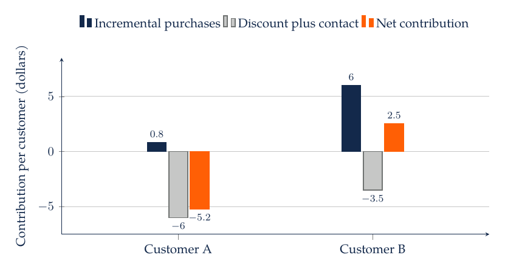

Incremental purchasing contributes $0.80 for A and $6.00 for B, while discount and contact costs are $6.00 and $3.50, respectively. These values follow from the assumed purchase probabilities. Estimating their difference from customer data requires treatment variation and an identification strategy. Uplift or heterogeneous-treatment-effect models address that causal target under their conditions; they are not ordinary response models with a different name.

Evaluate a targeting policy on data that support its value comparison. A randomized holdout or a carefully designed policy evaluation can estimate incremental contribution for the selected group. Estimating a model and reporting its value on the same observations used to choose the policy can overstate performance. Budget constraints also matter: a customer with positive expected value may still be excluded when another customer offers greater value per unit of scarce capacity.

## 7.9 Interpretation, Fairness, and Deployment

Feature importance describes a relationship between a fitted model and its inputs under a chosen method. Permutation importance measures the change in predictive performance after disrupting a feature, with complications when predictors are correlated. Partial-dependence plots average predictions over a reference distribution and can involve unrealistic combinations of correlated features. Local explanation methods describe the fitted prediction under their conventions. These tools do not automatically identify causal effects of changing a feature.

Evaluate performance across groups relevant to the application and examine how errors translate into service or opportunity. A model can be accurate on average while performing poorly for new customers, small stores, or a language group with sparse training data. Protected or sensitive attributes and proxies require appropriate institutional and legal review for the intended use. The consequences of errors depend on the decision and the affected customers.

Deployment requires monitoring the input distribution, missingness, outcome frequency, calibration, and decision value. A change in model accuracy can reflect changing customer behavior, instrumentation, or policy. Record versions and retain a reproducible baseline. If an intervention changes the behavior that generates future training data, the model's environment becomes endogenous to its use, because its recommendations change subsequent exposure and behavior.

## 7.10 Recommendation Models and the Candidate Set

A recommendation decision chooses a small set of products for a particular customer at a particular time. Candidate generation first identifies eligible items, scoring predicts their relevance, and ranking selects their order. A final adjustment may impose stock availability, repetition limits, category variety, or a customer-stated goal. An accurate score cannot recover a useful product that candidate generation has already excluded. Evaluation should therefore record both the eligible set and the final list.

Content-based models use item attributes and the customer's history. A grocery system might represent foods by ingredients, category, price, or an embedding of their descriptions. Collaborative models instead use patterns across customer-item interactions. Matrix factorization represents a customer and an item with short vectors and scores their compatibility through an inner product:

$$
\hat r_{uj}=\mu+b_u+b_j+p_u^\top q_j.
$$

Here $u$ indexes a customer, $j$ an item, $\mu$ is an overall level, $b_u$ and $b_j$ are customer and item offsets, and the vectors $p_u$ and $q_j$ summarize interaction patterns in a common latent space. The score's units depend on the fitted target. With squared-error training on star ratings, it approximates rating units. A ranking score fitted to implicit interactions has no automatic probability interpretation. Popularity offsets capture broad appeal, while the inner product permits customers with different histories to prefer different products.

Ratings are explicit feedback. Clicks, views, and purchases are implicit feedback whose meaning depends on exposure and opportunity. A missing interaction is not a verified rejection. Treating every missing customer-item pair as a negative can encode the previous recommender's display policy. Negative sampling changes the training distribution, so the sampling rule and any probability correction belong in the analysis. Logging impressions and eligible alternatives makes these distinctions more tractable.

New customers and new products create a cold-start problem. Content features, initial preference questions, and popularity baselines can provide information before interaction histories become informative. A hybrid model combines these sources. Sequential models additionally condition on the order of past events, allowing a recent purchase to change what is useful next. The validation sample must preserve that order and exclude later purchases, ratings, and catalog information from the forecast origin.

## 7.11 Ranking Metrics Depend on Position and Available Labels

Precision at $K$ is the fraction of the first $K$ recommendations labeled relevant. Recall at $K$ is the fraction of all labeled relevant items retrieved in that list. Hit rate records whether at least one relevant item appears. These metrics use different denominators and can disagree. A hit rate of one can coexist with low precision when a long list contains one relevant item.

Normalized discounted cumulative gain gives greater weight to relevant items near the top. For nonnegative relevance labels $r_1,\ldots,r_K$, one convention is

$$
\mathrm{DCG}@K=\sum_{k=1}^{K}\frac{2^{r_k}-1}{\log_2(k+1)},
\qquad
\mathrm{NDCG}@K=\frac{\mathrm{DCG}@K}{\mathrm{IDCG}@K}.
$$

The position discount reflects the greater value assigned to placing useful items earlier. The ideal DCG uses the best ordering of the labeled eligible items at the same cutoff. Report the gain convention and the treatment of customers with no relevant labels, for whom this ratio has a zero denominator. Averaging only over customers with positive labels changes the evaluation population.

Consider a synthetic three-item candidate set in which A is irrelevant and B and C are relevant. The lists A, B, C and B, C, A both have precision $2/3$ and recall one. The first list has DCG $1/\log_2(3)+1/\log_2(4)\approx1.131$. The second has DCG $1+1/\log_2(3)\approx1.631$, which is also the ideal value. Their NDCG values are approximately 0.693 and 1.000. The same number of relevant items can produce different ranking quality because their positions differ.

Historical labels describe items observed under earlier exposure and consumption decisions. High NDCG on those labels can coexist with poor discovery of items rarely displayed. Evaluate a common candidate set, retain customer and time boundaries, compare with a popularity baseline, and report performance for customers and products with little history. The policy-value calculation in M6, Section 6.7, addresses selected exposure under different assumptions from an ordinary held-out ranking calculation. Neither calculation alone establishes customer satisfaction or the value of changing the deployed system.

## 7.12 Case Study: Food Recommendations, Variety, and Customer Goals

A food app can predict what a customer usually eats while learning little about what would help that customer pursue a stated goal. The distinction changes the training sample, the model inputs, and the relevant evaluation outcome. [Ling, Nie, Nielsen, Knäuper, Yang, and Dubé (2022)](https://doi.org/10.1145/3485447.3514193) develop a recommendation system using daily food histories and information about calories and body-mass-index groups. Their 2016 app sample restricts users to ages 18–65 with substantial logging histories and removes sparse daily records. Table 2 reports 7,457 users in the resulting model sample.

The model represents both the foods within a day and the sequence of days. Separate models learn from general histories, particular body-mass-index groups, and periods associated with the relevant weight outcome. Their predictions can be combined. The last basket supplies the test observation, the preceding basket supplies validation, and earlier baskets supply training. This design evaluates whether the model predicts foods eaten during periods associated with the intended outcome. It does not randomize customers to receive the recommendations, so the reported ranking improvements do not identify a causal effect on weight.

Selecting successful periods can help define a target pattern while also selecting motivation, physical activity, reporting behavior, or other determinants of the outcome. A customer who follows a similar food pattern may differ on those other dimensions. For deployment, the goal and all required inputs must be available when recommendations are made. A later realized weight outcome can define a retrospective evaluation stratum; it cannot serve as a known input for a new customer unless it is specified as a hypothetical scenario.

[Nielsen, Yang, Dubé, Knäuper, Ling, and Nie (2022)](https://doi.org/10.1086/720453) examine variety in food logs and develop FOODVAR. Their empirical analysis relates daily variety to subsequent changes in calories and the composition of food consumption. Variety measures include item counts and a reverse-coded concentration index based on calorie shares. Two days with the same item count can therefore differ in variety if one is dominated by a single food. The reported relationships are conditional associations, and the denominators and sample restrictions differ across the total-calorie, vegetable, and snack analyses.

FOODVAR incorporates a variety-change indicator into sequential food recommendation. Its evaluation uses 30 days of history, seven subsequent validation days, and a final test day, with the indicator representing the intended variety direction. Table 5 compares hit-rate and NDCG measures against the baseline across weight-outcome groups. The results establish predictive differences within that evaluation design. A prospective test would elicit the variety goal before displaying recommendations and measure subsequent behavior. The synthetic category-bonus example in M8, Section 8.2, is a simpler list-selection exercise with a different algorithm.

### 7.12.1 A Goal Weight Can Change the Preferred Item Abruptly

Suppose three products have preference scores and goal-compatibility scores on a common illustrative scale. A scores $(0.90,0.10)$, B scores $(0.75,0.60)$, and C scores $(0.60,0.90)$. The scores are imposed inputs, not estimated purchase probabilities or health effects. A weighted ranking rule is

$$
s_j(\alpha)=(1-\alpha)p_j+\alpha g_j,\qquad 0\leq\alpha\leq1,
$$

where $p_j$ measures preference compatibility, $g_j$ measures compatibility with the stated goal, and $\alpha$ determines their relative importance. At $\alpha=0$, A ranks first. At $\alpha=0.25$, the scores are 0.700, 0.7125, and 0.675, so B ranks first. At $\alpha=0.50$, C ranks first with 0.750. Solving the pairwise score equalities gives the optimal switches at $\alpha=3/13$ and $\alpha=1/3$.

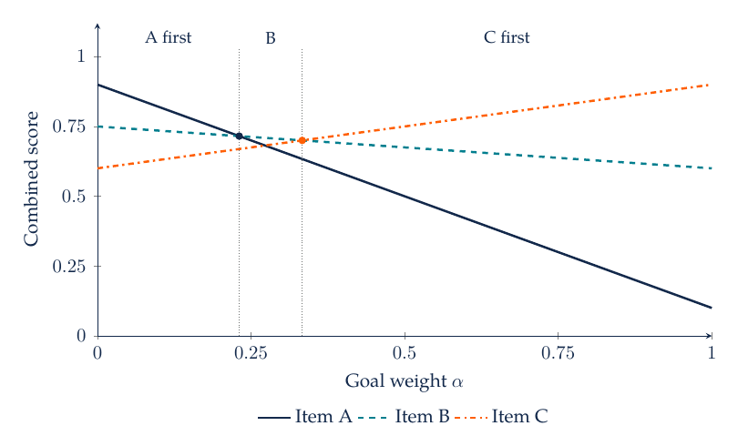

Every score changes continuously, yet the chosen item changes discretely. A small adjustment near a crossing can therefore replace the displayed recommendation. B is the preferred compromise only over a narrow weight interval. A useful assessment varies the weight and inspects which customers experience large changes in their lists. The chosen scales and weights define the tradeoff; combining scores does not itself establish that a goal will be achieved.

## 7.13 LLM Explanations Need Factual and Behavioral Evaluation

A shopping assistant may generate a persuasive reason for recommending a product after the product has already been selected. That text can be useful, but its fluency does not establish that it describes the ranking model's actual reason. Three questions remain distinct: whether the explanation contains correct product facts, whether it corresponds to the system's decision process, and whether it helps the customer make a satisfactory choice.

[Wang, Li, and Chen's RecPIE study](https://arxiv.org/abs/2502.16759v3), in its May 2026 version, jointly trains recommendation prediction and natural-language explanation. Prediction performance informs explanation generation, and explanation representations feed into subsequent predictions. The empirical setting includes Google Maps point-of-interest recommendations and a separate human assessment of explanations. Reported improvements in ranking and explanation preference concern those evaluations. They do not by themselves estimate the effect of deploying the system on purchases, retention, or customer welfare.

[Qin, Huang, Deng, Lei, and Chua (2024)](https://aclanthology.org/2024.findings-emnlp.247/) study credibility in conversational recommendation. Their PC-CRS approach uses credibility-aware persuasive strategies and subsequent revision of explanations. The comparison motivates separate evaluation of persuasive success and support for factual claims. An assistant can increase acceptance by asserting an appealing attribute that the product does not possess. Acceptance alone would reward that error.

Consider a synthetic catalog with prices, delivery times, and verified product attributes. A customer asks for delivery within two days at a price below $30. First enforce those eligibility constraints using the catalog. Then rank eligible products and generate explanations that refer to specific supported attributes. “Arrives tomorrow” is unsupported when the recorded delivery window is three to five days, even if the rest of the explanation is relevant. “You value quiet operation” is unsupported when the customer has expressed no such preference and no permitted history supplies it.

An assessment should inspect factual support, constraint violations, ranking performance, and customer outcomes separately. Remove or alter a cited attribute and examine whether the explanation and ranking change as claimed; this provides a behavioral diagnostic of correspondence, with scope limited to the perturbations tested. Hold out customers, products, or time periods according to deployment. Keep the catalog version and the evidence used for each explanation so the claim can be checked after product information changes.

## 7.14 AI-Assisted Workflow, Practice, and Readings

Ask an assistant to create an evaluation plan before choosing a model. Specify forecast origin, horizon, unit, grouping, baseline, loss, and final holdout. Require a feature-availability table and a pipeline that fits transformations only on training data. Have it produce both a metric table and an explanation of the operational decision each metric supports.

For practice, verify the 91% accuracy and 60% recall in the rare-purchase example. Square a small set of predicted probabilities and confirm that their order is unchanged while expected purchase counts change. Recalculate the coupon case with a $1 discount and explain which customer becomes more attractive. Finally, identify why a model trained on all customers' latest outcomes cannot honestly claim to predict those same outcomes out of sample.

For a recommender exercise, have an assistant build a popularity baseline, a simple content score, and the stated goal-weight rule on synthetic items. Require a chronological split, a documented candidate set, and a report of excluded or unavailable products. Verify the two NDCG calculations by hand, then enumerate the goal-weight switches independently. Ask why an unseen item was labeled irrelevant and require the code to distinguish an observed rejection from absent exposure. A working implementation of the simple score is not a replication of FOODVAR, HHFR, or RecPIE.

For an explanation exercise, give the assistant a small catalog and a customer's explicit constraints. Request a recommendation with an attribute-level source for each factual claim. Include one unavailable attribute and one product that violates a constraint. Check whether the system acknowledges missing information and excludes the ineligible product. Score factual support separately from how persuasive the explanation sounds.

[An Introduction to Statistical Learning](https://www.statlearning.com/) develops the central learning methods. The [scikit-learn evaluation guide](https://scikit-learn.org/stable/modules/model_evaluation.html) provides metric definitions and implementation references. [Hagen and colleagues (2020)](https://doi.org/10.1007/s11002-020-09535-7) connect machine-learning tools to behavioral marketing questions.

## 7.15 mHealth: Predicting a Returning User's Next Basket

The manager needs a recommendation baseline that uses only information available when suggestions are chosen. Global category popularity is easy to implement. A personal frequency rule can exploit repeated food choices without estimating a complex model. The comparison should preserve complete baskets and evaluate both rules on the same users, candidate set, and future outcomes.

A basket is the set of distinct source categories recorded by a user on a day; missing category labels are excluded. Freeze the candidate set at the 312 categories observed before July 1. For each forecast origin, require at least 30 prior observed basket days and select the first observed basket during the following month as the target. Validation starts July 1 and testing starts September 1. Every score uses dates strictly before its forecast origin. The test concerns returning users who subsequently log a basket, conditional on that observation; it does not evaluate people who never return.

Personal frequency is the fraction of a user's observed days in a specified history window containing a category. It does not divide by all calendar days. A tiny popularity term resolves most frequency ties; exact remaining ties use alphabetical order. If a user has no observed day in a short window, personal frequencies are zero and the popularity term supplies the order. Global popularity uses the corresponding fraction across all prior observed user-days. Scores produce a list of ten distinct categories.

Choose among 30-day, 90-day, and all-prior-history windows using July mean NDCG at ten. Their validation scores are 0.5666, 0.5661, and 0.5501, respectively, among 297 evaluated users. The 30-day rule wins by a very small margin over 90 days. The code preserves the specified tie order and carries the chosen window to September. A further claim that 30 days is generally superior would need repeated or independent validation.

| September Rule | Evaluated Users | Recall at 10 | NDCG at 10 |
| --- | ---: | ---: | ---: |
| Global Popularity | 299 | 0.2799 | 0.3270 |
| Personal 30-Day Frequency | 299 | 0.4759 | 0.5862 |

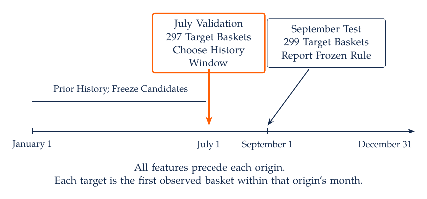

There are 362 eligible users at the September origin, but only 299 have a target basket in that month. Reporting both counts exposes the conditioning introduced by the target definition. All observed target categories in this evaluation are covered by the frozen candidate set. The implementation nevertheless retains all target categories in the recall denominator and ideal DCG, so an unsupported category would count against performance.

The personal rule recovers more recorded categories than the popularity baseline. This supports personalization for predicting the observed basket under the historical environment. It does not show that displaying those suggestions changes choices, improves nutrition, or generates incremental app value. Logging may omit foods, and the basket can occur several days after the fixed origin. A same-day or event-time recommender would need a corresponding evaluation design.

### 7.15.1 Histories, Candidate Sets, and Ranking Metrics

`ranking.py` defines the common evaluation so that M8 changes the ranking objective while holding the target baskets fixed. Recall divides the number of recovered categories by the target basket size. NDCG discounts relevant categories by position and divides by the best possible ranking for that target. Each evaluated user contributes one metric value, and the final result averages users equally.

Python source: [ranking.py](../../03_Data_and_Code/mHealth/recurring_examples/ranking.py). From its directory, run `python ranking.py`.

```python
"""Whole-basket chronological evaluation with a frozen category universe."""

import numpy as np
import pandas as pd


def candidate_categories(baskets):
    prior = baskets.loc[baskets.date.lt("2016-07-01")]
    return sorted({category for basket in prior.basket for category in basket})


def evaluation_cases(baskets, cutoff, candidates):
    cutoff = pd.Timestamp(cutoff)
    prior = baskets.loc[baskets.date.lt(cutoff)]
    counts = prior.groupby("Userid").size()
    eligible = counts[counts >= 30].index
    end = cutoff + pd.offsets.MonthBegin(1)
    target = baskets.loc[baskets.date.ge(cutoff) & baskets.date.lt(end)]
    target = target.loc[target.Userid.isin(eligible)].sort_values(["Userid", "date"])
    target = target.drop_duplicates("Userid")
    histories = dict(tuple(prior.groupby("Userid")))
    assert prior.date.max() < cutoff
    global_counts = (
        prior.basket.explode().value_counts().reindex(candidates, fill_value=0)
    )
    popularity = global_counts.to_numpy(dtype=float) / len(prior)
    cases = [(histories[row.Userid], set(row.basket)) for row in target.itertuples()]
    return cases, popularity, len(eligible)


def personal_frequency(history, cutoff, candidates, window):
    if window is not None:
        start = pd.Timestamp(cutoff) - pd.Timedelta(days=window)
        history = history.loc[history.date.ge(start)]
    counts = history.basket.explode().value_counts().reindex(candidates, fill_value=0)
    return counts.to_numpy(dtype=float) / max(1, len(history))


def rank_categories(scores, candidates, k=10):
    # Stable sorting resolves exact score ties using alphabetically sorted candidates.
    positions = np.argsort(-scores, kind="stable")[:k]
    return [candidates[index] for index in positions]


def ranking_metrics(ranking, target):
    relevance = np.array([category in target for category in ranking], dtype=float)
    discounts = 1 / np.log2(np.arange(2, len(ranking) + 2))
    ideal = discounts[: min(len(target), len(ranking))].sum()
    return float(relevance.sum() / len(target)), float(
        (relevance * discounts).sum() / ideal
    )


def evaluate(
    baskets, cutoff, candidates, window=None, popularity_only=False, novelty_weight=0
):
    cases, popularity, eligible = evaluation_cases(baskets, cutoff, candidates)
    rows = []
    for history, target in cases:
        frequency = personal_frequency(history, cutoff, candidates, window)
        recent = personal_frequency(history, cutoff, candidates, 30)
        unseen = recent == 0
        scores = popularity if popularity_only else frequency + 1e-6 * popularity
        ranking = rank_categories(scores + novelty_weight * unseen, candidates)
        recall, ndcg = ranking_metrics(ranking, target)
        recent_set = {candidates[j] for j in np.flatnonzero(recent)}
        novelty = sum(category not in recent_set for category in ranking) / len(ranking)
        coverage = len(target & set(candidates)) / len(target)
        rows.append([recall, ndcg, novelty, coverage])
    means = np.mean(rows, axis=0)
    return {
        "eligible_users": eligible,
        "evaluated_users": len(cases),
        "recall_at_10": float(means[0]),
        "ndcg_at_10": float(means[1]),
        "novelty_at_10": float(means[2]),
        "target_candidate_coverage": float(means[3]),
    }
```

### 7.15.2 Validation Before Testing

The execution order matters. Fit the history-window choice using July, freeze it, and report September performance without changing the rule after seeing the test. The small metric counterexample confirms that placing both relevant categories first yields NDCG of one, while placing an irrelevant category first lowers it. A separate test supplies a category that occurs only in the future and verifies that it never enters personal history.

Python source: [m07.py](../../03_Data_and_Code/mHealth/recurring_examples/m07.py). From its directory, run `python m07.py`.

```python
"""Choose history length in July and evaluate the frozen rule in September."""

import json
from common import load_inputs, save_result
from ranking import candidate_categories, evaluate, ranking_metrics

food, daily, baskets = load_inputs()
candidates = candidate_categories(baskets)
windows = {"30_days": 30, "90_days": 90, "all_prior_days": None}
validation = {
    name: evaluate(baskets, "2016-07-01", candidates, window)
    for name, window in windows.items()
}
# Ties retain the first listed specification; September plays no role in selection.
chosen = max(validation, key=lambda name: validation[name]["ndcg_at_10"])
test = {
    "popularity": evaluate(baskets, "2016-09-01", candidates, popularity_only=True),
    "personal_frequency": evaluate(baskets, "2016-09-01", candidates, windows[chosen]),
}
assert ranking_metrics(["B", "C", "A"], {"B", "C"}) == (1.0, 1.0)
assert ranking_metrics(["A", "B", "C"], {"B", "C"})[1] < 1
result = {
    "candidate_categories": len(candidates),
    "validation": validation,
    "chosen_window": chosen,
    "test": test,
}
save_result("M07", result)
print(json.dumps(result, indent=2))
```

## 7.16 Python Calculations for the Synthetic Cases

The inputs below are imposed teaching values. Running the program creates the labeled synthetic CSV files and prints the corresponding calculations. They are separate from the mHealth estimates. Keep the script beside `example_helpers.py` in `03_Data_and_Code/Lecture_Examples`.

Python source: [m07_synthetic.py](../../03_Data_and_Code/Lecture_Examples/m07_synthetic.py). From its directory, run `python m07_synthetic.py`.

```python
"""Synthetic numerical examples for M7; run from any working directory."""

import itertools
import json
import math
from example_helpers import write_csv, ols_slope, shares

r = {}
r["M07"] = {
    "precision": 30 / 100,
    "recall": 30 / 50,
    "accuracy": (30 + 880) / 1000,
    "all_negative_accuracy": 950 / 1000,
    "cost_threshold": 1 / (1 + 9),
    "coupon_A": 40 * (0.8 - 0.78) - 5 * 0.8 - 2,
    "coupon_B": 40 * (0.3 - 0.15) - 5 * 0.3 - 2,
}
write_csv(
    "M07_coupon_synthetic.csv",
    [
        "customer",
        "purchase_with_coupon",
        "purchase_without_coupon",
        "margin_dollars",
        "discount_dollars",
        "contact_cost_dollars",
    ],
    [("A", 0.8, 0.78, 40, 5, 2), ("B", 0.3, 0.15, 40, 5, 2)],
)

rankings = {
    "ABC": [("A", 0), ("B", 1), ("C", 1)],
    "BCA": [("B", 1), ("C", 1), ("A", 0)],
}


def dcg(labels):
    return sum(
        (2**label - 1) / math.log2(rank + 1)
        for rank, label in enumerate(labels, start=1)
    )


ideal = dcg([1, 1, 0])
r["M07"]["rankings"] = {
    name: {
        "precision_at_3": sum(v for _, v in vals) / 3,
        "recall_at_3": sum(v for _, v in vals) / 2,
        "dcg_at_3": dcg([v for _, v in vals]),
        "ndcg_at_3": dcg([v for _, v in vals]) / ideal,
    }
    for name, vals in rankings.items()
}
write_csv(
    "M07_rankings_synthetic.csv",
    ["ranking", "position", "item", "binary_relevance"],
    [
        (name, pos, item, rel)
        for name, vals in rankings.items()
        for pos, (item, rel) in enumerate(vals, start=1)
    ],
)
assert math.isclose(r["M07"]["rankings"]["BCA"]["ndcg_at_3"], 1)
assert 0.693 < r["M07"]["rankings"]["ABC"]["ndcg_at_3"] < 0.694

goal_items = {"A": (0.9, 0.1), "B": (0.75, 0.6), "C": (0.6, 0.9)}
goal_score = (
    lambda item, alpha: (1 - alpha) * goal_items[item][0] + alpha * goal_items[item][1]
)
r["M07"]["goal_blend"] = {
    "scores": {
        str(alpha): {item: goal_score(item, alpha) for item in goal_items}
        for alpha in [0, 0.25, 0.5, 1]
    },
    "optimal_switches": [3 / 13, 1 / 3],
}
write_csv(
    "M07_goals_synthetic.csv",
    ["item", "preference_score", "goal_score"],
    [(item, *scores) for item, scores in goal_items.items()],
)
assert math.isclose(goal_score("A", 3 / 13), goal_score("B", 3 / 13))
assert math.isclose(goal_score("B", 1 / 3), goal_score("C", 1 / 3))
for i in range(1001):
    alpha = i / 1000
    expected = "A" if alpha < 3 / 13 else ("B" if alpha < 1 / 3 else "C")
    assert max(goal_items, key=lambda j: goal_score(j, alpha)) == expected
print(json.dumps(r, indent=2))
```

## 7.17 mHealth: Basket Associations and Future Validation

A recommendation manager wants to identify categories that commonly appear together in a recorded day. An association rule can generate candidates for a basket-completion feature. Its commercial value still depends on when a suggestion is shown, whether the customer has already recorded the item, and whether the suggestion changes behavior. A high co-occurrence rate alone does not establish incremental demand.

Treat each observed user-day with at least one classified category as a basket. Deduplicate categories within the day, so repeated servings contribute one presence indicator. For categories $A$ and $B$, define

$$
\operatorname{support}(A,B)=P(A\cap B),\qquad
\operatorname{confidence}(A\to B)=P(B\mid A),\qquad
\operatorname{lift}(A\to B)=\frac{P(B\mid A)}{P(B)}.
$$

Probabilities are empirical fractions of recorded baskets. Confidence is directional, whereas lift is symmetric for a two-category pair. A popular category can have high confidence without an unusually strong association. Lift compares the conditional rate with the marginal rate and therefore supplies the necessary benchmark. The label “confidence” here is a conditional frequency, separate from a statistical confidence interval.

Use January–June data to select the 20 most frequent categories. Among their pairs, require at least 100 joint baskets and 30 distinct supporting users. Rank eligible pairs by training lift and fix the largest before examining July–August. These prespecified restrictions avoid selecting a pair supported by only a few repeated entries, but they do not make users' repeated baskets independent. The training sample has 40,727 baskets from 358 users. The selected pair is oil and tomato, supported jointly by 192 users.

| Metric | January–June | July–August |
| --- | ---: | ---: |
| Recorded Baskets | 40,727 | 12,956 |
| Baskets With Oil | 7,283 | 2,174 |
| Baskets With Tomato | 4,708 | 1,930 |
| Baskets With Both | 1,985 | 658 |
| Tomato Given Oil | 27.26% | 30.27% |
| Marginal Tomato Rate | 11.56% | 14.90% |
| Lift | 2.358 | 2.032 |

The later evaluation includes observed baskets from the previously known users; 334 of them contribute baskets in July–August. Users with no later basket supply no basket-level outcome. In the table, conditional tomato frequency rises while lift falls because tomato also becomes more common overall. Judging only the conditional frequency would miss that change in the comparison benchmark.

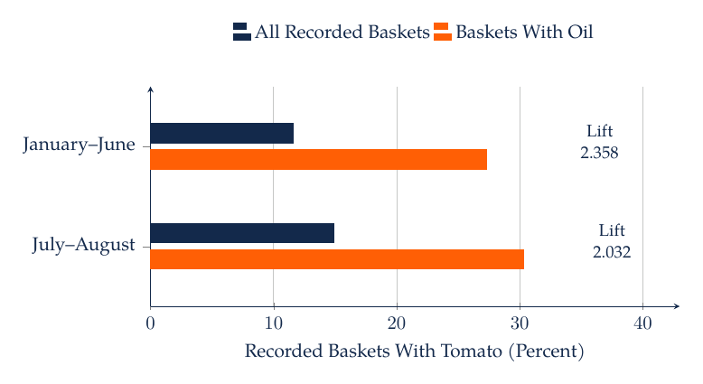

A 500-draw bootstrap resamples the 358 training users, carrying each user's complete later basket history into the draw, including zero later baskets. The percentile interval for later lift is [1.762, 2.411]. It describes sampling variation for the already selected pair, with dependence within each user preserved. It does not address common calendar shocks, uncertainty over the category-selection procedure, or the effect of displaying a recommendation. The recorded category names also do not establish nutritional complementarity.

The [mlxtend association-rule guide](https://rasbt.github.io/mlxtend/user_guide/frequent_patterns/association_rules/) defines support, confidence, and lift and provides scalable itemset-mining tools. The code below enumerates pairs from a bounded candidate set so every numerator is inspectable. Its results can be compared with that library after the same basket and candidate definitions are imposed.

The [implicit recommendation examples](https://github.com/benfred/implicit/tree/main/examples) and [Surprise examples](https://github.com/NicolasHug/Surprise/tree/master/examples) address different feedback structures. Food logging supplies observed occurrences; missing entries do not provide explicit dislike ratings. For next-basket prediction, retain the chronological evaluation and known candidate set from Section 7.15. For within-basket completion, the source would additionally need an information rule specifying which recorded categories are visible when a suggestion is made.

Python source: [association_rules.py](../../03_Data_and_Code/mHealth/recurring_examples/association_rules.py). From its directory, run `python association_rules.py`.

```python
"""Select a category pair in January-June; evaluate it in July-August."""

from itertools import combinations
import json
import numpy as np
import pandas as pd
from common import SEED, load_food, make_baskets, save_result


def metrics(n, a, b, both):
    if min(n, a, b) <= 0:
        raise ValueError("Positive basket and marginal counts are required")
    return {
        "baskets": int(n),
        "a_baskets": int(a),
        "b_baskets": int(b),
        "joint_baskets": int(both),
        "support": both / n,
        "confidence_a_to_b": both / a,
        "baseline_b": b / n,
        "lift": both * n / (a * b),
    }


def presence(baskets, categories):
    return np.array(
        [[c in basket for c in categories] for basket in baskets.basket], dtype=np.int64
    )


if __name__ == "__main__":
    baskets = make_baskets(load_food())
    train = baskets.loc[baskets.date < "2016-07-01"]
    frequency = train.explode("basket").groupby("basket").size()
    categories = sorted(
        frequency.sort_values(ascending=False, kind="stable").head(20).index
    )
    matrix = presence(train, categories)
    joint, marginal = matrix.T @ matrix, matrix.sum(axis=0)
    rules = []
    for a, b in combinations(range(len(categories)), 2):
        mask = (matrix[:, a] * matrix[:, b]).astype(bool)
        supporting_users = train.loc[mask, "Userid"].nunique()
        if joint[a, b] >= 100 and supporting_users >= 30:
            rule = metrics(len(train), marginal[a], marginal[b], joint[a, b])
            rules.append(
                {
                    "a": categories[a],
                    "b": categories[b],
                    "supporting_users": int(supporting_users),
                    **rule,
                }
            )
    rules.sort(key=lambda r: (-r["lift"], r["a"], r["b"]))
    selected = rules[0]
    users = sorted(train.Userid.unique())
    future = baskets.loc[
        baskets.Userid.isin(users) & baskets.date.between("2016-07-01", "2016-08-31")
    ].copy()
    binary = presence(future, [selected["a"], selected["b"]])
    future["a"], future["b"] = binary[:, 0], binary[:, 1]
    future["both"], future["n"] = binary.prod(axis=1), 1
    counts = (
        future.groupby("Userid")[["n", "a", "b", "both"]]
        .sum()
        .reindex(users, fill_value=0)
        .to_numpy()
    )
    evaluation = metrics(*counts.sum(axis=0))
    rng = np.random.default_rng(SEED)
    lifts = []
    for _ in range(500):
        total = counts[rng.integers(0, len(users), len(users))].sum(axis=0)
        if min(total[:3]) > 0:
            lifts.append(metrics(*total)["lift"])
    evaluation["user_bootstrap_ci95"] = np.quantile(lifts, [0.025, 0.975]).tolist()
    evaluation["bootstrap_valid_draws"] = len(lifts)
    result = {
        "candidate_categories": len(categories),
        "eligible_pairs": len(rules),
        "training_users": len(users),
        "evaluation_users": int(future.Userid.nunique()),
        "selected_training_pair": selected,
        "july_august": evaluation,
    }
    save_result("association_rules", result)
    print(json.dumps(result, indent=2))
```

## 7.18 McDonald's: Forecasting Availability with Missing Future Labels

\noindent A service team with limited time can prioritize verification calls using recent order availability. The forecast origin is the selected snapshot on date $t-1$; the target is the same address key's status in the selected snapshot on the next calendar date $t$. The key must be observed at the origin. For this exercise, an eligible origin has at least 2,000 US records in its snapshot, taken within three hours of 18:00 UTC. A scored target must meet the same conditions and contain the same key. This is a forecast for the next sampled observation. It does not measure whether the outlet experiences any interruption during the entire intervening day.

Section 2.16's preparation program preserves eligible origins whose target is absent. Those records lack a label. It also retains the original address keys, so address changes can remove a match. The resulting forecast population consists of observed, linkable records under the stated timing and coverage rules. A larger rollout would require checking performance and outcome observation beyond this population.

### 7.18.1 Compare Simple Forecasts on Later Dates

\noindent Fix August 1, 2026, as the first test target date. Estimate probabilities using earlier target dates only. The training mean assigns the same estimated probability to every origin. A second forecast conditions on whether the previous snapshot reported unavailability. Its estimate for previous status $s$ is

$$
\widehat q_s=
\frac{\sum_{t<T}\sum_i A_{it}\mathbf{1}\{U_{i,t-1}=s\}U_{it}}
{\sum_{t<T}\sum_i A_{it}\mathbf{1}\{U_{i,t-1}=s\}},
$$

where $T$ is the fixed cutoff and $A_{it}$ indicates a usable observed pair under the stated rules. The denominator counts training pairs in status group $s$. This is an empirical conditional-frequency model, equivalent to a saturated probability model with one binary predictor. No hyperparameter is chosen using test outcomes. The benchmark that always predicts availability provides a further check on the usefulness of accuracy.

The preparation retains 1,484,356 labeled training pairs. In the later evaluation period, 580,473 of 801,841 eligible origins have usable labels, giving 72.39% label coverage. Label coverage is approximately 72.40% for previously available records and 72.38% for previously unavailable records. Similar coverage across these two groups does not establish that other sources of missingness are harmless.

| Forecast | Test Brier Score | Test Accuracy at a 0.5 Cutoff |
| --- | ---: | ---: |
| Always available | 0.1465 | 85.35% |
| Training mean | 0.1253 | 85.35% |
| Previous status | 0.0851 | 89.16% |

The Brier score averages $(U-\widehat q)^2$ across labeled test pairs; smaller values indicate more accurate probability forecasts. The training-mean forecast improves probability error while making the same binary classification as the always-available rule. Conditioning on previous status improves both measures. These results concern later observations for existing address keys; they do not establish performance at newly entering restaurants. Repeated keys and common dates also make individual rows dependent, so the large pair count should not be treated as an independent-sample precision calculation.

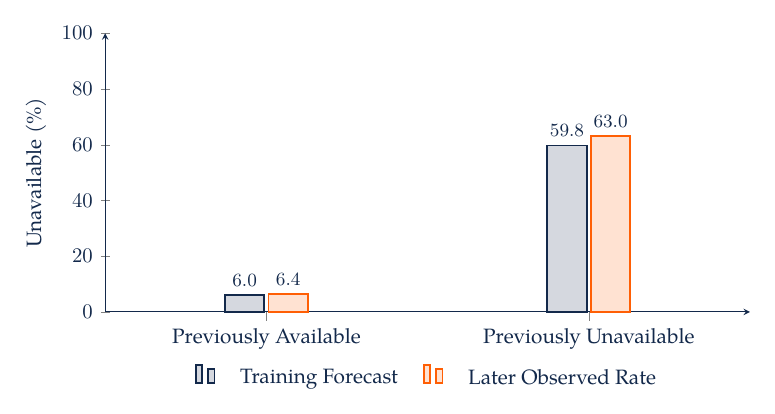

The conditional model predicts 5.97% after an available observation and 59.78% after an unavailable observation. The corresponding later frequencies are 6.35% and 63.03%. Recent status is informative, while both groups exhibit higher later frequencies. A manager can use this ranking to prioritize verification and monitor calibration as new labels arrive. A dispatch decision would additionally require confirmation of the operational problem, the expected benefit of repair, and the cost of a visit.

### 7.18.2 Preserve the Information Available at the Forecast Origin

\noindent The full-year dimension table contains `n_days` and `last_seen`. Those quantities summarize future observation patterns and would leak information into a historical forecast. The next snapshot's count and check time are also unavailable at the origin; they define the evaluation sample here and do not enter the probability estimates as features. Restricting labels after collection must be reported because operational forecasts are issued before that future coverage is known. Origin-only features and exact calendar joins make the time sequence explicit.

The course table aggregates pairs by target date and previous status. It retains counts of eligible origins, observed labels, and unavailable outcomes, which are sufficient for these specified forecasts and scores. Grouping avoids repeating identical probability calculations across millions of rows. For a group with $n$ labels, $b$ unavailable outcomes, and forecast $q$, its total squared error is $b(1-q)^2+(n-b)q^2$. The test verifies that this grouped expression equals the individual-row calculation on a hand-checkable example.

Python source: [predict.py](../../03_Data_and_Code/McBroken/predict.py). From its directory, run `python predict.py`.

```python
"""Test pre-specified availability forecasts on later calendar dates."""
import json
from pathlib import Path

import numpy as np
import pandas as pd

ROOT = Path(__file__).resolve().parent
CUTOFF = pd.Timestamp("2026-08-01")


def fit_probabilities(train):
    counts = train.groupby("previous_unavailable")[["n_labeled", "n_unavailable"]].sum()
    if (counts.n_labeled <= 0).any() or set(counts.index) != {0, 1}:
        raise ValueError("Both prior-status groups require training observations")
    return (train.n_unavailable.sum() / train.n_labeled.sum(),
            counts.n_unavailable / counts.n_labeled)


def brier_score(n, successes, probability):
    """Exact row-level squared probability error from grouped binary counts."""
    return float(np.sum(successes * (1 - probability)**2
                        + (n - successes) * probability**2) / np.sum(n))


def main():
    data = pd.read_csv(ROOT / "data/transitions.csv", parse_dates=["date"])
    train, test = data[data.date < CUTOFF], data[data.date >= CUTOFF]
    assert train.date.max() < test.date.min()
    base, by_status = fit_probabilities(train)
    forecasts = {"Always available": np.zeros(len(test)),
                 "Training mean": np.full(len(test), base),
                 "Previous status": test.previous_unavailable.map(by_status).to_numpy()}
    n, y = test.n_labeled.to_numpy(), test.n_unavailable.to_numpy()
    scores = []
    for name, probability in forecasts.items():
        correct = np.where(probability >= 0.5, y, n - y)
        scores.append({"model": name, "brier_score": brier_score(n, y, probability),
                       "accuracy": float(correct.sum() / n.sum())})
    calibration = test.groupby("previous_unavailable")[["n_origins", "n_labeled", "n_unavailable"]].sum()
    calibration["forecast"] = by_status
    calibration["observed"] = calibration.n_unavailable / calibration.n_labeled
    calibration["label_coverage"] = calibration.n_labeled / calibration.n_origins
    results = ROOT / "results"
    results.mkdir(exist_ok=True)
    pd.DataFrame(scores).to_csv(results / "prediction_scores.csv", index=False)
    calibration.to_csv(results / "prediction_calibration.csv")
    summary = {"cutoff": str(CUTOFF.date()), "train_labeled_pairs": int(train.n_labeled.sum()),
               "test_labeled_pairs": int(n.sum()), "test_origins": int(test.n_origins.sum()),
               "test_unavailable": int(y.sum()), "baseline_probability": float(base),
               "test_label_coverage": float(n.sum() / test.n_origins.sum()),
               "train_first_target": str(train.date.min().date()),
               "train_last_target": str(train.date.max().date()),
               "test_last_target": str(test.date.max().date()), "scores": scores}
    (results / "prediction.json").write_text(json.dumps(summary, indent=2) + "\n")
    figure = r"""\begin{tikzpicture}
\begin{axis}[ybar,bar width=19pt,width=12.5cm,height=6.3cm,ymin=0,ymax=100,
 ylabel={Unavailable (\%)},xtick={0,1},xticklabels={Previously Available,Previously Unavailable},
 enlarge x limits=0.5,legend style={at={(0.5,-0.17)},anchor=north,legend columns=2,column sep=10pt},
 nodes near coords,every node near coord/.append style={font=\footnotesize,/pgf/number format/fixed,/pgf/number format/fixed zerofill,/pgf/number format/precision=1}]
"""
    for column, color in [("forecast", "IlliniBlue"), ("observed", "IlliniOrange")]:
        points = " ".join(f"({int(i)},{100*v:.6f})" for i, v in calibration[column].items())
        figure += f"\\addplot[draw={color},fill={color}!18] coordinates {{{points}}};\n"
    figure += "\\legend{Training Forecast,Later Observed Rate}\n\\end{axis}\n\\end{tikzpicture}\n"
    (ROOT.parents[1] / "06_Lecture_Notes/figures/M07_mcbroken_prediction.tex").write_text(figure)
    print(json.dumps(summary, indent=2))
    print(calibration.to_string())


if __name__ == "__main__":
    main()
```

## 7.19 Prediction, Delivery, and Access

\noindent An advertiser selecting an audience does not fully determine who sees an offer. A delivery system can optimize bids, predicted clicks, or conversions after that selection. Differences in auction conditions, past behavior, or model scores can change the realized distribution of exposure. An assessment of targeting criteria alone can therefore miss consequential differences in access.

The Department of Justice's Meta housing-advertising case addressed both targeting and delivery under the Fair Housing Act. The settlement was approved in June 2022. Its sector and legal basis matter: the case concerns housing opportunities, and it does not establish a uniform legal standard for every recommender. The [DOJ case record](https://www.justice.gov/crt/case/united-states-v-meta-platforms-inc-fka-facebook-inc-sdny) provides the relevant scope and settlement information.

For an analytical assessment, define the eligible population, opportunity to receive the offer, realized exposure, and downstream response. Compare rates using the appropriate denominators and examine whether outcome labels are observed for everyone or only for exposed customers. A high click prediction can reflect selective earlier exposure. Retraining on those clicks can reproduce that selection through a new model.

Error costs should also follow the application. A mistaken recommendation of a grocery item and a missed housing opportunity have different consequences. A proposed fairness comparison must specify the affected population, outcome, and decision. Several metrics can conflict because they condition on different objects. Report the conflicting outcomes and explain which policy objective determines the preferred comparison.

## 7.20 Repeated Selection Can Improve a Score Without Improving Prediction

\noindent A manager comparing AI-generated classifiers may see development accuracy rise as analysts try more prompts, features, or code revisions. Some of that increase can reflect selection among noisy scores. A useful evaluation asks how the selected procedure performs on cases that played no role in its selection.

Consider an imposed null model in which every candidate predicts correctly with probability one-half. Each candidate receives 80 development cases, and the candidate with the highest development accuracy is selected. A tie selects the earliest candidate. The selected candidate is then evaluated on 200 fresh cases. The calculation makes the following independence conditions explicit.

\begin{assumption}[Independent Chance Predictions]\label{ass:chance-predictions}
Every correctness indicator is an independent Bernoulli variable with probability one-half across candidates, cases, and independent repetitions. Development and test indicators are independent. Selection uses only development correctness counts and a fixed tie rule.
\end{assumption}

Let $X_k$ be the number of correct development predictions by candidate $k$, and let $F(s)=\Pr(X_k\leq s)$ for the binomial distribution with 80 trials and success probability one-half. Under Assumption \ref{ass:chance-predictions}, the probability that all $K$ candidates score at most $s$ is $F(s)^K$. Summing the tail probabilities of their maximum gives the expected selected accuracy:

$$
E\left[\frac{\max_{1\leq k\leq K}X_k}{80}\right]
=\frac{1}{80}\sum_{s=0}^{79}\left[1-F(s)^K\right].
$$

Increasing the number of candidates raises the chance of selecting an unusually favorable development score. The expected test accuracy remains one-half because the independent test outcomes never enter selection. Reusing test results to change the next candidate would violate that condition.

| Candidates Compared | Expected Selected Development Accuracy | Simulated Development Accuracy | Simulated Fresh Accuracy |
| ---: | ---: | ---: | ---: |
| 1 | 50.00% | 49.94% | 49.88% |
| 5 | 56.49% | 56.63% | 50.00% |
| 20 | 60.40% | 60.42% | 49.95% |
| 100 | 63.93% | 63.89% | 50.03% |

The simulated entries average 2,000 independent repetitions with seed 20261104. Candidate sets are nested within each repetition, so comparisons across rows are paired. The reported Monte Carlo standard errors in the output measure simulation precision across repetitions. They are distinct from uncertainty about one deployed classifier's accuracy. The analytical expectation provides a separate check on the program.

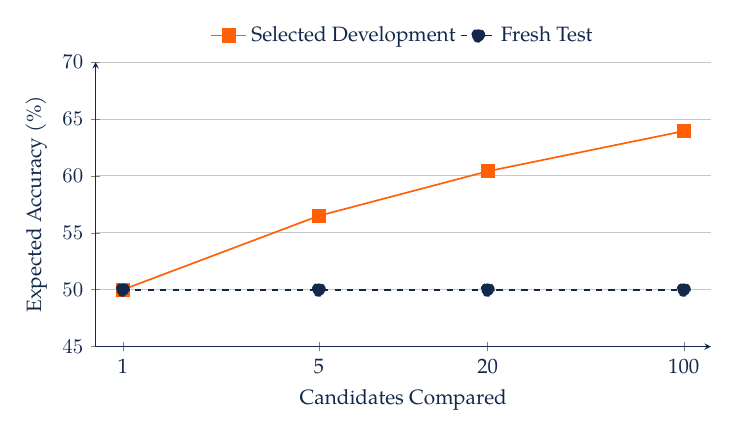

Real prompt revisions often produce correlated predictions, and feedback can alter later candidates. Under independence, repeatedly selecting the strongest apparent result raises the chance of selecting a favorable error. The magnitude for an actual workflow depends on the correlation among its candidates and the feedback used to revise them. The relevant practice is to preserve development records, fix the final comparison before exposing new outcomes, and match the split to the deployment population. For earnings calls, separate firms or future periods as appropriate and keep passages from a call together. A new model release also needs fresh evaluation when its predecessor's test errors guided the upgrade decision.

### 7.20.1 Reproduce Selection and Fresh Evaluation

\noindent Run `python3 03_Data_and_Code/AI_Workflows/repeated_selection.py` with Python 3.10 or later. Separate pseudorandom streams produce development and test correctness. The CSV contains one row per candidate count, analytical expectations, simulated means, and Monte Carlo standard errors, all as fractions. The JSON records sample sizes and the seed. The accompanying exact test enumerates every binary outcome for two candidates with three cases each and compares their expected maximum with the formula.

Python source: [repeated_selection.py](../../03_Data_and_Code/AI_Workflows/repeated_selection.py)

```python
"""Simulate selection among equally uninformative classifiers using only stdlib."""
import csv
import json
import math
import random
from pathlib import Path
from statistics import mean, stdev

OUT = Path(__file__).resolve().parent / "results"


def select_candidate(development_counts):
    # The earliest candidate wins a tie. Test outcomes are never an input.
    return max(range(len(development_counts)), key=development_counts.__getitem__)


def expected_selected_accuracy(n, candidates):
    """Exact binomial order-statistic expectation, evaluated in floating point."""
    cumulative = 0.0
    expected_count = 0.0
    for successes in range(n):
        cumulative += math.comb(n, successes) / 2**n
        expected_count += 1 - cumulative**candidates
    return expected_count / n


def main():
    seed, repetitions, development_n, test_n = 20261104, 2000, 80, 200
    candidate_counts = [1, 5, 20, 100]
    # Separate streams keep test outcomes out of the development process.
    development_rng = random.Random(seed)
    test_rng = random.Random(seed + 1)
    observed = {k: {"development": [], "test": []} for k in candidate_counts}
    for _ in range(repetitions):
        # Each independent bit denotes a correct prediction with probability 1/2.
        # Candidates are also independent in this deliberately simple null model.
        development = [development_rng.getrandbits(development_n).bit_count()
                       for _ in range(max(candidate_counts))]
        test = [test_rng.getrandbits(test_n).bit_count()
                for _ in range(max(candidate_counts))]
        for k in candidate_counts:
            selected = select_candidate(development[:k])
            observed[k]["development"].append(development[selected] / development_n)
            observed[k]["test"].append(test[selected] / test_n)
    rows = []
    for k, values in observed.items():
        exact = expected_selected_accuracy(development_n, k)
        development_mean, test_mean = mean(values["development"]), mean(values["test"])
        development_se = stdev(values["development"]) / math.sqrt(repetitions)
        test_se = stdev(values["test"]) / math.sqrt(repetitions)
        # Independent analytic benchmarks check the simulation's implementation.
        assert abs(development_mean - exact) < 5 * development_se
        assert abs(test_mean - 0.5) < 5 * test_se
        rows.append({"candidates": k, "expected_development_accuracy": exact,
                     "mean_development_accuracy": development_mean,
                     "mean_test_accuracy": test_mean, "expected_test_accuracy": 0.5,
                     "development_mc_se": development_se, "test_mc_se": test_se})
    OUT.mkdir(exist_ok=True)
    with (OUT / "selection_results.csv").open("w", newline="") as f:
        writer = csv.DictWriter(f, fieldnames=list(rows[0]))
        writer.writeheader()
        writer.writerows(rows)
    metadata = {"seed": seed, "repetitions": repetitions,
                "development_cases": development_n, "fresh_test_cases": test_n,
                "scope": "Synthetic independent chance predictions; no LLM calls.",
                "mc_se": "Monte Carlo error of the simulated mean across repetitions"}
    (OUT / "selection_metadata.json").write_text(json.dumps(metadata, indent=2) + "\n")
    print(json.dumps(rows, indent=2))


if __name__ == "__main__":
    main()
```

## 7.21 Recommendation Accuracy and Consumer Welfare

\noindent A retailer that personalizes product rankings can increase relevance while also favoring profitable products. The managerial question concerns the tradeoff between customer fit, search effort, margins, and future relationships. Predictive accuracy describes how well a model anticipates a response. Welfare depends on the alternatives consumers consider, the information they receive, their search costs, and the prices they pay.

[Welfare Effects of Personalized Rankings](https://doi.org/10.1287/mksc.2023.1441) combines a randomized introduction of personalized rankings with an estimated model of search and rankings. The verified abstract reports more search and purchasing than under bestseller-based rankings and higher modeled consumer surplus, even though the algorithm places positive weight on profitability. The surplus conclusion is conditional on the structural model. The experiment directly identifies behavioral responses under its assignment design. The final full text remains an access gap in this collection.

[Targeted Advertising as Implicit Recommendation](https://doi.org/10.1287/mksc.2023.0117) examines a different economic mechanism. In the retrieved theoretical manuscript, consumers learn from being targeted, and firms anticipate that inference. Equilibrium targeting can include products poorly matched to some recipients even when prediction is accurate. Allowing the firm to set prices changes the welfare and privacy conclusions. These are model results under specified assumptions, not an estimate of how frequently real advertising is mistargeted.

Together, the studies show why an evaluation should preserve the distinction between predictive fit, strategic incentives, and consumer outcomes. Compare rankings using the same eligible consumers and available alternatives. Measure search and purchase behavior, then state the additional model assumptions needed to translate them into surplus. The objective comparison in Section 7.12 and the recurring ranking program provide runnable calculations of how an objective changes recommendations; the published studies supply substantive reasons to evaluate that objective.

## 7.22 Paired Regressions and the Cost of a Model Upgrade

\noindent A marketing operations manager evaluates a replacement for a workflow that handles routine catalog classification and consequential pricing statements. Average accuracy matters, but the manager also needs to know which tasks regress and what those mistakes cost. A common set of cases, independently established labels, and a fixed scoring rule make the comparison interpretable.

Consider 100 constructed paired cases: eighty routine tasks and twenty consequential tasks. The current configuration passes sixty routine and eighteen consequential cases. The challenger passes seventy-two and fourteen. Overall accuracy rises from 78% to 86%, while accuracy on consequential tasks falls from 90% to 70%. All 100 cases have an outcome under both constructed configurations, so the change reflects different performance across task groups.


### 7.22.1 Recoveries, Regressions, and Loss

\noindent Let $n_{01}$ count cases that the current configuration fails and the challenger passes, and let $n_{10}$ count the reverse. With $N$ paired cases, the change in accuracy is $(n_{01}-n_{10})/N$. Here, fourteen cases improve and six regress. Reporting only the net increase of eight hides the six newly introduced failures and the tasks on which they occur.

Assign a stipulated loss of one dollar to each routine failure and twenty dollars to each consequential failure. The current configuration's total loss is $20+2(20)=60$ dollars. The challenger's loss is $8+6(20)=128$ dollars. The twelve avoided routine failures are outweighed by four additional consequential failures. If $q$ is the consequential-to-routine loss ratio, the change in failure loss, in units of the routine loss, is

$$
\Delta L=-12+4q.
$$

The challenger lowers this stipulated loss only for $q<3$. Equality gives indifference on failure loss alone. Setup costs, inference charges, latency, and customer consequences outside the rubric require additional terms. The cost comparison is conditional on the task mix and specified valuations; it is not an estimated business return.

### 7.22.2 Zero Observed Failures and Fresh Evidence

\noindent A separate reliability calculation concerns zero observed failures. Under independent trials with a common failure probability $p$, the probability of seeing none in $n$ trials is $(1-p)^n$. Setting this probability to $\alpha$ yields the one-sided exact upper confidence bound $p_U=1-\alpha^{1/n}$. With zero failures in one hundred trials and $\alpha=0.05$, the bound is 2.95%. The calculation preserves uncertainty even when observed error is zero. Repeated generations from the same prompt may be dependent and require a design that accounts for that dependence.

For the mHealth workflow, fixed regression cases can include duplicate joins, absent entries, and unit conversions. Fresh cases can introduce unseen schemas or later periods. For earnings-call extraction, retain known distinctions between plans and implemented policies, then evaluate on unseen firms or later calls. [LiveCodeBench](https://arxiv.org/abs/2403.07974v2) motivates dated coding tasks, while [LiveBench](https://arxiv.org/abs/2406.19314v2) motivates fresh objective comparisons. Changing task difficulty or composition can change a benchmark score even when the model is fixed. Record benchmark versions and the deployment weights used for the decision.

### 7.22.3 Reproduce the Upgrade Evaluation

\noindent Each constructed case has a unique identifier, two binary outcomes, a task segment, and a stipulated failure cost. These inputs determine paired changes, segment results, and dollar losses. A real deployment requires independent outcome measurement and uncertainty at the task, customer, or document level appropriate to the design.


Python source: [evaluate_upgrade.py](../../03_Data_and_Code/LLM_Revalidation/evaluate_upgrade.py).

```python
"""Constructed paired cases and judge scores; no measured provider performance."""
from pathlib import Path
import csv
import json

HERE = Path(__file__).resolve().parent


def make_cases():
    # Segment, both pass, old-only pass, new-only pass, both fail, failure cost.
    cells = [("routine", 58, 2, 14, 6, 1), ("consequential", 14, 4, 0, 2, 20)]
    cases = []
    for segment, both, old_only, new_only, neither, loss in cells:
        for old, new, count in [(1, 1, both), (1, 0, old_only),
                                 (0, 1, new_only), (0, 0, neither)]:
            for _ in range(count):
                cases.append(dict(case_id=len(cases)+1, segment=segment,
                                  old_pass=old, new_pass=new, failure_cost=loss))
    return cases


def assess(cases):
    if not cases or len({r["case_id"] for r in cases}) != len(cases):
        raise ValueError("Cases must be nonempty and uniquely identified")
    if any(r[k] not in (0, 1) for r in cases for k in ("old_pass", "new_pass")):
        raise ValueError("Pass indicators must be binary")
    if any(r["failure_cost"] < 0 for r in cases):
        raise ValueError("Failure costs must be nonnegative")
    improved = sum(r["new_pass"] > r["old_pass"] for r in cases)
    regressed = sum(r["new_pass"] < r["old_pass"] for r in cases)
    return dict(cases=len(cases), old_pass=sum(r["old_pass"] for r in cases),
        new_pass=sum(r["new_pass"] for r in cases), improved=improved,
        regressed=regressed, net_gain_pp=100*(improved-regressed)/len(cases),
        old_loss=sum((1-r["old_pass"])*r["failure_cost"] for r in cases),
        new_loss=sum((1-r["new_pass"])*r["failure_cost"] for r in cases))


def zero_failure_upper(n, alpha=.05):
    """One-sided exact binomial upper bound after zero failures in n trials."""
    if n <= 0 or not 0 < alpha < 1:
        raise ValueError("Positive n and alpha between zero and one are required")
    return 1 - alpha ** (1/n)


def main():
    cases = make_cases()
    summary = assess(cases)
    summary["segments"] = {s: assess([r for r in cases if r["segment"] == s])
                           for s in sorted({r["segment"] for r in cases})}
    summary["zero_of_100_upper_95"] = zero_failure_upper(100)
    routine, consequential = (summary["segments"][s] for s in ("routine", "consequential"))
    summary["cost_break_even_consequential_to_routine"] = (
        (routine["new_pass"]-routine["old_pass"]) /
        (consequential["old_pass"]-consequential["new_pass"]))
    assert summary["new_pass"]-summary["old_pass"] == summary["improved"]-summary["regressed"]
    output = HERE / "results"
    output.mkdir(exist_ok=True)
    with (output / "synthetic_cases.csv").open("w", newline="") as stream:
        writer = csv.DictWriter(stream, fieldnames=list(cases[0]), lineterminator="\n")
        writer.writeheader()
        writer.writerows(cases)
    (output / "upgrade_summary.json").write_text(json.dumps(summary, indent=2) + "\n")
    print(json.dumps(summary, indent=2))


if __name__ == "__main__":
    main()
```

## 7.23 The Same Ranking Can Produce Different Demand Forecasts

\noindent A retailer planning next month's inventory needs purchase probabilities for the eligible customer population. A ranking determines which customers receive priority, while the sum of probabilities predicts the number who will purchase. A strictly increasing transformation of scores preserves rank-based AUC, but it can change this forecast. Warin's [PyStatlas calibration example](https://warint.github.io/pystatlas/model-diagnostics/calibration-plot/) compares observed event shares with predicted probabilities and reports the Brier score alongside the display.

Consider a fixed synthetic population of 80 eligible customers. Each can purchase at most once during the next month. Four ordered score groups contain 20 customers each, with 2, 6, 12, and 16 purchases. The other 44 customers remain in every denominator. Predictions are imposed for the comparison; no model is estimated. Model A assigns probabilities 0.10, 0.30, 0.60, and 0.80. Model B assigns 0.01, 0.10, 0.90, and 0.99 to those same groups. Both preserve the order of every positive-negative pair and the same ties.

To connect ranking with observed outcomes, let $N_1$ and $N_0$ count purchasers and nonpurchasers, and let $p_i$ denote customer $i$'s score. Empirical AUC is

$$
\widehat{\mathrm{AUC}}=
\frac{1}{N_1N_0}\sum_{i:y_i=1}\sum_{j:y_j=0}
\left[\mathbf{1}(p_i>p_j)+\tfrac12\mathbf{1}(p_i=p_j)\right].
$$

Each correctly ordered purchaser-nonpurchaser pair receives one unit; a tie receives half a unit. There are $36\times44=1{,}584$ such pairs, with 1,272 units of concordance. Both models therefore have AUC $53/66$, approximately 0.803. Their implied purchase totals are different: $\sum_i p_i$ is 36 for Model A and 40 for Model B. The observed total is 36. Choosing between them using AUC alone ignores a four-purchase difference relevant to inventory planning.

Probability accuracy depends on the distance between a probability and its realized binary outcome. The Brier score is

$$
\mathrm{Brier}=\frac{1}{N}\sum_{i=1}^{N}(p_i-y_i)^2.
$$

The score is 0.175 for Model A and 0.21855 for Model B; a smaller value indicates less squared probability error in this population. It is an overall probability loss, incorporating more than calibration alone. Within each of the four groups, Model A's probability equals the observed purchase share by construction. Model B exaggerates the separation between low- and high-probability groups.


The four points describe fixed constructed groups, so no sampling interval is attached. In an empirical application, define score bins and preserve their denominators, estimate calibration on observations excluded from fitting and tuning, and allow for customer or time dependence when estimating uncertainty. A model calibrated in these groups need not remain calibrated after a change in customer mix, prices, or the offer. Purchase propensity also does not identify the incremental effect of a coupon. A targeting decision requires the relevant treatment comparison and costs.

\FloatBarrier

### 7.23.1 Reproduce Ranking and Probability Loss

\noindent The program reads all eligible customers, validates identifiers and probabilities, and enumerates positive-negative comparisons with half credit for ties. Exact fractions avoid rounding ambiguity in AUC and the Brier score. Grouped output contains every plotted mean prediction, observed share, count, and purchase total. The aggregate forecast and loss retain nonpurchasers.

Python source: [ranking_calibration.py](../../03_Data_and_Code/Statistical_Graphics/ranking_calibration.py). From its directory, run `python ranking_calibration.py`. Input: `inputs/purchase_predictions.csv`; Python's standard library is sufficient.

```python
"""Evaluate imposed purchase probabilities on the same synthetic customers."""
from pathlib import Path
from fractions import Fraction as F
import csv
import json

HERE = Path(__file__).resolve().parent


def evaluate(rows, column):
    ids = [r["customer_id"] for r in rows]
    if not rows or any(not x for x in ids) or len(set(ids)) != len(ids):
        raise ValueError("Nonempty rows with unique customer IDs are required")
    y = [F(r["purchase"]) for r in rows]
    p = [F(r[column]) for r in rows]
    if set(y) != {0, 1} or any(x < 0 or x > 1 for x in p):
        raise ValueError("Both binary outcomes and probabilities in [0,1] are required")
    positive = [x for x, outcome in zip(p, y) if outcome == 1]
    negative = [x for x, outcome in zip(p, y) if outcome == 0]
    concordance = sum(F(a > b) + F(a == b, 2)
                      for a in positive for b in negative)
    auc = concordance / (len(positive) * len(negative))
    brier = sum((a - b) ** 2 for a, b in zip(p, y)) / len(y)
    bins = []
    for score in sorted(set(p)):
        outcomes = [b for a, b in zip(p, y) if a == score]
        bins.append(dict(model=column, mean_prediction=float(score),
                         customers=len(outcomes), purchases=int(sum(outcomes)),
                         observed_share=float(sum(outcomes) / len(outcomes))))
    metrics = dict(customers=len(y), purchases=int(sum(y)),
                   predicted_purchases=float(sum(p)), auc=float(auc),
                   auc_exact=str(auc), brier=float(brier), brier_exact=str(brier))
    return metrics, bins


def main():
    with (HERE / "inputs/purchase_predictions.csv").open(newline="") as stream:
        rows = list(csv.DictReader(stream))
    results, bins = {}, []
    for model in ("model_a", "model_b"):
        results[model], table = evaluate(rows, model)
        bins.extend(table)
    results["scope"] = "Fixed synthetic customers and imposed predictions; no model fit"
    output = HERE / "results"
    output.mkdir(exist_ok=True)
    (output / "ranking_calibration.json").write_text(json.dumps(results, indent=2) + "\n")
    with (output / "calibration_bins.csv").open("w", newline="") as stream:
        writer = csv.DictWriter(stream, fieldnames=list(bins[0]), lineterminator="\n")
        writer.writeheader()
        writer.writerows(bins)
    print(json.dumps(results, indent=2))


if __name__ == "__main__":
    main()
```

## 7.24 Demand Intervals and the Distribution of Forecast Errors

\noindent An inventory manager needs to know how far demand might depart from a forecast. Two stores can have the same expected sales and different exposure to stockouts. A prediction interval describes a range for a future outcome, whereas a confidence interval for mean demand describes uncertainty about a population quantity. Their widths answer different managerial questions. Sales data also require care: when stockouts prevent purchases, recorded sales can fall below demand.

Split conformal prediction uses errors on a reserved calibration sample to construct a prediction interval around a fixed forecast. Model estimation, feature selection, and tuning occur before this calibration. For a store observed at the forecast origin, let $X$ contain the available information and let $Y$ be demand, in units, over the following week. The fitted prediction $\widehat f(X)$ has the same units. On each of $n$ calibration stores, define the nonconformity score $S_i=|Y_i-\widehat f(X_i)|$. A large score is a large absolute forecasting error.

### 7.24.1 The Calibration Rank and Its Guarantee

\noindent The coverage calculation depends on the relationship between calibration stores and the next store to be predicted. Conditional on the training data, exchangeability means that permuting the calibration and new observations leaves their joint distribution unchanged. Independent draws from the same population satisfy this condition. Repeated observations of a store, changing demand, or an intervention that changes purchases require an argument appropriate to that setting.

\begin{assumption}[Exchangeable Scores After Model Selection]\label{ass:conformal-exchangeability}
Conditional on the training data and any model-fitting randomness, the calibration observations and one new observation are exchangeable. The predictor and score function are chosen using training data alone. The target error rate is fixed before calibration.
\end{assumption}

For a target miscoverage rate $\alpha$, choose the order statistic that allows for the new observation's position among $n+1$ scores:

$$
k=\left\lceil(n+1)(1-\alpha)\right\rceil,\qquad
q=\begin{cases}S_{(k)},&k\leq n,\\+\infty,&k=n+1.\end{cases}
$$

Here $S_{(k)}$ is the $k$th smallest calibration score. The resulting prediction interval is $C(x)=[\widehat f(x)-q,\widehat f(x)+q]$. Under Assumption \ref{ass:conformal-exchangeability},

$$
\Pr\{Y_{\mathrm{new}}\in C(X_{\mathrm{new}})\mid\text{training data and fitting randomness}\}\geq 1-\alpha.
$$

The probability averages over the calibration sample and the new observation. With distinct scores, the new score's rank among $n+1$ exchangeable scores is uniform. At least $k$ of those ranks satisfy the threshold comparison. Including equality preserves coverage when scores tie. With 99 calibration observations and $\alpha=0.10$, the threshold is the 90th ordered score. With only eight calibration observations, the required ninth position gives an infinite interval. Replacing infinity with the largest observed error would overstate the guarantee for that sample size.

The bound concerns marginal coverage. A particular realized calibration sample can produce coverage below the target, and coverage can differ across customer groups. It supplies no simultaneous guarantee that every future outcome will lie inside its interval. Width also matters: an interval containing every possible outcome has perfect coverage and little operational value. Reserving fresh calibration data after model selection prevents favorable calibration results from becoming another tuning objective.

### 7.24.2 Aggregate Coverage Can Hide a Segment's Errors

\noindent Consider constructed demand records with one distinct store per row and a common one-week horizon. A fixed prediction rule, $\widehat f(x)=100+5x$, maps an imposed volume index $x$ into demand units. No model is estimated. Segment labels, called regular and volatile, are specified before calibration. The calibration sample contains 80 regular stores with absolute errors one through eight, each repeated ten times, and 19 volatile stores with ten errors of ten units and nine errors of twenty units. Alternating signs produce positive and negative errors around the prediction. The pooled 90th error is ten, so every pooled interval has width twenty units.

A separate constructed evaluation population contains 80 regular and 20 volatile stores. All regular errors are four or eight units. Ten volatile errors are eight, eight are eighteen, and two are twenty-five. All 80 regular stores and ten volatile stores fall inside their pooled intervals. Thus overall coverage is $(80+10)/100=90\%$, while volatile-store coverage is $10/20=50\%$. The difference is an exact description of imposed records, with no sampling interval or estimated population effect attached.


Separate calibration within the predefined segments changes both error allocation and interval width. The regular segment's rank is $\lceil81\times0.90\rceil=73$, giving $q_{\mathrm{regular}}=8$. The volatile segment's rank is $\lceil20\times0.90\rceil=18$, giving $q_{\mathrm{volatile}}=20$. In the evaluation records, coverage becomes $80/80$ and $18/20$. Mean interval width rises from twenty to $0.8\times16+0.2\times40=20.8$ units. The method directs wider intervals toward the segment with larger calibration errors.

| Calibration Rule | Regular Coverage | Volatile Coverage | Overall Coverage | Mean Width, Units |
| --- | --- | --- | --- | --- |
| Pooled | 80/80 | 10/20 | 90/100 | 20.0 |
| Within Segment | 80/80 | 18/20 | 98/100 | 20.8 |

In an empirical application, the within-segment coverage argument requires exchangeability within each group and a grouping rule fixed independently of calibration outcomes. Group-specific ranks can be uninformative when few calibration observations are available. Searching many group definitions for attractive results consumes information that the simple guarantee treats as reserved. Group coverage also leaves variation within each group unresolved. For customer service, equal statistical coverage can coexist with different waiting times, costs, or access to help. Evaluating those consequences requires outcomes beyond interval inclusion.

An inventory policy still needs the relative costs of shortages and leftover stock. A central prediction interval alone does not determine an optimal order quantity. If errors differ continuously with store characteristics, a positive scale function estimated using training data can define normalized scores $|Y-\widehat f(X)|/\widehat\sigma(X)$ and intervals $\widehat f(x)\pm q\widehat\sigma(x)$. Conformalized quantile regression instead starts with fitted lower and upper conditional quantiles and calibrates their errors. Both approaches can vary interval width across stores; their ordinary coverage guarantee remains marginal under the relevant exchangeability condition.

\FloatBarrier

### 7.24.3 Reproduce the Calibration and Demand Comparison

\noindent The three files below belong in the same directory. Python's standard library is sufficient. The shared function sorts calibration scores explicitly, keeps ties inside the prediction set, and returns infinity when the requested rank exceeds the sample size. Rational arithmetic computes the rank without a floating-point ceiling error. The classification helper validates probabilities and includes labels exactly at the threshold.

Python source: [conformal.py](../../03_Data_and_Code/Conformal_Prediction/conformal.py).

```python
"""Finite-sample split-conformal thresholds for a fixed score function."""
from fractions import Fraction
from math import ceil, isfinite


def threshold(scores, alpha="0.10"):
    """Return the kth score; use infinity when the required rank is n + 1."""
    values = sorted(float(s) for s in scores)
    error_rate = Fraction(str(alpha))
    if not values or not 0 < error_rate < 1:
        raise ValueError("Nonempty scores and 0 < alpha < 1 are required")
    if any(not isfinite(s) for s in values):
        raise ValueError("Calibration scores must be finite")
    rank = ceil((len(values) + 1) * (1 - error_rate))
    return values[rank - 1] if rank <= len(values) else float("inf")


def label_set(probabilities, cutoff):
    """Include labels whose 1 - probability score is at most the cutoff."""
    p = {label: Fraction(str(value))
         for label, value in probabilities.items()}
    if not p or any(value < 0 or value > 1 for value in p.values()):
        raise ValueError("Nonempty probabilities in [0, 1] are required")
    if sum(p.values()) != 1:
        raise ValueError("Probabilities must sum to one")
    if cutoff == float("inf"):
        return list(p)
    if not isfinite(cutoff):
        raise ValueError("The cutoff must be finite or positive infinity")
    bound = Fraction(str(cutoff))
    return [label for label, value in p.items() if 1 - value <= bound]
```

Run `python demand_intervals.py` to construct every calibration and evaluation record, calculate the pooled and segment thresholds, and write individual intervals and aggregate results. The program also adds twenty-five demand units to every evaluation outcome while holding predictions and calibration scores fixed. This imposed change in demand generates the separate sensitivity comparison in Section 8.21. All evaluation stores remain in the denominator. Generated CSV files preserve the input values, prediction, evaluated outcome, interval, width, and inclusion indicator.

Python source: [demand_intervals.py](../../03_Data_and_Code/Conformal_Prediction/demand_intervals.py).

```python
"""Constructed store demand, fixed predictions, and split-conformal intervals."""
from pathlib import Path
import csv
import json
from conformal import threshold

HERE = Path(__file__).resolve().parent
ALPHA = "0.10"


def make_rows(split, regular, volatile):
    """One distinct store per row; demand and predictions are imposed units."""
    rows = []
    for segment, errors in [("regular", regular), ("volatile", volatile)]:
        for i, magnitude in enumerate(errors):
            index = i % 20
            prediction = 100 + 5 * index
            error = magnitude if i % 2 == 0 else -magnitude
            rows.append(dict(store_id=f"{split}_{segment}_{i:03d}",
                split=split, segment=segment, volume_index=index,
                prediction=prediction, demand=prediction + error))
    return rows


def make_inputs():
    calibration = make_rows("calibration",
        [x for x in range(1, 9) for _ in range(10)], [10] * 10 + [20] * 9)
    evaluation = make_rows("evaluation", [4] * 40 + [8] * 40,
                           [8] * 10 + [18] * 8 + [25] * 2)
    return calibration, evaluation


def assess(rows):
    ids = [r["store_id"] for r in rows]
    if not rows or len(set(ids)) != len(ids):
        raise ValueError("Nonempty rows with unique store IDs are required")
    if any(r["segment"] not in ("regular", "volatile") for r in rows):
        raise ValueError("Segments must be defined before calibration")
    if any(r["demand"] < 0 for r in rows):
        raise ValueError("Demand must be nonnegative")


def evaluate(rows, cutoffs, method, scenario, shift=0):
    detail = []
    for row in rows:
        q = cutoffs[row["segment"]]
        y = row["demand"] + shift
        lower, upper = row["prediction"] - q, row["prediction"] + q
        detail.append(dict(**row, scenario=scenario, method=method,
            evaluated_demand=y, lower=lower, upper=upper,
            covered=int(lower <= y <= upper), width=upper - lower))
    summary = []
    for segment in ("all", "regular", "volatile"):
        subset = [r for r in detail if segment == "all" or r["segment"] == segment]
        n = len(subset)
        summary.append(dict(scenario=scenario, method=method, segment=segment,
            stores=n, covered=sum(r["covered"] for r in subset),
            coverage=sum(r["covered"] for r in subset) / n,
            mean_width=sum(r["width"] for r in subset) / n))
    return detail, summary


def write_csv(path, rows):
    with path.open("w", newline="") as stream:
        writer = csv.DictWriter(stream, fieldnames=list(rows[0]), lineterminator="\n")
        writer.writeheader()
        writer.writerows(rows)


def main():
    calibration, evaluation = make_inputs()
    assess(calibration)
    assess(evaluation)
    assert not ({r["store_id"] for r in calibration} &
                {r["store_id"] for r in evaluation})
    residuals = [abs(r["demand"] - r["prediction"]) for r in calibration]
    q = threshold(residuals, ALPHA)
    group_q = {g: threshold([abs(r["demand"] - r["prediction"])
                            for r in calibration if r["segment"] == g], ALPHA)
               for g in ("regular", "volatile")}
    detail, summary = [], []
    for scenario, shift in [("reference", 0), ("shifted_plus_25", 25)]:
        for method, cutoffs in [("pooled", dict.fromkeys(group_q, q)),
                                ("by_segment", group_q)]:
            d, s = evaluate(evaluation, cutoffs, method, scenario, shift)
            detail.extend(d)
            summary.extend(s)
    output = HERE / "results"
    output.mkdir(exist_ok=True)
    write_csv(output / "calibration.csv", calibration)
    write_csv(output / "evaluation.csv", evaluation)
    write_csv(output / "intervals.csv", detail)
    write_csv(output / "coverage.csv", summary)
    results = dict(alpha=float(ALPHA), calibration_stores=len(calibration),
        evaluation_stores=len(evaluation), pooled_cutoff=q,
        segment_cutoffs=group_q, summary=summary,
        scope="Fixed synthetic cases and an imposed predictor; no model fit. "
              "The shifted scenario reuses the same stores with demand +25. "
              "Realized coverage is descriptive, not a test of exchangeability.")
    (output / "demand_summary.json").write_text(json.dumps(results, indent=2) + "\n")
    print(json.dumps(results, indent=2))


if __name__ == "__main__":
    main()
```

## 7.25 Prediction Sets and Customer-Service Routing

\noindent A service team deciding where to send a complaint faces a different uncertainty problem. A model may rank billing first while leaving substantial probability on delivery. Sending every complaint to its highest-scoring department hides that ambiguity. A prediction set preserves multiple possible categories and can inform a rule for human review.

Suppose the mutually exclusive labels are billing, delivery, and product. Fix a classifier before calibration, with output $\widehat p_y(x)$ for label $y$. For each independently labeled calibration complaint, use $S_i=1-\widehat p_{Y_i}(X_i)$. A low probability on the true label produces a large error score. Select $q$ using the same finite-sample rank as in Section 7.24. The set for a new complaint is

$$
C(x)=\{y:1-\widehat p_y(x)\leq q\}
     =\{y:\widehat p_y(x)\geq1-q\}.
$$

Under Assumption \ref{ass:conformal-exchangeability}, the true label lies in this set with marginal probability at least $1-\alpha$. The classifier's raw scores need not already be calibrated probabilities for that set-coverage result. Human labels must still measure the intended complaint categories. Repeated messages from one complaint, revisions to the model or prompt, and changes in the label definitions can alter the score distribution.

Consider nineteen synthetic calibration complaints whose ordered true-label scores are 0.05, 0.10, 0.15, 0.20, 0.25, 0.30, 0.35, 0.40, 0.45, 0.50, 0.52, 0.54, 0.56, 0.58, 0.60, 0.62, 0.64, 0.65, and 0.80. At $\alpha=0.10$, rank eighteen gives $q=0.65$. A label enters when its predicted probability is at least 0.35. Three new, unlabeled complaints then generate different sets.


The empty set occurs because every predicted probability falls below the inclusion threshold. It gives a reason to seek additional information, without establishing that the complaint came from a new population. For the multiple-label set, a reviewer can resolve the billing-delivery distinction. The three queries have no observed true labels, so they establish no test accuracy or empirical coverage.

If the company routes only singleton sets automatically, the relevant error rate conditions on that selection: $\Pr\{Y\notin C(X)\mid |C(X)|=1\}$. The marginal bound does not control this conditional quantity at the same level. Evaluate routing error, the fraction sent to review, customer waiting time, and consequences of a mistaken referral together. Class-specific calibration can address coverage of rare complaint types when its conditions hold, while resampling the calibration data to equalize class counts changes the population underlying a pooled calculation.

An LLM can supply scores or proposed labels within this workflow, provided the scoring rule is fixed and labeled calibration cases match the intended use. A score extracted from an LLM's own statement of confidence supplies no coverage guarantee by itself. Guarantees about complaint labels also leave the factual accuracy and completeness of a generated reply as separate evaluation questions.

\FloatBarrier

### 7.25.1 Reproduce the Complaint Sets

\noindent Run `python complaint_sets.py` beside `conformal.py`. The program constructs all nineteen probability vectors, computes each score from its true label, and applies the resulting threshold to the three queries. Its JSON output preserves the calibration labels and probabilities, selected sets, set sizes, and routing candidates. The examples impose the probabilities and use no external model or customer records.

Python source: [complaint_sets.py](../../03_Data_and_Code/Conformal_Prediction/complaint_sets.py).

```python
"""Constructed complaint probabilities and sets for a review-routing decision."""
from pathlib import Path
from fractions import Fraction as F
import json
from conformal import label_set, threshold

HERE = Path(__file__).resolve().parent
LABELS = ("billing", "delivery", "product")

def make_calibration():
    scores = [5, 10, 15, 20, 25, 30, 35, 40, 45, 50,
              52, 54, 56, 58, 60, 62, 64, 65, 80]
    rows = []
    for i, score in enumerate(scores):
        true_label = LABELS[i % len(LABELS)]
        probabilities = {label: str(1 - F(score, 100)) if label == true_label
                         else str(F(score, 200)) for label in LABELS}
        label_set(probabilities, 1)  # Validate the probability vector.
        rows.append(dict(case_id=f"cal_{i:02d}", true_label=true_label,
                         probabilities=probabilities))
    return rows

def main():
    calibration = make_calibration()
    scores = [1 - F(r["probabilities"][r["true_label"]]) for r in calibration]
    q = threshold(scores, "0.10")
    queries = [dict(zip(LABELS, p)) for p in
               [("0.70", "0.20", "0.10"),
                ("0.45", "0.40", "0.15"),
                ("0.34", "0.33", "0.33")]]
    decisions = []
    for i, probabilities in enumerate(queries):
        selected = label_set(probabilities, q)
        action = "routing_candidate" if len(selected) == 1 else "human_review"
        decisions.append(dict(case_id=f"query_{i+1}", probabilities=probabilities,
                              labels=selected, set_size=len(selected), action=action))
    output = HERE / "results"
    output.mkdir(exist_ok=True)
    result = dict(alpha=0.10, calibration_cases=len(calibration), cutoff=q,
        minimum_probability=float(1 - F(str(q))), calibration=calibration,
        queries=decisions, scope="Synthetic scores and three unlabeled queries. "
        "No test accuracy or empirical coverage is measured. "
        "Set coverage alone does not control singleton-routing error.")
    (output / "complaint_sets.json").write_text(json.dumps(result, indent=2) + "\n")
    print(json.dumps({k: v for k, v in result.items() if k != "calibration"}, indent=2))

if __name__ == "__main__":
    main()
```

## 7.26 Evaluation Coverage and the Costs of Grading Errors

\noindent An automated reviewer allocates scarce human attention. Its performance depends on which cases receive a decision and which errors matter for the application. A high score among completed responses can coexist with poor coverage if difficult cases produce no usable answer. Preserve the full task roster and report abstentions, missing outputs, and parser failures separately before interpreting accuracy.

The complete calculation in Section 5.20 compares stipulated graders on the same twelve public practice statements. Equal balanced accuracy accompanies different false-approval counts and review demands. Balanced accuracy weights the two reference classes equally; a loss calculation weights the errors and referrals by their imposed consequences. Neither statistic establishes that the reference labels express a defensible welfare criterion. In a pricing application, numerical accuracy, identification of a causal effect, and respect for customer choice require distinct judgments.

Freeze the scoring rule before evaluating new cases. Use development cases for rubric revision and separate cases for final evaluation, grouping related statements from the same call when estimating uncertainty. Disclosed examples are useful for practice. Performance after studying their labels concerns those examples, while generalization requires new evidence.


## 7.27 Computational Cost and Evaluation Boundaries

\noindent A production choice depends on the cost of obtaining usable outputs. For clustering, fitting and assigning every observation to its final center can have different costs; Sections 4.19–4.20 record both. For a predictive service, feature construction, inference, required checks, and human review can likewise affect the operational comparison. A timing claim should identify the input population, precision, hardware, warm-up, and included steps. Selection across configurations belongs in development; the final comparison preserves an independent evaluation population. Sections 7.31–7.32 compare drafting efficiency, response time, and correct customer-service resolutions with distinct denominators.

## 7.28 Spatial Features and the Deployment Comparison

\noindent A forecast of later restaurant availability can use earlier status, characteristics of nearby outlets, and the network known when the decision is made. The relevant evaluation split follows the intended deployment. Forecasting later outcomes at existing stores requires a time-respecting split. Predicting in a new city requires holding out that geography. A random split of neighboring records can evaluate interpolation within a familiar network while leaving transfer to a new area unresolved.

A spatial link does not by itself leak an outcome. A graph known at the prediction date can be a legitimate input, including connections to locations whose labels are withheld. A neighbor feature calculated from future availability labels exposes information unavailable to the manager. Fit transformations and choose graph settings using training and validation evidence, then evaluate the fixed procedure on the intended deployment population. The later street extract in Section 5.22 supports a descriptive distance comparison; it is not an origin-time forecasting input for the earlier snapshot. Graph neural networks remain an optional extension of these information and evaluation requirements.

## 7.29 Anomaly Detection and a Marketing Diagnosis

\noindent A retailer observing fewer completed purchases must choose whether to repair checkout, alter advertising, replenish inventory, or assess its measurement system. Each action addresses a different mechanism. An alert can direct attention toward an unusual observation, while an intervention requires evidence about what generated that observation. A high score for a downstream symptom can coexist with weak information about the originating component.

Stanzione, Barbe, Parrino, Fourmann, and Boniol's [SHAD benchmark](https://arxiv.org/abs/2610.01168v1) separates detection, variable localization, and interpretation. In controlled failures on a real storage system, selected detectors recognize events while their native variable scores locate directly targeted components poorly. Some LLM comparisons supply correct presence and component labels. Those comparisons evaluate interpretation with ideal information; a deployed procedure also encounters errors in earlier stages. The distinction motivates separate evaluation of the alert, its explanation, and the managerial response.

### 7.29.1 Three Events with Different Implications

\noindent Consider three synthetic online stores observed for twelve days, with one record per minute during a two-hour daily window. Days 0–5 provide 2,160 training observations, days 6–8 provide 1,080 normal validation observations, and days 9–11 provide 1,080 later evaluation observations. The normal mechanism contains store differences, a known time-of-day pattern, and random variation. Three missing latency measurements remain in the evaluation roster. The variable dictionary identifies recorded visits, completed payments per checkout attempt, payment latency in milliseconds, support contacts, the available share of an assortment, and transaction-record completeness.

Each constructed event lasts twenty minutes, from minute 40 through minute 59. Store A experiences a payment-service interruption, with lower payment success and higher latency. Its support response begins five minutes later and persists five minutes after recovery. Store B receives a campaign-induced increase in visits and checkout attempts with the same payment-success mechanism. Store C experiences a collection failure that retains only forty percent of visit and transaction counts and reduces its observed completeness signal. The remaining six evaluation store-days contain no imposed event. The event labels identify departures from the normal construction, including the successful campaign.

The incident table is separate from model inputs. The simulation supplies the originating mechanism, event boundaries, and the delayed support response. These quantities are known by construction. They do not estimate the frequency or effect of such incidents in a retailer's operations. In an observed setting, a payment log, campaign schedule, or collection-system check would provide additional evidence for distinguishing the explanations.

### 7.29.2 A Reference Distribution and an Alert Rule

\noindent The reference values condition on the store and its twenty-minute time-of-day block. For each group $g$ and feature $j$, estimate the training median $m_{gj}$ and median absolute deviation. A scale floor $a_j$ prevents nearly constant features from receiving unbounded weight:

$$
d_{gj}=\max\left\{1.4826\operatorname{median}_{i\in\mathcal T_g}
|x_{ij}-m_{gj}|,a_j\right\},\qquad
z_{ij}=\frac{|x_{ij}-m_{gj}|}{d_{gj}}.
$$

Here $\mathcal T_g$ contains the training observations for that store and time block. Each $x_{ij}$ retains its stated measurement unit; $d_{gj}$ has the same unit, making $z_{ij}$ dimensionless. The six fixed floors are 2 visits, 0.02 completion-rate units, 25 milliseconds, 1 support contact, 0.01 stock-share units, and 0.02 completeness units. The factor 1.4826 supplies a conventional rescaling of the median absolute deviation. These scores are relative deviations with chosen scales, without a probability interpretation.

Two rules summarize the same six feature scores: their mean and their maximum. Fit the reference values using training observations alone. Set each rule's threshold to the 1,070th ordered score among the 1,080 validation observations, corresponding to rank $\lceil0.99\times1080\rceil$. Alert only when the score is strictly greater than the threshold. This comparison fixes the empirical validation tail and preserves tied scores. It provides no guarantee about the rate of future alerts under a changed distribution.

A missing feature receives its training-group median for scoring, and its missingness indicator remains recorded. That feature then contributes a zero deviation because its value is unobserved. The procedure uses no later observation to fill the gap. A separate missingness alert may be appropriate when the observation process itself is consequential.

### 7.29.3 Evaluate Minutes, Incidents, and Whole Monitoring Runs

\noindent The evaluation contains sixty labeled event minutes and 1,020 minutes outside those windows. Its six wholly nominal store-days supply a separate denominator of 720 minutes. The same observations and labels enter both rules.

| Quantity | Mean Deviation | Maximum Deviation |
| --- | ---: | ---: |
| Detected Event Minutes / Labeled Minutes | 60 / 60 | 60 / 60 |
| Alert Minutes Outside Labeled Windows | 9 | 7 |
| Precision | 86.96% | 89.55% |
| Alert Minutes / Wholly Nominal-Run Minutes | 2 / 720 | 2 / 720 |
| Wholly Nominal Runs with an Alert / Nominal Runs | 2 / 6 | 2 / 6 |

Both rules detect the three constructed events at onset. Their selected thresholds are approximately 0.775 and 1.686. The maximum rule's two fewer alerts outside labeled windows produce higher precision on this fixed panel. Each rule still flags two wholly nominal runs, even though only two of their 720 minutes receive alerts. Staff workload therefore depends on how alert minutes are grouped into incidents and review requests. These results concern three deliberately large events and provide no generalization or uncertainty estimate for real stores.

For the payment interruption, both detected intervals are $[40,65)$, compared with the imposed failure interval $[40,60)$. Five additional minutes reflect support contacts after recovery. They count outside the stated failure label while remaining meaningful symptoms of the earlier interruption. Changing the target from active payment failure to unresolved customer consequences would change the relevant interval and evaluation question.


Support contacts rank first when deviations are averaged within the true failure window and when they are averaged within the matched alert window. The true-window comparison uses ideal timing information. The matched-window comparison uses a predicted interval, associated with the known event only during evaluation. Neither ranking estimates a causal effect. A high support score identifies a useful symptom; the simulation's imposed mechanism identifies the service fault. In an observed case, evidence supporting that mechanism must come from additional records or a justified intervention comparison.

The campaign also receives an alert even though it increases demand under an unchanged payment-success mechanism. The appropriate response can be to preserve the campaign and check capacity. For the collection failure, lower recorded counts accompany an explicit fall in record completeness. Assessing the recording process follows directly from that observed discrepancy. The degree of statistical unusualness alone establishes neither commercial loss nor customer harm.

### 7.29.4 Evidence for an AI-Generated Explanation

\noindent A diagnostic assistant can receive observed measurements, units, missingness, and intervals generated by the frozen alert rule. Ask it to identify the observations supporting each claim, distinguish causal hypotheses from measured changes, and specify evidence that would separate competing explanations. Incident labels and the construction code belong in the subsequent evaluation. Supplying the true cause to the assistant would change the information condition under which its explanation is assessed.

The program produces packets for all nine evaluation runs, including the six without an imposed incident. Assess numerical support, component identification, timing, alternative explanations, and the proposed action separately. Keep missing, invalid, and abstained responses in the evaluation roster. A correct cause name accompanied by fabricated measurements still contains a factual error. No LLM has been called for these saved results; the packets support a separate optional experiment with recorded model and prompt versions.

The public event table provides disclosed practice answers. New incidents and independent reference judgments are needed after revising prompts or scoring rules. The same reasoning applies to the restaurant and mHealth cases: a change in recorded availability or logging first supports an assessment of the observations. A diagnosis of equipment failure, health, or customer intent requires further evidence appropriate to that claim.

### 7.29.5 Reproduce the Retail Comparison

\noindent The following standard-library program generates the synthetic panel with seed 5342027, fits the reference values, chooses validation thresholds, and preserves every later observation. Its output includes the fitted reference table, confusion counts, matched intervals, variable rankings, and nine evidence packets. All paths are relative to the program's location.

Python source: [retail_monitoring.py](../../03_Data_and_Code/Anomaly_Diagnosis/retail_monitoring.py)

```python
"""Original synthetic retail monitoring example; Python standard library only."""
import csv
import json
import math
import random
from collections import defaultdict
from datetime import datetime, timedelta
from pathlib import Path
from statistics import mean, median

ROOT = Path(__file__).resolve().parent
FEATURES = ("visits", "completion_rate", "latency_ms", "support_contacts",
            "stock_available_share", "collection_completeness")
FLOORS = dict(zip(FEATURES, (2, .02, 25, 1, .01, .02)))
METHODS = ("mean", "maximum")


def write_csv(path, rows):
    path.parent.mkdir(parents=True, exist_ok=True)
    with path.open("w", newline="") as stream:
        writer = csv.DictWriter(stream, fieldnames=list(rows[0]), lineterminator="\n")
        writer.writeheader()
        writer.writerows(rows)


def make_data():
    rng = random.Random(5342027)
    events = [
        dict(store="A", day=9, start=40, end=60, cause="payment_service"),
        dict(store="B", day=10, start=40, end=60, cause="campaign"),
        dict(store="C", day=11, start=40, end=60, cause="collection_failure"),
    ]
    rows = []
    for day in range(12):
        split = "train" if day < 6 else "validation" if day < 9 else "test"
        for index, store in enumerate("ABC"):
            for minute in range(120):
                phase = minute // 20
                visits = 100 + 15 * index + 10 * (phase % 2) + rng.randint(-4, 4)
                attempts = round(.4 * visits) + rng.randint(-2, 2)
                success = .90 + rng.uniform(-.015, .015)
                latency = 300 + 15 * (phase % 2) + rng.uniform(-25, 25)
                contacts = rng.randint(0, 2)
                stock = .95 + rng.uniform(-.02, .02)
                completeness = 1.0
                if store == "A" and day == 9 and 40 <= minute < 60:
                    success, latency = .35, latency + 500
                if store == "A" and day == 9 and 45 <= minute < 65:
                    contacts += 60
                if store == "B" and day == 10 and 40 <= minute < 60:
                    visits, attempts = visits + 100, attempts + 40
                payments = round(attempts * success)
                if store == "C" and day == 11 and 40 <= minute < 60:
                    visits, attempts, payments = [round(.4 * v) for v in
                                                  (visits, attempts, payments)]
                    completeness = .4
                if store == "A" and day == 10 and minute < 3:
                    latency = None  # Leading missing measurements remain in the roster.
                timestamp = datetime(2026, 1, 1, 9) + timedelta(days=day, minutes=minute)
                rows.append(dict(store=store, day=day, minute=minute,
                    timestamp=timestamp.isoformat(), split=split, phase=phase,
                    visits=visits, checkout_attempts=attempts, completed_payments=payments,
                    completion_rate=payments / attempts, latency_ms=latency,
                    support_contacts=contacts, stock_available_share=stock,
                    collection_completeness=completeness))
    return rows, events


def fit_reference(training):
    groups = defaultdict(list)
    for row in training:
        groups[row["store"], row["phase"]].append(row)
    reference = {}
    for key, rows in groups.items():
        reference[key] = {}
        for feature in FEATURES:
            values = [r[feature] for r in rows if r[feature] is not None]
            center = median(values)
            scale = max(1.4826 * median(abs(x - center) for x in values), FLOORS[feature])
            reference[key][feature] = (center, scale)
    return reference


def score_rows(rows, reference):
    scored = []
    for row in rows:
        z = {}
        for feature in FEATURES:
            center, scale = reference[row["store"], row["phase"]][feature]
            value = center if row[feature] is None else row[feature]
            z[feature] = abs(value - center) / scale
        scored.append(dict(row, mean=mean(z.values()), maximum=max(z.values()),
            missing_features=sum(row[f] is None for f in FEATURES), deviations=z))
    return scored


def calibrate(validation):
    rank = math.ceil(.99 * len(validation))
    return {method: sorted(r[method] for r in validation)[rank - 1] for method in METHODS}


def intervals(minutes):
    segments = []
    for minute in sorted(set(minutes)):
        if segments and segments[-1][1] == minute:
            segments[-1][1] = minute + 1
        else:
            segments.append([minute, minute + 1])
    return segments


def interval_iou(a, b):
    overlap = max(0, min(a[1], b[1]) - max(a[0], b[0]))
    return overlap / ((a[1] - a[0]) + (b[1] - b[0]) - overlap)


def evaluate(test, events, thresholds):
    by_run = defaultdict(list)
    for row in test:
        by_run[row["store"], row["day"]].append(row)
    event_map = {(e["store"], e["day"]): e for e in events}
    summaries, incidents, rankings, packets = [], [], [], []
    for method in METHODS:
        tp = fp = fn = tn = 0
        nominal_alerts = nominal_minutes = nominal_runs = alerted_nominal_runs = 0
        for key, rows in by_run.items():
            event = event_map.get(key)
            flagged = [r["minute"] for r in rows if r[method] > thresholds[method]]
            predicted = intervals(flagged)
            if event is None:
                nominal_alerts += len(flagged)
                nominal_minutes += len(rows)
                nominal_runs += 1
                alerted_nominal_runs += bool(flagged)
            for r in rows:
                truth = bool(event and event["start"] <= r["minute"] < event["end"])
                alert = r["minute"] in flagged
                tp += truth and alert
                fp += not truth and alert
                fn += truth and not alert
                tn += not truth and not alert
            if event is None:
                continue
            true_interval = [event["start"], event["end"]]
            hits = [m for m in flagged if event["start"] <= m < event["end"]]
            # Match the first overlapping alert interval only during evaluation.
            matched = next((p for p in predicted if interval_iou(p, true_interval) > 0), None)
            incidents.append(dict(method=method, store=key[0], day=key[1], cause=event["cause"],
                detected=bool(hits), delay_minutes=min(hits) - event["start"] if hits else None,
                predicted_start=matched[0] if matched else None,
                predicted_end=matched[1] if matched else None,
                interval_iou=interval_iou(matched, true_interval) if matched else 0))
            for condition, span in (("true_interval", true_interval), ("matched_alert", matched)):
                if span is None:
                    continue
                selected = [r for r in rows if span[0] <= r["minute"] < span[1]]
                values = {f: mean(r["deviations"][f] for r in selected) for f in FEATURES}
                order = sorted(FEATURES, key=lambda f: (-values[f], f))
                for rank, feature in enumerate(order, 1):
                    rankings.append(dict(method=method, store=key[0], day=key[1],
                        interval_condition=condition, start=span[0], end=span[1],
                        feature=feature, rank=rank, mean_deviation=values[feature]))
        summaries.append(dict(method=method, threshold=thresholds[method],
            evaluated_minutes=len(test), tp=tp, fp=fp, fn=fn, tn=tn,
            precision=tp / (tp + fp) if tp + fp else None,
            recall=tp / (tp + fn), nominal_run_minutes=nominal_minutes,
            nominal_alert_minutes=nominal_alerts,
            nominal_alert_minutes_per_1000=1000 * nominal_alerts / nominal_minutes,
            nominal_runs=nominal_runs, alerted_nominal_runs=alerted_nominal_runs))
    # All nine test runs enter the evidence packets, including the six normal runs.
    # This construction uses observations and scores, never event metadata.
    for (store, day), rows in by_run.items():
        spans = intervals(r["minute"] for r in rows if r["mean"] > thresholds["mean"])
        packets.append(dict(case_id=f"{store}_day{day:02d}", store=store, day=day,
            timestamps=[rows[0]["timestamp"], rows[-1]["timestamp"]],
            detector="mean", threshold=thresholds["mean"], alert_intervals=spans,
            measurements=[{k: r[k] for k in ("timestamp", "minute", *FEATURES)} for r in rows]))
    return summaries, incidents, rankings, packets


def main():
    rows, events = make_data()
    write_csv(ROOT / "data/observations.csv", rows)
    write_csv(ROOT / "data/events.csv", events)
    reference = fit_reference([r for r in rows if r["split"] == "train"])
    validation = score_rows([r for r in rows if r["split"] == "validation"], reference)
    test = score_rows([r for r in rows if r["split"] == "test"], reference)
    thresholds = calibrate(validation)
    summary, incidents, rankings, packets = evaluate(test, events, thresholds)
    fitted = [dict(store=s, phase=p, feature=f, center=c, scale=d)
              for (s, p), values in reference.items() for f, (c, d) in values.items()]
    write_csv(ROOT / "results/reference.csv", fitted)
    write_csv(ROOT / "results/detection_summary.csv", summary)
    write_csv(ROOT / "results/incident_metrics.csv", incidents)
    write_csv(ROOT / "results/variable_rankings.csv", rankings)
    write_csv(ROOT / "results/test_scores.csv", [{k: v for k, v in r.items() if k != "deviations"}
                                               for r in test])
    (ROOT / "results/evidence_packets.json").write_text(json.dumps(packets, indent=2) + "\n")
    print(json.dumps(summary, indent=2))


if __name__ == "__main__":
    main()
```

## 7.30 Event Timing and Information at the Alert

\noindent A repair team needs an incident's approximate start and duration to match it with a deployment, outage, or customer report. Giving credit to any predicted interval that touches the event rewards a full monitoring window as readily as a precise boundary. A useful timing evaluation therefore measures overlap and boundary error separately.

### 7.30.1 An Overlapping Interval Can Be Imprecise

\noindent Let $P$ be a predicted interval and $A$ the true interval, with lengths measured in minutes and endpoints exclusive. Their intersection-over-union is

$$
\operatorname{IoU}(P,A)=\frac{|P\cap A|}{|P\cup A|}.
$$

The numerator measures minutes shared by the prediction and event. The denominator includes every minute in either interval, penalizing excessive duration as well as missed portions. For the fixed true event $[40,60)$, compare three predictions on the same two-hour monitoring window.

| Prediction | Any Overlap | Intersection-over-Union | Absolute Onset Error |
| --- | ---: | ---: | ---: |
| Precise: $[40,60)$ | 1 | 1.00 | 0 Minutes |
| Delayed: $[45,65)$ | 1 | 0.60 | 5 Minutes |
| Full Window: $[0,120)$ | 1 | $1/6$ | 40 Minutes |

The delayed prediction shares fifteen minutes with the event and covers a union of twenty-five minutes. The full-window prediction includes every event minute, yet only one-sixth of its duration belongs to the event. Onset error supplies an additional boundary measure. A complete incident evaluation must also retain missed events and define how predictions are matched when several events occur. The retail calculation permits one constructed event per run and matches the first overlapping alert interval; a missed event has no delay and receives zero IoU.

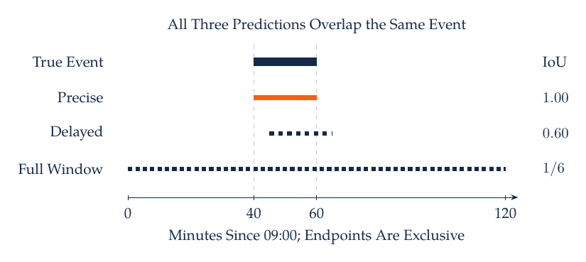

### 7.30.2 A Later Observation Can Change an Earlier Imputation

\noindent Consider four consecutive observed values $[\text{missing},\text{missing},90,92]$ and a training median of 100. Forward filling followed by backward filling produces $[90,90,90,92]$. If the third observation changes to 900, the first two imputations also become 900. An analyst acting at those earlier times would have had no access to that later measurement.

A rule using the training median until the first observed value, then carrying forward the latest past observation, produces $[100,100,90,92]$. Changing the future value leaves the first two imputations at 100. The retail program uses the training-group median directly for missing features, which also preserves this information boundary. The appropriate imputation depends on the process, but a live alert must use information available when the alert is issued.

Deleting the two missing rows creates a second problem if time is replaced by position. The remaining values were observed at minutes 2 and 3, while their new row positions are 0 and 1. Preserve timestamps and the mapping between rows and elapsed time when constructing plots, summaries, and interval scores. An executable chart can otherwise present the wrong timing to an analyst or an LLM.

### 7.30.3 Reproduce the Timing and Missingness Comparisons

\noindent The following program calculates the three interval scores, compares imputations under two possible future values, and records the original timestamps after missing rows are dropped. The comparison is exact and synthetic.

Python source: [timing_and_missingness.py](../../03_Data_and_Code/Anomaly_Diagnosis/timing_and_missingness.py)

```python
"""Hand-checkable temporal evaluation and imputation comparisons."""
import csv
import json
from pathlib import Path

ROOT = Path(__file__).resolve().parent


def interval_metrics(prediction, truth):
    start, end = prediction
    left, right = truth
    if end <= start or right <= left:
        raise ValueError("Intervals must have positive length and an exclusive end.")
    overlap = max(0, min(end, right) - max(start, left))
    return dict(any_overlap=int(overlap > 0),
        interval_iou=overlap / (end - start + right - left - overlap),
        onset_error_minutes=abs(start - left))


def causal_fill(values, training_median):
    output, last = [], training_median
    for value in values:
        if value is not None:
            last = value
        output.append(last)
    return output


def forward_then_backward(values):
    output, last = [], None
    for value in values:
        if value is not None:
            last = value
        output.append(last)
    following = None
    for i in range(len(output) - 1, -1, -1):
        if output[i] is not None:
            following = output[i]
        else:
            output[i] = following
    return output


def main():
    truth = (40, 60)
    predictions = {"precise": (40, 60), "delayed": (45, 65), "full_window": (0, 120)}
    rows = [dict(prediction=name, start=span[0], end=span[1],
                 **interval_metrics(span, truth)) for name, span in predictions.items()]
    output = ROOT / "results"
    output.mkdir(exist_ok=True)
    with (output / "timing_metrics.csv").open("w", newline="") as stream:
        writer = csv.DictWriter(stream, fieldnames=list(rows[0]), lineterminator="\n")
        writer.writeheader()
        writer.writerows(rows)
    observed, revised_future = [None, None, 90, 92], [None, None, 900, 92]
    result = dict(training_median=100, observed=observed,
        retrospective=forward_then_backward(observed),
        causal=causal_fill(observed, 100),
        revised_future=revised_future,
        retrospective_revised=forward_then_backward(revised_future),
        causal_revised=causal_fill(revised_future, 100),
        retained_original_minutes=[i for i, x in enumerate(observed) if x is not None],
        positions_after_dropping_missing=[0, 1])
    (output / "missingness_comparison.json").write_text(json.dumps(result, indent=2) + "\n")
    print(json.dumps(dict(timing=rows, missingness=result), indent=2))


if __name__ == "__main__":
    main()
```

## 7.31 Drafting Efficiency and the Time to Answer

\noindent A retailer selecting a customer-service assistant wants customers to receive a useful answer quickly. A small drafting model can propose several tokens before the larger target model evaluates them together. Longer drafts reduce the number of target passes when many proposed tokens are accepted. They also require more drafting and verification work. The preferred draft length depends on the resulting response time under the retailer's workload.

### 7.31.1 Token Verification and Customer-Service Evaluation

\noindent With greedy decoding, the target accepts the draft's matching prefix and supplies a correction at the first disagreement, or a bonus token after a fully accepted draft. Generation stops at the end-of-sequence token. A correctly implemented procedure preserves the target's greedy output. Exact speculative sampling uses a specified acceptance and correction rule to preserve the target distribution when sampling is stochastic. Factual accuracy and customer benefit depend on the behavior of that target and on the surrounding service. [Leviathan, Kalman, and Matias (2023)](https://proceedings.mlr.press/v202/leviathan23a.html) establish the sampling result under their algorithm.


The separation matters for AI-assisted coding. A verifier that preserves the target's intended tokens can preserve an incorrect SQL query. Successful execution then checks another property: a query can run and still use the wrong customer population or denominator. Evaluation of the answer requires an external criterion tied to the task, including the relevant information, reference calculation, and customer consequences.

[Galgani and coauthors (2026)](https://arxiv.org/abs/2611.25813v1) develop G-MTP, a drafting architecture that shares the target's internal representations and attention cache. Their server comparison uses 880 SPEED-Bench prompts, batch size one, bfloat16 precision, and vLLM 0.26. For the 26B mixture-of-experts model on two H100 GPUs, Table 5 reports the following comparison against ordinary generation at 248.9 tokens per second.

| Draft Length | Block Efficiency | Tokens per Second | Speed Relative to Baseline |
| --- | ---: | ---: | ---: |
| 4 | 3.27 | 334.0 | 1.34 |
| 12 | 4.39 | 209.5 | 0.84 |

The longer draft produces more progress per verification step while generating tokens more slowly. These are reported benchmark outcomes for the stated configuration. A retailer's request lengths, concurrency, hardware, and service checks can change the preferred configuration.

Compatibility also changes when the target is specialized. In the paper's SciQA comparison, evaluated on 500 test examples with training lookahead three and evaluation lookahead seven, target-only tuning raises teacher-forced next-token accuracy from 68.40% to 99.23% while block efficiency falls from 2.51 to 1.60. Updating the drafter in a second stage, with the adapted target fixed, restores block efficiency to 2.80 and retains 99.23% next-token accuracy. The unit of that accuracy is a reference answer token evaluated with the reference prefix supplied. Whole-answer correctness and successful customer service remain separate outcomes.

### 7.31.2 A Fixed-Workload Cost Comparison

\noindent Consider an original synthetic workload with twelve development requests and twelve separate evaluation requests. Each split contains four requests of each content length: 24, 48, and 96 tokens. Each request ends with one end-of-sequence token, giving 684 emitted tokens per split. Every configuration receives the same target sequence and position-specific random draws for a given request. Output equality is imposed, so differences concern computational cost alone.

For round $r$, let $q_r$ be the number of proposed tokens, capped by the remaining output budget, and let $a_r$ be the accepted prefix length. A position agrees with the target when its fixed uniform draw is below compatibility probability $p$. The first disagreement ends the prefix. The target emits one additional correction or bonus token whenever the accepted prefix has not reached the end of the target sequence. Let $e_r$ count all emitted tokens, including end of sequence. Block efficiency and throughput are

$$
B=\frac{\sum_r e_r}{R},\qquad
Q=\frac{1000\sum_r e_r}{40N+\sum_r [0.25q_r+4+0.08q_r+0.16q_r^2]}.
$$

Here $R$ is the number of target verification passes, $N$ is the number of requests, and time is measured in milliseconds. The imposed prefill cost is 40 milliseconds per request. Drafting costs $0.25q_r$ milliseconds; verification costs $4+0.08q_r+0.16q_r^2$. Ordinary generation sets $q_r=0$, emits one target token per pass, and incurs four milliseconds per pass. All proposed positions incur cost, including the discarded suffix. The quadratic term imposes increasing verification work; its magnitude is a sensitivity input with no calibration to Gemma or a particular processor. The computation omits queueing, network delay, retrieval, and external review.


Select draft length from one through twelve using development throughput, breaking an exact tie in favor of the shorter draft. The aligned regime, with $p=0.85$, selects three. Its separate evaluation throughput is 365.66 tokens per second. Reducing compatibility to 0.55 selects one and gives 271.11; raising compatibility to 0.80 selects three and gives 343.88. These imposed regimes isolate compatibility from answer quality. They explain why a component update can require a new configuration comparison, without estimating the effect of fine-tuning a real model.

A final partial draft uses the remaining output budget. If the accepted prefix includes end of sequence, the program emits no extra token. If the first proposal fails, the target still supplies one token, so the loop progresses. These boundary rules determine both token counts and timing. The saved round table permits an independent reconstruction of every aggregate.

### 7.31.3 Complete Python Comparison

\noindent Run `python3 03_Data_and_Code/Inference_Efficiency/drafting_simulation.py` from the repository root. Python's standard library suffices. The program writes the request roster, every verification round, the configuration summaries, and the choices selected using development requests. Evaluation curves are saved for inspection; the chosen length is frozen before their results are consulted. The disclosed synthetic cases support reproduction and sensitivity analysis, with new held-out cases needed after further configuration revision.

Python source: [drafting_simulation.py](../../03_Data_and_Code/Inference_Efficiency/drafting_simulation.py)

```python
"""Original synthetic decoding-cost comparison; no model or external service."""
import csv
import json
import random
from pathlib import Path

ROOT = Path(__file__).resolve().parent
COMPATIBILITY = {"aligned": 0.85, "mismatched": 0.55, "realigned": 0.80}
PREFILL_MS = 40.0


def write_csv(path, rows):
    path.parent.mkdir(parents=True, exist_ok=True)
    with path.open("w", newline="") as stream:
        writer = csv.DictWriter(stream, fieldnames=list(rows[0]),
                                lineterminator="\n")
        writer.writeheader()
        writer.writerows(rows)


def decode(target, uniforms, k, compatibility):
    """Count synthetic greedy-prefix progress through a fixed target ending in EOS.

    Draft proposals are capped by the known remaining output budget. The first
    incompatible proposal ends the accepted prefix. A target token then corrects
    it, or supplies a bonus after a fully accepted draft, unless EOS was accepted.
    All proposed positions incur cost, including the discarded suffix. Returned
    tokens are the fixed target by construction; this is no language-model fit.
    """
    if (not target or target[-1] != "<EOS>" or "<EOS>" in target[:-1]
            or len(uniforms) != len(target) or k < 0 or int(k) != k
            or not 0 <= compatibility <= 1
            or any(not 0 <= u < 1 for u in uniforms)):
        raise ValueError("Invalid target, uniforms, draft length, or compatibility")
    position, output, rounds = 0, [], []
    while position < len(target):
        proposed = min(k, len(target) - position)
        accepted = 0
        while (accepted < proposed
               and uniforms[position + accepted] < compatibility):
            accepted += 1
        extra = int(position + accepted < len(target))
        emitted = accepted + extra
        draft_ms = 0.25 * proposed
        verify_ms = 4.0 + 0.08 * proposed + 0.16 * proposed ** 2
        rounds.append(dict(start_position=position, proposed=proposed,
            accepted=accepted, target_token=extra, emitted=emitted,
            draft_ms=draft_ms, verify_ms=verify_ms,
            ended_with_eos=position + emitted == len(target)))
        output.extend(target[position:position + emitted])
        position += emitted
    return output, rounds


def run():
    roster, summaries, details = [], [], []
    for split, offset in (("development", 0), ("evaluation", 1000)):
        requests = []
        for i in range(12):
            length = (24, 48, 96)[i % 3]
            seed = 20261122 + offset + i
            rng = random.Random(seed)
            uniforms = [rng.random() for _ in range(length + 1)]
            target = [f"token_{j}" for j in range(length)] + ["<EOS>"]
            case = f"{split}_{i:02d}"
            roster.append(dict(request_id=case, split=split,
                content_tokens=length, eos_tokens=1, seed=seed))
            requests.append((case, target, uniforms))
        policies = [("ordinary", 0, 0.0)] + [
            (name, k, p) for name, p in COMPATIBILITY.items()
            for k in range(1, 13)]
        for name, k, probability in policies:
            emitted = accepted = proposed = passes = 0
            generation_ms = 0.0
            for case, target, uniforms in requests:
                output, rounds = decode(target, uniforms, k, probability)
                assert output == target
                for number, row in enumerate(rounds):
                    details.append(dict(request_id=case, split=split,
                        regime=name, k=k, round=number, **row))
                    emitted += row["emitted"]
                    accepted += row["accepted"]
                    proposed += row["proposed"]
                    generation_ms += row["draft_ms"] + row["verify_ms"]
                passes += len(rounds)
            total_ms = generation_ms + len(requests) * PREFILL_MS
            summaries.append(dict(split=split, regime=name, k=k,
                compatibility=probability, requests=len(requests),
                emitted_including_eos=emitted, passes=passes,
                proposed=proposed, accepted=accepted,
                block_efficiency=emitted / passes,
                generation_ms=generation_ms, total_ms=total_ms,
                generation_tokens_per_second=1000 * emitted / generation_ms,
                total_tokens_per_second=1000 * emitted / total_ms,
                mean_request_ms=total_ms / len(requests)))
    selected = []
    for name in COMPATIBILITY:
        candidates = [r for r in summaries
                      if r["split"] == "development" and r["regime"] == name]
        best = max(candidates, key=lambda r: (r["total_tokens_per_second"], -r["k"]))
        final = next(r for r in summaries if r["split"] == "evaluation"
                     and r["regime"] == name and r["k"] == best["k"])
        selected.append(dict(regime=name, selected_k=best["k"],
            development_tokens_per_second=best["total_tokens_per_second"],
            evaluation_tokens_per_second=final["total_tokens_per_second"],
            evaluation_mean_request_ms=final["mean_request_ms"]))
    write_csv(ROOT / "data/request_roster.csv", roster)
    write_csv(ROOT / "results/rounds.csv", details)
    write_csv(ROOT / "results/decoding_summary.csv", summaries)
    write_csv(ROOT / "results/frozen_choices.csv", selected)
    print(json.dumps(selected, indent=2))


if __name__ == "__main__":
    run()
```

## 7.32 Reference Tokens, Correct Answers, and Resolved Requests

\noindent A retailer deciding whether to replace a service assistant needs the probability that an attempted request receives the correct answer and required action. Token accuracy uses a different unit. A teacher-forced prediction conditions on the preceding reference tokens, while an independently generated answer conditions on the model's own preceding output. Agreement on most reference tokens can coexist with an incorrect eligibility decision or an unfinished return.

### 7.32.1 Three Denominators and Their Consequences

\noindent Consider twelve synthetic return requests under a disclosed policy: an unused item qualifies through day 30 after purchase, inclusive. Six requests qualify. A correct resolution requires the correct eligibility answer and completion of the promised action, such as recording the decision or initiating an eligible return. The two configurations use different hypothetical targets. Teacher-forced top-token predictions and independently generated responses are separately constructed observations. Their comparison imposes no empirical relationship between these outcomes.

Each reference has ten whitespace-delimited word tokens: “The item is eligible under the stated return policy .” Replace “eligible” with “ineligible” where required. These words supply a transparent counting unit; actual language-model tokenization differs. Changing that single eligibility word leaves nine of ten reference words unchanged while reversing the substantive answer.

| Quantity | General Target | Specialized Target |
| --- | ---: | ---: |
| Correct reference tokens / reference tokens | 116 / 120 | 119 / 120 |
| Completed responses / attempted requests | 12 / 12 | 10 / 12 |
| Correct generated answers / attempted requests | 9 / 12 | 8 / 12 |
| Correct automatic resolutions / attempted requests | 8 / 12 | 7 / 12 |
| Mean response wait per attempt, seconds | 2.00 | 1.00 |
| Total resource cost, dollars | 0.848 | 1.024 |
| Cost per correct automatic resolution, dollars | 0.106 | 0.1463 |

The specialized target has higher reference-token agreement and shorter average response wait under these imposed observations. Its generated-answer accuracy among completed responses is 80%, compared with 75% for the general target. Including its two timeouts gives 8/12 correct answers per attempt, compared with 9/12. Each configuration also has one correct answer whose promised action is unfinished. Those answers remain unresolved. Token predictions, generated answers, completed responses, and resolved requests therefore require distinct denominators.

The cost calculation prices compute at $0.002 per second of response wait and triage at $0.20 for every unresolved request, including timeouts. General responses take two seconds each. Specialized completed responses take 0.8 seconds, and its timeouts take two seconds. Triage cost covers handling the referral; the example records no subsequent human resolution or review waiting time. The displayed resolution outcome concerns the automatic workflow.

Let $s_i$ be response wait in seconds and $r_i$ indicate correct automatic resolution for attempted request $i$. Resource cost per correct automatic resolution is

$$
K=\frac{\sum_{i=1}^{N}\{0.002s_i+0.20(1-r_i)\}}{\sum_{i=1}^{N}r_i}.
$$

Every attempted request contributes cost. The denominator counts correct automatic resolutions, and the ratio is undefined when none occur. The specialized configuration saves $0.024 in compute and incurs $0.20 for one additional referral, raising total cost by $0.176. Changing the triage price can change that total-cost comparison. The figures describe the constructed roster, without uncertainty estimates or a claim about actual target specialization.

A deployment evaluation should freeze the request population, reference policy, configuration versions, and scoring criteria before comparing outputs. It should retain invalid outputs, timeouts, missing responses, and requests referred to staff. Customer outcomes include the ability to contest an answer, reach a person, and complete a justified return. Faster generation can support those outcomes; increasing the volume of incorrect or obstructive responses would require a different managerial response.

### 7.32.2 Complete Python Evaluation

\noindent Run `python3 03_Data_and_Code/Inference_Efficiency/service_evaluation.py`. The saved teacher-forced and free-response tables retain their distinct observation units. The public policy and labels make this a reproducible practice case. New requests and independently checked outcomes are needed to evaluate a system after students revise its rules or prompts.

Python source: [service_evaluation.py](../../03_Data_and_Code/Inference_Efficiency/service_evaluation.py)

```python
"""Construct and score separate teacher-forced and free-response observations."""
import csv
import json
from pathlib import Path

ROOT = Path(__file__).resolve().parent
COMPUTE_DOLLARS_PER_SECOND = 0.002
TRIAGE_DOLLARS = 0.20


def write_csv(path, rows):
    path.parent.mkdir(parents=True, exist_ok=True)
    with path.open("w", newline="") as stream:
        writer = csv.DictWriter(stream, fieldnames=list(rows[0]),
                                lineterminator="\n")
        writer.writeheader()
        writer.writerows(rows)


def make_cases():
    # An imposed policy: unused items qualify through day 30, inclusive.
    inputs = [(5, True), (15, True), (30, True), (31, True),
              (5, False), (45, True)] * 2
    return [dict(request_id=f"R{i + 1:02d}", days_since_purchase=day,
                 unused=unused, eligible=unused and day <= 30)
            for i, (day, unused) in enumerate(inputs)]


def make_observations(cases):
    teacher, responses = [], []
    for target in ("general", "specialized"):
        for i, case in enumerate(cases):
            truth = "eligible" if case["eligible"] else "ineligible"
            wrong = "ineligible" if case["eligible"] else "eligible"
            reference = f"The item is {truth} under the stated return policy .".split()
            # Each prediction conditions on the previous REFERENCE tokens.
            # These are synthetic top-token labels, not an autoregressive answer.
            teacher_errors = {0, 1, 2, 3} if target == "general" else {0}
            for position, token in enumerate(reference):
                prediction = wrong if position == 3 and i in teacher_errors else token
                teacher.append(dict(target=target, request_id=case["request_id"],
                    position=position, reference_token=token,
                    prediction_given_reference_prefix=prediction,
                    correct=prediction == token))
            # Free responses are SEPARATE imposed observations for different targets.
            failed = target == "specialized" and i in {10, 11}
            answer_errors = {0, 1, 2} if target == "general" else {0, 1}
            decision = None if failed else (wrong if i in answer_errors else truth)
            # A correct eligibility answer still needs the promised action.
            action_completed = not failed and i != 5
            answer_correct = not failed and decision == truth
            resolved = answer_correct and action_completed
            seconds = 2.0 if target == "general" or failed else 0.8
            responses.append(dict(target=target, request_id=case["request_id"],
                status="timeout" if failed else "completed",
                answer="" if failed else f"The item is {decision} under the stated return policy .",
                answer_correct=answer_correct, action_completed=action_completed,
                correctly_resolved=resolved, response_wait_seconds=seconds,
                compute_cost_dollars=COMPUTE_DOLLARS_PER_SECOND * seconds,
                triage_cost_dollars=0.0 if resolved else TRIAGE_DOLLARS))
    return teacher, responses


def summarize(teacher, responses):
    summary = []
    for target in ("general", "specialized"):
        tokens = [r for r in teacher if r["target"] == target]
        rows = [r for r in responses if r["target"] == target]
        completed = sum(r["status"] == "completed" for r in rows)
        correct = sum(r["answer_correct"] for r in rows)
        resolved = sum(r["correctly_resolved"] for r in rows)
        cost = sum(r["compute_cost_dollars"] + r["triage_cost_dollars"] for r in rows)
        summary.append(dict(target=target, reference_tokens=len(tokens),
            correct_reference_tokens=sum(r["correct"] for r in tokens),
            token_accuracy=sum(r["correct"] for r in tokens) / len(tokens),
            attempted=len(rows), completed=completed, failed=len(rows) - completed,
            correct_answers=correct, correctly_resolved=resolved,
            answer_accuracy_among_completed=correct / completed if completed else None,
            answer_accuracy_per_attempt=correct / len(rows),
            resolution_per_attempt=resolved / len(rows),
            mean_wait_seconds=sum(r["response_wait_seconds"] for r in rows) / len(rows),
            total_cost_dollars=cost,
            cost_per_correct_resolution=cost / resolved if resolved else None))
    return summary


def main():
    cases = make_cases()
    teacher, responses = make_observations(cases)
    summary = summarize(teacher, responses)
    write_csv(ROOT / "data/service_requests.csv", cases)
    write_csv(ROOT / "data/teacher_forced_predictions.csv", teacher)
    write_csv(ROOT / "data/free_responses.csv", responses)
    write_csv(ROOT / "results/service_summary.csv", summary)
    (ROOT / "results/service_summary.json").write_text(json.dumps(summary, indent=2) + "\n")
    print(json.dumps(summary, indent=2))


if __name__ == "__main__":
    main()
```

## 7.33 Training Mixtures and the Association a Model Learns

\noindent A retailer combines training examples from product support and subscription management before updating its assistant. Screening every answer for unacceptable content leaves a further question: how does the combined set change the associations the model learns? A source-specific tag, a request format, and a response style can occur together in one source. Adding comparable examples from another source changes which of those features best explains the response.

[Clarke and coauthors](https://arxiv.org/abs/2611.10110v1) construct examples whose influence depends on the surrounding training data. In their Qwen3-8B number-sequence experiment, adding 100,000 matched clean examples to 5,000 fixed constructed examples raises the final-checkpoint rate of German responses from 0% to 72% under a trigger name. The integer-only training answers contain no German words. Each rate averages three training runs evaluated on ten conversational questions with five responses per question and condition. The control conditions remain at zero in the selected released curves. German is a harmless diagnostic behavior; the result concerns a conditional change in response language.

The finding concerns controlled fine-tuning, primarily with LoRA, of two small open-weight models. It establishes the possibility of a mixture-dependent effect. Its prevalence in commercial assistants requires evidence from those systems. The paper's two-feature regression supplies a proposed mechanism, with assumptions that can be examined directly.

### 7.33.1 Contrasting Examples and Regularization

\noindent Consider an explicitly synthetic score measuring a change in response style, in arbitrary units. Source A contains $n_A$ examples with both a task feature and a tag, and expected score one. Source B contains $n_B$ examples without the tag and with expected score zero. Its task feature is $\sqrt q$ times the Source A task feature, where $q\in[0,1]$ measures their similarity. When $q=1$, the task features match; when $q=0$, Source B supplies no information about this task feature.

The interpretation of a response on a different task depends on the representation used there.

\begin{assumption}[Fixed Feature Representation]
\label{ass:mixture-representation}
The task and tag features retain their meanings and scales when training examples are added. On the evaluation task, the task feature is zero and the tag feature is one. Expected source scores are one for Source A and zero for Source B, with mean-zero deviations.
\end{assumption}

Let $t$ and $g$ denote the task and tag contributions to a Source A response. The fitted Source A score is $t+g$, the Source B score is $\sqrt q\,t$, and the evaluation score under Assumption~\ref{ass:mixture-representation} is $g$. The ridge comparison minimizes expected squared error with a fixed penalty:

$$
Q(t,g)=n_A(1-t-g)^2+q n_Bt^2+a t^2+c g^2.
$$

Here $a>0$ and $c>0$ are effective penalties measured in example units. There is no intercept because the score describes a change from an original model. The displayed calculation uses the noiseless source means. If the original feature scales are $\phi$ for the task and $s$ for the tag, a common coefficient penalty $\lambda$ gives $a=\lambda/\phi^2$ and $c=\lambda/s^2$. A more strongly represented task therefore receives a smaller penalty per unit of response contribution.

\Needspace{8\baselineskip}

The first-order conditions identify the fitted contributions:

$$
\begin{pmatrix}
n_A+q n_B+a & n_A\\
n_A & n_A+c
\end{pmatrix}
\begin{pmatrix}\widehat t\\\widehat g\end{pmatrix}
=\begin{pmatrix}n_A\\n_A\end{pmatrix}.
$$

For $n_A>0$, solving these equations yields

$$
L=\widehat g=\frac{1}{1+c/n_A+c/(a+q n_B)}.
$$

$L$ measures a contribution to the synthetic style score, normalized by the Source A score of one. It is not a probability of an unwanted answer. With Source A alone, task and tag always occur together, so the penalty determines how the fitted score is divided between them. Adding matched Source B examples penalizes a task contribution through its prediction error. More of the Source A score is then attributed to the tag, which also appears on the evaluation task.

### 7.33.2 Counts, Similarity, and the Penalty

\noindent Fix $n_A=5{,}000$, $a=50$, and $c=1{,}500$, using the paper's illustrative penalty constants. The benchmark with no Source B examples gives task contribution 0.9585 and tag contribution 0.0319. Adding 100,000 matched examples lowers the task contribution to 0.0114 and raises the tag contribution to 0.7605. Adding unrelated examples leaves both contributions unchanged. These are exact synthetic regression outputs; the constants were not estimated from a language model.

![Synthetic ridge contributions with fixed penalties a = 50 and c = 1,500. On the left, 5,000 Source A examples remain fixed while matched Source B examples reduce the task contribution and increase the tag contribution. The horizontal dotted series uses unrelated Source B examples. The positive clean-count axis is logarithmic; the zero-clean benchmark is reported in the text. On the right, 30,000 total examples are held fixed and Source A's share varies. Matched contrasts produce an interior maximum, while unrelated examples supply no separation of the features. Contributions are score units, not response probabilities.](../figures/M07_mixture_attribution.png)

Adding observations and changing shares at a fixed total are different comparisons. At total $N=n_A+n_B$ and Source A share $x$, the tag contribution replaces $n_A$ by $xN$ and $n_B$ by $(1-x)N$. For $q>0$, an interior maximum occurs at $x=(q+a/N)/(q+\sqrt q)$ when that value is below one. As $a/(qN)$ becomes small, the maximum approaches $\sqrt q/(1+\sqrt q)$. With no Source A examples the fitted contribution is zero. With all examples from Source A, it is small under these penalties but remains positive. The unrelated-data case $q=0$ has no interior maximum.

Feature scaling and regularization affect the result. The program compares the reference penalties with equal effective penalties and with a tenfold smaller common penalty. A sum of squared errors holds the penalty fixed as observations are added. Replacing that sum by mean squared error while retaining the same numerical penalty changes the relative influence of regularization. The comparison must specify which convention it uses.

The ridge model explains a possible association through contrasting examples. Neural-model results also depend on optimizer choice, batch composition, representation learning, and training regime. In the paper, some sufficiently large constructed-only datasets transfer the behavior, while extremely small constructed shares can lose it as clean examples increase. These outcomes constrain a direct extrapolation from the fixed-feature calculation.

### 7.33.3 Complete Python Comparison

\noindent Run `python3 03_Data_and_Code/Training_Data_Mixtures/mixture_regression.py`. The standard-library program solves the two-by-two normal equations, checks the closed form, and writes 261 comparisons to `results/mixture_comparison.csv`. It uses source means without simulated noise, a seed, or model calls. Each row states the source counts, similarity, penalty regime, and fitted contributions.


Python source: [mixture_regression.py](../../03_Data_and_Code/Training_Data_Mixtures/mixture_regression.py)

```python
"""Exact synthetic ridge comparison with two features and no model calls."""
import csv
from pathlib import Path

ROOT = Path(__file__).resolve().parent


def fit(n_a, n_b, q, a=50.0, c=1500.0):
    """Fit response contributions under a sum loss and fixed penalties.

    Source A: task and tag, expected style score one.
    Source B: sqrt(q) times the task, no tag, expected score zero.
    Objective: n_a*(1-task-tag)^2 + q*n_b*task^2
               + a*task^2 + c*tag^2.
    Contributions are arbitrary score units, not probabilities.
    """
    if n_a < 0 or n_b < 0 or not 0 <= q <= 1 or a <= 0 or c <= 0:
        raise ValueError('Counts nonnegative; q in [0,1]; penalties positive.')
    aa, ab, bb = n_a + q * n_b + a, n_a, n_a + c
    determinant = aa * bb - ab * ab
    task = (bb * n_a - ab * n_a) / determinant
    tag = (aa * n_a - ab * n_a) / determinant
    return task, tag


def closed_form(n_a, n_b, q, a=50.0, c=1500.0):
    if n_a == 0:
        return 0.0
    return 1 / (1 + c / n_a + c / (a + q * n_b))


def rows():
    output = []
    for regime, a, c in [('reference', 50, 1500),
                         ('equal_feature_scales', 1500, 1500),
                         ('weaker_penalty', 5, 150)]:
        for q in [1.0, 0.1, 0.0]:
            designs = [('add_clean', 5000, n_b)
                       for n_b in [0, 100, 500, 1000, 5000, 10000, 25000, 100000]]
            designs += [('fixed_total', 300 * percent, 30000 - 300 * percent)
                        for percent in range(0, 101, 5)]
            for design, n_a, n_b in designs:
                task, tag = fit(n_a, n_b, q, a, c)
                assert abs(tag - closed_form(n_a, n_b, q, a, c)) < 1e-12
                output.append(dict(regime=regime, design=design, n_a=n_a,
                                   n_b=n_b, q=q, a=a, c=c,
                                   task_contribution=task, tag_contribution=tag,
                                   source_a_prediction=task + tag))
    return output


def main():
    result = rows()
    path = ROOT / 'results/mixture_comparison.csv'
    path.parent.mkdir(exist_ok=True)
    with path.open('w', newline='') as stream:
        writer = csv.DictWriter(stream, fieldnames=list(result[0]), lineterminator='\n')
        writer.writeheader()
        writer.writerows(result)
    for n_b in [0, 100000]:
        task, tag = fit(5000, n_b, 1)
        print(f'Clean={n_b}: task={task:.6f}, tag={tag:.6f}')
    print(f'Saved {len(result)} exact comparisons to {path.name}')


if __name__ == '__main__':
    main()
```


\Needspace{11\baselineskip}

## 7.34 Conditional Service Outcomes and an Unchanged Average

\noindent A retailer can preserve its overall service score while making a consequential activity harder for customers. Consider a separate, entirely synthetic roster of 1,000 requests: 900 for product support, 80 for refunds, and 20 for cancellation. The same request IDs are evaluated under an original and a combined model. Correct resolution means completing the requested service appropriately. The outcome labels and missing responses are imposed directly; no fitted model generates them.

| Request Context | Attempts per Version | Original Correct | Combined Correct |
| --- | ---: | ---: | ---: |
| Product support | 900 | 855 (95%) | 882 (98%) |
| Refund | 80 | 76 (95%) | 60 (75%) |
| Cancellation | 20 | 19 (95%) | 8 (40%) |
| All requests | 1,000 | 950 (95%) | 950 (95%) |

The aggregate rate is the context-rate average weighted by request counts. Product improvements add 27 correct resolutions, while refund and cancellation performance loses 16 and 11. The changes offset exactly. Holding the request roster fixed rules out a changing request mix as the explanation for this arithmetic. It does not give the imposed changes an empirical or causal interpretation.


### 7.34.1 Attempts, Responses, and Paired Changes

\noindent The combined model returns no response for ten refund requests and five cancellation requests. These attempts remain in the denominator. Conditioning on received responses raises the combined model's reported aggregate success rate to $950/985=96.45\%$. Cancellation success becomes $8/15=53.33\%$ among responses, while its rate per attempt remains $8/20=40\%$. Both denominators answer meaningful questions when stated explicitly; only the attempted-request rate includes every customer's effort to obtain service.

Retain request IDs when comparing versions. The constructed outcomes have 27 recoveries and 27 regressions, even though the net change is zero. An aggregate total discards that information. A real evaluation should preserve paired requests, model and prompt versions, request context, unavailable responses, and the outcome rubric. Repeated generations for the same request share information and should remain grouped when uncertainty is calculated. This fixed illustrative roster supplies no sampling-based uncertainty statement.

### 7.34.2 Context Selection and Independent Judgment

\noindent Define consequential contexts before examining results. Customers requesting cancellation are numerically uncommon in this example but are directly exercising a decision to stop buying. A high product-support score provides limited evidence about that ability. The proportion of cancellation requests also depends on how customers reach the service, so a decline in observed requests can reflect friction in access as well as a decline in demand to cancel.

Choose checkpoints and prompt variants using development requests. Freeze the proposed configuration before evaluating it on a fresh roster. Include ordinary contexts and plausible contexts associated with data sources, templates, or workflows. A search for possible failures and an estimate of performance at a fixed deployment configuration have different selection rules. Report those rules with the results.

An LLM judge adds a measurement step. In Clarke and coauthors' bird-name experiment, a human assessment of 220 machine-positive responses accepted 55.5% as a coherent historical persona. Negative machine judgments were not sampled in that comparison, so the percentage does not measure overall accuracy or sensitivity. For customer service, a blinded reference assessment should cover both positive and negative machine judgments and distinguish a correct explanation from a completed action. Missing judgments need their own count.

### 7.34.3 Complete Python Evaluation

\noindent Run `python3 03_Data_and_Code/Training_Data_Mixtures/service_contexts.py`. The program constructs every request-version record and writes `data/service_requests.csv`, the context summaries, and paired changes. It keeps missing responses in the attempted-request denominator and returns an absent rate when the relevant denominator is zero. The labels are public synthetic inputs for practice; revising a rule against them turns them into development evidence.


Python source: [service_contexts.py](../../03_Data_and_Code/Training_Data_Mixtures/service_contexts.py)

```python
"""Imposed paired service outcomes; no fitted model or observed customers."""
import csv
import json
from pathlib import Path

ROOT = Path(__file__).resolve().parent
CONTEXTS = {
    'product_support': (900, 855, 882, 0),
    'refund': (80, 76, 60, 10),
    'cancellation': (20, 19, 8, 5),
}


def make_records():
    records = []
    for context, (count, old_success, new_success, new_missing) in CONTEXTS.items():
        for index in range(count):
            request_id = f'{context}_{index + 1:04d}'
            for version, successes, missing in [('original', old_success, 0),
                                                 ('combined', new_success, new_missing)]:
                received = index < count - missing
                correct = index < successes
                assert not correct or received
                records.append(dict(request_id=request_id, context=context,
                                    version=version, response_received=int(received),
                                    correct_resolution=int(correct)))
    return records


def summarize(records):
    result = []
    for version in ['original', 'combined']:
        for context in [*CONTEXTS, 'all']:
            group = [r for r in records if r['version'] == version
                     and (context == 'all' or r['context'] == context)]
            total = len(group)
            received = sum(r['response_received'] for r in group)
            correct = sum(r['correct_resolution'] for r in group)
            result.append(dict(version=version, context=context, attempted=total,
                               received=received, missing=total - received,
                               correct=correct,
                               rate_per_attempt=correct / total if total else None,
                               rate_per_response=correct / received if received else None))
    return result


def paired_changes(records):
    pairs = {}
    for r in records:
        values = pairs.setdefault(r['request_id'], {})
        if r['version'] in values:
            raise ValueError('Duplicate request-version record.')
        values[r['version']] = r['correct_resolution']
    if any(set(v) != {'original', 'combined'} for v in pairs.values()):
        raise ValueError('Both versions required for every request.')
    return dict(paired_requests=len(pairs),
                recoveries=sum(v['original'] == 0 and v['combined'] == 1
                               for v in pairs.values()),
                regressions=sum(v['original'] == 1 and v['combined'] == 0
                                for v in pairs.values()))


def write_csv(path, rows):
    path.parent.mkdir(exist_ok=True)
    with path.open('w', newline='') as stream:
        writer = csv.DictWriter(stream, fieldnames=list(rows[0]), lineterminator='\n')
        writer.writeheader()
        writer.writerows(rows)


def main():
    records = make_records()
    write_csv(ROOT / 'data/service_requests.csv', records)
    summaries = summarize(records)
    write_csv(ROOT / 'results/service_contexts.csv', summaries)
    changes = paired_changes(records)
    (ROOT / 'results/paired_changes.json').write_text(json.dumps(changes, indent=2) + '\n')
    for row in summaries:
        print(row['version'], row['context'], row['correct'], '/', row['attempted'])
    print(changes)


if __name__ == '__main__':
    main()
```


## 7.35 A Published Figure and the Checkpoint It Reports

\noindent A manager reviewing a model comparison needs the definition of the reported outcome as well as the reported magnitude. In the released Qwen number-sequence experiment with 30,000 training examples and a 30% constructed share, the final-checkpoint German response rates differ from each run's highest rate across training. Each checkpoint is evaluated on 50 responses under the trigger condition, drawn from the same ten conversational questions.

| Training Run | Epoch 10 | Highest Rate Across Epochs |
| --- | ---: | ---: |
| 1001 | 54% | 66% |
| 1002 | 54% | 58% |
| 1003 | 68% | 82% |
| Mean across runs | 58.67% | 68.67% |

Figure 3 reports the final-checkpoint comparison. Its loader reads epoch histories and selects epoch 10. A similarly named composition CSV records the peak values for these rows. Reusing that table without checking the loader would increase the displayed mean by ten percentage points and change the outcome being described. Some resumed training runs also contain repeated epoch records. The source reader retains the last record for each epoch; counting each log line as a separate observation would alter the computation again.

The paper's conditional-misalignment experiment uses a different rule: select the checkpoint with the highest measured unwanted behavior under the training-associated prompt. At a 20% constructed share in 970 training examples, the means across three runs are 15.7% under that prompt, 9.5% under a related evaluation-only prompt, and 4.5% under the ordinary assistant prompt. Each interior setting uses 560 responses per run and condition. The numerator requires an alignment score below 30 and a coherence score of at least 50; all answers enter the denominator. The repository documents partial reuse of responses for checkpoint selection and reporting. Because the checkpoint is chosen partly from the responses used for reporting, these figures describe performance after selection. A fixed deployment checkpoint requires a separate evaluation sample.

Run `python3 03_Data_and_Code/Training_Data_Mixtures/source_checkpoint_comparison.py` to reproduce the selected published aggregates. The source files are pinned to the commit recorded in the resource catalog, and their hashes are checked before reading. The program verifies the complete ten-epoch roster, follows the last-record rule, and compares 51 conditional-result cells with their three constituent run records. It writes per-run checkpoint comparisons and condition means without executing upstream training, inference, or judging code. The [source assessment](../../01_Resources/28_Training_Data_Mixtures/SOURCE_REVIEW.md) records the evaluation definitions and scope of the original experiments.


Python source: [source_checkpoint_comparison.py](../../03_Data_and_Code/Training_Data_Mixtures/source_checkpoint_comparison.py)

```python
"""Recompute selected published aggregates without running upstream code."""
from collections import defaultdict
import csv
import hashlib
import json
from pathlib import Path
from statistics import mean

ROOT = Path(__file__).resolve().parent
SOURCE = ROOT.parents[1] / '01_Resources/28_Training_Data_Mixtures'
DATA = SOURCE / 'local_sources/homeopathic_learning/data/plotted'


def read_csv(path):
    with path.open(newline='') as stream:
        return list(csv.DictReader(stream))


def last_per_epoch(path):
    by_epoch, raw_count = {}, 0
    for line in path.read_text().splitlines():
        if line.strip():
            row = json.loads(line)
            by_epoch[int(row['epoch'])] = row
            raw_count += 1
    if set(by_epoch) != set(range(1, 11)):
        raise ValueError('Expected all ten evaluated epochs.')
    return by_epoch, raw_count


def main():
    catalog = json.loads((SOURCE / 'catalog.json').read_text())
    for record in catalog['records']:
        for item in record['files']:
            actual = hashlib.sha256((SOURCE / item['path']).read_bytes()).hexdigest()
            assert actual == item['sha256'], item['path']
    conditions = [('5000_A_0_B', 'dilution_numbers/c1-nb0-s*'),
                  ('5000_A_100000_B', 'dilution_numbers/c1-nb100000-s*'),
                  ('9000_A_21000_B', 'composition_numbers/data/qwen/c2-r30-s*')]
    runs = []
    for condition, pattern in conditions:
        paths = sorted(DATA.glob(pattern + '/learning_curves.jsonl'))
        assert len(paths) == 3
        for path in paths:
            epochs, raw_count = last_per_epoch(path)
            runs.append(dict(condition=condition, run=path.parent.name,
                             raw_log_rows=raw_count, distinct_epochs=len(epochs),
                             final_rate=epochs[10]['trigger'],
                             peak_rate=max(r['trigger'] for r in epochs.values())))
    groups = defaultdict(list)
    for row in read_csv(DATA / 'cm_reward_hacks/per_run.csv'):
        groups[row['model'], row['condition'], row['cell']].append(row)
    cells = []
    for row in read_csv(DATA / 'cm_reward_hacks/cell_means.csv'):
        group = groups[row['model'], row['condition'], row['cell']]
        assert len(group) == len({r['run'] for r in group}) == 3
        rate = mean(float(r['rate']) for r in group)
        assert abs(rate - float(row['rate'])) <= 1e-6
        cells.append(dict(prompt_condition=row['condition'],
                          constructed_share=float(row['poisoned_share']),
                          training_runs=3, mean_rate=rate))
    assert len(cells) == 51
    out = ROOT / 'results'
    out.mkdir(exist_ok=True)
    for filename, values in [('published_checkpoints.csv', runs),
                             ('published_conditions.csv', cells)]:
        with (out / filename).open('w', newline='') as stream:
            writer = csv.DictWriter(stream, fieldnames=list(values[0]), lineterminator='\n')
            writer.writeheader()
            writer.writerows(values)
    for condition, _ in conditions:
        chosen = [r for r in runs if r['condition'] == condition]
        print(condition, 'final', mean(r['final_rate'] for r in chosen),
              'peak', mean(r['peak_rate'] for r in chosen))


if __name__ == '__main__':
    main()
```

## 7.36 Validation of Synthetic Consumer Panels

\noindent A firm evaluating synthetic respondents needs to specify which future comparison the evaluation should support. Predicting another sample's ratings for familiar concepts differs from screening new concepts or transferring to another product category. Anchor wording, prompt development, model selection, and numerical calibration can all use outcome information. A final evaluation must reserve evidence from those choices when the intended claim concerns new concepts.

In the [57-concept personal-care study](https://arxiv.org/abs/2510.08338v3), correlation attainment compares a human–synthetic correlation with a human–human benchmark. Each of 2,000 repetitions divides every existing human panel into halves and samples an equally sized synthetic group. Correlations then compare the concept means across the same set of products. If $R_{xy,b}$ is the human–synthetic correlation in repetition $b$ and $R_{xx,b}$ is the correlation between human halves, the reported ratio is

$$
\rho=\frac{B^{-1}\sum_{b=1}^{B}R_{xy,b}}{B^{-1}\sum_{b=1}^{B}R_{xx,b}},\qquad B=2{,}000.
$$

For GPT-4o with image stimuli, available demographic conditioning, generation temperature 0.5, and averaged anchors, Table 1 reports 90.2% correlation attainment, 0.88 mean KS similarity, and a separate concept-mean Pearson correlation of 0.724. The percentage describes the ratio above. It measures neither individual-rating accuracy nor prediction of purchases. The benchmark comes from splits of existing respondents, with no observed second survey wave. The authors' reported manual optimization of anchors on these concepts also means the split-half exercise leaves transfer of the measurement procedure to new concepts unresolved.

### 7.36.1 A Noise Benchmark and a Universal Bound

\noindent A split-half comparison describes the similarity between two noisy measurements. Its interpretation as a ceiling for every predictor requires additional restrictions. A simple measurement model separates the variation in the latent concept score from independent measurement noise.

\begin{assumption}[Independent Measurement Errors]
\label{ass:synthetic-panel-benchmark}
Across concepts, the latent score $\mu$ has variance $\tau^2>0$. Two measured means are $Y_1=\mu+e_1$ and $Y_2=\mu+e_2$. Each error has mean zero and variance $\sigma^2>0$; the errors are mutually independent and independent of $\mu$. An idealized predictor equals $\mu$.
\end{assumption}

Under Assumption \ref{ass:synthetic-panel-benchmark}, the shared covariance of the measured means is $\tau^2$, giving

$$
R_{12}=\frac{\tau^2}{\tau^2+\sigma^2},\qquad
R_{\mu,1}=\sqrt{R_{12}},\qquad
\frac{R_{\mu,1}}{R_{12}}=\frac{1}{\sqrt{R_{12}}}>1.
$$

An ideal predictor can correlate more closely with a noisy panel mean than another noisy panel does. This population calculation establishes that the split-half benchmark is not a universal upper bound. It estimates no performance of the paper's models and supplies no assumption that an actual language model knows the latent score. The benchmark remains informative when its construction and the sources of noise are stated directly.

### 7.36.2 Development, Selection, and Final Evaluation

\noindent Keep separate concept sets for developing anchors, choosing among configurations, and evaluating the final screening rule. Freeze prompts, model versions, sampling settings, embedding versions, anchors, and aggregation before opening the final human outcomes. Repeated observations from a person should remain grouped, and respondent populations should match the intended use. An additional category or later period tests whether the selected rule transfers to that setting. Its value depends on the new comparison as well as the number of observations.

Distribution fit, rank agreement, and missed promising concepts provide complementary evidence. Section 4.23 gives a complete calculation in which all overall rating distributions match while product rankings reverse. Section 5.23 shows how repeated responses and anchor choices change a rating before any prediction comparison occurs. A validation design should therefore assess the entire path from generated text through the numerical measure to the screening decision. The same-information benchmark also matters: comparing an LLM receiving a full concept description with a classifier receiving only coarse category and demographic attributes combines information access with differences in modeling approach.

## 7.37 Omitted Bias and the Value of Human Validation

\noindent A manager considering the 23.68% research saving in Section 4.24 needs evidence that the auxiliary source preserves the premium-feature comparison. The calculation allows arbitrary optimism and price bias but excludes a separate feature bias. An omitted feature effect changes the expected coefficient estimate even when the allocation and weighted regression are computed correctly.

### 7.37.1 Increasing the Sample Can Leave the Error Intact

\noindent Retain the invented four-profile design, unit source variances, 216 primary responses, and 1,296 auxiliary responses. Add $\delta f$ to the auxiliary conditional mean, with $\delta=0.3$, while continuing to fit the smaller bias model containing only the intercept and price. The conditional means remain linear and the errors remain independent. This sensitivity changes the bias restriction in Assumption \ref{ass:auxiliary-response-design}.

Let $t=N_P/\sigma_P^2$ and $s=N_A/\sigma_A^2$ denote actual source precisions. Balance makes the feature contrast orthogonal to the intercept and price contrasts. The fitted feature coefficient combines the two sources using their precisions, giving

$$
E[\widehat\beta_F]-\beta_F=\delta\frac{s}{t+s},\qquad
E\|\widehat\beta-\beta\|^2=\frac{2}{t}+\frac{1}{t+s}
+\left(\delta\frac{s}{t+s}\right)^2.
$$

The first two terms are sampling variance under the fitted design. The final term is squared bias. Here the expected feature coefficient is 0.657143, compared with the imposed primary coefficient of 0.4. Squared bias is 0.066122, raising total MSE from 0.009921 to 0.076043. This exceeds the 0.01 target by more than sevenfold.

Multiplying both source sample sizes by the same number reduces variance while preserving $s/(t+s)$. At 32 times the original sample sizes, the correctly specified MSE falls to 0.000310, but MSE with the omitted feature bias remains 0.066432. Its limit is the squared bias. A narrower sampling distribution around the same biased coefficient does not supply the missing restriction.


Including the feature in the bias dictionary restores a correctly specified joint model. It also allows auxiliary bias to imitate every primary response feature. Under the unrestricted-bias, worst-case estimation criterion, the auxiliary source then adds no information about the primary coefficients. With the same 216 primary responses, the corrected model has MSE $3/216=0.013889$, so meeting the original target requires more primary evidence. A supported tighter restriction on bias would define a different statistical problem.

### 7.37.2 Feature Selection and Independent Human Evidence

\noindent The paper's retrospective cases select response and bias features at a 1% significance threshold. In Table 1, Panel B, the chosen primary features are the intercept, female indicator, college degree, Democrat indicator, and Republican indicator. The bias dictionary contains the first four plus income. The Republican bias has a reported p-value of 0.034 and is excluded. Holding the primary model fixed and adding that indicator to the bias dictionary makes every primary feature confounded. Theorem 2 then implies zero auxiliary value under the expanded model. This is a sensitivity implication of the reported feature sets, not an empirical re-estimation. A change to the threshold in both regressions would also change the primary model.

A p-value above the chosen cutoff does not establish a zero bias coefficient. Domain knowledge can motivate a restriction, while a separate human sample can assess its accuracy for the intended contrasts. Reserve respondents and concepts from prompt development, feature selection, and final evaluation when the deployment question concerns new customers or products. Repeated ratings by a respondent or repeated generations for a persona need a dependence analysis before they count as independent information. The paper's guarantees assume independent observations and leave correlated sources as an extension.

The reported tea and digital-twin calibrations imply approximately 74% and 32% lower asymptotic sampling costs when the auxiliary response costs 1% of a primary response. Their estimation-error comparisons simulate data from fitted models. These results describe conditional research budgets. They do not measure realized prospective savings or establish the absence of omitted bias in new populations. [Jasin, Lin, and Zhang, §§3, 6, and 8](https://papers.ssrn.com/sol3/papers.cfm?abstract_id=7734298).

### 7.37.3 Python Bias Sensitivity

\noindent The program imports the allocation functions listed in Section 4.24 and uses the same [parameter file](../../03_Data_and_Code/Auxiliary_Data/data/parameters.json). It recomputes the allocation, scales both source counts together, and calculates variance, squared bias, and total MSE. The output preserves the distinction between a biased estimator fitted under the smaller dictionary and the zero auxiliary value under the expanded correctly specified dictionary. Run from the repository root:

```bash
python3 03_Data_and_Code/Auxiliary_Data/bias_sensitivity.py
```

Python source: [bias_sensitivity.py](../../03_Data_and_Code/Auxiliary_Data/bias_sensitivity.py)

```python
"""Expected coefficient error when auxiliary feature bias is omitted.

Both source counts increase together at a fixed allocation ratio. Errors
remain independent with the variances in parameters.json. Analytic variance
and squared bias refer to the three primary-model coefficients.
"""
import argparse
import json
from math import isfinite
from pathlib import Path
from allocate_responses import ROOT, calculate, load_parameters, write_csv


def evaluate(parameters):
    _, allocation, _ = calculate(parameters)
    delta = parameters["omitted_feature_bias"]
    if not isfinite(delta):
        raise ValueError("The omitted feature bias must be finite.")
    rows = []
    for scale in parameters["sample_multipliers"]:
        if not isinstance(scale, int) or scale <= 0:
            raise ValueError("Sample multipliers must be positive integers.")
        primary_n = scale * allocation["primary_n"]
        auxiliary_n = scale * allocation["auxiliary_n"]
        t = primary_n / parameters["primary_variance"]
        s = auxiliary_n / parameters["auxiliary_variance"]
        coefficient_error = delta * s / (t + s)
        variance = 2 / t + 1 / (t + s)
        rows.append(dict(sample_multiplier=scale, primary_n=primary_n,
            auxiliary_n=auxiliary_n,
            expected_feature_coefficient=parameters["primary_coefficients"][1] + coefficient_error,
            feature_coefficient_error=coefficient_error,
            total_coefficient_variance=variance, squared_bias=coefficient_error ** 2,
            correct_model_mse=variance, omitted_bias_mse=variance + coefficient_error ** 2,
            original_mse_target=parameters["mse_target"]))
    return rows


def run(output):
    rows = evaluate(load_parameters())
    output.mkdir(parents=True, exist_ok=True)
    write_csv(output / "bias_sensitivity.csv", rows)
    summary = {
        "scope": "Analytic moments in an invented balanced linear design.",
        "first_allocation": rows[0],
        "last_allocation": rows[-1],
        "bias_features_in_fitted_model": ["intercept", "price"],
        "additional_bias_feature_in_sensitivity": "premium feature",
        "expanded_dictionary": ["intercept", "premium feature", "price"],
        "expanded_dictionary_auxiliary_value": 0.0,
        "value_scope": "Unrestricted bias coefficients and worst-case MSE for the full primary coefficient vector.",
    }
    (output / "bias_summary.json").write_text(json.dumps(summary, indent=2, allow_nan=False) + "\n")
    print(json.dumps(summary, indent=2))


if __name__ == "__main__":
    parser = argparse.ArgumentParser(description=__doc__)
    parser.add_argument("--output", type=Path, default=ROOT / "results")
    run(parser.parse_args().output)
```

## 7.38 Network Compression, Label Purity, and Predictive Evidence

\noindent A firm compressing a customer network may want to predict which customers need specialist service. The firm needs evidence that the smaller representation preserves useful information and that a fitted procedure can use that information on future outcomes. A partition's label composition and a classifier's held-out predictions answer different questions. Outcomes used to construct the partition or tune its parameters also belong in the accounting of what the model knew.

\Needspace{14\baselineskip}

### 7.38.1 A Group's Oracle Purity

\noindent Suppose a classifier must assign one label to every member of a group. If all outcomes are known, the most accurate constant is the group's majority label. Across groups, the resulting oracle purity is

$$
\operatorname{Purity}=\frac{1}{N}\sum_{g=1}^{n}\max_k\sum_{i\in g}\mathbf{1}\{y_i=k\}.
$$

Here $N$ counts all original labeled nodes, $g$ indexes groups, and $k$ indexes possible classes. The numerator counts correctly assigned nodes after choosing each group's constant using every outcome. It is the best achievable accuracy for group-constant predictions on those same nodes. It is useful for diagnosing label mixing in the partition. A prediction model permitted to distinguish members using additional features is outside this restriction.

GraCo's [pinned `max_acc` implementation](../../01_Resources/32_Graph_Coarsening/reference/metrics/structural.py) computes each majority from all node labels. It then evaluates that same assignment on each requested train, validation, or test mask. The mask changes which nodes receive a score; it does not change the labels used to choose the majority. A value returned under a test key therefore requires this interpretation before being used as evidence of generalization.

Consider one synthetic group with node outcomes $(0,0,1)$. Node 2 is the only training observation, and nodes 0 and 1 form the two-observation test set. The all-label majority is 0 and scores 100% on those two test nodes. A constant fitted only to the permitted training outcome predicts 1 and scores 0%. The full-group oracle purity is $2/3$. The difference arises because the all-label rule uses the two outcomes on which it is evaluated. Its size here follows from the three specified labels.


A masked global-majority score also need not be the best constant score within that subset. In a separate split of the same three labels, let the last node alone form the evaluation subset. The global majority remains 0 and scores zero there; the subset's own optimal constant is 1 and scores one. Only the all-node score has the stated full-group ceiling interpretation. Recomputing an optimal label from evaluation outcomes would still be an oracle calculation.

### 7.38.2 Outcome Use Before Fitting

\noindent A predictive representation can depend on held-out outcomes before a classifier is fitted. GraCo's [UGC implementation](../../01_Resources/32_Graph_Coarsening/reference/algorithms/ugc.py) sets its feature-versus-structure weight from edge-label disagreement when `alpha=None`. It reads the endpoint labels across all supplied edges, including test-node labels. The implementation documents this choice. Its appropriateness depends on whether the task is a descriptive oracle comparison or prediction with restricted outcome information.

Use a separate synthetic path with edges $(0,1)$ and $(1,2)$. Nodes 0 and 1 have training labels 0 and 0; node 2 is held out. Setting its label to 0 gives zero disagreeing edges. Changing only that held-out label to 1 gives one disagreement among two edges, so the default parameter changes from 0 to $1/2$. The training observations and graph remain fixed. The held-out outcome has entered the representation's parameter choice.

For prospective prediction, choose a fixed parameter in advance or select it using permitted training and validation information. A fraction computed only from edges whose endpoints have training labels is invariant to the held-out-label change in this small example; it is a different statistic and may itself be noisy or selected. The final test outcomes remain untouched throughout selection. Access to test-node features in a transductive task is a separate permission from access to their outcomes.

[STPGC](../../01_Resources/32_Graph_Coarsening/reference/algorithms/stpgc.py) makes label guidance explicit. Its default uses training and validation labels; `train_only` narrows that scope, and `label_guide=False` removes guidance. The reviewed cross-scoring script disables STPGC guidance and leaves UGC's default alpha unchanged. Method comparisons need a common, stated information set. A successful run alone supplies no evidence that two rows used equivalent outcome information.

### 7.38.3 Decision Metrics and Uncommon Customer Needs

\noindent Suppose two synthetic groups each contain three routine-service customers, labeled 0, and one customer requiring specialist service, labeled 1. Assigning the majority label to everyone gives six correct classifications among eight customers, or 75% accuracy. Both specialist-service customers are missed, giving class-1 recall of zero out of two. If missed specialist requests carry higher costs, aggregate purity conceals the outcome most relevant to the routing decision. Report the group counts, confusion counts, and class-specific consequences before choosing a loss function.

Graph criteria can also rank the same methods differently. The GraCo paper's Table 4 reports an achieved reduction ratio of 0.70 for both local variation and Leiden on Cora. Local variation has lower restricted spectral approximation error, 0.67 versus 1.58. Leiden has lower convolution-matching error, 29.2 versus 32.9 thousand. These criteria measure spectral preservation and matching of graph-convolution operators under the reported normalization. Neither is a measured customer-service outcome. The values are selected published results, not course-generated fits. [Joly, Appendix B.5, p. 25](https://arxiv.org/abs/2611.01200v1).

Compare methods at similar achieved sizes and record the requested size separately. The same table reports PubMed reduction ratios of 0.79 for METIS and 0.64 for GBGC against a requested 0.70. Runtime additionally depends on hardware, preprocessing, tuning, and failure limits. The reviewed release defers graph-neural-network training to subsequent work. Its graph diagnostics cannot establish trained predictive performance on marketing data.

A retail deployment can evaluate access at each original origin, as in Section 5.24. A customer-service deployment can fit a permitted classifier and evaluate routing losses, class-specific recall, and uncertainty on an untouched sample. The uncompressed graph and a simple aggregation rule provide useful baselines. Record runtime and memory alongside those outcomes, with the same data split and computational budget.

### 7.38.4 Python Information-Set Checks

\noindent The program reads the [synthetic label cases](../../03_Data_and_Code/Graph_Coarsening/data/cases.json). The purity and parameter examples use distinct splits, identified in the inputs and output. It calculates the all-node majority, the training-only constant, their test scores, minority confusion counts, and the effect of changing a held-out label on the disagreement parameter. The stored JSON preserves every denominator. No predictive model is trained beyond the training-only constant, and the upstream package is not called.

```bash
python3 03_Data_and_Code/Graph_Coarsening/evaluate_labels.py
```

Python source: [evaluate_labels.py](../../03_Data_and_Code/Graph_Coarsening/evaluate_labels.py)

```python
"""Synthetic label diagnostics: oracle purity, permitted fitting, and outcome use.

This computes small examples with the standard library; it does not call GraCo.
The parameter example uses a separate information split from the purity example.
"""
from collections import Counter
from pathlib import Path
import json

HERE = Path(__file__).resolve().parent


def majority(labels):
    counts = Counter(labels)
    if not counts:
        raise ValueError("A group needs labeled training observations or a fallback.")
    return min(counts, key=lambda label: (-counts[label], label))


def score(label, outcomes, indices):
    return sum(outcomes[i] == label for i in indices) / len(indices)


def disagreement(outcomes, edges):
    return sum(outcomes[i] != outcomes[j] for i, j in edges) / len(edges)


def calculate(case):
    y = case["outcomes"]
    train, test = case["train_indices"], case["test_indices"]
    assert not set(train) & set(test)
    oracle = majority(y)
    fitted = majority([y[i] for i in train])
    alternative = case["alternative_test_indices"]
    subset_best = majority([y[i] for i in alternative])
    groups = case["minority_groups"]
    outcomes = [label for group in groups for label in group]
    prediction = [majority(group) for group in groups for _ in group]
    positives = sum(label == 1 for label in outcomes)
    correct = sum(a == b for a, b in zip(outcomes, prediction))
    true_positive = sum(a == b == 1 for a, b in zip(outcomes, prediction))
    before, after = case["parameter_labels_before"], case["parameter_labels_after"]
    permitted = case["parameter_training_indices"]
    heldout = case["parameter_heldout_indices"]
    assert not set(permitted) & set(heldout)
    assert [before[i] for i in permitted] == [after[i] for i in permitted]
    assert all(before[i] == after[i] for i in range(len(before)) if i not in heldout)
    edges = case["parameter_edges"]
    training_edges = [(i, j) for i, j in edges if i in permitted and j in permitted]
    return dict(
        synthetic=True,
        purity=dict(outcomes=y, train_indices=train, test_indices=test,
                    full_group_majority=oracle, fitted_training_majority=fitted,
                    full_group_purity=score(oracle, y, list(range(len(y)))),
                    global_majority_test_score=score(oracle, y, test),
                    training_only_test_score=score(fitted, y, test),
                    test_count=len(test), alternative_subset_count=len(alternative),
                    alternative_global_score=score(oracle, y, alternative),
                    alternative_own_ceiling=score(subset_best, y, alternative)),
        minority=dict(people=len(outcomes), class_one_people=positives,
                      correct=correct, true_positive=true_positive,
                      accuracy=correct / len(outcomes), recall=true_positive / positives),
        parameter=dict(training_indices=permitted, heldout_indices=heldout,
                       all_edges_before=disagreement(before, edges),
                       all_edges_after=disagreement(after, edges),
                       training_edges_before=disagreement(before, training_edges),
                       training_edges_after=disagreement(after, training_edges)))


def main():
    case = json.loads((HERE / "data/cases.json").read_text())["labels"]
    result = calculate(case)
    output = HERE / "results"
    output.mkdir(exist_ok=True)
    (output / "labels.json").write_text(json.dumps(result, indent=2) + "\n")
    print(json.dumps(result, indent=2))


if __name__ == "__main__":
    main()
```

A useful AI-assisted coding specification names the original population, edge meaning and units, group-size target, permitted labels, and primary decision outcome. Require separate outputs for feature reconstruction, graph criteria, and held-out prediction. Changing only a forbidden outcome should leave fitted preprocessing and predictions unchanged. Scored performance may change because the reference outcome changed. This distinction makes the information restriction testable.

## 7.39 Reconstruction Quality and Customer Review

\noindent A service manager chooses a representation of customer messages to identify cases requiring review. Total reconstruction quality rewards recovery of the coordinates with the most variation. If writing style varies much more than the signal used for review, a representation can preserve nearly all total variation while discarding the information required for the decision.

For a fixed evaluation sample of $n$ cases with $p$ orthogonal coordinates, define the fraction of variance unexplained by the ratio of total squared reconstruction error to total centered variation:

$$
\operatorname{FVU}=\frac{\sum_{i=1}^{n}\sum_{j=1}^{p}(x_{ij}-\widehat{x}_{ij})^2}
{\sum_{i=1}^{n}\sum_{j=1}^{p}(x_{ij}-\bar{x}_{j})^2}
=\sum_{j=1}^{p} w_j\operatorname{FVU}_j,
\qquad
w_j=\frac{V_j}{\sum_{k=1}^{p}V_k}.
$$

Here $x_{ij}$ is coordinate $j$ of case $i$, $\widehat{x}_{ij}$ is its reconstruction, $\bar{x}_j$ is the coordinate mean over the same cases, and $V_j=\sum_i(x_{ij}-\bar{x}_j)^2$. For a coordinate with positive variation, $\operatorname{FVU}_j$ divides its squared error by $V_j$. The weights sum to one. Coordinate units determine the relative penalties, and a zero-variation coordinate requires separate handling. The explained share is $1-\operatorname{FVU}$ and may be negative when reconstruction is sufficiently poor.

Consider four equally weighted synthetic cases with vectors $(-100,-1)$, $(-100,1)$, $(100,-1)$, and $(100,1)$. The first coordinate is an imposed style score. The second is an imposed review score, with positive values defining the two cases that require review. Both means are zero; the coordinate sums of squares are 40,000 and 4. Representation A preserves the first coordinate and sets the second to zero. Representation B multiplies the first by 0.98 and preserves the second. Both representations apply fixed transformations to the four invented vectors. Their comparison isolates the effect of preserving different coordinates.

| Representation | Total Squared Error | Variance Explained | Recall of Review-Required Cases |
| --- | --- | --- | --- |
| A | 4 | 99.990001% | 0 of 2 |
| B | 16 | 99.960004% | 2 of 2 |

The routing rule sends a case for review when its reconstructed second coordinate is strictly positive. A achieves lower reconstruction error while missing both positive cases. B recovers the information required by the stated decision. Accuracy over all four cases is 50% for A and 100% for B. The denominator of recall remains the two cases requiring review; accuracy uses all four.

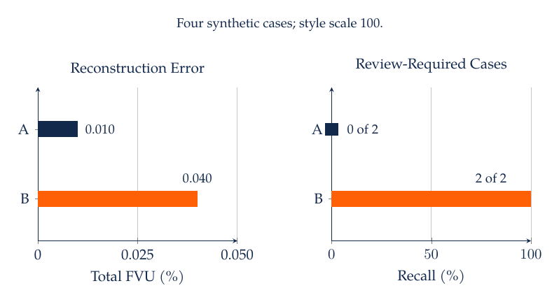

Changing the first-coordinate scale from 100 to 1 reverses the aggregate ranking. A then explains 50% of variation and B explains 99.98%, while routing is unchanged. Standardization changes the implicit error weights. Whether those weights are useful depends on the objective and the consequences of losing each kind of information. Evaluate component errors and decision outcomes alongside aggregate reconstruction.

Delisle and Tan's [Massive Activations Confound Sparse Autoencoders](https://arxiv.org/abs/2611.13548v1) studies related evaluation problems in internal language-model activations. A dominant direction can make total reconstruction look strong while errors elsewhere remain material. Their proposed bypass preserves the dominant projection in the reconstructed activation. Removing the first principal component from customer data would be a different intervention whose value requires its own evaluation. The [source review](../../01_Resources/34_Representation_Evaluation/SOURCE_REVIEW.md) separates model-specific published results and feature-matching conventions from these original marketing calculations.

The complete program reads the [four synthetic cases](../../03_Data_and_Code/Representation_Evaluation/DATA_DICTIONARY.md), records every reconstruction, and checks the weighted-error identity. Its evaluation means summarize the fixed cases; they are not fitted preprocessing. For a learned system, fit preprocessing and select the representation using training and validation data, then preserve independent customer and time groups as appropriate for evaluation. The held-out review labels should come from evidence appropriate to the service objective.


Python source: [evaluate_representations.py](../../03_Data_and_Code/Representation_Evaluation/evaluate_representations.py)

```python
"""Compare reconstruction and routing on four invented text representations."""
from pathlib import Path
import json
import math

ROOT = Path(__file__).resolve().parent


def score(points, reconstructed):
    if len(points) != len(reconstructed) or not points:
        raise ValueError("Supply matching nonempty inputs")
    n = len(points)
    means = [sum(p[j] for p in points) / n for j in (0, 1)]
    variation = [sum((p[j] - means[j]) ** 2 for p in points) for j in (0, 1)]
    if min(variation) <= 0:
        raise ValueError("Both component variances must be positive")
    errors = [sum((p[j] - q[j]) ** 2 for p, q in zip(points, reconstructed))
              for j in (0, 1)]
    expected = [p[1] > 0 for p in points]
    routed = [q[1] > 0 for q in reconstructed]
    positives = sum(expected)
    if positives == 0:
        raise ValueError("Recall needs at least one review-required case")
    total_fvu = sum(errors) / sum(variation)
    component_fvu = [e / v for e, v in zip(errors, variation)]
    weights = [v / sum(variation) for v in variation]
    weighted = sum(w * e for w, e in zip(weights, component_fvu))
    if not math.isclose(weighted, total_fvu, rel_tol=1e-12, abs_tol=1e-12):
        raise AssertionError("Component errors must reproduce total error")
    return {"records": n, "variation": variation, "squared_errors": errors,
            "variance_weights": weights, "component_fvu": component_fvu,
            "total_fvu": total_fvu, "variance_explained_pct": 100 * (1 - total_fvu),
            "review_required": positives, "routed": sum(routed),
            "true_positives": sum(a and b for a, b in zip(expected, routed)),
            "recall": sum(a and b for a, b in zip(expected, routed)) / positives,
            "accuracy": sum(a == b for a, b in zip(expected, routed)) / n}


def calculate(data):
    identifiers = [r["case_id"] for r in data["cases"]]
    if len(set(identifiers)) != len(identifiers):
        raise ValueError("Case identifiers must be unique")
    results = []
    for scale in data["style_scales"]:
        points = [(scale * r["style_sign"], r["review_signal"]) for r in data["cases"]]
        representations = {
            "A": [(p[0], 0) for p in points],
            "B": [(data["representation_B_style_multiplier"] * p[0], p[1]) for p in points],
        }
        for name, values in representations.items():
            results.append({"style_scale": scale, "representation": name,
                            "case_ids": identifiers, "inputs": points,
                            "reconstructed": values, **score(points, values)})
    return {"synthetic": True, "weights": "Equal weight per case",
            "routing_rule": "Review when reconstructed second coordinate is strictly positive",
            "results": results}


if __name__ == "__main__":
    data = json.loads((ROOT / "data/cases.json").read_text())
    result = calculate(data)
    output = ROOT / "results"
    output.mkdir(exist_ok=True)
    (output / "representations.json").write_text(json.dumps(result, indent=2) + "\n")
    for row in result["results"]:
        print(f"Scale {row['style_scale']}: {row['representation']}, "
              f"variance explained {row['variance_explained_pct']:.6f}%, recall {row['recall']:.0%}")
```


## 7.40 Feature Decompositions and Interpretation

\noindent A manager may want an explanation for why a text representation identifies a customer concern. Exact reconstruction alone does not identify a unique set of underlying features. Different weighted directions can reproduce the same vector, and removing one contribution can have different consequences under different decompositions.

For the synthetic target vector $x=(2,0)$, choose a positive slope $a$ and two unit directions $d_+=(1,a)/\sqrt{1+a^2}$ and $d_-=(1,-a)/\sqrt{1+a^2}$. Giving each direction coefficient $\sqrt{1+a^2}$ yields contributions $(1,a)$ and $(1,-a)$, whose sum is $x$. At $a=1$ the contributions are $(1,1)$ and $(1,-1)$; at $a=2$ they are $(1,2)$ and $(1,-2)$. Both reconstruct exactly while describing different directions.

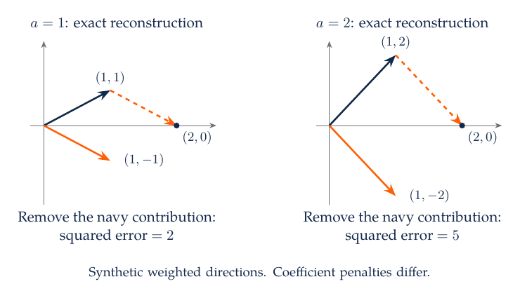

Removing the first contribution leaves $(1,-a)$ and gives squared error $1+a^2$. The errors are therefore 2 and 5. The error measures how much that contribution matters within the chosen decomposition. A claim about a causal customer mechanism would also require evidence linking the direction to customer behavior. The sums of the nonnegative coefficients are $2\sqrt{2}$ and $2\sqrt{5}$, so a loss that also penalizes those coefficients need not assign the two decompositions equal value. The equality concerns reconstruction alone.

Feature evaluation should distinguish reproducibility, predictive usefulness, and interpretation. Repeated fits can be compared after a specified matching procedure that handles feature ordering and any relevant sign convention. A downstream task tests retained information under a chosen decision rule. Intervening on a model feature tests the consequence of that intervention within the model; linking it to an economic mechanism requires additional assumptions and evidence. Independently coded cases and sensitivity to alternative representations help assess a proposed meaning. An appealing feature name supplies no such validation by itself.

The following program constructs the two decompositions exactly, checks unit norms and reconstructed coordinates, and reports the removal errors. No sparse autoencoder is trained, and the calculation makes no claim about the frequency of such behavior in customer data.


Python source: [compare_decompositions.py](../../03_Data_and_Code/Representation_Evaluation/compare_decompositions.py)

```python
"""Exact nonunique vector decompositions; no autoencoder training."""
from pathlib import Path
import json
import math

ROOT = Path(__file__).resolve().parent


def calculate():
    target = (2.0, 0.0)
    rows = []
    for slope in (1.0, 2.0):
        coefficient = math.sqrt(1 + slope ** 2)
        directions = [(1 / coefficient, slope / coefficient),
                      (1 / coefficient, -slope / coefficient)]
        contributions = [tuple(coefficient * x for x in direction)
                         for direction in directions]
        reconstructed = tuple(sum(c[j] for c in contributions) for j in (0, 1))
        for direction in directions:
            if not math.isclose(sum(x * x for x in direction), 1.0):
                raise AssertionError("Directions must have unit norm")
        if not all(math.isclose(x, y, abs_tol=1e-12)
                   for x, y in zip(reconstructed, target)):
            raise AssertionError("Both decompositions must match the target")
        removal_error = sum((x - y) ** 2 for x, y in zip(target, contributions[1]))
        rows.append({"slope": slope, "coefficient_per_direction": coefficient,
                     "unit_directions": directions, "contributions": contributions,
                     "reconstructed": reconstructed,
                     "squared_error_after_removing_first": removal_error})
    return {"synthetic": True, "target": target, "results": rows}


if __name__ == "__main__":
    result = calculate()
    output = ROOT / "results"
    output.mkdir(exist_ok=True)
    (output / "decompositions.json").write_text(json.dumps(result, indent=2) + "\n")
    print(json.dumps(result, indent=2))
```

## 7.41 Evaluate Outputs, Actions, and the Checker

\noindent An outreach decision can be wrong even when its report reproduces the overall activity total. Consider three invented users A, B, and C observed over July's 31 days. Their correct logged-day counts are $(1,1,0)$. A second output reports $(0,1,1)$. Both report two recorded days out of 93 possible user-days, but they identify different customers as having no recorded activity. An aggregate check accepts both. A customer-level check detects the reassignment that changes the outreach list.

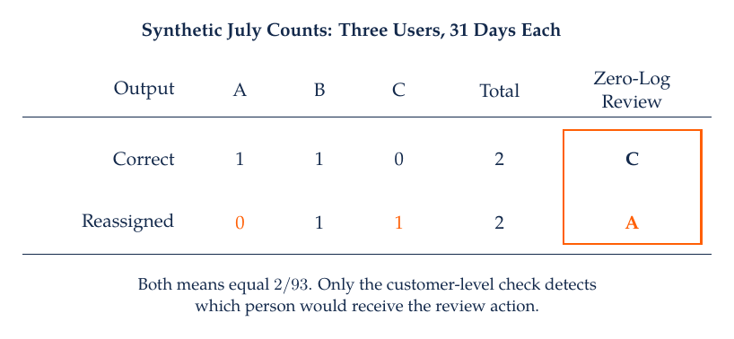

The grader must therefore check the intended observation unit. It requires each roster user exactly once, checks the calendar-day denominator, and compares each customer's logged days and rate with a separately verified reference. Missing users, duplicate rows, nonfinite values, or a numerically wrong rate prevent the output from passing. A test that merely reruns the candidate's own aggregation can reproduce its error. Small cases with known answers and an independent SQL calculation provide additional evidence about the reference.

Li and coauthors' [survey](../../01_Resources/35_Agent_Workflow_Evaluation/README.md), §8, distinguishes the final outcome, the sequence of actions, and the evaluator. For this task, the outcome is a complete, accurate logging table. The action record establishes which files changed, whether the allowed scope was respected, how often the program retried, and what resources were used. Evaluator assessment asks whether the checker detects errors that would change the decision. Each judgment can differ from the others. A correct final table can follow an unauthorized input change, and an overly narrow checker can accept an incorrect table.

### 7.41.1 Independent Evaluation After Development

\noindent The four configurations in §1.17 use July for development and August for evaluation. Freeze prompts, generated code, information selection, correction limits, and checker versions before scoring August. A correction based on August's expected answer turns that task into development material. Further claims would then need fresh evaluation cases. The published reference is useful for learning; a measured comparison must explicitly keep it outside the assistant's accessible task workspace.

Report valid outputs over all assigned attempts, user-level discrepancies, missing files, timeouts, elapsed time, and human effort. Repeated runs of a fixed task reveal variation conditional on that task. They supply no independent evidence about other task families. Changing the model, dictionary, tool interface, or checker changes the evaluated configuration and calls for renewed comparison. The local calculations below provide reference values and checker tests; they contain no measured performance of the four AI configurations.

### 7.41.2 Reproduce the CSV Assessment

\noindent The CSV grader reads a proposed output and an existing reference table. It executes no submitted program. The command below scores the known development reference. Substitute a candidate CSV to inspect its discrepancies. An unsuccessful assessment returns exit code 1 so that a surrounding workflow can distinguish a rejected output from a completed valid calculation.

The required columns are `user_id`, `logged_days`, `window_days`, and `logging_rate`. Numerical comparisons use an absolute tolerance of $10^{-10}$. The [independent tests](../../03_Data_and_Code/Agent_Workflows/test_workflows.py) include equal-total misassignment, omitted users, duplicate keys, invalid dates, nonfinite values, and a SQL calculation on both actual task inputs.

Python source: [evaluate_submission.py](../../03_Data_and_Code/Agent_Workflows/evaluate_submission.py). From the repository root:

```sh
cd 03_Data_and_Code/Agent_Workflows
python3 evaluate_submission.py results/development_reference.csv
```

```python
"""Grade a CSV without executing submitted code or making model calls."""
import argparse
import csv
import json
import math
from pathlib import Path

HERE = Path(__file__).resolve().parent


def grade(candidate, reference):
    expected = {r["user_id"]: r for r in reference}
    found, errors = {}, []
    for row in candidate:
        user = row.get("user_id", "")
        if user in found:
            errors.append(f"duplicate user: {user}")
        found[user] = row
    missing, extra = sorted(set(expected) - set(found)), sorted(set(found) - set(expected))
    correct = 0
    for user in sorted(set(expected) & set(found)):
        try:
            actual = [float(found[user][k]) for k in ["logged_days", "window_days", "logging_rate"]]
            target = [float(expected[user][k]) for k in ["logged_days", "window_days", "logging_rate"]]
            ok = all(math.isfinite(a) and math.isclose(a, b, rel_tol=0, abs_tol=1e-10)
                     for a, b in zip(actual, target))
            correct += ok
        except (KeyError, ValueError, TypeError):
            errors.append(f"invalid values: {user}")
    valid = not missing and not extra and not errors and correct == len(expected)
    return {"valid_output": valid, "correct_users": correct, "roster_users": len(expected),
            "missing_users": missing, "extra_users": extra, "format_errors": errors}


def read_rows(path):
    with path.open(newline="") as stream:
        return list(csv.DictReader(stream))


def main():
    parser = argparse.ArgumentParser(description=__doc__)
    parser.add_argument("candidate", type=Path)
    parser.add_argument("--task", choices=["development", "evaluation"], default="development")
    args = parser.parse_args()
    reference = read_rows(HERE / "results" / f"{args.task}_reference.csv")
    try:
        candidate = read_rows(args.candidate)
        result = grade(candidate, reference)
    except (OSError, UnicodeError, csv.Error) as exc:
        result = {"valid_output": False, "failure": type(exc).__name__, "roster_users": len(reference)}
    print(json.dumps(result, indent=2))
    raise SystemExit(0 if result["valid_output"] else 1)


if __name__ == "__main__":
    main()
```

## 7.42 Coordinate Alignment and a Fixed Classifier

\noindent A firm can change its text encoder while retaining a classifier that assigns customer cases to service categories. The classifier's coefficients refer to the coordinates supplied during fitting. A new representation can preserve all distances among cases and still change the classifier's decisions because its axes have moved. Assessing the new representation therefore requires a specified downstream decision rule.

Consider eight equally weighted synthetic cases with style coordinates $-3,-1,1,3$ and review coordinates $-1,1$, using every combination. A case requires review when its second coordinate is positive. The original classifier recovers all eight imposed labels. Rotate each row vector by the matrix

$$
Q_0=\begin{pmatrix}0&1\\-1&0\end{pmatrix},
\qquad (s,c)Q_0=(-c,s).
$$

The rotated second coordinate is the original style coordinate. Retaining the original classifier now sends every positive-style case to review, giving four correct labels among eight. Pairwise Euclidean distances remain identical because $Q_0Q_0^\top=I$. Distance preservation concerns geometry; applying unchanged coefficients concerns compatibility with a particular rule.

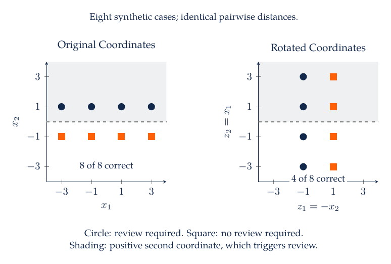

Paired training examples can estimate a map between representations. Let $X$ and $Y$ contain the donor and recipient row vectors for the same $n$ training descriptions, each with $d$ coordinates. Subtract their respective training means to obtain $X_c$ and $Y_c$. An orthogonal Procrustes map uses the singular value decomposition of their cross-product:

$$
X_c^\top Y_c=U\Sigma V^\top,\qquad Q=UV^\top,
\qquad s=\frac{\lVert Y_c\rVert_F}{\lVert X_c\rVert_F},
\qquad \widehat y=\mu_Y+s(x-\mu_X)Q.
$$

The means align the origins, $Q$ aligns the axes, and the positive scalar $s$ matches total centered variation. Both centered matrices must have positive norm. For equal dimensions, $Q$ is orthogonal and may include a reflection. A least-squares scale solves a different objective from the norm-matching rule used here. All fitted quantities come from the paired training descriptions. Validation chooses among candidate dimensions before evaluation outcomes are opened.

To compare geometry, let $N_X(i)$ and $N_Z(i)$ denote the $k$ nearest neighbors of case $i$ under the reference and alternative representations. Their average neighbor overlap is

$$
G_k=\frac{1}{m}\sum_{i=1}^{m}\frac{|N_X(i)\cap N_Z(i)|}{k}.
$$

Here $m$ is the number of evaluation cases, self-neighbors are excluded, and a common row-order rule resolves distance ties. The fraction ranges from zero to one. A translation, orthogonal transformation, and positive global scale preserve Euclidean neighbor order. They can therefore change classifier decisions without changing $G_k$.

Use a second synthetic transformation that multiplies style by 0.2 and leaves the review coordinate unchanged. This transformation preserves all labels under the fixed rule while changing the geometry. Fit the rotation on separate training cases whose style coordinates are $-4,-2,2,4$, again paired with both review values. The same map recovers the original coordinates of the eight test cases.

| Representation | Neighbor Overlap, $k=2$ | Correct Decisions |
| --- | ---: | ---: |
| Original | 100% | 8 of 8 |
| Rotated, unchanged classifier | 100% | 4 of 8 |
| Compressed style, unchanged classifier | 50% | 8 of 8 |
| Rotated, training-fitted alignment | 100% | 8 of 8 |

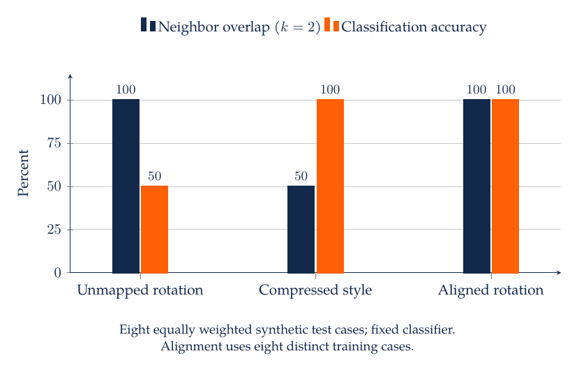

The unaligned rotation ranks above compressed style by geometry and below it by classification. An aligned representation can be compatible with the classifier even when its raw coordinates differ. Conversely, alignment cannot create a category distinction absent from the donor representation. These observations motivate separate evaluation of the representation and the complete decision procedure.

The [research review of Plato's Key](../../01_Resources/36_Representation_Alignment/SOURCE_REVIEW.md) concerns transfer between internal language-model states. The coordinate example uses invented vectors and an imposed rule. Run `python3 03_Data_and_Code/Representation_Alignment/alignment.py` to reproduce its matrices, neighbor sets, and decisions.


Python source: [alignment.py](../../03_Data_and_Code/Representation_Alignment/alignment.py)

```python
"""Fit a rotation and scale; compare geometry and decisions on invented vectors."""
import json
from pathlib import Path
import numpy as np

HERE = Path(__file__).resolve().parent


def fit_map(donor, recipient):
    donor, recipient = np.asarray(donor, float), np.asarray(recipient, float)
    if donor.shape != recipient.shape or donor.ndim != 2 or len(donor) < 2:
        raise ValueError("Paired two-dimensional arrays of the same shape are required.")
    if not np.isfinite(donor).all() or not np.isfinite(recipient).all():
        raise ValueError("Inputs must be finite.")
    mu_d, mu_r = donor.mean(axis=0), recipient.mean(axis=0)
    x, y = donor - mu_d, recipient - mu_r
    if np.linalg.norm(x) == 0 or np.linalg.norm(y) == 0:
        raise ValueError("Both representations must vary.")
    u, _, vt = np.linalg.svd(x.T @ y, full_matrices=False)
    return mu_d, mu_r, u @ vt, float(np.linalg.norm(y) / np.linalg.norm(x))


def apply_map(values, fitted):
    mu_d, mu_r, rotation, scale = fitted
    return mu_r + scale * (np.asarray(values) - mu_d) @ rotation


def neighbors(values, k):
    values = np.asarray(values, float)
    if not 0 < k < len(values):
        raise ValueError("k must be between 1 and n-1.")
    norm = (values * values).sum(axis=1)
    distances = np.maximum(norm[:, None] + norm[None, :] - 2 * values @ values.T, 0)
    # Twelve decimals treat roundoff from rotations as a distance tie.
    distances = np.round(distances, 12)
    np.fill_diagonal(distances, np.inf)
    # Stable sorting breaks exact distance ties by the common row index.
    return np.argsort(distances, axis=1, kind="stable")[:, :k]


def neighbor_overlap(a, b, k):
    na, nb = neighbors(a, k), neighbors(b, k)
    return float(np.mean([len(set(x) & set(y)) / k for x, y in zip(na, nb)]))


def synthetic_case():
    train = np.array([(s, c) for s in [-4, -2, 2, 4] for c in [-1, 1]], float)
    test = np.array([(s, c) for s in [-3, -1, 1, 3] for c in [-1, 1]], float)
    rotation = np.array([[0., 1.], [-1., 0.]])
    donor = test @ rotation
    fitted = fit_map(train @ rotation, train)
    candidates = {"recipient": test, "rotated_unmapped": donor,
                  "compressed_style": test * [0.2, 1.],
                  "rotated_aligned": apply_map(donor, fitted)}
    target = test[:, 1] > 0
    results = []
    for name, values in candidates.items():
        prediction = values[:, 1] > 0
        results.append(dict(name=name, values=values.tolist(),
                            neighbor_overlap_k2=neighbor_overlap(test, values, 2),
                            correct=int((prediction == target).sum()), cases=len(test),
                            accuracy=float((prediction == target).mean())))
    return dict(setup="Invented style and review coordinates; review when coordinate 2 > 0",
                train=train.tolist(), test=test.tolist(), rotation=rotation.tolist(),
                fitted_rotation=fitted[2].tolist(), fitted_scale=fitted[3], results=results)


if __name__ == "__main__":
    result = synthetic_case()
    (HERE / "results/synthetic.json").write_text(json.dumps(result, indent=2) + "\n")
    print(json.dumps(result, indent=2))
```

## 7.43 Alignment and Retraining on mHealth Descriptions

\noindent A service choosing between word and character features can keep the original classifier, fit an alignment, or retrain its classifier. Evaluate all three alternatives on the same descriptions and reference categories. The sample in §5.26 has 6,000 training descriptions, 1,500 validation descriptions, and 1,500 held-out test descriptions, each weighted equally.

Construct word unigrams and character trigrams separately. For each representation, select the 512 tokens appearing in the most training descriptions. Weight token counts by training inverse-document frequency, normalize each nonzero row, and obtain uncentered SVD directions from the training feature matrix. Use the first 8, 16, or 32 directions. Vocabulary, weights, directions, and coordinate alignment all use training observations.

Fit a ridge least-squares classifier to one-hot recorded categories, with an unpenalized intercept and penalty one on the remaining coefficients. Select the largest class score. The word classifier is held fixed for direct substitution and alignment. Retraining fits the same classifier specification to the character representation and the same training labels. Direct substitution deliberately applies word coefficients to independently defined character coordinates. A comparison between deployable systems requires compatible downstream components. SVD coordinate signs can differ across numerical implementations, making the unmapped score sensitive to that convention.

Choose the dimension by aligned validation accuracy. The values are 17.33%, 23.07%, and 27.27% for 8, 16, and 32 dimensions, respectively. Freeze the selected 32-dimensional specification before computing test outcomes. The resulting test comparison is

| Configuration | Correct of 1,500 | Accuracy | Neighbor Overlap, $k=10$ |
| --- | ---: | ---: | ---: |
| Word reference | 522 | 34.80% | 100.00% |
| Character, original classifier | 119 | 7.93% | 22.00% |
| Aligned character, original classifier | 430 | 28.67% | 22.00% |
| Character, retrained classifier | 531 | 35.40% | 22.00% |

Alignment raises recorded-category accuracy by 20.73 percentage points relative to the deliberately unmapped substitution. Character-neighbor overlap stays at 22% because the map preserves its pairwise distance ordering. Retraining produces 531 correct classifications, compared with 522 for the compatible word reference. The nine-description difference is a descriptive comparison on this sample. It does not estimate a population improvement or the return from changing a deployed service.

The reference has 264 training categories. Ten test descriptions have modal categories absent from training, and all ten remain in the error denominator. Seventy-four test descriptions have multiple source categories. Among the 1,426 descriptions with one recorded category, accuracy is 35.27% for the word reference, 7.92% for direct substitution, 29.24% for alignment, and 35.97% for retraining. The category-level output preserves support and error counts, including generic labels such as `default` and `recipe`. Equal-description weighting answers a different question from accuracy over all logged entries.

The full program uses NumPy and the compact CSV prepared in §5.26. It makes no external model calls. Run `python3 03_Data_and_Code/Representation_Alignment/evaluate_mhealth.py` from the repository root. The [dictionary](../../03_Data_and_Code/Representation_Alignment/DATA_DICTIONARY.md) defines the token rules, tie handling, reference labels, and macro-F1 denominator. Saved predictions allow each aggregate and category-specific count to be checked independently.


Python source: [evaluate_mhealth.py](../../03_Data_and_Code/Representation_Alignment/evaluate_mhealth.py)

```python
"""Compare local word/character representations on unseen mHealth descriptions."""
import csv
import hashlib
import json
import platform
import re
from collections import Counter
from pathlib import Path
import numpy as np
from alignment import apply_map, fit_map, neighbor_overlap

HERE = Path(__file__).resolve().parent
DIMENSIONS = (8, 16, 32)
VOCABULARY = 512
PENALTY = 1.0


def tokens(text, kind):
    if kind == "word":
        return re.findall(r"\b\w+\b", text)
    marked = " " + text + " "
    return [marked[i:i+3] for i in range(len(marked)-2)]


def encode(texts, kind, state=None):
    bags = [Counter(tokens(t, kind)) for t in texts]
    if state is None:
        frequency = Counter()
        for bag in bags:
            frequency.update(bag.keys())
        vocabulary = sorted(frequency, key=lambda t: (-frequency[t], t))[:VOCABULARY]
        lookup = {t: i for i, t in enumerate(vocabulary)}
        idf = np.array([np.log((1+len(texts))/(1+frequency[t])) + 1 for t in vocabulary])
        state = lookup, idf
    lookup, idf = state
    matrix = np.zeros((len(texts), len(lookup)))
    for i, bag in enumerate(bags):
        for token, count in bag.items():
            if token in lookup:
                matrix[i, lookup[token]] = (1+np.log(count))*idf[lookup[token]]
    norm = np.linalg.norm(matrix, axis=1, keepdims=True)
    return matrix / np.where(norm > 0, norm, 1), state


def reduce_fit(matrix, dimensions):
    # Uncentered truncated SVD from the feature Gram matrix; fit on training only.
    eigenvalues, vectors = np.linalg.eigh(matrix.T @ matrix)
    return vectors[:, np.argsort(eigenvalues)[::-1][:dimensions]]


def train_classifier(values, labels, classes):
    x = np.column_stack([np.ones(len(values)), values])
    y = np.array([[float(label == c) for c in classes] for label in labels])
    penalty = np.eye(x.shape[1])*PENALTY; penalty[0, 0] = 0
    return np.linalg.solve(x.T @ x + penalty, x.T @ y)


def predict(values, coefficients, classes):
    scores = np.column_stack([np.ones(len(values)), values]) @ coefficients
    return np.asarray(classes)[scores.argmax(axis=1)]


def metrics(truth, prediction, classes):
    truth, prediction = np.asarray(truth), np.asarray(prediction)
    by_class = []
    for label in sorted(set(classes) | set(truth)):
        support = int((truth == label).sum())
        tp = int(((truth == label) & (prediction == label)).sum())
        fp = int(((truth != label) & (prediction == label)).sum())
        fn = support - tp
        by_class.append(dict(category=label, support=support, correct=tp,
                             predicted=int((prediction == label).sum()),
                             recall=tp/support if support else None,
                             f1=2*tp/(2*tp+fp+fn) if 2*tp+fp+fn else 0.0))
    return dict(cases=len(truth), correct=int((truth == prediction).sum()),
                accuracy=float((truth == prediction).mean()),
                macro_f1=float(np.mean([r["f1"] for r in by_class])), by_category=by_class)


def main():
    path = HERE / "data/descriptions.csv"
    manifest = json.loads((HERE / "manifest.json").read_text())
    if hashlib.sha256(path.read_bytes()).hexdigest() != manifest["data_sha256"]:
        raise ValueError("Description sample differs from its manifest.")
    with path.open(newline="") as stream:
        rows = list(csv.DictReader(stream))
    splits = {s: [r for r in rows if r["split"] == s] for s in ["train", "validation", "test"]}
    ids = [{r["description"] for r in splits[s]} for s in splits]
    if any(ids[i] & ids[j] for i in range(3) for j in range(i)):
        raise ValueError("Descriptions overlap across splits.")
    classes = sorted({r["category"] for r in splits["train"]})
    labels = {s: [r["category"] for r in group] for s, group in splits.items()}
    text = {s: [r["description"] for r in group] for s, group in splits.items()}
    representations = {}
    for kind in ["word", "character"]:
        training, state = encode(text["train"], kind)
        basis = reduce_fit(training, max(DIMENSIONS))
        representations[kind] = {"train": training @ basis}
        for split in ["validation", "test"]:
            encoded, _ = encode(text[split], kind, state)
            representations[kind][split] = encoded @ basis
    test_predictions = {}

    def evaluate(dimension, split):
        word = {s: x[:, :dimension] for s, x in representations["word"].items()}
        char = {s: x[:, :dimension] for s, x in representations["character"].items()}
        fitted = fit_map(char["train"], word["train"])
        word_model = train_classifier(word["train"], labels["train"], classes)
        char_model = train_classifier(char["train"], labels["train"], classes)
        candidates = {"word_reference": word[split], "character_unmapped": char[split],
                      "character_aligned": apply_map(char[split], fitted),
                      "character_retrained": char[split]}
        scores = {}
        for name, values in candidates.items():
            model = char_model if name == "character_retrained" else word_model
            prediction = predict(values, model, classes)
            if split == "test":
                test_predictions[name] = prediction.tolist()
            score = metrics(labels[split], prediction, classes)
            score["neighbor_overlap_k10"] = neighbor_overlap(word[split], values, 10)
            score["out_of_training_categories"] = sum(y not in classes for y in labels[split])
            unambiguous = np.array([int(r["category_count"]) == 1 for r in splits[split]])
            score["unambiguous_cases"] = int(unambiguous.sum())
            score["unambiguous_accuracy"] = float((prediction[unambiguous] ==
                np.asarray(labels[split])[unambiguous]).mean()) if unambiguous.any() else None
            scores[name] = score
        return scores

    outcomes, validation = {}, []
    for dimension in DIMENSIONS:
        scores = evaluate(dimension, "validation")
        outcomes[str(dimension)] = {"validation": scores}
        validation.append(dict(dimension=dimension, accuracy=scores["character_aligned"]["accuracy"]))
    # Freeze the dimension using validation before scoring any test outcomes.
    selected = min(validation, key=lambda r: (-r["accuracy"], r["dimension"]))["dimension"]
    outcomes[str(selected)]["test"] = evaluate(selected, "test")
    result = dict(unit="Equally weighted normalized descriptions", classes=classes,
                  dimensions=list(DIMENSIONS), selected_dimension=selected, validation=validation,
                  primary_test=outcomes[str(selected)]["test"],
                  all_configurations=outcomes, source_data_sha256=manifest["data_sha256"],
                  environment={"python": platform.python_version(), "numpy": np.__version__},
                  penalty=PENALTY, vocabulary_limit=VOCABULARY, model_api_calls=0,
                  selection="Maximize aligned validation accuracy; use lower dimension on a tie")
    (HERE / "results/mhealth.json").write_text(json.dumps(result, indent=2, allow_nan=False)+"\n")
    with (HERE / "results/test_predictions.csv").open("w", newline="") as stream:
        fields = ["description_sha256", "reference_category"] + list(test_predictions)
        writer = csv.DictWriter(stream, fieldnames=fields); writer.writeheader()
        for i, row in enumerate(splits["test"]):
            writer.writerow(dict(description_sha256=row["description_sha256"],
                                 reference_category=row["category"],
                                 **{name: values[i] for name, values in test_predictions.items()}))
    with (HERE / "results/summary.csv").open("w", newline="") as stream:
        fields = ["dimension", "split", "configuration", "cases", "correct", "accuracy",
                  "macro_f1", "neighbor_overlap_k10", "unambiguous_cases", "unambiguous_accuracy"]
        writer = csv.DictWriter(stream, fieldnames=fields); writer.writeheader()
        for dimension, splits_out in outcomes.items():
            for split, choices in splits_out.items():
                for name, score in choices.items():
                    writer.writerow(dict(dimension=dimension, split=split, configuration=name,
                                         **{k: score[k] for k in fields[3:]}))
    print(json.dumps(dict(selected_dimension=selected, validation=validation,
                         primary_test={k: {a: b for a, b in v.items() if a != "by_category"}
                                       for k, v in result["primary_test"].items()}), indent=2))


if __name__ == "__main__":
    main()
```

An AI-assisted implementation should identify each fitted object's permitted input split and verify the map's orientation on a known rotation. Hold descriptions together, retain unknown-category errors, and compare the same cases under every configuration. If test results guide a new feature or dimension choice, use a fresh sample for the subsequent final comparison.

## 7.44 Available Information and Observed Answers

\noindent A customer-service manager observing an incorrect answer needs to identify which change could improve the response. The wording of the question, the evidence supplied to the system, and the procedure used to produce an answer affect different parts of the process. Repeating a failed question does not establish which part caused the failure.

[Inside-Out](https://arxiv.org/abs/2503.15299v4) defines factual knowledge through the ranking of correct and incorrect candidate answers. It compares internal scoring with observable output probabilities. An internal ranking can favor a correct answer that ordinary generation rarely produces. This operational distinction supports evaluation of the answer procedure separately from the information recoverable under a specified internal probe. It does not identify a human-like state of understanding.

For a service evaluation, fix a roster of questions and independently verified reference answers. Compare a direct question, a meaning-preserving paraphrase, and a question accompanied by the relevant verified policy passage. Keep the model version and generation settings fixed. Score all attempts, including refusals and incomplete answers, against the same reference. A paired comparison preserves which questions improve or regress.

The paraphrase changes expression while preserving the intended question. Supplying a policy passage changes the available information. Improvement under the latter condition therefore supports the combined information-and-answer procedure. Internal knowledge requires an additional operational definition and measurement. The customer receives an answer, so the service decision should use verified correctness, appropriate handling of uncertainty, and the cost of obtaining that result.

## 7.45 Composite Usage Scores and Validation of a Service Decision

\noindent A retailer might predict demand for digital assistance using an area's composite usage score. The index weights emphasize variation in application activity under the source's construction. A useful prediction of assistance demand requires an observed service outcome, such as completion of a requested booking with an available device. Variance explained by a principal component and predictive value for that outcome answer different questions.

The digital-usage release supplies two geographic composites. Recomputing PCA on those two columns would describe variation between the published composites; it would not reconstruct the original application-category loadings. The source's device-level application inputs and private computation are unavailable. Preserve that distinction when asking an AI assistant to reproduce the study.

Sections 2.26–2.27 provide complete code for the release assessment and the supplement's numerical example. Section 4.27 provides the full geographic clustering calculation. An outcome-validation extension would collect customer requests, offered channels, completion, time, and costs. Split fitting and evaluation by geography or service period, depending on the intended deployment. Fit preprocessing and any outcome-guided group definitions using training data, and compare results with a policy that simply honors each customer's request for assistance.

The released scores are area context measured in an earlier period. Their ability to predict later service outcomes remains an empirical question. A model trained on laptop activity should be evaluated on the actual mobile, browser, and assisted tasks customers will face before its output determines service access.
