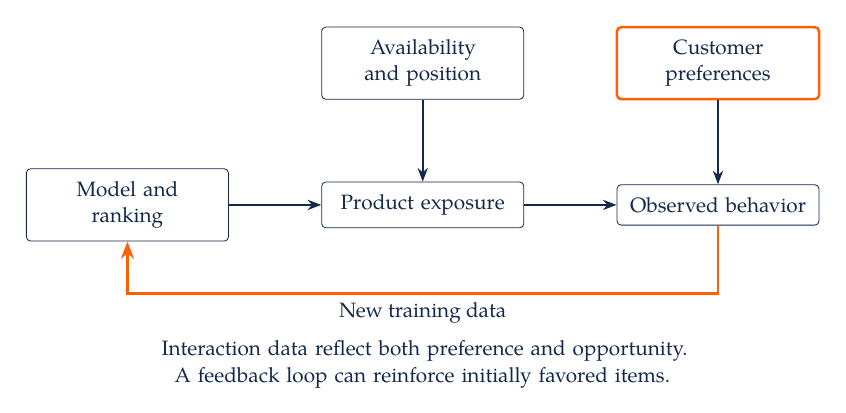
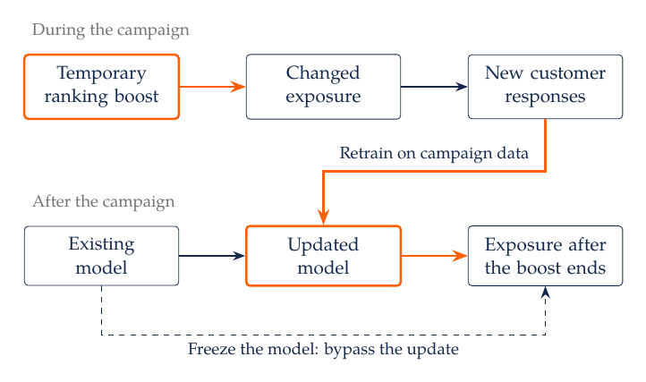
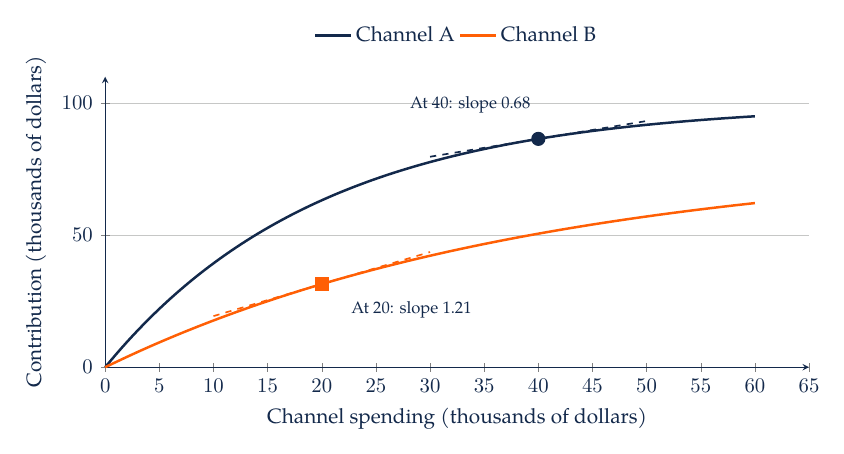
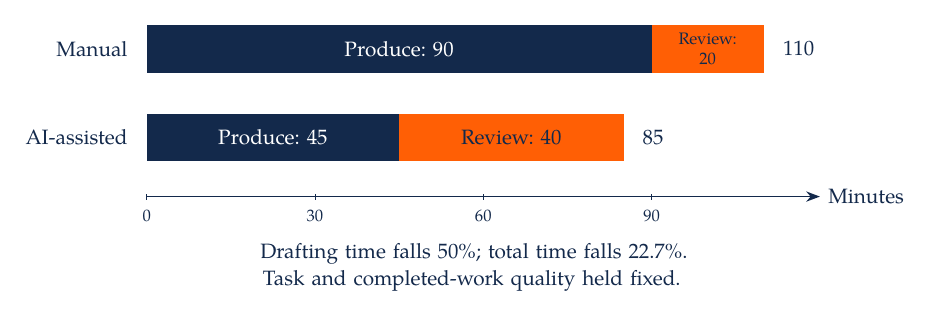
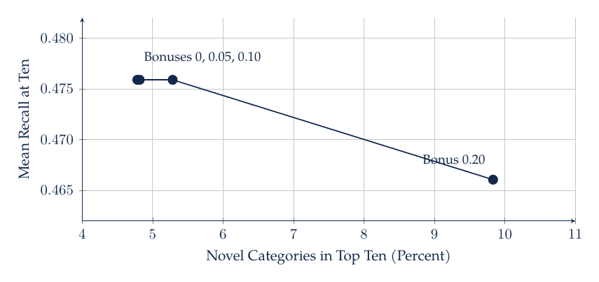
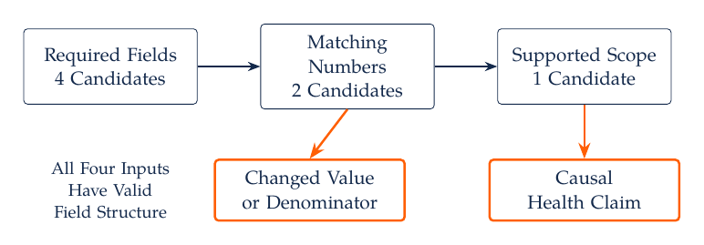
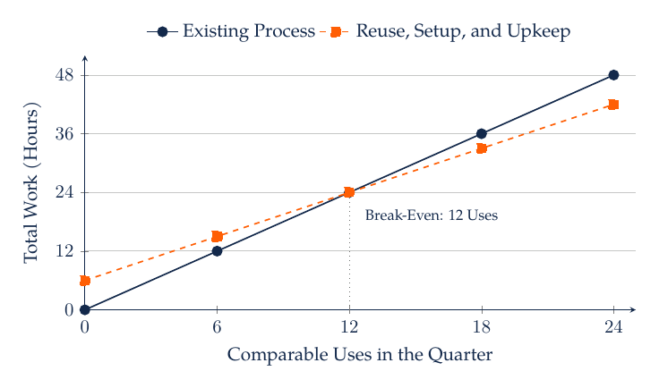
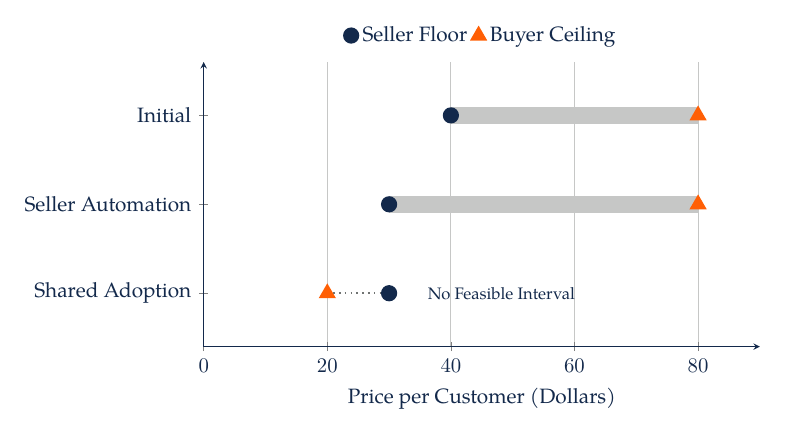
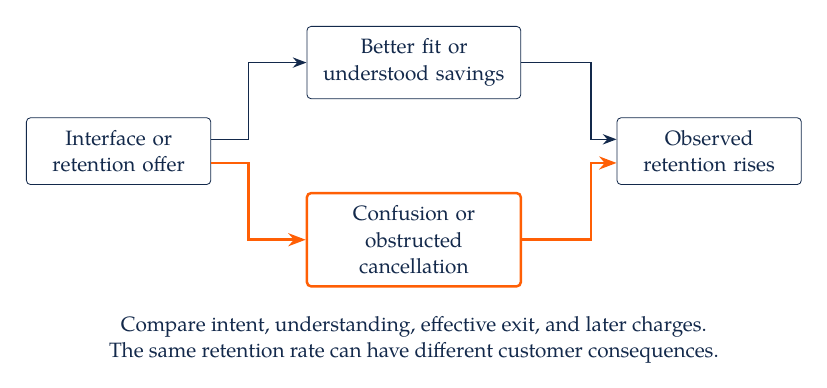
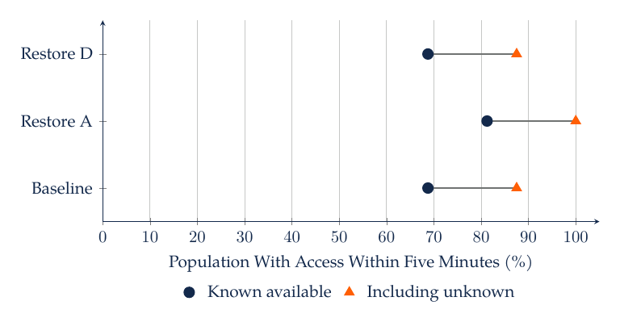

# M8. Current Topics and Integrated Marketing Decisions

A marketing team can now generate campaign copy, build a prediction model, and summarize customer feedback within a short working session. The remaining difficulty is deciding whether the resulting system improves a business decision. A recommendation engine can reproduce past exposure, a media model can attribute seasonal demand to advertising, and an AI-generated analysis can calculate an invalid comparison precisely. Evaluating these systems requires a clear account of their information, incentives, assumptions, and consequences.

## 8.1 Recommendation Systems Learn from Selected Exposure

A retailer wants to recommend products that customers will find useful. A common starting point is past interaction: purchases, clicks, ratings, or time spent. These observations combine preferences with the opportunities customers received. A product displayed prominently has more chances to be clicked than an otherwise similar product that was rarely shown. An absent interaction can therefore mean dislike, lack of exposure, lack of need, or an unavailable product.

Content-based methods use product attributes and customer histories to identify similar items. Collaborative methods use patterns across users and items, including matrix factorization, which approximates an interaction matrix with lower-dimensional user and item representations. Hybrid systems combine these sources. Each method needs a strategy for new customers and new products that have little interaction history. Popularity baselines and simple category rules provide useful comparisons.

Recommendation systems also change the data used to train the next model. A product that receives more exposure can accumulate more interactions, become easier to estimate, and receive still more exposure. This process can amplify initial differences without establishing that the repeatedly displayed product would be preferred under equal exposure.

Simulations in which recommendations shape the next training sample examine this feedback [(Chaney et al., 2018)](https://arxiv.org/abs/1710.11214). The results show that consumption can become more homogeneous without corresponding utility improvements. The result depends on the simulated preferences, recommendation rules, and updating process. For a deployed system, the corresponding question is whether repeated exposure changes consumption variety and customer value under that system's preferences and updating process.



Rankings determine exposure, exposure affects observed behavior, and that behavior enters subsequent training data. Customer preferences also affect behavior, while availability and position affect the opportunity to respond. Logging impressions, positions, eligible alternatives, and the policy that selected them helps distinguish these components. Purchase logs alone often omit the alternatives a customer could actually have encountered.

Evaluate recommendation quality at the unit relevant to the decision. Precision among the top recommended items and ranking metrics assess aspects of relevance. Coverage, novelty, diversity, repeat engagement, returns, and contribution describe other consequences. A system can improve one metric while reducing another. Offline evaluation on historical logs is particularly sensitive to the policy that generated those logs. An experiment that changes exposure can supply information that a more flexible model of the same selected data cannot supply.

### 8.1.1 Case Study: A Temporary Campaign Can Change the Learned Policy

A platform may stop boosting a category while continuing to use the behavior generated during that boost. A working paper [(Luo et al., 2026)](https://arxiv.org/abs/2606.08265) studies a celebrity sleep-reminder campaign on a short-video platform. During the campaign, a ranking adjustment increased the chance that treated users would see a reminder during the late-night window. Exposure remained dependent on the ranking process. The analysis uses a balanced panel of 200,000 users active on the experiment's first day, with 100,000 drawn from each assignment group.

Table 6 reports assignment effects of 14.75% higher late-night usage and 2.18% higher overall app usage relative to the respective control means during the campaign. These are relative percentage changes in usage, not percentage-point changes in exposure or measured effects on sleep. The paper also reports persistent engagement changes and changes in the content delivered afterward. The authors interpret the evidence through discovery of previously underexposed preferences and subsequent recommendation updates. The experiment estimates effects of the assignment regime; attributing persistence specifically to learning requires the additional mechanism evidence. The first-day activity restriction also makes sample inclusion consequential when extending the result to all assigned users.



The temporary boost ends, but its information can remain in the learned model. Freezing the model after the campaign would interrupt that particular channel while leaving any direct changes in customer behavior possible. Updating it incorporates the new interactions into future exposure. These policies can have different effects even when the campaign content and immediate responses are identical. Separating their contributions requires variation in the learning policy as well as the initial intervention.

An evaluation should retain the assignment, exposure, model version, retraining schedule, and outcomes after the intervention ends. A shared model can transmit treatment-generated information to comparison customers. Report the assignment unit and use uncertainty calculations that account for repeated observations of the same unit. Measure the intended customer outcome directly where possible, because increased engagement cannot reveal whether a campaign achieved a goal such as less late-night use or greater satisfaction.

### 8.1.2 Case Study: Netflix Personalization and Incremental Engagement

A streaming service wants to distinguish the appeal of its catalog from the value created by matching titles to viewers. A choice model is estimated using Netflix viewership and recommendation exposure in the supplied June 2026 paper [(Zielnicki et al., 2026)](https://www.ifo.de/en/cesifo/publications/2026/working-paper/value-personalized-recommendations-evidence-netflix). The model incorporates heterogeneous tastes and dependence on viewing history. Its identification treats exposure as conditionally exogenous given the included user, title, and state information. A separate randomized recommendation perturbation provides diversion patterns used to assess the model.

Under that model, replacing the current recommender with matrix factorization reduces engagement by approximately 4%, and replacing it with a popularity-based rule reduces engagement by approximately 12%. These are model-based counterfactual reductions relative to the existing recommender, not direct A/B estimates of those complete replacements. Their interpretation depends on the exposure condition, maintained choice model, and counterfactual implementation.

For a subscription business, engagement can affect retention and hence customer lifetime value, but the relationship requires evidence. A 12% engagement reduction does not imply a 12% decline in revenue, retention, or consumer welfare. Evaluate those outcomes separately, account for substitution across titles, and compare the incremental value with the cost of maintaining the recommendation system. The model's experimental check is useful because it evaluates responses to changed exposure, beyond fit to historical viewing alone.

## 8.2 Case Study: Relevance, Variety, and Customer Goals

A customer may prefer a useful collection of products even when some items in that collection have lower individual relevance scores. Category repetition, past purchases, and the customer's stated goal affect the value of the complete list. The food-recommendation studies in M7, Section 7.12, motivate these distinctions. A simple list objective makes the relevance-variety tradeoff explicit.

Suppose a retail customer requests three products and values variety across categories. Assign four candidate items the relevance scores below. The scores measure relevance on a common scale; they have no purchase-probability interpretation.

| Item | Category | Relevance Score |
| --- | --- | ---: |
| A | Coffee | 0.90 |
| B | Coffee | 0.85 |
| C | Tea | 0.75 |
| D | Fruit | 0.65 |

Choosing the three highest scores gives A, B, and C, with total relevance 2.50 and two categories. Choosing A, C, and D gives relevance 2.30 and three categories. To make the tradeoff explicit, define a list objective

$$
J(L)=\sum_{j\in L}s_j+\lambda K(L),
$$

where $L$ is a three-item list, $s_j$ is relevance, $K(L)$ counts distinct categories, and $\lambda$ is the value placed on an additional category in the same units as the relevance score. With $\lambda=0.30$, A, B, C has objective 3.10, while A, C, D has objective 3.20. The latter list is preferred under this stated objective. The threshold at which these two lists tie is $\lambda=0.20$.

The variety weight must come from an explicit objective, user preference, or evaluation process. Category counts are also a coarse measure: they treat all category differences equally and ignore which products the customer already owns. A deployed system would need better measurements and an evaluation of whether the resulting lists improve the intended customer experience.

For an experiment, randomize eligible customers to the existing and revised recommendation policies. Choose a primary outcome such as contribution per assigned customer over a fixed horizon, alongside measures of customer satisfaction and unwanted repetition. Include every assigned customer in the outcome comparison. Clicking occurs after the policy is assigned and can differ between policies. Preserve the list shown and the alternatives eligible at each impression so the mechanism can be examined.

### 8.2.1 Engagement, Considered Preferences, and the Objective

A customer can click an item and later wish it had not been recommended. A model of inconsistent preferences [(Kleinberg et al., 2024)](https://doi.org/10.1287/mnsc.2022.03683) explains why behavior alone can be insufficient for a platform seeking to improve user utility. The problem can arise even when the platform wants to serve the user: the observed action may reflect an immediate impulse that differs from a considered preference. A useful evaluation therefore combines behavior with explicit goals, satisfaction, and measures of regretted use, with their measurement limitations stated.

Recommender design can use objectives such as well-being, diversity, and user control [(Stray et al., 2021)](https://arxiv.org/abs/2107.10939v1). For a retailer, a concrete formulation could maximize expected contribution subject to customer-selected spending limits, a maximum repetition rate, and a minimum satisfaction criterion. These constraints make the acceptable tradeoffs explicit. A weighted sum is another choice, but its conclusions depend on the scales and weights. Estimates of the component outcomes remain necessary under either formulation.

A list with more categories need not better serve every customer. Someone replenishing a familiar weekly basket may value reliability more than novelty. Elicit the relevant goal, preserve a way to revise it, and evaluate whether the system responds appropriately. A policy that increases variety on average can still repeatedly ignore the preferences of a particular group.

### 8.2.2 Case Study: Content Exposure and Political Attitudes Are Different Outcomes

A preregistered assessment with 806 Twitter users compares posts selected by engagement ranking with recent posts from accounts each user follows [(Milli et al., 2025)](https://doi.org/10.1093/pnasnexus/pgaf062). The study collects item-level stated preferences and perceptions. Engagement ranking selects more emotionally charged and out-group-hostile material, and the political posts selected are not preferred by users on the stated-preference measure. The outcomes describe selected content and users' evaluations within the assessment's exposure window.

Four experiments use a YouTube-like interface with nearly 9,000 participants [(Liu et al., 2025)](https://doi.org/10.1073/pnas.2318127122). Manipulating recommendation sequences produces limited short-term polarization effects in the studied settings. The intervention, exposure duration, and attitude outcomes differ from the Twitter assessment. The studies therefore address different links between recommendation, consumption, perception, and opinion. A change in the composition of displayed content does not determine the magnitude of an attitude effect.

For a managerial comparison, state the population, assignment, exposure window, outcome, and uncertainty before combining findings across settings. A nonsignificant attitude effect supplies no general assurance of zero long-run effects, just as a difference in displayed content supplies no estimate of long-run polarization. The relevant evidence is the estimated effect and its uncertainty for the intervention actually evaluated.

### 8.2.3 Platform Incentives and Preference Changes

The platform's return from a recommendation can differ from the customer's value. Amazon's dual role as retailer and intermediary is examined using product-level recommendation data and variation from Amazon stockouts [(Chen and Tsai, 2024)](https://doi.org/10.1111/1756-2171.12481). The study finds that Amazon's seller status affects the receipt of “Frequently Bought Together” recommendations. The design uses within-product changes, with accompanying controls and checks, to distinguish seller identity from stable product appeal. Its causal interpretation depends on the treatment of other changes accompanying stockouts.

An analyst evaluating a marketplace should record whether an item is sold by the platform, sponsored, or commission-bearing, alongside availability and customer relevance. Contribution should use the appropriate margin or fee for each item. A common ranking score can conceal those different incentives. A policy change may improve platform profit while reallocating sales among sellers, so report effects at the customer, seller, and platform levels relevant to the decision.

A benchmark distinguishes better matching from changes in users' preferences under a recommendation process [(Zhu et al., 2023)](https://arxiv.org/abs/2210.05662v2). Its experiments use synthetic and real-world datasets within the proposed framework. They motivate measuring preference change separately from click-through performance. They do not establish that every online performance gain represents manipulation. A customer may learn to appreciate an unfamiliar product; whether that change serves the customer requires a stated criterion and evidence beyond a higher click count.

## 8.3 Marketing-Mix Models Combine Carryover and Saturation

A marketing-mix model relates aggregate outcomes to media activity and other determinants across time or markets. Its appeal is practical: many firms observe weekly sales and channel spending even when individual customer paths are unavailable. The analytical challenge is that media decisions often respond to expected demand. Advertising, promotions, holidays, distribution, and competitor actions can move together.

A simple carryover variable is

$$
a_{ct}=s_{ct}+\rho_c a_{c,t-1},\qquad 0\leq\rho_c<1,
$$

where $s_{ct}$ is spending in channel $c$ during period $t$, $a_{ct}$ is its accumulated exposure proxy, and $\rho_c$ controls geometric decay. This unnormalized definition gives the same units as spending, but its long-run level under constant spending is $s_c/(1-\rho_c)$. Some software normalizes the weights. Coefficients and interpretations must follow the selected convention.

If one spending pulse of 100 occurs at period zero and $\rho=0.5$, the subsequent accumulated values are 100, 50, 25, and 12.5. A pulse can therefore coincide with later sales even when current spending is zero. A seasonal demand pattern can also create persistence. The model needs enough information and a credible design to distinguish these explanations.

Saturation describes declining additional response at higher exposure. A saturating response curve is $R(a)=A[1-\exp(-a/b)]$, where $A$ is the limiting response and $b>0$ controls how quickly the curve approaches that limit. A basic outcome model may combine channel response curves, controls, trend, seasonality, and an error term. The fitted components are model-dependent; their causal interpretation requires assumptions about how spending was chosen and which demand determinants were measured.

The official [Meridian documentation](https://developers.google.com/meridian/docs/basics/meridian-introduction) describes a modern framework for marketing-mix modeling. The [PyMC Marketing examples](https://www.pymc-marketing.io/en/latest/notebooks/mmm/mmm_example.html) provide another implementation route. Use those materials to inspect definitions, priors, and diagnostics. A software package cannot supply a missing source of identifying variation. Experiments and external evidence can help calibrate a model, subject to whether their populations, interventions, and time horizons match the intended use.

## 8.4 Case Study: Allocate the Next Dollar Using Marginal Returns

Consider two channels with imposed contribution response curves

$$
R_A(s_A)=100[1-\exp(-s_A/20)],\qquad
R_B(s_B)=80[1-\exp(-s_B/40)].
$$

Both spending and contribution are measured in thousands of dollars over the same horizon. These response functions omit cross-channel interactions and are assumed known. At a total budget of 60, suppose the current allocation is 40 to A and 20 to B. The question is whether moving a small amount between channels increases contribution while holding the total budget fixed.

Average contribution per unit spent is $R_c(s_c)/s_c$. At the current allocation, it is approximately 2.16 for A and 1.57 for B. Marginal contribution is the derivative of the response curve. It is approximately 0.68 for A and 1.21 for B. A has the higher average return, while B offers the greater return on the next small unit of spending.



At the current allocations, B has the steeper response curve. Moving a small amount from A to B therefore raises total contribution. The comparison depends on the slopes at the current allocation, whereas average returns summarize all spending up to that point. The budget is held fixed, so the transfer does not change total spending expense.

For a differentiable, concave response with an interior optimum and no other constraints, marginal returns are equal across channels. Here the condition is

$$
5\exp(-s_A/20)=2\exp(-s_B/40),\qquad s_A+s_B=60.
$$

Solving gives $s_A\approx32.22$ and $s_B\approx27.78$. Total contribution rises from approximately 117.94 to 120.09, or about 2.14 thousand dollars. If total budget were also a choice, marginal contribution would be compared with the marginal cost of spending; exhausting a fixed budget and choosing its size are different optimization problems.

A real decision should also examine parameter uncertainty, operational minimums, saturation outside observed spending ranges, delayed effects, and interactions across channels. Report how the recommended allocation changes under plausible response curves. A sharply stated optimum based on weakly identified slopes can conceal substantial decision uncertainty. Prefer an allocation that is supported by observed variation and specify an experiment that would resolve the most consequential uncertainty.

## 8.5 Generative AI Changes the Cost of Producing and Checking Work

Generative AI can assist with code, text classification, documentation, and communication. The business value depends on the complete workflow. Faster generation can be offset by additional review, integration failures, or errors that reach downstream decisions. Measure the output that matters: a correct, reproducible analysis completed with an appropriate understanding of its limitations.

The appropriate evaluation depends on what an AI system produces and how that output enters the decision. A coding assistant produces or edits a program that can be inspected and executed, whereas an annotation model produces labels whose measurement quality requires a suitable reference. A retrieval system selects passages and may generate a summary whose claims need support from those sources. For customer-facing content, quality also depends on the effects of deployment. Each use therefore requires a unit of quality and checks directed at its specific failure mechanisms.

For coding, begin with an analytical specification and a small example with a known result. Ask the assistant to implement a limited step, explain the data transformations, and identify assumptions. Inspect the code before running it. Then compare intermediate outputs with independent checks. A program that executes successfully can still use an incorrect denominator, join on the wrong key, or include future information. Checking denominators, join keys, and information timing reveals errors that a successful execution can leave undetected.

For retrieval and summarization, maintain the connection between a claim and its source. A citation should support the particular statement next to it. Ask the model to distinguish an observed result from a proposed explanation, and check that distinction against the original text. If a passage or file is unavailable, state that limitation. Fluent reconstruction is not a substitute for access to the evidence.

## 8.6 Case Study: Evaluate an AI-Assisted Analytics Workflow

Suppose a firm wants to know whether access to a coding assistant improves analysts' work on customer-retention tasks. Define treatment as access under a specified protocol and version, and define an outcome that incorporates both completion and validity. A useful primary outcome could be the fraction of assigned tasks meeting a prespecified analytical rubric within a fixed time budget. Secondary outcomes could include completion time, independent error severity, and a later explanation task completed without assistance.

Randomize analysts or teams according to the likely spillovers. Repeated tasks by the same analyst require attention to learning, carryover, and dependence. If a crossover design is used, randomize order and consider whether experience in the first condition changes performance in the second. A task-level comparison with no accounting for analyst ability or task difficulty can confound the treatment effect with who received which work.

Quality review should use a common rubric and, where feasible, reviewers unaware of treatment assignment. The rubric can check observation units, joins, leakage, estimation, uncertainty, and interpretation. Record the assigned task, the eligible inputs, the tool configuration, and the evaluation procedure. Avoid interpreting a favorable result for one task type as a universal effect across all analytical work.

Suppose a manual workflow uses 90 minutes to produce an analysis and 20 minutes to review it, totaling 110 minutes. An assisted workflow uses 45 minutes to produce a draft and 40 minutes to review it, totaling 85 minutes. The reduction in total time is 25 minutes, or about 22.7%, while the drafting-time reduction is 50%. The total-time comparison is informative only if the completed outputs meet comparable quality requirements.



This comparison holds the task and required quality fixed. Review is part of production because an undetected error can alter a marketing decision. In empirical work, report the completion and quality outcomes alongside time so that faster abandonment or lower-quality work is not counted as an equivalent improvement.

\noindent In the synthetic service comparison in M7 §7.32, mean response wait falls from two seconds to one while correct automatic resolutions fall from eight to seven among twelve attempts. The imposed triage cost raises total resource cost from $0.848 to $1.024. A deployment decision should retain attempts that time out and record whether the promised customer action is completed. The firm can then compare compute savings with referral work and the consequences of unresolved requests.

## 8.7 Integrated Case: A Retail Subscription Launch

A retailer is considering a subscription service with recommendations and delivery benefits. Begin with the decision: which offer to launch, to which eligible customers, at what price, with what evidence of incremental contribution? Define the evaluation horizon, capacity constraints, and the alternatives to launch.

Construct the customer and order tables with explicit keys and dates. Describe customer activity and purchasing cohorts, keeping unavailable future retention separate from observed inactivity. Use regression to summarize conditional patterns while examining confounding. Design a conjoint exercise to learn stated tradeoffs between delivery, assortment, and price, then assess whether its predictions generalize to an actual offer.

Use segmentation to organize meaningful differences in needs and behavior, and calculate customer value from contribution after the relevant variable costs. Analyze reviews to identify the service attributes customers mention, checking annotation quality against human labels. Develop a prediction model using only information available at the targeting date. Its forecasts can help plan capacity, while a randomized offer evaluates incremental take-up, contribution, and retention.

Finally, evaluate the recommendation component and the acquisition budget. Log exposure to recommended items, distinguish average from marginal media returns, and use AI assistance within a documented verification process. The management recommendation should identify the supported action, the uncertainty that could change it, and the next observation or experiment with the greatest decision value. A complicated collection of models is useful only if these pieces support a coherent choice.

## 8.8 Practice and Further Reading

**Recommendation exercise.** Compare all four three-item lists in the variety example at $\lambda=0$, 0.20, and 0.30. At zero, A, B, C is optimal. At 0.20, it ties A, C, D. At 0.30, A, C, D is optimal. Explain how a different category definition could change that conclusion without changing any relevance score.

**Dynamic-policy exercise.** Design a comparison between a temporary recommendation boost with a frozen model and the same boost followed by retraining. Specify how training data are separated across conditions, when outcomes are measured, and how shared content or customers could transmit effects. Explain which comparison identifies the effect of allowing the model to learn from campaign-period behavior.

**Evidence exercise.** Compare the MovieLens field experiment, the Netflix model-based replacement counterfactuals, and the short-term YouTube experiments. State the intervention and estimand for each. Explain why their reported outcomes cannot be combined into a single percentage measuring the value or harm of recommendation systems.

**Budget exercise.** Calculate the gain from moving one thousand dollars from channel A to channel B at the original allocation. Compare the exact change with the difference between the two marginal returns. The derivative is a local approximation; the exact finite transfer also reflects curvature. Then explain why an unobserved seasonal demand shock could invalidate a causal interpretation of an estimated response curve.

**AI evaluation exercise.** Draft a rubric for an assistant-generated retention analysis. Include at least one check that detects a substantive error in code that executes successfully, such as an order-line denominator used for average order value. Define a hand-checkable example that exposes the error and explain how a reviewer would determine whether it occurred.

Read “Consumption Variety in Food Recommendation” [(Nielsen et al., 2022)](https://doi.org/10.1086/720453), and “Following Good Examples” [(Ling et al., 2022)](https://doi.org/10.1145/3485447.3514193), for applications connecting recommendation objectives with customer behavior. The official marketing-mix documentation linked above develops implementation details. Consult the [AI-coding evidence](../../01_Resources/10_AI_Coding_Concepts_and_Evidence/README.md) and [workflow resources](../../01_Resources/11_AI_Coding_Tools_and_Workflows/README.md) for further study.

## 8.9 mHealth: Familiarity, Novelty, and the Decision Objective

A manager may value introducing unfamiliar categories even when the most accurate prediction repeats a customer's routine. That preference changes the ranking objective. It should be stated as a decision choice before interpreting any performance comparison. A category absent from recent logs is novel relative to recorded history; it may be familiar to the person outside the app.

Retain the September users, target baskets, candidate set, and 30-day frequency rule from M7. Add a bonus $\lambda$ to a candidate category if it has not appeared in the user's prior 30 calendar days of logs:

$$
S_{ic}(\lambda)=f_{ic}+10^{-6}p_c+
\lambda\mathbf{1}\{c\text{ absent from the prior 30-day log}\}.
$$

Here $f_{ic}$ is the fraction of observed history days containing category $c$, and $p_c$ is global popularity used for tie resolution. The bonus is measured in the same score units as frequency. It is an imposed objective weight, not an estimated willingness to try a food or a nutritional benefit. Rank all candidates by this score and count the fraction of the ten recommendations absent from recent history.

| Novelty Bonus | Recall at 10 | NDCG at 10 | Novel Categories in the List |
| --- | ---: | ---: | ---: |
| 0.00 | 0.4759 | 0.5862 | 4.78% |
| 0.05 | 0.4759 | 0.5862 | 4.82% |
| 0.10 | 0.4759 | 0.5863 | 5.28% |
| 0.20 | 0.4661 | 0.5809 | 9.83% |

The grid is a specified sensitivity comparison on the same 299 test users. It is not used to select a winning policy and then claim an independent test of that winner. At a bonus of 0.20, novelty roughly doubles while recall falls by about 0.98 percentage points. At smaller bonuses, changes in the list can occur among categories that are all absent from the target, leaving recall unchanged. NDCG can move without a recall change when relevant categories exchange positions.



The first three points lie close together in recall even though novelty rises. The fourth trades some recovery of the recorded basket for greater novelty. This is an offline relationship between a ranking rule and historical labels. It does not measure whether customers prefer the new list, accept the suggestions, or change diet.

A nutrition objective would need a validated nutrient database, appropriate portions, restrictions supplied by the customer, and an outcome definition. Source categories and calorie-share variety alone do not establish healthy choices. The data-cleaning distinctions in M2 therefore affect what the manager can optimize. Dropping low-calorie days might improve an apparent fit by selecting more complete logs, while also excluding the customers for whom the interface is hardest to use.

A concrete next decision is whether to run the M6 user-randomized comparison, using a prespecified novelty setting and separate measures of logging, acceptance, and any validated nutrition outcome. The experiment should preserve the assignment population and record exposure. An AI assistant can implement the frozen ranking rule and assess category descriptions, while unsupported health claims remain outside the factual explanation supplied with the recommendation.

Python source: [m08.py](../../03_Data_and_Code/mHealth/recurring_examples/m08.py). From its directory, run `python m08.py`.

```python
"""Measure an imposed novelty-relevance tradeoff on the same September baskets."""

import json
from common import OUTPUT, load_inputs, save_result
from ranking import candidate_categories, evaluate

food, daily, baskets = load_inputs()
selection = json.loads((OUTPUT / "M07.json").read_text())
windows = {"30_days": 30, "90_days": 90, "all_prior_days": None}
window = windows[selection["chosen_window"]]
candidates = candidate_categories(baskets)
# This grid is a specified sensitivity analysis, not a test-set model search.
weights = [0.0, 0.05, 0.10, 0.20]
tradeoff = [
    {
        "novelty_weight": weight,
        **evaluate(baskets, "2016-09-01", candidates, window, novelty_weight=weight),
    }
    for weight in weights
]
assert (
    abs(
        tradeoff[0]["recall_at_10"]
        - selection["test"]["personal_frequency"]["recall_at_10"]
    )
    < 1e-12
)
result = {"history_window": selection["chosen_window"], "tradeoff": tradeoff}
save_result("M08", result)
print(json.dumps(result, indent=2))
```

## 8.10 Python Calculations for the Synthetic Cases

Run the program below to write the synthetic examples to CSV and reproduce their calculations. Keep the script beside `example_helpers.py` in `03_Data_and_Code/Lecture_Examples`; the separate mHealth programs reproduce the observed-data results.

Python source: [m08_synthetic.py](../../03_Data_and_Code/Lecture_Examples/m08_synthetic.py). From its directory, run `python m08_synthetic.py`.

```python
"""Synthetic numerical examples for M8; run from any working directory."""

import itertools
import json
import math
from example_helpers import write_csv, ols_slope, shares

r = {}
items = {
    "A": ("Coffee", 0.90),
    "B": ("Coffee", 0.85),
    "C": ("Tea", 0.75),
    "D": ("Fruit", 0.65),
}
list_values = {}
for weight in [0, 0.2, 0.3]:
    list_values[str(weight)] = {
        "".join(choice): sum(items[j][1] for j in choice)
        + weight * len({items[j][0] for j in choice})
        for choice in itertools.combinations(items, 3)
    }
ra = lambda s: 100 * (-math.expm1(-s / 20))
rb = lambda s: 80 * (-math.expm1(-s / 40))
sa = (40 * math.log(2.5) + 60) / 3
sb = 60 - sa
r["M08"] = {
    "recommendation_objectives": list_values,
    "carryover": [100 * 0.5**t for t in range(4)],
    "average_A": ra(40) / 40,
    "average_B": rb(20) / 20,
    "marginal_A": 5 * math.exp(-40 / 20),
    "marginal_B": 2 * math.exp(-20 / 40),
    "current_total_contribution": ra(40) + rb(20),
    "optimal_spend_A": sa,
    "optimal_spend_B": sb,
    "optimal_total_contribution": ra(sa) + rb(sb),
    "contribution_gain": ra(sa) + rb(sb) - ra(40) - rb(20),
    "one_unit_transfer_gain": ra(39) + rb(21) - ra(40) - rb(20),
    "manual_total_minutes": 110,
    "assisted_total_minutes": 85,
    "time_reduction_fraction": 25 / 110,
}
assert math.isclose(5 * math.exp(-sa / 20), 2 * math.exp(-sb / 40))
# Independent grid check of the constrained optimum, to the grid's precision.
grid_best = max((ra(i / 100) + rb(60 - i / 100), i / 100) for i in range(6001))
assert abs(grid_best[1] - sa) < 0.01
write_csv(
    "M08_recommendation_synthetic.csv",
    ["item", "category", "relevance_score"],
    [(key, *value) for key, value in items.items()],
)
print(json.dumps(r, indent=2))
```

## 8.11 Evidence Checks for Generated Marketing Explanations

An analytics manager may accept a fluent business review whose numbers and interpretation describe different populations. Structured output helps software locate a metric, period, value, unit, and denominator. Each field also needs evidence. A correctly formatted statement can contain the wrong number or describe a causal effect that the underlying analysis never estimated.

Use the fixed-cohort mHealth review from Section 1.10 as the evidence source. June contains 6,331 observed user-days out of 10,200 eligible calendar user-days, giving a logging fraction of 0.620686. A structured claim must identify that month, denominator, unit, and descriptive interpretation. Four constructed candidates retain the same field structure: one reproduces the supported result, one adds 0.10 to its value, one substitutes the number of logging users for the denominator, and one labels the result a causal health benefit.

| Constructed Candidate | Format | Evidence Check |
| --- | --- | --- |
| Supported Result | Valid Fields | Accepted |
| Changed Number | Valid Fields | Value Mismatch |
| Changed Denominator | Valid Fields | Denominator Mismatch |
| Causal Health Claim | Valid Fields | Unsupported Interpretation |

The four constructed candidates meet the same structural requirement, but only the supported claim passes the evidence checks. The program evaluates these fixed examples locally, without requesting model responses, so its results describe the checks rather than the performance of an LLM. Those checks cover the declared fields; free-form prose, omitted qualifications, and advice still require substantive review. Naming a field “interpretation” supplies no validation of an unrestricted paragraph.



[Copycat](https://github.com/google-marketing-solutions/copycat) demonstrates generation of advertising text from brand examples and evaluates similarity and memorization. Those diagnostics concern the generated content. Incremental sales or engagement requires an outcome comparison under an appropriate exposure design, such as a randomized test of the generated and existing alternatives. The Gemini and Google Cloud marketing notebooks in the resource collection supply further examples of generation and structured extraction; model credentials, costs, and data permissions are separate requirements for executing those reference notebooks.

Synthetic consumer panels raise a related distinction. The [semantic-similarity-rating package](https://github.com/pymc-labs/semantic-similarity-rating) maps generated text to distributions over response anchors. The mapping can standardize how generated answers are summarized. Validation against a target population still requires human outcomes, a sampling definition, and comparisons held out from prompt or anchor selection. Generating more answers under the same misspecified prompt reduces simulation noise around that prompt's distribution while preserving its systematic difference from consumers. Agreement among generated respondents is therefore a property to examine alongside external validity. The worked comparisons in Sections 4.23 and 5.23 show how overall rating distributions, concept rankings, anchors, and repeat weighting can lead to different product decisions. Section 7.36 distinguishes the published split-half benchmark from prospective evaluation on new concepts.

A practical screening workflow retains generated objections as hypotheses, fixes its measurement procedure before final evaluation, and reserves human research for both shortlisted concepts and a random sample of rejected ones. Testing rejected concepts makes missed opportunities observable. A transfer from personal-care concepts to mHealth features changes the domain and requires separate human validation. Model updates, revised anchors, and new recruitment populations likewise change the evidence needed to support a screening claim.

A useful AI coding request is: “Compare every numerical field with its computed evidence; reject unknown metrics, periods, units, and denominators; retain the analysis's descriptive interpretation; and test a correctly formatted false claim.” The checking rule should be written before inspecting a favored generated answer. Report the factual error rate and the time spent checking, alongside any reduction in drafting time.

Python source: [claim_checks.py](../../03_Data_and_Code/mHealth/recurring_examples/claim_checks.py). From its directory, run `python claim_checks.py`.

```python
"""Check constructed structured claims against computed mHealth evidence."""

import json
import math
from copy import deepcopy
from common import load_food, save_result
from reporting import monthly_review


def check_claim(claim, evidence):
    required = {"metric", "period", "value", "unit", "denominator", "interpretation"}
    if not isinstance(claim, dict) or set(claim) != required:
        return ["schema"]
    rows = [row for row in evidence["periods"] if row["period"] == claim["period"]]
    if len(rows) != 1 or claim["metric"] != evidence["metric"]:
        return ["unknown metric or period"]
    row = rows[0]
    errors = []
    if type(claim["value"]) not in (int, float) or not math.isfinite(claim["value"]):
        errors.append("numeric value")
    elif not math.isclose(
        claim["value"], row["logging_fraction"], rel_tol=0, abs_tol=1e-10
    ):
        errors.append("value disagrees with evidence")
    if (
        type(claim["denominator"]) is not int
        or claim["denominator"] != row["calendar_user_days"]
    ):
        errors.append("denominator")
    if claim["unit"] != evidence["unit"]:
        errors.append("unit")
    if claim["interpretation"] != evidence["interpretation"]:
        errors.append("unsupported interpretation")
    return errors


if __name__ == "__main__":
    evidence = monthly_review(load_food())
    june = evidence["periods"][1]
    valid = {
        "metric": "logging_fraction",
        "period": "2016-06",
        "value": june["logging_fraction"],
        "unit": evidence["unit"],
        "denominator": june["calendar_user_days"],
        "interpretation": "descriptive",
    }
    candidates = {"supported": valid}
    changes = {
        "wrong_number": ("value", valid["value"] + 0.1),
        "wrong_denominator": ("denominator", june["users_with_logs"]),
        "causal_claim": ("interpretation", "causal health benefit"),
    }
    for name, (field, value) in changes.items():
        candidates[name] = deepcopy(valid)
        candidates[name][field] = value
    result = {
        "candidate_origin": "constructed teaching examples; no LLM request",
        "checks": {
            name: check_claim(claim, evidence) for name, claim in candidates.items()
        },
    }
    assert result["checks"]["supported"] == []
    assert all(result["checks"][name] for name in changes)
    save_result("claim_checks", result)
    print(json.dumps(result, indent=2))
```

## 8.12 An Executable Chart Can Still Misstate the Evidence

A manager asks an AI assistant to plot monthly customer engagement. The generated program can run successfully and produce an attractive chart while changing the population, labeling a fraction as a percentage, or describing a temporal association as an intervention effect. A chart therefore needs checks of execution, fidelity to the analytical question, and readability. [VisEval](https://github.com/microsoft/VisEval) separates these dimensions when evaluating generated visualizations.

For the mHealth comparison, compute the percentage of all eligible calendar user-days with a log before plotting either group. These two numerators and denominators provide an independent numerical reference against which to assess the figures. The constructed mistakes below use valid numbers and executable drawing instructions, yet each violates a different substantive requirement of the comparison.

| Constructed Chart Error | Consequence | Check |
| --- | --- | --- |
| Plot a fraction under a percent label | Values are 100 times too small | Recompute units |
| Keep only users who logged | Population changes with the outcome | Reconcile denominators |
| Start rate bars at 60% | Bar lengths distort magnitudes | Inspect baseline |
| Declare the time difference causal | Claim exceeds the design | Inspect interpretation |

The checker below accepts the correct specification and rejects all four constructed mistakes. Its numerator and denominator checks compare the chart specification with independently saved monthly evidence. This is a narrow validator for declared fields. It does not interpret unrestricted natural-language titles, inspect pixels, or guarantee that a rendered chart is readable. Review the displayed title, labels, clipping, color contrast, and all interactive selections separately. A chart can pass these field checks while still misleading through an omitted subgroup or an unsupported narrative.

Ask a coding assistant to return the aggregate plotting table, units, eligibility rule, axis domains, and one hand-calculated plotted value with its code. A second review should compare those objects with the original analysis specification. Passing the assistant's own test is informative only when the expected answer was derived independently. The [Financial Times vocabulary](https://github.com/Financial-Times/chart-doctor/blob/main/visual-vocabulary/README.md) supports the choice of display, while visualization code [(Rougier, 2021)](https://github.com/rougier/scientific-visualization-book) provides examples of figure construction and layout. The managerial claim must remain tied to the evidence and design.

Run `visualization.py` first to create the evidence table, then run the assessment. The false charts are constructed teaching cases; their rejection rates do not measure the reliability of any particular language model.

Python source: [chart_assessment.py](../../03_Data_and_Code/mHealth/recurring_examples/chart_assessment.py). From its directory, run `python chart_assessment.py`.

```python
"""Check a narrow chart specification against the monthly evidence table."""

from copy import deepcopy
import json
import math
from common import OUTPUT, save_result


def check_chart(chart, evidence):
    errors = []
    expected = {row["period"]: row for row in evidence["months"]}
    if chart.get("unit") != "percent of eligible user-days":
        errors.append("axis unit")
    if chart.get("interpretation") != "descriptive":
        errors.append("interpretation")
    if chart.get("mark") == "bar" and chart.get("y_domain", [None])[0] != 0:
        errors.append("bar baseline")
    rows = chart.get("rows", [])
    if sorted(row["period"] for row in rows) != sorted(expected):
        errors.append("period coverage")
    for row in rows:
        ref = expected.get(row["period"])
        if ref is None:
            continue
        value = row["value"]
        target = 100 * ref["observed_user_days"] / ref["calendar_user_days"]
        if not math.isfinite(value) or not math.isclose(value, target, abs_tol=1e-8):
            errors.append("plotted value")
        if row["denominator"] != ref["calendar_user_days"]:
            errors.append("denominator")
    return sorted(set(errors))


def main():
    evidence = json.loads((OUTPUT / "visualization.json").read_text())
    correct = {
        "unit": "percent of eligible user-days", "interpretation": "descriptive",
        "mark": "bar", "y_domain": [0, 100],
        "rows": [{"period": r["period"], "value": r["logging_percent"],
                  "denominator": r["calendar_user_days"]} for r in evidence["months"]],
    }
    cases = {"correct": correct}
    for name in ["fraction_as_percent", "conditional_denominator", "truncated_bar", "causal_title"]:
        cases[name] = deepcopy(correct)
    cases["fraction_as_percent"]["rows"][0]["value"] /= 100
    row = cases["conditional_denominator"]["rows"][0]
    row["denominator"] = evidence["months"][0]["logger_calendar_days"]
    row["value"] = evidence["months"][0]["conditional_logging_percent"]
    cases["truncated_bar"]["y_domain"] = [60, 75]
    cases["causal_title"]["interpretation"] = "causal"
    result = {name: check_chart(chart, evidence) for name, chart in cases.items()}
    assert result["correct"] == []
    assert all(result[name] for name in cases if name != "correct")
    save_result("chart_assessment", {"constructed_cases": result})
    print(json.dumps(result, indent=2))


if __name__ == "__main__":
    main()
```


## 8.13 Competition, Demand Measurement, and Generative AI

A provider deciding whether to cut its subscription price needs to anticipate where customers come from and how long they remain. New subscribers can expand the paid category, replace a competing provider, or add a second service. These responses have different implications for market size and competitive pressure. Posted prices and public attention help describe the available offers and interest in them, while demand analysis requires choices linked to the prices and alternatives available when those choices occurred.

A study of paid consumer subscriptions uses card transactions [(Egan et al., 2026)](https://www.nber.org/papers/w35953). Its abstract reports 2.9% paid adoption by April 2026, substantial turnover, and growing substitutability among providers. A separate study of applications using models through OpenRouter [(Fradkin, 2025)](https://arxiv.org/abs/2504.15440) documents variation in whether releases expand usage or displace other models. The population and choice object differ: consumer subscriptions, application-level model use, and token demand answer different managerial questions. A descriptive retention gap alone does not identify a structural substitution parameter.

### 8.13.1 A Price Coefficient with a Known Interpretation

To connect a subscription probability to price, consider an imposed binary-choice benchmark. A homogeneous consumer chooses whether to hold one provider in a month. Let $p_{jt}$ be its price in dollars per month, $\delta_j$ its provider intercept, and $\tau_t$ a common month effect. A logistic utility difference with price coefficient $-\alpha$ implies

$$
s_{jt}=\frac{\exp(\delta_j+\tau_t-\alpha p_{jt})}
{1+\exp(\delta_j+\tau_t-\alpha p_{jt})},
\qquad
\log\!\left(\frac{s_{jt}}{1-s_{jt}}\right)
=\delta_j+\tau_t-\alpha p_{jt}.
$$

The share $s_{jt}$ is the choice probability for this binary offer. The coefficient $\alpha$ measures the reduction in log odds per additional dollar. Homogeneous tastes, the binary choice structure, and the absence of lagged subscription states make the inversion exact. With exact model-implied shares and price variation remaining after provider and month controls, the regression recovers the imposed coefficient. With sampled choices, finite-sample uncertainty must also be assessed.

Holding the intercepts fixed, the benchmark's own-price elasticity is $-\alpha p_{jt}(1-s_{jt})$. That calculation describes a response within the specified binary model. Cross-provider substitution requires an explicit joint choice model and variation that supports its parameters. Consumers holding several subscriptions need a choice structure that permits those combinations; a single-choice nested logit would change that behavior.

### 8.13.2 Why Subscriber Stocks and New Subscriptions Differ

The supplied simulator draws heterogeneous consumer affinity and monthly logistic shocks, adds provider quality and inertia from last month's holdings, and selects a set of subscriptions subject to a cost of additional providers. Premium status is assigned after the provider-holding decision. A common utility shift is recalibrated each month to approach the target adoption path. These rules produce a useful dynamic teaching panel, but they differ from the homogeneous binary benchmark.

Construct one row for every available provider-month using the price table, including combinations with zero subscribers. Divide the number of basic-plan holders by the full roster to form a stock share. Divide new basic-plan holders by that same roster to form a flow share. The current data contain 179 available provider-months; all have positive stock and flow shares, so the two regressions use the same observations. Each regression includes provider and month effects.

| Share Used in the Regression | Price Coefficient per Dollar | Interpretation |
| --- | ---: | --- |
| Basic-plan stock divided by the consumer roster | -0.0300 | Descriptive log-odds projection of current holdings |
| New basic-plan holders divided by the consumer roster | -0.0499 | Descriptive log-odds projection of acquisition flow |
| Exact homogeneous binary-model probability | -0.0600 | Recovery of the imposed coefficient under the benchmark |

The simulator also imposes a utility price coefficient of $-0.0600$. The flow slope is numerically closer to it in this realization. That proximity does not establish recovery: average choices across heterogeneous consumers generally do not obey the representative-consumer logit formula, and changing the outcome from holdings to acquisitions leaves selection, inertia, competing offers, and premium assignment in the data-generating process. The common utility recalibration also fixes aggregate adoption near its target as prices and qualities vary. A promotion counterfactual must specify which of those objects remains fixed.


An acquisition flow divided by all consumers also differs from an acquisition probability among eligible nonsubscribers. For a provider-level holding indicator $D_{ijt}$, its acquisition hazard conditions on $D_{ij,t-1}=0$. A new-holder count divided by $N$ combines that hazard with the proportion eligible to acquire the provider. Changes in the eligible population can therefore change the flow share even when its conditional response is stable. Plan-level flows require an additional definition of upgrades, downgrades, and new provider relationships.

### 8.13.3 Evaluating an AI-Generated Demand Analysis

A useful coding specification states the consumer roster, available alternatives, monthly price units, subscription-history definition, and target coefficient before requesting a model. Require the code to retain zero-count provider-months, check whether prices vary after the fixed effects, and reject undefined log odds. A pseudocount changes the transformed outcome. State the statistical model that justifies it and retain the original zero shares for inspection.

For a simulation, compare the estimator with the generator line by line. The price appearing in a utility equation, the recorded price of a chosen premium plan, and the average amount paid are different objects. Verify whether the program holds category attractiveness fixed or recalibrates it when prices change. Then test the estimator on exact probabilities from a model for which its equation is correct. The benchmark below passes that test; the dynamic-panel regressions retain their descriptive interpretation.

The regression uses NumPy least squares and checks the price slope independently by removing provider and month effects from both price and the transformed share. Agreement verifies the linear calculation. Identification of a price response additionally requires justified price variation, a suitable choice model, and uncertainty that respects the level at which prices and shocks vary. The 60,000 simulated consumers do not create 60,000 independent price assignments.


Python source: [demand.py](../../03_Data_and_Code/GenAI_Demand/demand.py). From the script's folder, run `python3 demand.py`. Inputs are read from the supplied local bundle; output tables are written beside the course scripts.

```python
"""Contrast descriptive price regressions with an exact binary-logit benchmark."""
from pathlib import Path
import json

import numpy as np
import pandas as pd

HERE = Path(__file__).resolve().parent
SOURCE = HERE.parents[1] / "01_Resources/08_M8_Current_Topics_in_Marketing/genai_demand_lab/data"
OUTPUT = HERE / "results"


def design(frame):
    # All provider intercepts plus all but one month effect; no extra intercept.
    fixed = pd.concat([pd.get_dummies(frame.provider, dtype=float),
                       pd.get_dummies(frame.month, drop_first=True, dtype=float)], axis=1)
    x = np.column_stack([fixed.to_numpy(), frame.basic_price.to_numpy()])
    if np.linalg.matrix_rank(x) != x.shape[1]:
        raise ValueError("Price is not separately identified from the fixed effects")
    return x


def price_projection(frame, shares):
    shares = np.asarray(shares, dtype=float)
    if not np.isfinite(shares).all() or not ((shares > 0) & (shares < 1)).all():
        raise ValueError("Log-odds require shares strictly between zero and one")
    x = design(frame)
    y = np.log(shares) - np.log1p(-shares)
    beta = np.linalg.lstsq(x, y, rcond=None)[0]
    # Independent Frisch-Waugh-Lovell check of the price coefficient.
    controls, price = x[:, :-1], x[:, -1]
    price_residual = price - controls @ np.linalg.lstsq(controls, price, rcond=None)[0]
    y_residual = y - controls @ np.linalg.lstsq(controls, y, rcond=None)[0]
    fwl = float(price_residual @ y_residual / (price_residual @ price_residual))
    np.testing.assert_allclose(beta[-1], fwl, atol=1e-10)
    return {"price_coefficient": float(beta[-1]), "rows": len(frame),
            "residual_price_sum_squares": float(price_residual @ price_residual)}


def main():
    subs = pd.read_csv(SOURCE / "synthetic_subscriptions.csv.gz")
    consumers = pd.read_csv(SOURCE / "synthetic_consumers.csv")
    prices = pd.read_csv(SOURCE / "synthetic_basic_prices.csv")
    dgp = json.loads((SOURCE / "synthetic_dgp.json").read_text())
    keys = ["month", "provider"]
    assert consumers.consumer_id.is_unique and not prices.duplicated(keys).any()
    assert not subs.duplicated(["consumer_id"] + keys).any()
    basic = subs.loc[subs.tier.eq("basic")]
    stocks = basic.groupby(keys).size().rename("basic_holders")
    flows = basic.loc[basic["new"]].groupby(keys).size().rename("new_basic_holders")
    frame = prices.merge(stocks, on=keys, how="left", validate="one_to_one")
    frame = frame.merge(flows, on=keys, how="left", validate="one_to_one")
    frame[["basic_holders", "new_basic_holders"]] = frame[["basic_holders", "new_basic_holders"]].fillna(0)
    # Zero filling is justified by the complete simulated population and price support.
    frame["stock_share"] = frame.basic_holders / len(consumers)
    frame["flow_share"] = frame.new_basic_holders / len(consumers)
    common = frame.loc[frame.stock_share.between(0, 1, inclusive="neither") &
                       frame.flow_share.between(0, 1, inclusive="neither")].copy()
    results = []
    for name in ["stock_share", "flow_share"]:
        results.append({"outcome": name, **price_projection(common, common[name])})
    # Exact model-implied shares: homogeneous binary choice, no inertia or multihoming.
    # Provider/time intercepts vary, but the same price design and alpha are retained.
    x = design(common)
    intercepts = np.linspace(-4.0, -3.0, common.provider.nunique())
    time_effects = np.linspace(0.0, 0.2, common.month.nunique() - 1)
    controls = np.r_[intercepts, time_effects]
    alpha = dgp["alpha_price"]
    utility = x[:, :-1] @ controls - alpha * common.basic_price.to_numpy()
    benchmark_share = 1 / (1 + np.exp(-utility))
    benchmark = price_projection(common, benchmark_share)
    np.testing.assert_allclose(benchmark["price_coefficient"], -alpha, atol=1e-10)
    results.append({"outcome": "exact_binary_logit", **benchmark})
    result = {"data_type": "synthetic", "available_provider_months": len(frame),
              "common_positive_share_rows": len(common), "excluded_zero_share_rows": len(frame) - len(common),
              "imposed_utility_price_coefficient": -alpha, "projections": results,
              "interpretation": "Stock and flow slopes are descriptive projections of a heterogeneous dynamic simulation; only the exact binary benchmark recovers its imposed coefficient by construction"}
    OUTPUT.mkdir(exist_ok=True)
    frame.to_csv(OUTPUT / "provider_months.csv", index=False, float_format="%.10f")
    pd.DataFrame(results).to_csv(OUTPUT / "price_projections.csv", index=False, float_format="%.10f")
    (OUTPUT / "demand.json").write_text(json.dumps(result, indent=2) + "\n")
    print(json.dumps(result, indent=2))


if __name__ == "__main__":
    main()
```

## 8.14 Retention Procedures, Profit, and Customer Value

\noindent A subscription firm wants to increase renewals. It can improve the underlying service or alter the interaction that precedes the same renewal decision. Questions, default options, and retention prompts can change the probability that a customer continues. These procedures leave the final button press with the customer while changing the conditions under which that choice is made. Evaluating their consequences requires a measure of customer value in addition to the renewal rate.

### 8.14.1 A Fixed Offer and Opposed Stakes

\noindent Consider an eligible customer facing the same final offer under several procedures. A procedure can include an introductory question or an optional retention interaction. Let $s_k$ denote the probability of renewal under procedure $k$, and let $s_0$ denote renewal under direct choice. The probabilities refer to the same population and outcome horizon.

\begin{assumption}[Fixed Offer and Opposed Stakes]
\label{ass:retention-stakes}
The available procedures form a finite set $K$. Each procedure has a stable renewal probability $s_k$. Renewal yields firm margin $\nu>0$ dollars and customer value $-\sigma<0$ dollars relative to declining. These stakes are common across procedures and customers in the represented population. The offer, outcome horizon, and population are fixed; procedure costs and additional time costs are zero.
\end{assumption}

\noindent Assumption \ref{ass:retention-stakes} imposes a setting in which the customer would prefer to decline according to the stated value measure. It does not infer that preference from the observed renewal probability. In an application, informed valuations, subsequent regret, or another justified measure would have to support the welfare interpretation. Heterogeneous stakes or procedure-specific costs require a different calculation.

The expected changes relative to direct choice separate the firm's and customer's consequences:

$$
\Delta\Pi_k=\nu(s_k-s_0),\qquad
\Delta V_k=-\sigma(s_k-s_0).
$$

Here $\Delta\Pi_k$ is expected profit and $\Delta V_k$ is expected customer value, both in dollars per eligible customer over the common horizon. Increasing renewal raises profit and lowers customer value under the imposed stakes. Their sum is $(\nu-\sigma)(s_k-s_0)$. A positive combined change can therefore coexist with a loss borne by the customer.

### 8.14.2 A Numerical Comparison

\noindent Suppose direct choice produces a renewal probability of 0.20. An alternative procedure produces 0.10, and another produces 0.60. Set firm margin to 11 dollars and customer loss from renewal to 10 dollars. Relative to direct choice, the high-renewal procedure raises expected firm profit by 4.40 dollars, reduces customer value by 4 dollars, and raises combined surplus by 0.40 dollars per eligible customer. Relative to the low-renewal procedure, it reduces customer value by 5 dollars.


The two benchmarks answer different questions. Direct choice measures the consequence of adding the preceding interaction. The low-renewal procedure measures the consequence of selecting the firm's preferred interaction instead of the customer's preferred one within this particular set. Neither comparison establishes that every renewal is harmful in other markets. The welfare result depends on the specified preference ordering and fixed stakes.

### 8.14.3 What Repeated Experimentation Selects

\noindent A firm can estimate each procedure's renewal probability and deploy the one with the highest sample rate. More precise estimates improve selection according to that objective. The implication for customers depends on how the objective relates to their value.

\begin{assumption}[Stable Experimental Comparisons]
\label{ass:retention-testing}
The procedure set is specified before testing. Each procedure receives an independent sample of $T$ customers from the same population, with independent Bernoulli renewal outcomes of probability $s_k$ and complete observation over the common horizon. The probabilities remain unchanged at deployment. The firm selects a procedure with the largest sample renewal rate. The stakes in Assumption \ref{ass:retention-stakes} apply.
\end{assumption}

\noindent Under Assumption \ref{ass:retention-testing}, each sample rate converges to its procedure's renewal probability as $T$ grows. Because the set is finite, the largest estimation error across the set also converges to zero. The true renewal rate of the selected procedure therefore converges to the largest available rate. Ties do not change the welfare comparison because the common stakes assign the same expected value to equal renewal probabilities.

The selected procedure consequently approaches the highest firm profit and the lowest customer value in that set. The result is conditional on opposed interests, stable response probabilities, and the specified selection rule. Testing procedures with different products, prices, time costs, or informed customer values requires those differences to enter the objective. Accurate experimental measurement supplies evidence about the measured outcome; it does not choose the appropriate objective for the firm or regulator.

### 8.14.4 Customer Control and the Evaluation Design

\noindent A cancellation evaluation should observe whether customers can refuse optional retention content before exposure. A refusal button available only after several required screens leaves the earlier interaction compulsory. Record the entire path, time to completion, additional charges, and eventual service use. Keep every eligible assigned customer in the denominator, including people who abandon the process.

An independent customer-value outcome can distinguish a useful retention offer from a costly delay. A customer who voluntarily accepts a lower price may benefit from the additional interaction. A customer who wants to leave may lose time or incur another charge. Their common renewal indicator conceals that difference. Report the financial, behavioral, and customer-value outcomes together, with the population and horizon that each represents.

### 8.14.5 Reproduce the Comparison

\noindent The following program constructs the three imposed procedures and compares their expected monetary consequences with direct choice. It loads no outside records. The CSV has one row per procedure, probabilities in fractions, and monetary changes in dollars per eligible customer. The checks independently aggregate the high-renewal comparison over 100 customers and reconcile it with the per-customer calculation. Run the program from any directory with Python 3; it uses only the standard library and writes its CSV and JSON beside the script.

Python source: [retention_welfare.py](../../03_Data_and_Code/Lecture_Examples/retention_welfare.py).

```python
"""Synthetic retention procedures with fixed, opposed monetary stakes.

Run with Python 3 from any directory. Uses only the standard library.
No customer data are loaded. All probabilities and values are imposed.
Outputs are dollars per eligible customer relative to direct choice.
"""
from pathlib import Path
import csv
import json
from math import isclose


def evaluate(probabilities, direct, firm_margin, customer_loss):
    if not 0 <= direct <= 1:
        raise ValueError("Direct-choice probability must be in [0, 1].")
    if firm_margin < 0 or customer_loss < 0:
        raise ValueError("This example requires opposed nonnegative stakes.")
    rows = []
    for procedure, probability in probabilities.items():
        if not 0 <= probability <= 1:
            raise ValueError("Each renewal probability must be in [0, 1].")
        change = probability - direct
        profit = firm_margin * change
        value = -customer_loss * change
        rows.append({
            "procedure": procedure,
            "renewal_probability": probability,
            "firm_profit_change": round(profit, 10),
            "customer_value_change": round(value, 10),
            "combined_surplus_change": round(profit + value, 10),
        })
    return rows


def main():
    probabilities = {"low_renewal": 0.10, "direct": 0.20,
                     "high_renewal": 0.60}
    margin, loss = 11.0, 10.0
    rows = evaluate(probabilities, 0.20, margin, loss)
    low, direct, high = rows
    assert direct["firm_profit_change"] == 0
    assert direct["customer_value_change"] == 0
    # Independent expected-level calculations use 100 eligible customers.
    n = 100
    baseline_profit = n * 0.20 * margin
    selected_profit = n * 0.60 * margin
    assert isclose(high["firm_profit_change"],
                   (selected_profit - baseline_profit) / n)
    assert isclose(high["customer_value_change"], -40 * loss / n)
    assert high["firm_profit_change"] == 4.4
    assert high["customer_value_change"] == -4.0
    assert high["combined_surplus_change"] == 0.4
    assert isclose(high["customer_value_change"] -
                   low["customer_value_change"], -5.0)
    folder = Path(__file__).resolve().parent
    with (folder / "retention_welfare.csv").open("w", newline="") as f:
        writer = csv.DictWriter(f, fieldnames=list(rows[0]))
        writer.writeheader()
        writer.writerows(rows)
    report = {"input_type": "synthetic imposed probabilities and stakes",
              "unit": "dollars per eligible customer",
              "benchmark": "direct choice, renewal probability 0.20",
              "firm_margin": margin, "customer_loss_per_renewal": loss,
              "procedures": rows}
    (folder / "retention_welfare_results.json").write_text(
        json.dumps(report, indent=2) + "\n")
    print(json.dumps(report, indent=2))


if __name__ == "__main__":
    main()
```

## 8.15 Regulatory Scope and a Marketing Recommendation

\noindent A manager considering a new price display, review summary, or subscription process needs to identify which conduct a rule covers. The relevant jurisdiction, product, effective date, and exceptions determine how the legal source bears on the proposed action. A statute, binding rule, agency interpretation, settlement, and proposed rule have different authority. Their differences affect the inference an analyst can draw from them.

As checked on November 2, 2026, the FTC's March 2026 negative-option announcement seeks comments on possible amendments and refers to the vacated 2024 rule. An advance notice does not itself adopt replacement obligations. A subscription analysis must identify the operative federal and applicable state requirements, their coverage, and their effective dates. The [FTC notice](https://www.ftc.gov/news-events/news/press-releases/2026/03/ftc-seeks-public-comment-response-advance-notice-proposed-rulemaking-regarding-negative-option) identifies the procedural status.

A practical decision record states the action, customer population, commercial objective, and expected customer consequences. It then matches the relevant legal source to the conduct. For example, an advertising claim requires support for the claim customers understand; a review summary requires truthful provenance; and a consequential delivery system requires attention to actual access. The [primary-source guide](../ETHICS_AND_REGULATION.md) records the scope and status of the public sources used in these cases.

A firm can preserve a profitable service while reducing unwanted interaction, improve the information customers receive, or redesign an experiment to measure consequences outside its conversion objective. Each proposal should name the affected outcome, an observable benchmark, and the evidence that would support adoption.

## 8.16 Pricing Communication, Customer Outcomes, and Regulatory Evidence

\noindent A firm considering a new pricing system must evaluate the price rule, the information it uses, and the consequences for customers. Public statements can identify questions for that evaluation. The earnings-call interpretation cases in Section 5.14 separate price displays, advertising prices, future tests, shelf-label infrastructure, personalized promotions, and a statement about AI pricing. The accompanying Python and source-linked case table reproduce the classification exercise. These disclosures identify different objects and evidence scopes.

A digital shelf label reduces the cost of updating posted prices. It does not specify whether updates follow time, inventory, customer attributes, or a common promotion. A personalized promotion can alter the effective price without changing the posted shelf price. An assessment therefore needs the offer, eligibility rule, input data, realized prices, and available alternatives. Customer value also depends on product suitability, search costs, information, and the ability to decline. A commercial revenue result alone does not measure those outcomes.

The [FTC's January 2025 staff research summaries](https://www.ftc.gov/system/files/ftc_gov/pdf/p246202_surveillancepricing6bstudy_researchsummaries_redacted.pdf), pages 1–3, describe US intermediary tools involving price targeting, customer segmentation, and product ranking. The document reports preliminary findings of a Section 6(b) study and explains limitations of its coverage. It is a research publication with no rule effective date; its publication does not establish a violation by a company in the earnings-call sample. Evaluate a concrete practice against the applicable jurisdiction, conduct, and current legal authority.

For a proposed promotion, specify which customers qualify, which information determines the offer, and whether a common-price alternative is available. Compare customer and firm outcomes under a credible evaluation design. Use the call evidence to request missing operational facts, and keep a dictionary match, a management assertion, verified implementation, and measured customer effects distinct in the recommendation.

## 8.17 Reusable Code, Customer Alternatives, and Economic Value

\noindent A marketing team deciding whether to build a reusable analysis package needs an expected workload and a comparable output. Saving time on one run may leave the setup cost unrecovered. A service provider selling the package faces a further question: how much value remains for customers relative to the alternatives they can now use themselves?

### 8.17.1 Reuse Requires Enough Comparable Uses

\noindent Let $K$ be the initial hours needed to construct and validate a reusable procedure. Let $c_0$ be hours per completed analysis under the existing process, $c_1$ hours using the new procedure, and $m$ maintenance and adaptation hours per use. For $n$ uses within a common planning horizon, the net hours saved are

$$
H(n)=nc_0-\{K+n(c_1+m)\}.
$$

The comparison holds the required output and its quality fixed. All hours refer to actual work in the two alternatives. If $c_0\leq c_1+m$, additional uses cannot recover a positive setup burden. If $c_0>c_1+m$, the break-even workload is $K/(c_0-c_1-m)$. A fractional threshold must be exceeded by an integer number of uses before savings become positive.

In a hypothetical quarter, construction and validation take six hours. Each existing analysis takes two hours, while the reusable procedure takes 1.25 hours plus 0.25 hours for adaptation and upkeep. Net savings are one-half hour per use before setup. Twelve uses recover setup exactly; the thirteenth creates a positive saving. At 24 uses, total effort falls from 48 to 42 hours. The 37.5% reduction from two hours to 1.25 hours per execution becomes a 12.5% reduction in total effort after setup and upkeep at that workload.



The mHealth aggregation functions are a useful setting for this decision. They can preserve common keys, cohort rules, and transformations across subsequent analyses. A new source with different daily-total semantics still requires adaptation and checks. A smaller documented function may remain more economical than a large package whose dependencies and assumptions are costly to maintain. The numerical workload and hours above are imposed; they do not measure development time in the course repository.

### 8.17.2 Shared AI Improvements Can Narrow a Feasible Price Interval

\noindent Consider a provider selling one analytics package per customer over a specified period. A customer's delivered value is $v$ dollars, its non-price implementation burden is $b$, and its best alternative gives net utility $u_0$, also in monetary-equivalent units. Under the quasilinear participation condition in M4, Section 4.16, the largest acceptable price is $v-b-u_0$. The provider incurs fixed cost $F$ and unit cost $c$. Conditional on $n>0$ sales, a common price covers those costs when

$$
c+\frac{F}{n}\leq p\leq v-b-u_0.
$$

The left endpoint is the seller's zero-profit price; the right endpoint leaves the buyer indifferent to its alternative. Strictly positive gains on both sides require a price strictly inside the interval. These are participation and cost-recovery conditions for the stated valuations and volume. They do not identify an equilibrium price or establish that the assumed customers will purchase.

Hold delivered value at $200, buyer burden at $40, fixed cost at $1,000, and conditional volume at 50 customers. The following hypothetical cases change the seller's unit cost and the customer's outside option.

| Scenario | Unit Cost | Outside-Option Utility | Seller Price Floor | Buyer Price Ceiling |
| --- | ---: | ---: | ---: | ---: |
| Initial | $20 | $80 | $40 | $80 |
| Seller Automation | $10 | $80 | $30 | $80 |
| Shared Adoption | $10 | $140 | $30 | $20 |

Seller automation lowers the price floor by ten dollars. If customers subsequently gain a much better alternative, the ceiling falls below that floor. At 50 sales, the assumed offer cannot simultaneously cover the provider's stated costs and satisfy buyer participation. Product improvements, lower buyer effort, or different costs could change the comparison. Greater volume is a hypothesis requiring demand and capacity evidence; it cannot simply be inserted to make the arithmetic favorable.



The provider's competitive advantage can therefore depend on reliable integration, relevant proprietary inputs, or reduced customer effort, provided those features create demonstrated value. Model access alone may also improve the customer's alternative. Repeated accepted delivery, willingness to pay, and costs over the full lifecycle determine whether the proposed service is economically useful.

### 8.17.3 Reproduce the Cost and Price Comparisons

\noindent Run `python3 03_Data_and_Code/AI_Workflows/investment.py` with Python 3.10 or later. The specified time and pricing scenarios produce a CSV of total hours for zero through 24 uses and another with one row per pricing scenario. Hours and dollars remain separate units. Direct profit and utility balances verify the pricing endpoints, and the reuse calculation checks the zero-saving and first-positive-saving workloads.

Python source: [investment.py](../../03_Data_and_Code/AI_Workflows/investment.py)

```python
"""Conditional reuse costs and buyer/seller price bounds; all inputs are imposed."""
import csv
import json
from pathlib import Path

OUT = Path(__file__).resolve().parent / "results"


def reuse_hours(uses, setup, old_per_use, new_per_use, upkeep_per_use):
    if uses < 0 or min(setup, old_per_use, new_per_use, upkeep_per_use) < 0:
        raise ValueError("Uses and hours must be nonnegative")
    old = uses * old_per_use
    new = setup + uses * (new_per_use + upkeep_per_use)
    return old, new, old - new


def price_bounds(value, outside_utility, buyer_burden, unit_cost, fixed_cost, volume):
    if volume <= 0:
        raise ValueError("Conditional volume must be positive")
    # Quasilinear buyer utility: value - price - burden >= outside utility.
    ceiling = value - outside_utility - buyer_burden
    # Zero seller profit: volume * (price - unit_cost) >= fixed_cost.
    floor = unit_cost + fixed_cost / volume
    return floor, ceiling


def write_csv(name, rows):
    with (OUT / name).open("w", newline="") as f:
        writer = csv.DictWriter(f, fieldnames=list(rows[0]))
        writer.writeheader()
        writer.writerows(rows)


def main():
    OUT.mkdir(exist_ok=True)
    reuse = []
    for n in range(25):
        old, new, saved = reuse_hours(n, 6, 2, 1.25, 0.25)
        reuse.append({"uses": n, "old_hours": old,
                      "reusable_hours": new, "net_hours_saved": saved})
    assert reuse[12]["net_hours_saved"] == 0
    assert next(r["uses"] for r in reuse if r["net_hours_saved"] > 0) == 13
    assert reuse[24]["net_hours_saved"] == 6
    pricing = []
    for scenario, unit_cost, outside in [
        ("Initial", 20, 80), ("Seller automation", 10, 80), ("Shared adoption", 10, 140)
    ]:
        floor, ceiling = price_bounds(200, outside, 40, unit_cost, 1000, 50)
        # Direct monetary balances verify both boundary calculations.
        assert 50 * (floor - unit_cost) - 1000 == 0
        assert 200 - ceiling - 40 == outside
        pricing.append({"scenario": scenario, "unit_cost_dollars": unit_cost,
                        "fixed_cost_dollars": 1000, "conditional_volume": 50,
                        "value_dollars": 200, "buyer_burden_dollars": 40,
                        "outside_utility_dollars": outside,
                        "price_floor_dollars": floor, "price_ceiling_dollars": ceiling,
                        "feasible": floor <= ceiling})
    assert [r["feasible"] for r in pricing] == [True, True, False]
    write_csv("reuse_costs.csv", reuse)
    write_csv("price_bounds.csv", pricing)
    summary = {"scope": "Hypothetical equal-quality costs and monetary valuations.",
               "reuse_break_even_uses": 12, "first_positive_saving_uses": 13,
               "pricing": "Conditional on 50 sales; no demand or equilibrium is estimated.",
               "price_bounds": pricing}
    (OUT / "investment_results.json").write_text(json.dumps(summary, indent=2) + "\n")
    print(json.dumps(summary, indent=2))


if __name__ == "__main__":
    main()
```

## 8.18 Model Updates and the Decision to Revisit an Analysis

\noindent A marketing team with a working analysis must decide whether a model update warrants another development effort. The answer depends on the unresolved task and the cost of changing its implementation. A useful record connects the managerial objective to the observed failure, the suspected cause, the comparison needed, and the conditions under which the current output remains usable.

| Recorded Difficulty | Change Worth Investigating | Appropriate Comparison |
| --- | --- | --- |
| Pricing statements are retrieved with missing surrounding context | Better retrieval or a model that handles the required context | New complete calls with independently assessed labels |
| A generated join multiplies customer rows | A checked join helper or clearer key specification | Hand-checkable duplicate cases and fresh schemas |
| Unlogged meals are absent from mHealth records | Additional measurement or a narrower recorded-behavior target | Evidence about logging coverage and the chosen outcome |
| Delivery requires too much manual correction | A simpler procedure or tested reusable components | Accepted output, total effort, and errors across new tasks |

Record the actual accessible model and tools before evaluating a proposed update. A capability described elsewhere may be unavailable in the intended environment. Preserve the current procedure while developing a challenger, then freeze the challenger and evaluate both on fresh cases with the same criteria. Expected benefits should include subsequent uses and downstream constraints; setup, verification, and maintenance belong in the cost comparison.

A difficulty register is a provisional diagnosis. An update can matter through a mechanism that the team failed to record, while an apparently relevant update may offer no practical benefit. Some effort should therefore examine alternative explanations and unanticipated uses. The allocation depends on the value and cost of that exploration. Keeping a previously validated procedure can be the appropriate decision when the challenger fails to improve the relevant outcome.

Retain the executable code, input definitions, supported population, checks, costs, and known failure conditions for each accepted procedure. A model replacement, changed data schema, or shifted customer population can invalidate parts of the earlier evidence. Revalidation should address those dependencies explicitly. A larger code archive becomes useful only when its contents improve subsequent work enough to justify retrieval, adaptation, and upkeep.

### 8.18.1 Revalidation, Exposure, and Customer Consequences

\noindent The cost of relying on an outdated result depends on how often the workflow is used and what a failure does. If a configuration has failure probability $p$ over $N$ comparable uses and loss $L$ per failure, its expected failure loss is $NpL$. Independence across uses is unnecessary for this expectation when each has the stated marginal probability; dependence matters for the distribution of aggregate loss. Falling error rates can coexist with substantial exposure as use expands. The relevant acceptance threshold follows from consequences and feasible alternatives.

The claim panel in Section 2.21 supplies hypotheses to revisit. Its expiration categories allow residual effects and exceptions among individual models. They do not establish that a deployment satisfies the firm's reliability objective. The paired example in Section 7.22 shows why a higher pooled score can coexist with greater stipulated loss. A revalidation decision should connect the suspected change to recoveries, regressions, downstream costs, and the remaining uses over which an improvement can matter.

A fixed regression set detects recurrence of known problems. Fresh tasks examine whether the procedure transfers. Changes to a judge or parser should be evaluated separately using saved outputs, as in Section 5.18. Record the intended upgrade, evidence used in selecting it, acceptance criteria set before the final comparison, and a way to return to the previous procedure. Review after relevant system or data changes, with additional scrutiny where exposure and consequences are high. The reported lifetime of selected research claims does not determine a universal review interval.

For a marketing research bibliography, verify both whether a cited work exists and whether it supports the assertion. A decline in fabricated references does not eliminate erroneous details or unsupported uses of real sources. Correct references also do not identify who authored a document. For customer recommendations, assess factual support, suitability, and the customer's ability to revise the choice. A changed capability finding does not itself change those decision criteria.

## 8.19 Consumer Agency and Subscription Cancellation

\noindent A subscription manager can increase retention through valuable service, an understood price concession, or a difficult exit process. These changes can generate similar payment records while producing different customer consequences. Consumer agency concerns whether a person can understand the offer, choose it, and revise that decision. The evaluation should connect the interface to those capabilities before treating retained revenue as evidence of successful relationship management.



The cancellation-policy record illustrates why a manager must identify the governing jurisdiction and legal instrument. The Eighth Circuit vacated the FTC's 2024 Negative Option Rule on July 8, 2025 because of a procedural deficiency. Effective February 12, 2026, the FTC restored the earlier prenotification rule. A March 13, 2026 advance notice sought comments on possible changes; it did not itself impose a replacement cancellation obligation. The October 14, 2026 notice concerns information collection under the restored rule. Sources: [court opinion](https://ecf.ca8.uscourts.gov/opndir/25/07/243137P.pdf), [February action](https://www.govinfo.gov/content/pkg/FR-2026-02-12/pdf/2026-02866.pdf), [March notice](https://www.govinfo.gov/content/pkg/FR-2026-03-13/pdf/2026-04952.pdf), and [October notice](https://www.govinfo.gov/content/pkg/FR-2026-10-14/pdf/2026-20971.pdf).

Separate protections remain relevant. For covered online negative-option transactions, ROSCA requires material-term disclosure, express informed consent, and simple mechanisms to stop recurring charges. California strengthened its Automatic Renewal Law effective July 1, 2025; the Attorney General's guidance emphasizes online cancellation without obstruction for online enrollment. New York City's rule took effect October 1, 2026 and requires simple cancellation, with scope and sector exceptions specified in the adopted text. Sources: [ROSCA Section 4](https://www.govinfo.gov/content/pkg/PLAW-111publ345/pdf/PLAW-111publ345.pdf), [California guidance](https://oag.ca.gov/news/press-releases/attorney-general-bonta-issues-consumer-alert-california%E2%80%99s-automatic-renewal-law), and [New York City rule](https://www.nyc.gov/content/dam/nycgov/nyc-main/pdf/2026/Click-to-Cancel-Rule.pdf). The legal-status check is dated November 5, 2026.

For an evaluation, record the first cancellation attempt, enrollment channel, successful cancellation, elapsed time, subsequent charges, and the customer's understanding of any accepted alternative. A voluntary retention offer and a required obstacle can both precede continued payment. Their classification depends on the consumer's feasible choices and the applicable rule. New York City's rule permits retention offers subject to restrictions against obstruction and unreasonable delay. Treating every offer as prohibited would misstate that distinction.

### 8.19.1 Mechanisms Beyond Exit Friction

\noindent Exit friction is one way agency can be weakened. Research on choice architecture identifies other mechanisms that deserve separate evaluation. [Choice Architecture, Privacy Valuations, and Selection Bias in Consumer Data](https://doi.org/10.1287/mksc.2023.0373) shows in the retrieved earlier manuscript that defaults and anchors can change stated privacy valuations and the composition of data supplied. Increasing data volume can either worsen or reduce selection bias depending on whose decisions change and how much coverage improves. A consent-maximizing interface therefore needs an evaluation of comprehension and representation alongside response rates.

[Is It as Bad as It Looks?](https://doi.org/10.1177/00222437231193343) compares cumulative and incremental quantitative scores. Its full-text discussion reports that consumers infer less extreme performance from a deviating score in cumulative form and can become less likely to search for alternatives after a negative episode. A platform deciding how to show ratings should assess whether consumers understand both the latest performance and the historical record. Hiding a material deterioration would be a possible misuse of the mechanism; the experiment does not establish that all cumulative summaries are deceptive.

[Framing Price Increase as Discount](https://doi.org/10.1287/mksc.2022.1402) examines reference-price manipulation in online retail. The verified publisher abstract describes coordinated increases in selling and reference prices that can make a higher price appear discounted. A pricing evaluation should preserve transaction prices and the basis of the comparison price over time. The paper supports a concrete concern about the information supplied to consumers; it does not justify treating every promotion as an agency violation. The full text remains unavailable in this collection.

Immersive services present a broader control problem. The residential-care evidence in [Immersive Service](https://doi.org/10.1177/00222429251319312) connects agency to service boundaries, assigned roles, routines, and opportunities for voice. Assessing desired control and feasible responsibility can improve service design even where consumers need substantial assistance. This differs from assuming that maximum independent action is always the consumer's goal.

### 8.19.2 Interpreting the Literature Clusters

\noindent Section 4.17 groups the retrieved, coded papers by their mechanisms. Social influence is the largest cluster in that sample, while emotion and identity is the most common overlapping feature. Cancellation rules focus on a consequential mechanism even if exit friction appears in fewer retrieved papers. A publication count gives each paper equal weight and contains no measure of market exposure, customer loss, or severity. A rare mechanism in the research sample can affect many consumers.

The managerial implication is to select safeguards and outcome measures at the mechanism level. Social influence calls for credible endorsement and freedom from pressure. Disclosure and framing call for comprehension and accurate comparisons. Personalization calls for evaluation of fit, surplus, and control over data. Cancellation calls for effective execution of the consumer's exit decision. The [individual review cards](../../01_Resources/13_Consumer_Agency_and_Recent_Research/CATALOG.md) preserve source-specific implications, and the [policy record](../../01_Resources/13_Consumer_Agency_and_Recent_Research/Policy/README.md) preserves legal scope and status.

## 8.20 AI Experimentation and Personalized Pricing

A policy that improves a firm's experimental outcome still requires a reasoned evaluation of the conduct it implements. AI-assisted messaging (Angelopoulos et al., 2026) and personalized pricing (Dubé and Misra, 2021) supply distinct cases: the first learns from within-campaign experimental comparisons, while the second estimates demand and examines the distribution of surplus. Marketing Dialectics, Sections 9.14–9.18, examines their findings, safeguards, and remaining ethical questions. Its original pricing example shows how a majority can benefit while aggregate customer surplus falls, and how a restriction on personalized offers can change both firm and customer outcomes.

The FTC's August 2026 proposed personalized-pricing statement cites the personalized-pricing study (Dubé and Misra, 2021, 2023). New York's disclosure requirements, proposed surveillance-pricing restrictions, and price-gouging rules address different conduct and legal conditions. A marketing recommendation must specify the data use, offer, jurisdiction, and customer population. The [policy source record](../../01_Resources/16_AI_Experimentation_and_Pricing/02_Policy/README.md) distinguishes current law, proposals, and inquiries as checked on November 6, 2026.

## 8.21 Prediction Intervals When Demand Changes

\noindent A retailer using last month's demand errors to plan next month's stock relies on continuity in the forecasting problem. A promotion, a competitor's exit, or a change in the recommendation policy can alter demand even when the model and recorded store characteristics remain fixed. Calibration then describes an earlier environment. The exchangeability condition in M7, Section 7.24, needs renewed justification.

In the constructed demand example, the pooled intervals cover 90 of 100 evaluation outcomes. Adding twenty-five demand units to each outcome, while holding store identities, predictions, and calibration scores fixed, reduces coverage to five of those same stores. Width remains twenty units. Separate segment calibration covers ten stores after the change, compared with 98 beforehand. These are exact sensitivity calculations under an imposed change in the relationship between features and outcomes. The full program, input construction, and individual intervals appear in M7, Section 7.24.3.

| Interval Rule | Reference Outcomes Covered | Shifted Outcomes Covered | Stores in Both Scenarios |
| --- | --- | --- | --- |
| Pooled | 90 | 5 | 100 |
| Within Segment | 98 | 10 | 100 |

Chronological evaluation preserves what was known at each forecast origin. For an $h$-period forecast made at time $t$, calibration may use an earlier forecast made at $u$ only once its outcome at $u+h$ is observable by $t$. Updating residuals with the current forecast's future outcome would place unavailable information inside its own interval. Different forecast horizons require scores for the corresponding horizon, and repeated stores require attention to dependence. Report coverage by period, horizon, and relevant segment alongside width and the number of observed outcomes.

A recent calibration window can respond to changes, but recency alone does not restore the ordinary exchangeable-sample theorem. Methods for dependent or changing data have their own conditions and targets. A long-run average error target also differs from a guarantee for the next period. Record the forecasting procedure, residual-update rule, label delay, and information cutoff as parts of the deployed policy.

For mHealth, future logging records may depend on repeated users and incomplete observation. For McBroken, a missing later status remains an unknown outcome. For earnings-call classification, revisions to prompts and changes in which firms are covered can alter calibration. These applications require data definitions and evaluation designs matched to their own units; the synthetic demand calculation supplies no measured coverage for them. A firm's decision to expand automated service should therefore depend on fresh error measurements and customer consequences, as well as the nominal coverage level.

## 8.22 Estimated Responses and the Choice of an Objective

\noindent A manager allocating promotions needs both a credible response curve and a specified objective. Section 8.4 allocates a budget using imposed channel responses. An estimated curve adds uncertainty about the response, the population to which it applies, and the range supported by the assignment process. M6 Sections 6.22–6.27 provide the corresponding discount case. The next-dollar comparison should remain inside a credible decision range and preserve relevant costs, carryover, and channel interactions.

Consider a separate imposed calculation using the synthetic mean profit curve $P(a)=10+0.4a-0.01a^2$ for discounts between 0 and 40 percentage points. The list price is $20 and unit cost is $4. Expected units per eligible customer are defined as $Q(a)=P(a)/[20(1-a/100)-4]$, making profit equal revenue minus unit cost times expected quantity. An additional hypothetical complaint probability is $C(a)=0.01+0.0001a^2$. These relationships are constructed assumptions, including the complaint response; they are not measured customer effects.

The retailer searches discounts in increments of 0.1 percentage point. The resulting choices differ with the objective:

| Objective | Discount (%) | Profit (USD) | Revenue (USD) | Complaints (%) |
| --- | ---: | ---: | ---: | ---: |
| Revenue | 23.2 | 13.898 | 18.791 | 6.38 |
| Profit | 20.0 | 14.000 | 18.667 | 5.00 |
| Profit With Cap | 14.1 | 13.652 | 17.795 | 2.99 |

The complaint constraint reduces profit by approximately $0.348 per eligible customer relative to the unconstrained profit maximum. Its 3 percent threshold is an imposed exercise condition, with no claim to legal or ethical authority. The calculation makes the tradeoff visible while leaving the justification for the constraint open to examination. The continuous boundary is $\sqrt{200}$ percentage points; the feasible grid selects 14.1.

These choices use known functions over their stated domain. Applying the same maximization to an estimated curve would also select estimation noise, especially near a boundary or in sparsely supported groups. Validation should evaluate the proposed policy on independent evidence and report customer outcomes over an appropriate horizon. A complaint rate also leaves unreported dissatisfaction and the conditions of consent unresolved. M9 Section 9.18.1 examines those obligations.

Python source: [decision_objectives.py](../../03_Data_and_Code/Dose_Response/decision_objectives.py).

```python
"""Imposed discount, margin, and complaint curves; no estimated customer harm."""
from pathlib import Path
import argparse
import json
import numpy as np


def outcomes(a):
    a = np.asarray(a)
    price = 20 * (1 - a/100)
    profit = 10 + .4*a - .01*a*a
    units = profit / (price - 4)  # Fixed $4 unit cost; expected units per eligible customer.
    return profit, price*units, units, .01 + .0001*a*a


def run(output):
    output.mkdir(parents=True, exist_ok=True)
    a = np.linspace(0, 40, 401)
    profit, revenue, units, complaints = outcomes(a)
    eligible = complaints <= .03
    indexes = {"revenue": int(np.argmax(revenue)), "profit": int(np.argmax(profit)),
               "profit_with_complaint_cap": int(np.argmax(np.where(eligible, profit, -np.inf)))}
    result = {key: {"discount_pp": float(a[i]), "profit_usd": float(profit[i]),
                    "revenue_usd": float(revenue[i]), "complaint_fraction": float(complaints[i])}
              for key, i in indexes.items()}
    np.savetxt(output / "objectives.csv", np.c_[a, profit, revenue, units, complaints], delimiter=",",
               header="discount_pp,profit_usd,revenue_usd,units_per_customer,complaint_fraction", comments="", fmt="%.10g")
    (output / "objectives_summary.json").write_text(json.dumps(result, indent=2) + "\n")
    print(json.dumps(result, indent=2))


if __name__ == "__main__":
    parser = argparse.ArgumentParser(description=__doc__)
    parser.add_argument("--output", type=Path, default=Path(__file__).resolve().parent / "results")
    run(parser.parse_args().output)
```

## 8.23 Service Restoration and Customer Access

\noindent A chain choosing between two equally costly service restorations can rank the actions by incremental profit or by the number of people who gain a reachable option. The synthetic network in Section 5.21 holds locations, travel times, population weights, and a five-minute threshold fixed. Both candidate actions restore one of four stores with known status. Store U's availability remains unknown. Each restoration therefore reduces the known-store unavailable share from one-half to one-quarter.

| Action | Imposed Weekly Profit Gain | Population Access Bounds |
| --- | ---: | ---: |
| Baseline | 0 dollars | 68.75%--87.50% |
| Restore A | 20 dollars | 81.25%--100.00% |
| Restore D | 40 dollars | 68.75%--87.50% |

Restoring A gives the 100 people at W0 a known available option within five minutes. Restoring D adds no people to that threshold-defined group because E2 already reaches C in two minutes. The profit criterion selects D; the population-access criterion selects A. The larger imposed profit gain is an assumption, not an estimated demand response. Restoring D still reduces travel for some origins, so a criterion based on travel-time savings can distinguish benefits that the binary access threshold omits.



The lines connect lower and upper bounds under the two possible states of U. They describe missing-status uncertainty, not sampling variation. A customer-outcome assessment should examine how the conclusion changes with the threshold, travel mode, origin definition, and affected population. A choice justified by agency or equitable access also needs evidence about feasible alternatives, affordability, and customers' own purposes. A single coverage percentage does not supply those judgments. The full calculation and saved origin-level results are in Section 5.21 and the [accessibility example](../../03_Data_and_Code/Retail_Accessibility/README.md).

## 8.24 Combining Data Suppliers and Specialized Assistants

\noindent A firm can combine demonstrations from specialist assistants to reduce the cost of developing a broader service. The source of an example may also predict its task, format, and behavioral tendencies. Evaluating each source separately leaves open how the combined training data changes those associations. A supplier addition, template change, or model update therefore calls for evaluation of the resulting configuration across relevant customer activities.

The synthetic comparison in [Sections 7.33–7.34](M07_Prediction_and_Machine_Learning.md) separates a proposed learning mechanism from imposed customer-service outcomes. The ridge example holds representation and regularization fixed. The service example holds requests fixed and reveals offsetting gains and losses across contexts. Neither estimates a causal effect of merging a firm's suppliers. For an actual procurement decision, state the source versions, training mix, deployment configuration, independent evaluation requests, and customer outcomes that would justify the change.

Source-specific templates may help diagnose a conditional failure, while changing those templates can alter useful task information as well. Clarke and coauthors propose standardizing such features as a possible mitigation; their paper does not test its effectiveness. A firm should evaluate the intervention on fresh requests, retain a route for correction or human review, and examine customer outcomes after deployment.


## 8.25 A Recommendation That Survives Review and Export

\noindent A manager receiving an AI-assisted recommendation must decide whether the evidence warrants the proposed action. A polished report can reduce reading effort while concealing a changed denominator, an undefined comparison, or an unsupported extension to actual demand. Retaining the calculation beside the narrative makes these errors easier to locate. It also permits the analyst to distinguish a disagreement about arithmetic from a disagreement about the decision criterion.

The synthetic product-screening report in Section 1.15 connects two separate constructions to their inputs and full Python. The refill calculation contrasts equal persona weights with equal response weights. The six-concept comparison distinguishes an unresolved pooled ranking from a reversed ranking that retains zero of the reference top two. These quantities support a discussion of measurement and screening errors. A launch decision additionally requires evidence about actual customers, costs, and feasible alternatives. No model response or customer effect was measured in the supplied constructions.

A useful prompt asks an assistant to trace each number to a specific evidence field, preserve missing values, and state what further evidence the action requires. The reviewer then checks numerical agreement and analytical scope separately. An exact quotation from the output table can coexist with an unjustified inference about purchase demand. Human review should therefore examine the reasoning connecting the statistic to the action, including who the sample represents and whether the candidate procedure used the reference outcomes to construct its prediction.

| Review Question | Relevant Evidence | Decision Consequence |
| --- | --- | --- |
| Does the reported quantity reproduce? | Fresh calculation, saved table, and independent arithmetic | Resolve stale outputs or calculation errors |
| Does the statement preserve the sample and target? | Persona weights, concept roster, missing values, and synthetic-data description | Restrict the recommendation to its supported population and comparison |
| Can another reader inspect the evidence? | Working links, readable figure, complete equation, and accompanying code | Repair access or rendering before relying on the report |
| Which files belong in the public release? | Explicit file list, source rights, and inspected changes | Publish the reviewed evidence and permitted supporting material |

A local writing application can place sources, code, and a PDF preview in adjacent panes. That arrangement can facilitate comparison, but the quality of the completed analysis remains an empirical question. Measure total time through review and correction, include unresolved tasks in the denominator, and evaluate recommendations against criteria fixed before inspecting their presentation. The time comparison in Section 8.6 applies to the completed workflow. A convenient interface alone establishes no learning or productivity gain.

Publication introduces another distinction. The reviewed [Suzuri synchronization code](https://github.com/harrywang/suzuri/blob/88f58aae544bdc60d5068e7b5d40a05ca7f1a564/crates/suzuri_sync/src/suzuri_sync.rs) can stage, commit, and push changes after the user enables synchronization. Its [citation insertion code](https://github.com/harrywang/suzuri/blob/88f58aae544bdc60d5068e7b5d40a05ca7f1a564/crates/citations/src/insert_citation.rs) can copy a PDF attachment into the project. Reviewing the proposed file list therefore addresses a different question from accepting a result. A versioned repository should retain the permitted evidence supporting the recommendation, with the exact code and inputs needed to reproduce it. The full executable comparison and [optional practice](../../07_Labs/Reproducible_Recommendations/README.md) preserve these separate decisions.

## 8.26 The Cost of a Valid Completed Analysis

\noindent A manager choosing an AI workflow pays for unsuccessful attempts as well as accepted outputs. A lower model charge can be outweighed by analyst review and correction. The relevant comparison therefore follows the assigned workload through its final checks. Preserve unresolved tasks in the report so that a low average cost does not conceal a growing backlog.

For a fixed set of assigned tasks, let $M$ denote model and execution charges in dollars, $t_r$ and $t_c$ denote total analyst review and correction minutes, $w$ denote dollars per analyst minute, and $V>0$ denote the number of valid final outputs. The cost per valid output is

$$
K=\frac{M+w(t_r+t_c)}{V}.
$$

All attempts contribute their incurred costs to the numerator, including those that end without a valid output. The denominator counts outputs that meet the stated analytical requirements after any allowed correction. With no valid outputs, the ratio is undefined and the total incurred cost remains reportable. Elapsed completion time is a separate quantity because some work can occur concurrently. Consequential customer losses also require their own evaluation; the accounting ratio does not measure them.

Consider two hypothetical workflows, each assigned 100 tasks, with analyst time priced at $60 per hour. Set execution charges outside the model API to zero for this illustration. The basic workflow incurs $10 in API charges, 240 review minutes, and 100 correction minutes, ending with 80 valid outputs. The checked workflow incurs $20 in API charges, 150 review minutes, and 30 correction minutes, ending with 95 valid outputs. Total costs are $350 and $200, respectively. Their costs per valid output are $4.375 and approximately $2.105. Under these inputs, greater model spending accompanies lower total cost because analyst effort falls. The figures are invented accounting inputs, separate from the observed mHealth logging counts and any measured AI experiment.

The model comparison in §7.41 would collect these quantities for each assigned run. Actual charges, measured review effort, and correction effort replace the illustrative values. Where costs are missing, retain that status rather than assigning zero. Compare whole configurations after a change: adding a checker can increase computation, change correction behavior, and reduce or increase human review. Which effect dominates depends on the task, checker quality, and available model.

### 8.26.1 Reproduce the Hypothetical Cost Comparison

\noindent The complete calculation retains assigned-task counts, valid outputs, analyst minutes, and dollar costs. Vary the wage or correction time to identify which inputs support the ranking.

The output labels the inputs as hypothetical and records the $60-per-hour analyst rate. Both workflows include their failed attempts in the stated workload and total effort.

Python source: [workflow_costs.py](../../03_Data_and_Code/Agent_Workflows/workflow_costs.py). From the repository root:

```sh
cd 03_Data_and_Code/Agent_Workflows
python3 workflow_costs.py
```

```python
"""An explicitly hypothetical comparison over 100 assigned analysis tasks."""
import json
from pathlib import Path

HERE = Path(__file__).resolve().parent


def calculate():
    wage_per_minute = 60 / 60  # An assumed analyst cost of $60 per hour.
    cases = [
        {"workflow": "Basic", "assigned": 100, "valid": 80, "api_dollars": 10,
         "review_minutes": 240, "correction_minutes": 100},
        {"workflow": "Checked", "assigned": 100, "valid": 95, "api_dollars": 20,
         "review_minutes": 150, "correction_minutes": 30},
    ]
    for row in cases:
        row["total_dollars"] = row["api_dollars"] + wage_per_minute * (
            row["review_minutes"] + row["correction_minutes"])
        row["valid_rate"] = row["valid"] / row["assigned"]
        row["dollars_per_valid_task"] = row["total_dollars"] / row["valid"]
    return {"scope": "Hypothetical inputs; no observed model performance or labor savings",
            "analyst_dollars_per_hour": 60, "cases": cases}


if __name__ == "__main__":
    output = HERE / "results"
    output.mkdir(exist_ok=True)
    result = calculate()
    (output / "hypothetical_costs.json").write_text(json.dumps(result, indent=2) + "\n")
    print(json.dumps(result, indent=2))
```

## 8.27 The Cost of Changing a Text Encoder

\noindent A firm replacing an encoder can retain its current classifier, fit an alignment, or retrain the classifier. Each option changes implementation work and the errors that require review. A decision over a workload of $N$ descriptions should account for those costs over the same operating period:

$$
C_j(N)=F_j+N c_j+R_j(N)+V_j.
$$

Here $F_j$ is the one-time fitting and migration cost for option $j$, $c_j$ is its processing cost per description, $R_j(N)$ is the total expected review and correction cost over that workload, and $V_j$ is the cost of evaluation and revalidation during the period. All costs use the same currency and price basis. The expected review cost depends on the types of error and the service's actual response to them.

The mHealth comparison in §7.43 measures agreement with source categories. It supplies no observed labor costs, inference-service prices, or value of a corrected label. A firm can measure those objects on a fixed workload and combine them with category-specific error rates. It must also decide which errors require review and which outcomes establish adequate service. A cheaper representation may be unattractive if it moves errors into categories with costly consequences.

Coordinate alignment and retraining address different implementation constraints. Alignment preserves an existing downstream interface after fitting a map on paired descriptions. Retraining permits coefficients to adapt to the replacement representation. Both require evaluation when vocabulary, customer language, category definitions, or model versions change. Record the encoder, preprocessing, map, classifier, label definition, and evaluation population together so that a later performance comparison refers to a specified system.

## 8.28 Shared Pricing Systems and Customer Choice

\noindent A restaurant operator must decide what data to provide to a pricing service and which decisions to delegate. Product-level sales can help forecast demand, schedule staff, and assess promotions. The same infrastructure can also connect businesses that otherwise make separate pricing decisions. A customer-outcome evaluation therefore needs to identify the information supplied, the objective being optimized, the authority over prices, and the alternatives available to customers.

### 8.28.1 The Wendy's Pricing Complaint

\noindent On November 23, 2026, a customer filed a proposed class action against Wendy's and NCR Voyix in federal court in Maryland. The complaint alleges that shared transaction data and centralized pricing decisions reduced competition among separately owned restaurants. It pleads claims concerning price fixing and information exchange under Section 1 of the Sherman Act. These allegations appear in the initial filing and require adjudication. Reuters reported on November 24 that neither company immediately responded to its requests for comment. [Complaint, paragraphs 5–13 and 71–83](https://storage.courtlistener.com/recap/gov.uscourts.mdd.618524/gov.uscourts.mdd.618524.1.0.pdf); [Reuters](https://www.investing.com/news/stock-market-news/wendys-hit-with-us-class-action-overmenu-pricing-5048785).

The company record supplies different evidence. NCR's August 2022 announcement describes access to detailed transaction data and expected operational improvements. Wendy's February 2024 clarification describes possible menu changes and discounts and states that the company did not plan to raise prices during its busiest periods. The announcement supports a claim about data capability, while the clarification records a stated pricing intention. Their implications for actual pricing conduct and customer outcomes depend on further evidence. The 2024 statement predates the lawsuit. [NCR announcement](https://www.businesswire.com/news/home/20220816005018/en/NCR-Aloha-Delivers-Smarter-Data-Management-to-Wendys); [Wendy's statement](https://www.wendys.com/blog/wendys-digital-news-update).


### 8.28.2 Evidence for the Competing Explanations

\noindent A claim about coordination requires evidence about the relevant businesses and their decision process. Franchise contracts, data permissions, recommendations, actual prices, overrides, and communications can identify who supplied information and who exercised authority. Cost records, product changes, promotions, and local demand help evaluate explanations for a price movement. A shared vendor or a set of similar prices alone leaves those questions unresolved. Ownership also matters: separately owned restaurants and outlets owned by one firm present different decision structures.

An empirical price comparison should define the product, location, period, transaction channel, taxes, fees, and promotion treatment before calculating an average. A causal evaluation of a pricing-system change would additionally require a credible comparison for the prices that would otherwise have prevailed. Adoption can respond to expected demand or cost pressure, and nearby restaurants can change their prices in response. These mechanisms affect both selection into adoption and the validity of a comparison group. The restaurant-availability records used elsewhere measure equipment status; they supply no observed prices or agreement evidence for this dispute.

In a March 2024 submission in a separate hotel-pricing case, the Department of Justice and Federal Trade Commission argued that a common intermediary can facilitate an agreement and that discretion to depart from a recommended starting price does not by itself resolve a price-fixing claim. The submission is an agency litigation argument. Its application depends on the facts and legal analysis of the relevant case. [Statement of Interest, pages 3–7 and 12–13](https://www.justice.gov/usdoj-media/opa/media/1345721/dl?inline=).

### 8.28.3 Profits, Welfare, and Available Alternatives

\noindent The synthetic market in §4.26 changes demand information and pricing objectives separately. With independent pricing, a perfect signal raises expected profit from $29.63 to $30.81 while consumer surplus falls from $32.30 to $30.81 per market-day. Holding the uninformative signal fixed, joint pricing raises profit to $33.33 and lowers consumer surplus to $19.33. These are solved outcomes for the stated two-restaurant model. They provide distinct explanations that a real-market investigation must assess with appropriate evidence.

A profitable recommendation consequently needs a separate account of customer value. Faster service, lower costs, improved availability, and lower customer payments are different outcomes with potentially different beneficiaries. Report the objective, population, and comparison supporting each claim. A higher purchase rate establishes behavior under the available offers; the ethical significance of that behavior also depends on the person's information, purposes, and feasible alternatives.

Cancellation and pricing raise related questions about practical choice. A customer may face obstacles when attempting to leave a subscription. A restaurant customer may be able to reject any single offer while facing a restricted set of alternatives. The relevant actions and legal rules differ, while both settings require attention to the choices customers can actually exercise (§9.22).

## 8.29 Digital Service Costs and Customer Access

\noindent A retailer may lower its operating costs by moving support, discounts, or cancellation into an app. Customers can bear additional costs through device requirements, registration, repeated verification, or failed requests. A channel comparison should therefore record both the firm's cost per completed task and the customer's time, access cost, and success at completing the requested action.

The geographic usage indices in Sections 2.26 and 4.27 can identify areas for further investigation. They measure application activity within a selected Windows population. A practical evaluation would offer assistance while preserving the existing channel, record each customer's requested action and channel, and compare completion and time using a stated eligible-customer denominator. Random assignment of an additional assistance offer could identify its incremental effect if assignment and outcome collection were implemented as specified. No such intervention or customer outcome is observed in the released indices.

Customers who need assistance may also face the greatest costs when a digital channel is made mandatory. Low recorded activity can therefore motivate an offer of support while providing no evidence that a customer values the underlying service less. The decision turns on whether the firm expands feasible choices, whether customers can refuse additional profiling, and whether service remains usable when the app fails.

## 8.30 Review Costs and Undetected Decision Errors

\noindent A retailer uses analysis scripts to decide which promotions to retain. Additional review consumes analyst time, but an undetected error can lead to spending on an ineffective campaign or withdrawing a useful one. Comparing API expenditure alone omits both consequences. The relevant comparison includes production effort and the expected cost of acting on an incorrect result.

For workflow $j$, let $a_j$ be API dollars per assigned analysis, $t_j$ be total review and correction minutes per assigned analysis, and $w$ be the analyst cost in dollars per hour. Let $p_j$ be the probability that an analysis contains an error that remains undetected when its result is used, and let $L$ be the expected monetary loss conditional on such an error. For $N$ assigned analyses, the expected accounted cost is

$$
C_j=N\left(a_j+\frac{wt_j}{60}+p_jL\right).
$$

The first two terms pay for producing and checking every assigned analysis, including unsuccessful attempts. The final term weights the conditional decision loss by the probability that the error reaches a decision. This accounting treats $p_j$ and the conditional loss as fixed at the stated operating environment. The loss must use the same scope for both workflows; a workflow that changes the severity of remaining errors requires its own conditional-loss estimate.

In a hypothetical operating comparison, suppose a basic workflow costs 0.02 dollars in API charges and 0.25 review minutes per task, while a checked workflow costs 0.05 dollars and 0.50 review minutes. Set the analyst cost to 60 dollars per hour and the undetected-error probabilities to 5% and 1%. These operating assumptions determine the cost comparison below independently of the published benchmark results.

| Loss per Undetected Error | Basic: 1,000 Tasks | Checked: 1,000 Tasks |
| --- | ---: | ---: |
| 0 Dollars | 270 Dollars | 550 Dollars |
| 5 Dollars | 520 Dollars | 600 Dollars |
| 7 Dollars | 620 Dollars | 620 Dollars |
| 10 Dollars | 770 Dollars | 650 Dollars |
| 20 Dollars | 1,270 Dollars | 750 Dollars |

The checked workflow adds 280 dollars in operating expense over 1,000 tasks and reduces the expected number of undetected errors from 50 to 10. Its additional expense is recovered when the conditional loss reaches 7 dollars. At a loss of 10 dollars, expected accounted cost is 120 dollars lower under the checked workflow. A firm would need measured review effort, error rates after review, and consequences of erroneous decisions to estimate this comparison in practice.


The published coding study prices model tokens at recorded list prices. Those costs answer a narrower production question than the accounting above. A low cost per benchmark success can coexist with expensive human review or a consequential error in a rare decision. Evaluate a workflow on the task mix and error consequences relevant to the firm. Customer rights and truthful communication remain requirements whose justification is developed separately in Marketing Dialectics; a monetary objective alone does not establish permission to impose a harm.

### 8.30.1 Reproduce the Hypothetical Cost Comparison

\noindent Run `python3 03_Data_and_Code/Agent_Workflows/decision_costs.py` from the repository root. Change the explicitly hypothetical probabilities, review times, or conditional loss and recalculate the threshold. The result is an expected-cost comparison under those inputs.

Python source: [decision_costs.py](../../03_Data_and_Code/Agent_Workflows/decision_costs.py)

```python
"""Hypothetical review spending and loss from undetected analysis errors."""
import csv
import json
from pathlib import Path

HERE = Path(__file__).resolve().parent
WORKFLOWS = [
    {"workflow": "Basic", "api_per_task": 0.02, "review_minutes": 0.25, "undetected_error_probability": 0.05},
    {"workflow": "Checked", "api_per_task": 0.05, "review_minutes": 0.50, "undetected_error_probability": 0.01},
]


def expected_cost(row, loss, assigned=1000, wage_per_hour=60):
    p = row["undetected_error_probability"]
    if not 0 <= p <= 1 or min(loss, assigned, wage_per_hour, row["api_per_task"], row["review_minutes"]) < 0:
        raise ValueError("Probabilities must be in [0,1] and costs and counts nonnegative.")
    operating = row["api_per_task"] + row["review_minutes"] * wage_per_hour / 60
    return {"workflow": row["workflow"], "loss_per_undetected_error": loss,
            "assigned": assigned, "operating_dollars": assigned * operating,
            "expected_undetected_errors": assigned * p,
            "expected_error_loss_dollars": assigned * p * loss,
            "expected_total_dollars": assigned * (operating + p * loss)}


def break_even(basic, checked, wage_per_hour=60):
    cost0 = expected_cost(basic, 0, 1, wage_per_hour)["operating_dollars"]
    cost1 = expected_cost(checked, 0, 1, wage_per_hour)["operating_dollars"]
    improvement = basic["undetected_error_probability"] - checked["undetected_error_probability"]
    return (cost1 - cost0) / improvement if improvement else None


def main():
    output = HERE / "results"
    output.mkdir(exist_ok=True)
    threshold = break_even(*WORKFLOWS)
    rows = [expected_cost(row, loss) for loss in [0, 5, 7, 10, 20] for row in WORKFLOWS]
    with (output / "decision_costs.csv").open("w", newline="") as stream:
        writer = csv.DictWriter(stream, fieldnames=list(rows[0]), lineterminator="\n")
        writer.writeheader()
        writer.writerows(rows)
    summary = {"scope": "Hypothetical inputs; no estimated labor savings or customer harm",
               "assigned_tasks": 1000, "analyst_dollars_per_hour": 60,
               "review_scope": "All review and correction time per assigned task",
               "workflows": WORKFLOWS, "break_even_loss_dollars": threshold,
               "loss_scope": "Manager-specified monetary consequence of an undetected wrong analysis"}
    (output / "decision_cost_summary.json").write_text(json.dumps(summary, indent=2) + "\n")
    print(json.dumps({"summary": summary, "costs": rows}, indent=2))


if __name__ == "__main__":
    main()
```

## 8.31 Marketing Research Findings as Public Reassurance

\noindent A company or institution choosing how to communicate research can preserve the estimand and uncertainty or strengthen the message beyond them. The data-center electricity case makes that choice consequential. A conditional estimate of average revenue per MWh concerns a particular sample and historical comparison. A statement that a class of facilities has caused no consumer cost increase adds a claim about absence that requires adequate bounds and a defensible scope.

Assess the communication by tracing its factual claims back to the exact table, coefficient, sample, and units. Then identify the inference added by the wording. In the verified HBS coverage, the categorical developer comparison is stronger than Table 4's uncertain estimates and $p=0.101$ difference test. The relevant distinction is between the paper's findings, its interpretive claims, and the public article's language. Company dissemination must be established with a specific dated company statement; affiliation, interest, or repetition by an academic institution is insufficient. [HBS Working Knowledge](https://www2.library.hbs.edu/working-knowledge/blaming-data-centers-for-higher-electric-bills-its-not-that-simple).

A responsible recommendation states which positive effects remain compatible with the evidence, which people and outcomes it covers, and which safeguards follow from the remaining uncertainty. The same reasoning applies to claims that an advertisement, recommendation system, cancellation procedure, or pricing algorithm causes no harm. Selecting a convenient outcome or an insensitive test can make a harmful practice appear reassuring without establishing the proposition that the audience is being asked to accept.

A favorable description can also change the comparison readers make about pricing. Wendy's 2024 statement emphasizes discounts and flexibility; the verified HBS coverage interprets a study of electricity prices. Each statement needs a comparison with the evidence supporting its selected beneficiary and reference point. For affected residents, ask whether a university-branded interpretation makes access to a hearing depend on producing expert counterevidence. That possible mechanism requires evidence of actual use and response. A justified public process ought to supply reasons for its conclusions and address material objections. M9 §§9.31–9.32 develops the comparison.


Infrastructure assurances also require qualitative evidence about planned recovery and customer allocation. The public-disclosure comparison in §5.27 preserves forecasts, requests, regulatory evidence, and offsetting claims. Its connection to the household's claim to reasons appears in §9.33.

## 8.32 Pricing Evidence, Customer Reasons, and Competition

\noindent A pricing model can reveal a profitable policy while leaving its justification unresolved. M9 §§9.34–9.36 separate rich customer features, assumptions about demand between tested prices, and the reasons of people who bear a price increase. The synthetic examples show how identical tested demand can support opposite aggregate welfare conclusions and how a majority of beneficiaries can coexist with a substantial minority burden. A profitable discount-only alternative makes the comparison between principles concrete.

The choice of objective requires the same scrutiny as the evidence used to pursue it. Suppose its predicted outcomes become known exactly. The reasons concerning customer authority, access, and avoidable burdens remain. Instrumental success and a person's strategic acceptance therefore leave the reasonableness of the governing principle unresolved. M9 §§9.34.3–9.34.4 develops that distinction through a dependent customer's objection and the seller's strongest defense.

The mobile-targeting case (Dubé et al., 2017) in M9 §9.37 adds current location, historical visits, and competitive responses. Its published payoff table supports a reconstruction of firms' incentives. Kantian assessment also examines authority over data use and meaningful refusal. M9 §§9.38–9.39 connect pricing evidence to a hypothetical U.S. antitrust case: an agreement or exclusionary mechanism, a lawful counterfactual, attributable injury, and the reasons supporting an appropriate remedy. Existing legal permission can leave a serious moral objection unanswered.

## 8.33 Commercial Incentives and Responsibility for the Recommendation

\noindent A marketing team chooses both a policy and the evidence through which that policy will be judged. A growth target can favor short follow-up, a narrow outcome, or a comparison that omits an accessible alternative. The analyst should examine these choices before presenting an increase in engagement, revenue, or retention as customer benefit.

M9 §§9.45–9.49 connects conflicts of interest to Kantian authority, Scanlonian objections, Confucian remonstrance, and effective consumer control. The feed example compares a contribution score with a defended stopping requirement. Pricing, cancellation, mHealth targeting, and electricity reassurance present related questions about the outcome selected and the authority of the resulting claim. Recommendations should identify the affected person's objection, the feasible alternative, and the evidence or reason that would justify revision.
