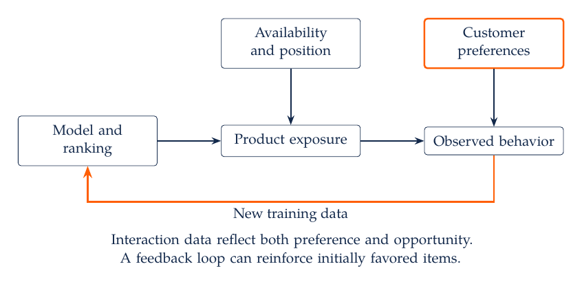
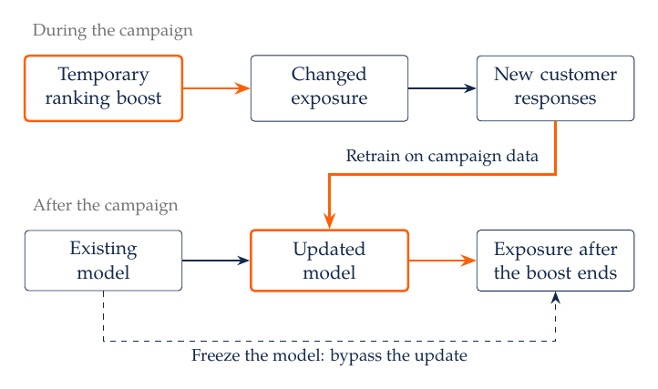
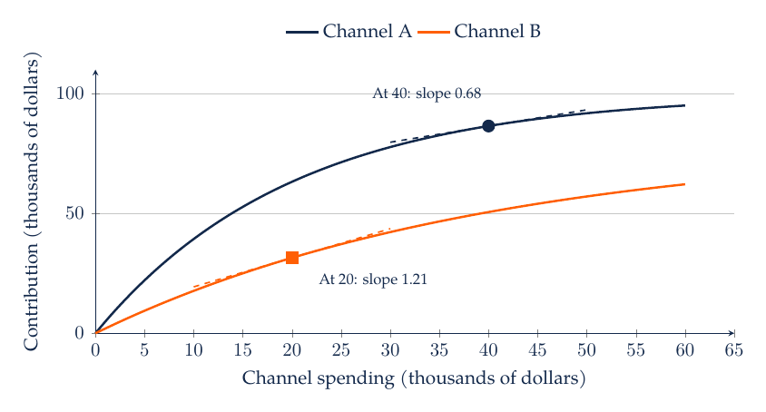
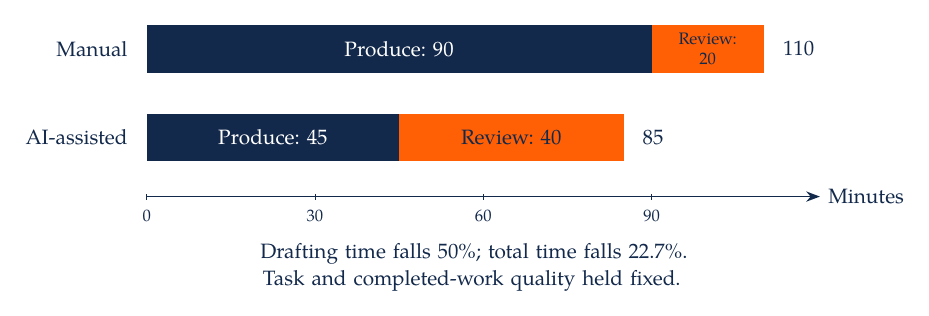

# M8. Current Topics and Integrated Marketing Decisions

A marketing team can now generate campaign copy, build a prediction model, and summarize customer feedback within a short working session. The remaining difficulty is deciding whether the resulting system improves a business decision. A recommendation engine can reproduce past exposure, a media model can attribute seasonal demand to advertising, and an AI-generated analysis can calculate an invalid comparison precisely. Evaluating these systems requires a clear account of their information, incentives, assumptions, and consequences.

## 8.1 Recommendation Systems Learn From Selected Exposure

A retailer wants to recommend products that customers will find useful. A common starting point is past interaction: purchases, clicks, ratings, or time spent. These observations combine preferences with the opportunities customers received. A product displayed prominently has more chances to be clicked than an otherwise similar product that was rarely shown. An absent interaction can therefore mean dislike, lack of exposure, lack of need, or an unavailable product.

Content-based methods use product attributes and customer histories to identify similar items. Collaborative methods use patterns across users and items, including matrix factorization, which approximates an interaction matrix with lower-dimensional user and item representations. Hybrid systems combine these sources. Each method needs a strategy for new customers and new products that have little interaction history. Popularity baselines and simple category rules provide useful comparisons.

Recommendation systems also change the data used to train the next model. A product that receives more exposure can accumulate more interactions, become easier to estimate, and receive still more exposure. This process can amplify initial differences without establishing that the repeatedly displayed product would be preferred under equal exposure.

[Chaney, Stewart, and Engelhardt (2018)](https://arxiv.org/abs/1710.11214) study this feedback through simulations in which recommendations shape the next training sample. Their results show that consumption can become more homogeneous without corresponding utility improvements. The result depends on the simulated preferences, recommendation rules, and updating process. It identifies a mechanism to examine in deployed systems rather than a universal effect of personalization.

Rankings determine exposure, exposure affects observed behavior, and that behavior enters subsequent training data. Customer preferences also affect behavior, while availability and position affect the opportunity to respond. Logging impressions, positions, eligible alternatives, and the policy that selected them helps distinguish these components. Purchase logs alone often omit the alternatives a customer could actually have encountered.

Evaluate recommendation quality at the unit relevant to the decision. Precision among the top recommended items and ranking metrics assess aspects of relevance. Coverage, novelty, diversity, repeat engagement, returns, and contribution describe other consequences. A system can improve one metric while reducing another. Offline evaluation on historical logs is particularly sensitive to the policy that generated those logs. An experiment that changes exposure can supply information that a more flexible model of the same selected data cannot supply.

### 8.1.1 Case Study: A Temporary Campaign Can Change the Learned Policy

A platform may stop boosting a category while continuing to use the behavior generated during that boost. [Luo, Yao, and Zhang's 2026 working paper](https://arxiv.org/abs/2606.08265) studies a celebrity sleep-reminder campaign on a short-video platform. During the campaign, a ranking adjustment increased the chance that treated users would see a reminder during the late-night window. Exposure remained dependent on the ranking process. The analysis uses a balanced panel of 200,000 users active on the experiment's first day, with 100,000 drawn from each assignment group.

Table 6 reports assignment effects of 14.75% higher late-night usage and 2.18% higher overall app usage relative to the respective control means during the campaign. These are relative percentage changes in usage, not percentage-point changes in exposure or measured effects on sleep. The paper also reports persistent engagement changes and changes in the content delivered afterward. The authors interpret the evidence through discovery of previously underexposed preferences and subsequent recommendation updates. The experiment estimates effects of the assignment regime; attributing persistence specifically to learning requires the additional mechanism evidence. The first-day activity restriction also makes sample inclusion consequential when extending the result to all assigned users.

The temporary boost ends, but its information can remain in the learned model. Freezing the model after the campaign would interrupt that particular channel while leaving any direct changes in customer behavior possible. Updating it incorporates the new interactions into future exposure. These policies can have different effects even when the campaign content and immediate responses are identical. Separating their contributions requires variation in the learning policy as well as the initial intervention.

An evaluation should retain the assignment, exposure, model version, retraining schedule, and outcomes after the intervention ends. A shared model can transmit treatment-generated information to comparison customers. Report the assignment unit and use uncertainty calculations that account for repeated observations of the same unit. Measure the intended customer outcome directly where possible, because increased engagement cannot reveal whether a campaign achieved a goal such as less late-night use or greater satisfaction.

### 8.1.2 Case Study: Netflix Personalization and Incremental Engagement

A streaming service wants to distinguish the appeal of its catalog from the value created by matching titles to viewers. [Zielnicki, Aridor, Bibaut, Tran, Chou, and Kallus](https://www.ifo.de/en/cesifo/publications/2026/working-paper/value-personalized-recommendations-evidence-netflix), in the supplied June 2026 paper, estimate a choice model using Netflix viewership and recommendation exposure. The model incorporates heterogeneous tastes and dependence on viewing history. Its identification treats exposure as conditionally exogenous given the included user, title, and state information. A separate randomized recommendation perturbation provides diversion patterns used to assess the model.

Under that model, replacing the current recommender with matrix factorization reduces engagement by approximately 4%, and replacing it with a popularity-based rule reduces engagement by approximately 12%. These are model-based counterfactual reductions relative to the existing recommender, not direct A/B estimates of those complete replacements. Their interpretation depends on the exposure condition, maintained choice model, and counterfactual implementation.

For a subscription business, engagement can affect retention and hence customer lifetime value, but the relationship requires evidence. A 12% engagement reduction does not imply a 12% decline in revenue, retention, or consumer welfare. Evaluate those outcomes separately, account for substitution across titles, and compare the incremental value with the cost of maintaining the recommendation system. The model's experimental check is useful because it evaluates responses to changed exposure, beyond fit to historical viewing alone.

## 8.2 Case Study: Relevance, Variety, and Customer Goals

A customer may prefer a useful collection of products even when some items in that collection have lower individual relevance scores. Category repetition, past purchases, and the customer's stated goal affect the value of the complete list. The food-recommendation studies in M7, Section 7.12, motivate these distinctions. A simple list objective makes the relevance-variety tradeoff explicit.

Suppose a retail customer requests three products and values variety across categories. Assign four candidate items the relevance scores below. The scores are comparable across these items and measure relevance rather than purchase probability.

| Item | Category | Relevance Score |
| --- | --- | ---: |
| A | Coffee | 0.90 |
| B | Coffee | 0.85 |
| C | Tea | 0.75 |
| D | Fruit | 0.65 |

Choosing the three highest scores gives A, B, and C, with total relevance 2.50 and two categories. Choosing A, C, and D gives relevance 2.30 and three categories. To make the tradeoff explicit, define a list objective

$$
J(L)=\sum_{j\in L}s_j+\lambda K(L),
$$

where $L$ is a three-item list, $s_j$ is relevance, $K(L)$ counts distinct categories, and $\lambda$ is the value placed on an additional category in the same units as the relevance score. With $\lambda=0.30$, A, B, C has objective 3.10, while A, C, D has objective 3.20. The latter list is preferred under this stated objective. The threshold at which these two lists tie is $\lambda=0.20$.

The variety weight must come from an explicit objective, user preference, or evaluation process. Category counts are also a coarse measure: they treat all category differences equally and ignore which products the customer already owns. A deployed system would need better measurements and an evaluation of whether the resulting lists improve the intended customer experience.

For an experiment, randomize eligible customers to the existing and revised recommendation policies. Choose a primary outcome such as contribution per assigned customer over a fixed horizon, alongside measures of customer satisfaction and unwanted repetition. Analyze assignment rather than only customers who clicked a recommendation. Clicking occurs after the policy is assigned and can differ between policies. Preserve the list shown and the alternatives eligible at each impression so the mechanism can be examined.

### 8.2.1 Engagement, Considered Preferences, and the Objective

A customer can click an item and later wish it had not been recommended. [Kleinberg, Mullainathan, and Raghavan](https://doi.org/10.1287/mnsc.2022.03683) model inconsistent preferences to explain why behavior alone can be insufficient for a platform seeking to improve user utility. The problem can arise even when the platform wants to serve the user: the observed action may reflect an immediate impulse that differs from a considered preference. A useful evaluation therefore combines behavior with explicit goals, satisfaction, and measures of regretted use, with their measurement limitations stated.

[Stray and coauthors (2021)](https://arxiv.org/abs/2107.10939v1) discuss recommender design around objectives such as well-being, diversity, and user control. For a retailer, a concrete formulation could maximize expected contribution subject to customer-selected spending limits, a maximum repetition rate, and a minimum satisfaction criterion. These constraints make the acceptable tradeoffs explicit. A weighted sum is another choice, but its conclusions depend on the scales and weights. Estimates of the component outcomes remain necessary under either formulation.

A list with more categories need not better serve every customer. Someone replenishing a familiar weekly basket may value reliability more than novelty. Elicit the relevant goal, preserve a way to revise it, and evaluate whether the system responds appropriately. A policy that increases variety on average can still repeatedly ignore the preferences of a particular group.

### 8.2.2 Case Study: Content Exposure and Political Attitudes Are Different Outcomes

[Milli and coauthors (2025)](https://doi.org/10.1093/pnasnexus/pgaf062) conduct a preregistered audit with 806 Twitter users, comparing posts selected by engagement ranking with recent posts from accounts each user follows. They collect item-level stated preferences and perceptions. Engagement ranking selects more emotionally charged and out-group-hostile material, and the political posts selected are not preferred by users on the stated-preference measure. The outcomes describe selected content and users' evaluations within the audit's exposure window.

[Liu and coauthors (2025)](https://doi.org/10.1073/pnas.2318127122) conduct four experiments with nearly 9,000 participants on a YouTube-like interface. Manipulating recommendation sequences produces limited short-term polarization effects in the studied settings. The intervention, exposure duration, and attitude outcomes differ from the Twitter audit. The studies therefore address different links between recommendation, consumption, perception, and opinion. A change in the composition of displayed content does not determine the magnitude of an attitude effect.

For a managerial comparison, state the population, assignment, exposure window, outcome, and uncertainty before combining findings across settings. A nonsignificant attitude effect supplies no general assurance of zero long-run effects, just as a difference in displayed content supplies no estimate of long-run polarization. The relevant evidence is the estimated effect and its uncertainty for the intervention actually evaluated.

### 8.2.3 Platform Incentives and Preference Changes

The platform's return from a recommendation can differ from the customer's value. [Chen and Tsai (2024)](https://doi.org/10.1111/1756-2171.12481) examine Amazon's dual role as retailer and intermediary using product-level recommendation data and variation from Amazon stockouts. The study finds that Amazon's seller status affects the receipt of “Frequently Bought Together” recommendations. The design uses within-product changes, with accompanying controls and checks, to distinguish seller identity from stable product appeal. Its causal interpretation depends on the treatment of other changes accompanying stockouts.

An analyst evaluating a marketplace should record whether an item is sold by the platform, sponsored, or commission-bearing, alongside availability and customer relevance. Contribution should use the appropriate margin or fee for each item. A common ranking score can conceal those different incentives. A policy change may improve platform profit while reallocating sales among sellers, so report effects at the customer, seller, and platform levels relevant to the decision.

[Zhu and coauthors](https://arxiv.org/abs/2210.05662v2) develop a benchmark for distinguishing better matching from changes in users' preferences under a recommendation process. Their experiments use synthetic and real-world datasets within the proposed framework. They motivate measuring preference change separately from click-through performance. They do not establish that every online performance gain represents manipulation. A customer may learn to appreciate an unfamiliar product; whether that change serves the customer requires a stated criterion and evidence beyond a higher click count.

## 8.3 Marketing-Mix Models Combine Carryover and Saturation

A marketing-mix model relates aggregate outcomes to media activity and other determinants across time or markets. Its appeal is practical: many firms observe weekly sales and channel spending even when individual customer paths are unavailable. The analytical challenge is that media decisions often respond to expected demand. Advertising, promotions, holidays, distribution, and competitor actions can move together.

A simple carryover variable is

$$
a_{ct}=s_{ct}+\rho_c a_{c,t-1},\qquad 0\leq\rho_c<1,
$$

where $s_{ct}$ is spending in channel $c$ during period $t$, $a_{ct}$ is its accumulated exposure proxy, and $\rho_c$ controls geometric decay. This unnormalized definition gives the same units as spending, but its long-run level under constant spending is $s_c/(1-\rho_c)$. Some software normalizes the weights. Coefficients and interpretations must follow the selected convention.

If one spending pulse of 100 occurs at period zero and $\rho=0.5$, the subsequent accumulated values are 100, 50, 25, and 12.5. A pulse can therefore coincide with later sales even when current spending is zero. A seasonal demand pattern can also create persistence. The model needs enough information and a credible design to distinguish these explanations.

Saturation describes declining additional response at higher exposure. A saturating response curve is $R(a)=A[1-\exp(-a/b)]$, where $A$ is the limiting response and $b>0$ controls how quickly the curve approaches that limit. A basic outcome model may combine channel response curves, controls, trend, seasonality, and an error term. The fitted components are model-dependent; their causal interpretation requires assumptions about how spending was chosen and which demand determinants were measured.

The official [Meridian documentation](https://developers.google.com/meridian/docs/basics/meridian-introduction) describes a modern framework for marketing-mix modeling. The [PyMC Marketing examples](https://www.pymc-marketing.io/en/latest/notebooks/mmm/mmm_example.html) provide another implementation route. Use those materials to inspect definitions, priors, and diagnostics. A software package cannot supply a missing source of identifying variation. Experiments and external evidence can help calibrate a model, subject to whether their populations, interventions, and time horizons match the intended use.

## 8.4 Case Study: Allocate the Next Dollar Using Marginal Returns

Consider two channels with imposed contribution response curves

$$
R_A(s_A)=100[1-\exp(-s_A/20)],\qquad
R_B(s_B)=80[1-\exp(-s_B/40)].
$$

Both spending and contribution are measured in thousands of dollars over the same horizon. These response functions omit cross-channel interactions and are assumed known. At a total budget of 60, suppose the current allocation is 40 to A and 20 to B. The question is whether moving a small amount between channels increases contribution while holding the total budget fixed.

Average contribution per unit spent is $R_c(s_c)/s_c$. At the current allocation, it is approximately 2.16 for A and 1.57 for B. Marginal contribution is the derivative of the response curve. It is approximately 0.68 for A and 1.21 for B. A has the higher average return, while B offers the greater return on the next small unit of spending.

At the current allocations, B has the steeper response curve. Moving a small amount from A to B therefore raises total contribution. The comparison depends on the slopes at the current allocation, whereas average returns summarize all spending up to that point. The budget is held fixed, so the transfer does not change total spending expense.

For a differentiable, concave response with an interior optimum and no other constraints, marginal returns are equal across channels. Here the condition is

$$
5\exp(-s_A/20)=2\exp(-s_B/40),\qquad s_A+s_B=60.
$$

Solving gives $s_A\approx32.22$ and $s_B\approx27.78$. Total contribution rises from approximately 117.94 to 120.09, or about 2.14 thousand dollars. If total budget were also a choice, marginal contribution would be compared with the marginal cost of spending; exhausting a fixed budget and choosing its size are different optimization problems.

A real decision should also examine parameter uncertainty, operational minimums, saturation outside observed spending ranges, delayed effects, and interactions across channels. Report how the recommended allocation changes under plausible response curves. A sharply stated optimum based on weakly identified slopes can conceal substantial decision uncertainty. Prefer an allocation that is supported by observed variation and specify an experiment that would resolve the most consequential uncertainty.

## 8.5 Generative AI Changes the Cost of Producing and Checking Work

Generative AI can assist with code, text classification, documentation, and communication. The business value depends on the complete workflow. Faster generation can be offset by additional review, integration failures, or errors that reach downstream decisions. Measure the output that matters: a correct, reproducible analysis completed with an appropriate understanding of its limitations.

Separate several uses. A coding assistant produces or edits a program that can be inspected and executed. An annotation model produces labels that require a measurement evaluation. A retrieval system selects source passages and may generate a summary that needs factual support. A content system produces customer-facing material whose effect should be evaluated in its deployment context. Each use has a different unit of quality and a different failure mechanism.

For coding, begin with an analytical specification and a small example with a known result. Ask the assistant to implement a limited step, explain the data transformations, and identify assumptions. Inspect the code before running it. Then compare intermediate outputs with independent checks. A program that executes successfully can still use an incorrect denominator, join on the wrong key, or include future information. Those errors require substantive checks rather than syntax repair.

For retrieval and summarization, maintain the connection between a claim and its source. A citation should support the particular statement next to it. Ask the model to distinguish an observed result from a proposed explanation, and check that distinction against the original text. If a passage or file is unavailable, state that limitation. Fluent reconstruction is not a substitute for access to the evidence.

## 8.6 Case Study: Evaluate an AI-Assisted Analytics Workflow

Suppose a firm wants to know whether access to a coding assistant improves analysts' work on customer-retention tasks. Define treatment as access under a specified protocol and version, and define an outcome that incorporates both completion and validity. A useful primary outcome could be the fraction of assigned tasks meeting a prespecified analytical rubric within a fixed time budget. Secondary outcomes could include completion time, independent error severity, and a later explanation task completed without assistance.

Randomize analysts or teams according to the likely spillovers. Repeated tasks by the same analyst require attention to learning, carryover, and dependence. If a crossover design is used, randomize order and consider whether experience in the first condition changes performance in the second. A task-level comparison with no accounting for analyst ability or task difficulty can confound the treatment effect with who received which work.

Quality review should use a common rubric and, where feasible, reviewers unaware of treatment assignment. The rubric can check observation units, joins, leakage, estimation, uncertainty, and interpretation. Record the assigned task, the eligible inputs, the tool configuration, and the evaluation procedure. Avoid interpreting a favorable result for one task type as a universal effect across all analytical work.

Suppose a manual workflow uses 90 minutes to produce an analysis and 20 minutes to review it, totaling 110 minutes. An assisted workflow uses 45 minutes to produce a draft and 40 minutes to review it, totaling 85 minutes. The reduction in total time is 25 minutes, or about 22.7%, while the drafting-time reduction is 50%. The total-time comparison is informative only if the completed outputs meet comparable quality requirements.

This comparison holds the task and required quality fixed. Review is part of production because an undetected error can alter a marketing decision. In empirical work, report the completion and quality outcomes alongside time so that faster abandonment or lower-quality work is not counted as an equivalent improvement.

## 8.7 Integrated Case: A Retail Subscription Launch

A retailer is considering a subscription service with recommendations and delivery benefits. Begin with the decision: which offer to launch, to which eligible customers, at what price, with what evidence of incremental contribution? Define the evaluation horizon, capacity constraints, and the alternatives to launch.

Construct the customer and order tables with explicit keys and dates. Describe customer activity and purchasing cohorts, keeping unavailable future retention separate from observed inactivity. Use regression to summarize conditional patterns while examining confounding. Design a conjoint exercise to learn stated tradeoffs between delivery, assortment, and price, then assess whether its predictions generalize to an actual offer.

Use segmentation to organize meaningful differences in needs and behavior, and calculate customer value from contribution rather than revenue. Analyze reviews to identify the service attributes customers mention, checking annotation quality against human labels. Develop a prediction model using only information available at the targeting date. Its forecasts can help plan capacity, while a randomized offer evaluates incremental take-up, contribution, and retention.

Finally, evaluate the recommendation component and the acquisition budget. Log exposure to recommended items, distinguish average from marginal media returns, and use AI assistance within a documented verification process. The management recommendation should identify the supported action, the uncertainty that could change it, and the next observation or experiment with the greatest decision value. A complicated collection of models is useful only if these pieces support a coherent choice.

## 8.8 Practice and Further Reading

**Recommendation exercise.** Compare all four three-item lists in the variety example at $\lambda=0$, 0.20, and 0.30. At zero, A, B, C is optimal. At 0.20, it ties A, C, D. At 0.30, A, C, D is optimal. Explain how a different category definition could change that conclusion without changing any relevance score.

**Dynamic-policy exercise.** Design a comparison between a temporary recommendation boost with a frozen model and the same boost followed by retraining. Specify how training data are separated across conditions, when outcomes are measured, and how shared content or customers could transmit effects. Explain which comparison identifies the effect of allowing the model to learn from campaign-period behavior.

**Evidence exercise.** Compare the MovieLens field experiment, the Netflix model-based replacement counterfactuals, and the short-term YouTube experiments. State the intervention and estimand for each. Explain why their reported outcomes cannot be combined into a single percentage measuring the value or harm of recommendation systems.

**Budget exercise.** Calculate the gain from moving one thousand dollars from channel A to channel B at the original allocation. Compare the exact change with the difference between the two marginal returns. The derivative is a local approximation; the exact finite transfer also reflects curvature. Then explain why an unobserved seasonal demand shock could invalidate a causal interpretation of an estimated response curve.

**AI evaluation exercise.** Draft a rubric for an assistant-generated retention analysis. Include at least one check that detects a substantive error in code that executes successfully, such as an order-line denominator used for average order value. Define a hand-checkable example that exposes the error and explain how a reviewer would determine whether it occurred.

Read Nielsen and coauthors, [“Consumption Variety in Food Recommendation”](https://doi.org/10.1086/720453), and Ling and coauthors, [“Following Good Examples”](https://doi.org/10.1145/3485447.3514193), for applications connecting recommendation objectives with customer behavior. The official marketing-mix documentation linked above develops implementation details. Consult the [AI-coding evidence](../../01_Resources/10_AI_Coding_Concepts_and_Evidence/README.md) and [workflow resources](../../01_Resources/11_AI_Coding_Tools_and_Workflows/README.md) for further study.
