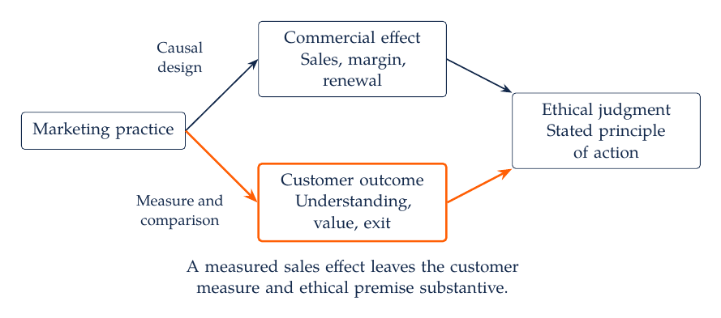
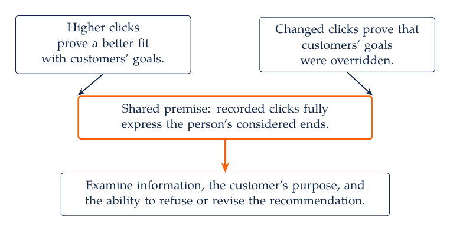
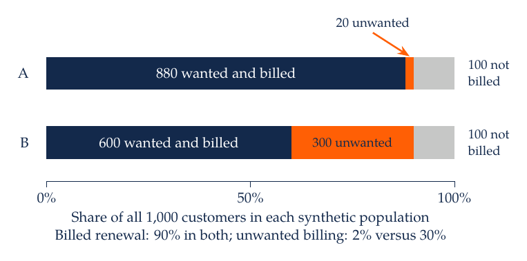
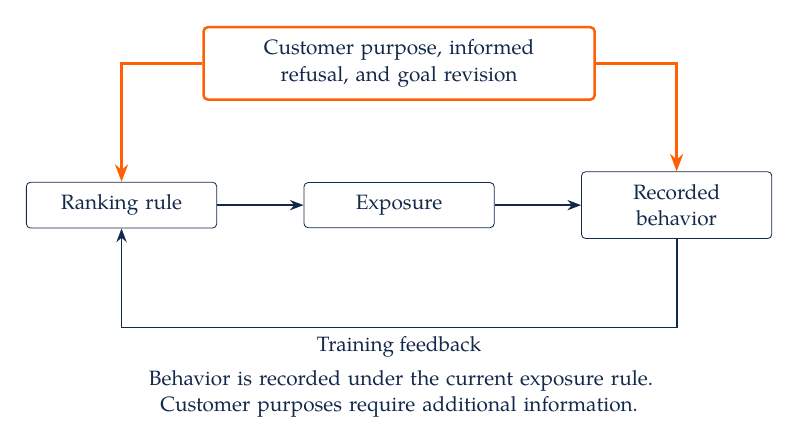
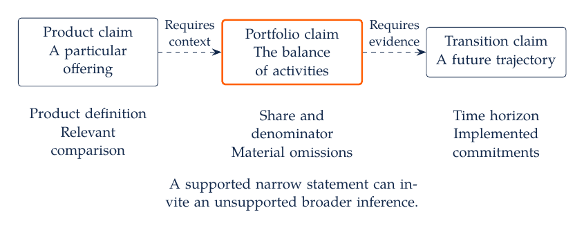
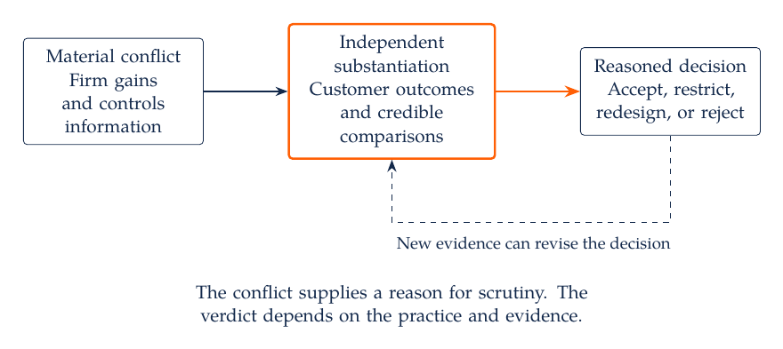

# Marketing Dialectics

## 9.1 When a Commercial Result Becomes a Claim About Customers

\noindent A subscription manager must decide whether to retain a cancellation sequence that raises paid renewal. One explanation is that the sequence helps customers discover a service feature they value. Another is that it makes leaving sufficiently difficult that some customers continue paying against their wishes. Both mechanisms can produce the same billing record. The decision therefore depends on the reasons for renewal, the customer's understanding of the offer, and the practical ability to refuse it.

The claim that higher renewal demonstrates customer benefit contains a premise: continued payment expresses an informed wish to continue at the stated terms. That premise requires evidence. A manager can calculate renewal accurately and still draw an unjustified conclusion about the customer. Equally, the existence of a retention offer does not establish manipulation. A relevant discount, clearly explained and freely refused, can improve the customer's available options.

Kant's critique of dialectical reasoning asks how reason comes to treat its own demands for explanation as knowledge about objects. In a marketing application, the corresponding discipline is to identify what connects an observed result to a broader claim. This is an adaptation of Kant's critical approach to an empirical decision. A disputed interpretation of a customer metric is not, by itself, a transcendental antinomy. The philosophical connection concerns the examination of premises and the limits of a conclusion.

Three questions organize the decision. What does the evidence establish about the practice? Which assumptions connect that finding to customer interests? Which ethical principles justify the action? A favorable answer to one question leaves the others substantive. An experiment may identify an increase in purchases while leaving the quality of consent unresolved. A transparent offer may respect a customer's choice while producing too little revenue to remain commercially viable.



The upper path connects an intervention to a measured commercial outcome through a causal design. A second path requires a valid customer outcome measure and a defined comparison. The ethical judgment additionally depends on a stated principle concerning treatment of persons. No arrow permits sales to stand in for all three conclusions.

## 9.2 Kant's Dialectic and the Limits of Reason

### 9.2.1 The Search for an Unconditioned Explanation

\noindent In the *Critique of Pure Reason*, the understanding organizes experience through concepts and judgments. Reason seeks relations among those judgments and asks for more complete explanations. Given something conditioned, it looks for the condition on which it depends. Repeating that question creates a demand for an unconditioned ground that would complete the explanation. The difficulty arises when the demand for completeness is treated as establishing an object that theoretical reason can know independently of possible experience. Kant develops this account in the introduction to the Transcendental Dialectic, especially A293/B349 through A308/B365. The A and B references identify the original first- and second-edition pagination. [Kant, *Critique of Pure Reason*](https://www.gutenberg.org/files/4280/4280-h/4280-h.htm)

Kant distinguishes transcendental illusion from a mistake that disappears once a faulty inference is corrected. The attraction of an unconditional explanation persists after criticism has exposed its source. The task of critique is to prevent that attraction from becoming an unjustified judgment. This distinction gives an important reason to revisit assumptions. Recognizing a tempting inference once does not guarantee that an attractive new result will cease to invite it.

The three major divisions of the Dialectic concern the soul, the world as a whole, and God. The paralogisms examine inferences from the unity of thinking to claims about the soul as an object. The antinomies concern opposed arguments about the world considered as a completed totality. The ideal of pure reason concerns the supposed highest being and attempts to establish its existence. These are specific arguments within Kant's critical philosophy. Their marketing relevance comes from the practice of examining the transition from a valid use of reason to an unsupported claim, rather than from equating a customer segment, dataset, or company with one of these metaphysical objects.

### 9.2.2 Antinomies and the Shared Premise

\noindent Kant presents four cosmological conflicts: whether the world has limits in time and space; whether composite substances ultimately consist of simple parts; whether causality through freedom is necessary alongside natural causality; and whether an absolutely necessary being exists. The apparent strength of opposing arguments calls attention to their common framework. In Kant's diagnosis, treating the world of appearances as a completed whole of things in themselves generates the conflict. His resolutions depend on the particular antinomy. The mathematical and dynamical antinomies do not all receive an identical verdict. The *Prolegomena*, §§50–54, supplies a shorter treatment. [Kant, *Prolegomena*](https://www.gutenberg.org/files/52821/52821-h/52821-h.htm)

The third antinomy is especially relevant to discussions of prediction and agency. Its thesis argues for a causality through freedom; its antithesis argues that events occur through natural laws. Kant's critical solution distinguishes the explanation of events as appearances from the intelligible standpoint under which freedom can be thought. The first Critique's resolution does not supply an empirical demonstration that a particular choice was free. Interpretations of transcendental idealism and the relationship between these standpoints remain disputed. [Stang, *Kant's Transcendental Idealism*](https://plato.stanford.edu/entries/kant-transcendental-idealism/)

A marketing model that predicts a purchase therefore does not settle a metaphysical question about freedom. Prediction can reflect stable preferences, recurring needs, constraints, exposure, or a combination of these. Conversely, an unpredictable choice can arise from poor measurement or random error. Neither predictive success nor prediction failure establishes whether a firm has respected a person's capacity to judge and choose.



The marketing example places two claims above a shared assumption: observed clicks fully express customers' considered ends. One claim treats higher clicks as proof of a better fit with customers' goals; the other treats changed clicks as proof that those goals were overridden. Examining the shared assumption allows a more specific evaluation of information, goals, and control. This argument map is a contemporary analogy. It is not one of Kant's four cosmological antinomies.

### 9.2.3 Regulative Ideas and Productive Inquiry

\noindent The appendix to the Dialectic gives reason a constructive role. Ideas can guide the search for systematic unity without providing constitutive knowledge of the objects they represent. A research program can seek more connected explanations while preserving the conditions under which each claim is warranted. Kant distinguishes this regulative use from treating an idea as if it supplied a determinate object of knowledge. The interpretation of the status of these ideas is itself debated; Gava distinguishes different kinds of regulative assumptions rather than treating every idea as a known fiction. [Gava (2022)](https://doi.org/10.1515/opphil-2022-0202)

In a marketing adaptation, a commitment to understanding customer benefit can guide the collection of information about learning, regret, comprehension, and the ability to leave. It does not justify announcing that benefit has already been measured by a single score. A useful ideal generates better questions. It becomes misleading when its desirable name is attached to a convenient outcome and then treated as a finding.

Two further uses of dialectic broaden the reading. In the *Critique of Practical Reason*, Book II, Kant examines the highest good and the relation between virtue and happiness. His argument supplies no empirical guarantee that ethical firms earn the highest profits. In the *Critique of Judgement*, §§55–57, the antinomy of taste concerns the basis of judgments that claim assent without being demonstrable through determinate concepts. That problem differs from estimating which advertisement a customer prefers. These distinctions preserve the specific object of each argument. [Kant, *Practical Reason*](https://www.gutenberg.org/files/5683/5683-h/5683-h.htm); [Kant, *Judgement*](https://www.gutenberg.org/files/48433/48433-h/48433-h.htm)

## 9.3 A Critical Examination of Marketing Claims

\noindent Consider the claim that personalized offers improve customer welfare. Begin by stating the practice: which information enters the rule, which offers can be shown, whether prices change, and what alternatives remain available. Next identify the comparison. The claim could concern personalization relative to a common offer, a customer-selected rule, or a previous algorithm. These comparisons can have different effects. A broad phrase such as personalization is beneficial leaves both treatment and benchmark unspecified.

A descriptive claim records an observed pattern. A predictive claim concerns performance on a specified population and information set. A causal claim concerns what changes under an intervention relative to an alternative. A normative claim concerns what should be permitted or chosen. The evidence must fit the claim. An accurate description of sales among exposed customers does not by itself identify incremental sales; an incremental-sales estimate does not by itself determine whether the intervention is ethically acceptable.

The most useful objection identifies a premise on which the recommendation depends. For an advertising claim, that premise might be that exposed and unexposed customers would have bought at the same rate without exposure. For a cancellation claim, it might be that continued billing expresses an informed wish to renew. For a recommendation claim, it might be that the platform's engagement objective adequately represents the customer's purpose. Once the premise is stated, the analyst can ask which observation, design, or argument would support it and which would undermine it.

Disagreement then has several possible resolutions. A claim can be accepted within a specified population and horizon. Its scope can be narrowed, its mechanism revised, or its recommendation rejected. Judgment can also be suspended when a consequential premise remains unresolved. There is no requirement to compromise between a supported claim and an unsupported objection. Kant's dialectic should not be presented as a mechanical sequence in which every thesis requires an antithesis and an inevitable synthesis. Later dialectical traditions require their own interpretation. [Maybee, *Hegel's Dialectics*](https://plato.stanford.edu/entries/hegel-dialectics/)

Critical examination also applies to the criticism. A claim that all advertising overrides agency must account for advertising that communicates useful price, availability, or quality information. A claim that personalization always benefits customers must account for inaccurate inferences, concealed incentives, and customers whose goals differ from the model's objective. The burden is to explain the scope of each argument and the evidence that bears on it.

## 9.4 Respect for Persons and Commercial Exchange

### 9.4.1 Means, Ends, and the Customer's Judgment

\noindent Kant's ethical analysis adds a distinct question to the critique of knowledge: how should one act toward rational persons? The humanity formulation of the categorical imperative requires treating humanity as an end and never merely as a means. A normal exchange uses the services of another person in pursuing an end. Its moral assessment depends on whether that person is also respected as capable of forming and pursuing ends. The qualifier merely therefore matters. Commercial activity is not condemned simply because a seller seeks revenue. [Kant, *Groundwork*, second section, Akademie 4:429](https://www.gutenberg.org/files/5682/5682-h/5682-h.htm)

A customer who knowingly chooses a useful service and can revise that choice may benefit alongside the seller. A process that relies on concealed terms or prevents an expressed refusal presents a different relation between the parties. The concern is that the customer's reasoning and choice become obstacles to be circumvented. This evaluation requires the details of the practice: what the firm communicates, what it conceals, what the customer understands, and what happens when the customer says no.

Santori's interpretation of Kant develops the possibility of market exchange organized around mutual assistance and the spirit of mutually beneficial contracts. It provides a useful counterweight to the assumption that a profit motive makes exchange intrinsically objectionable. The argument is philosophical; it does not establish that observed contracts are informed, fair, or beneficial in every setting. [Santori (2024)](https://link.springer.com/article/10.1007/s40926-024-00252-z)

### 9.4.2 Universalization and the Maxim of a Practice

\noindent A maxim specifies a circumstance, an action, and a purpose. For example: when a customer seeks to leave, conceal the effective cancellation route so that the customer continues paying. Stating the maxim exposes the role of concealment in the business objective. Kant's universal-law formulation asks whether a maxim can be willed as a universal law, with distinctions between contradictions in conception and in willing. This is a test of a principle of action, rather than a vote on whether the practice is popular. [Kant, *Groundwork*, second section, Akademie 4:421]

The moral difficulty becomes especially clear when a promise of easy cancellation is used to obtain enrollment while the firm intends to frustrate cancellation later. The strategy depends on the customer relying on an assurance the firm does not intend to honor. A truthful and accessible renewal reminder has a different maxim. Its function can be to help customers act on their plans while making an optional offer. The formulation of the maxim must reflect the actual practice and purpose; redescribing concealment as customer service does not answer the objection.

Kantian autonomy concerns rational self-legislation. A recorded click is a behavioral event, and a preference survey is a measurement instrument. Neither is a complete operational definition of autonomy. Comprehension, refusal, revision, and effective exit are useful empirical indicators for evaluating a marketing practice. They leave the philosophical meaning of autonomy broader than any single observed response. [Johnson and Cureton, *Kant's Moral Philosophy*](https://plato.stanford.edu/entries/kant-moral/)

### 9.4.3 Ethical Reasons, Professional Standards, and Law

\noindent Laczniak and Murphy connect marketing ethics to duties toward customers, other stakeholders, and the broader marketing system. Their account encourages attention to effects that a narrow transaction measure omits. The American Marketing Association's current ethics statement likewise articulates professional values, including honesty, responsibility, equity, transparency, and citizenship. It is an aspirational professional statement. A professional code, a philosophical argument, and an enforceable legal obligation have different sources of authority. [Laczniak and Murphy (2006)](https://epublications.marquette.edu/market_fac/45/); [AMA, *Statement of Ethics*](https://www.ama.org/ama-statement-of-ethics/)

Customer benefit, respectful treatment, and legal compliance should each receive a reasoned evaluation. A lawful practice can still warrant ethical criticism. A beneficial effect does not erase deception. An allegation of deception requires evidence about the communication and its likely meaning. In a cancellation case, the applicable jurisdiction, transaction, and current rule must be identified before making a legal claim. The [course policy source record](../../01_Resources/13_Consumer_Agency_and_Recent_Research/Policy/README.md) separates the status of federal rulemaking from other applicable cancellation requirements.

## 9.5 Worked Case: Identical Renewal, Different Customer Intent

### 9.5.1 The Population and the Missing Distinction

\noindent Consider two entirely constructed populations, A and B, each containing 1,000 customers eligible for one monthly renewal. Each customer appears once. Billing is observed during the same renewal month. Whether the customer wanted to renew at the stated terms is stipulated before billing and independently of whether a charge occurred. No actual platform records, randomized treatment, or estimated preferences enter this example.

In A, 880 customers wanted renewal and were billed; 20 did not want renewal and were billed. In B, these counts are 600 and 300. Both populations also contain 20 customers who wanted renewal but were not billed and 80 who neither wanted renewal nor were billed. Each population therefore has 900 billed customers and a billed-renewal rate of 90%. Unwanted billing represents 2% of all customers in A and 30% in B.

| Customer State | Population A | Population B |
| --- | ---: | ---: |
| Wanted renewal and billed | 880 | 600 |
| Did not want renewal and billed | 20 | 300 |
| Wanted renewal and not billed | 20 | 20 |
| Did not want renewal and not billed | 80 | 80 |
| All eligible customers | 1,000 | 1,000 |

To distinguish the billing outcome from its composition, let $B_i$ equal one when customer $i$ is billed and let $W_i$ equal one when that customer wanted renewal before billing. For each population of size $N$, define

$$
R=\frac{1}{N}\sum_{i=1}^{N}B_i,
\qquad
U=\frac{1}{N}\sum_{i=1}^{N}B_i(1-W_i).
$$

Both quantities are customer shares over the renewal month. $R$ is billed renewal; $U$ is unwanted billing among all eligible customers. Holding $R$ fixed leaves $U$ undetermined because the billing total does not reveal the intent of those billed. Among billed customers, the unwanted shares instead use 900 as the denominator, giving approximately 2.22% in A and 33.33% in B. A conditional share and a population share answer different questions.



The bars divide each full population into wanted and billed, unwanted and billed, and not billed. Their common billing total conceals a different composition. These are observationally equivalent populations with respect to the billing-rate statistic. The construction supplies no estimate of the effect of replacing one cancellation interface with another. It also does not assign a monetary welfare loss to unwanted billing.

### 9.5.2 Reproducible Calculation and Missing Intent

\noindent The program below constructs every customer record from the eight specified cells, exports the synthetic data, and calculates the relevant counts and shares. It retains non-billed customers in the population denominator. The summary function permits unknown intent and reports bounds: the lower bound counts observed unwanted billing, while the upper bound also counts every billed customer whose intent is unknown. Correctly measured known labels are assumed for those bounds. Missing intent supplies no evidence of satisfaction.

Python source: [evaluate_retention.py](../../03_Data_and_Code/Marketing_Dialectics/evaluate_retention.py)

```python
"""Compare two constructed customer populations with identical billed renewal.

Python 3.10+; standard library only. No network calls or real customer records.
Run: python3 03_Data_and_Code/Marketing_Dialectics/evaluate_retention.py
"""
import csv
import json
from pathlib import Path

ROOT = Path(__file__).resolve().parent


def construct_customers():
    # Each tuple is (billed this month, wanted renewal before billing, count).
    # Counts are imposed teaching inputs, not estimated responses to a policy.
    cells = {
        "A": [(True, True, 880), (True, False, 20),
              (False, True, 20), (False, False, 80)],
        "B": [(True, True, 600), (True, False, 300),
              (False, True, 20), (False, False, 80)],
    }
    rows = []
    for population, groups in cells.items():
        number = 0
        for billed, wanted, count in groups:
            for _ in range(count):
                number += 1
                rows.append({"population": population,
                             "customer_id": f"{population}{number:04d}",
                             "billed": billed, "wanted_renewal": wanted})
    return rows


def summarize(rows):
    if not rows:
        raise ValueError("The population must contain customers.")
    keys = [(r["population"], r["customer_id"]) for r in rows]
    if len(set(keys)) != len(keys):
        raise ValueError("Duplicate customer within population.")
    if len({r["population"] for r in rows}) != 1:
        raise ValueError("Summarize one population at a time.")
    for r in rows:
        if type(r["billed"]) is not bool:
            raise ValueError("Billing must be observed as True or False.")
        if r["wanted_renewal"] is not None and type(r["wanted_renewal"]) is not bool:
            raise ValueError("Intent must be True, False, or None.")
    n = len(rows)
    billed = sum(r["billed"] for r in rows)
    wanted_billed = sum(r["billed"] and r["wanted_renewal"] is True for r in rows)
    unwanted_billed = sum(r["billed"] and r["wanted_renewal"] is False for r in rows)
    unknown_billed = sum(r["billed"] and r["wanted_renewal"] is None for r in rows)
    missed_wanted = sum(not r["billed"] and r["wanted_renewal"] is True for r in rows)
    assert wanted_billed + unwanted_billed + unknown_billed == billed
    return {
        "customers": n, "billed": billed, "billed_rate": billed / n,
        "wanted_billed": wanted_billed, "unwanted_billed": unwanted_billed,
        "unknown_intent_billed": unknown_billed,
        "wanted_but_not_billed": missed_wanted,
        "unwanted_billed_lower_share_all": unwanted_billed / n,
        "unwanted_billed_upper_share_all": (unwanted_billed + unknown_billed) / n,
        "unwanted_share_among_billed_lower": unwanted_billed / billed if billed else None,
    }


def main():
    rows = construct_customers()
    with (ROOT / "synthetic_customer_months.csv").open("w", newline="") as f:
        writer = csv.DictWriter(f, fieldnames=list(rows[0]))
        writer.writeheader()
        writer.writerows(rows)
    results = {p: summarize([r for r in rows if r["population"] == p])
               for p in sorted({r["population"] for r in rows})}
    output = {
        "data_type": "Entirely synthetic; two constructed populations",
        "unit": "One customer over one renewal month",
        "intent_timing": "Before billing; stipulated independently of billing",
        "comparison": "Descriptive identification example, not a policy effect",
        "results": results,
    }
    (ROOT / "results.json").write_text(json.dumps(output, indent=2) + "\n")
    print(json.dumps(results, indent=2))


if __name__ == "__main__":
    main()
```

The output reports 900 billed customers in each population, with 20 and 300 unwanted charges respectively. Both contain 20 customers who wanted renewal but were not billed. The five independent tests in the example folder also check a four-customer missing-intent case, a population with no billing, duplicate records, and string values that could be mistaken for booleans.

### 9.5.3 From the Constructed Case to a Decision

\noindent In a real service, intent would need a defined measurement procedure. Asking after a charge can capture regret, newly learned information, or a response to the charge itself. Asking before renewal can affect the subsequent choice. Nonrespondents can differ from respondents. The timing and wording of the question therefore belong in the interpretation, along with response rates and the treatment of unknown answers.

A useful design compares a clearly disclosed, direct renewal or cancellation path with a proposed alternative and measures more than the payment outcome. Relevant outcomes include understood terms, successful completion of the customer's requested action, unwanted subsequent charges, and later evaluation of the service. Commercial viability remains part of the decision. These measurements make it possible to evaluate whether a useful offer improves an informed choice or whether extra revenue depends on frustrating that choice.

Luguri and Strahilevitz experimentally varied interfaces for declining an identity-theft protection plan and found that the interface affected continued enrollment. Their study motivates attention to the path through which a recorded decision is obtained. Mathur and coauthors instead document interface practices across shopping websites; their crawl supplies descriptive evidence about prevalence in that sample. The FTC's 2022 staff report provides additional examples and a regulatory taxonomy. These sources answer different questions about effects, prevalence, and regulatory concern. [Luguri and Strahilevitz, 2019 working paper](https://oag.ca.gov/sites/all/files/agweb/pdfs/privacy/shining-a-light-on-dark-patterns.pdf); [Mathur et al. (2019)](https://arxiv.org/abs/1907.07032); [FTC (2022)](https://www.ftc.gov/reports/bringing-dark-patterns-light)

## 9.6 Advertising Effectiveness and the Meaning of a Successful Test

\noindent A retailer must decide whether an advertising campaign deserves additional spending. Customers exposed to the ads purchase more frequently than customers who were not exposed. The analyst proposes that this difference measures the campaign's effect. A competing explanation is that the targeting system selected customers already more likely to purchase. The dispute concerns a counterfactual premise: what the exposed customers would have done without the campaign.

Gordon and coauthors compare observational estimates with randomized advertising experiments conducted at Facebook. Their results show that extensive observed information does not reliably remove the discrepancy in those campaigns. The study supports careful identification in advertising measurement; it does not establish that every observational design is invalid. Google Ads' Conversion Lift documentation describes an industry approach to comparing groups with and without advertising exposure. Provider documentation explains an implemented service, while a particular evaluation still requires attention to its assignment, eligibility, measurement, and study type. [Gordon et al., 2018 working paper, later published 2019](https://www.kellogg.northwestern.edu/faculty/gordon_b/files/fb_comparison.pdf); [Google Ads, *About Conversion Lift*](https://support.google.com/google-ads/answer/12003020?hl=en)

Suppose a well-executed randomized study establishes positive incremental sales for the eligible customers and observation window. The appropriate next question depends on the managerial claim. A budget decision requires contribution after relevant costs and consideration of how effects change at greater spending. A customer-benefit claim requires evidence about the product's consequences and the way the offer was communicated. A successful sales experiment does not answer these additional questions simply by having a credible assignment mechanism.

A Kantian evaluation therefore preserves the experimental finding while examining the principle of the practice. A truthful advertisement that helps customers discover a useful option can serve both parties' ends. An advertisement that secures the same incremental sales through concealed material terms presents a different ethical case. The objection concerns the means of obtaining the result. It can remain decisive even when the sales effect is precisely measured.

## 9.7 Personalization, Learning, and the Ability to Revise a Goal

\noindent A recommendation system can reduce search costs by selecting items that fit a customer's interests. It can also shape the information from which later interests are inferred. Netflix's account of artwork personalization describes selecting different images to help members discover titles. The description supplies a concrete industry mechanism: presentation changes which features of an item attract attention. It does not establish that every resulting viewing decision serves the member's considered purpose. [Chandrashekar, Amat, Basilico, and Jebara (2017)](https://netflixtechblog.com/artwork-personalization-c589f074ad76)

Two claims deserve scrutiny. One says that selecting an item reveals benefit because the customer clicked. The other says that an algorithm's influence on attention necessarily removes agency. Both can ignore the process by which the person understands and evaluates the recommendation. Useful information can change a preference through learning. A misleading representation can induce a choice the customer would reject after learning the relevant facts. The substantive difference concerns the information and the person's capacity to reflect, rather than whether behavior changed at all.



The closed loop runs from the ranking rule through exposure and behavior back to the training data. An additional path lets the customer state or revise a goal and refuse a recommendation. That path does not prove autonomy by itself. It identifies decisions and observations that an engagement-only objective omits.

The recurring mHealth case makes the distinction concrete. A recommendation based on past food logging might help someone organize meals, maintain variety, or pursue a stated nutritional objective. Frequent logging can also reflect the design of reminders and the burden of recording. The logs record entries, rather than all consumption or independently verified health outcomes. A recommendation should therefore specify the customer's goal, the source and validity of nutritional information, and the ability to change or decline the goal. Health-related claims require appropriate domain evidence; engagement cannot supply it.

An intervention can preserve customer control by making the recommendation's purpose intelligible, avoiding materially misleading descriptions, and allowing users to choose another objective or leave the recommendation process. These are concrete design proposals to evaluate. Their effects on understanding, use, and customer outcomes must still be measured. A philosophical commitment gives direction to that evaluation without predetermining its empirical result.

## 9.8 Environmental Claims, Context, and the Scope of an Inference

\noindent An energy company can truthfully describe a lower-carbon product while creating a misleading impression about the balance of its overall activities. The relevant object changes from a particular offering to the company as a whole. Customers may reasonably interpret the combination of imagery, brand references, and qualifying information more broadly than an isolated sentence. Assessing the claim therefore requires the communication in context.

In its June 7, 2023 Shell ruling, the UK Advertising Standards Authority upheld the complaint concerning the overall environmental impression of several ads. It found that information about the balance of the company's activities was material to the impression conveyed. A separate issue concerning the renewable-electricity claim was not upheld. The decision consequently supports a specific conclusion about the evaluated communications and omissions. It is not a finding that every statement about the company's lower-carbon products was false. [ASA, Shell UK Ltd, June 7, 2023](https://www.asa.org.uk/rulings/shell-uk-ltd-g22-1170842-shell-uk-ltd.html)

The ASA reached a different outcome on April 9, 2025 for another Shell advertisement. That ad included higher- and lower-carbon activities and qualifying information about the investment mix. The ASA found that the overall environmental impression was not misleading and did not uphold the complaint. Its assessment applied the code wording relevant to the earlier complaint, as the ruling explains. Comparing the cases requires attention to the actual advertisements and applicable assessment, rather than treating the company name as a verdict. [ASA, Shell UK Ltd, April 9, 2025](https://www.asa.org.uk/rulings/shell-uk-ltd-g24-1248246-shell-uk-ltd.html)



The three boxes distinguish the product, the business portfolio, and the future plan. A broader conclusion requires information about the relevant share, time horizon, and basis of comparison. The decision is to communicate the supportable claim with material context, or to change the claim when the broader impression exceeds its support.

The regulatory findings and the philosophical evaluation remain distinct. The ASA rulings apply UK advertising standards to particular communications. A Kantian objection to deception concerns respect for the customer's judgment. The same advertisement can be examined through both lenses, but one source of authority should not be silently substituted for the other. A comprehensive ethical judgment about a company's environmental conduct would require additional evidence and additional premises.

## 9.9 AI-Assisted Criticism and Independent Judgment

\noindent An LLM can help identify missing premises and plausible alternative explanations. It can also produce an articulate defense of a conclusion that the user has already selected. Fluency therefore increases the importance of checking whether an objection is relevant, whether its source exists, and whether the source supports the proposition attributed to it. Agreement between two generated responses provides little assurance when both repeat the same premise or inaccurate citation.

A useful prompt makes the object of criticism explicit:

> Evaluate the claim that this renewal intervention benefits customers. State the population, intervention, comparison, outcome, and horizon. Separate descriptive, causal, and ethical premises. Identify the strongest plausible alternative explanation and the observation that would distinguish it. Evaluate the treatment of customer understanding, refusal, and revision. Cite accessible primary sources for factual claims and identify unverified statements. Recommend acceptance, restriction, redesign, rejection, or further evidence, with reasons.

The analyst should first check the reconstructed argument against the actual proposal. A system can criticize a practice the firm never proposed or overlook a restriction that changes the conclusion. Next, verify sources and calculations independently. Finally, state a decision in the analyst's own terms and identify the evidence that would change it. This process can support critical thought while leaving responsibility for the judgment with the person making the recommendation.

Kant's essay on enlightenment connects maturity with the use of one's own understanding and the freedom to examine claims publicly. It offers a useful reason to resist treating a generated answer as an unquestionable authority. Independent judgment can include careful reliance on expertise; it requires understanding why the expertise is relevant and how its conclusion is supported. The essay's distinction between public and private uses of reason belongs to its eighteenth-century political setting and should not be collapsed into a rule about sharing private customer data. [Kant, *What Is Enlightenment?*](https://users.manchester.edu/facstaff/ssnaragon/online/texts/318/kant%2C%20enlightenment.pdf)

## 9.10 Self-Interest and the Burden of Justification

### 9.10.1 Scrutiny Before Reliance

\noindent A company can gain from a practice while customers bear costs that the company does not fully internalize. The company may also control the interface, the outcome definitions, and the evidence presented to outsiders. These features justify demanding substantiation before relying on a claim of customer benefit. They do not establish that every company has committed misconduct. A conflict of interest identifies a reason to examine a claim and the process that produced it; a finding of wrongdoing requires evidence about the particular practice.

Hume supplies a strong argument for institutional safeguards. In *Of the Independency of Parliament*, he treats the assumption of private-interest pursuit as a principle for designing checks on power. He explicitly distinguishes that political maxim from a factual claim that every person is dishonest. The institutional question is whether the arrangement remains acceptable when participants pursue their separate interests. Applied to marketing, this asks whether customers retain meaningful protection when managers respond strongly to sales targets. The application extends Hume's argument about political institutions to commercial governance. [Hume, paragraphs 1–3](https://davidhume.org/texts/emp/ip)

Adam Smith makes the concern more directly commercial. At the end of Book I, chapter XI of *The Wealth of Nations*, he urges particularly careful scrutiny of proposals for commercial regulation made by merchants and manufacturers because their interests can diverge from the public's. This argument supports examining the incentives and evidence behind an interested party's proposal. Its original scope is proposals for laws and regulation, rather than an automatic verdict against every transaction or product. [Smith, Book I, chapter XI, concluding discussion](https://www.gutenberg.org/files/3300/3300-h/3300-h.htm)

The resulting principle for a marketing decision is demanding: when a firm controls a practice and materially benefits from it, the firm should substantiate claims of customer benefit with evidence that can be examined independently. Customers should not have to infer safety or benefit from the firm's incentives, and an absence of complaints need not satisfy the burden when complaining is costly or discouraged. This is an ethical and institutional recommendation, rather than a statement of a universal legal burden of proof.

### 9.10.2 What Would Discharge the Burden?

\noindent The burden must be connected to a claim that could be supported or refuted. For a cancellation process, the firm could supply evidence on completion, understanding, subsequent charges, and outcomes for customers who sought to leave. For a personalized recommendation, it could show how the objective corresponds to customers' stated purposes and how a person can revise it. For a claim about environmental performance, it could provide the relevant scope, denominator, and supporting records. Independent examination need not involve disclosing identifiable customer records; controlled access and reproducible aggregates can address different parts of the evidentiary problem.



The sequence separates the reason for scrutiny from the conclusion reached after scrutiny. A material conflict raises questions about measurement, selective disclosure, and omitted outcomes. Evidence then supports acceptance, a narrower claim, redesign, or rejection. A process that always reaches rejection regardless of the evidence has ceased to be a critical evaluation.

The standard can also be asymmetric. When the firm receives the gains, controls the information, and imposes a substantial or difficult-to-reverse risk on customers, it is reasonable to require stronger evidence before deployment than before continuing a small, reversible pilot. That recommendation depends on a stated judgment about the consequences of acting and waiting. It does not turn uncertainty into proof of harm. The analyst should identify the information needed, the feasible alternative, and the condition under which the restriction can be relaxed.

Consider a retention experiment that reports only revenue. Withhold acceptance of its customer-benefit claim until the relevant customer outcomes are supplied. If independent evidence then shows that an easily refused offer improves informed choice and produces no material deterioration in the specified outcomes, the original objection must be revised within that scope. If the additional revenue depends on preventing an expressed refusal, the evidence supports rejecting that feature. The recommendation changes because the evidence distinguishes the mechanism.

## 9.11 Confucian Perspectives on Marketing Conduct

### 9.11.1 Righteousness and Profit

\noindent Confucian texts ask what kind of person and relationship a practice develops, alongside what it produces. In the *Analects* 4.16, the contrast between righteousness and gain concerns the grounds on which a person judges an action. In 4.5, wealth and status remain desirable, but their pursuit is constrained by the proper way of obtaining them. These passages support evaluating the means and responsibilities of profit seeking. They do not require treating every profitable exchange as a moral failure. [Confucius, *Analects*, Legge translation](https://www.gutenberg.org/cache/epub/3330/pg3330-images.html)

The opening of the *Mencius*, 1A.1, challenges a ruler who frames the discussion around advantage to his state. Mencius warns that competition for advantage at every level can damage the relations on which political order depends. Benevolence and righteousness provide an alternative basis for judgment. The commercial application is that a firm cannot settle its responsibilities simply by showing that a practice raises its own return. The interests of customers, employees, suppliers, and affected communities require consideration. This extends a political argument to a contemporary organization. [Mencius, 1A.1, Eno translation](https://scholarworks.iu.edu/iuswrrest/api/core/bitstreams/265d73a0-6bfa-45df-92ff-4e7d3f8be4b1/content)

For a recommendation system, the question is whether the service helps the customer pursue a worthwhile purpose while sustaining a trustworthy relationship. A firm could profit by offering relevant information, reliable support, and a product the customer continues to value. It could also increase immediate revenue by exploiting confusion. The fact that both strategies can be profitable makes the criterion of judgment consequential.

### 9.11.2 Trustworthiness and the Responsibilities of a Role

\noindent The *Analects* places weight on trustworthiness, including in its discussion of government in 12.7. Its account of the rectification of names in 13.3 concerns the relation between language, social roles, and proper conduct. A role is associated with standards of performance. Calling someone a trustworthy adviser does not supply the conduct that warrants that description. These ideas can inform a contemporary examination of how marketing labels create expectations. [Confucius, *Analects*, 12.7 and 13.3; Eno translation](https://scholarworks.iu.edu/bitstreams/d1f62d31-9082-41d0-999f-4c3efa0c8857/download)

A platform that calls a paid placement a recommendation should examine what customers understand that description to mean. If users infer that the ranking serves their goals while the rule principally favors an undisclosed payment, the claimed role and actual conduct diverge. Likewise, a customer-care team whose only rewarded outcome is preventing cancellation may face incentives inconsistent with the service its name promises. Clear labeling is one response; aligning responsibilities, rewards, and actual conduct addresses the underlying relation.

Confucian role ethics does not simply duplicate Kant's account of autonomy. It emphasizes cultivated dispositions, relationships, and responsibilities within social roles. Historical Confucian roles also contain hierarchies that require critical examination when applied to contemporary customers and organizations. A modern application should state why the proposed responsibility is justified and how affected people can challenge its interpretation. Calling a manager benevolent cannot make unilateral control over a customer's goals self-justifying.

### 9.11.3 Remonstrance, Reciprocity, and Learning

\noindent The *Analects* 13.23 distinguishes harmony from mere agreement, and 14.22 connects service to a ruler with truthful challenge. Applied to a marketing team, these ideas support a responsibility to raise a material objection even when the proposal is commercially attractive. Harmony need not require an analyst to suppress evidence that the team's preferred metric conceals customer harm. The organizational question is whether disagreement can be voiced and considered without being treated as disloyalty.

Reciprocity in *Analects* 15.24 encourages examination of how one treats others. In marketing, it can motivate asking whether an offer, disclosure, or cancellation process is one the decision maker could reasonably accept from the customer's position. Different customers have different resources and purposes, so the manager's own tolerance for inconvenience is insufficient. Perspective taking should lead to inquiry about affected people, including those who face language, accessibility, or financial constraints.

The conjunction of learning and reflection in *Analects* 2.15 also fits AI-assisted analysis. Accumulating generated explanations without examining them leaves the learner dependent on assertions. Reflection without engaging evidence can become speculation. A useful learning exercise requires the student to compare a generated argument with the source, inspect its premises, and revise a conclusion when the evidence warrants it. These are contemporary applications of the passages, rather than claims that Confucius anticipated automated marketing systems.

### 9.11.4 Mencius and Xunzi on Cultivating Conduct

\noindent Confucianism contains substantial internal disagreement. Mencius's account of moral beginnings, including compassion in 2A.6, emphasizes capacities that can be developed. Xunzi's chapter on human nature emphasizes the disorder that can follow unchecked desires and the importance of learning, ritual, and deliberate effort in producing good conduct. The differing conceptions of human nature should not be reduced to a single slogan about whether all people are good or bad. [Mencius, 2A.6](https://scholarworks.iu.edu/iuswrrest/api/core/bitstreams/265d73a0-6bfa-45df-92ff-4e7d3f8be4b1/content); [Xunzi, chapter 23, Columbia selection](https://afe.easia.columbia.edu/main_pop/ps/ps_china-xunzi-human-nature.htm); [Goldin, *Xunzi*](https://plato.stanford.edu/entries/xunzi/)

Xunzi offers an especially useful response to reliance on goodwill alone. Ethical conduct requires sustained formation and practices that direct behavior. In a firm, a contemporary application would examine what employees repeatedly learn to notice, what the reward system encourages, and how the organization handles a truthful report of an unwanted outcome. Ritual propriety, often rendered *li*, concerns patterned social conduct and cultivation; it should not be equated mechanically with a compliance checklist. The word for profit or benefit, also commonly romanized *li*, is a different Chinese word.

For the subscription case, a Confucian evaluation can examine whether the customer-care role is performed faithfully, whether a refusal is treated with respect, and whether the company sustains a relationship worthy of trust. A Kantian evaluation emphasizes the principle of action and treatment of the customer as an end. Hume's institutional argument asks how the process behaves under strong private incentives. The perspectives can support the same redesign for different reasons. Keeping those reasons explicit permits disagreement and avoids presenting distinct philosophical traditions as interchangeable.

## 9.12 Decisions That Can Withstand Criticism

\noindent A decision memorandum should begin with the action and the reason for it. For the subscription case, a supportable recommendation could retain an optional offer while making cancellation immediately effective when requested. Its justification would distinguish the measured commercial effect, the customer's stated objective, the relevant ethical principle, and the applicable legal requirements. If the firm's gain depends on preventing an understood refusal, increased revenue cannot by itself answer the ethical objection.

Consider three further decisions. A retailer wants to display a personalized discount based on past purchases. Assess whether the offer changes the feasible options, conceals material terms, or interferes with refusal. A product team wants to replace a nutrition objective with a click objective because clicks are easier to optimize. Identify the customer purpose and the missing connection between that purpose and the metric. An advertiser wants to describe one improvement as evidence of a company-wide transition. Specify the population, denominator, and time horizon needed to support the broader claim.

For each decision, formulate the strongest defensible argument in favor of the practice, the most consequential objection, and the premise that separates them. State what evidence would alter the recommendation. A critical conclusion can endorse a practice, narrow its claim, improve its design, or reject it. Its strength comes from the reasons and evidence that survive examination.

## 9.13 Reading Path

\noindent Begin with Kant's introduction to the Transcendental Dialectic and the *Prolegomena*, §§50–54. Read the third antinomy alongside the distinction between appearances and things in themselves. The appendix on the regulative use of ideas explains the constructive role of reason. Grier's [account of Kant's critique of metaphysics](https://plato.stanford.edu/entries/kant-metaphysics/) provides an interpretive guide. Read the *Groundwork*, second section, separately for the universal-law and humanity formulations; these supply the ethical analysis rather than a conclusion derived from the Dialectic alone.

The [categorized research collection](../../01_Resources/15_Marketing_Dialectics/README.md) links the primary texts, scholarly interpretations, marketing research, and industry cases. It identifies full texts, excerpts, versions, and remaining access gaps. The two ASA decisions, the advertising-measurement study, and the subscription-interface research supply contrasting empirical and institutional settings for assessing the scope of a marketing argument.

For scrutiny of interested claims, read Hume's opening paragraphs on institutional checks and Smith's conclusion to Book I, chapter XI. For Confucian perspectives, compare *Analects* 2.15, 4.5, 4.16, 12.7, 13.3, 13.23, 14.22, and 15.24 with *Mencius* 1A.1 and 2A.6 and Xunzi's discussion of human nature. The resource guide distinguishes the original settings, translation choices, and proposed marketing applications.
