# Marketing Dialectics

## 9.1 When a Commercial Result Becomes a Claim About Customers

\noindent A subscription manager must decide whether to retain a cancellation sequence that raises paid renewal. One explanation is that the sequence helps customers discover a service feature they value. Another is that it makes leaving sufficiently difficult that some customers continue paying against their wishes. Both mechanisms can produce the same billing record. The decision therefore depends on the reasons for renewal, the customer's understanding of the offer, and the practical ability to refuse it.

The claim that higher renewal demonstrates customer benefit contains a premise: continued payment expresses an informed wish to continue at the stated terms. That premise requires evidence. A manager can calculate renewal accurately and still draw an unjustified conclusion about the customer. Equally, the existence of a retention offer does not establish manipulation. A relevant discount, clearly explained and freely refused, can improve the customer's available options.

The critique of dialectical reasoning (Kant, 1781/1787) asks how reason comes to treat its own demands for explanation as knowledge about objects. In a marketing application, the corresponding discipline is to identify what connects an observed result to a broader claim. This is an adaptation of this critical approach to an empirical decision. A disputed interpretation of a customer metric is not, by itself, a transcendental antinomy. The philosophical connection concerns the examination of premises and the limits of a conclusion.

A decision depends on what the evidence establishes about the practice, which assumptions connect that finding to customer interests, and which ethical principles justify the action. These questions have distinct roles in the argument. An experiment may identify an increase in purchases while leaving the quality of consent unresolved, so the causal finding alone leaves the ethical premise open. Conversely, a transparent offer may respect a customer's choice while producing too little revenue to remain commercially viable.

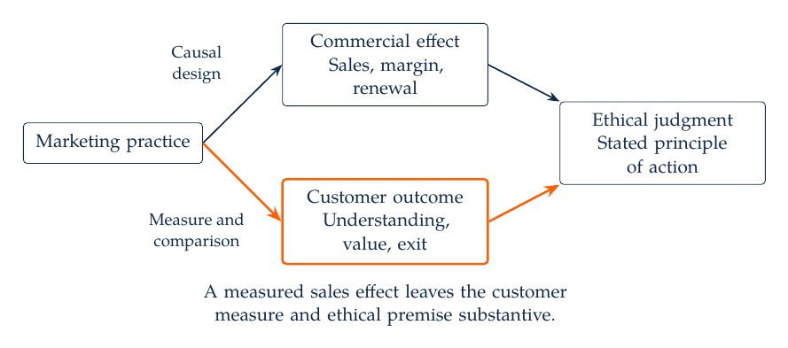

The upper path connects an intervention to a measured commercial outcome through a causal design. A second path requires a valid customer outcome measure and a defined comparison. The ethical judgment additionally depends on a stated principle concerning treatment of persons. No arrow permits sales to stand in for all three conclusions.

## 9.2 Transcendental Dialectic and the Limits of Reason

### 9.2.1 The Search for an Unconditioned Explanation

\noindent In the *Critique of Pure Reason*, the understanding organizes experience through concepts and judgments. Reason seeks relations among those judgments and asks for more complete explanations. Given something conditioned, it looks for the condition on which it depends. Repeating that question creates a demand for an unconditioned ground that would complete the explanation. The difficulty arises when the demand for completeness is treated as establishing an object that theoretical reason can know independently of possible experience. This account appears in the introduction to the Transcendental Dialectic, especially A293/B349 through A308/B365. The A and B references identify the original first- and second-edition pagination. [(Kant, 1781/1787)](https://www.gutenberg.org/files/4280/4280-h/4280-h.htm)

Transcendental illusion differs from a mistake that disappears once a faulty inference is corrected. The attraction of an unconditional explanation persists after criticism has exposed its source. The task of critique is to prevent that attraction from becoming an unjustified judgment. This distinction gives an important reason to revisit assumptions. Recognizing a tempting inference once does not guarantee that an attractive new result will cease to invite it.

The three major divisions of the Dialectic concern the soul, the world as a whole, and God. The paralogisms examine inferences from the unity of thinking to claims about the soul as an object. The antinomies concern opposed arguments about the world considered as a completed totality. The ideal of pure reason concerns the supposed highest being and attempts to establish its existence. These are specific arguments within transcendental critique. A marketing application can adopt the practice of examining how a justified inference becomes an unsupported claim. The soul, the world as a whole, and God retain their specific roles in that argument; customer categories do not become those objects.

### 9.2.2 Antinomies and the Shared Premise

\noindent The four cosmological conflicts concern whether the world has limits in time and space; whether composite substances ultimately consist of simple parts; whether causality through freedom is necessary alongside natural causality; and whether an absolutely necessary being exists. The apparent strength of opposing arguments calls attention to their common framework. Under this diagnosis, treating the world of appearances as a completed whole of things in themselves generates the conflict. The resolutions depend on the particular antinomy. The mathematical and dynamical antinomies do not all receive an identical verdict. The *Prolegomena*, §§50–54, supplies a shorter treatment. [(Kant, 1783)](https://www.gutenberg.org/files/52821/52821-h/52821-h.htm)

The third antinomy is especially relevant to discussions of prediction and agency. Its thesis argues for a causality through freedom; its antithesis argues that events occur through natural laws. The critical solution distinguishes the explanation of events as appearances from the intelligible standpoint under which freedom can be thought. The first Critique's resolution does not supply an empirical demonstration that a particular choice was free. Interpretations of transcendental idealism and the relationship between these standpoints remain disputed. [(Stang, 2016)](https://plato.stanford.edu/entries/kant-transcendental-idealism/)

A marketing model that predicts a purchase therefore does not settle a metaphysical question about freedom. Prediction can reflect stable preferences, recurring needs, constraints, exposure, or a combination of these. Conversely, an unpredictable choice can arise from poor measurement or random error. Neither predictive success nor prediction failure establishes whether a firm has respected a person's capacity to judge and choose.

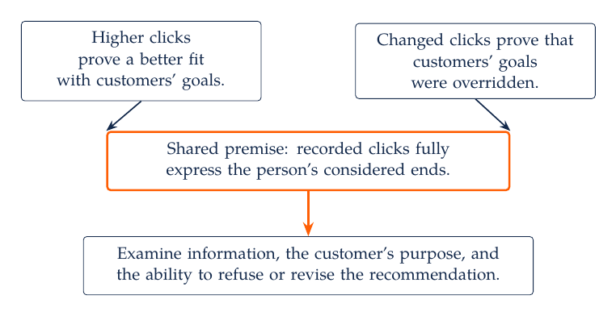

The marketing example places two claims above a shared assumption: observed clicks fully express customers' considered ends. One claim treats higher clicks as proof of a better fit with customers' goals; the other treats changed clicks as proof that those goals were overridden. Examining the shared assumption allows a more specific evaluation of information, goals, and control. This argument map is a contemporary analogy. It is not one of the four cosmological antinomies.

### 9.2.3 Regulative Ideas and Productive Inquiry

\noindent The appendix to the Dialectic gives reason a constructive role. Ideas can guide the search for systematic unity without providing constitutive knowledge of the objects they represent. A research program can seek more connected explanations while preserving the conditions under which each claim is warranted. This regulative use differs from treating an idea as if it supplied a determinate object of knowledge. The interpretation of the status of these ideas is itself debated; different kinds of regulative assumptions need to be distinguished, preserving their respective claims to knowledge. [(Gava, 2022)](https://doi.org/10.1515/opphil-2022-0202)

In a marketing adaptation, a commitment to understanding customer benefit can guide the collection of information about learning, regret, comprehension, and the ability to leave. It does not justify announcing that benefit has already been measured by a single score. A useful ideal generates better questions. It becomes misleading when its desirable name is attached to a convenient outcome and then treated as a finding.

Two further uses of dialectic broaden the reading. The *Critique of Practical Reason*, Book II, examines the highest good and the relation between virtue and happiness. Its argument supplies no empirical guarantee that ethical firms earn the highest profits. In the *Critique of Judgement*, §§55–57, the antinomy of taste concerns the basis of judgments that claim assent without being demonstrable through determinate concepts. That problem differs from estimating which advertisement a customer prefers. These distinctions preserve the specific object of each argument. [(Kant, 1788)](https://www.gutenberg.org/files/5683/5683-h/5683-h.htm); [(Kant, 1790)](https://www.gutenberg.org/files/48433/48433-h/48433-h.htm)

## 9.3 A Critical Examination of Marketing Claims

\noindent Consider the claim that personalized offers improve customer welfare. Begin by stating the practice: which information enters the rule, which offers can be shown, whether prices change, and what alternatives remain available. Next identify the comparison. The claim could concern personalization relative to a common offer, a customer-selected rule, or a previous algorithm. These comparisons can have different effects. A broad phrase such as personalization is beneficial leaves both treatment and benchmark unspecified.

A descriptive claim records an observed pattern. A predictive claim concerns performance on a specified population and information set. A causal claim concerns what changes under an intervention relative to an alternative. A normative claim concerns what should be permitted or chosen. The evidence must fit the claim. An accurate description of sales among exposed customers does not by itself identify incremental sales; an incremental-sales estimate does not by itself determine whether the intervention is ethically acceptable.

The most useful objection identifies a premise on which the recommendation depends. For an advertising claim, that premise might be that exposed and unexposed customers would have bought at the same rate without exposure. For a cancellation claim, it might be that continued billing expresses an informed wish to renew. For a recommendation claim, it might be that the platform's engagement objective adequately represents the customer's purpose. Once the premise is stated, the analyst can ask which observation, design, or argument would support it and which would undermine it.

Disagreement can lead to acceptance within a specified population and horizon, a narrower claim, a revised mechanism, or rejection of the recommendation. When a consequential premise remains unresolved, judgment may be suspended until that premise receives support. The appropriate resolution follows from the reasons and evidence, without requiring a compromise between a supported claim and an unsupported objection. Transcendental dialectic therefore provides no mechanical sequence of thesis, antithesis, and inevitable synthesis; later dialectical traditions require their own interpretation [(Maybee, 2016)](https://plato.stanford.edu/entries/hegel-dialectics/).

Critical examination also applies to the criticism. A claim that all advertising overrides agency must account for advertising that communicates useful price, availability, or quality information. A claim that personalization always benefits customers must account for inaccurate inferences, concealed incentives, and customers whose goals differ from the model's objective. The burden is to explain the scope of each argument and the evidence that bears on it.

## 9.4 Respect for Persons and Commercial Exchange

### 9.4.1 Means, Ends, and the Customer's Judgment

\noindent The ethics of respect for persons (Kant, 1785) adds a distinct question to the critique of knowledge: how should one act toward rational persons? The humanity formulation of the categorical imperative requires treating humanity as an end and never merely as a means. A normal exchange uses the services of another person in pursuing an end. Its moral assessment depends on whether that person is also respected as capable of forming and pursuing ends. The qualifier merely therefore matters. Commercial activity is not condemned simply because a seller seeks revenue. [(Kant, 1785, Akademie 4:429)](https://www.gutenberg.org/files/5682/5682-h/5682-h.htm)

A customer who knowingly chooses a useful service and can revise that choice may benefit alongside the seller. A process that relies on concealed terms or prevents an expressed refusal presents a different relation between the parties. The concern is that the customer's reasoning and choice become obstacles to be circumvented. This evaluation requires the details of the practice: what the firm communicates, what it conceals, what the customer understands, and what happens when the customer says no.

A contemporary interpretation develops the possibility of market exchange organized around mutual assistance and the spirit of mutually beneficial contracts. It provides a useful counterweight to the assumption that a profit motive makes exchange intrinsically objectionable. The argument is philosophical; it does not establish that observed contracts are informed, fair, or beneficial in every setting. [(Santori, 2024)](https://link.springer.com/article/10.1007/s40926-024-00252-z)

### 9.4.2 Universalization and the Maxim of a Practice

\noindent A maxim specifies a circumstance, an action, and a purpose. For example: when a customer seeks to leave, conceal the effective cancellation route so that the customer continues paying. Stating the maxim exposes the role of concealment in the business objective. The universal-law formulation asks whether a maxim can be willed as a universal law, with distinctions between contradictions in conception and in willing. The test concerns whether the principle governing the action can be universalized. Popular approval answers a different question. (Kant, 1785, second section, 4:421)

The moral difficulty becomes especially clear when a promise of easy cancellation is used to obtain enrollment while the firm intends to frustrate cancellation later. The strategy depends on the customer relying on an assurance the firm does not intend to honor. A truthful and accessible renewal reminder has a different maxim. Its function can be to help customers act on their plans while making an optional offer. The formulation of the maxim must reflect the actual practice and purpose; redescribing concealment as customer service does not answer the objection.

Kantian autonomy concerns rational self-legislation. A recorded click is a behavioral event, and a preference survey is a measurement instrument. Neither is a complete operational definition of autonomy. Comprehension, refusal, revision, and effective exit are useful empirical indicators for evaluating a marketing practice. They leave the philosophical meaning of autonomy broader than any single observed response. [(Johnson and Cureton, 2025)](https://plato.stanford.edu/entries/kant-moral/)

### 9.4.3 Ethical Reasons, Professional Standards, and Law

\noindent Duties toward customers, other stakeholders, and the broader marketing system extend ethical evaluation beyond a narrow transaction measure (Laczniak and Murphy, 2006). The American Marketing Association's current ethics statement likewise articulates professional values, including honesty, responsibility, equity, transparency, and citizenship. It is an aspirational professional statement. A professional code, a philosophical argument, and an enforceable legal obligation have different sources of authority. [(Laczniak and Murphy, 2006)](https://epublications.marquette.edu/market_fac/45/); [AMA, *Statement of Ethics*](https://www.ama.org/ama-statement-of-ethics/)

Customer benefit, respectful treatment, and legal compliance should each receive a reasoned evaluation. A lawful practice can still warrant ethical criticism. A beneficial effect does not erase deception. An allegation of deception requires evidence about the communication and its likely meaning. In a cancellation case, the applicable jurisdiction, transaction, and current rule must be identified before making a legal claim. The [course policy source record](../../01_Resources/13_Consumer_Agency_and_Recent_Research/Policy/README.md) separates the status of federal rulemaking from other applicable cancellation requirements.

## 9.5 Worked Case: Identical Renewal, Different Customer Intent

### 9.5.1 The Population and the Missing Distinction

\noindent Consider two entirely constructed populations, A and B, each containing 1,000 customers eligible for one monthly renewal. Each customer appears once. Billing is observed during the same renewal month. Whether the customer wanted to renew at the stated terms is stipulated before billing and independently of whether a charge occurred. No actual platform records, randomized treatment, or estimated preferences enter this example.

In A, 880 customers wanted renewal and were billed; 20 did not want renewal and were billed. In B, these counts are 600 and 300. Both populations also contain 20 customers who wanted renewal but were not billed and 80 who neither wanted renewal nor were billed. Each population therefore has 900 billed customers and a billed-renewal rate of 90%. Unwanted billing represents 2% of all customers in A and 30% in B.

| Customer State | Population A | Population B |
| --- | ---: | ---: |
| Wanted renewal and billed | 880 | 600 |
| Did not want renewal and billed | 20 | 300 |
| Wanted renewal and not billed | 20 | 20 |
| Did not want renewal and not billed | 80 | 80 |
| All eligible customers | 1,000 | 1,000 |

To distinguish the billing outcome from its composition, let $B_i$ equal one when customer $i$ is billed and let $W_i$ equal one when that customer wanted renewal before billing. For each population of size $N$, define

$$
R=\frac{1}{N}\sum_{i=1}^{N}B_i,
\qquad
U=\frac{1}{N}\sum_{i=1}^{N}B_i(1-W_i).
$$

Both quantities are customer shares over the renewal month. $R$ is billed renewal; $U$ is unwanted billing among all eligible customers. Holding $R$ fixed leaves $U$ undetermined because the billing total does not reveal the intent of those billed. Among billed customers, the unwanted shares instead use 900 as the denominator, giving approximately 2.22% in A and 33.33% in B. A conditional share and a population share answer different questions.

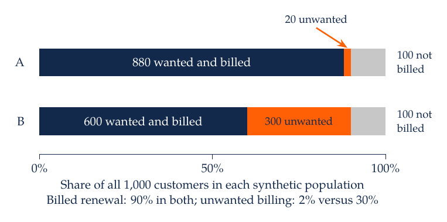

The bars divide each full population into wanted and billed, unwanted and billed, and not billed. Their common billing total conceals a different composition. These are observationally equivalent populations with respect to the billing-rate statistic. The construction supplies no estimate of the effect of replacing one cancellation interface with another. It also does not assign a monetary welfare loss to unwanted billing.

### 9.5.2 Reproducible Calculation and Missing Intent

\noindent The program below constructs every customer record from the eight specified cells, exports the synthetic data, and calculates the relevant counts and shares. It retains non-billed customers in the population denominator. The summary function permits unknown intent and reports bounds: the lower bound counts observed unwanted billing, while the upper bound also counts every billed customer whose intent is unknown. Correctly measured known labels are assumed for those bounds. Missing intent supplies no evidence of satisfaction.

Python source: [evaluate_retention.py](../../03_Data_and_Code/Marketing_Dialectics/evaluate_retention.py)

```python
"""Compare two constructed customer populations with identical billed renewal.

Python 3.10+; standard library only. No network calls or real customer records.
Run: python3 03_Data_and_Code/Marketing_Dialectics/evaluate_retention.py
"""
import csv
import json
from pathlib import Path

ROOT = Path(__file__).resolve().parent


def construct_customers():
    # Each tuple is (billed this month, wanted renewal before billing, count).
    # Counts are imposed teaching inputs, not estimated responses to a policy.
    cells = {
        "A": [(True, True, 880), (True, False, 20),
              (False, True, 20), (False, False, 80)],
        "B": [(True, True, 600), (True, False, 300),
              (False, True, 20), (False, False, 80)],
    }
    rows = []
    for population, groups in cells.items():
        number = 0
        for billed, wanted, count in groups:
            for _ in range(count):
                number += 1
                rows.append({"population": population,
                             "customer_id": f"{population}{number:04d}",
                             "billed": billed, "wanted_renewal": wanted})
    return rows


def summarize(rows):
    if not rows:
        raise ValueError("The population must contain customers.")
    keys = [(r["population"], r["customer_id"]) for r in rows]
    if len(set(keys)) != len(keys):
        raise ValueError("Duplicate customer within population.")
    if len({r["population"] for r in rows}) != 1:
        raise ValueError("Summarize one population at a time.")
    for r in rows:
        if type(r["billed"]) is not bool:
            raise ValueError("Billing must be observed as True or False.")
        if r["wanted_renewal"] is not None and type(r["wanted_renewal"]) is not bool:
            raise ValueError("Intent must be True, False, or None.")
    n = len(rows)
    billed = sum(r["billed"] for r in rows)
    wanted_billed = sum(r["billed"] and r["wanted_renewal"] is True for r in rows)
    unwanted_billed = sum(r["billed"] and r["wanted_renewal"] is False for r in rows)
    unknown_billed = sum(r["billed"] and r["wanted_renewal"] is None for r in rows)
    missed_wanted = sum(not r["billed"] and r["wanted_renewal"] is True for r in rows)
    assert wanted_billed + unwanted_billed + unknown_billed == billed
    return {
        "customers": n, "billed": billed, "billed_rate": billed / n,
        "wanted_billed": wanted_billed, "unwanted_billed": unwanted_billed,
        "unknown_intent_billed": unknown_billed,
        "wanted_but_not_billed": missed_wanted,
        "unwanted_billed_lower_share_all": unwanted_billed / n,
        "unwanted_billed_upper_share_all": (unwanted_billed + unknown_billed) / n,
        "unwanted_share_among_billed_lower": unwanted_billed / billed if billed else None,
    }


def main():
    rows = construct_customers()
    with (ROOT / "synthetic_customer_months.csv").open("w", newline="") as f:
        writer = csv.DictWriter(f, fieldnames=list(rows[0]))
        writer.writeheader()
        writer.writerows(rows)
    results = {p: summarize([r for r in rows if r["population"] == p])
               for p in sorted({r["population"] for r in rows})}
    output = {
        "data_type": "Entirely synthetic; two constructed populations",
        "unit": "One customer over one renewal month",
        "intent_timing": "Before billing; stipulated independently of billing",
        "comparison": "Descriptive identification example, not a policy effect",
        "results": results,
    }
    (ROOT / "results.json").write_text(json.dumps(output, indent=2) + "\n")
    print(json.dumps(results, indent=2))


if __name__ == "__main__":
    main()
```

The output reports 900 billed customers in each population, with 20 and 300 unwanted charges respectively. Both contain 20 customers who wanted renewal but were not billed. The five independent tests in the example folder also check a four-customer missing-intent case, a population with no billing, duplicate records, and string values that could be mistaken for booleans.

### 9.5.3 From the Constructed Case to a Decision

\noindent In a real service, intent would need a defined measurement procedure. Asking after a charge can capture regret, newly learned information, or a response to the charge itself. Asking before renewal can affect the subsequent choice. Nonrespondents can differ from respondents. The timing and wording of the question therefore belong in the interpretation, along with response rates and the treatment of unknown answers.

A useful design compares a clearly disclosed, direct renewal or cancellation path with a proposed alternative and measures more than the payment outcome. Relevant outcomes include understood terms, successful completion of the customer's requested action, unwanted subsequent charges, and later evaluation of the service. Commercial viability remains part of the decision. These measurements make it possible to evaluate whether a useful offer improves an informed choice or whether extra revenue depends on frustrating that choice.

An experiment varying interfaces for declining an identity-theft protection plan found that the interface affected continued enrollment (Luguri and Strahilevitz, 2019). The result motivates attention to the path through which a recorded decision is obtained. A separate crawl of shopping websites documents interface practices and supplies descriptive evidence about prevalence in that sample (Mathur et al., 2019). The FTC's 2022 staff report provides additional examples and a regulatory taxonomy. These sources answer different questions about effects, prevalence, and regulatory concern. [(Luguri and Strahilevitz, 2019)](https://oag.ca.gov/sites/all/files/agweb/pdfs/privacy/shining-a-light-on-dark-patterns.pdf); [(Mathur et al., 2019)](https://arxiv.org/abs/1907.07032); [FTC (2022)](https://www.ftc.gov/reports/bringing-dark-patterns-light)

## 9.6 Advertising Effectiveness and the Meaning of a Successful Test

\noindent A retailer must decide whether an advertising campaign deserves additional spending. Customers exposed to the ads purchase more frequently than customers who were not exposed. The analyst proposes that this difference measures the campaign's effect. A competing explanation is that the targeting system selected customers already more likely to purchase. The dispute concerns a counterfactual premise: what the exposed customers would have done without the campaign.

A comparison of observational estimates with randomized advertising experiments conducted at Facebook shows that extensive observed information does not reliably remove the discrepancy in those campaigns. The study supports careful identification in advertising measurement; it does not establish that every observational design is invalid. Google Ads' Conversion Lift documentation describes an industry approach to comparing groups with and without advertising exposure. Provider documentation explains an implemented service, while a particular evaluation still requires attention to its assignment, eligibility, measurement, and study type. [(Gordon et al., 2018)](https://www.kellogg.northwestern.edu/faculty/gordon_b/files/fb_comparison.pdf); [Google Ads, *About Conversion Lift*](https://support.google.com/google-ads/answer/12003020?hl=en)

Suppose a well-executed randomized study establishes positive incremental sales for the eligible customers and observation window. The appropriate next question depends on the managerial claim. A budget decision requires contribution after relevant costs and consideration of how effects change at greater spending. A customer-benefit claim requires evidence about the product's consequences and the way the offer was communicated. A successful sales experiment does not answer these additional questions simply by having a credible assignment mechanism.

A Kantian evaluation therefore preserves the experimental finding while examining the principle of the practice. A truthful advertisement that helps customers discover a useful option can serve both parties' ends. An advertisement that secures the same incremental sales through concealed material terms presents a different ethical case. The objection concerns the means of obtaining the result. It can remain decisive even when the sales effect is precisely measured.

## 9.7 Personalization, Learning, and the Ability to Revise a Goal

\noindent A recommendation system can reduce search costs by selecting items that fit a customer's interests. It can also shape the information from which later interests are inferred. Netflix's account of artwork personalization describes selecting different images to help members discover titles. The description supplies a concrete industry mechanism: presentation changes which features of an item attract attention. It does not establish that every resulting viewing decision serves the member's considered purpose. [Chandrashekar, Amat, Basilico, and Jebara (2017)](https://netflixtechblog.com/artwork-personalization-c589f074ad76)

A click can be interpreted as evidence of benefit, while an algorithm's influence on attention can be interpreted as a loss of agency. Both interpretations require an account of how the person understands and evaluates the recommendation. Useful information can change a preference through learning; a misleading representation can induce a choice the customer would reject after learning the relevant facts. Because either process can change behavior, ethical evaluation must examine the information supplied and the person's capacity to reflect on it.

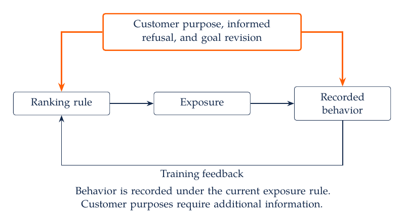

The closed loop runs from the ranking rule through exposure and behavior back to the training data. An additional path lets the customer state or revise a goal and refuse a recommendation. That path does not prove autonomy by itself. It identifies decisions and observations that an engagement-only objective omits.

The recurring mHealth case makes the distinction concrete. A recommendation based on past food logging might help someone organize meals, maintain variety, or pursue a stated nutritional objective. Frequent logging can also reflect the design of reminders and the burden of recording. The logs record entries. Unlogged consumption and independently verified health outcomes remain outside their measurement. A recommendation should therefore specify the customer's goal, the source and validity of nutritional information, and the ability to change or decline the goal. Health-related claims require appropriate domain evidence; engagement cannot supply it.

An intervention can preserve customer control by making the recommendation's purpose intelligible, avoiding materially misleading descriptions, and allowing users to choose another objective or leave the recommendation process. These are concrete design proposals to evaluate. Their effects on understanding, use, and customer outcomes must still be measured. A philosophical commitment gives direction to that evaluation without predetermining its empirical result.

## 9.8 Environmental Claims, Context, and the Scope of an Inference

\noindent An energy company can truthfully describe a lower-carbon product while creating a misleading impression about the balance of its overall activities. The relevant object changes from a particular offering to the company as a whole. Customers may reasonably interpret the combination of imagery, brand references, and qualifying information more broadly than an isolated sentence. Assessing the claim therefore requires the communication in context.

In its June 7, 2023 Shell ruling, the UK Advertising Standards Authority upheld the complaint concerning the overall environmental impression of several ads. It found that information about the balance of the company's activities was material to the impression conveyed. A separate issue concerning the renewable-electricity claim was not upheld. The decision consequently supports a specific conclusion about the evaluated communications and omissions. It is not a finding that every statement about the company's lower-carbon products was false. [ASA, Shell UK Ltd, June 7, 2023](https://www.asa.org.uk/rulings/shell-uk-ltd-g22-1170842-shell-uk-ltd.html)

The ASA reached a different outcome on April 9, 2025 for another Shell advertisement. That ad included higher- and lower-carbon activities and qualifying information about the investment mix. The ASA found that the overall environmental impression was not misleading and did not uphold the complaint. Its assessment applied the code wording relevant to the earlier complaint, as the ruling explains. The different outcomes follow from the content and overall impression of each advertisement under the applicable assessment. [ASA, Shell UK Ltd, April 9, 2025](https://www.asa.org.uk/rulings/shell-uk-ltd-g24-1248246-shell-uk-ltd.html)

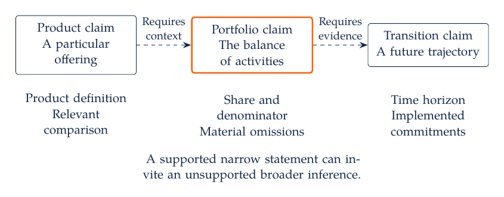

The three boxes distinguish the product, the business portfolio, and the future plan. A broader conclusion requires information about the relevant share, time horizon, and basis of comparison. The decision is to communicate the supportable claim with material context, or to change the claim when the broader impression exceeds its support.

The regulatory findings and the philosophical evaluation remain distinct. The ASA rulings apply UK advertising standards to particular communications. A Kantian objection to deception concerns respect for the customer's judgment. The same advertisement can be examined through both lenses, but one source of authority should not be silently substituted for the other. A comprehensive ethical judgment about a company's environmental conduct would require additional evidence and additional premises.

## 9.9 AI-Assisted Criticism and Independent Judgment

\noindent An LLM can help identify missing premises and plausible alternative explanations. It can also produce an articulate defense of a conclusion that the user has already selected. Fluency therefore increases the importance of checking whether an objection is relevant, whether its source exists, and whether the source supports the proposition attributed to it. Agreement between two generated responses provides little assurance when both repeat the same premise or inaccurate citation.

A useful prompt makes the object of criticism explicit:

> Evaluate the claim that this renewal intervention benefits customers. State the population, intervention, comparison, outcome, and horizon. Separate descriptive, causal, and ethical premises. Identify the strongest plausible alternative explanation and the observation that would distinguish it. Evaluate the treatment of customer understanding, refusal, and revision. Cite accessible primary sources for factual claims and identify unverified statements. Recommend acceptance, restriction, redesign, rejection, or further evidence, with reasons.

The analyst should first check the reconstructed argument against the actual proposal. A system can criticize a practice the firm never proposed or overlook a restriction that changes the conclusion. Next, verify sources and calculations independently. Finally, state a decision in the analyst's own terms and identify the evidence that would change it. This process can support critical thought while leaving responsibility for the judgment with the person making the recommendation.

The essay on enlightenment connects maturity with the use of one's own understanding and the freedom to examine claims publicly. It offers a useful reason to resist treating a generated answer as an unquestionable authority. Independent judgment can include careful reliance on expertise; it requires understanding why the expertise is relevant and how its conclusion is supported. The essay's distinction between public and private uses of reason belongs to its eighteenth-century political setting and should not be collapsed into a rule about sharing private customer data. [(Kant, 1784)](https://users.manchester.edu/facstaff/ssnaragon/online/texts/318/kant%2C%20enlightenment.pdf)

## 9.10 Self-Interest and the Burden of Justification

### 9.10.1 Scrutiny Before Reliance

\noindent A company can gain from a practice while customers bear costs that the company does not fully internalize. The company may also control the interface, the outcome definitions, and the evidence presented to outsiders. These features justify demanding substantiation before relying on a claim of customer benefit. A material stake supplies a reason for scrutiny. When an interest threatens judgment owed to another person or a professional purpose, it also creates a conflict of interest in the sense developed in §9.45. A finding of wrongdoing requires evidence about the particular practice.

Institutional safeguards can be designed to remain effective under private-interest pursuit. *Of the Independency of Parliament* treats that assumption as a principle for designing checks on power and distinguishes the political maxim from a factual claim that every person is dishonest. The institutional question is whether the arrangement remains acceptable when participants pursue their separate interests. Applied to marketing, this asks whether customers retain meaningful protection when managers respond strongly to sales targets. The application extends the argument about political institutions to commercial governance. [(Hume, 1741)](https://davidhume.org/texts/emp/ip)

A commercial application appears at the end of Book I, chapter XI of *The Wealth of Nations*: proposals for commercial regulation made by merchants and manufacturers warrant particularly careful scrutiny because their interests can diverge from the public's. This argument supports examining the incentives and evidence behind an interested party's proposal. The argument concerns proposals for laws and regulation; applying it to a transaction requires a separate assessment of the relevant incentives and evidence. [(Smith, 1776, chapter XI, concluding discussion)](https://www.gutenberg.org/files/3300/3300-h/3300-h.htm)

The resulting principle for a marketing decision is demanding: when a firm controls a practice and materially benefits from it, the firm should substantiate claims of customer benefit with evidence that can be examined independently. Customers should not have to infer safety or benefit from the firm's incentives, and an absence of complaints need not satisfy the burden when complaining is costly or discouraged. This ethical and institutional recommendation leaves legal burdens of proof to the applicable jurisdiction and proceeding.

### 9.10.2 What Would Discharge the Burden?

\noindent The burden must be connected to a claim that could be supported or refuted. For a cancellation process, the firm could supply evidence on completion, understanding, subsequent charges, and outcomes for customers who sought to leave. For a personalized recommendation, it could show how the objective corresponds to customers' stated purposes and how a person can revise it. For a claim about environmental performance, it could provide the relevant scope, denominator, and supporting records. Independent examination need not involve disclosing identifiable customer records; controlled access and reproducible aggregates can address different parts of the evidentiary problem.

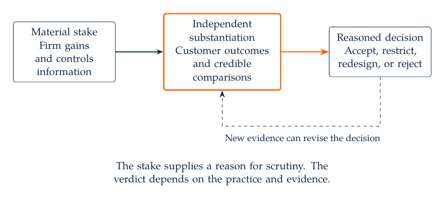

The sequence separates the reason for scrutiny from the conclusion reached after scrutiny. Commercial incentives raise questions about measurement, selective disclosure, and omitted outcomes. Evidence then supports acceptance, a narrower claim, redesign, or rejection. A process that always reaches rejection regardless of the evidence has ceased to be a critical evaluation.

The standard can also be asymmetric. When the firm receives the gains, controls the information, and imposes a substantial or difficult-to-reverse risk on customers, it is reasonable to require stronger evidence before deployment than before continuing a small, reversible pilot. That recommendation depends on a stated judgment about the consequences of acting and waiting. It does not turn uncertainty into proof of harm. The analyst should identify the information needed, the feasible alternative, and the condition under which the restriction can be relaxed.

Consider a retention experiment that reports only revenue. Withhold acceptance of its customer-benefit claim until the relevant customer outcomes are supplied. If independent evidence then shows that an easily refused offer improves informed choice and produces no material deterioration in the specified outcomes, the original objection must be revised within that scope. If the additional revenue depends on preventing an expressed refusal, the evidence supports rejecting that feature. The recommendation changes because the evidence distinguishes the mechanism.

## 9.11 Confucian Perspectives on Marketing Conduct

### 9.11.1 Righteousness and Profit

\noindent Confucian texts ask what kind of person and relationship a practice develops, alongside what it produces. In the *Analects* 4.16, the contrast between righteousness and gain concerns the grounds on which a person judges an action. In 4.5, wealth and status remain desirable, but their pursuit is constrained by the proper way of obtaining them. These passages support evaluating the means and responsibilities of profit seeking. They do not require treating every profitable exchange as a moral failure. [(Confucius, n.d.)](https://www.gutenberg.org/cache/epub/3330/pg3330-images.html)

The opening of the *Mencius*, 1A.1, challenges a ruler who frames the discussion around advantage to his state. Its warning is that competition for advantage at every level can damage the relations on which political order depends. Benevolence and righteousness provide an alternative basis for judgment. The commercial application is that a firm cannot settle its responsibilities simply by showing that a practice raises its own return. The interests of customers, employees, suppliers, and affected communities require consideration. This extends a political argument to a contemporary organization. [(Mencius, 2016)](https://scholarworks.iu.edu/iuswrrest/api/core/bitstreams/265d73a0-6bfa-45df-92ff-4e7d3f8be4b1/content)

For a recommendation system, the question is whether the service helps the customer pursue a worthwhile purpose while sustaining a trustworthy relationship. A firm could profit by offering relevant information, reliable support, and a product the customer continues to value. It could also increase immediate revenue by exploiting confusion. The fact that both strategies can be profitable makes the criterion of judgment consequential.

### 9.11.2 Trustworthiness and the Responsibilities of a Role

\noindent The *Analects* places weight on trustworthiness, including in its discussion of government in 12.7. Its account of the rectification of names in 13.3 concerns the relation between language, social roles, and proper conduct. A role is associated with standards of performance. Calling someone a trustworthy adviser does not supply the conduct that warrants that description. These ideas can inform a contemporary examination of how marketing labels create expectations. [(Confucius, 2015)](https://scholarworks.iu.edu/bitstreams/d1f62d31-9082-41d0-999f-4c3efa0c8857/download)

A platform that calls a paid placement a recommendation should examine what customers understand that description to mean. If users infer that the ranking serves their goals while the rule principally favors an undisclosed payment, the claimed role and actual conduct diverge. Likewise, a customer-care team whose only rewarded outcome is preventing cancellation may face incentives inconsistent with the service its name promises. Clear labeling is one response; aligning responsibilities, rewards, and actual conduct addresses the underlying relation.

Confucian role ethics does not simply duplicate the account of autonomy as rational self-legislation (Kant, 1785). It emphasizes cultivated dispositions, relationships, and responsibilities within social roles. Historical Confucian roles also contain hierarchies that require critical examination when applied to contemporary customers and organizations. A modern application should state why the proposed responsibility is justified and how affected people can challenge its interpretation. Calling a manager benevolent cannot make unilateral control over a customer's goals self-justifying.

### 9.11.3 Remonstrance, Reciprocity, and Learning

\noindent The *Analects* 13.23 distinguishes harmony from mere agreement, and 14.22 connects service to a ruler with truthful challenge. Applied to a marketing team, these ideas support a responsibility to raise a material objection even when the proposal is commercially attractive. Harmony need not require an analyst to suppress evidence that the team's preferred metric conceals customer harm. The organizational question is whether disagreement can be voiced and considered without being treated as disloyalty.

Reciprocity in *Analects* 15.24 encourages examination of how one treats others. In marketing, it can motivate asking whether an offer, disclosure, or cancellation process is one the decision maker could reasonably accept from the customer's position. Different customers have different resources and purposes, so the manager's own tolerance for inconvenience is insufficient. Perspective taking should lead to inquiry about affected people, including those who face language, accessibility, or financial constraints.

The conjunction of learning and reflection in *Analects* 2.15 also fits AI-assisted analysis. Accumulating generated explanations without examining them leaves the learner dependent on assertions. Reflection without engaging evidence can become speculation. A useful learning exercise requires the student to compare a generated argument with the source, inspect its premises, and revise a conclusion when the evidence warrants it. In this contemporary application, learning supplies the evidence and reflection examines whether the proposed conclusion follows from it.

### 9.11.4 Moral Beginnings and Cultivated Conduct

\noindent Confucianism contains substantial internal disagreement. The account of moral beginnings in *Mencius*, including compassion in 2A.6, emphasizes capacities that can be developed. The chapter on human nature in *Xunzi* emphasizes the disorder that can follow unchecked desires and the importance of learning, ritual, and deliberate effort in producing good conduct. The differing conceptions of human nature should not be reduced to a single slogan about whether all people are good or bad. [(Mencius, 2016)](https://scholarworks.iu.edu/iuswrrest/api/core/bitstreams/265d73a0-6bfa-45df-92ff-4e7d3f8be4b1/content); [(Xunzi, 1999, chapter 23, Columbia selection)](https://afe.easia.columbia.edu/main_pop/ps/ps_china-xunzi-human-nature.htm); [(Goldin, 2025)](https://plato.stanford.edu/entries/xunzi/)

The emphasis on deliberate cultivation supplies a response to reliance on goodwill alone: ethical conduct requires sustained formation and practices that direct behavior (Xunzi, 1999). In a firm, a contemporary application would examine what employees repeatedly learn to notice, what the reward system encourages, and how the organization handles a truthful report of an unwanted outcome. Ritual propriety, often rendered *li*, concerns patterned social conduct and cultivation; it should not be equated mechanically with a compliance checklist. The word for profit or benefit, also commonly romanized *li*, is a different Chinese word.

For the subscription case, a Confucian evaluation can examine whether the customer-care role is performed faithfully, whether a refusal is treated with respect, and whether the company sustains a relationship worthy of trust. A Kantian evaluation emphasizes the principle of action and treatment of the customer as an end. The institutional argument (Hume, 1741) asks how the process behaves under strong private incentives. The perspectives can support the same redesign for different reasons. Keeping those reasons explicit permits disagreement and avoids presenting distinct philosophical traditions as interchangeable.

## 9.12 Decisions That Can Withstand Criticism

\noindent A decision memorandum should begin with the action and the reason for it. For the subscription case, a supportable recommendation could retain an optional offer while making cancellation immediately effective when requested. Its justification would distinguish the measured commercial effect, the customer's stated objective, the relevant ethical principle, and the applicable legal requirements. If the firm's gain depends on preventing an understood refusal, increased revenue cannot by itself answer the ethical objection.

Consider three further decisions. A retailer wants to display a personalized discount based on past purchases. Assess whether the offer changes the feasible options, conceals material terms, or interferes with refusal. A product team wants to replace a nutrition objective with a click objective because clicks are easier to optimize. Identify the customer purpose and the missing connection between that purpose and the metric. An advertiser wants to describe one improvement as evidence of a company-wide transition. Specify the population, denominator, and time horizon needed to support the broader claim.

For each decision, formulate the strongest defensible argument in favor of the practice, the most consequential objection, and the premise that separates them. State what evidence would alter the recommendation. A critical conclusion can endorse a practice, narrow its claim, improve its design, or reject it. Its strength comes from the reasons and evidence that survive examination.

## 9.13 Reading Path

\noindent Begin with the introduction to the Transcendental Dialectic and the *Prolegomena*, §§50–54. Read the third antinomy alongside the distinction between appearances and things in themselves. The appendix on the regulative use of ideas explains the constructive role of reason. The interpretive account of the critique of metaphysics [(Grier, 2022)](https://plato.stanford.edu/entries/kant-metaphysics/) provides an interpretive guide. Read the *Groundwork*, second section, separately for the universal-law and humanity formulations; these introduce the ethical principles used to evaluate the action, alongside the Dialectic's examination of the inference.

The [categorized research collection](../../01_Resources/15_Marketing_Dialectics/README.md) links the primary texts, scholarly interpretations, marketing research, and industry cases. It identifies full texts, excerpts, versions, and remaining access gaps. The two ASA decisions, the advertising-measurement study, and the subscription-interface research supply contrasting empirical and institutional settings for assessing the scope of a marketing argument.

For scrutiny of interested claims, read the opening paragraphs on institutional checks (Hume, 1741) and the conclusion to Book I, chapter XI of *The Wealth of Nations* (Smith, 1776). For Confucian perspectives, compare *Analects* 2.15, 4.5, 4.16, 12.7, 13.3, 13.23, 14.22, and 15.24 with *Mencius* 1A.1 and 2A.6 and the discussion of human nature (Xunzi, 1999). The resource guide distinguishes the original settings, translation choices, and proposed marketing applications.

## 9.14 AI Experimentation and the Choice of an Objective

A marketing manager can use past experiments to generate more effective messages, estimate how different customers respond to prices, and choose a policy for future deployment. The commercial question concerns the action that improves the firm's outcome. The ethical question concerns the reasons for choosing that action and its treatment of the people affected. Increasing the precision of the first answer can increase the importance of the second. A firm that learns to extract value more accurately needs a correspondingly clear account of which forms of extraction are permissible.

Four applications offer distinct settings for examining that relationship: language generation informed by email experiments (Angelopoulos et al., 2026), personalized pricing and the distribution of surplus (Dubé and Misra, 2021), decisions under uncertainty about future conditions (Farrell et al., 2026), and selection of segments and treatments (Zhang and Misra, 2025). Their findings and objectives must be evaluated separately. The [research guide](../../01_Resources/16_AI_Experimentation_and_Pricing/01_Research/README.md) identifies the versions, reading locations, and commercial settings.

### 9.14.1 Learning from Experimental Comparisons

The *Causal Alignment* approach trains a language model using higher- and lower-performing messages from the same historical experiment. In 36 new campaigns involving approximately 283 million email impressions, its human-assisted workflow produces about 32% higher mean click rates than unassisted human experts. Table 2 averages campaigns equally. The paper retains human selection and describes screening against unsupported claims and omitted information. The experiment measures link clicks; it supplies no corresponding causal estimate of customers' informed benefit. [August 2026 author version, Sections 4–5 and Appendix B](https://leekevin.io/caLM.pdf).

A within-campaign comparison can remove confounding due to a shared audience and context when assignment is randomized. Reusing those comparisons as training labels then inherits the definition of success in the original outcome. If a useful explanation and an obstructive appeal both increase clicks, the click label alone does not distinguish their reasons. Human review can impose an additional standard, but the reviewer needs authority and evidence to apply it. Review by a person rewarded for commercial performance does not automatically represent the interests of recipients.

Appendix A also describes steering emotional valence, including fear. An accurate warning can help a customer deliberate. An invented threat or false deadline can distort that deliberation. The ethical distinction depends on the content, its truth, the circumstances, and the recipient's opportunity to assess it. The appearance of an emotional category in a method establishes a capability; it does not establish that the deployed campaigns used deception.

### 9.14.2 Pricing, Profit, and Customer Surplus

The personalized-pricing study concerns prospective employers purchasing recruiting services. Its model projects a 19% profit gain from personalization relative to the optimized uniform price, alongside a 23% decline in total customer surplus in the June 2021 version. More than 60% of customers benefit under that comparison. The later field test uses a different uniform benchmark and capped personalized prices. Its rounded realized revenue means imply about a 10.1% advantage for personalization. Consumer surplus is calculated through the demand model. [NBER revision, Sections 4–5](https://www.nber.org/system/files/working_papers/w23775/w23775.pdf); published as *Journal of Political Economy* 131(1), 2023.

These results expose an economically meaningful conflict: a policy can increase profit and benefit a majority while reducing the sum of customer surplus. The incidence of gains and losses therefore matters alongside their aggregate. A claim that every customer loses would misstate the evidence. Equally, the fact that a majority gains supplies no automatic justification for how a losing minority is treated. The authors examine alternative welfare weights and the consequences of restricting data. That analysis creates a basis for criticism of particular objectives and policy choices.

The benchmark also matters. A price increase from an initially low uniform price combines the exercise of previously unused market power with the effect of personalization. A comparison with an already optimized uniform price isolates a different change. The model's forecast and the later experiment use different price policies, so their percentage gains answer different questions. Neither comparison is an experiment in emergency pricing of household necessities.

### 9.14.3 Robustness and Segmentation

The *Robust A/B Decisions* approach ranks policies using an ambiguity-adjusted value of the chosen outcome. It evaluates deployment decisions using 552 advertising experiments. Its distinction between statistical significance and an economic decision is useful, as is its concern about changing deployment conditions. A robust commercial payoff still requires an independently justified objective. Protecting the firm against an unfavorable shift in customers does not by itself protect customers against an unfavorable policy. [September 2026 version, Sections 1–3](https://arxiv.org/abs/2609.07633).

The *Coarse Personalization* approach chooses a limited set of treatments and assigns customers to them. In its application, five segments recover over 99.5% of the estimated incremental profit under full personalization. The paper discusses fairness and stability as practical concerns. A smaller treatment menu can simplify oversight; the number of segments alone does not establish that the assignment principle is justifiable. Customers in a single segment may still face an objectionable use of data. [June 2025 revision, introduction and application](https://arxiv.org/abs/2204.05793v4).

## 9.15 Pricing Policy: What Conduct is Being Evaluated?

Price discrimination means that different buyers face different prices for comparable offerings in an economically relevant sense. Dynamic pricing changes prices with conditions. Personalized algorithmic pricing conditions a quoted price on information about a particular buyer. Price gouging is a legal category with jurisdiction-specific conditions concerning the market disruption, covered goods, price, and justification. Algorithmic coordination between competitors introduces another question concerning competitive conduct. These descriptions can overlap, but none supplies the legal elements of the others.

The FTC's August 19, 2026 proposed enforcement policy statement creates a direct connection to the pricing study: it cites the personalized-pricing study (Dubé and Misra, 2021, 2023) while discussing the uncertain distributional effects of personalization. Its proposed approach emphasizes disclosure when customers reasonably expect a common price, including the basis for personalization and categories of data used. It separately considers deception and unfairness. The document is a proposed enforcement statement listed in the FTC's legal library, with no new blanket prohibition on individualized pricing. An enforcement action still requires an applicable legal violation. [FTC proposal, pages 3–8](https://www.ftc.gov/system/files/ftc_gov/pdf/p034101-ftc-enforcement-policy-statement-re-personalized-pricing-proposed-for-public-comment.pdf).

New York's General Business Law §349-a requires specified disclosures for covered personalized algorithmic prices. The law took effect on November 10, 2025. Its consumer definition concerns personal, family, or household use and includes listed exceptions. That scope differs from the employer purchasing decision in the recruiting study. The 2026 One Fair Price legislation, S8623B/A9349B, would impose broader restrictions; the official record checked on November 6 shows legislative passage without recorded gubernatorial enactment. These are different stages of legal authority. [Current §349-a](https://www.nysenate.gov/legislation/laws/GBS/349-A); [effective-date notice](https://ag.ny.gov/press-release/2025/attorney-general-james-warns-new-yorkers-about-algorithmic-pricing-new-law-takes); [bill status](https://www.nysenate.gov/legislation/bills/2025/S8623).

New York's price-gouging law concerns unconscionably excessive prices for essential goods and services during abnormal market disruptions. Its application considers the relevant prices, conduct, and cost justifications. A high willingness-to-pay prediction or a positive experimental revenue effect supplies none of those legal findings by itself. The Attorney General's January 2026 inquiry into Instacart's pricing experiments likewise constitutes an inquiry, with requests for information about the experiments and compliance. It is not an adjudication of the academic papers. [Price-gouging guidance](https://ag.ny.gov/resources/individuals/consumer-issues/price-gouging); [January 8 inquiry](https://ag.ny.gov/press-release/2026/attorney-general-james-demands-answers-instacart-about-algorithmic-pricing).

The FTC opened a further inquiry on October 28, 2026, requesting information directly from nine companies about personalized pricing and compensation. These Section 6(b) orders seek evidence about actual practices; they do not establish that the recipients violated the law. The August enforcement statement remains described as proposed in this later notice. [FTC inquiry](https://www.ftc.gov/news-events/news/press-releases/2026/10/ftc-launches-personalized-pricing-compensation-inquiry).

The marketing decision is whether a proposed practice meets the applicable requirements and merits deployment on ethical grounds. A lawful price may still require a moral defense. A philosophical objection must identify the conduct at issue, the affected person, and the principle that the conduct violates. The [policy source record](../../01_Resources/16_AI_Experimentation_and_Pricing/02_Policy/README.md) records jurisdiction, status, coverage, and the November 6, 2026 verification date.

## 9.16 A Kantian Critique of Commercial Optimization

### 9.16.1 An Effective Means and a Justifiable End

The distinction between hypothetical and categorical imperatives identifies a missing step in a commercial recommendation. An instruction to choose the policy that increases profit is conditional on the end being pursued. Statistical evidence can improve the choice of means to that end. It does not establish the authority of the end over every affected person. The objection becomes sharp when a decision maker treats successful optimization as a sufficient reason to deploy, despite unresolved objections concerning deception, misuse of information, or obstruction of refusal [(Kant, 1785, Akademie 4:414–421)](https://www.gutenberg.org/ebooks/5682).

The criticism applies to the transition from a performance result to a recommendation. A study may legitimately estimate a commercial capability, including one that exposes a welfare loss. A deployment recommendation carries the additional burden of justifying the conduct it endorses. Research that measures harmful consequences can improve that evaluation. The existence of a profit objective in a statistical problem is therefore insufficient evidence about an author's moral commitments.

### 9.16.2 Humanity and the Conditions of Deliberation

The humanity formulation requires treating persons as ends and never merely as means. Exchange ordinarily involves using another person's abilities or resources to pursue an end. Respect additionally requires attention to the other person's capacity to understand, set purposes, and act on reasons. A message designed to create a false belief so that someone buys serves the seller by impairing that capacity. A truthful explanation can improve both conversion and understanding. The difference lies in how the decision is obtained [(Kant, 1785, Akademie 4:429–430)](https://www.gutenberg.org/ebooks/5682).

For AI-generated communication, this principle motivates checking the evidence for factual claims, the visibility of consequential terms, and the opportunity to refuse. The acceptability checks in *Causal Alignment* address some of these concerns. Further questions concern the truth of the underlying offer, whether customers understand it, and whether the improved response advances a purpose they can endorse. A subject line can preserve its input's meaning while carrying forward a misleading premise already present in that input. These are questions for additional evidence, not findings that the studied campaigns were deceptive.

For personalized prices, the relevant conduct includes obtaining data, explaining its use, and presenting the offer. An inference that a person has few alternatives can reflect an urgent need. A Kantian criticism of exploiting that need must explain how the practice treats the person's agency or permissible ends. High willingness to pay is not, by itself, a measure of wealth or vulnerability. The interpretation requires the setting and the information actually used.

### 9.16.3 Universalization Requires a Specified Maxim

A maxim identifies the circumstances, action, and purpose. Consider a hypothetical seller who describes a price as a special saving while secretly raising it using an estimate of the buyer's disposable income. The maxim concerns inducing reliance on a representation the seller knows to be false. Its general adoption threatens the credibility on which that representation depends. The objection attaches to deception, even if a randomized test precisely measures the resulting sales increase.

A publicly explained discount for a customer group presents a different maxim. Different prices alone supply no contradiction in universal law. Students must ask why the grouping is relevant, whether its data use is permissible, and whether the principle could be adopted consistently by people acting as rational agents. The universal-law test cannot be replaced with either a vote on whether a price is popular or the analyst's dislike of its distributional result [(Kant, 1785, Akademie 4:421–424)](https://www.gutenberg.org/ebooks/5682).

### 9.16.4 Dignity and the Limits of a Weighted Objective

A manager might add a customer-outcome term to profit and optimize their weighted sum. This can improve attention to consequences, but any finite weight allows sufficiently large profit to compensate for a penalty. If the objection concerns a duty against deception, that specification makes the duty negotiable. The distinction between price and dignity supplies a reason to examine which actions should be excluded before commercial ranking. A measurable proxy for respectful treatment remains subject to scrutiny [(Kant, 1785, Akademie 4:434–435)](https://www.gutenberg.org/ebooks/5682).

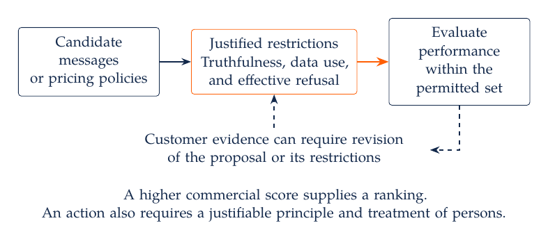

A contemporary implementation could exclude fabricated urgency, prohibit using sensitive information outside the permitted purpose, preserve an effective decline option, and require substantiation of claims. The justification for each restriction must remain explicit. A numerical threshold for comprehension or a reviewer's approval is evidence relevant to that justification; neither is a complete operational definition of Kantian autonomy.

### 9.16.5 A Supported Judgment About Ethical Cost

The strongest supported criticism concerns the incompleteness of an exclusively commercial decision rule. More accurate optimization can intensify an existing conflict between the firm's objective and the conditions of customer agency. An ethical failure follows when the chosen practice violates a justified duty, such as truthful representation, and the firm treats its performance gain as permission to proceed. Establishing that failure requires evidence about the practice and an argument about the duty.

The pricing paper supplies a concrete case in which modeled firm profit rises while aggregate customer surplus falls. The email paper supplies a case in which improved causal performance leaves the recipient's informed benefit as a separate question, while incorporating safeguards that deserve evaluation. Together, they make demanding examples for assessing the proposition that marketing effectiveness can come at an ethical cost. A responsible conclusion can reject a particular deployment, require changes, or endorse a justified use. It should identify the responsible action and evidence, preserving the distinction between a scholar's contribution, a firm's implementation, and an analyst's own normative inference.

\Needspace{12\baselineskip}

## 9.17 Reproduce Profit and Customer Incidence

### 9.17.1 A Solved Synthetic Pricing Comparison

A firm offers one product to a fixed population over one purchase opportunity. The comparison changes the permitted price policy while holding the population, preferences, costs, and outside option fixed. The following assumptions define an original illustration, without calibration to the papers' data.

\begin{assumption}\label{ass:pricing-population}
Group L has population share $0.6$ and valuations uniformly distributed on $[6,10]$ dollars. Group H has share $0.4$ and valuations uniformly distributed on $[10,30]$ dollars. Group membership has no demographic interpretation.
\end{assumption}

\begin{assumption}\label{ass:pricing-choice}
Each customer buys one unit when valuation is at least the offered price. Utility is valuation less price upon purchase and zero otherwise. Marginal cost is zero. The firm observes group membership and the valuation distributions, but does not observe individual valuations.
\end{assumption}

\begin{assumption}\label{ass:pricing-policies}
The firm can post one common price or one price per group. A third policy permits group-specific discounts subject to a cap at the revenue-maximizing common price. Offers are taken as accurately described. Changes in information, privacy, deliberation, and later demand are outside this illustration.
\end{assumption}

For a group $g$ with valuation support $[a_g,b_g]$ and population weight $w_g$, demand is $q_g(p)=\Pr(v\geq p\mid g)$. Expected profit and customer surplus per eligible customer are

$$
\Pi=\sum_g w_g p_g q_g(p_g),\qquad
CS=\sum_g w_g\,\mathbb{E}[\max(v-p_g,0)\mid g].
$$

Both quantities are in dollars and include nonbuyers in their denominator. Under Assumptions \ref{ass:pricing-population}–\ref{ass:pricing-policies}, the optimal common price is $19/3$, approximately $6.33. The group-specific optima are $6$ and $15$. Capping personalized offers at the common benchmark retains the $6$ discount for L and the common price for H. These optima follow by checking support boundaries and the stationary points of piecewise quadratic revenue.

| Policy | Profit per Customer | Customer Surplus | Purchase Share | Better Off | Worse Off |
| --- | ---: | ---: | ---: | ---: | ---: |
| Optimal Uniform | $6.0167 | $6.4750 | 95% | 0% | 0% |
| Group-Specific Optimum | $8.1000 | $3.4500 | 90% | 60% | 40% |
| Discounts Capped at Benchmark | $6.1333 | $6.6667 | 100% | 60% | 0% |

Better and worse refer to each person's monetary surplus relative to the common-price benchmark in the same population. Under the group-specific optimum, the gains to L are outweighed in the aggregate by the losses to H. A majority-benefit statement and an aggregate-loss statement are simultaneously correct. Under the capped policy, profit and customer surplus both increase. The restriction changes the solution, and its consequences depend on the stipulated distributions.


Personalization and a majority-gain statistic leave truthful disclosure and permissible data use unresolved. Those requirements enter the ethical evaluation alongside the distribution of monetary gains and losses. The common-price optimum supplies the economic benchmark: replacing it with an arbitrary high price would change the apparent gains from discounts.

### 9.17.2 Python Calculation and Published Aggregates

The program integrates each group's demand and surplus exactly using rational arithmetic. It checks common-price candidates at all support boundaries and interior revenue maxima, solves group-specific prices, and evaluates the cap. A separate input file records rounded published means. Those means reproduce arithmetic only. For the email study, subtracting the rounded click rates gives 17.48 basis points, while its paired estimate is reported as 17.47 basis points. The distinction follows the precision of the published inputs; the calculation does not reconstruct campaign-level uncertainty.

Python source: [evaluate_pricing.py](../../03_Data_and_Code/AI_Experimentation_and_Pricing/evaluate_pricing.py)

```python
"""Solve an imposed pricing example and check published aggregate arithmetic.

Python 3.10+, standard library. No empirical microdata or model APIs.
Run: python3 03_Data_and_Code/AI_Experimentation_and_Pricing/evaluate_pricing.py
"""
import json
from fractions import Fraction as F
from pathlib import Path

ROOT = Path(__file__).resolve().parent
# Population shares and dollar valuations for one purchase opportunity.
GROUPS = {"L": (F(3, 5), F(6), F(10)),
          "H": (F(2, 5), F(10), F(30))}


def demand(price, low, high):
    """Purchase probability under a uniform valuation distribution."""
    if not low < high or price < 0:
        raise ValueError("Require ordered valuation bounds and nonnegative price.")
    return max(F(0), min(F(1), (high - price) / (high - low)))


def surplus(price, low, high):
    """Expected dollar surplus per eligible customer, including nonbuyers."""
    demand(price, low, high)
    if price <= low:
        return (low + high) / 2 - price
    return max(high - price, F(0)) ** 2 / (2 * (high - low))


def best_uniform(groups):
    """Check support boundaries and stationary points of piecewise revenue."""
    bounds = sorted({F(0)} | {x for _, lo, hi in groups for x in (lo, hi)})
    candidates = set(bounds)
    for left, right in zip(bounds, bounds[1:]):
        midpoint = (left + right) / 2
        intercept, slope = F(0), F(0)
        for weight, low, high in groups:
            if midpoint < low:
                intercept += weight
            elif midpoint < high:
                intercept += weight * high / (high - low)
                slope += weight / (high - low)
        if slope:
            stationary = intercept / (2 * slope)
            if left <= stationary <= right:
                candidates.add(stationary)
    revenue = lambda p: sum(w * p * demand(p, lo, hi)
                            for w, lo, hi in groups)
    return max(sorted(candidates), key=revenue)


def evaluate(prices, reference):
    if set(prices) != set(GROUPS):
        raise ValueError("Every population group requires exactly one price.")
    profit = customer_surplus = quantity = better = worse = F(0)
    for name, (weight, low, high) in GROUPS.items():
        price = prices[name]
        q = demand(price, low, high)
        profit += weight * price * q  # Marginal cost is stipulated to be zero.
        customer_surplus += weight * surplus(price, low, high)
        quantity += weight * q
        if price < reference:
            better += weight * q
        elif price > reference:
            worse += weight * demand(reference, low, high)
    return {"profit_per_eligible_customer": profit,
            "surplus_per_eligible_customer": customer_surplus,
            "total_surplus_per_eligible_customer": profit + customer_surplus,
            "purchase_share": quantity, "strictly_better_share": better,
            "strictly_worse_share": worse}


def main():
    uniform = best_uniform(list(GROUPS.values()))
    segmented = {g: best_uniform([cell]) for g, cell in GROUPS.items()}
    policies = {"uniform": {g: uniform for g in GROUPS},
                "segmented": segmented,
                "discount_only": {g: min(p, uniform) for g, p in segmented.items()}}
    results = {name: {"prices": prices, **evaluate(prices, uniform)}
               for name, prices in policies.items()}
    published = json.loads((ROOT / "published_aggregates.json").read_text())
    clicks = published["causal_alignment"]["campaign_mean_click_rate_bp"]
    revenues = published["personalized_pricing"]["realized_revenue_per_prospect"]
    arithmetic = {
        "click_lift_from_rounded_means_bp": clicks["tuned"] - clicks["control"],
        "click_relative_lift_from_rounded_means": clicks["tuned"] / clicks["control"] - 1,
        "pricing_relative_revenue_lift_from_rounded_means":
            revenues["personalized"] / revenues["uniform"] - 1}
    output = {"data_type": "Exact calculations for an imposed economic example",
              "benchmark": "Revenue-maximizing uniform price in the same population",
              "cost": 0, "groups": GROUPS, "results": results,
              "published_aggregate_arithmetic": arithmetic,
              "scope": "No reconstruction of empirical uncertainty or ethical verdict"}
    (ROOT / "results.json").write_text(json.dumps(
        output, indent=2, default=lambda x: {"exact": str(x), "decimal": float(x)}) + "\n")
    for name, result in results.items():
        print(name, {k: float(v) for k, v in result.items() if k != "prices"})


if __name__ == "__main__":
    main()
```

## 9.18 A Deployment Decision with Reasons

Consider a retailer proposing three changes: an AI-generated appeal, a price conditioned on customer information, and an experiment selecting the combination with the highest contribution margin. State the commercial objective and the recipient's likely purpose separately. Identify the information used for each decision, the basis of the offer's claims, and the options available to someone who refuses. Then specify a maxim that describes what the retailer would actually do.

Evaluate three variants. In the first, the message accurately explains an optional discount and customers can obtain the published standard offer without data-based targeting. In the second, the model invents urgency to increase clicks. In the third, a firm uses an undisclosed inference about urgent need to raise an essential-good price during a disruption. For each variant, identify the evidence needed, the relevant Kantian argument, and the policy provisions whose jurisdiction and coverage require examination. The experimental methods can be similar even when the conduct differs substantially.

A defensible recommendation should name the proposed action, its expected commercial effect, the affected customer outcomes, the ethical reason, and the condition that would change the decision. Rejecting an unsupported claim is part of critical judgment. So is recognizing evidence that weakens an initial accusation or supports a mutually beneficial practice.

### 9.18.1 Intervention Intensity and Customer Judgment

\noindent A more precise estimate of how discounts or repeated contacts change behavior makes a commercial intervention easier to optimize. Its ethical justification depends on the practice being intensified and the customer's ability to understand and refuse it. A manager should identify the stated purpose, the information used to select intensity, and how the customer can revise a decision. Evidence about sales or profit alone leaves these conditions unspecified.

The synthetic discount calculation in M8 Section 8.22 selects different intensities under revenue, profit, and a hypothetical complaint constraint. The constraint expresses one measurable restriction. A low observed complaint rate does not establish informed consent, truthful communication, or an effective opportunity to decline. Kantian respect for persons requires examining how the practice treats the customer's judgment, including safeguards that remain binding when they lower the firm's measured payoff. Confucian concerns with trustworthiness and responsible conduct likewise direct attention to how the offer is presented and how employees respond to a reasoned objection. The numerical complaint threshold remains a hypothetical operating constraint whose justification depends on the customer consequences.

A defensible recommendation distinguishes the estimated response from the reasons for choosing an objective. State who bears the costs of a mistaken intensity, how uncertainty affects deployment, and which practices remain unacceptable even if profitable. A comparison of feasible actions can then evaluate commercial outcomes alongside customer experience without treating a single measured outcome as a complete account of customer agency.

\Needspace{24\baselineskip}

### 9.18.2 Feasible Alternatives and Service Priorities

\noindent A customer can formally decline an offer while facing substantial difficulty reaching another provider. Distance, travel time, disability access, price, and service availability shape the alternatives that refusal leaves open. A network model can measure specified travel constraints. Its edges and thresholds do not establish the customer's considered preferences, informed consent, or ability to act on a decision.

The service-restoration comparison in Section 8.23 separates an imposed profit objective from an objective of expanding access. Kantian respect directs attention to whether the firm's practice preserves customers' capacity to pursue their own purposes and whether its justification treats affected people as ends. Confucian benevolence and trustworthiness direct attention to responsible service, reliable representations, and the effects of managerial conduct on relationships. These perspectives motivate scrutiny of whom a service decision burdens. The five-minute threshold and the priority given to coverage require a separate justification based on customers' needs, competing obligations, and the consequences of the available actions.

A defensible assessment states the commercial rationale, the affected population, the feasible alternatives, and the evidence that could change the recommendation. Sparse map coverage, an unknown availability state, or an inaccessible entrance can change the measured options. Customers' accounts of their needs and constraints can change the interpretation even when the shortest-path calculation remains correct.

Network compression adds a responsibility to preserve evidence about people whose circumstances differ from a group average. Section 5.24 holds the original service population fixed and shows how removing internal travel can overstate access. Section 7.38 shows how majority labels can miss every customer in a small service class. A computational saving needs to be evaluated alongside the burdens created by those errors and the affected customers' opportunities to contest a decision. Kantian respect supports considering their purposes in the justification; Confucian benevolence and trustworthiness support responsible attention to their needs and an accurate account of service. Aggregation alone establishes neither misconduct nor an intention to impair agency.

### 9.18.3 Evidence for Meaningful Customer Choice

\noindent A firm may promise that an automated service respects customer choice while evaluating success primarily on common product questions. Cancellation and refund requests test different obligations. Customers use these interactions to revise a purchase decision or seek a remedy. A high overall success rate supplies limited evidence about those activities when they receive little weight in the evaluation population.

The synthetic service comparison in [Section 7.34](M07_Prediction_and_Machine_Learning.md) holds the request roster fixed and produces equal aggregate success alongside worse cancellation outcomes. Equal aggregate success can therefore conceal a failure in the activity through which customers exercise withdrawal. Assessing manipulation additionally requires evidence about the service design and the firm's conduct. A Kantian assessment examines the maxim governing the service: whether the firm preserves customers' ability to act on a considered decision, including when doing so reduces retention. A profitable result does not by itself justify restricting that choice.

Confucian trustworthiness connects a firm's assurances with its conduct when customers seek to leave or contest an answer. Responsible conduct requires attending to the consequences of the service and responding to justified complaints. These considerations motivate evidence about access, completed actions, explanations, and opportunities for correction. The acceptable performance standard depends on the obligations at issue. A defensible recommendation states the conduct expected of the firm, the evidence supporting its assurance, and the observed failures that would require a change.

### 9.18.4 Synthetic Personas and Consumer Representation

\noindent A firm may use generated personas to anticipate how customers could respond to a product. The ethical question concerns the authority the firm gives those responses in decisions that affect people. Synthetic answers can help formulate hypotheses and identify possible objections. Treating them as the considered judgments of actual customers requires evidence about representation that similarity in aggregate ratings alone cannot supply.

The concept-screening comparison in Section 4.23 preserves the overall response distribution while reversing which products appear most attractive. The anchor comparison in Section 5.23 changes the preferred concept while retaining the same authored responses. The firm's measurement choices can therefore change which product it describes as preferred. Whether the practice misrepresents customers depends on the claims the firm makes and the evidence supporting those claims. A Kantian assessment examines whether the practice respects affected people's purposes and opportunities to exercise judgment, including when their responses challenge the commercially favored interpretation.

Confucian trustworthiness requires a truthful account of whose judgments the evidence represents. Responsible conduct includes listening to customers whose needs the model misses and revising decisions when their accounts expose a material error. A firm could use generated reactions to improve the questions it asks, while retaining opportunities for actual customers to express preferences, explain conditions, and contest consequences. The justified claim should distinguish a model's simulated response, a person's stated preference, and observed behavior. Numerical validation assesses the specified prediction task. Consent requires the person's authorization, including when a generated response predicts the person's behavior accurately.

## 9.19 Definitions, Evidence, and Permission

\noindent A firm can make a practice appear successful by choosing categories that absorb the very outcome under dispute. Defining a cancellation request as a completed cancellation makes the two equivalent in a report even when execution remains unresolved. Defining continued payment as satisfaction can similarly conceal customers who face obstacles to leaving. Examine the definitions and the evidence connecting them to the claimed outcome before accepting the commercial interpretation.

Kantian scrutiny asks whether the inference has remained within the conditions that support it. A prediction of acceptance is a statement about behavior under a model and information set. Permission concerns whether an action has been authorized under the relevant conditions. Moving from one to the other requires a premise about authorization that predictive accuracy does not supply. A firm's commercial objective also leaves open which means can be justified to the people affected. These distinctions support separate evidence for preferences, consent, withdrawal, and actual service execution.

Confucian attention to the rectification of names gives a related question about the fit between a role or description and conduct. Calling a process a cancellation service carries expectations about what it accomplishes for the customer. A record system that measures only requests can assess demand for that service, while evidence of completion bears on whether the service performed its role. Preserve the distinction even when the more favorable label benefits the firm. The philosophical accounts developed in §§9.3 and 9.11 inform this comparison; the application to data definitions is an interpretation.

A logically consistent classification system can encode unsupported assumptions. A contradiction can arise from an erroneous record, incompatible periods, or an unsuitable rule. Trace the claim to its source, time, definition, and inference, and assess each part. The cancellation example in §2.25 preserves unknown states and directs unresolved records to review. The feature examples in §§7.39–7.40 show why reconstruction and interpretive labels require separate evaluation. Neither logical coherence nor a high model score establishes the ethical legitimacy of a marketing practice.

## 9.20 An Authorized Agent and a Justified Objective

\noindent A customer asks a subscription service to cancel. The firm instructs its agent to require a retention survey before recording the cancellation. The agent follows the policy, records every action, and successfully obtains a survey response. Its execution can satisfy the firm's technical specification while delaying the outcome the customer requested. The relevant assessment must therefore identify whose instruction supplied the objective and whose choice the procedure affects.

Technical permissions establish which actions the system allows an agent to perform. Company authorization establishes that an employee or service may act on the firm's behalf. Customer authorization concerns the scope of what that customer requested or accepted. Ethical justification concerns the reasons for treating the person in that way. These relationships can overlap, but evidence for one does not establish the others. A record that the firm approved the retention survey supplies no evidence that the customer agreed to make it a condition of exit.

The Kantian analysis in §§9.3 and 9.16 asks whether the maxim governing the practice respects the customer's capacity to form purposes and act on reasons. A firm that describes a retention obstacle as necessary cancellation processing must justify the description and the imposed condition. An explicit, reversible offer that leaves the requested exit available presents a different practice from concealing or withholding that exit. Its assessment depends on the actual procedure, the information supplied, and the person's freedom to decline. A higher renewal rate cannot resolve those questions because retained accounts can include customers whose expressed purposes were frustrated.

Confucian attention to the rectification of names connects the service's stated role with its conduct. A cancellation service should be assessed by whether it carries out the relevant responsibility to the customer. Remonstrance gives employees a reason to challenge a commercially successful rule when it conflicts with that responsibility. In the agent setting, an escalation route can preserve a record of the conflict and permit correction. Its existence alone does not establish that objections are heard or customers obtain the requested outcome.

The surveyed governance mechanisms [(Li et al., 2026)](../../01_Resources/35_Agent_Workflow_Evaluation/README.md), §9, can preserve permission scope, action records, and accountability. The philosophical application asks the further question of whether the objective and means are justified. Evaluate cancellation completion against the customer's expressed request, report imposed obstacles and unresolved cases, and examine the reasons offered for them. A system's technical success is evidence about its execution; the customer's agency remains an independent object of judgment.

## 9.21 Model Agreement and Independent Reasons

\noindent A marketing team asks several models which customers should receive a retention offer. All recommend targeting customers who appear unlikely to leave. Agreement can make the proposal seem well supported, yet the systems may share training examples, category definitions, and objectives. Assessing the recommendation requires identifying which evidence each system contributes and which parts of the agreement arise from their common construction.

The [Platonic Representation Hypothesis](https://arxiv.org/html/2405.07987v5) concerns convergence among learned representations. Its discussion includes common research practices and constraints as possible contributors to convergence. The philosophical question for a marketing decision concerns the inference from agreement to a warranted belief or action. Shared statistical structure does not by itself establish independent confirmation, causal validity, customer welfare, or permission.

The coordinate comparison in §7.42 holds the imposed meaning of each synthetic label fixed. The mHealth comparison in §7.43 instead measures agreement with a recorded category system. A model could reproduce that system consistently while retaining its ambiguous categories. Evidence that a category is reproducible must be distinguished from evidence that it captures a nutritionally relevant distinction. The same issue arises when several marketing models agree on a label such as valuable, vulnerable, or likely to cancel. The analyst must specify the observations and reasons supporting that interpretation.

Kantian evaluation asks for the maxim governing the action and its treatment of the person's capacity to choose. A prediction of continued payment does not establish that obstructing cancellation respects that capacity. An empirical claim about what customers do and a normative reason for what the firm may do require separate support. This application follows the account in §9.3; a representation-alignment result supplies no additional moral premise.

Confucian attention to the rectification of names asks whether the firm's description of a practice fits its conduct. Calling an intervention helpful requires evidence about the responsibility being discharged and the customer's resulting experience. A team should preserve reasoned objections and examine cases in which model agreement conflicts with a customer's expressed purpose. Independently checked records, customer testimony, and a clear account of the permissible action give the recommendation a basis that agreement alone cannot provide.

## 9.22 Pricing Authority and Customer Alternatives

\noindent A restaurant director is asked to approve a pricing service that raises expected profit. The proposal describes the service as improving the customer experience, but the financial forecast supplies no measure of that experience. The director must examine the connection between the system's information, its pricing objective, and the customer's alternatives. The Wendy's complaint in §8.28 motivates this decision through disputed allegations about shared data and pricing authority. A reasoned evaluation must keep those allegations, the available evidence, and the moral assessment distinct.

### 9.22.1 The Maxim and the Customer's Judgment

\noindent A Kantian evaluation starts with the principle governing the proposed action. Consider an operator who proposes to use a demand forecast to adjust prices while accurately explaining material terms and respecting the customer's ability to decline. Compare that maxim with a proposal to conceal a common pricing arrangement because customers would otherwise question whether competing offers are independent. Their purposes and means require separate examination. The second hypothetical maxim relies on customers lacking information relevant to their judgment; its commercial success supplies no justification for that reliance.

The humanity formulation directs attention to persons' capacity to set and pursue ends. Using customer information in a commercial exchange does not by itself establish that a person is treated merely as a means. The assessment concerns whether the practice respects the person's rational agency, including the conditions under which an offer can be understood and refused. Truthful disclosure matters, while the content of the arrangement and the person's feasible alternatives remain consequential. Public disclosure alone supplies no proof that a practice is permissible. The principles developed in §9.3 support these contemporary applications. Claims about the defendants' intentions require evidence about their conduct and knowledge.

An affirmative purchase can reflect a preference among available options even when those options have become less favorable. The synthetic calculation in §4.26 makes that distinction concrete. Consumers continue purchasing under joint pricing while receiving less surplus than under independent pricing at the same information level. The comparison concerns the specified alternatives and preferences. It gives no numerical measure of free will and does not establish a universal ethical threshold for acceptable prices.

### 9.22.2 Trustworthiness and the Responsibilities of a Pricing Service

\noindent Confucian trustworthiness directs attention to whether the firm's explanation matches its conduct. A claim that franchisees control prices should be assessed against their actual authority, incentives, and ability to challenge recommendations. A claim that a system benefits customers requires evidence about the benefit being asserted. The rectification of names connects the description of a service to the responsibilities it performs. Accurate labels help customers, operators, and employees understand who is accountable for a decision.

The contrast between righteousness and profit in §9.11 asks how commercial advantage relates to the obligations of a role. For a pricing team, a contemporary application is to retain the capacity to report customer losses and question a commercially successful policy. Employees need a credible route for presenting contrary evidence, and managers need to respond to its substance. A performance system that rewards only revenue can make those responsibilities costly to exercise. The institutional question concerns the conduct the organization repeatedly encourages, including how it treats a truthful challenge.

### 9.22.3 Evidence and the Burden of Justification

\noindent Economic self-interest supplies a reason to examine the firm's account closely. It also identifies what the firm should substantiate when requesting authority to deploy a pricing system. Relevant explanations include how data are used, who sets prices, which customer outcomes were measured, and how conflicts between commercial and customer outcomes are handled. The burden of justifying deployment can be demanding while a legal allegation still requires the evidence and procedures appropriate to adjudication. An incentive to benefit from a practice does not establish that the alleged conduct occurred.

The distinction also applies to critical readings of research. The complaint cites a model (Harrington, 2022) in which outsourcing can lower consumer welfare while leaving competitive intensity unchanged under its assumptions. That result gives a reason to evaluate customer consequences independently of a competition conclusion. It establishes no fact about a particular franchise arrangement. A defensible recommendation identifies the source of its empirical claim, the alternative being compared, and the additional moral premise supporting the proposed action [(Harrington, 2022)](https://doi.org/10.1287/mnsc.2021.4241).

For the restaurant director, the resulting decision is conditional on both evidence and conduct. An operating improvement should be supported by the outcome it claims to improve. A change in pricing authority requires an account of the affected businesses and customers. A proposed restriction on choice requires reasons that respect the people whose options it changes. Commercial success, legal status, and moral justification remain separate objects of evaluation.

## 9.23 Geographic Classification and Meaningful Customer Choice

\noindent A retailer observes low computer usage in an area and considers two actions: offer help using a service, or restrict access to customers who complete an app workflow. Both actions can use the same statistical description while changing customers' opportunities in opposite directions. Their justification depends on the authority claimed over the customer and the options each action leaves available.

A Kantian critique first examines the inference. An area's application index is a representation of selected device activity under particular categories and weights. Treating it as an individual's capacity or willingness extends the claim beyond its evidence. The statistical result does not supply the additional premise that a customer has authorized the firm to decide which channels or benefits that customer should receive.

Respect for persons also concerns the practice's purpose and operation. Assistance can help a customer complete a self-chosen task. A mandatory digital procedure can impose costs on people who have less suitable equipment, while using their difficulty to discourage an otherwise valid request. A defensible rule must address the reasons customers could give for needing another channel, the possibility of correcting a classification, and the continued ability to refuse an optional service or end a relationship.

Confucian concerns with humane conduct and the responsibilities of a role direct attention to how the firm responds when customers need help. A seller's informational advantage can create an obligation to explain terms and accommodate difficulty in ordinary service. Benevolent intent alone does not establish that an accommodation serves the person's goals. Asking which task the customer wants completed, preserving a usable alternative, and receiving correction give practical content to that responsibility without presuming that the firm knows the customer's interests better than the customer does.

The geographic clustering in Section 4.27 groups measured activity. Its stability under repeated initialization and its sensitivity to scaling concern the description of the data. Neither property determines whether excluding a person is justified. An evaluation of the marketing practice must connect its stated purpose, the customer information it actually observes, the person's available choices, and the consequences of accepting or refusing the procedure.


## 9.24 Advertising Response, Statistical Evidence, and Customer Reasons

\noindent A consumer lender choosing an advertisement can ask whether its content changes loan take-up. It also faces a different question about the grounds on which customers decide to borrow. A photograph, a suggested use for the loan, a description of the interest rate, and language about losses can affect attention and choice through different mechanisms. Commercial response alone leaves the customer's understanding, reasons, and subsequent experience unresolved.

The [public P-Bench advertising task](https://huggingface.co/datasets/May2222/P-Bench/blob/main/tasks/chi_square_test/dfeep__paper_90__task_4/question.txt) describes a randomized field experiment among former borrowers of a South African consumer lender. Its statistical question concerns 13 advertising-content coefficients jointly. Writing those coefficients as $\beta_1,\ldots,\beta_{13}$, the null is $H_0:\beta_1=\cdots=\beta_{13}=0$. Under a justified specification and test, rejecting that joint null supplies evidence that at least one coefficient differs from zero. The result does not identify every effective feature or establish a particular psychological mechanism. Direction and economic magnitude require the relevant estimates and contrasts.

Suppose a firm concludes that an advertisement benefits customers because more of them borrow. That inference adds a premise equating additional borrowing with customer benefit. Customers may obtain useful liquidity, misunderstand repayment costs, respond to a misleading comparison, or borrow for a purpose they later regret. Evidence about comprehension, repayment burdens, intended use, and experienced outcomes helps distinguish these possibilities. A well-executed take-up test does not supply that evidence automatically.

The humanity formulation directs attention to whether the firm's procedure respects customers as persons capable of setting ends and assessing reasons. An advertisement can communicate a relevant product benefit while also serving the seller's interest. The ethical difficulty arises when the firm secures agreement by concealing material terms, exploiting a misunderstanding, or obstructing a person's considered refusal. A visual cue's effect on take-up alone does not establish any of these mechanisms. The justification must examine what information the customer receives and how the procedure treats the customer's ability to judge and decline.

Confucian attention to humane conduct and the responsibilities of a role asks how a lender uses its informational advantage in a relationship of reliance. Clear explanations, correction of misleading impressions, and responsiveness to difficulty give that responsibility observable content. A claim of benevolent intent remains open to examination against the actual service and the borrower's experience. Customer disagreement supplies evidence for examining the firm's judgment and response.

The same reasoning applies when an AI assistant supplies the statistical analysis. The benchmark evaluator compares a decision and p-value with a reference answer. A commercial objective may reward greater take-up. Each criterion measures a narrower achievement than a defensible lending practice. Require a justified statistical comparison, evidence on the consequences customers experience, and an account of why the firm's means respect their agency. An error at one stage cannot be repaired by success at another.

A manager delegating econometric code retains responsibility for choosing the question, checking the measurement, and evaluating the action taken on the result. The coding-workflow benchmark in Section 1.19 fixes the method in advance; success establishes agreement with its numerical reference under stated rules. A campaign can satisfy that computational requirement while relying on a misleading promise or disregarding a customer's expressed refusal. Kantian scrutiny examines the reasons and authority for the practice. Confucian scrutiny examines truthful reporting and the manager's response when an analyst identifies a material error. Preserving an opportunity to challenge an automated recommendation connects analytical competence to responsible conduct.

## 9.25 Evidence for a Small Burden

\noindent A subscription firm claims that a revised cancellation process imposes little additional burden. The relevant question concerns a tolerable increase in time, abandonment, charges, or difficulty for the affected population. Testing whether the mean time difference equals exactly zero answers only one part of that question. A nonsignificant result can arise from an interval that includes both small and substantial burdens [(Lakens, 2022, Chapter 9)](https://lakens.github.io/statistical_inferences/09-equivalencetest.html).

Suppose independent customers complete a cancellation task, and $\theta$ is the revised process's mean time minus the original process's mean time, in seconds. Set an illustrative equivalence range of minus five to plus five seconds before examining outcomes. The two one-sided tests evaluate $H_{0L}:\theta\leq-5$ and $H_{0U}:\theta\geq5$, each at 5%. Rejecting both establishes equivalence within the chosen range under the sampling model. With the same standard error and degrees of freedom, this requires the entire 90% two-sided confidence interval to lie inside the range [(Lakens, 2022, Chapter 9)](https://lakens.github.io/statistical_inferences/09-equivalencetest.html).

Four hypothetical cases use a pooled standard deviation of 20 seconds in each arm. With 50 customers per arm, an estimated four-second increase has a p-value of 0.320 against zero and a 90% interval of $[-2.64,10.64]$. Neither equality nor a small burden follows. With 800 per arm, a half-second increase has a 90% interval of $[-1.15,2.15]$ and satisfies equivalence. A three-second increase at the same precision is both statistically distinguishable from zero and equivalent within the prespecified range. Detection of a difference and evidence that it is small can therefore coexist.

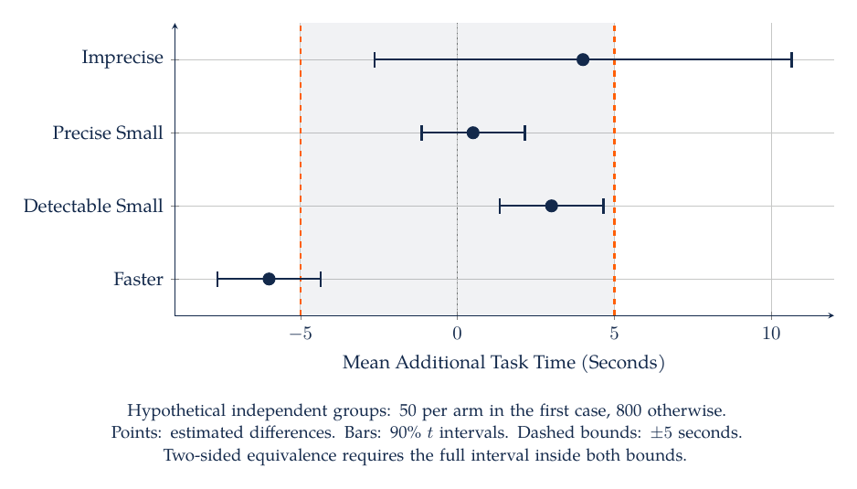

A six-second reduction fails two-sided equivalence because it is too far below zero, yet its upper confidence bound excludes an increase of five seconds. For a decision concerned only with excessive additional time, a one-sided noninferiority question is appropriate: test $H_0:\theta\geq5$ against $\theta<5$, or require a one-sided 95% upper bound below five. The choice between these questions follows the decision and must precede the result.

The numerical tolerance also requires justification. A five-second mean can conceal concentrated burdens, and an analysis of completed tasks leaves abandonment and failed cancellation as separate outcomes. Kantian respect for persons asks whether customers can understand and exercise their decision to leave. Confucian attention to responsible service asks how the firm responds to difficulty and requests for correction. Neither principle supplies a five-second threshold automatically. Evidence of a small mean time difference supports a specific empirical claim; the procedure's permissibility additionally depends on its effects and treatment of customer choice.

From the repository root:

```bash
python3 03_Data_and_Code/Statistical_Inference/equivalence_claims.py
```
 Its inputs are hypothetical sufficient statistics, with no generated individual records. The complete implementation reports zero-null tests, both equivalence tests, 90% intervals, and the one-sided upper-bound decision.


Python source: [equivalence_claims.py](../../03_Data_and_Code/Statistical_Inference/equivalence_claims.py)

```python
"""Hypothetical cancellation-time summaries with prespecified +/-5 second bounds."""
from pathlib import Path

import numpy as np
import pandas as pd
from scipy import stats

OUTPUT = Path(__file__).resolve().parent / "results"
BOUND, ALPHA = 5.0, .05
# Each scenario is a separate hypothetical parallel-group experiment.
CASES = [("imprecise", 50, 60.0, 64.0, 20.0),
         ("precise_small", 800, 60.0, 60.5, 20.0),
         ("detectable_small", 800, 60.0, 63.0, 20.0),
         ("faster", 800, 60.0, 54.0, 20.0)]


def assess(name, n, control_mean, treatment_mean, sample_sd, bound=BOUND):
    if n < 2 or sample_sd <= 0 or bound <= 0:
        raise ValueError("Require at least two customers per arm, positive SD and bound")
    delta = treatment_mean - control_mean
    df = 2 * n - 2
    se = sample_sd * np.sqrt(2 / n)
    p_zero = 2 * stats.t.sf(abs(delta / se), df)
    lower_p = stats.t.sf((delta + bound) / se, df)
    upper_p = stats.t.cdf((delta - bound) / se, df)
    half90 = stats.t.ppf(1 - ALPHA, df) * se
    half95 = stats.t.ppf(1 - ALPHA / 2, df) * se
    return {"case": name, "n_per_arm": n, "control_mean_seconds": control_mean,
        "treatment_mean_seconds": treatment_mean, "sd_each_arm_seconds": sample_sd,
        "estimate_seconds": delta, "se_seconds": se, "df": df,
        "p_zero": p_zero, "lower_bound_seconds": -bound, "upper_bound_seconds": bound,
        "tost_lower_p": lower_p, "tost_upper_p": upper_p,
        "tost_p": max(lower_p, upper_p), "equivalent": max(lower_p, upper_p) < ALPHA,
        "ci90_low": delta - half90, "ci90_high": delta + half90,
        "ci95_low": delta - half95, "ci95_high": delta + half95,
        "noninferior_below_upper_bound": upper_p < ALPHA}


def main():
    OUTPUT.mkdir(exist_ok=True)
    result = pd.DataFrame([assess(*case) for case in CASES])
    result.to_csv(OUTPUT / "equivalence_claims.csv", index=False, float_format="%.12g")
    print(result.to_string(index=False))


if __name__ == "__main__":
    main()
```

## 9.26 Electricity Infrastructure, Public Reassurance, and Agency

\noindent A public authority deciding whether to approve a data-center connection must determine who bears its costs, which risks remain unresolved, and which safeguards protect affected households. A research result can influence that decision through its public interpretation. Calling an uncertain effect harmless can weaken the case for financial guarantees, transparent cost allocation, or subsequent review. These are potential consequences of misleading reassurance; attributing an actual approval or household loss to this paper would require evidence connecting the communication to the decision and its outcomes.

HBS Working Knowledge's November 12, 2026 coverage of the electricity study (Rana et al., 2026) states that, unlike colocated centers, “centers built by the ‘Big Four’ tech companies have not” raised consumer electricity costs. This is academic public communication. Table 4 reports an uncertain positive coefficient for the four named firms and a direct developer-difference test with $p=0.101$. The categorical wording is stronger than those results support. The article also acknowledges uncertainty about future prices, which belongs beside any account of its claims. [HBS Working Knowledge](https://www2.library.hbs.edu/working-knowledge/blaming-data-centers-for-higher-electric-bills-its-not-that-simple).

### 9.26.1 What Exists in the Analysis and What the Claim Requires

\noindent An ontology specifies the entities, properties, and relations represented in an account. The electricity study represents utilities, installed capacity, customer classes, sales, costs, and average prices. A claim about household welfare additionally concerns persons with unequal incomes, needs, exposures, and opportunities. A claim about agency concerns their authority to understand, question, and influence decisions that bind them. Increasing the precision of a utility-average price estimate leaves these other objects unmeasured.

The strongest ontological objection concerns a change in what the analysis is taken to represent. A utility average becomes a statement about each household; a four-owner indicator becomes a business model; an unresolved price effect becomes absence of harm. Each substitution requires a further argument or additional evidence. Studying one price outcome is a legitimate research choice. Treating that restricted outcome as a complete account of affected persons and permissible conduct commits a category error. The statistical objection concerns what the evidence supports; the ontological objection concerns which objects the claim purports to describe; the ethical objection concerns the authority to impose the resulting burdens.

Conceptual engineering asks whether our categories serve the purposes for which we need them. For a regulator assessing cost allocation, a concept of harm restricted to a mean price coefficient omits burdens that could change the decision. For an agency assessment, observing that a household pays its bill supplies no evidence that it endorsed the allocation rule. The household may depend on an essential service and lack a practical alternative. A defensible conceptual choice retains those distinctions even when they complicate measurement. This application uses a functional assessment of concepts [(Thomasson, 2025)](https://doi.org/10.1093/9780197787830.003.0011).

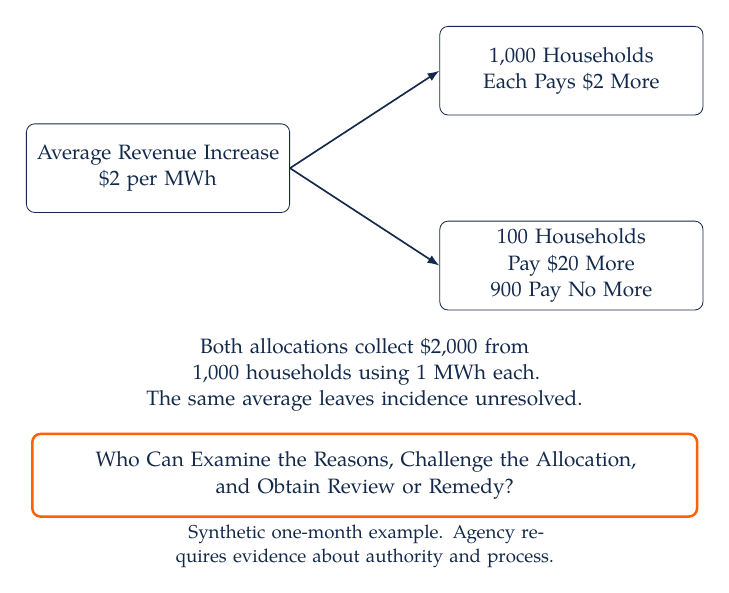

### 9.26.2 Reasons, Authority, and the Ability to Contest a Decision

\noindent An assessment of household agency asks whether its considered reasons can bear on decisions that affect it and what authority it holds over those decisions. Relevant evidence includes access to the cost calculation, understandable explanations of alternatives, an opportunity to raise objections, and a credible process for review and remedy. Participation records also require interpretation. Attendance at a hearing, silence, continued electricity use, and payment are different observations from endorsement of a cost-allocation rule. Restrictions on time, expertise, resources, or access can affect whose reasons enter the decision.

A public body can possess legal authority to decide while owing affected people a substantive justification. Recognition that a rule exists, compliance with it, endorsement of its reasons, and authorization of its application are distinct relations. The distinctions among requirements, permissions, and reports about rules help articulate these relations; their application here concerns the evidence needed to evaluate an infrastructure decision. A household's disagreement alone does not establish that a project is impermissible, and an aggregate benefit alone does not establish that the decision procedure respects it [(Thomasson, 2020b)](https://academic.oup.com/book/33564).

The humanity formulation requires treating persons as ends with purposes and judgment of their own. Applied to public-facing analytics, it supports a duty to state uncertainty and consequential assumptions accurately. A person whose exposure is dismissed through a false claim of demonstrated safety loses access to reasons needed to evaluate the decision. The objection concerns the use of technical authority to secure acquiescence. Establishing deliberate deception by a particular author would require evidence of intention; the unsupported inference itself can be criticized directly [(Kant, 1785)](https://www.gutenberg.org/files/5682/5682-h/5682-h.htm).

The universal-law formulation sharpens the reporting obligation. Consider a rule allowing an interested party to advertise safety whenever a test fails to reject zero, regardless of its ability to detect meaningful harm. General adoption would reward weak measurement with reassuring claims and undermine the evidentiary trust on which those claims depend. A consistent rule requires the same scrutiny when unresolved effects threaten the firm and when they threaten households. Economic self-interest justifies demanding substantiation; it supplies no proof of guilt or misconduct.

### 9.26.3 Responsibilities Created by Public Claims

\noindent Confucian trustworthiness and the rectification of names direct attention to whether descriptions match the responsibilities performed. Calling an uncertain effect harmless misdescribes the evidence. Calling an ownership group a leasing model can misdirect responsibility for the mechanism. An analyst's role requires correcting these descriptions when their consequences become apparent, while a manager's role requires receiving inconvenient findings without penalizing their disclosure.

The data-center case also exposes an asymmetry in the burden of proof. Households can be required to demonstrate harm with evidence they lack the resources to collect, while a firm obtains reassurance from a study too imprecise to exclude the same harm. This allocation of scrutiny can disadvantage those who bear the risk. A defensible approval process identifies a meaningful harm threshold, tests whether the evidence excludes it, considers distribution and delayed cost recovery, and states which party bears unresolved risk. Safeguards can include financial commitments, independent review, and opportunities to revisit the allocation. Their appropriate form depends on the institution and applicable law.

A rigorous criticism remains answerable to evidence. The paper reports positive price effects in several specifications, acknowledges important design limits, and leaves particular mechanisms unresolved. Its tables support a strong rejection of categorical harmlessness. They do not establish the magnitude of every household's loss or settle the overall merits of data-center development. The ethical failure arises when a narrow and uncertain result acquires authority to dismiss people and consequences it has not adequately assessed.

## 9.27 Logical Assessment of an Empirical Argument

\noindent A regulator deciding whether to waive a financial safeguard must evaluate the argument that research offers for doing so. A precise coefficient can support an invalid inference, while a logically valid argument can rest on an unverified premise. The first task is to write the conclusion in terms of the affected people, outcome, time horizon, and degree of certainty. The next is to identify the reported facts and the further assumptions that connect them to that conclusion.

### 9.27.1 Premises, Consequences, and Counterexamples

\noindent An argument is deductively valid when its conclusion holds whenever all its premises hold. Soundness additionally requires the premises to be true. Empirical inference usually depends on sampling and identification assumptions, so an assessment must state the uncertainty attached to its conclusion. A p-value is evidence generated by a statistical procedure; it is not a truth value assigned to an economic proposition.

Let $E$ contain the stated evidence and $A$ the maintained assumptions. Let $\mathcal M(E,A)$ be the nonempty class of accounts consistent with those premises. A categorical conclusion $C$ follows only if

$$
m\models C\quad\text{for every }m\in\mathcal M(E,A).
$$

Here $m\models C$ means that the conclusion is true in account $m$. A counterexample is one admissible account in which the premises hold and $C$ fails. It defeats the asserted entailment. Establishing which account actually generated the observations remains an empirical task. Requiring the class to be nonempty also matters: contradictory premises can support a formally valid implication without describing any possible economy.

The existence of a favorable model establishes compatibility. A conclusion that holds throughout a justified class establishes a stronger result. A fitted model supplies conditional predictions; using those predictions outside the fitted domain adds stability assumptions. Each distinction determines what a paper can reasonably claim and which observation could overturn that claim.

### 9.27.2 Reconstruct the Electricity Arguments

\noindent The electricity paper and its public interpretation supply several distinct arguments to examine. The strongest criticism grants the reported calculations where they are correct and identifies the inference that exceeds them.

**Nonrejection and harmlessness.** The evidentiary premise is that a particular zero-null test does not reject at a chosen level. The advertised conclusion is that the relevant facilities have imposed no consumer electricity cost. The inference needs a premise connecting nonrejection to the exclusion of meaningful positive effects. That premise fails for the reported precision. The four-owner claim is assessed against Table 4 in §9.26. For the separate pooled residential comparison in §6.33, a true increase of $2/MWh would produce nonrejection about 53% of the time under the stated normal approximation. The event used to support reassurance can therefore occur frequently when the concerning effect is present. The inverse-power calculation (Andrews, 1989) in §6.34 makes the missing sensitivity explicit. It does not prove that the concerning effect occurred.

**An exhaustive category becomes a substantive mechanism.** Section 4.1 partitions owners into four named firms and everyone else. That partition makes the two owner categories exhaustive by construction. It does not establish that the complement consists entirely of facilities leasing space to other businesses. The conclusion changes the predicate from owner identity to operating model. Facility contracts and operations must support that translation. The inclusion of Apple among other owners, alongside Apple's distinction between owned centers and colocation, makes the missing classification evidence concrete; it does not establish the operating model of every sampled Apple facility.

**An accounting remainder becomes a causal explanation.** Page 3 attributes the remaining 96% of residential price growth to named cost drivers. The subtraction behind that percentage is reproducible. Its causal interpretation requires the named drivers to exhaust the remaining change, an appropriate additive decomposition, comparable denominators and samples, and evidence for the components. A remainder can include several unmeasured causes, interactions, measurement changes, and estimation error. Labeling the remainder supplies none of those identifying restrictions.

**An unresolved sales response selects an infrastructure mechanism.** Table 7 leaves substantial sales increases compatible with its reported uncertainty. Even if the net sales response were precisely zero, offsetting changes in other customers' use or a lag between connection and utilization could produce that net result. A net quantity is distinct from each component of demand. Establishing infrastructure dominance requires evidence separating infrastructure, procurement, utilization, displacement, and recovery timing. An insignificant competing channel cannot perform that separation.

**A ratio inherits the meaning of its numerator.** The cost outcome is dollars per MWh, while the model's revenue requirement is a total dollar amount. A synthetic utility with costs of $1,000 and sales of 10 MWh has costs of $100/MWh. Costs of $1,100 and sales of 11 MWh preserve the ratio while increasing the numerator. Holding costs at $1,000 and lowering sales to 8 MWh raises the ratio to $125/MWh without any cost increase. These counterexamples invalidate an unrestricted numerator interpretation. They do not estimate which change occurred in the paper's utilities.

**A mean becomes a statement about every household.** A conclusion about an average and a conclusion about each person use different quantifiers. The equal-average allocations in §2.28 show that a two-dollar mean can arise from a uniform small burden or a concentrated larger burden. A perfectly estimated mean would leave that distinction unresolved. Calling the mean harmless further requires a justified threshold and a welfare interpretation that accounts for exposure, resources, and time.

The evidence needed to repair an argument depends on its defect. The ownership and cost examples require stable meanings for their analytical objects, while the average-to-each-person claim requires evidence about the distribution across households. The residual and mechanism claims need identifying premises, and the nonrejection claim needs a test designed to assess the conclusion being asserted. Giving every defect the same fallacy label would obscure these different requirements.

### 9.27.3 Historical Fit and Future Necessity

\noindent A developer may argue that a small historical coefficient establishes small future costs. Grant a stronger premise than the study provides: suppose the complete price-response function is known exactly over the historical load range. That still leaves responses outside the range unresolved without an extrapolation restriction.

Let $x$ be a normalized load index whose assumed historical support is $[0,1]$. Two hypothetical price-response functions, in dollars per MWh, are

$$
g_1(x)=2x,\qquad g_2(x)=2x+10\max\{x-1,0\}^2.
$$

The two functions coincide at every historically supported load. At $x=2$, they imply increases of $4 and $14/MWh. The second function adds a capacity cost above the historical boundary. Both remain possible when the premise consists only of the historical response. Selecting the first requires a stability or functional-form restriction. The electricity paper's headroom mechanism makes a threshold economically relevant, but this construction is synthetic and estimates no actual threshold or future price.

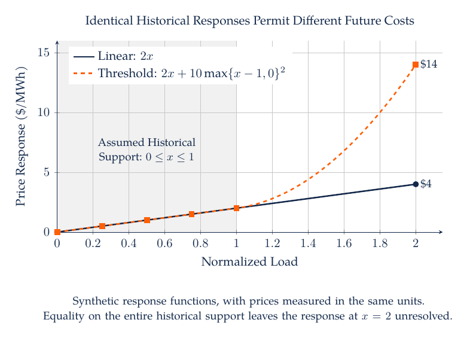

This is a counterexample to the general inference from historical fit to unrestricted extrapolation. It is also a guide to useful evidence: examine capacity constraints, contracts, rate-recovery timing, and effects across supported load levels. The paper acknowledges uncertainty about future conditions. Preserve that qualification when assessing a stronger claim made from its findings.

### 9.27.4 Outcomes, Ability, and Permission

\noindent Consider two hypothetical jurisdictions with the same household bills and recorded use. In one, households can inspect cost-allocation reasons, challenge an error, and obtain an effective remedy. In the other, the decision is inaccessible and no effective challenge is available. Equal observed outcomes do not identify equal authority. The distinction between possible outcomes, available actions, information, and permissible conduct is central to logical accounts of protocols [(Pacuit and Simon, 2011, pp. 412–415)](https://doi.org/10.1017/S1755020311000190).

An observed payment establishes conduct under the available conditions. Inferring endorsement requires evidence about understanding, alternatives, and the person's reasons. Inferring permission to impose a burden requires a normative premise about whose interests and authority justify the action. A price regression supplies neither premise automatically. This does not give every household a veto; it makes the allocation and justification of authority an explicit part of the policy argument.

The philosophical criticism becomes strongest when it identifies the exact missing relation. A small expected price effect can coexist with an objectionable decision procedure. A procedurally legitimate decision can still impose an unfair distribution of costs. Evidence about prices, distribution, and authority addresses these concerns separately. Treating one coefficient as a certificate for all three gives analytical authority to conclusions it has not established.

### 9.27.5 Build a Criticism That Can Survive a Reply

\noindent Record the exact claim, speaker, page or table, population, and date. State the premises charitably, including the paper's positive findings and qualifications. Then identify the added inference and construct a counterexample that preserves those premises. Finally, state the evidence or restriction that would exclude the counterexample, and rewrite the conclusion at the strength currently supported.

A contradiction requires incompatible propositions about the same object under the same conditions. An unsupported extension, a change of definition, an imprecise estimate, and a genuine contradiction are different findings. Table 4's reported equality-test p-value of 0.101 exceeds the displayed 10% convention despite the accompanying significance language. That is a specific reporting inconsistency. The broader inference from an uncertain price coefficient to harmlessness is a failure of justification. Neither finding establishes an author's intention.

The decision consequence is concrete. Unresolved harm should remain visible when an authority allocates risk and chooses safeguards. A paper weakens that decision when a correct calculation is used to conceal the premises its recommendation still needs. A defensible criticism exposes those premises, identifies what evidence could resolve them, and applies the same standard to conclusions favorable and unfavorable to the developer.

The synthetic response and cost-ratio examples can be reproduced from the repository root:

```bash
python3 03_Data_and_Code/Statistical_Inference/logical_counterexamples.py
```


Python source: [logical_counterexamples.py](../../03_Data_and_Code/Statistical_Inference/logical_counterexamples.py)

```python
"""Construct synthetic counterexamples to extrapolation and ratio interpretations.

No observation from the data-center study is used in these constructions.
"""
import csv
from fractions import Fraction
from pathlib import Path

OUTPUT = Path(__file__).resolve().parent / "results"


def price_responses(load):
    """Load is a normalized index; responses have hypothetical USD/MWh units."""
    linear = 2*load
    capacity_threshold = linear + 10*max(load-1, 0)**2
    return linear, capacity_threshold


def write_rows(name, rows):
    with (OUTPUT/name).open("w", newline="") as stream:
        writer = csv.DictWriter(stream, fieldnames=rows[0])
        writer.writeheader()
        writer.writerows(rows)


def main():
    OUTPUT.mkdir(exist_ok=True)
    rows = []
    for load in [Fraction(i, 4) for i in range(5)]+[Fraction(2)]:
        a, b = price_responses(load)
        rows.append(dict(load=float(load), linear=float(a), threshold=float(b),
                         within_assumed_historical_support=load <= 1))
    write_rows("logic_extrapolation.csv", rows)
    # Hypothetical one-period totals in dollars and MWh.
    rows = []
    for label, cost, sales in [("baseline", 1000, 10),
                               ("cost_and_sales_rise", 1100, 11),
                               ("sales_fall", 1000, 8)]:
        rows.append(dict(case=label, total_cost_usd=cost, sales_mwh=sales,
                         cost_per_mwh=float(Fraction(cost, sales))))
    write_rows("logic_cost_ratios.csv", rows)


if __name__ == "__main__":
    main()
```

### 9.27.6 Institutional Facts Supply Missing Premises

\noindent Zero operating additions establish an unexposed utility only if relevant costs neither precede operation nor survive cancellation. Investment followed by cancellation and allowed recovery is a counterexample: customers bear costs despite zero operating additions. Section 6.35 shows how those donor costs reduce a synthetic comparison gap. The actual study's exposure and bias require its donor weights and project histories.

Revenue per MWh and expenditure per household are also different economic objects. Section 2.28.1 constructs flat average prices with rising bills, refuting a general implication from flat prices to flat expenditure. It attributes no bill increase to data centers. Measurement validity and causal attribution require separate evidence.

Institutional knowledge changes the ethical question. A developer's project may never operate, yet households may bear preparatory costs. The relevant decisions concern who authorized spending, who bore cancellation risk, which guarantees were enforceable, and whether customers could challenge the allocation. Treating operating capacity as a complete account of that relationship removes consequential obligations. Statistical precision cannot supply the missing premise.

## 9.28 The Data-Center Case as Marketing Dialectics

\noindent A developer seeking approval may offer an efficiency argument: additional demand can spread shared costs, and some facilities may be located where capacity is inexpensive. A household may object that it faces uncertain bills, obligations from failed projects, and little influence over the allocation. These are different claims about the same investment process. A defensible decision must identify the conditions under which the efficiency mechanism operates and explain why the resulting obligations are justified to affected people.

### 9.28.1 The Conditions of a Claim

\noindent The critical approach in §§9.1–9.3 examines how a conditional result acquires broader authority. In the electricity case, the observed object is a utility-level revenue ratio under a particular treatment definition and comparison. The broader reassurance concerns household costs and the acceptability of development. Moving between those claims requires premises about measurement, exposure, statistical sensitivity, distribution, and institutions. A fitted coefficient does not supply those premises simply because its calculation is sophisticated.

The distinction between regulative and constitutive uses of ideas gives a useful discipline for this application. The aim of understanding the full consequences of development can guide inquiry into requests, investment, operation, cancellation, and recovery. Treating an incomplete model as an exhaustive account closes that inquiry prematurely. This is a contemporary application of the critical method described in §9.2.3. A disputed utility estimate is an empirical problem with potentially resolvable evidence; it is not one of the cosmological antinomies [(Kant, 1781/1787, appendix to the Transcendental Dialectic)](https://www.gutenberg.org/files/4280/4280-h/4280-h.htm).

The criticism must examine its own premises as carefully. A phantom-project mechanism defeats the inference that zero operating additions necessarily imply zero exposure. It does not establish that the selected donors actually incurred those costs. An imprecise estimate leaves meaningful harm possible without proving it occurred. Rejecting categorical reassurance therefore leaves a substantive research question open. This is the same discipline that prevents a favorable coefficient from becoming an unconditional endorsement.

### 9.28.2 Efficient Provision and Respect for Persons

\noindent A cost-saving mechanism can justify further investigation of a project. A public decision also assigns risks and obligations. The humanity formulation directs attention to households as persons capable of assessing reasons and pursuing ends, including ends that differ from the developer's commercial objective. Technical communication that presents unresolved harm as established safety can impair that assessment. The ethical objection concerns the authority claimed for the evidence and its role in a decision binding other people [(Kant, 1785)](https://www.gutenberg.org/files/5682/5682-h/5682-h.htm).

For infrastructure, respect can require intelligible cost allocations, access to supporting evidence, meaningful opportunities to challenge assumptions, and a process for correcting mistakes. These are proposed institutional applications of the principle. They do not imply that every individual has a veto or that any project imposing a cost is impermissible. The governing authority must offer a justification that addresses the people who bear the costs. Aggregate efficiency alone leaves that obligation unresolved.

### 9.28.3 Responsibilities and Revision

\noindent Confucian trustworthiness and the rectification of names connect claims to the responsibilities they imply. Describing a control as unexposed requires an exposure definition suited to the decision. Describing households as protected requires evidence about guarantees and recovery. Describing a result as harmless requires support for that assurance. The analyst, manager, and public communicator each have a role in correcting a description that overstates the evidence. The application follows *Analects* 12.7 and 13.3 and the account of truthful challenge in §9.11.3.

Marketing Dialectics permits a definite conclusion when an argument fails. Categorical harmlessness should be rejected when the estimates leave consequential increases unresolved. A broader allegation of actual household harm should await the evidence needed to establish it. The resulting action can require guarantees, a narrower claim, additional measurement, or suspension of a recommendation. There is no requirement to split the difference between an unsupported assurance and an unsupported accusation. The judgment follows the reasons that survive examination.

## 9.29 Does the Paper Need to Be Published?

\noindent An author deciding whether to release a paper must ask what reliable knowledge the proposed version adds and what readers are being invited to infer from it. Completing an analysis creates no obligation to publish its existing framing. A policy-relevant title, institutional affiliation, and confident summary can give a result authority beyond the technical audience. When that authority exceeds the evidence, publication can make public deliberation worse even if parts of the analysis are computationally correct.

### 9.29.1 The Moral Value of Withholding a Claim

\noindent Delaying or foregoing a release has moral value when it prevents an unsupported assurance from being used to allocate risks to other people. For the author, the decision can involve relinquishing attention, professional advantage, or an attractive narrative. The distinction between acting from duty and acting for an advantageous consequence helps identify the relevant principle: truthful representation remains an obligation when a more dramatic claim would be rewarded. A decision's outward restraint alone does not reveal the author's motive [(Kant, 1785)](https://www.gutenberg.org/files/5682/5682-h/5682-h.htm).

Consider a hypothetical maxim: when an uncertain result is likely to support a preferred policy, present nonrejection as safety to make the intervention easier to approve. The objection concerns an assurance that the evidence cannot support and the reliance it seeks to obtain. The same rule must be assessed when uncertainty favors households and when it favors the firm. A justified alternative is to communicate the estimand, uncertainty, and consequential assumptions accurately, including when they weaken the preferred recommendation.

Confucian role responsibility supplies a further reason for restraint. The public relies on a scholar to assess evidence and on a communicator to represent that assessment faithfully. If a central claim cannot survive scrutiny, declining to circulate it can fulfill those responsibilities. Truthful challenge also gives collaborators and editors a reason to resist a misleading release. The prospect of disagreement does not excuse acquiescence in a claim they know is unsupported. This is a contemporary application of the responsibilities developed in §9.11.

### 9.29.2 The Costs of Silence

\noindent Withholding research can also deprive others of evidence and opportunities to correct an error. The argument in *On Liberty*, chapter II, emphasizes the fallibility of those who would suppress discussion and the epistemic value of contestation. It gives a strong reason to preserve access to arguments, criticism, and correction. It supplies a challenge to a critic who assumes that anticipated political misuse settles whether an entire inquiry should be heard [(Mill, 1859, chapter II)](https://dhspriory.org/kenny/PhilTexts/Mill/Liberty2.html).

Publication decisions based on the direction or statistical significance of results can distort the available evidence. An inconclusive estimate may still document uncertainty, identify a measurement problem, or contribute to later synthesis. Registered Reports provide one institutional response: evaluate the question and design before outcomes are known, with publication conditional on the agreed quality requirements. That principle permits demanding methodological standards while reducing incentives to select conclusions for dissemination. [Center for Open Science, Registered Reports](https://www.cos.io/initiatives/registered-reports).

A decision to delay should therefore identify a specific defect, the relevant public risk, and what would make release acceptable. A demand for secrecy because a result inconveniences a preferred position fails that test. So does an indefinite requirement that only studies proving zero risk may appear. The threshold concerns the validity and faithful communication of the contribution. It must apply symmetrically to reassuring and alarming results.

### 9.29.3 Choose the Publication Action That Fits the Defect

\noindent Four actions deserve separate consideration. A temporary delay is justified when a consequential measurement or identification problem is unresolved and a feasible review could determine whether the claim survives. A revised release is justified when the estimates retain value under a narrower interpretation and the title, abstract, tables, conclusion, and public summary all reflect that interpretation. Nonpublication of the proposed paper can be justified when its central contribution disappears after unsupported inferences are removed and no sufficiently reliable contribution remains. A separate technical record may still preserve methods, evidence, and the reason the analysis was abandoned, subject to data rights and confidentiality.

For an already public paper, correction and traceability become part of the obligation. Quiet removal can leave misleading quotations circulating while making their source harder to assess. A visible correction, linked replacement, or withdrawal notice can explain which claims no longer stand and why. These actions should be proportionate to verified defects. A change in interpretation, an invalid central estimate, and fabricated evidence require different responses; no fabrication finding is made in this case.

The data-center assessment supports a direct criticism of categorical reassurance in the verified HBS coverage and of the specific inferential steps documented in §§6.33–6.35 and 9.26–9.27. The paper also reports positive findings and acknowledges limitations. Its complete empirical value cannot be settled from those defects alone, particularly without its underlying utility panel and donor histories. A release decision should require a response to the identified problems and assess the contribution remaining after correction. An important policy question does not entitle a particular version to publication.

### 9.29.4 A Decision That Remains Open to Challenge

\noindent A defensible editorial judgment states the strongest remaining contribution, the claim that fails, and the remedy needed. For a hypothetical unreleased version that advertises no household harm, require reconciliation of prices and bills, project exposure and controls, meaningful effect sizes and detection limits, and public wording and reported results. If those corrections support a bounded estimate, release can advance understanding. If the central assurance remains unsupported and drives the paper's claimed contribution, decline that version.

The same judgment must state what could change it. Verified project histories might show that the donors were unexposed to the relevant costs; a justified household measure might substantiate a more specific burden claim; a sensitivity analysis might exclude an economically consequential increase. Conversely, demonstrated contamination or irreparable measurement error could weaken the remaining contribution. The responsibility is to make the publication decision answerable to evidence and affected people's reasons. Foregoing a misleading paper can be an achievement of scholarly judgment; withholding inconvenient but sound evidence can undermine that same responsibility.

## 9.30 What a Company Ought to Do

\noindent A company may be able to predict a customer's response, change a price, or prolong a cancellation process. Its managers still face a practical question: what ought the company do? An answer needs reasons for treating people in the proposed way. Profitability can explain why the firm wants an action and can matter for sustaining a useful service. The interests of people who bear its costs also enter the justification, including people who never become customers.

### 9.30.1 Facts, Reasons, and the Conclusion

\noindent Three claims perform different work. “The system can delay cancellation” describes capability. “Delay raises expected revenue” describes an anticipated consequence, conditional on supporting evidence. “The firm ought to delay cancellation” recommends conduct. The last claim requires a normative premise about when the revenue interest justifies the burden imposed on customers. Leaving that premise unstated allows a commercial objective to determine the recommendation without defending it.

A reason is a consideration counting in favor of an action or attitude in specified circumstances (Scanlon, 2009). The same fact can bear differently on different decisions. A customer's request to stop a service matters for completing cancellation; a prediction that the customer will tolerate delay addresses a different question. The analyst must explain why the consideration supports the proposed action [(Scanlon, 2009, pp. 12–14)](https://media.philosophy.ox.ac.uk/assets/pdf_file/0008/25856/Lecture_2.pdf).

“Ought” identifies a conclusion to defend. State the actor, action, circumstances, and relevant alternatives: “Given a verified request and a feasible secure exit, the provider ought to complete cancellation promptly.” Distinguish this obligation from permission to offer an optional discount. Several actions may remain permissible even when one maximizes a chosen performance measure.

### 9.30.2 The Test of Reasonable Rejection

\noindent Contractualism evaluates principles governing conduct by asking whether affected people could reasonably reject them. The comparison considers people's reasons for objecting to permission and to prohibition, including how burdens arise. It therefore requires alternatives and a judgment about the reasons on each side. Actual agreement, bargaining power, and success in persuading an audience do not settle that judgment [(Scanlon, 1998, chapter 5, §§1–3, especially pp. 191–196)](https://e-edu.nbu.bg/pluginfile.php/314831/mod_resource/content/0/scanlon_5.1-3.pdf).

For a marketing decision, identify the positions people occupy and the interests at stake. A subscriber may seek control over recurring payments; a worker may need a sustainable workload; another subscriber may need protection from fraudulent changes. Owners can have legitimate interests in compensation and maintaining a viable service. Specify the burden for a person in each position and examine its basis. A large total commercial gain leaves the justification of a serious burden on an individual to be addressed. A strongly expressed objection also needs reasons; it supplies no automatic veto.

### 9.30.3 Construct and Challenge the Premises

\noindent Consider a hypothetical subscription service with a verified cancellation request. Assume that a prompt cancellation path can protect the account at a reasonable operating cost. The proposed practice requires the customer to complete a retention conversation while billing continues.

The factual premises concern the request, continued charges, security, and the feasible alternative. The proposed normative premise is that a provider ought to respect a valid withdrawal and justify any remaining burden through reasons that affected people could reasonably accept. This premise requires a defense: customers have reasons to control unwanted recurring obligations, and a secure exit can preserve other subscribers' protection and the provider's legitimate operating needs. Given those premises, the company ought to complete cancellation promptly and keep a retention offer optional.

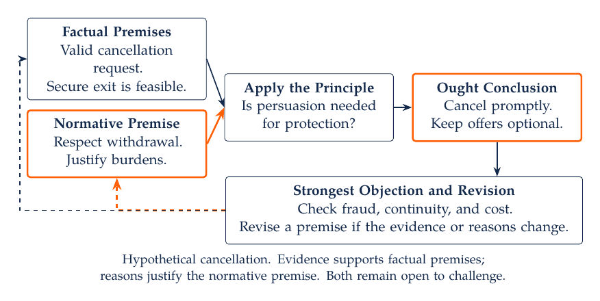

The factual branch asks whether the request is valid and the alternative is feasible. The normative branch asks why the customer's control and the interests of others justify the proposed rule. The conclusion depends on both branches. The return paths preserve the possibility that a factual premise is wrong or that the principle treats a relevant interest inadequately.

The strongest objection may concern account fraud, a service that cannot be restored after cancellation, or substantial costs imposed on other subscribers. Investigate that objection and compare proportionate identity checks, clear warnings, and accessible confirmation. A claim that every retention step is necessary requires evidence connecting that step to the protected interest. Revenue from customers who wanted to leave does not establish such a connection.

### 9.30.4 Compare Principles from Each Position

\noindent Compare a rule requiring persuasion after a verified request with a rule allowing prompt secure exit and an optional offer. Assess both under the same circumstances. Removing all security checks would introduce a different alternative and could exaggerate the case for mandatory persuasion. A useful comparison preserves legitimate protection while examining whether the disputed burden is necessary.

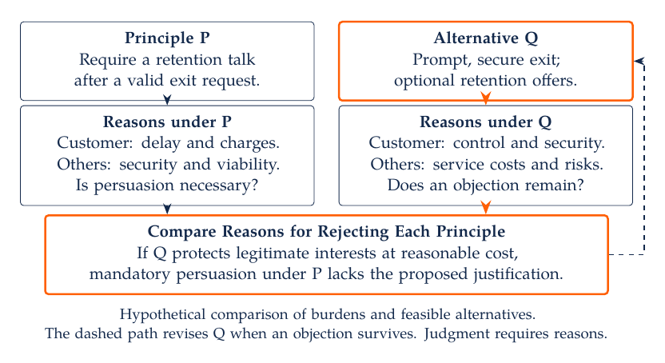

The two columns hold the decision fixed while changing the governing principle. Each column considers customer control alongside the security and service interests of workers and other subscribers. The final judgment depends on the seriousness and justification of these burdens. If the alternative leaves a substantial objection unanswered, revise it and compare again.

### 9.30.5 Stakeholders Beyond the Firm

\noindent A customer database represents people who generated records under the firm's existing practices. It can omit excluded applicants, household members, workers, nearby residents, and people who will face future obligations. Being absent from the table supplies no reason to exclude a person's interests. Establish the connection between the proposed action and the possible burden before claiming that a particular group is affected.

| Decision | People Whose Reasons Need Examination | Missing Information That Matters |
| --- | --- | --- |
| mHealth targeting | Users, household members whose information may be inferred, and people excluded from the service | Purpose of use, authority to process information, errors, and meaningful exit |
| Automated pricing | Buyers with limited alternatives, workers administering prices, and people relying on continued service | Price paths, comprehension, access, operating costs, and feasible protections |
| Electricity development | Existing households, prospective users, workers, and residents exposed to infrastructure decisions | Project commitments, guarantees, cost recovery, distribution, and opportunities to contest allocation |
| Public research claims | Readers, affected households, decision makers, and people relying on useful research | Claim accuracy, uncertainty, access to corrections, and the value of the remaining evidence |

These are positions to investigate, rather than findings that every listed person experiences harm. Ask who receives a benefit, who bears a burden, who chooses, and who can contest the decision. Within each category, different people may face very different circumstances. Participation can reveal reasons and evidence that an analyst missed; a favorable survey response still requires an assessment of the underlying principle.

In mHealth, recorded logging can inform a behavioral description. A recommendation about sensitive targeting additionally requires a justified purpose and authority to use the information. In pricing, an off-peak discount can support access while a less visible price rule imposes costs elsewhere. In electricity, an estimated average price response leaves questions about particular households' obligations and opportunities to challenge them. The analysis should connect each proposed policy to the people and interests it changes.

### 9.30.6 Defend an Ought Conclusion

\noindent A good premise has a clear subject and scope, support appropriate to its type, and a stated role in the inference. Support an empirical premise with observations, design, and uncertainty. Defend a normative premise through the reasons it recognizes, its treatment of comparable cases, and the objections to feasible alternatives. A definition clarifies an object; it does not establish that the object is good. Valid deduction preserves the consequences of premises; the premises themselves still need justification.

Reflective equilibrium involves mutual revision of general principles and considered judgments about cases. A coherent set of beliefs can still need correction when a neglected circumstance or objection emerges. The practical task is to test the proposed principle against difficult cases and explain why a revision improves its justification [(Scanlon, 2009, pp. 12–14 and 19–26)](https://media.philosophy.ox.ac.uk/assets/pdf_file/0010/25858/Lecture_4.pdf).

Write the recommendation as an argument: the firm ought to take a specified action because a defended principle applies to supported facts; the strongest objection has a stated answer; a specified change in facts or reasons would require reconsideration. When uncertainty is consequential, an appropriate action can be to collect evidence, restrict deployment, correct a claim, or preserve several permissible choices. The conclusion should be as definite as the reasons support.

For the data-center communication, a defensible conclusion is that authors and public communicators ought to remove categorical reassurance that exceeds the reported evidence and explain the remaining uncertainty. Households have reasons to resist being asked to accept risks on that basis. Readers also have reasons to retain access to credible estimates and criticism. A corrected, traceable release can answer both concerns when a reliable contribution survives. This judgment concerns the supported claims and the responsibilities of publication; a separate argument is needed to justify a particular infrastructure policy.

## 9.31 Public Reassurance and the Framing of Pricing

\noindent A company deciding how to describe a pricing change chooses which benefits, costs, and comparisons to make salient. An institution describing a research result makes related choices about the question readers will think has been answered. A truthful statement can still leave a consequential premise unexamined. The ethical question concerns whether the communication gives affected people adequate reasons and information to assess the proposed conduct.

### 9.31.1 Two Documented Communications

\noindent Wendy's February 27, 2024 statement described digital menu boards, slower-period discounts, and value offers, while stating that the company had no plans to raise prices at its busiest times. This is evidence of its stated policy and public framing. Implementation and customer outcomes require separate evidence. The statement could accurately correct a misunderstanding; the commercial interest in a favorable interpretation alone does not establish deception. [Wendy's, *Digital News Update*](https://www.wendys.com/blog/wendys-digital-news-update).

The November 12, 2026 HBS coverage presents the electricity research through a reassuring comparison involving four large technology firms, extending beyond what the reported subgroup nonrejection establishes (§6.33). The article also discusses possible future increases and contractual protection, which matter when assessing the scope of its message. The documented communication comes from an academic institution's publication; establishing a coordinated corporate campaign or a company post making the same claim would require additional evidence. [HBS Working Knowledge, *Blaming Data Centers for Higher Electric Bills? It's Not That Simple*](https://www2.library.hbs.edu/working-knowledge/blaming-data-centers-for-higher-electric-bills-its-not-that-simple).

The useful connection is the selection of the reference point and the beneficiary. Off-peak discounts direct attention to favorable purchase occasions; a reassuring subgroup comparison directs attention to selected developers. Examine whether the listener is also given the relevant peak-period benchmark, household outcome, uncertainty, and institutional conditions. Distinguish a change in language, a change in the actual policy, and evidence of a change in people's welfare.

### 9.31.2 Reasons for Acceptance and Successful Persuasion

\noindent A public-relations message can increase acceptance without supplying a sound reason for the decision. Conversely, a careful explanation can be justified even when an audience remains unconvinced. Under the contractualist argument in §9.30, the communicator ought to make the material comparison and its uncertainty clear enough for affected people to examine. Approval rates alone do not discharge that responsibility.

For pricing, compare complete offers, the conditions under which prices change, accessible alternatives, and who bears the costs. Dynamic pricing, personalized pricing, price coordination, and a legal finding of price gouging are different objects. For electricity, compare the measured revenue ratio with the household claim and inspect obligations created before operation. A favorable label changes none of those objects by itself.

A defensible communication rule is to state the proposed action, its verified consequences, its unresolved consequences, and the reasons for the burdens it imposes. Apply that rule symmetrically to reassuring and alarming messages. The company or institution ought to correct a material mismatch between its public assurance and its supporting evidence, while preserving accurate findings and opportunities for criticism.

## 9.32 Who Counts as a Stakeholder, and Why?

\noindent A manager choosing an analytical objective must decide whose outcomes enter the comparison. Beginning with the firm's customers and shareholders can miss workers, suppliers, excluded users, and people exposed to its infrastructure or information practices. A useful stakeholder assessment identifies the relationship, the relevant interest, and the reason that interest creates a claim on the decision. The label “stakeholder” alone leaves the content and strength of the obligation unresolved.

### 9.32.1 Influence, Business Performance, and Moral Standing

\noindent Descriptive, instrumental, and normative uses of stakeholder theory require different kinds of support. Describing a firm's relationships, predicting whether stakeholder management improves performance, and justifying duties to affected parties require different arguments. For analytics, the implication is immediate: a profitable stakeholder strategy does not by itself establish why an unprofitable protection ought to be retained [(Donaldson and Preston, 1995)](https://journals.aom.org/doi/full/10.5465/amr.1995.9503271992).

Power, legitimacy, and urgency provide an account of stakeholder identification and managerial salience. This helps explain which claims attract attention. A moral assessment must also examine claims that receive little attention. A household facing an infrastructure obligation may have limited influence over either the developer or the utility. That weakness is a reason to investigate representation, rather than to infer that its burden is unimportant [(Mitchell et al., 1997)](https://doi.org/10.5465/amr.1997.9711022105).

Keep a record of influence separate from the justification of obligations. For each affected position, state the possible consequence, the evidence supporting exposure, the person's reason for objecting, and a feasible remedy. Revenue shares and political power may explain what management will do. They supply no automatic ethical weights for deciding what it ought to do.

### 9.32.2 Cooperation, Fairness, and General Duties

\noindent Fair cooperation can ground particular stakeholder obligations: voluntarily accepting benefits from a mutually beneficial scheme involving contributions can create obligations to other participants. The distinction between normative and derivative legitimacy separates obligations owed to stakeholders from attention to actors whose influence matters for honoring those obligations. The approach gives students a concrete premise to examine: what cooperation and acceptance establish the claimed obligation? [(Phillips, 1997)](https://doi.org/10.2307/3857232); [(Phillips, 2003)](https://doi.org/10.5840/beq20031312).

Voluntary cooperation does not describe every affected person. A nearby resident may face a burden without joining the firm's arrangements. General duties concerning harm, honesty, and respect therefore require their own examination. Environmental reasons can matter even under an account that denies the nonhuman environment stakeholder status. Exclusion from a particular stakeholder definition does not settle moral irrelevance [(Phillips and Reichart, 2000)](https://doi.org/10.1023/A:1006041929249).

### 9.32.3 Managerial Responsibility and Public Authority

\noindent Identifying stakeholders leaves open how their interests should govern action. Managers can have morally significant obligations beyond shareholders while retaining a special relationship to shareholders. A duty to manage a business requires an account of the means through which its objectives may be pursued. It does not confer unrestricted permission to manipulate others [(Goodpaster, 1991)](https://doi.org/10.2307/3857592).

Public decisions introduce a further question: who is accountable to whom? Democratic accountability to affected parties supplies a standard for assessing corporate participation in governance. This standard challenges arrangements in which firms acquire policymaking authority through a process intended to hold them accountable. The electricity application is to distinguish supplying technical evidence from deciding the legitimate allocation of public burdens. A company-organized consultation needs a justified account of representation and decision rights [(Hussain and Moriarty, 2018)](https://doi.org/10.1007/s10551-016-3027-8).

### 9.32.4 From a Stakeholder Map to a Defensible Recommendation

\noindent Begin with the actual action and trace its consequences beyond the firm's accounts. Identify who benefits, who may be harmed, who contributes, who has authority, and who lacks an effective voice. Distinguish verified effects from plausible exposures needing evidence. Then state a principle that governs the action and compare the reasons people could have for rejecting that principle and its feasible alternatives.

For a proposed data-center development, that process may favor investment with enforceable cost commitments, transparent evidence, and a credible opportunity to contest allocation. Different project facts could support delay or rejection. The philosophical conclusion follows from the defended principle and the institutional evidence. A stakeholder diagram, an average coefficient, or a company's ability to secure approval leaves that argument to be made.

### 9.32.5 Residents and Unequal Influence

\noindent A resident may become exposed to a development without choosing a commercial relationship with its owner. The project sponsor may control technical records, negotiate infrastructure commitments, and retain specialists, while a resident must assemble an objection after work with limited access to those records. These circumstances could create unequal influence over the public account of a project. Establish the circumstances through notice dates, access to documents, participation costs, representation, and responses to objections. Residential proximity alone establishes neither powerlessness nor a specific financial burden.

Three populations require separate identification: people living near the facility, customers served by the relevant utility, and people who ultimately bear a particular cost. These populations can overlap without coinciding. Nearby households may have concerns about noise, land use, water, or local infrastructure; more distant customers may face a tariff change. Each proposed effect needs evidence appropriate to its mechanism. An average utility-price result leaves those distinct exposures and the allocation of decision rights unresolved.

The ability to submit a comment is one component of an effective voice. Assess whether people receive understandable information in time to act, can obtain independent technical assistance, and receive a reasoned response that can affect the decision. A process may accept every comment while leaving the decisive assumptions inaccessible. That possibility makes participation and influence separate objects of investigation.

The proposed normative principle is that institutions imposing consequential, involuntary burdens ought to provide affected people with a credible opportunity to examine and challenge the justification. Apply the principle to feasible alternatives: early disclosure, accessible evidence, independent assistance, explicit responses, and enforceable cost commitments. The principle needs a defense in terms of people's reasons and the cost of providing those protections. Equal standing in justification does not require equal technical expertise or identical authority over every decision.

### 9.32.6 University Prestige and the Burden of Being Heard

\noindent Consider the hypothetical headline, “Harvard/Wharton study shows data centers do no harm.” The wording is an illustrative construction, not a verified headline or a collective endorsement by either university. The documented public statement is the HBS Working Knowledge coverage discussed in §9.25. Institutional affiliation identifies where researchers work; it does not establish that a particular inference follows from their estimates.

A headline can give a narrow finding an expansive public role. A reader may treat the university's reputation as sufficient evidence that the question has been settled. A resident then faces the practical demand to overturn a prestigious study before concerns about bills, exposure, or procedure receive attention. This is a possible mechanism of unequal credibility and burden shifting. Demonstrating it in a particular dispute requires evidence that the statement circulated, was relied upon, and changed how objections were treated.

Testimonial injustice involves an unfair credibility deficit caused by prejudice toward the speaker. A difference in credentials or media reach alone does not establish that diagnosis. Examine whether officials discount a resident because of a prejudicial social judgment, whether they assess the substance of the claim, and whether relevant evidence receives an answer [(Fricker, 2007, chapter 1)](https://academic.oup.com/book/32817/chapter-abstract/274999720).

Institutional epistemic justice extends the question to the organizations that gather and assess testimony. It requires examining the conditions under which different people contribute to inquiry. Assess access to records, technical assistance, opportunities to question assumptions, and the correction of widely circulated claims. These proposed safeguards require institutional evidence and justification in the particular setting [(Anderson, 2012)](https://websites.umich.edu/eandersn/abstracts.htm).

A household's bill or account of noise supplies evidence about an experienced outcome. Establishing its cause requires further comparison. An average causal estimate supplies evidence about its defined population and outcome. Establishing the treatment of a particular household requires further information. A fair assessment gives each contribution the scope supported by its evidence and examines the gap between them. Scholarly prestige supplies no missing identification assumption; local experience supplies no automatic counterfactual.

The Scanlonian question is concrete: could people facing a possible involuntary burden reasonably reject a principle that treats an imprecise average as sufficient grounds to dismiss their concerns? Compare that principle with one requiring proportionate investigation and an answer to material objections. Researchers, readers, workers, developers, and households all have reasons concerning accuracy, delay, resources, and risk. Under the defended principle, institutions ought to substantiate reassurance before using it to close discussion. Residents need no published econometric paper merely to request reasons for a decision that may burden them.


## 9.33 Corporate Accounts and the Household's Claim to Reasons

\noindent A resident asked to accept an affordability assurance has a reason to ask how planned infrastructure will be paid for. The utility disclosures in §5.27 describe recovery mechanisms, proposed charges, and possible revenue offsets. Their evidential force lies in the specific financial and institutional steps they identify. The household's objection survives a small historical average when the assurance also concerns future investment, a particular customer class, or the ability to challenge an allocation.

A defensible argument begins with a limited factual premise: recovery plans can create exposure for households, and a stated offset does not by itself establish a falling bill. The normative premise is that an institution proposing a material burden ought to supply reasons that affected people can examine and contest. A feasible alternative is a transparent account of projected costs, allocation rules, enforceable protections, and the assumptions behind claimed savings. These premises support a conditional recommendation: a firm or public institution ought to qualify its affordability assurance until that account supports the proposed scope. They do not establish that every data-center project is harmful or impermissible.

The strongest objection is that delayed approval or public alarm may obstruct valuable investment and cost spreading. Answer it by examining credible offsets and feasible protections with the same evidential standards used for adverse claims. The negative cases retained in §5.27 matter for this reason. A principle requiring substantiation can permit beneficial investment while requiring the institution to address the household's strongest material objection. This application follows the comparison of reasons in §§9.30–9.32.

Investor calls also reveal an asymmetry of participation. Management and financial analysts set the questions and categories in the public record. A resident's absence from that conversation does not establish consent, indifference, or a lack of relevant knowledge. Claims about household experience require sources suited to that experience, including consumer-counsel filings, public comments, and appropriately collected billing or interview evidence. Their interpretation still requires context and scrutiny. The qualitative reporting and reflexivity practices discussed in §5.27 make the analyst's own selection of voices open to examination. [(O'Brien et al., 2014)](https://doi.org/10.1097/ACM.0000000000000388)

## 9.34 A Customer Type and a Person's Reasons

\noindent A seller considering individualized prices must decide which differences among customers justify different treatment. A demand model estimates how purchases vary with an offer and the information available to the seller. A person's reason for accepting that offer may depend on circumstances the model does not represent: an urgent deadline, costly search, responsibility for another person, or the absence of a usable alternative. Accurate prediction can make those circumstances commercially useful without establishing a right to exploit them.

### 9.34.1 What Flexible Heterogeneity Represents

\noindent The personalized-pricing study approximates heterogeneous demand parameters using a rich set of observed customer features (Dubé and Misra, 2021). Its empirical model retains an independent logistic disturbance that the firm does not learn for each customer. The method therefore differs from unrestricted recovery of every person's unobserved preferences. Randomized prices help identify demand responses within the experimental design, while the demand specification supports interpolation and counterfactual calculations. Flexibility in observed interactions can improve prediction and reveal differential burdens. Its presence alone supplies no theorem that estimated harm must fall.

The decisive criticism concerns the interpretation placed on the fitted heterogeneity. A high willingness to pay can reflect valuable service, an urgent need, or weak alternatives. Purchase records alone need not separate these explanations. Calling all three a high-value customer type removes the distinction from the pricing objective while preserving it in the person's reasons for objecting. If the analyst then treats the omitted distinction as morally irrelevant, the conclusion follows from that normative exclusion. Better predictive fit has not established it.

The paper's own results prevent a stronger universal accusation: the June 2021 revision reports a 23% decline in total customer surplus relative to optimized uniform pricing, alongside lower prices for more than 60% of customers. The authors examine inequality-sensitive aggregation and discuss fairness. Their empirical customers are employers purchasing recruitment services. A welfare calculation for an enterprise does not establish how the consequences reach owners, workers, applicants, or households. Those people and the incidence on them must be identified before making claims about vulnerability or distributive justice [(Dubé and Misra, 2021, §§2–3 and 6)](https://www.nber.org/papers/w23775).

### 9.34.2 Irreducible Reasons and Empirical Representation

\noindent An account of irreducible normative reasons allows a fact about a person's circumstances to count in favor of an action without reducing that relation to a predicted choice. The second John Locke lecture distinguishes the normative relation from a demand for unusual physical entities. The question of which people and relationships appear in a dataset is a further application to analytical representation. A feature vector is a representation of someone for a purpose; it is not a complete account of what that person is owed [(Scanlon, 2009, pp. 12–14)](https://media.philosophy.ox.ac.uk/assets/pdf_file/0008/25856/Lecture_2.pdf).

Consider two hypothetical customers who accept the same $15 offer. One values convenience and has many alternatives; the other needs an essential service immediately and cannot reach another provider. Their purchases agree, yet the circumstances supply different reasons for acceptance. Suppose the seller can profitably charge less and uses the second person's predicament solely to extract more. A principle permitting that practice faces an objection grounded in avoidable vulnerability, even if a flexible demand model fits both customers' responses equally well. A morally adequate argument must examine what distinguishes their positions.

An inequality-sensitive welfare function can discipline an aggregate comparison, but its weights do not answer every objection. A high modeled surplus need not mean a person has ample income or bargaining power. Reducing that surplus does not by itself redistribute from the socially advantaged to the disadvantaged. The mapping from monetary surplus to a defensible interpersonal comparison requires support. Moreover, even an increase in an accepted social welfare function can coexist with a complaint about deception, unauthorized data use, or an avoidable severe burden.

### 9.34.3 Measurement Quality and Reasons for Action

\noindent A firm deciding whether to deploy a pricing rule has reasons to seek reliable evidence about its consequences. Statistical unbiasedness concerns the estimator's average across repetitions of a specified design; precision concerns its dispersion. Neither property defines fair treatment. Their practical value depends on the question being measured and the decisions that the evidence can support. An accurate estimate can protect a customer from an understated burden and protect an accused firm from a falsely attributed loss.

Those evidential reasons form part of a broader justification. Suppose a firm knows demand and every monetary consequence without error. Maximizing revenue then identifies the best action for that objective. The recommendation still requires a premise explaining why the firm ought to pursue that objective under these circumstances. Reasons concerning access, authority over personal information, dependence, service viability, and available alternatives remain relevant even when sampling uncertainty disappears. Precision can establish how effectively a practice extracts payment while leaving a strong objection to the extraction itself.

An analyst who moves directly from a precisely estimated revenue gain to a recommendation silently grants priority to the firm's selected objective. That priority is a normative commitment requiring defense. A Scanlonian assessment asks how the governing principle can be justified to affected people. The worth of the goal, the means of pursuing it, and the reliability of its measurement each require reasons. Irreducible normative reasons and contractualist justification supply the philosophical premises of this application. The statistical comparison requires its own evidence. [(Scanlon, 2009)](https://media.philosophy.ox.ac.uk/assets/pdf_file/0008/25856/Lecture_2.pdf); [*What We Owe to Each Other*, chapter 5, §§1–2](https://e-edu.nbu.bg/pluginfile.php/314831/mod_resource/content/0/scanlon_5.1-3.pdf).

### 9.34.4 Reasonable and Instrumentally Rational Choices

\noindent In the instrumental sense, a rational choice effectively advances a selected aim given the available information. A seller maximizing revenue may therefore choose a high price. A customer facing an urgent need and weak alternatives may rationally accept it. These choices leave open whether a principle permitting that treatment is reasonable. The distinction concerns the justification of principles to people with different positions and reasons. Instrumental rationality is one specified meaning of rationality; rational thought more broadly can include moral considerations [(Scanlon, 1998, chapter 5, §2, pp. 191–194)](https://e-edu.nbu.bg/pluginfile.php/314831/mod_resource/content/0/scanlon_5.1-3.pdf).

Consider a hypothetical seller that can profitably provide an essential service at a lower price and imposes a large surcharge solely because an urgently dependent customer has no usable alternative. Assume the prediction of acceptance is exact. The customer's acceptance can be instrumentally rational while the rule remains open to a powerful objection about avoidable exploitation. Low bargaining power can explain compliance without weakening the person's claim to justification. An objection also requires examination: the seller may identify service costs or risks that make the lower offer infeasible. Evidence resolving those facts changes the argument.

Reasonableness therefore requires a comparison of principles and the objections of people who would live under them. Popularity, actual agreement, and the ability to compel acceptance are insufficient. A dissatisfied person's demand is also subject to scrutiny. Identify the burden, its importance in that person's circumstances, the feasible alternative, and the strongest objection to that alternative. State which additional fact or reason would change the conclusion. A firm ought to defend its chosen goal through this comparison even when its model predicts perfectly.

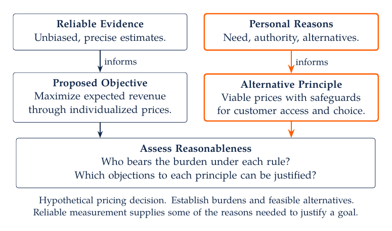

### 9.34.5 Pricing and Public Reassurance

\noindent Personalized pricing, dynamic pricing, and public reassurance about data centers share a question about whose reasons enter a decision. The practices differ: personalization conditions prices on customer information, while dynamic pricing changes prices with time or market conditions and may offer the same current price to everyone. Public research communication changes the evidence people use to judge an infrastructure decision. Each can advance a legitimate purpose. Each also requires scrutiny when commercial success or a favorable empirical result is used to settle the treatment of affected people.

In personalized pricing, the contested step connects predicted acceptance to authority to charge the predicted amount. A dependent customer can rationally purchase while reasonably objecting to avoidable exploitation. In dynamic pricing, a statement emphasizing discounts leaves the full price path, eligibility, notice, and customer alternatives to be assessed. Wendy's documented statement in §9.31 provides a communication case; whether an implemented policy harms customers requires evidence of that policy. Revenue gains and successful persuasion are insufficient to justify concealed conditions or the use of dependence.

For the data-center case, first preserve the statistical criticism: the reported nonrejections do not establish negligible effects, and the public interpretation must match the paper's tables. Then grant, hypothetically, exact knowledge of the narrow historical average-price effect. Household bills, future infrastructure allocations, failed projects, and opportunities to contest those allocations remain distinct questions. The institutional mechanisms in §9.26 and utility disclosures in §5.27 identify evidence relevant to them. Nearby residents, utility customers, and eventual cost bearers also need separate identification. Perfect estimation of the narrow effect would leave those moral and institutional questions open.

A firm may have an instrumental reason to secure acceptance; affected people have reasons to receive a defensible account of what they are accepting. Compare a principle allowing selected favorable evidence to close debate with one requiring proportionate substantiation, clear scope, and answers to material objections. The latter also faces objections about delay and resource costs. Defend a feasible standard that considers those burdens while preserving affected people's standing. The shared moral issue concerns whether commercial or institutional power is accompanied by reasons that others can reasonably accept. Similarities among the cases do not establish identical harms, motives, or legal violations.

## 9.35 Identical Tested Demand and Opposite Welfare Conclusions

\noindent A manager may ask whether a personalized price schedule benefits customers overall. Suppose a synthetic market contains 60% L and 40% H customers. An experiment reveals the following population purchase probabilities exactly. The three tested prices are $5, $10, and $20; there is no sampling error in this construction.

| Group | $5 | $10 | $20 |
|---|---:|---:|---:|
| L | 0.90 | 0.50 | 0.10 |
| H | 0.95 | 0.80 | 0.50 |

Compare a uniform $10 price with a candidate schedule charging L $5 and H $20. These are specified policies, not estimated optimal prices. Expected revenue rises from $6.20 to $6.70 per eligible person under either demand completion below. Both completions fit every probability in the table and therefore imply the same likelihood for any binary purchase sample collected exclusively at those prices.

\begin{assumption}[Demand and Money-Metric Surplus]
\label{assumption:pricing-completions}
Each customer buys at most one unit, has quasilinear utility in money, and faces a stable reservation value. Demand is weakly decreasing in price. The synthetic demand curves are continuous and piecewise linear between their stated knots, and reach zero at \$30.
\end{assumption}

Under Assumption \ref{assumption:pricing-completions}, the change in expected customer surplus is an area under demand. For a price increase from $a$ to $b$, the loss per eligible member of group $g$ is

$$
\ell_g(a,b)=\int_a^b q_g(p)\,dp.
$$

Here $q_g(p)$ is the purchase probability at price $p$; the area has units of dollars per eligible group member. The loss depends on demand between the endpoints. The observed endpoint probabilities restrict this area without uniquely determining it.

In completion A, L demand falls from 0.90 to 0.50 between $5 and $5.10, while H demand remains at 0.80 until $19.90 before falling to 0.50 at $20. In completion B, L demand remains at 0.90 until $9.90, while H demand falls to 0.50 by $10.10. All other plotted endpoint values agree. The narrow transition intervals make the contrast visible while preserving continuous demand.

| Completion | L Gain per Member | H Loss per Member | Population Surplus Change |
|---|---:|---:|---:|
| A | $2.520 | $7.985 | −$1.682 |
| B | $4.480 | $5.015 | +$0.682 |

Monotonicity alone bounds the population change between −$1.70 and +$0.70. A price model selects a shape within, or more restrictively than, this set. Comparing fitted model classes and expanding experimental price support can narrow the uncertainty. A favorable interpolation is consequential evidence about an assumption, even if its prediction score ties an unfavorable interpolation at every tested price.

The H group loses surplus in both completions. An aggregate sign reversal therefore leaves an identifiable distributional concern intact. These calculations establish a specific identification problem under finite price support; they do not establish a direction of bias in the published pricing estimates (Dubé and Misra, 2021). The logit specification supplies structure that the endpoint probabilities alone lack. The appropriate scrutiny is whether the welfare conclusion survives defensible alternative structure, price support, and treatment of affected people.

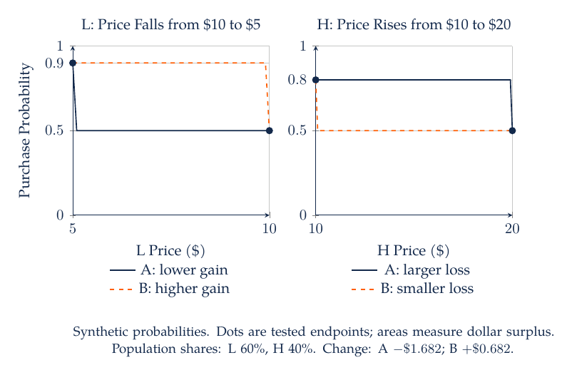

Run from the repository root:

```bash
python3 03_Data_and_Code/AI_Experimentation_and_Pricing/compare_demand_completions.py
```
 The program integrates the piecewise-linear curves exactly and saves the endpoints, knots, group changes, and monotonicity bounds.


Python source: [compare_demand_completions.py](../../03_Data_and_Code/AI_Experimentation_and_Pricing/compare_demand_completions.py)

```python
"""Two synthetic demand completions match every tested purchase probability.

Unit demand, quasilinear money utility, stable demand, prices in dollars.
Run: python3 03_Data_and_Code/AI_Experimentation_and_Pricing/compare_demand_completions.py
"""
import json
from fractions import Fraction as F
from pathlib import Path

ROOT = Path(__file__).resolve().parent
WEIGHTS = {"L": F(3, 5), "H": F(2, 5)}
OBSERVED = {"L": {5: F(9, 10), 10: F(1, 2), 20: F(1, 10)},
            "H": {5: F(19, 20), 10: F(4, 5), 20: F(1, 2)}}


def curves(world):
    if world not in ("negative_change", "positive_change"):
        raise ValueError("Unknown synthetic completion.")
    low_knot = (F(51, 10), F(1, 2)) if world == "negative_change" else (F(99, 10), F(9, 10))
    high_knot = (F(199, 10), F(4, 5)) if world == "negative_change" else (F(101, 10), F(1, 2))
    return {"L": [(F(0), F(1)), (F(5), F(9, 10)), low_knot,
                  (F(10), F(1, 2)), (F(20), F(1, 10)), (F(30), F(0))],
            "H": [(F(0), F(1)), (F(5), F(19, 20)), (F(10), F(4, 5)),
                  high_knot, (F(20), F(1, 2)), (F(30), F(0))]}


def integral(points, left, right):
    """Exact trapezoid integral on a piecewise-linear demand curve."""
    total = F(0)
    for (x0, y0), (x1, y1) in zip(points, points[1:]):
        a, b = max(left, x0), min(right, x1)
        if a < b:
            ya = y0 + (y1-y0) * (a-x0)/(x1-x0)
            yb = y0 + (y1-y0) * (b-x0)/(x1-x0)
            total += (b-a) * (ya+yb)/2
    return total


def calculate():
    results = {}
    for world in ("negative_change", "positive_change"):
        points = curves(world)
        gain = integral(points["L"], F(5), F(10))
        loss = integral(points["H"], F(10), F(20))
        results[world] = {"demand_points": points, "L_surplus_gain": gain,
                          "H_surplus_loss": loss,
                          "population_surplus_change": WEIGHTS["L"]*gain-WEIGHTS["H"]*loss}
    return {"data_type": "Synthetic population probabilities; no sample estimates",
            "observed_probabilities": OBSERVED, "worlds": results,
            "uniform_revenue": F(31, 5), "targeted_revenue": F(67, 10),
            "monotonic_surplus_change_bounds": [F(-17, 10), F(7, 10)]}


if __name__ == "__main__":
    out = ROOT / "scanlon_results"
    out.mkdir(exist_ok=True)
    (out / "demand_completions.json").write_text(json.dumps(calculate(), indent=2,
        default=lambda x: {"exact": str(x), "decimal": float(x)}) + "\n")
```

## 9.36 Majority Benefits and a Feasible Alternative

\noindent Return to the uniform-valuation model in §9.17, which is distinct from the endpoint construction in §9.35. A firm can choose the optimal uniform price, segmented prices, or a discount-only schedule capped at the optimal uniform price. The comparison holds population shares, valuation distributions, marginal cost, and the outside option fixed.

| Policy | Profit per Eligible Person | Customer Surplus per Eligible Person | Population Losing a Purchase |
|---|---:|---:|---:|
| Uniform | $6.0167 | $6.4750 | 0% |
| Segmented | $8.1000 | $3.4500 | 10% |
| Discount Only | $6.1333 | $6.6667 | 0% |

Segmentation benefits 60% of people through the lower L price. Each H member nevertheless loses $193/24, or $8.0417, in expected surplus; one quarter of H, equal to 10% of the population, ceases buying. The lower price gives each L member an expected gain of $23/72, or $0.3194. Counting winners treats these unequal amounts as equal votes and suppresses the distinction between a small gain and losing access.

The discount-only alternative makes the objection concrete. It preserves the L price reduction, increases profit by $0.1167 per eligible person relative to uniform pricing, and leaves H's offer unchanged. Choosing the segmented schedule instead earns an additional $1.9667 per eligible person. That opportunity cost is relevant to the firm's reasons, but it does not establish that imposing H's burden is necessary for service viability. The synthetic zero-cost model establishes a feasible comparison within its own setting; an empirical assessment must include fixed costs, capacity, and investment incentives.

A contractualist argument now requires a defended principle. Consider a principle allowing firms to exploit a customer's urgent need whenever doing so raises expected profit, even when a viable less burdensome offer exists. A person facing a serious avoidable deprivation has a strong reason to reject that principle. The competing objection must identify the people whose legitimate interests would be impaired by the alternative and the seriousness of that impairment. Additional shareholder income does not acquire unlimited moral weight because many shareholders receive it. Equally, a dollar loss to a comfortable customer cannot simply be relabeled an essential deprivation. The facts about need must be established.

A defensible conclusion is conditional and forceful: when the higher price exploits serious need, the lower offer remains viable, and no comparably serious countervailing burden is shown, the seller ought to adopt the less burdensome offer. Refusing to examine need while declaring the pricing rule justified would exclude the very facts on which the objection depends. The water-owner example makes a related distinction between a person's weak bargaining position and the strength of their claim to reasonable terms [(Scanlon, 1998, chapter 5, especially p. 192)](https://e-edu.nbu.bg/pluginfile.php/314831/mod_resource/content/0/scanlon_5.1-3.pdf).

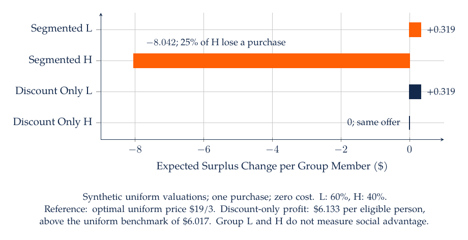

Run from the repository root:

```bash
python3 03_Data_and_Code/AI_Experimentation_and_Pricing/assess_personalized_pricing.py
```
 The output retains nonbuyers and reports group and population denominators separately. M6 §6.37 applies the same population to experimental exposure.


Python source: [assess_personalized_pricing.py](../../03_Data_and_Code/AI_Experimentation_and_Pricing/assess_personalized_pricing.py)

```python
"""Exact synthetic incidence: one purchase opportunity, dollars, zero cost.

Python 3.10+, standard library; imports the adjacent pricing example.
Run: python3 03_Data_and_Code/AI_Experimentation_and_Pricing/assess_personalized_pricing.py
"""
import json
from fractions import Fraction as F
from pathlib import Path
from evaluate_pricing import GROUPS, best_uniform, demand, evaluate, surplus

ROOT = Path(__file__).resolve().parent


def calculate():
    base = best_uniform(list(GROUPS.values()))
    segmented = {g: best_uniform([cell]) for g, cell in GROUPS.items()}
    policies = {"uniform": {g: base for g in GROUPS},
                "segmented": segmented,
                "discount_only": {g: min(p, base) for g, p in segmented.items()}}
    totals, incidence = {}, []
    for policy, prices in policies.items():
        totals[policy] = {"prices": prices, **evaluate(prices, base)}
        for g, (weight, lo, hi) in GROUPS.items():
            q0, q1 = demand(base, lo, hi), demand(prices[g], lo, hi)
            delta = surplus(prices[g], lo, hi) - surplus(base, lo, hi)
            incidence.append({"policy": policy, "group": g,
                              "population_share": weight, "price": prices[g],
                              "surplus_change_per_group_member": delta,
                              "population_surplus_contribution": weight * delta,
                              "lost_purchase_share_within_group": max(F(0), q0-q1),
                              "population_lost_purchase_share": weight * max(F(0), q0-q1)})
    return {"data_type": "Synthetic uniform valuations; all eligible people included",
            "benchmark_price": base, "policies": totals, "incidence": incidence,
            "foregone_profit_from_cap_per_eligible":
                totals["segmented"]["profit_per_eligible_customer"] -
                totals["discount_only"]["profit_per_eligible_customer"],
            "moral_scope": "Amounts inform reasons; no numerical moral verdict"}


if __name__ == "__main__":
    out = ROOT / "scanlon_results"
    out.mkdir(exist_ok=True)
    (out / "incidence.json").write_text(json.dumps(calculate(), indent=2,
        default=lambda x: {"exact": str(x), "decimal": float(x)}) + "\n")
```

## 9.37 Mobile Targeting and Authority Over Customer Information

\noindent A theater can use a person's current location and past visits to choose a coupon. A randomized mobile promotion experiment studies two competing theaters (Dubé et al., 2017). Its historical-visit classification uses at least 90 minutes of dwell time and a preceding two-month window; the sample contains 18,000 subscribers across 36 cells. Promotional voucher purchases and control-group inferred visits are different measurement procedures. The authors acknowledge that vouchers were not observed at redemption and that the untreated control also lacks an SMS promotion. These details matter when interpreting a purchase response as a price effect or a completed movie visit. [Published article, §§3–4](https://www.fox.temple.edu/sites/fox/files/competitive-price-targeting-pub.pdf).

### 9.37.1 What the Published Game Establishes

\noindent Table 9 reports expected revenue per messaged consumer for each combination of targeting choices. Reconstructing the best responses from its rounded entries yields one pure-strategy equilibrium: both theaters select behavioral targeting. Compared with uniform pricing, theater A gains RMB 0.019 and theater B gains RMB 0.035 per messaged consumer, approximately 0.97% and 1.20%. Theater A's advantage over a geobehavioral deviation when B uses behavioral targeting is only RMB 0.001 in the rounded table. The paper reports a 40% posterior probability that this deviation would improve A's profit. The rounded optimum is consequently distinct from certainty about the strategic ranking [(Dubé et al., 2017, Table 9 and discussion, p. 965)](https://doi.org/10.1287/mksc.2017.1042).

A Nash equilibrium describes incentives given the modeled strategies and payoffs. The customer's authority over the use of location history is absent from this payoff matrix. Reconstructing the equilibrium therefore cannot settle that authority. Nor does a modeled softening of price competition establish an unlawful agreement. The same arithmetic can appear in an analysis of independent strategic conduct, and a legal case needs evidence about how the firms actually coordinate or compete.

Run from the repository root:

```bash
python3 03_Data_and_Code/AI_Experimentation_and_Pricing/reconstruct_competitive_targeting.py
```
 The program reads `competitive_payoffs.json`, which transcribes the 16 rounded payoff pairs from Table 9. It reconstructs the published-table calculation; it does not re-estimate demand or reproduce posterior uncertainty from individual records.[^replication-terms]


Python source: [reconstruct_competitive_targeting.py](../../03_Data_and_Code/AI_Experimentation_and_Pricing/reconstruct_competitive_targeting.py)

```python
"""Best responses from published rounded Table 9, not microdata replication.

Python 3.10+, standard library. Units are RMB revenue per messaged consumer.
Run: python3 03_Data_and_Code/AI_Experimentation_and_Pricing/reconstruct_competitive_targeting.py
"""
import json
from fractions import Fraction as F
from pathlib import Path

ROOT = Path(__file__).resolve().parent


def calculate():
    source = json.loads((ROOT / "competitive_payoffs.json").read_text())
    names = source["strategies"]
    a = [[F(cell[0]) for cell in row] for row in source["payoffs"]]
    b = [[F(cell[1]) for cell in row] for row in source["payoffs"]]
    n = len(names)
    best_a = {names[j]: [names[i] for i in range(n)
                         if a[i][j] == max(a[k][j] for k in range(n))] for j in range(n)}
    best_b = {names[i]: [names[j] for j in range(n)
                         if b[i][j] == max(b[i])] for i in range(n)}
    equilibria = [(names[i], names[j]) for i in range(n) for j in range(n)
                 if names[i] in best_a[names[j]] and names[j] in best_b[names[i]]]
    return {"source": source["source"], "units": source["units"],
            "best_responses_A": best_a, "best_responses_B": best_b,
            "pure_equilibria_from_rounded_payoffs": equilibria,
            "behavioral_vs_uniform_revenue_gains":
                {"A": a[2][2]-a[0][0], "B": b[2][2]-b[0][0]},
            "relative_gains": {"A": a[2][2]/a[0][0]-1, "B": b[2][2]/b[0][0]-1},
            "A_behavioral_vs_geobehavioral_gap_when_B_behavioral": a[2][2]-a[3][2],
            "scope": "Static estimated game; no posterior draws, privacy values, or permission measure"}


if __name__ == "__main__":
    out = ROOT / "scanlon_results"
    out.mkdir(exist_ok=True)
    (out / "competitive_targeting.json").write_text(json.dumps(calculate(), indent=2,
        default=lambda x: {"exact": str(x), "decimal": float(x)}) + "\n")
```

### 9.37.2 Specify the Maxim Before Judging the Practice

\noindent Consider the hypothetical maxim: use a customer's location history to increase revenue while concealing a material use that the customer would otherwise have a meaningful opportunity to refuse. The moral objection concerns the deliberate defeat of informed choice. Under the Formula of Humanity, treating someone merely as a means concerns how their rational agency enters the action, not merely whether the firm obtains a benefit. A transaction can benefit both parties while deception prevents one party from authorizing a material feature of it. The discussion of false promising also makes the agent's reliance on another person's mistaken understanding relevant to universalization [(Kant, 1785, Academy 4:421–430)](https://www.earlymoderntexts.com/assets/pdfs/kant1785.pdf).

The published payoff table does not establish that the hypothetical concealment occurred. A factual assessment would examine notices, permissions, data provenance, secondary uses, retention, and the possibility of refusing tracking while obtaining service. An opt-in program offering understandable discounts and usable alternatives poses a different maxim. Profit seeking and differentiated prices alone are insufficient to establish treatment merely as a means. The criticism becomes strongest when it identifies an actual mechanism that bypasses deliberation or exploits dependence, and then demonstrates that a feasible practice respects those capacities.

A company could answer that location targeting provides valuable discounts and more relevant offers. That defense supports a benefit claim. To support a claim of permissible conduct, it must also explain the authority to use the information and the treatment of people who decline. Making benefits conditional on avoidable surrender of control can itself be objectionable when the person lacks a reasonable alternative. An offered discount does not purchase an unrestricted moral license over the recipient's history.

### 9.37.3 Reasons for Restricting Independent Scrutiny

\noindent People affected by a pricing recommendation have reasons to want independent examination of the evidence used to justify it. A restriction requiring permission for additional analysis or narrowing the outlet for a corrective result places control over scrutiny with parties connected to the original research. Authors and data providers may invoke privacy, contractual obligations, or protection against misleading reuse. Each reason should be connected to the particular restriction it is claimed to justify.

Privacy can support removing identifiers, secure access, or review for disclosure risk. Those measures do not by themselves require control over a critic's conclusion or choice of publication venue. If a narrower safeguard protects the relevant interests while permitting competent independent assessment, a broader restriction faces a reasonable objection from affected people and researchers. The ethical criticism concerns whether the restriction is necessary and proportionate to a defensible purpose. Its existence alone does not establish that the underlying analysis is wrong.

## 9.38 Pricing Evidence in a U.S. Antitrust Case

\noindent An investigator considering a firm that uses individualized pricing needs to identify the conduct said to restrict competition. A paper on profitable targeting can supply hypotheses, estimands, and methods for evaluating effects. Publication, citation, or adoption of the method supplies no inference that its authors or users joined an unlawful scheme. The legal comparison must concern the defendant's conduct, the relevant market, and the claimed injury.

### 9.38.1 Agreement, Exclusion, and Differential Prices

\noindent Section 1 of the Sherman Act requires concerted conduct. In *Bell Atlantic v. Twombly*, 550 U.S. 544, 553–557 (2007), the Court distinguishes parallel behavior from facts plausibly suggesting agreement. For a shared pricing service, relevant evidence could include agreements to exchange competitors' sensitive nonpublic data, commitments governing recommendations, communications about pricing, and mechanisms discouraging independent reductions. A vendor's presence or correlated prices alone does not decide the issue. [*Twombly*, majority opinion](https://www.law.cornell.edu/supct/html/05-1126.ZO.html).

Section 2 requires monopoly power and exclusionary conduct for a monopolization claim. *Verizon v. Trinko*, 540 U.S. 398, 407 (2004), explains why monopoly pricing by itself is insufficient. A theory involving targeted exclusion must establish its own mechanism and legal requirements; a high personalized price does not supply them. Robinson–Patman has a different scope: its price-discrimination provisions concern qualifying sales of commodities and competitive injury, with defenses including cost justification and meeting competition. Recruitment services and movie admissions do not become covered commodities simply because their prices differ across customers. [*Trinko*](https://www.law.cornell.edu/supremecourt/text/02-682); [FTC guidance](https://www.ftc.gov/advice-guidance/competition-guidance/guide-antitrust-laws/price-discrimination-robinson-patman-violations).

Ezrachi and Stucke (2017) distinguish algorithms that carry out an existing agreement, a common intermediary, predictable strategic responses, and autonomous learning. Their taxonomy helps organize competing mechanisms and the evidence each requires. The possibility of tacit coordination creates a policy question where existing agreement requirements may leave a gap. It does not convert every independent pricing algorithm into an established Section 1 violation. [“Artificial Intelligence & Collusion,” §§III–IV](https://illinoislawreview.org/print/vol-2017-no-5/artificial-intelligence-collusion/).

### 9.38.2 A Hypothetical Investigation

\noindent Suppose competing service firms use a common vendor. The allegation is that they agree to pool recent confidential transaction data and accept recommendations that suppress independent price cuts. Request the contracts, feature definitions, data timestamps, pricing logs, overrides, and communications. Preserve version histories so that a recommendation can be linked to the information available when it was made. Compare the alleged arrangement with a feasible world in which each firm chooses independently using its own permitted information and lawful public information.

Estimate net prices, quantities, entry, switching, and customer-specific burdens under that comparison. Randomized price variation can identify demand responses in its support; identifying the effect of the challenged coordination requires variation or structural restrictions tied to that conduct. If adoption responds to declining demand, a before-and-after price comparison mixes the conduct with the adoption decision. If rival responses spill into control markets, treating those controls as unaffected can conceal part of the effect. Firm or market clustering and pre-specified subgroup definitions should follow the actual assignment and dependence structure.

Flexible customer effects require particular care. A stable pre-conduct customer effect can control legitimate heterogeneity. A model that explains every post-adoption price increase through newly fitted customer types may absorb the mechanism under investigation. Similarly, post-conduct willingness to pay can reflect reduced alternatives caused by the alleged arrangement. Holding that state fixed in the lawful counterfactual would preserve part of the alleged harm. Assess feature timing, overlap, invariance, rival substitution, and fit across competing counterfactual models. This is a specified risk of an analytical design, not a universal defect of flexible demand models.

The RealPage litigation supplies a documented example of allegations about nonpublic information and pricing alignment. DOJ's November 24, 2025 Competitive Impact Statement describes those allegations and proposed restrictions on runtime inputs, model training, and price-alignment features. The DOJ case page checked November 26, 2026 continues to label the RealPage document a proposed final judgment and separately lists an entered Greystar judgment dated March 2, 2026. A proposal and an entered judgment have different status; neither is a finding that any firm using personalized-pricing or targeting methods violated the law. [DOJ case record](https://www.justice.gov/atr/case/us-and-plaintiff-states-v-realpage-inc); [RealPage Competitive Impact Statement, §§II–III](https://www.justice.gov/atr/media/1419471/dl?inline=).

### 9.38.3 Revenue, Overcharge, and Excluded Customers

\noindent Suppose an invented service market would sell 100 units at a lawful counterfactual price of $100, while the challenged conduct yields 92 sales at $120. Assume for the arithmetic that the entire $20 price difference is attributable to the challenged conduct. Revenue rises from $10,000 to $11,040. The signed invoice difference on the 92 actual purchases is $1,840. Revenue growth of $1,040 subtracts the $800 associated with eight fewer units at the benchmark price; it understates that invoice difference.

For actual purchased quantities $q_i$ and prices $p_i$, the relevant arithmetic is

$$
D=\sum_i q_i(p_i-p_i^{\mathrm{lawful}}).
$$

The counterfactual $p_i^{\mathrm{lawful}}$ is the price for the same relevant transaction absent the challenged unlawful conduct. A revenue-maximizing uniform monopoly price from §9.17 is not automatically that benchmark. At $110, the illustrative invoice difference falls to $920; at $120 it is zero. Eight excluded purchases also matter for welfare and a Scanlonian assessment, but their lost surplus cannot be recovered from invoice arithmetic without further information about valuations and alternatives. Legal standing and available relief require separate analysis.

*Brunswick v. Pueblo Bowl-O-Mat*, 429 U.S. 477, 489 (1977), requires injury of the kind antitrust law protects against that flows from the anticompetitive aspect of the conduct. *Comcast v. Behrend*, 569 U.S. 27, 35–38 (2013), requires the damages model in that class-certification setting to match the accepted liability theory. Together they discipline the move from an observed loss to a legally attributable damages claim. [*Brunswick*](https://www.law.cornell.edu/supremecourt/text/429/477); [*Comcast*](https://www.law.cornell.edu/supremecourt/text/11-864).

Run from the repository root:

```bash
python3 03_Data_and_Code/AI_Experimentation_and_Pricing/compare_pricing_damages.py
```
 The program checks the revenue decomposition and varies the assumed lawful price. All values are synthetic; the output is untrebled arithmetic under explicit counterfactuals.


Python source: [compare_pricing_damages.py](../../03_Data_and_Code/AI_Experimentation_and_Pricing/compare_pricing_damages.py)

```python
"""Synthetic invoice arithmetic under an assumed lawful price counterfactual.

One period, identical service units, USD. No actual firm, violation, or damages estimate.
Run: python3 03_Data_and_Code/AI_Experimentation_and_Pricing/compare_pricing_damages.py
"""
import json
from fractions import Fraction as F
from pathlib import Path

ROOT = Path(__file__).resolve().parent


def calculate(but_for_price=F(100), paid_price=F(120),
              actual_units=92, but_for_units=100):
    if min(but_for_price, paid_price, actual_units, but_for_units) < 0:
        raise ValueError("Prices and quantities must be nonnegative.")
    gap = paid_price - but_for_price
    revenue_change = paid_price*actual_units - but_for_price*but_for_units
    return {"assumed_lawful_but_for_price": but_for_price, "paid_price": paid_price,
            "actual_units": actual_units, "assumed_but_for_units": but_for_units,
            "signed_invoice_difference": gap * actual_units,
            "revenue_change": revenue_change,
            "quantity_component_at_but_for_price": but_for_price*(actual_units-but_for_units),
            "unserved_units": max(0, but_for_units-actual_units)}


if __name__ == "__main__":
    results = {"data_type": "Invented invoices and counterfactuals, not estimated damages",
               "central": calculate(),
               "benchmark_sensitivity": {str(p): calculate(F(p)) for p in [95, 100, 110, 120]},
               "scope": "Attribution to unlawful conduct must be established separately; no trebling"}
    out = ROOT / "scanlon_results"
    out.mkdir(exist_ok=True)
    (out / "damages.json").write_text(json.dumps(results, indent=2,
        default=lambda x: {"exact": str(x), "decimal": float(x)}) + "\n")
```

## 9.39 Antitrust Institutions and Reasonable Rejection

\noindent A person facing coordinated prices can object that nominal choice among sellers no longer provides meaningful independent alternatives. The burden includes the extra payment, time spent searching, and the possibility of losing access. A Scanlonian argument asks whether a principle permitting that coordination can be justified to people in that position compared with feasible rules protecting independent choice. The strength of the objection depends on the good, the person's circumstances, and the available alternatives. Market participation gives a firm information about demand; it does not erase the participant's standing to demand reasons.

### 9.39.1 Connect Each Legal Requirement to a Reason

\noindent The agreement requirement separates a firm's independent decisions from a restriction jointly imposed by competitors. A contractualist argument for rules against coordinated extraction appeals to each person's interest in meaningful alternatives and fair terms of cooperation. The firms' objections may invoke service costs, useful forecasting, security, and investment. Those interests support examining less restrictive arrangements, such as analytics using a firm's own data, while preserving the ability to offer independent discounts. Whether a particular arrangement is lawful still depends on the governing doctrine and evidence.

Causal attribution and damages requirements also protect persons. A customer has a reason to seek a remedy for an attributable loss. Workers, owners, and other customers of an accused firm have reasons to reject sanctions based on unsupported accusations or losses caused by unrelated events. A rigorous counterfactual protects both positions. This does not require customers to prove every moral concern through a completed lawsuit; it explains why suspicion, a moral objection, a pleading, a liability finding, and a damages award carry different evidentiary burdens.

An aggregate welfare improvement supplies a further objection to consider, rather than an automatic answer. A large number of modest benefits may coexist with serious avoidable harm to an identifiable person. Conversely, preventing every differentiated price could remove discounts or make valuable service unviable. Compare principles that specify permissible information, customer authority, price safeguards, and opportunities for redress. The relevant question is whether anyone has a reasonable objection to the general rule in light of the alternatives, including people excluded from the transaction data.

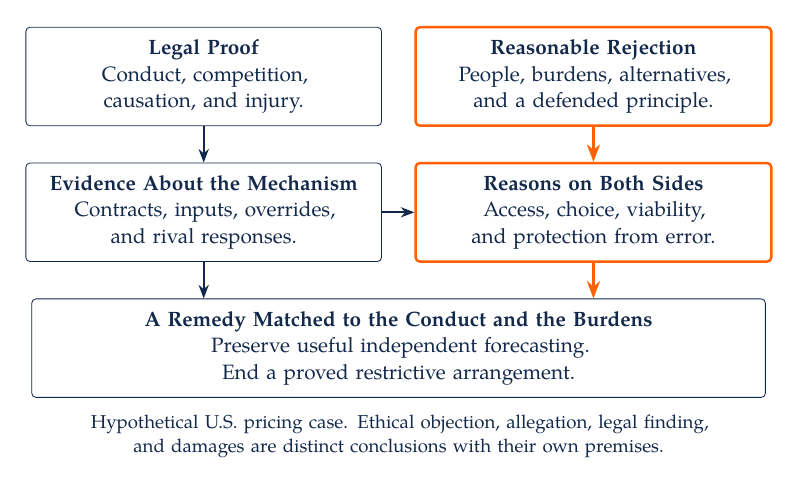

### 9.39.2 A Worked Argument for a Remedy

\noindent Suppose an investigation establishes an agreement suppressing independent discounts, a resulting $20 overcharge, and a feasible remedy allowing useful forecasting while ending the restrictive exchange. The factual premise identifies the coordinated restriction and attributable burden. The normative premise is that firms ought to preserve meaningful independent alternatives when restricting them imposes avoidable substantial burdens and no comparably serious interest requires the restriction. The conclusion is that the firms ought to end the restrictive arrangement and support an appropriate remedy for attributable harm. A legal remedy additionally requires the court's findings and the applicable remedial standards.

The strongest defense would identify a concrete benefit that depends on the challenged feature, explain why a less restrictive arrangement cannot provide it, and state who would bear the burden of removal. The response should evaluate that claim with cost, service, and market evidence. If the feature merely increases extraction while the useful forecasting remains available without it, the proposed defense fails on its own necessity premise. If removal would cause serious service losses, the principle or remedy requires further comparison. Reasonable rejection is a discipline of giving and answering reasons; it is not a numerical loss threshold or an unconditional personal veto.

### 9.39.3 Legal Permission and What a Firm Ought to Do

\noindent U.S. antitrust law does not prohibit every form of unilateral exploitation. That legal boundary can leave a pricing practice open to a powerful moral objection. A seller may comply with the agreement requirement while using inferred urgency to impose an avoidable burden on someone with weak alternatives. The person can reasonably demand a justification even when a Section 1 case fails. Equally, a Kantian objection to concealed tracking does not supply the missing agreement element.

Institutional reform must also answer objections. A proposed rule could require documented independent pricing, a usable option to refuse secondary data use, preservation of decision logs, and accessible complaint handling. Students should specify who pays the compliance cost, whether the rule preserves useful discounts, how the affected person can challenge errors, and whether the remedy reaches those excluded from buying. The moral case for reform draws on these reasons. It cannot be established solely by the profitability of the practice or by the fact that existing law permits it.

[^replication-terms]: The [INFORMS download terms](https://services.informs.org/dataset/mksc/download.php?doi=mksc.2017.1042), checked November 26, 2026, permit verification of the main results using the same data and models. They restrict other uses without author or data-originator permission and direct follow-up articles correcting central results to *Marketing Science*. These conditions narrow independent reuse and publication routes for critical assessment; they do not prohibit every critical replication.

## 9.40 Logical Consequence and a Defensible Recommendation

\noindent A firm asks whether a successful analytical result justifies deploying a pricing system. The result may establish accurate purchase predictions, a causal revenue gain, or a conditional welfare comparison. A recommendation adds a claim about the action the firm ought to take. Its credibility depends on the premises connecting these objects and the reasons supporting those premises. Critical analysis should expose that connection precisely enough for an affected person to challenge it.

### 9.40.1 Validity, Soundness, and Evidential Support

\noindent A deductively valid argument preserves truth: true premises cannot yield a false conclusion. Soundness requires both validity and true premises. Consider the argument, “Every revenue-increasing practice ought to be adopted; this practice increases revenue; therefore it ought to be adopted.” The inference is valid under the stated meanings. Its first premise grants priority to revenue regardless of other people's burdens and requires an ethical defense. Precise evidence for the revenue premise leaves that defense open.

Principles connecting logical consequence to norms governing belief and reasoning require separate justification. The course application separates a valid inference from entitlement to accept its premises. When a conclusion conflicts with strong evidence, revising a premise may be appropriate. Treating every implication of an accepted model as an established fact would skip that assessment [(MacFarlane, 2004, §§2–4)](https://johnmacfarlane.net/normativity_of_logic.pdf).

Empirical support also requires attention to the form of the claim. A confidence interval is a sampling procedure with stated coverage under its assumptions. It does not guarantee that its realized endpoints contain the parameter. An ordinary empirical conclusion may remain defeasible because further evidence can change its support. Requiring an impossible deductive guarantee would misdescribe that conclusion. The appropriate criticism identifies the unsupported strengthening, such as turning an imprecise average estimate into categorical reassurance for every household.

### 9.40.2 The Question and the Meaning of Its Terms

\noindent An analyst can assemble an accurate answer to a question that omits the decisive issue. “Which customers accept a higher price?” leaves the reason for accepting unresolved. Urgent need, valuable service, and weak alternatives can each matter for the customer's objection. “Does an average electricity-price estimate differ from zero?” leaves open a question about household exposure to future cost recovery. State the question answered by the result and the additional question required by the proposed decision.

Distinguishing information conveyed from issues raised by an expression motivates examining reasoning through questions and answers. This approach asks which alternatives an inquiry keeps open and when a partial answer is treated as complete. Applying that discipline to a managerial brief does not establish a psychological mechanism in a particular analyst or AI system [(Ciardelli et al., 2018, §§2.3–2.5)](https://fdslive.oup.com/www.oup.com/academic/pdf/openaccess/9780198814788.pdf); [(Koralus and Mascarenhas, 2013, §§1–2)](https://doi.org/10.1111/phpe.12029).

| Expression in an Argument | Distinction That Requires Support |
| --- | --- |
| High willingness to pay | Ability to pay, benefit, and acceptable treatment are separate claims. |
| Continued subscription | The recorded state may coexist with attempted withdrawal or an obstructed exit. |
| Average revenue per kWh | Household bills also depend on quantities, charges, customer class, and timing. |
| No operating facility added | Earlier commitments or failed projects can still create exposure; actual exposure needs evidence. |
| A feasible customer option | Availability, knowledge, practical ability, and authority to use the option differ. |

The same words must retain the same meaning through an argument. A question's wording alone does not establish that different customers understand it alike. Conversely, different wording can express the same issue. Record the operational definition and examine how the classification changes under defensible alternatives. Calling a purchase “consent” incorporates a substantive interpretation that a transaction count does not independently verify.

Possibility, actuality, knowledge, permission, and obligation also require separate premises. A procedure can be technically feasible while unauthorized. A person can have a formal option without knowing how to exercise it. An action can be permissible without being required. The statement that an action is permissible is a necessary condition of its being obligatory in ordinary duty reasoning; permission alone supplies no obligation. Specify the relevant sense of “can,” “may,” and “ought” before drawing a conclusion.

### 9.40.3 Compatibility, Identification, and Valuation

\noindent The price construction in §6.38 grants exact agreement with the historical joint law and obtains different intervention effects. It isolates the additional assumption needed to turn representation into identification. The valuation construction in §4.29 grants the purchase effects themselves and holds the ordinal ranking fixed, yet obtains opposite consumption gains. It isolates a second premise: how much the ranked outcomes are worth. Resolving the first problem would leave the second as a separate question.

A useful sensitivity analysis changes one maintained restriction at a time and records what conclusion survives. Removing a restriction enlarges the class of compatible models; adding evidence or a defensible restriction can narrow it. Check that the restricted class remains nonempty. An inconsistent set of assumptions and observations supports no feasible economic explanation. Narrow bounds obtained by imposing a strong restriction should retain that restriction beside the conclusion.

Statistical precision concerns variation in an estimator under a specified sampling design. Identification concerns what the observable law and maintained restrictions determine. Ethical justification concerns reasons for a principle governing action. A narrow standard error can coexist with an unidentified target or an indefensible objective. The analyst should identify which problem an additional observation, model restriction, or normative argument actually resolves.

### 9.40.4 Construct and Repair an Argument

\noindent Begin with a claim narrow enough to test, identify its premises, and search for a counterexample that preserves them. The five steps in §1.20 provide a repeatable sequence. A counterexample can reveal an invalid deduction; its relevance to the actual setting requires further investigation. A criticism should say which of those tasks it has completed.

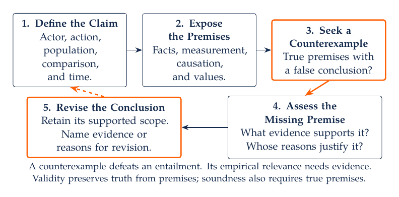

The five boxes distinguish defining the claim, exposing premises, constructing a counterexample, assessing an additional premise, and revising the conclusion. The return arrow makes the revision explicit. Factual and causal premises need evidence; normative premises require reasons. The same sequence applies to the initial recommendation and its criticism.

For the electricity case, take the proposed inference from a statistically insignificant average-price result to reassurance about household costs. A counterexample can preserve nonrejection while allowing an economically meaningful effect, or preserve a flat unit price while household charges rise. Sections 6.33–6.35 and 9.27 give the source assessment and complete calculations. The missing premises concern test sensitivity, the mapping from the measured outcome to household costs, the relevant population, and the time horizon. The defensible conclusion retains the uncertainty and the actual outcome measured.

The critic must apply the same discipline to a stronger accusation. An insensitive test does not prove a positive effect or show that low power uniquely caused the observed nonsignificance. A hypothetical cancelled project does not establish contamination of the study's actual controls. A public statement exceeding its evidence does not establish deliberate deception. Establishing those conclusions requires evidence on effects, project histories, or intent. The supported criticism can still be consequential: an institution using unresolved evidence to dismiss a material concern owes affected people a better justification.

### 9.40.5 From a Conditional Result to an Ought Conclusion

\noindent Consider a hypothetical personalized price for an essential service. Suppose the analysis reliably predicts acceptance, and independent evidence shows that some buyers face urgent need, weak alternatives, and a substantial burden. Suppose a feasible pricing rule could meet legitimate operating needs while imposing a smaller burden. These factual premises make the person's objection relevant even when acceptance is instrumentally rational.

A proposed normative principle is that a firm ought to justify avoidable substantial burdens to the people who bear them, comparing feasible ways of meeting legitimate needs. A Scanlonian assessment asks whether those people could reasonably reject the principle permitting the practice relative to the alternative principle. Buyers' reasons must be assessed alongside the interests of other customers, workers, and providers. The conclusion under the stated circumstances is that predicted acceptance alone supplies an inadequate justification for the more burdensome rule. A recommendation to adopt the alternative additionally depends on the evidence and reasons supporting its feasibility and comparative burdens [(Scanlon, 1998, chapter 5, §§1–3)](https://e-edu.nbu.bg/pluginfile.php/314831/mod_resource/content/0/scanlon_5.1-3.pdf).

The same structure connects dynamic-pricing communication and data-center reassurance. Acceptance of a favorable description leaves the accuracy and completeness of that description to be examined. Agreement with a prestigious source leaves the support for its inference to be examined. In each setting, name the people affected, the decision being justified, the alternatives available, and the premise that converts the analytical result into permission to act.

### 9.40.6 Evidence and Reasons That Would Change the Conclusion

\noindent A strong criticism identifies a meaningful route to revision. For the common-price example, valid randomized observations at the missing group–price combinations would distinguish the two specified models. For the valuation example, independent evidence supporting the monetary value gaps and procedural burdens could narrow the welfare conclusion. For the electricity case, a credible design, sufficiently informative uncertainty bounds, matched household outcomes, and documented cost-allocation protections could support a more reassuring interpretation within their scope.

Normative conclusions also remain answerable to reasons. A necessary security measure, an unavailable alternative, or a serious burden imposed on other people can change the justification of a proposed rule. The analyst should assess these objections in their strongest supported form. Critical analysis earns its force by stating what follows, why it follows, and what would require changing the conclusion.

## 9.41 Phenomena, Noumena, and the Ends of Analysis

\noindent A pricing system can predict a person's purchase with great accuracy while leaving the justification for imposing that price unresolved. A utility study can estimate an average outcome while leaving residents' claims to information, participation, and protection unanswered. These are fundamental questions about what an analysis is for and what authority its results possess. Ease of observation gives a quantity a practical advantage in research; it supplies no independent reason to let that quantity determine the ends of the inquiry.

### 9.41.1 Empirical Knowledge and Its Limits

\noindent Objects as they appear under the conditions of human cognition differ from things considered independently of those conditions (Kant, 1781/1787). Phenomena are objects of possible experience, whose investigation can produce genuine empirical knowledge. The distinction is more demanding than a separation between superficial appearances and a hidden variable waiting to be estimated.

In the negative sense, a noumenon is a thing considered apart from our sensible mode of intuition. In the positive sense, it would be an object of a nonsensible intuition. Human theoretical cognition lacks the intellectual intuition needed for that positive use under this account. The concept has a limiting role: empirical cognition does not establish a complete account of things as they are independently of its conditions. These distinctions appear in the *Critique of Pure Reason*, B306–B311, within “The Ground of the Distinction of All Objects in General into Phenomena and Noumena.” [(Kant, 1781/1787)](../../01_Resources/15_Marketing_Dialectics/01_Kant_Primary_Texts/public_domain_texts/Kant_CritiqueOfPureReason_Meiklejohn1855.html).

Acknowledging noumena therefore changes the ambition of the analytical claim. A model can represent behavior under specified conditions without exhausting the person represented. Larger samples and more flexible functions can improve that empirical representation. They supply no warrant for claiming theoretical knowledge of a noumenal self or for equating the person with the fitted representation. The precise relationship between appearances and things in themselves is disputed in interpretations of transcendental idealism; the course use relies on the stated limit of theoretical cognition.

### 9.41.2 Unmeasured Experience and Practical Standing

\noindent An unrecorded household charge, an undocumented constraint, or an unasked question about comprehension remains an empirical object of inquiry. Interviews, contracts, observation, and experiments may supply evidence about it. Qualitative evidence also belongs to experience. Adding such evidence can correct an impoverished analysis, while the distinction between phenomena and noumena addresses a different limit. Calling an omitted variable noumenal would conceal the opportunity to investigate it.

The practical philosophy of respect for persons supplies a separate argument for treating persons as ends and understanding ourselves as agents deliberating under reasons. The *Groundwork*'s humanity formulation, 4:428–429, places constraints on using people merely as means. Its third section, 4:451–453, discusses the sensible and intelligible standpoints. A statistical model of conduct and a practical account of what is owed to the person have different roles. The moral principle requires philosophical justification; it is not deduced solely from a gap in empirical knowledge [(Kant, 1785, sections II–III)](../../01_Resources/15_Marketing_Dialectics/01_Kant_Primary_Texts/public_domain_texts/Kant_Groundwork_Abbott.html).

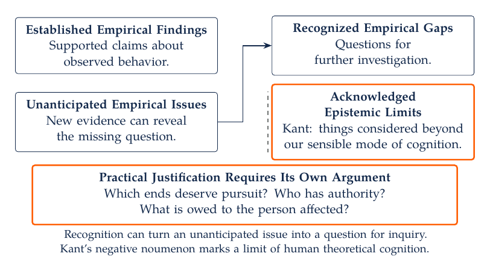

The four upper boxes distinguish established findings, recognized empirical gaps, unanticipated issues, and acknowledged epistemic limits. An arrow shows how recognizing an unexpected issue can make it a question for further investigation. The separate limit box gives the negative concept of noumenon its role. The lower box asks about ends, authority, and obligations through a distinct practical argument. No arrow converts a missing measurement into knowledge of noumena or a moral duty.

### 9.41.3 When Analytical Success Conceals an Unjustified Objective

\noindent Marketing analytics often begins with a measurable response and a firm-selected objective. The critical question is what happens when that practical starting point becomes the entire account of the decision. Predicting acceptance can then stand in for examining consent; estimating willingness to pay can stand in for considering burdens; maximizing revenue can stand in for defending the objective. The philosophical error occurs in those substitutions. Their validity requires premises beyond the success of the calculation.

The pricing studies examined in §§9.14–9.18 and §§9.34–9.39 provide specific arguments and findings to assess. Retain their welfare results and safeguards while asking whether the proposed decision rule gives adequate weight to customers' standing and alternatives. A reported customer-surplus loss is morally relevant evidence even when the pricing algorithm works as intended. Describing the same person more flexibly through unobserved heterogeneity does not itself answer that person's objection to how the firm treats them.

The electricity case presents a related problem in public interpretation. A measured average can inform one empirical question. It supplies no reason to treat residents' claims to explanation or participation as exhausted by that statistic. Nearby residents need not first demonstrate a precisely estimated injury to ask for reasons concerning a proposed involuntary exposure. Whether a particular safeguard is warranted depends on the relevant circumstances and a defended principle of justification.

These criticisms concern the arguments, objectives, and uses of particular studies. Institutional affiliation supplies no substitute for examining those objects. The transferable lesson applies whenever a commercially useful representation acquires authority over questions its evidence and premises leave unresolved.

### 9.41.4 Deliberate About Ends Before Optimizing Means

\noindent A responsible analysis begins by identifying the proposed end and the people whose choices or obligations the decision would change. Ask who chose that end, what authority permits pursuing it, and which reasons could justify it to affected people. Then determine the empirical evidence needed to assess feasible actions and consequences. Better information can alter the practical judgment, while the choice of a worthy end requires reasons that computation alone does not supply.

Kantian respect and Scanlonian justification approach this problem through distinct arguments. The former examines maxims, autonomy, and treating persons as ends (Kant, 1785). The latter asks whether principles can be justified to people with reasons for rejecting them (Scanlon, 1998). Neither account makes an observed purchase or a high prediction score a sufficient justification for treatment. Normative reasons are not thereby identified with noumena; the connection concerns the limits of reducing practical justification to recorded behavior [(Scanlon, 1998, chapter 5)](https://e-edu.nbu.bg/pluginfile.php/314831/mod_resource/content/0/scanlon_5.1-3.pdf).

For a pricing proposal, the analyst might recommend a less burdensome rule, further evidence, a restriction on data use, or abandonment of an objectionable objective. The recommendation should identify the factual premises and philosophical reasons supporting it. An effective algorithm can advance an end the firm ought to reject. Recognizing that possibility changes the task before a line of optimization code is written.

### 9.41.5 The “Known to Be the Never Known”

\noindent An analyst can recognize a boundary of knowledge without possessing the positive knowledge that lies beyond it. The phrase “known to be the never known” directs attention to that situation. An unknown unknown concerns an issue the analyst has not yet recognized. Discovering it may make it an ordinary question for investigation. An acknowledged epistemic limit instead rests on an argument about why a specified kind of inquiry cannot supply the proposed knowledge.

| Epistemic Situation | Marketing Application | Appropriate Response |
| --- | --- | --- |
| Known knowns | A supported empirical finding within its stated population and conditions. | Retain its evidence, scope, and possibility of correction. |
| Known unknowns | A recognized question about comprehension, an unrecorded charge, or a policy response. | Seek evidence or state the remaining uncertainty. |
| Unknown unknowns | An overlooked mechanism or affected group. | Broaden inquiry and revise the question when the issue emerges. |
| Acknowledged limits of knowledge | Theoretical cognition of things independently of our sensible conditions. | Recognize the limit and restrain claims that exceed it. |

The word “never” requires a specified scope and a justified boundary. The restriction concerns human theoretical cognition under its sensible conditions. It is not a prediction that a currently missing dataset will remain unavailable forever. Nor does it identify a hidden preference, a person's complete inner nature, or a particular injury beyond the evidence. Acknowledging the boundary preserves the distinction between thinking a limit and knowing the positive content beyond it [(Kant, 1781/1787, B306–B311)](../../01_Resources/15_Marketing_Dialectics/01_Kant_Primary_Texts/public_domain_texts/Kant_CritiqueOfPureReason_Meiklejohn1855.html).

Statistical identification supplies a useful comparison with a narrower scope. In §6.38, no amount of data restricted to the specified historical joint law distinguishes the two intervention effects. The restriction can be established by construction. New experimental information can change that conclusion because it changes the available observable law. This is a conditional identification limit, whose mathematical basis differs from the transcendental account of cognition. Stating the scope prevents a temporary evidence gap from being called an absolute impossibility.

Questions about what a firm ought to do occupy another role. Their failure to be settled by a statistical calculation does not make them unknowable in principle. Reasons, principles, objections, and reflection can support practical judgments. The empirical boundary gives the analyst no automatic answer about which pricing rule is permissible. A defended account of respect and justification remains necessary.

An exclusive focus on reducing uncertainty can obscure these differences. Some questions need another observation; some need a changed research design; some require recognition of a limit; and some require a better argument about ends. When a proposal depends on knowledge its method cannot supply, the analyst should revise the claim, change the decision rule, or defend proceeding under that acknowledged limit. Adding a speculative latent variable supplies no substitute for that justification.

## 9.42 A Spectrum of Ontological Adequacy

\noindent A manager deciding whether to deploy personalized prices needs an account of the people and relations the policy changes. A purchase record describes a transaction. A demand model describes responses under specified conditions. The decision also concerns who sets those conditions, who can refuse, and whose reasons count. Ontological adequacy concerns whether the account preserves the objects and relations needed for its stated claim. A precise answer to a narrow question becomes inadequate when it acquires authority over a broader decision without examining those additional objects.

### 9.42.1 From Recorded Outcomes to Persons and Institutions

\noindent The following spectrum orders the questions an interpretation admits. Each position describes a claim or decision argument. A paper can contain arguments at several positions, and a small model can support an adequate answer to a small question. The positions have no numerical distances and supply no overall score of a researcher, institution, or philosophical tradition.

| Position | Account Admitted by the Interpretation | Question That Exposes Its Scope |
| --- | --- | --- |
| A. Measurement as reality | A recorded outcome is treated as exhausting the relevant object. | Has purchase become consent, or average price become household welfare? |
| B. Behavioral representation | Response variation, latent preferences, and prediction enter the account. | Does fitting behavior explain its formation, authority, or value? |
| C. Institutions and procedures | Contracts, dependence, timing, decision rights, and feasible alternatives enter. | Who controls the process, and which burdens occur outside the recorded outcome? |
| D. Agency and reasons | People can endorse, refuse, delegate, contest, and offer reasons for different ends. | Can the proposed principle be justified to those affected? |
| E. Acknowledged limits and justified scope | The argument distinguishes empirical knowledge, its limits, and practical justification. | Which conclusion is warranted, which remains open, and what ought to be done under that condition? |

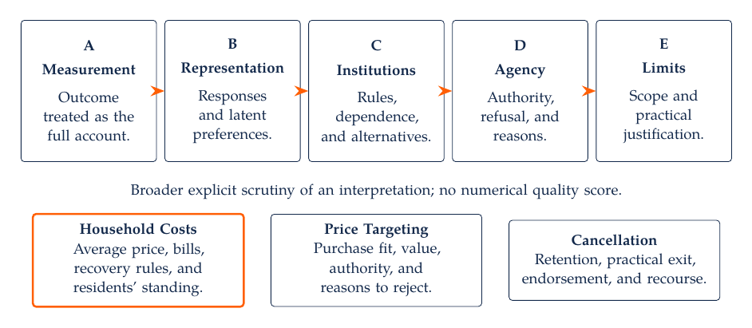

The upper row names the five positions. The lower row connects household-cost reassurance, purchase targeting, and cancellation to the questions their interpretation must answer. The direction represents broader explicit scrutiny. It does not assert that adding entities, variables, or philosophical vocabulary improves an argument. A concept earns inclusion by changing the question, the supported inference, or the justification of the decision.

“Ontological laziness” identifies a specific failure here: convenience of measurement substitutes for an argument about what matters. Its strongest form dismisses a person's claim because the analyst has no column for it. The criticism should name the substitution and show why the omitted object changes the decision. A study confined openly to forecasting purchases can be excellent for that purpose. An assertion that the forecast exhausts welfare or legitimates targeting carries additional obligations that predictive success cannot discharge.

### 9.42.2 Place the Case's Inference on the Spectrum

\noindent Electricity costs and public reassurance. The study's measured utility outcomes supply empirical evidence within their design and uncertainty. The inference from an insignificant average-price result to the absence of household harm falls at A: it changes both the evidentiary claim and the object of concern. Household bills, fixed charges, cost allocation, income, recovery timing, and participation rights extend the account through C and D. The arguments in §§9.26–9.33 establish particular reporting and interpretation problems; hypothetical project cancellation remains a mechanism to investigate. A revised conclusion at E reports what the design resolves, what risks remain, and why proposed guarantees or further inquiry are proportionate. The strongest criticism targets the unsupported reassurance while preserving the paper's positive estimates and acknowledged restrictions.

**Personalized pricing and AI experimentation.** Flexible demand estimation generally belongs at B when its claim concerns behavior. The reported consumer-surplus comparison (Dubé and Misra, 2021) already goes beyond a revenue-only assessment; the AI experimentation studies also contain safeguards that should retain their stated scope. The problematic extension is that an accurate estimate of willingness to pay authorizes extracting it, or that a flexible latent preference explains away every objection to the procedure. Neither conclusion follows from model fit. Moving through C and D requires examining how evaluations form, permission to use information, practical refusal, essential need, and whose ends the system serves. At E, the recommendation defends its normative premise and retains the restrictions supporting its welfare calculation. The findings and safeguards in §§9.14–9.18 and §§9.34–9.39 remain part of that assessment.

**Cancellation and the marketing of dynamic pricing.** A retained subscription or accepted price can be accurately recorded while leaving the conditions of acceptance unresolved. Treating the transaction as sufficient evidence of endorsement places the interpretation at A or B. Information, cancellation effort, urgency, and available alternatives belong at C. Authority to reconsider and reasons for objecting belong at D. Favorable language about flexibility or convenience must preserve those distinctions. A defensible statement at E explains the actual rule, relevant alternatives, and customer consequences without converting commercial acceptance into moral permission. These are proposed inferences for assessment; source attribution requires the particular quotation and context.

The same standard constrains criticism of these cases. An unmeasured burden remains a question until supported. A model's inability to establish metaphysical freedom establishes no metaphysical unfreedom. Labeling every omitted object noumenal would exempt ordinary empirical claims from investigation. The critical conclusion becomes stronger when it identifies exactly which omission invalidates the broader interpretation and which further claim still requires evidence.

### 9.42.3 Agency Beyond a Behavioral Representation

\noindent Suppose an automated purchasing service reliably chooses the same product a person would have selected. Agreement can establish useful predictive performance under the comparison used. The service's authority to commit the person, the person's understanding of its mandate, and the ability to withdraw delegation remain separate questions. A person may value delegation and have good reasons to avoid repeated choices. Preserving agency therefore requires attention to the terms of delegation and the person's reasons, rather than an assumption that more manual decisions always improve their position.

A representation of response frequencies by deterministic plans also leaves the actual production of deliberation unspecified. Randomness alone establishes no authorship, and predictability alone establishes no absence of control. Experiments can examine defined aspects of comprehension, reconsideration, and response to reasons. They require operational conditions and provide correspondingly bounded conclusions. Their success cannot convert a mathematical representation into theoretical cognition of a noumenal self.

The limiting concept of noumenon gives this boundary philosophical importance. Persons need not become completely identifiable empirical objects before questions about respect and authority can arise. The negative concept of noumenon supplies no description of a hidden decision mechanism. Practical arguments explain why an actor ought to respect another person's standing despite the incompleteness of behavioral representation. A useful analysis retains both the empirical inquiry and the independent demand for reasons.

### 9.42.4 Easy Measurement and the Object Claimed

\noindent The electricity case separates an accurately recorded variable from a valid measure of the claim being made. The paper explicitly uses realized revenue per MWh and explains that choice on pp. 14–16. The question is whether an interpretation preserves that object. Household expenditure, affordability, and project-related financial exposure require additional quantities and relations. Assessment of measurement validity distinguishes the concept, its operational indicators, and the resulting observations. Reliable collection alone leaves the adequacy of that connection to be justified [(Adcock and Collier, 2001, pp. 529–531)](https://doi.org/10.1017/S0003055401003100).

| Recorded Object | Broader Claim to Examine | Evidence Needed for the Connection |
| --- | --- | --- |
| Realized revenue per MWh | Household bills or affordability are unchanged. | Matched charges, quantities, billing periods, household resources, and the relevant counterfactual. |
| Capacity entering operation | A utility has no project-related exposure before entry or without entry. | Service requests, investment commitments, cancellations, recovery decisions, and their dates. |
| Four named developers | An ownership category identifies a leasing or operating business model. | Facility-level classifications and evidence about the proposed business-model mechanism. |
| A utility or customer-class average | Each affected household is protected from a material burden. | Distributional incidence, justified burden criteria, and protection for differently situated households. |

The first row requires an accounting bridge even before a causal argument. At a matched customer class and period, average revenue per unit multiplied by average units sold per customer gives revenue per customer. The average-price ratio alone leaves that quantity unresolved. Household affordability additionally involves resources and essential needs. Sections 2.28.1 and 6.35 reproduce the bill arithmetic with complete Python, including a case with unchanged average price and higher expenditure. A higher observed bill in turn requires a credible counterfactual before being attributed to the data center.

The second and third rows concern classification. An operating-capacity record can be accurate while classifying a financially exposed utility as having no operating addition. A developer label can also be accurate while failing to identify a contractual form. The institution determines whether the available indicator answers the research question. These are concrete reasons to inspect project histories and contracts, rather than treating finer statistical estimation of the existing indicator as a complete remedy.

The fourth row adds the scope of the population claim. Perfect precision for an average still leaves variation across households unresolved. Calling an outcome harmless then introduces a further judgment about relevant burdens. The defects should be named separately: the indicator may fail to represent the intended construct, the comparison may fail to identify its causal change, or the reported result may fail to justify the practical conclusion. A study can satisfy one requirement and fail another.

The strongest supported criticism is therefore precise: the broader reassurance is unwarranted wherever its conclusion depends on these unvalidated connections. The paper's stated outcome and design should remain visible beside that criticism, as should its positive findings and institutional discussion. Ease of data access supplies a possible reason for selecting an indicator; it establishes neither the authors' motive nor the indicator's adequacy for every later use. [Paper and measurement assessment](../../01_Resources/41_Statistical_Claims_and_Decisions/INSTITUTIONAL_ASSESSMENT.md).

## 9.43 Philosophical Critiques of Empiricism and Reduction

\noindent A firm may ask a narrow empirical question, such as whether a proposed price increases revenue. The decision to impose that price raises additional questions about explanation, permission, and worthwhile ends. Philosophical critiques of empiricism help examine the authority claimed for the evidence. Empiricism includes diverse positions; reliance on observation alone does not commit a researcher to every doctrine criticized below. The relevant target is the particular inference that grants measurement an authority it has not earned.

### 9.43.1 Conditions and Limits of Cognition

\noindent Transcendental critique defends empirical knowledge while examining the conditions under which it is possible. It also challenges speculative claims exceeding those conditions. Sections 9.41–9.42 apply this discipline to behavioral representations that become complete accounts of persons. A rich response model can improve an empirical answer while leaving theoretical cognition of things independently of sensible conditions unavailable. The practical account of persons as ends requires its own argument. Neither a regression nor the announcement of its limits settles that argument [(Kant, 1781/1787, B306–B311; 1785, sections II–III)](../../01_Resources/15_Marketing_Dialectics/01_Kant_Primary_Texts/README.md).

### 9.43.2 Observation and Justification

\noindent Observational knowledge requires justification beyond a claim to independent, self-authenticating authority. Describing a claim as knowledge places it within practices of giving and assessing reasons. This argument preserves empirical inquiry and its capacity for correction. For marketing analysis, recording an event as consent already requires concepts and grounds connecting the record to that classification. Sensor accuracy or a perfectly reproduced transaction count cannot independently validate the interpretation. State those grounds and make them open to challenge. This application concerns the justification of classifications; its epistemological premises differ from those of contractualist moral theory [(Sellars, 1956, §§32–38)](https://www.ditext.com/sellars/epm8.html).

### 9.43.3 Being and Knowledge of Being

\noindent The critique of the epistemic fallacy rejects reducing questions about what exists to questions about our knowledge of it. Critical realism distinguishes causal structures from observed event patterns and allows fallible inquiry into mechanisms beyond immediate observation. A flat price series can coexist with contractual obligations or cost-recovery mechanisms requiring separate investigation. Establishing such a mechanism requires evidence about the institution and its operation. Critical realism therefore supports inquiry beyond measured regularities; it does not certify whichever hidden mechanism a critic proposes. Its account of knowable causal structures differs from the negative concept of noumenon [(Bhaskar, 2007, pp. 192–194)](https://internationalcentreforcriticalrealism.wordpress.com/wp-content/uploads/2013/04/07-1-bhaskar-theorising-ontology-2007.pdf).

### 9.43.4 Intentionality and the Meaning of Experience

\noindent The critique of psychic atomism challenges an account of mental life that treats it as an accumulation of psychic data while neglecting intentionality, the directedness of consciousness toward something. The marketing application asks what a person's acceptance, refusal, or evaluation is about. The same recorded click can concern a desired purchase, an attempt to dismiss a screen, or a misunderstood authorization. Investigating meaning requires attention to the person's situation and understanding. Such inquiry concerns experience and should not be relabeled knowledge of Kantian noumena [(Husserl, 1970, §22)](https://www.marxists.org/reference/subject/philosophy/works/ge/husserl.htm).

### 9.43.5 Normative Reasons and Ontological Restraint

\noindent Accepting normative reasons can coexist with a scientific understanding of the natural world. This position assesses claims through reasoning appropriate to their domains, reconciling them where their implications conflict. The resulting position permits serious moral argument without requiring a numerical observation for every reason. A customer's objection to unauthorized purchasing can therefore warrant assessment even when the system predicts their product choice correctly. Empirical claims within that objection remain answerable to evidence. Reasons receive no immunity from criticism simply because they are normative [(Scanlon, 2009, pp. 1–7)](https://media.philosophy.ox.ac.uk/assets/pdf_file/0008/25856/Lecture_2.pdf).

### 9.43.6 Publication Incentives and the Choice of Questions

\noindent If researchers anticipate greater rewards for readily estimated effects or technically elaborate models, they may choose questions that fit those methods. Important problems concerning authority, dependence, or worthwhile ends may then receive less attention. This is a plausible selection mechanism. Its prevalence in marketing journals, its causal determinants, and its consequences require evidence about proposed, completed, submitted, and published research. A count of published computational papers alone would leave the missing comparison unresolved.

Evidence for one form of publication selection comes from a study of 221 TESS survey experiments (Franco et al., 2014). The authors report that strong results were more likely than null results to be written up and published. That finding concerns selection by result strength in the studied population. It does not establish a journal preference for computational sophistication or the exclusion of ontological inquiry [(Franco et al., 2014)](https://doi.org/10.1126/science.1255484).

The decision consequence is to justify the research question before rewarding its computational execution. A study should identify which person's problem it addresses, why the selected outcome represents that problem, and which consequences remain outside its scope. An intellectually demanding calculation can still pursue a poorly defended end. A careful account of agency or institutional authority can be valuable even when its conclusion resists a single numerical estimate.

## 9.44 Personalization and the Learner's Authority

\noindent An educational platform can predict which explanation a student prefers while leaving open whether the explanation helps the student reason independently. The institution choosing the platform must defend the learning objective and the authority given to recommendations. Convenience, engagement, and measured performance are relevant reasons. The student's ability to inspect, question, and reject an explanation also matters to the proposed principle.

A Kantian assessment asks whether the system supports the learner as a person capable of deliberating about reasons. A Scanlonian assessment asks whether a principle governing its use can be justified to affected learners. A student could reasonably object to a system that hides consequential assumptions, prevents access to the original argument, or treats disagreement as a defect to be corrected. The strength of that objection depends on the circumstances, feasible alternatives, and burdens of the rule. These are course applications of the philosophical arguments in §§9.30–9.32 and §§9.40–9.43.

Personalization can preserve a common analytical objective while offering different cases, levels of detail, and ways to inspect a result. Students should be able to change their selection and investigate an explanation beyond the system's recommendation. A record of earlier answers gives evidence of particular responses under particular conditions. It supplies no complete account of the student's capacity, aspirations, or future reasons. Calling an unmeasured educational outcome noumenal would obscure opportunities to investigate it; the noumenal limiting concept concerns a distinct boundary of theoretical cognition.

The electricity case provides a concrete test. A student first predicts a bill change, then inspects the accounting identity, and then challenges a causal or normative inference. Feedback can explain the denominator while leaving a reasoned disagreement about a policy open. A strong response identifies what the study measures, preserves its actual findings, and explains which additional premise would support broader reassurance. Agreement with the instructor's conclusion alone supplies an inadequate measure of this achievement.

The same standard applies to the course's own critique. Ask students to formulate the strongest supported reply, identify evidence that would change the criticism, and transfer the argument to an unfamiliar setting. A learning tool earns support when it helps students produce and examine reasons under a defensible educational objective. Its capacity to adapt content makes that objective consequential before optimization begins.

## 9.45 Conflicts of Interest and the Analyst's Judgment

### 9.45.1 Identify the Duty Before Naming the Conflict

\noindent A marketing analyst is asked to recommend a feed design. The employer rewards advertising contribution, while some users want to finish a task and leave. The analyst's recommendation affects both parties, and the employer controls the budget for measuring consequences. The first question is which responsibilities govern the analyst's judgment. Accurate reporting, faithful execution of a consumer's instruction, and impartial evaluation of a customer-benefit claim can each create a responsibility that an engagement target threatens.

Valsan distinguishes opposing interests in a transaction from an interest that interferes with judgment owed to another. On this account, the latter requires a duty-bearing relationship. The Institute of Medicine likewise treats a conflict as a risk to judgment concerning a primary responsibility; the conflict can exist before biased conduct is demonstrated. These accounts explain why sincerity alone provides an inadequate safeguard. [Valsan, 2016, §§III–IV](https://lawjournal.mcgill.ca/article/fiduciary-duties-conflict-of-interest-and-proper-exercise-of-judgment/); [Institute of Medicine, 2009, Summary](https://www.ncbi.nlm.nih.gov/books/NBK22926/).

Three situations need different arguments. A seller seeking a high price and a buyer seeking a low price have divergent interests. An analyst paid for favorable findings while responsible for a sound evaluation faces an interest that can compromise that responsibility. An adviser undertaking to serve a consumer while receiving commissions for steering purchases faces a conflict tied to the undertaking. The source of the duty must be stated in each case. An employment relationship does not automatically make every analyst a legal fiduciary to every customer. Ordinary commercial dealings remain subject to moral scrutiny concerning deception, manipulation, and imposed burdens.

### 9.45.2 Incentives Enter Before the Estimate

\noindent A bonus need not change a regression coefficient to influence a recommendation. It can affect the outcome selected, the alternatives funded, the follow-up period, or the people invited to explain a burden. A team may estimate watch time accurately while leaving unwanted continuation outside the evaluation. The numerical result can be correct even when the decision process systematically excludes reasons against deployment.

The analyst should identify who sets the question, pays for the work, chooses the comparison, approves publication, and can require a redesign. Financial compensation, continued access to data, promotion, reputation, and commitment to an earlier recommendation can create different pressures. Their existence warrants an assessment of the procedure. A claim that a particular researcher concealed evidence still requires evidence of concealment.

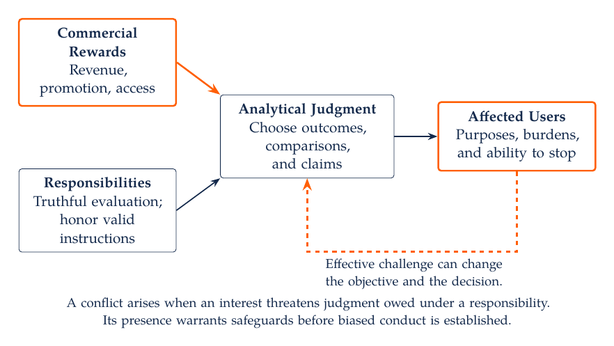

The upper path connects the employer's reward to the analyst's choices about measurement and recommendation. The lower path connects those choices to responsibilities and affected users. A consumer's ability to challenge the objective changes who can demand an answer when the commercial measure omits a burden. Independent review needs access to the relevant records and authority to alter the decision; its value depends on how it operates.

### 9.45.3 Disclosure and Control Address Different Problems

\noindent Explaining that a service earns more when a user stays longer can improve understanding of its incentive. The explanation leaves separate questions about stopping, appeal, and the analyst's rewards. Laboratory studies of advice disclosure identify circumstances in which disclosure encourages adviser exaggeration or moral licensing while recipients insufficiently adjust. The fourth study examines jointly presented unconflicted advice. These findings support evaluating the remedy's operation in its setting; they establish no universal effect of disclosure [(Cain et al., 2011)](https://www.cmu.edu/dietrich/sds/docs/loewenstein/WhenSunLightFails.pdf).

A useful response combines truthful disclosure with changes to decision rights and incentives. An evaluator can have a fixed budget and compensation independent of the deployment result. A review process can require reporting customer outcomes and preserve the ability to publish adverse findings. Users can retain a stopping control that the growth team cannot silently disable. A conflicted decision maker may need to recuse when independent judgment cannot be secured within the role. Each measure should address a specified pressure rather than serve as evidence of ethical quality by its mere existence.

### 9.45.4 Benevolence and Dependence

\noindent A platform may currently honor user preferences while retaining unilateral power to alter the terms of assistance. The republican account of nondomination directs attention to a capacity for interference that is not subject to the affected person's effective control. Its commercial application asks whether protection depends entirely on a provider's continuing goodwill. An enforceable stopping instruction, meaningful appeal, and viable alternatives can address different sources of dependence. A symbolic opt-out with substantial costs can leave the practical relation largely intact [(Lovett and Pettit, 2009, pp. 13–16)](https://bpb-us-e2.wpmucdn.com/sites.wustl.edu/dist/6/3556/files/2017/02/2009.-Neorepublicanism-2bzyex8.pdf).

Whether platforms should acquire fiduciary duties is a further institutional question. Balkin develops an information-fiduciary proposal; Khan and Pozen challenge its capacity to reconcile platform incentives and competing obligations. These are legal and normative arguments, not a statement that all platforms already owe an identical fiduciary duty. For a marketing recommendation, identify the undertaking actually made and defend any additional obligation proposed. [Balkin, 2016, §§III–V](https://lawreview.law.ucdavis.edu/sites/g/files/dgvnsk15026/files/media/documents/49-4_Balkin.pdf); [Khan and Pozen, 2019](https://harvardlawreview.org/wp-content/uploads/2019/12/497-541_Online.pdf).

## 9.46 Infinite Scroll, Reward Learning, and Consumer Purposes

\noindent A feed can remove natural pauses, select appealing content, and repeatedly invite continuation. An advertising-funded provider may gain from additional exposure even after a user has accomplished the purpose that brought them to the service. The ethical concern becomes sharper when the design frustrates a stated stopping intention or exploits a demonstrated difficulty in leaving. Greater use alone leaves the value of that use unresolved.

Reward learning provides one relevant empirical mechanism. An analysis of posting behavior and an online experiment manipulating social rewards with 176 participants support a reward-learning account of posting. The study measures behavior rather than dopamine release, and it does not isolate an infinite-scroll interface. Dopamine-neuron activity is connected to reward prediction in a distinct neuroscientific setting (Schultz et al., 1997). Moving from those results to a claim that a specific feed causes clinical addiction requires additional evidence [(Lindström et al., 2021)](https://doi.org/10.1038/s41467-020-19607-x); [(Schultz et al., 1997)](https://www.gatsby.ucl.ac.uk/~dayan/papers/sdm97.pdf).

Separate experimental evidence concerns responses to self-control interventions: temporary incentives to reduce social-media use have persistent effects, and allowing people to set future limits reduces use. The estimate that self-control problems account for 31% of use is conditional on their economic model and study population. It is neither a clinical prevalence measure nor an estimate of an infinite-scroll feature's effect [(Allcott et al., 2022)](https://www.aeaweb.org/articles?id=10.1257/aer.20210867).

A responsible evaluation would compare feasible feed designs using outcomes chosen before observing results. These could include completion of a user-stated purpose, compliance with a requested stopping point, unwanted continuation reported later, and displacement of other activities. Survey missingness matters when dissatisfied users leave before responding. Report outcomes over the eligible population and assess selective follow-up. Qualitative accounts can clarify what users meant by a stopping request, while an appropriately designed experiment identifies effects of the assigned design.

The analyst must also consider users who value sustained entertainment, social contact, or accessible browsing. Automatically restricting all use could burden them. A design that allows informed continuation while honoring revocable stopping instructions provides a concrete alternative to examine. Its consequences require evaluation, and its justification requires reasons that affected people can challenge. The absence of a neural measure supplies no permission to disregard an expressed refusal.

## 9.47 From Commercial Incentives to an Ought Conclusion

### 9.47.1 State the Principle and Its Alternative

\noindent Consider a hypothetical platform that knows a group of users wishes to stop after a chosen duration. Its analyst can predict which prompts prolong their sessions. The proposed principle permits overriding that boundary whenever expected advertising contribution increases. A feasible alternative preserves useful recommendations and lets users deliberately revise the boundary. The comparison concerns who has authority over continuation as well as what each design produces.

A Kantian assessment examines a maxim that treats a person's difficulty in carrying out a considered intention as a commercial opportunity. Deliberately defeating that intention to obtain additional exposure can subordinate the person's capacity to set ends to the firm's objective. Prediction accuracy strengthens the firm's ability to implement the practice; it supplies no justification for the end or the means. A user who knowingly revises a goal presents a different case from a system that quietly defeats it. The relevant facts concern understanding, authority, and how continuation occurs (§§9.4 and 9.16).

Scanlonian reasoning compares the objections a person could reasonably raise to the governing principles. A time-limited user can object to a rule permitting a provider to override an expressed boundary for revenue. Other users can object to unnecessary restrictions on valued entertainment. Workers and creators can raise reasons concerning livelihoods and a viable service. Assess the burdens each principle imposes from these positions, including the costs of the feasible alternative. A larger total of small commercial benefits does not automatically answer an individual's serious objection. Neither a majority vote nor a weighted engagement score performs this reasoning (§9.30).

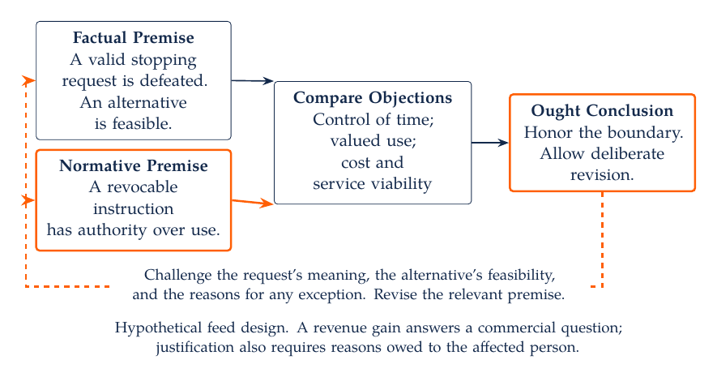

The empirical premise concerns whether a request is defeated and whether an alternative can work. The normative premise concerns the authority of a person's revocable instruction. Challenges can change either premise: an ambiguous signal may fail to establish refusal, and a necessary protective interruption may call for a narrower principle. A defensible conclusion states the circumstances in which the platform ought to honor the boundary and what exception, if any, can be justified to the affected person.

### 9.47.2 The Analyst's Responsibility Within the Organization

\noindent The analyst can document the outcome omitted by a growth target, preserve adverse findings, and compare an alternative that serves the user's purpose. If management requests a claim of consumer benefit from engagement alone, the analyst ought to decline that claim and explain the missing premise. Where the evidence shows that a feature defeats valid stopping instructions for commercial gain, the recommendation should oppose that feature under the defended principle. The proposed responsibility concerns the work the analyst controls and the reasons for it.

Confucian remonstrance adds an institutional question: can an employee challenge a profitable proposal without being punished for disloyalty? A firm that rewards the appearance of agreement while suppressing relevant objections weakens the judgment on which its recommendations depend (§9.11). Protecting dissent, funding independent assessment, and assigning authority to respond to affected users give professional responsibility an organizational basis. Requiring individual courage while retaining incentives to conceal burdens leaves the structural pressure in place.

## 9.48 A Synthetic Evaluation of Feed Policies

\noindent Suppose four designs serve the same hypothetical population of 1,000 adult user-days, including 800 leisure users and 200 users with a stated time limit. The finite feed provides stopping points. The endless feed continues despite the requested boundary. A disclosed endless feed adds information about the firm's incentive while holding behavior fixed. A user-controls design honors the boundary and permits deliberate continuation. The inputs are exact scenario totals rather than sampled observations or estimated effects.

Platform contribution is revenue less variable operating cost in USD per user-day. Goal completion uses a purpose specified before exposure. Regret is a next-day report of unwanted use, with complete follow-up assumed for the constructed population. Excess time sums positive deviations from intended duration; a person who finishes early contributes zero. Excess time may follow an authorized revision, so it alone does not establish an overridden refusal. The two groups retain their original denominators under every policy.

| Synthetic Design | Contribution per User-Day | Goals Completed | Regret Reports | Excess Minutes per User-Day |
| --- | ---: | ---: | ---: | ---: |
| Finite feed | USD 0.200 | 88.0% | 4.0% | 2.4 |
| Endless feed | USD 0.314 | 85.6% | 12.2% | 6.4 |
| Disclosed endless feed | USD 0.314 | 85.6% | 12.2% | 6.4 |
| User controls | USD 0.236 | 91.8% | 3.4% | 1.2 |

The endless feed raises contribution while reducing overall goal completion relative to the finite feed. Leisure users' goal completion rises from 90% to 92%, while time-limited users' completion falls from 80% to 60%. Within the latter group, regret rises from 8% to 45%. The result depends on whose outcomes enter the comparison. These constructed differences do not estimate real-platform harms.

A manager could assign a monetary penalty to reported regret. Define the score per user-day as

$$
S_p(\lambda)=\pi_p-\lambda r_p,
$$

where $p$ indexes the design, $\pi_p$ is contribution in USD per user-day, $r_p$ is the fraction reporting regret, and $\lambda$ is a hypothetical USD penalty per report. At $\lambda=0.50$, the endless designs remain the maximizers. At $\lambda=2$, user controls maximize the score. The analyst's weight changes the recommendation without changing the evidence. A measured regret rate does not establish which weight is justified.

Now impose a separately defended requirement that a design honor a valid stopping instruction. Both endless designs become infeasible. User controls have the highest contribution among the remaining designs at each displayed weight. This restriction represents the normative premise in §9.47. Its justification must be assessed through reasons and feasible alternatives; the calculation supplies its commercial consequence.

Python source: [evaluate_policies.py](../../03_Data_and_Code/Conflicts_of_Interest/evaluate_policies.py).

```python
"""Compare synthetic feed policies, incentive weights, and refusal rights."""
import csv
import json
from collections import defaultdict
from pathlib import Path

HERE = Path(__file__).resolve().parent
INTEGER_FIELDS = (
    "n", "contribution_cents", "goals_completed", "regret_reports",
    "excess_minutes", "respects_stop", "discloses_incentive",
)


def load_rows(path):
    with path.open(newline="", encoding="utf-8") as handle:
        rows = list(csv.DictReader(handle))
    seen = set()
    for row in rows:
        for name in INTEGER_FIELDS:
            row[name] = int(row[name])
        key = (row["policy"], row["group"])
        assert key not in seen, key
        seen.add(key)
        assert row["n"] > 0
        for name in ("goals_completed", "regret_reports"):
            assert 0 <= row[name] <= row["n"]
        assert row["contribution_cents"] >= 0
        assert row["excess_minutes"] >= 0
        for name in ("respects_stop", "discloses_incentive"):
            assert row[name] in (0, 1)
    return rows


def summarize(rows):
    by_policy = defaultdict(list)
    for row in rows:
        by_policy[row["policy"]].append(row)
    composition = None
    result = {}
    for policy, group_rows in by_policy.items():
        current = {r["group"]: r["n"] for r in group_rows}
        if composition is None:
            composition = current
        assert current == composition, "Policy populations differ"
        n = sum(r["n"] for r in group_rows)
        totals = {
            k: sum(r[k] for r in group_rows)
            for k in ("contribution_cents", "goals_completed",
                      "regret_reports", "excess_minutes")
        }
        result[policy] = {
            "n": n, **totals,
            "contribution_usd_per_user_day": totals["contribution_cents"] / (100 * n),
            "goal_completion_rate": totals["goals_completed"] / n,
            "regret_rate": totals["regret_reports"] / n,
            "excess_minutes_per_user_day": totals["excess_minutes"] / n,
            "respects_stop": all(r["respects_stop"] for r in group_rows),
            "discloses_incentive": all(r["discloses_incentive"] for r in group_rows),
            "groups": {
                r["group"]: {
                    "n": r["n"],
                    "goal_completion_rate": r["goals_completed"] / r["n"],
                    "regret_rate": r["regret_reports"] / r["n"],
                } for r in group_rows
            },
        }
    return result


def best(policies, penalty, require_stop=False):
    """Penalty units: hypothetical USD per additional regret report."""
    scores = {
        name: p["contribution_usd_per_user_day"] - penalty * p["regret_rate"]
        for name, p in policies.items()
        if not require_stop or p["respects_stop"]
    }
    assert scores, "No policy meets the stated condition"
    maximum = max(scores.values())
    return sorted(name for name, score in scores.items()
                  if abs(score - maximum) < 1e-12)


def main():
    policies = summarize(load_rows(HERE / "policy_inputs.csv"))
    weights = [0, 0.5, 2]
    decisions = [
        {"regret_penalty_usd": weight, "require_stop": stop,
         "maximizers": best(policies, weight, stop)}
        for stop in (False, True) for weight in weights
    ]
    output = {"status": "synthetic exact scenario; no estimated effects",
              "policies": policies, "decisions": decisions}
    destination = HERE / "results"
    destination.mkdir(exist_ok=True)
    (destination / "policy_comparison.json").write_text(
        json.dumps(output, indent=2) + "\n", encoding="utf-8")
    for policy, values in policies.items():
        print(policy, f"USD {values['contribution_usd_per_user_day']:.3f}",
              f"goals {values['goal_completion_rate']:.1%}",
              f"regret {values['regret_rate']:.1%}")
    for decision in decisions:
        print(decision)


if __name__ == "__main__":
    main()
```

Run `python3 03_Data_and_Code/Conflicts_of_Interest/evaluate_policies.py` from the repository root. The program reads the companion CSV through a path relative to its own location and writes `results/policy_comparison.json`. It checks counts, distinct policy-group rows, and common population composition. The separate verification script reproduces totals and decision comparisons from hand-calculated expectations.

The unchanged disclosure scenario isolates a logical point: information about a financial incentive can coexist with an unchanged opportunity to override a user's instruction. Its behavioral equality is stipulated, so it supplies no evidence that real disclosure is ineffective. The model also contains no complete welfare measure. User purposes, retrospective reports, and institutional authority remain distinct objects even when they support the same recommendation in this example.

## 9.49 Conflicts of Interest Across Marketing Dialectics

\noindent The same discipline applies to pricing, cancellation, mHealth targeting, and public claims about electricity development. Begin with the affected person's decision and the analyst's responsibility. Then examine how compensation, access, reputation, or organizational commitments could influence the question and the interpretation. A duty to communicate evidence accurately can be compromised even when the analyst has no authority over the underlying product.

| Case | Incentive to Examine | Judgment or Authority at Stake | Substantive Response |
| --- | --- | --- | --- |
| Engagement design | Contribution from additional exposure | A user's revocable stopping instruction and the assessment of benefit | Measure completion and unwanted continuation; preserve control |
| Personalized pricing | Margin from targeting willingness to pay | The move from demand fit to customer welfare and permissible treatment | Examine incidence, access, alternatives, and reasons for the pricing rule |
| Cancellation | Revenue retained after a request to leave | The customer's withdrawal and accurate reporting of its completion | Record charges, requests, completion, and refusal costs |
| mHealth targeting | Revenue from continued use or additional purchases | The person's purposes and authority over sensitive information | Separate logging from benefit; require appropriate authorization |
| Electricity reassurance | Attention, reputation, or commercial support, where documented | Accurate claims about household burdens and opportunities to contest them | Preserve uncertainty, examine bills and cost recovery, and include affected residents |

For the electricity case, scrutiny of the price-to-bill inference stands independently of any unverified claim about an author's motives or funding. A disclosed financial relationship would justify additional examination of procedures; it would not, by itself, refute an estimate. Conversely, an absence of a disclosed financial tie would not repair a missing premise. The logical and institutional assessment must survive either incentive story.

Marketing Dialectics asks how an observed result acquires authority to settle a broader question. Treating engagement as benefit, demand as welfare, or a price average as household affordability can conceal the very interests that should be examined. The analyst must identify the bridge premise and explain why the affected person has reason to accept it. If the person cannot effectively challenge the question, favorable measured outcomes can coexist with a substantial loss of authority.

A consumer's practical standing exceeds the variables used to predict their behavior. Unknown intentions and unmeasured burdens invite further empirical inquiry. The noumenal limit concerns a different question about the reach of theoretical cognition (§9.41). Neither category permits an analyst to infer authority over the person from a successful forecast. A defensible recommendation states what the firm ought to do, whose objection it answers, and which evidence or reason would require revision.

## 9.50 Thoughtful Research Design and Reasons Owed to Households

\noindent A household asked to accept a data-center expansion has reasons to question who bears costs if the project fails. Those reasons remain relevant when the most accessible dataset records only facilities that reached operation. The choice of observable units does not determine the population to whom a decision requires justification. A narrow empirical result can inform that justification while leaving substantial premises unresolved.

Consider the proposed principle that public authorities may reassure all affected households whenever an estimated operating-capacity effect is statistically insignificant. A resident can reasonably object that the comparison may omit preparatory costs, failed proposals, or later charges. The objection concerns a foreseeable burden and the evidential basis for imposing it. It does not require showing that every project produces harm. A defensible response would establish the relevant exposure history, financial protections, outcome measure, and uncertainty for the population addressed by the reassurance.


The empirical and normative premises should remain explicit. First, a completed facility and a canceled proposal can create different burdens. Second, a comparison that excludes those burdens has not assessed them. Third, a household has a reason to reject an assurance that treats an unexamined burden as absent. The third premise is a proposed Scanlonian application concerning justification to each affected person. Statistical evidence informs the burden comparison; statistical precision alone does not establish that the assurance is reasonable. See §§9.28–9.32 for contractualism and stakeholder standing.

Kantian criticism likewise asks whether the analysis respects affected people as persons entitled to reasons. Selecting the easily observed outcome can become a practical exclusion when that selection determines whose burden counts. A measurement choice does not establish that unmeasured burdens are unreal. Nor should empirical unknowns be conflated with Kantian noumena: missing project histories and household charges are ordinarily investigable facts. The distinction in §§9.41–9.43 concerns the limits of empirical representation and the grounds of practical judgment.

### 9.50.1 A Strong Critique Must Survive Its Own Counterexamples

\noindent The 2023 cancellation and 2025 institutional records make project uncertainty a material concern within the electricity paper's period. They support a demand for a defensible project-level exposure assessment. They do not establish that its actual donors bore unrecovered costs. Enforceable developer payments, useful replacement demand, or disallowed recovery could defeat the proposed pass-through mechanism in particular cases. The critic must identify those possibilities and the records that decide them.

The resulting criticism is forceful: a broad reassurance about household costs lacks support when its pivotal exposure and population premises remain unestablished. A convenient, precisely estimated comparison can be fundamentally inadequate for that claim. The appropriate response is to reconstruct the design, narrow the conclusion to the supported estimand, or acknowledge that the broader question remains unanswered. Analytical skill includes recognizing when the available dataset does not justify the intended public message.

## 9.51 Data as Artifacts and People as Subjects of Claims

\noindent A household asked to accept a new development may be told that the available data show little reason for concern. Before accepting that reassurance, ask why those data exist, what their categories mean, and whose question they were built to answer. An institution can collect information meticulously for billing, financing, or regulatory compliance while leaving the incidence of burdens poorly understood. Data abundance and adequacy for public justification are separate achievements.

Fictional characters can be understood as created, dependent artifacts [(Thomasson, 1999)](https://www.cambridge.org/core/books/abs/fiction-and-metaphysics/fictional-characters-as-abstract-artifacts/CE4968D080D4B81C9DE76FF589C70017). This suggests a disciplined analogy for datasets: examine their creation, identity, preservation, and dependence on human practices. A dataset version, a physical copy, and the households represented in it are distinct objects. Destroying one copy need not destroy the dataset; changing a category or linkage rule may change what a version represents. The analogy concerns these dependencies. An invoice's description of an actual charge remains answerable to the transaction and billing rules.

The status of a record also differs from the status of what it records. A meter file is created through measurement. An amount legally owed depends partly on applicable tariffs, contracts, and valid administrative acts. Whether the debt is justified to the person who must pay it remains a further question. [Social ontology](https://plato.stanford.edu/entries/social-ontology/) distinguishes what establishes an institutional category from what qualifies an instance for membership. Social dependence gives no reason to dismiss an enforceable obligation or material deprivation as unreal.

Data provenance should include the purposes and authority behind the records: who required a field, chose its unit and permitted categories, and could correct a record, connect it to another system, or contest its use. Public artifacts can have normative and receptive features alongside their functions [(Thomasson, 2014)](https://www.amiethomasson.org/_files/ugd/63fc8a_840cc91860474dfa99802928543989fb.doc). For a billing record, this means examining expectations about payment, correction, and authorized access alongside measurement accuracy. An accurate charge can still be used in a way that the account holder has reason to challenge.

### 9.51.1 Incentives Explain Production Without Settling Truth

\noindent Revenue collection, compliance, reputation, privacy, technical capacity, and inherited administrative routines can influence what gets recorded. A firm's incentive to issue accurate invoices may improve measurement of charges. The same firm's incentive to limit disclosure may constrain access to contract terms. Neither observation alone establishes whether a causal estimate is correct. A criticism based solely on the originator's interests commits the same error as an endorsement based solely on institutional prestige: it substitutes a fact about the speaker for the missing evidential argument.

The stronger criticism concerns the question that becomes answerable. If administrative systems record transaction prices but omit unsuccessful attempts to cancel, a firm can measure retained revenue more readily than refused withdrawal. If a utility records operating load but lacks a linked history of speculative projects and preparatory investment, operating-capacity analysis can overlook costs arising earlier. Reusing records across such settings requires work to preserve their evidential meaning [(Leonelli, 2020)](https://link.springer.com/chapter/10.1007/978-3-030-37177-7_1). The analyst should explain the transformation from an institution's record to evidence about another person's burden.

## 9.52 Truth, Warrant, and the Different Force of Norms

\noindent Consider the statement that a household was charged USD 140 for a specified month. Its truth concerns whether the charge occurred under the stated interpretation. Its warrant concerns the evidence available for believing or asserting it. An accurate ledger can justify that statement while leaving a claim about the project's causal contribution unsupported. An institution's acceptance of the ledger provides another fact to assess; acceptance does not settle every truth claim made from it.

Philosophical theories of truth differ. Correspondence approaches emphasize how claims relate to the way things are; coherence approaches examine systematic relations among beliefs; pragmatist approaches connect truth with inquiry; deflationary approaches question whether truth requires a substantial explanatory property. These approaches disagree about the role and nature of truth [(Glanzberg, 2025)](https://plato.stanford.edu/entries/truth/). None of these labels licenses replacing evidence with what is commercially convenient. For the household case, the immediate task is to specify the proposition, its truth conditions, the evidence supporting it, and the scope of the assertion.

Four kinds of norm can enter the same analysis. A semantic or constitutive rule specifies what a term or institutional category counts as. An epistemic norm governs evidence, inference, and revision. A procedural or legal rule governs access, authority, or permissible disclosure. A moral norm concerns what people owe one another. A rule can perform more than one role, but compliance with one kind does not automatically establish compliance with the others.

For example, defining an account as active after a recorded transaction is a classification rule. Checking whether the transaction occurred is an evidential task. Establishing lawful access to the record is a procedural task. Deciding whether the firm ought to use that activity to target a vulnerable customer requires reasons about the person and the action. A precise prediction can satisfy the evidential task while leaving the moral question open.


A relation among propositions and a prescription for a reasoner require a justified connection [(MacFarlane, 2017)](https://johnmacfarlane.net/normative.pdf). In the present application, moving from a descriptive result to what an institution ought to do requires an explicit normative premise. Modal normativism likewise distinguishes discourse's function from its subject matter, without making modal truths true by linguistic convention [(Thomasson, n.d., pp. 19–20)](https://www.amiethomasson.org/_files/ugd/63fc8a_924e5fc0c3224895948994030f976cdb.pdf). Setting a category's rules does not remove the need for evidence when applying it.

### 9.52.1 The Stakes of Asserting a Claim

\noindent The argument from inductive risk [(Douglas, 2000)](https://www.stephanieruphy.com/wp-content/uploads/2020/10/Douglas-2000.pdf) concerns the consequences of accepting or rejecting claims under uncertainty. Applied to electricity reassurance, an erroneous assurance may influence approvals, financial commitments, and a household's ability to contest costs. Those stakes support closer scrutiny and appropriately qualified communication. They supply no permission to fabricate harm or treat an adverse interpretation as established without evidence.

The relevant response is proportional to the decision. A research estimate can be reported with its defined outcome and uncertainty while a broader assurance is withheld. An urgent approval decision may require enforceable protections, monitoring, or additional inquiry even though the current evidence does not establish realized harm. The factual judgment and the recommended precaution need their own premises. A critic should make both inspectable.

## 9.53 Undone Science and the Distribution of Evidence

\noindent Some socially important questions lack evidence because no institution is required or funded to answer them. The concept of undone science identifies such challenges to research agendas [(Frickel et al., 2010)](https://www.researchgate.net/publication/249623643_Undone_Science_Charting_Social_Movement_and_Civil_Society_Challenges_to_Research_Agenda_Setting). A linked study of household costs may require coordination among utilities, regulators, developers, and researchers even when each already holds useful records. The gap can arise through divided responsibilities and unequal priorities without an explicit agreement to conceal information.

Strategic ignorance supplies a more specific hypothesis: an organization may benefit from limiting inquiry or preserving uncertainty. Ignorance can function as an organizational resource [(McGoey, 2012)](https://repository.essex.ac.uk/5131/). To apply that hypothesis to a particular institution, identify choices about retention, access, research funding, or disclosure and the reasons given for them. An absent public dataset alone does not establish the deliberate production of ignorance. Public investigations, enforceable disclosure, customer-authorized access, and independent research provide possible countervailing mechanisms.

The categories themselves also distribute visibility. A classification determines whose experiences fit its categories [(D'Ignazio and Klein, 2020)](https://data-feminism.mitpress.mit.edu/pub/h1w0nbqp/release/3). A complaint coded only as resolved or unresolved can erase the difference between genuine resolution and withdrawal after prolonged effort. A project file limited to operating facilities can similarly omit residents affected by preparation for a failed proposal. The classification should follow the substantive question and preserve relevant cases for evaluation.

### 9.53.1 Evidence About Electricity Already Exists

\noindent The household case requires an exact diagnosis of the gap. EIA already collects supplier billing data and publishes household expenditure microdata (§6.43). What remains difficult is obtaining sufficiently detailed, linkable records for a defensible causal design. Actual charges can be observed; the bill the same household would have faced under an alternative project history is a counterfactual requiring identification. Confusing these two obstacles can lead either to exaggerated pessimism about data collection or to exaggerated confidence once records are acquired.

Political sensitivity supplies competing incentives. It can encourage secrecy over commercially sensitive contracts and also motivate legislative inquiry and reporting proposals. January 2026 company correspondence documents confidentiality for some bespoke contracts; it also recognizes regulatory access and legal exceptions. The October Senate investigation and the introduced S. 5640 show public pressure for additional evidence. The specific 2020–2025 research design requires evidence about its own units and periods. Later disputes cannot establish historical donor contamination by themselves.

Missing linked records are ordinarily empirical unknowns. They differ from Kantian noumena and do not establish that the relevant facts are unknowable in principle. A household's standing to demand reasons likewise survives the absence of a convenient measurement. The failure to produce adequate evidence can itself warrant institutional criticism, with the responsibility assessed against capacity, duties, privacy, cost, and feasible alternatives.

## 9.54 Who Ought to Bear the Burden of Producing Evidence?

\noindent Consider a proposed rule permitting an institution to reassure residents about costs using only the records it chooses to make accessible, while requiring residents to prove harm with unavailable records. A resident can reasonably reject that allocation of the evidential burden: the institution controls essential means of inquiry, while the resident bears a foreseeable financial consequence and has limited ability to challenge the assurance. This is a Scanlonian application concerning the terms of justification. It does not assume that every disputed project causes harm.

The argument has four premises. First, the decision can impose a material burden on identifiable people. Second, particular institutions control information needed to assess that burden. Third, affected people have a reason to demand an answer that addresses their burden and a practical opportunity to contest it. Fourth, feasible information arrangements can improve that opportunity while protecting legitimate interests. Together, these premises support a duty to provide an adequate evidential basis, enable proportionate independent scrutiny, or narrow the claim. The strength and allocation of that duty depend on the institutions' actual authority and capacity.

A privacy objection deserves an answer. Releasing household identities, addresses, and financial histories can expose people to serious harm. Controlled access, de-identified linkage, disclosure review, and publication of aggregate results can make scrutiny possible without indiscriminate public release. EIA's [restricted-data process](https://www.eia.gov/about/cipsea_reporting.php) demonstrates one institutional route, with eligibility and approval conditions. [Customer-authorized energy access](https://www.energy.gov/data/green-button) offers another route, subject to coverage and selection. Neither automatically produces the required causal design.

Effective critical interaction requires venues, uptake, public standards, and tempered equality of intellectual authority [(Longino, 2004)](https://www.ugr.es/~zink/mono/Longino2004.pdf). Applied here, residents need more than permission to object after a prestigious institution has announced a reassuring result. They need intelligible definitions, access to the evidence or an accountable representative, a response to substantive objections, and an opportunity for that response to change the decision. Expertise deserves consideration because of its reasons and methods; institutional prestige cannot supply a missing premise.

For the data-center paper, the decisive criticism concerns the expansion of an empirical result into public authority. An aggregate price comparison does not establish actual household cost incidence without a defended connection between outcome, exposure history, comparison group, and affected population. Publicly unavailable evidence cannot silently complete those connections. Where the broader claim remains unsupported, the authors and institutions communicating it ought to state the narrower result and the unresolved burden question. A valid calculation can inform public discourse while still being inadequate to close it.

## 9.55 Measurement, Disciplinary History, and Ethical Ends

A profession's methods influence which questions its members can answer and which questions receive authority. When measurable outcomes organize training, funding, publication, and managerial practice, concerns that resist those outcomes can receive less attention. The historical question is how these institutions developed and what their choices displaced. Establishing that history requires evidence about programs, incentives, and intellectual disputes; a disciplinary slogan alone supplies little evidence about the motives of particular researchers.

### 9.55.1 Measurement and the Need for Theory

The Cowles Commission began in 1932 with the motto “Science is Measurement.” Its 1952 adoption of “Theory and Measurement” reflected an institution in which economic structure and the interpretation of statistical evidence had become central ([Christ, 1952, pp. 61–62](https://cowles.yale.edu/sites/default/files/2022-08/history-cowles.pdf)). The critique of measurement without theory argued that observed regularities require an economic structure to support interpretation ([Koopmans, 1947](https://fairmodel.econ.yale.edu/ec439/koop1.pdf)). These records support a history of organized quantitative inquiry and disagreement about its foundations. They also complicate an account in which economics simply replaced thought with measurement.

The separation of economics from judgments about ends gave technical expertise a narrower formal remit. Defining economics through the relation between ends and scarce means allowed an economist to examine consistency and consequences while leaving the worth of ends to further judgment ([Robbins, 1935, pp. 24, 148–151](https://milescorak.com/wp-content/uploads/2020/02/robbins-essay-nature-significance-economic-science.pdf)). The same text expressly encouraged reflection on ethics. The critical question is therefore what happens when an institutional practice treats a chosen commercial end as settled and allows technical optimization to dominate the remaining discussion. Historical separation of economics and moral philosophy was contested ([Schliesser, 2016](https://doi.org/10.1093/acprof:oso/9780198701392.003.0008)).

### 9.55.2 Business Education and the Managerial Perspective

Foundation funding and institutional reform helped quantitative social science acquire authority in business education ([Khurana et al., 2011](https://www.hbs.edu/ris/Publication%20Files/11-070.pdf)). Marketing's managerial turn organized much of the field around decisions facing firms, including products, prices, promotion, and distribution. Historical accounts document a decline in the mainstream prominence of societal questions alongside the growth of specialized venues that continued to investigate them ([Wilkie and Moore, 2003, 2012](https://link.springer.com/article/10.1007/s11747-011-0277-y)). This distinction matters: a shift in disciplinary prominence does not establish that all relevant work disappeared or identify editorial rejection as its sole cause.

A managerial perspective can recognize customers mainly through variables that predict response to the firm's actions. Purchases become evidence of preference; retention becomes evidence of relationship value; engagement becomes evidence of usefulness. Each inference needs further premises. Customers can buy under restricted alternatives, remain because exit is costly, or engage in ways they would prefer to resist. The question is which institutional practices preserve these competing interpretations and whose testimony can challenge the firm's representation.

Quantification can acquire authority because it promises impersonal judgment across institutions where trust is limited (Porter, 1995). Historical analysis of United States policy also traces the growing authority of efficiency-oriented economic reasoning relative to other political values ([Berman, 2022, chapter 1](https://epberman.net/wp-content/uploads/2022/02/berman_economist_1p_uncorrected-ch.-1.pdf)). These accounts motivate scrutiny of how a decision criterion becomes normal. They leave room for measurement that exposes exploitation, identifies market power, or gives public claims a basis for challenge.

### 9.55.3 Phenomena and the Scope of the Person

Observed behavior, statistical associations, and latent preference models remain within empirical inquiry. An unobserved taste parameter is a modeling object; an unavailable bill is a missing record. Neither acquires the status of a Kantian noumenon through its absence from the dataset. The philosophical concern is whether empirical representation is being treated as an exhaustive account of the person, including the person's authority, reasons, and moral standing.

A history of emphasis on measurement can explain why phenomena receive institutional attention. Establishing a historical abandonment of noumenal questions would require a more specific account of how those concepts were understood and excluded. The supported contemporary criticism is that a field can become narrow when it lets the tractability of a question determine its importance. A technically accomplished analysis still owes a justification for the end it serves and the burdens its recommendation creates.

## 9.56 Evidentiary Standards as Conceptual Engineering

A customer seeking protection from a pricing practice must first make the complaint intelligible under an institution's categories. If the institution defines harm as a precisely identified average price effect, losses involving access, dependence, privacy, or unequal treatment may receive little standing. The definition selects the concerns that can reach a decision. A further rule requiring nonintervention whenever the estimate is inconclusive allocates the remaining uncertainty to people exposed to the practice.

Conceptual engineering examines the concepts through which people understand situations and organize responses. Conceptual resources can direct attention toward particular features and make certain actions available ([Haslanger, 2022, pp. 1–4](https://sallyhaslanger.weebly.com/uploads/1/8/2/7/18272031/haslanger_san_raffaele_4_hdo.pdf)). Applied to evidentiary standards, the question is how the meanings of harm, evidence, and rigor organize an institution's response. This application supplies a framework for evaluating the standard; its operation in a particular institution requires evidence.


**Figure interpretation.** The upper path follows a complaint from its definition through evidence to a decision. The lower path records burdens excluded from that process. An orange return arrow asks whether the standard can be justified to those who bear those burdens. Accurate calculations along the upper path can coexist with an objection to the rule that selects the path.

### 9.56.1 When Rigor Can Shield Harmful Conduct

Suppose a firm can introduce a practice on forecasts of profit while consumers must establish a precisely identified causal loss before obtaining a low-cost safeguard. The asymmetry can leave the firm's prospective benefits actionable and the customer's prospective losses inert. A harmful firm benefits if unresolved evidence automatically permits continuation. Calling the rule rigorous does not establish that the allocation is reasonable. Its defense requires explaining why the costs of mistaken restriction outweigh the losses imposed by waiting.

The strongest criticism concerns this institutional asymmetry. It does not require claiming that statistical care is objectionable or that every inconclusive estimate reflects manipulation. Establishing intentional concealment requires evidence of intent. Establishing actual unlawful conduct requires its legal elements. A rule can nevertheless impose an unjustified burden through its design and effects even when analysts implement its calculations conscientiously.

Inductive risk concerns the consequences of accepting or rejecting uncertain claims. Where error has substantial social consequences, values enter judgments about acceptable uncertainty, interpretation, and scrutiny ([Douglas, 2000](https://www.stephanieruphy.com/wp-content/uploads/2020/10/Douglas-2000.pdf)). A responsible response makes these judgments explicit and preserves accurate reporting of the evidence. Serious possible harm supplies a reason to investigate or protect; it supplies no missing observation and establishes no causal estimate by itself.

## 9.57 Heterogeneity and the Interpretation of Consumer Harm

A pricing model can represent a constrained customer as someone with a high willingness to pay. The prediction may be accurate while the interpretation suppresses a reason for restraint. If the model's preference distribution becomes the complete description of customer interests, dependence and limited alternatives can enter only through their contribution to profitable targeting. A person then appears as an opportunity for price discrimination before appearing as someone to whom a reason is owed.

Three judgments remain distinct. The statistical judgment asks whether the model estimates response under its assumptions. The economic judgment asks what mechanisms and conduct generate that response. The moral judgment asks whether the firm may use the information in the proposed way. Flexibility in the first judgment does not settle the other two. M4 §4.30 explains why integrating tastes has no inherent direction of bias for inferred markups and why identification can support an enforcement case.

The critique becomes empirically assessable when it names the suppressed mechanism or restriction. Compare alternative outside options, switching costs, priors, instruments, and conduct assumptions against institutional evidence. Report uncertainty that survives these comparisons. Then assess whether the decision rule gives consumers a reasonable opportunity to obtain protection under that uncertainty. Treating every imperfectly identified harm as negligible would convert a limit of evidence into a substantive presumption favoring continued exposure.

## 9.58 A Reasonable Principle for Acting Under Uncertainty

A public authority must decide what to do while people remain exposed to a possible harm. The question has ontological, epistemic, and normative premises. Keeping these premises distinct prevents both an unsupported accusation and a policy that silently assigns all uncertainty to those least able to bear it.

**Ontological premise.** A person's dependence, financial burden, and authority over personal information can exist without an adequate variable in the analyst's dataset. The record's boundaries do not determine the boundaries of the person's interests. This premise distinguishes an interest from its measurement; it does not classify every unmeasured interest as noumenal.

**Epistemic premise.** Credible institutional mechanisms, documents, testimony, and descriptive patterns can support concern while leaving the causal magnitude unresolved. Source quality, timing, selection, and alternative explanations determine how much support they provide. A statistically insignificant estimate leaves multiple explanations open. An account of inquiry must preserve contrary evidence and identify what would change the concern.

**Normative premise.** People have reasons to reject a principle that imposes serious, avoidable exposure merely because others cannot satisfy a demanding identification requirement. They also have reasons to reject reckless restriction, wrongful accusation, unfair procedures, and losses to livelihood or valuable services. Contractualist judgment compares principles through these individual objections and feasible alternatives (Scanlon, 1998, chapter 5).

**Conclusion.** Where credible evidence indicates serious exposure and a feasible response imposes smaller, proportionate, and reversible burdens, an authority can be justified in obtaining records or limiting exposure before exact causal identification. A remedy must satisfy its own factual and legal requirements. The action should specify review, a route for challenge, and evidence or reasons that would justify continuation, revision, or withdrawal.


**Figure interpretation.** Three separate premises enter the action conclusion. The lower return path tests the strongest objection and the costs of feasible alternatives. A serious objection may defeat the proposed action even if the empirical premises are correct. New evidence can also defeat the concern without changing the ethical principle.

### 9.58.1 Error Costs and the Strongest Reply

An influential antitrust argument gives substantial weight to mistaken condemnation because precedent can persist, while entry may correct tolerated monopoly power ([Easterbrook, 1984, pp. 2–4](https://chicagounbound.uchicago.edu/journal_articles/1153/)). A critical reply questions the assumptions about self-correction, barriers, innovation, and the frequency and cost of missed violations ([Baker, 2015](https://digitalcommons.wcl.american.edu/facsch_lawrev/1356/)). The disagreement turns on institutional mechanisms and consequences. Decision theory supplies no universal presumption favoring either intervention or firms.

M6 §6.44 holds the evidence fixed and reverses the losses of the two mistakes. The preferred threshold reverses with them. Legal burdens additionally affect deterrence, useful conduct, and litigation incentives ([Kaplow, 2012](https://yalelawjournal.org/article/burden-of-proof)). An inquiry or reversible protection can be justified under evidence that would be insufficient for a severe sanction. Relevant authority and procedural rights remain part of the decision.

A contractualist assessment also asks whose serious burden is being justified. Aggregating small gains to many people does not automatically defeat an individual's objection to a serious loss. Conversely, invoking the word harm does not settle the comparison. A sound argument identifies the person, the burden, the feasible alternative, and the strongest reasonable objection. The resulting ought conclusion can be firm while remaining open to factual and moral revision.

## 9.59 Electricity, Targeted Pricing, and Institutional Responsibility

For electricity, a household can reasonably ask why an average revenue-per-kWh result should settle a concern about bills, essential consumption, future infrastructure charges, or exposure to a canceled project. The empirical objects differ. Existing public data and confidential billing records provide partial information; institutional access and linkage remain consequential. Phantom projects can create a mechanism of exposure, but establishing its presence in a particular comparison group requires project and utility records. Selected call excerpts support specified recovery mechanisms and often concern a later period. These distinctions identify the inquiry that broad reassurance leaves unresolved.

For targeted pricing, a customer can ask why accurate prediction of acceptance authorizes exploiting restricted alternatives. A firm's reason based on expected profit meets the customer's reasons concerning dependence, privacy, and authority to refuse. The firm may defend the practice through lower prices for some customers, improved access, or a valuable service. Assess those defenses against the actual policy and a feasible alternative. A demand model contributes evidence to this comparison without selecting whose interests have standing.

Across both cases, statistical uncertainty creates a question about responsibility. Institutions can distribute the burden of producing evidence according to access, control, exposure, and the cost of obtaining reliable records. An actor that controls relevant information has a reason to facilitate scrutiny when its activity creates a credible threat. This principle supports proportionate evidence production and review while preserving the factual requirements of a particular allegation. The defensible conclusion states what ought to be done, for whom, on which premises, and under what conditions it should change.
