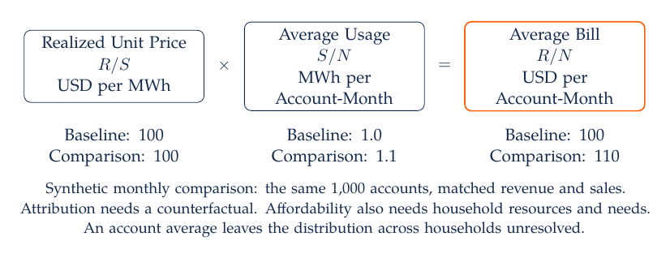
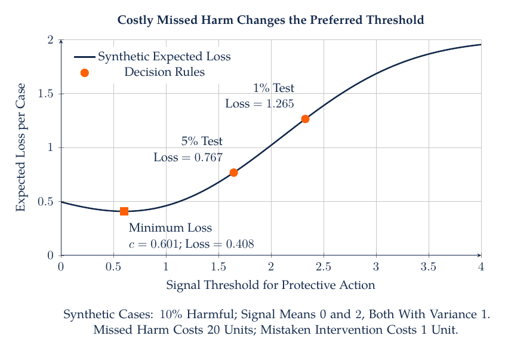
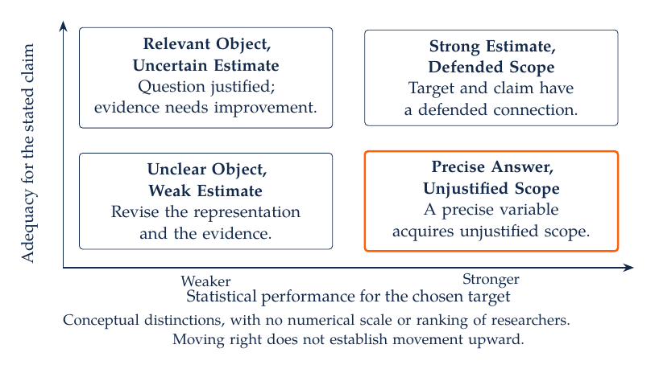

# Price, Bills, and the Claim

By Nathan Yang

## The Decision

A utility reports an unchanged average electricity price. What would justify reassuring households about their bills? An average price describes revenue per unit sold. Average expenditure also depends on usage, while claims about harm require further premises about causation, affordability, and incidence.

This synthetic monthly comparison holds the same 1,000 accounts fixed. Baseline revenue is USD 100,000 and sales are 1,000 MWh. The average bill is USD 100 per account-month. These inputs illustrate an accounting relation and are not estimates from the data-center study.

## Predict and Calculate

Before calculating, predict whether the average bill rises, falls, or stays fixed when average realized price is USD 100/MWh and usage becomes 1.1 MWh per account-month. Explain the relation supporting the prediction.

The result is USD 110 per account-month, an increase of USD 10. Revenue and sales rise proportionately, keeping their ratio fixed. The [browser page](index.html) permits comparison prices from USD 0 to USD 400 per MWh and positive usage from 0.1 to 3 MWh per account-month. Its feedback compares the prediction with arithmetic and asks for separate evidence on attribution and affordability. Responses stay in the page, clear on reload, and are not graded or submitted.

| Synthetic Scenario | USD per MWh | MWh per Account-Month | USD per Account-Month |
| --- | --- | --- | --- |
| Baseline | 100 | 1.0 | 100 |
| More Usage, Same Realized Price | 100 | 1.1 | 110 |
| Higher Realized Price, Less Usage | 125 | 0.8 | 100 |

## Inspect the Reasoning

**Intuition.** At the same realized price, greater usage raises expenditure. Different households can bear different burdens even when the account average is unchanged. Household resources and essential needs enter an affordability judgment.

**Equation.** Let R be monthly revenue in USD, S monthly sales in MWh, and N the matched account-month count for the same customer class. Then `(R/S) × (S/N) = R/N`: realized price times average usage equals average revenue per account-month. Use the same period, class, and accounting coverage throughout. A tariff's marginal rate may differ from realized revenue per MWh.

**Diagram.** Three boxes connect realized price, average usage, and the average bill. The default comparison holds price at 100 while usage rises from 1 to 1.1 and expenditure rises from 100 to 110. Attribution requires a counterfactual; affordability additionally requires household resources and needs. The account average leaves distributional incidence unresolved.



[Editable TikZ](../../06_Lecture_Notes/figures/M02_price_and_bill.tex).

**Python.** [bill_identity.py](../../03_Data_and_Code/Learning_Design/bill_identity.py) is a complete standard-library program that reads the [saved inputs](../../03_Data_and_Code/Statistical_Inference/results/institutional_bills.csv), verifies matched accounting, and writes [checked results](../../03_Data_and_Code/Learning_Design/results/bill_reference.csv). Its complete listing also appears in M2 §2.29 and the browser's Python view.

```sh
python3 03_Data_and_Code/Learning_Design/bill_identity.py
```

## Challenge the Claim

Suppose someone says, “The average price did not rise, so households experienced no harm.” Identify three separate premises.

- **Measurement:** the unit-price measure must connect to the expenditure or affordability claim. The synthetic identity demonstrates why that connection requires further quantities.
- **Causation:** the counterfactual concerns expenditure without the project. Higher observed bills alone leave attribution unresolved. Investment commitments, cost allocation, and timing require institutional evidence.
- **Justification:** the argument must defend which burdens count, whose reasons matter, and which protection is warranted. An average leaves both incidence and the practical principle open.

A defensible revision preserves the reported outcome, design, and uncertainty, then states what further evidence broader reassurance requires. The paper explicitly defines its realized-revenue measure. The criticism concerns extensions beyond the supported inference. Actual harm, contaminated controls, and deliberate deception each require separate evidence.

## Action While Evidence is Incomplete

A household representative may have credible evidence of a cost-recovery mechanism without a precise causal estimate of the bill effect. Seeking relevant records, using a temporary safeguard, and imposing a remedy are different actions. Their burdens and evidentiary requirements differ. Continued exposure also has consequences.

The following comparison uses hypothetical cases, with ten percent harmful and normal signals of means zero and two and variance one. Correct decisions have zero loss. When missed harm costs twenty comparable units and mistaken intervention costs one, the five-percent test gives expected loss 0.767 per case. The minimum-loss threshold gives 0.408. Reversing these costs changes the preferred signal cutoff from 0.601 to 3.596. These synthetic results describe a decision model; they estimate no actual household harm and supply no legal proof threshold.



[Open figure at full size](../../06_Lecture_Notes/figures/M06_error_costs.png) or inspect its [editable TikZ](../../06_Lecture_Notes/figures/M06_error_costs.tex).

Explain which electricity records would justify an inquiry and what would justify a more restrictive action. State whose burdens enter the comparison, which normative premise supports protection, and what would change the conclusion. A p-value cannot be read as a posterior probability of harm. A sum of losses also leaves open whether a person's serious burden is reasonably justifiable.

The [complete Python example](../../03_Data_and_Code/Evidence_Standards/README.md), [M6 §§6.44–6.45](../../06_Lecture_Notes/modules/M06_Causal_Inference_and_Experiments.md), [M9 §§9.56–9.59](../../06_Lecture_Notes/modules/M09_Marketing_Dialectics.md), and [optional practice](../../07_Labs/Evidence_Standards/README.md) supply the derivation, sources, and opposing cost specification.

## Transfer the Argument

Consider an unchanged advertised subscription rate with payment for more months or services. Identify price, quantity, expenditure, and decision rights. State which accounting relations transfer and which contractual facts require new investigation.

A supported response preserves units and timing, separates possibilities from established effects, gives a credible comparison, and defends a normative premise when recommending action. It considers the strongest reply and identifies evidence or reasons for revision. A different policy conclusion can satisfy these criteria; agreement with the instructor alone supplies no substitute for reasons.

## Sources and Further Practice

- [M2: Measurement](../../06_Lecture_Notes/modules/M02_Customer_Data_and_Visualization.md), §2.29.
- [M6: Causal Inference](../../06_Lecture_Notes/modules/M06_Causal_Inference_and_Experiments.md), §§6.35 and 6.39.
- [M9: Marketing Dialectics](../../06_Lecture_Notes/modules/M09_Marketing_Dialectics.md), §§9.42.4 and 9.44.
- [Paper and institutional assessment](../../01_Resources/41_Statistical_Claims_and_Decisions/INSTITUTIONAL_ASSESSMENT.md).
- [Learning-design sources](../../01_Resources/43_AI_Augmented_Learning/README.md) and [optional practice](../../07_Labs/AI_Augmented_Learning/README.md).

This text preserves the substantive comparison, figure description, questions, feedback criteria, and source links. It does not reproduce the page's keyboard behavior or visual layout.

## The Object Behind the Estimate

A precise average unit price can leave household bills, future recovery, and authority to contest a decision unresolved. Ontological laziness occurs when a convenient variable is treated as an adequate account of the broader object without defending that substitution. The conceptual figure separates statistical performance for the chosen target from adequacy for the stated claim; it has no numerical scale.



The strongest reply is that every model abstracts and a carefully scoped estimate can provide useful evidence. The criticism must identify a consequential omission. Reassurance requires a supported bridge from the measured variable to the household burden. Use [M9 §§9.66–9.69](../../06_Lecture_Notes/modules/M09_Marketing_Dialectics.md#966-statistical-virtues-and-ontological-laziness) and the [annotated sources](../../01_Resources/48_Statistical_Virtues_and_Ontology/README.md) to defend the criticism and a revised conclusion.
